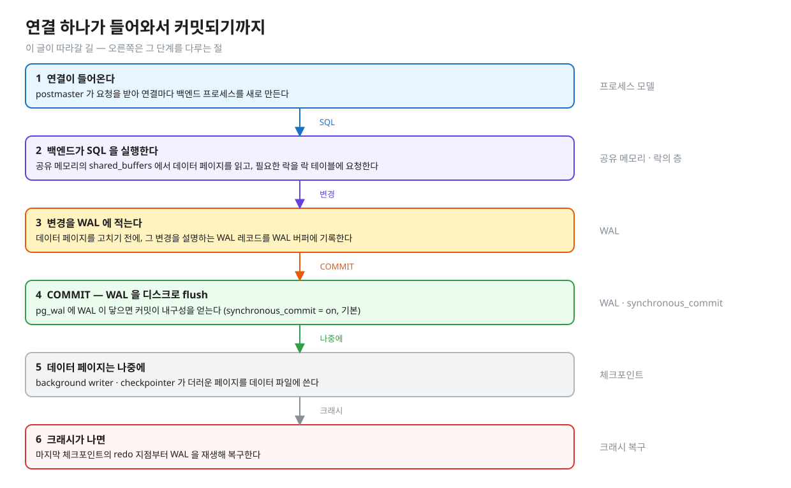
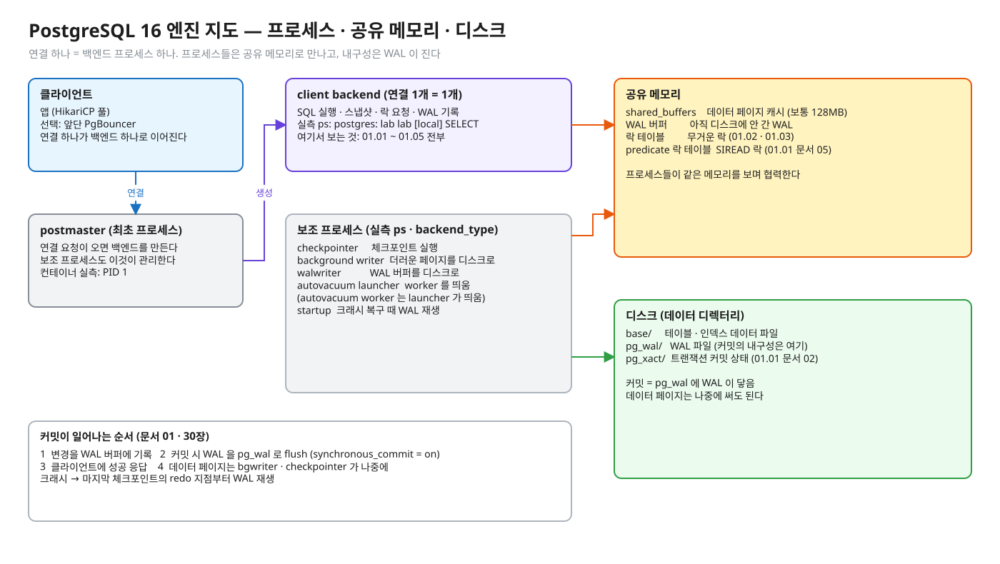
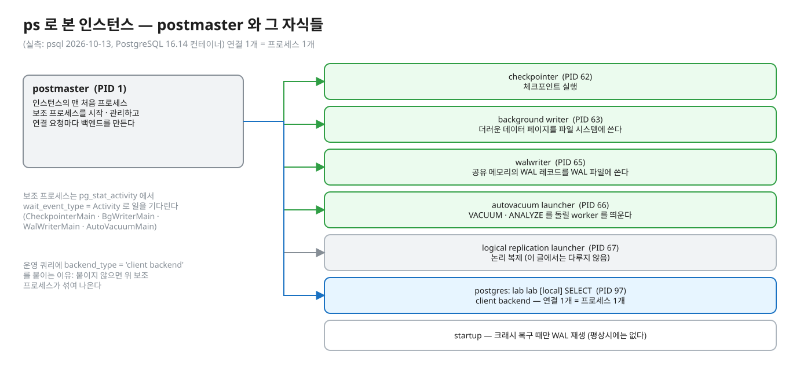
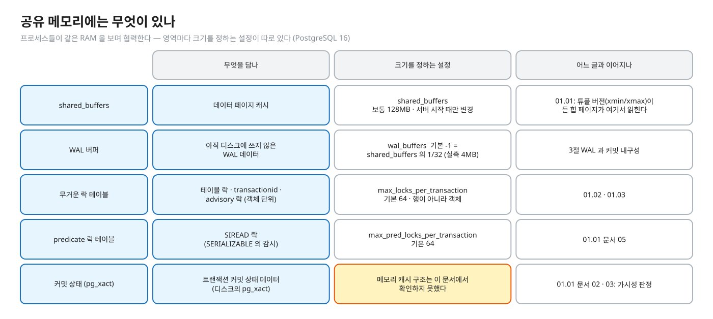
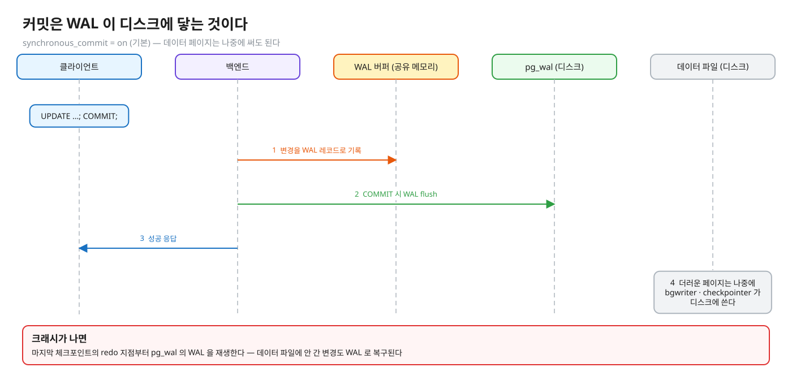
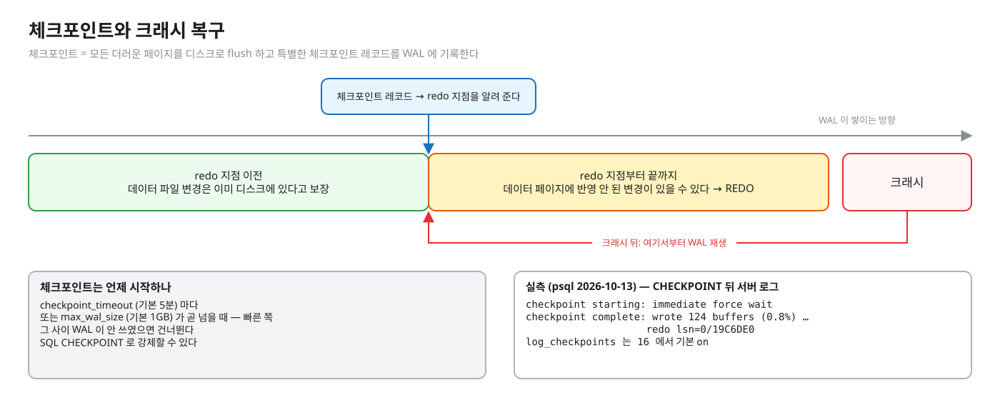
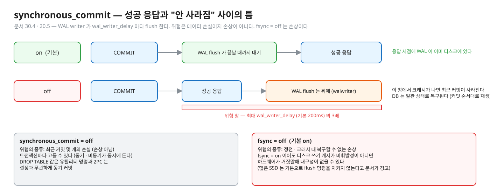
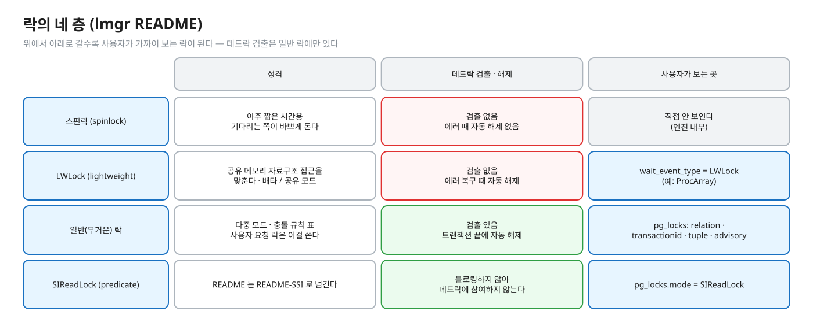
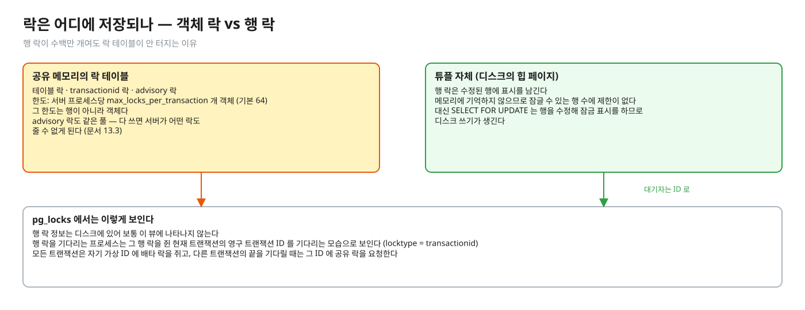
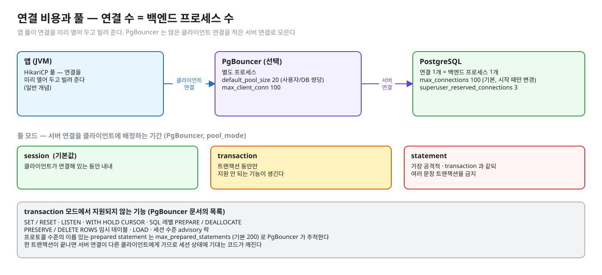

# 01. PostgreSQL 엔진 지도 — 연결 하나가 들어와서 커밋되기까지

> **이 글에서 알게 되는 것**
> 1. PostgreSQL 이 연결 하나에 프로세스 하나를 붙이고, 그 프로세스들이 공유 메모리로 만난다는 것을 안다.
> 2. 커밋의 내구성이 "WAL 이 디스크에 닿는 것"으로 정해지고, 데이터 페이지는 나중에 써도 되는 이유를 안다.
> 3. 락이 어떤 층으로 나뉘고 어디에 저장되는지, 연결이 많아지면 왜 풀이 필요한지 안다.
>
> **다음 글**: [02. 장애 대응 쿼리 모음](02-observability-playbook.md) → [03. 동시성 · 정합성 문제 — 도구 고르기](03-concurrency-decision-guide.md)
> **구분**: 심화 — 꼬리질문 대비 (레슨을 마친 뒤 · 면접 전). 레슨 예측 문항의 답은 이 문서에 없다

## 연결 하나가 들어오면 무슨 일이 생기나

앱을 운영하다 보면 `max_connections` 고갈, 커넥션 풀 설정, `synchronous_commit` 튜닝, 크래시 뒤 복구 시간, `out of shared memory`(락 테이블) 같은 증상을 만난다. 이름은 제각각이지만 모두 같은 지도 위에서 설명된다. 연결 하나가 들어와서 SQL 을 실행하고 커밋되기까지 PostgreSQL 안에서 일어나는 일을 따라가 보면 지도가 그려진다.

PostgreSQL 은 연결 하나에 프로세스 하나를 붙이고, 프로세스들이 공유 메모리로 만나며, 커밋의 내구성은 WAL 이 디스크에 닿는 것으로 정해진다. 01 트랙 레슨 5개는 이 지도 위의 한 구역씩이다. 이 글은 아래 여섯 단계를 차례로 따라간다.


<sub>편집: [diagrams/blog-t01-journey.excalidraw](diagrams/blog-t01-journey.excalidraw)</sub>

전체 지도를 먼저 한 장으로 보고 시작하자. 이 글의 각 절은 이 그림의 한 구역을 확대한 것이다.


<sub>편집: [diagrams/engine-map.excalidraw](diagrams/engine-map.excalidraw)</sub>

## 1. 프로세스 모델 — 연결 하나 = 백엔드 프로세스 하나

[문서 52.2(connect-estab)](https://www.postgresql.org/docs/16/connect-estab.html): PostgreSQL 은 "process per user" 클라이언트/서버 모델이다. 클라이언트는 정확히 하나의 백엔드 프로세스에 연결된다. 몇 개나 연결될지 미리 알 수 없으므로 "supervisor process" 인 **postmaster** 가 지정된 포트에서 기다리다가 연결 요청마다 새 백엔드를 만든다. 백엔드들은 세마포어와 공유 메모리로 동시 접근의 정합성을 지킨다.

[용어집](https://www.postgresql.org/docs/16/glossary.html)은 postmaster 를 "인스턴스의 맨 처음 프로세스, 보조 프로세스를 시작·관리하고 백엔드를 요청에 따라 만든다"고 정의하고, 백엔드는 "클라이언트 세션을 대신해 요청을 처리하는 프로세스"라고 정의한다. 실제로 확인해 보자. (실측: psql 2026-10-13, PostgreSQL 16.14 컨테이너 `docker exec … ps -eo pid,ppid,args`) postmaster 는 PID 1 이고, 나머지가 전부 그 자식이다.

```
  PID  PPID  COMMAND
    1     0  postgres -c deadlock_timeout=200ms -c log_lock_waits=on     <- postmaster
   62     1  postgres: checkpointer
   63     1  postgres: background writer
   65     1  postgres: walwriter
   66     1  postgres: autovacuum launcher
   67     1  postgres: logical replication launcher
   97     1  postgres: lab lab [local] SELECT                              <- 연결 1개 = 프로세스 1개
```


<sub>편집: [diagrams/blog-t01-processes.excalidraw](diagrams/blog-t01-processes.excalidraw)</sub>

프로세스 제목은 `postgres: 사용자 DB 호스트 활동` 형식이고 활동은 `idle` · `idle in transaction` · 명령 종류 등으로 바뀐다 ([문서 28.1(monitoring-ps)](https://www.postgresql.org/docs/16/monitoring-ps.html)). 같은 문서에 따르면 다른 세션의 락을 기다리는 중이면 `waiting` 이 붙는다. 위 `SELECT` 가 `pg_sleep` 을 도는 세션이다.

### 백그라운드 프로세스

연결 말고도 프로세스가 여럿 떠 있다. [용어집](https://www.postgresql.org/docs/16/glossary.html) 정의와 이 컨테이너의 `pg_stat_activity.backend_type` 실측을 맞추면 이렇다.

| backend_type | 하는 일 (용어집) | 이 컨테이너에서 |
|---|---|---|
| `checkpointer` | 체크포인트 실행 | 보임 (PID 62) |
| `background writer` | 공유 메모리의 더러운(dirty) 데이터 페이지를 파일 시스템에 씀 | 보임 |
| `walwriter` | 공유 메모리의 WAL 레코드를 WAL 파일에 씀 | 보임 |
| `autovacuum launcher` | autovacuum 은 "VACUUM · ANALYZE 를 주기적으로 하는 백그라운드 프로세스 집합" | 보임. worker 는 일이 있을 때 `autovacuum worker` 로 나타난다(문서 28.2 의 값 목록에 있음 — 이 실측에서는 못 봤다) |
| `logical replication launcher` | 논리 복제 | 보임 (이 문서에서 다루지 않음) |
| `client backend` | 클라이언트 세션 | 연결마다 |
| `startup` | 크래시 복구 · 물리 복제본에서 WAL 재생 | 평상시에는 없다 |

(실측: psql 2026-10-13) `SELECT pid, backend_type, state, wait_event_type, wait_event FROM pg_stat_activity` 는 위 프로세스를 전부 한 표로 준다. 보조 프로세스는 `wait_event_type = Activity` (예: `CheckpointerMain` · `BgWriterMain` · `WalWriterMain` · `AutoVacuumMain`) 로 일을 기다리고 있었다. 문서 28.2 의 `backend_type` 값에는 이 밖에 `archiver` · `walsender` · `walreceiver` · `parallel worker` 도 있다.

운영 쿼리에서 `WHERE backend_type = 'client backend'` 를 붙이는 이유가 여기 있다. 붙이지 않으면 위 보조 프로세스가 섞여 나온다.

연결이 프로세스라는 것을 알았으니, 이 프로세스들이 무엇을 공유하는지 보자.

## 2. 공유 메모리 — 무엇이 거기 있고 어느 레슨과 이어지나

[용어집](https://www.postgresql.org/docs/16/glossary.html)은 공유 메모리를 이렇게 정의한다. "한 인스턴스의 프로세스들이 공통으로 쓰는 RAM. 데이터베이스 파일의 일부를 비추고(mirror), WAL 레코드의 임시 영역을 주고, 그 밖의 공통 정보를 저장한다". 백엔드가 SQL 을 실행하면서 만나는 것이 대부분 이 안에 있다.


<sub>편집: [diagrams/blog-t01-memory.excalidraw](diagrams/blog-t01-memory.excalidraw)</sub>

| 영역 | 근거 | 이어지는 곳 |
|---|---|---|
| `shared_buffers` — 데이터 페이지 캐시 | 보통 128MB(커널 설정이 못 받쳐 주면 더 작을 수 있다 — initdb 가 정한다) · 서버 시작 때만 변경 ([문서 20.4](https://www.postgresql.org/docs/16/runtime-config-resource.html)). (실측: `SHOW shared_buffers` = `128MB`) | 01.01: 튜플 버전(xmin/xmax)이 들어 있는 힙 페이지가 여기서 읽힌다 |
| WAL 버퍼 | `wal_buffers` = "아직 디스크에 쓰지 않은 WAL 데이터에 쓰는 공유 메모리", 기본 -1 은 `shared_buffers` 의 1/32 (최소 64kB, 최대 WAL 세그먼트 1개) ([문서 20.5](https://www.postgresql.org/docs/16/runtime-config-wal.html)). (실측: `SHOW wal_buffers` = `4MB`) | 아래 3절 |
| 무거운 락 테이블 | 공유 락 테이블은 서버 프로세스(또는 준비된 트랜잭션)당 `max_locks_per_transaction` 개 객체(예: 테이블)를 담을 공간이 있다. 기본 64, 서버 시작 때만 변경 ([문서 20.12](https://www.postgresql.org/docs/16/runtime-config-locks.html)). 이 한도는 **행이 아니라 객체**다 | 01.02 · 01.03: 테이블 락 · `transactionid` 락 · advisory 락. 4절 |
| predicate 락 테이블 | `max_pred_locks_per_transaction` 기본 64 ([문서 20.12](https://www.postgresql.org/docs/16/runtime-config-locks.html)). README-SSI: "predicate 락을 추적하려고 postmaster 시작 때 설정 가능한 양의 공유 메모리를 예약한다" | 01.01 문서 05: SERIALIZABLE 의 SIREAD 락 |
| 커밋 상태 | 디스크의 `pg_xact` = "트랜잭션 커밋 상태 데이터" ([문서 73.1](https://www.postgresql.org/docs/16/storage-file-layout.html)). 메모리에 어떻게 캐시되는지는 이 문서에서 확인하지 못했다 | 01.01 문서 02 · 03: 가시성 판정이 "그 트랜잭션이 커밋됐나" 를 여기서 확인 |

락 테이블이 가득 차면 문서가 경고한다. advisory 락도 같은 풀(`max_locks_per_transaction` 과 `max_connections` 로 크기가 정해진 풀)을 쓰고, 다 쓰면 "서버가 어떤 락도 줄 수 없게 된다" ([문서 13.3](https://www.postgresql.org/docs/16/explicit-locking.html)). 락 테이블 크기에 `max_connections` 가 들어가는 것도 이 문장에서 확인된다. 정확한 곱셈 공식은 이 문서들에서 확인하지 못해 쓰지 않는다.

`pg_locks` 뷰는 일반 락 관리자와 predicate 락 관리자(서로 다른 시스템) 두 곳의 데이터를 함께 보여 준다 ([문서 54.12](https://www.postgresql.org/docs/16/view-pg-locks.html)).

메모리 영역 가운데 WAL 버퍼가 다음 이야기의 주인공이다. 커밋이 무엇인지는 이 버퍼가 디스크로 넘어가는 순간으로 정해진다.

## 3. WAL 과 커밋 내구성

### 규칙 — 로그가 먼저, 데이터는 나중

[문서 30.3](https://www.postgresql.org/docs/16/wal-intro.html)은 이렇게 쓴다. "WAL 의 핵심 개념은 데이터 파일(테이블 · 인덱스)의 변경을 **그 변경을 기술한 WAL 레코드가 영구 저장소로 flush 된 뒤에만** 쓴다는 것이다." 그러면 커밋마다 데이터 페이지를 flush 할 필요가 없다. 크래시가 나도 로그로 복구할 수 있기 때문이다. 커밋을 보장하려면 WAL 파일만 flush 하면 되고, WAL 은 순차 쓰기라 데이터 페이지 flush 보다 훨씬 싸다.


<sub>편집: [diagrams/blog-t01-wal-commit.excalidraw](diagrams/blog-t01-wal-commit.excalidraw)</sub>

그래서 `synchronous_commit = on`(기본) 이라면 **커밋 = WAL 이 디스크에 닿은 것**이고, 데이터 페이지는 나중에(background writer · 체크포인트) 써도 된다. `off` 면 이 등식이 깨진다. 바로 아래에서 본다.

데이터 파일에 아직 안 간 변경은 크래시 때 어떻게 되살리나. 크래시 복구는 roll-forward(REDO)다. 데이터 페이지에 반영 안 된 변경을 WAL 에서 다시 적용한다 (문서 30.3). [문서 30.5](https://www.postgresql.org/docs/16/wal-configuration.html)에 따르면 복구는 가장 최근 체크포인트 레코드에서 **redo 지점**을 알아내 거기서부터 REDO 를 시작하고, 그 지점 이전의 데이터 파일 변경은 이미 디스크에 있다고 보장된다.

### 체크포인트

그렇다면 WAL 을 어디서부터 재생할지 정해 주는 것이 체크포인트다. 체크포인트 시점에 "모든 더러운 데이터 페이지가 디스크로 flush 되고 특별한 체크포인트 레코드가 WAL 에 기록된다" (문서 30.5).


<sub>편집: [diagrams/blog-t01-checkpoint.excalidraw](diagrams/blog-t01-checkpoint.excalidraw)</sub>

시작 조건은 `checkpoint_timeout`(기본 5분) 마다 또는 `max_wal_size`(기본 1GB)가 곧 넘을 때 중 빠른 쪽이다. 그 사이 WAL 이 안 쓰였으면 건너뛴다. SQL `CHECKPOINT` 로 강제할 수 있다 (문서 30.5, [문서 20.5](https://www.postgresql.org/docs/16/runtime-config-wal.html)). (실측: psql 2026-10-13) `CHECKPOINT` 뒤 서버 로그는 `checkpoint starting: immediate force wait` → `checkpoint complete: wrote 124 buffers (0.8%) … redo lsn=0/19C6DE0` 였다. `log_checkpoints` 는 16 에서 기본 `on` 이다 ([문서 20.8](https://www.postgresql.org/docs/16/runtime-config-logging.html)). 체크포인트 간격을 늘리면 크래시 복구 시간이 늘 수 있다 (문서 20.5 `checkpoint_timeout`).

### `synchronous_commit` · `fsync` — 성공 응답과 내구성 사이

앞의 등식을 일부러 깨는 설정이 있다. 두 설정의 위험은 종류가 다르다.


<sub>편집: [diagrams/blog-t01-sync-commit.excalidraw](diagrams/blog-t01-sync-commit.excalidraw)</sub>

| 설정 | 기본 | 의미 | 위험 |
|---|---|---|---|
| `synchronous_commit` | `on` | 클라이언트에 성공을 돌려주기 전에 WAL 처리(flush)가 끝나야 한다 ([문서 20.5](https://www.postgresql.org/docs/16/runtime-config-wal.html)). 값: `remote_apply` · `on` · `remote_write` · `local` · `off`. 동기 복제본(`synchronous_standby_names`)이 없으면 `on` · `off` 만 의미 있다(나머지는 `on` 과 같은 로컬 flush 대기). 복제본이 있으면 `on` = 복제본이 flush 까지, `remote_write` = 복제본이 파일시스템에 쓰기까지(OS 크래시엔 보장 없음), `remote_apply` = 복제본이 적용해 조회 가능해질 때까지, `local` = 로컬 flush 만(복제 대기 안 함) | `off` 면 "성공 응답"과 "크래시에도 안 사라짐" 사이에 짧은 틈이 생긴다 |
| `fsync` | `on` | 업데이트가 실제로 디스크에 쓰였는지 `fsync()` 등으로 확인한다 | `off` 면 정전·크래시 때 복구할 수 없는 손상이 날 수 있다 |

비동기 커밋에서는 백그라운드 프로세스(WAL writer)가 `wal_writer_delay` 밀리초마다 아직 안 쓴 WAL 을 디스크로 flush 한다 ([문서 30.4](https://www.postgresql.org/docs/16/wal-async-commit.html) · [문서 20.5](https://www.postgresql.org/docs/16/runtime-config-wal.html)). 그래서 위험 창 최대 길이는 `wal_writer_delay`(기본 200ms)의 **3배**다. 위험은 **데이터 손실이지 손상이 아니다**. DB 는 자기 일관 상태로 복구되고, flush 안 된 트랜잭션만 빠진다. 복구가 커밋 순서대로 재생하기 때문에 불일치는 생기지 않는다. `fsync = off` 와 달리 손상 위험이 없다. 트랜잭션마다 고를 수 있고(동기·비동기 트랜잭션이 동시에 돈다), `DROP TABLE` 같은 유틸리티 명령과 2PC 는 설정과 무관하게 동기 커밋이다.

(실측: psql 2026-10-13) `BEGIN; SET LOCAL synchronous_commit TO off; SHOW synchronous_commit; COMMIT; SHOW synchronous_commit;` → `off` 그리고 커밋 뒤 `on`. 자동 커밋 `INSERT` 한 건 뒤 `pg_current_wal_lsn()` 이 304바이트 늘었고 `pg_current_wal_flush_lsn() = pg_current_wal_insert_lsn()` 이 `t` 였다 (커밋 시점에 WAL 이 flush 되어 있다).

관련 설정이 둘 더 있다. `full_page_writes`(기본 `on`)는 체크포인트 뒤 페이지를 처음 고칠 때 페이지 전체를 WAL 에 쓴다. 크래시로 반쯤 쓰인 페이지를 WAL 로 복구하기 위해서다 ([문서 30.1](https://www.postgresql.org/docs/16/wal-reliability.html), 20.5). 그리고 디스크 쓰기 캐시가 있다. 비휘발성이 아닌 캐시는 정전 때 내용을 잃고, 많은 SSD 는 기본으로 flush 명령을 지키지 않는다고 문서가 경고한다 (문서 30.1). 즉 `fsync = on` 이어도 하드웨어가 거짓말하면 내구성은 없다.

### 이 레슨들과의 연결 (해석)

01.01~01.05 의 "트랜잭션이 커밋됐다" 는 위 규칙에서 "그 트랜잭션의 WAL 이 flush 됐다" 는 뜻이다. 앱이 커밋 성공을 받은 뒤 외부 시스템에 알리는 설계(01.03 멱등성의 외부 부수효과 · 02.03 outbox)가 DB 쪽 내구성에 기대는 지점도 여기다. 단 `synchronous_commit = off` 로 두면 이 기대가 깨진다.

## 4. 락의 층

백엔드가 데이터를 읽고 고치는 동안 서로를 조율하는 것이 락이다. 그런데 "락" 이라는 한 단어 아래 성격이 전혀 다른 장치가 여럿 있다. [소스 README `src/backend/storage/lmgr/README`](https://github.com/postgres/postgres/blob/REL_16_STABLE/src/backend/storage/lmgr/README) 가 락을 네 종류로 나눈다.


<sub>편집: [diagrams/blog-t01-lock-layers.excalidraw](diagrams/blog-t01-lock-layers.excalidraw)</sub>

| 층 | 성격 (README) | 사용자가 보는 곳 |
|---|---|---|
| 스핀락(spinlock) | 아주 짧은 시간용. 기다리는 쪽이 바쁘게 돌며 기다린다(busy-loop). 데드락 검출 없음, 에러 때 자동 해제 없음 | 직접 안 보인다 (엔진 내부) |
| LWLock (lightweight) | 공유 메모리 자료구조 접근을 맞추는 데 쓴다. 배타 · 공유 모드. 데드락 검출 없음, 에러 복구 때 자동 해제 | `pg_stat_activity.wait_event_type = LWLock` (예: 문서 28.2 의 `ProcArray`) |
| 일반(무거운, regular/heavyweight) 락 | 다중 모드 · 표로 정해진 충돌 규칙. **데드락 검출 있음**, 트랜잭션 끝에 자동 해제. 사용자 요청 락은 이걸 쓴다 | `pg_locks` — `relation` · `transactionid` · `tuple` · `advisory` … |
| SIReadLock (predicate) | README 는 README-SSI 로 넘긴다 | `pg_locks.mode = SIReadLock` |

사용자가 직접 마주치는 것은 세 번째 층, 일반 락이다. 종류별로 하나씩 보자.

**테이블 락**은 8개 모드(`ACCESS SHARE` … `ACCESS EXCLUSIVE`)가 있다. 일반 `SELECT` 도 `ACCESS SHARE` 를 잡고, `ACCESS EXCLUSIVE` 만 `SELECT` 를 막는다 ([문서 13.3](https://www.postgresql.org/docs/16/explicit-locking.html)). 01.02 문서 01 · 02 가 다룬다. ALTER 뒤에 읽기가 줄 서는 사례도 거기 있다.

**행 락**은 4개 모드(`FOR KEY SHARE` · `FOR SHARE` · `FOR NO KEY UPDATE` · `FOR UPDATE`)가 있다. 읽기에는 영향이 없고 쓰는 쪽과 잠그는 쪽만 막는다. 행 락은 락 테이블에 쌓이지 않는다. PostgreSQL 은 "수정된 행에 대한 정보를 메모리에 기억하지 않으므로 한 번에 잠글 수 있는 행 수에 제한이 없다". 대신 `SELECT FOR UPDATE` 는 행을 **수정해 잠금 표시**를 하므로 디스크 쓰기가 생긴다 (문서 13.3).


<sub>편집: [diagrams/blog-t01-row-lock-where.excalidraw](diagrams/blog-t01-row-lock-where.excalidraw)</sub>

그러면 행 락은 `pg_locks` 에서 어떻게 보이나. 행 락 정보는 디스크에 저장되므로 보통 이 뷰에 나타나지 않고, 행 락을 기다리는 프로세스는 보통 그 행 락을 쥔 현재 트랜잭션의 영구 트랜잭션 ID 를 기다리는 모습으로 보인다 ([문서 54.12](https://www.postgresql.org/docs/16/view-pg-locks.html)). → 01.02 문서 01(튜플에 적힌 락 · MultiXact), 01.01 문서 04.

**`transactionid` 락**이 그 "기다리는 대상"이다. 모든 트랜잭션은 자기 가상 트랜잭션 ID 에 배타 락을 쥐고, 영구 ID 가 배정되면(보통 DB 를 바꿀 때) 그 ID 에도 쥔다. 다른 트랜잭션의 끝을 기다릴 때는 그 ID 에 공유 락을 요청한다 (문서 54.12). → 01.03 문서 03.

**`tuple` 락**은 `pg_locks` 에 `page` · `tuple` 열이 있고 `locktype = tuple` 로 나온다. (실측: psql 2026-10-13) 같은 행을 UPDATE 하려는 세션 3개가 줄을 서면 맨 앞 대기자는 `wait_event = transactionid`, 그 뒤 대기자는 `wait_event = tuple` 이었고 `pg_blocking_pids` 가 사슬(C → B → A)로 나왔다. 이 줄서기의 설계 이유는 01.02 문서 02 가 (해석)이라고 적었다 — 여기서도 같다.

**advisory 락**은 앱이 정의하는 락이다. 세션 수준은 명시적으로 풀거나 세션이 끝날 때까지 유지되고 롤백에도 남는다. 트랜잭션 수준은 트랜잭션 끝에 자동 해제된다 ([문서 13.3](https://www.postgresql.org/docs/16/explicit-locking.html)).

**데드락**은 일반 락만 검출 대상이다 (README). `deadlock_timeout` 만큼 기다린 뒤 검사한다 — 기본 `1s` ([문서 20.12](https://www.postgresql.org/docs/16/runtime-config-locks.html)). 실측 컨테이너는 `200ms` 로 낮춰 두었다. 어느 쪽이 끊길지는 예측해서 기대면 안 된다 (문서 13.3). → 01.02 문서 05.

SIREAD 락은 블로킹하지 않아 데드락에 참여하지 않는다 → 01.01 문서 05.

## 5. 연결 비용과 풀

마지막으로 처음 질문으로 돌아가자. 연결 하나가 프로세스 하나라면, 연결이 많아지면 무슨 일이 생기나.

### 서버 쪽

`max_connections` 기본은 보통 100(커널 설정이 못 받쳐 주면 더 작을 수 있다)이고, 서버 시작 때만 변경한다. 스탠바이는 프라이머리 이상이어야 한다 ([문서 20.3](https://www.postgresql.org/docs/16/runtime-config-connection.html)). `superuser_reserved_connections` 기본은 3이다. (실측: `SHOW` = 100 · 3)

1절의 사실에서 이어지는 것은 이렇다. 연결 수가 곧 백엔드 프로세스 수다. `max_connections` 는 락 테이블 크기에도 들어간다(2절). 프로세스 하나가 메모리를 얼마나 쓰는지, 연결 생성이 얼마나 비싼지는 이 문서들에서 확인하지 못해 수치는 쓰지 않는다 (해석: 그래서 앱에서 짧은 연결을 매번 새로 열지 않고 풀을 쓴다).

연결 하나를 오래 점유하는 것의 예가 `idle in transaction` 세션이다. 연결 슬롯 · 락 · VACUUM horizon 을 함께 붙잡는다 → 01.01 문서 06, 01.02 장애 시나리오 1("커넥션 풀이 마른다"). 현재 사용량은 `SELECT count(*) FROM pg_stat_activity WHERE backend_type = 'client backend'` 와 `current_setting('max_connections')` 를 비교하면 된다 → [문서 02 의 쿼리 5](02-observability-playbook.md).

### 풀


<sub>편집: [diagrams/blog-t01-pool.excalidraw](diagrams/blog-t01-pool.excalidraw)</sub>

| | 어디 있나 | 하는 일 |
|---|---|---|
| HikariCP 등 앱 풀 | 앱(JVM) 안 | DB 연결을 앱이 미리 열어 두고 빌려 준다 (해석: 일반 개념). 크기 기준은 아래 "풀 크기 — 위키가 권하는 것" |
| PgBouncer | 앱과 DB 사이의 별도 프로세스 | 많은 클라이언트 연결을 적은 서버 연결로 모은다 |

[PgBouncer 기능 문서](https://www.pgbouncer.org/features.html) · [설정 문서](https://www.pgbouncer.org/config.html) 에서 확인한 것은 이렇다.

| 풀 모드 | 서버 연결을 클라이언트에 배정하는 기간 |
|---|---|
| session | 클라이언트가 연결해 있는 동안 내내 (설정 `pool_mode` 의 **기본값**) |
| transaction | 트랜잭션 동안만 |
| statement | 가장 공격적. transaction 과 같되 **여러 문장 트랜잭션을 금지** |

transaction 모드에서 **지원되지 않는** 기능(문서의 목록)은 `SET`/`RESET`, `LISTEN`, `WITH HOLD CURSOR`, SQL 레벨 `PREPARE`/`DEALLOCATE`, `PRESERVE`/`DELETE ROWS` 임시 테이블, `LOAD`, **세션 수준 advisory 락**이다. 프로토콜 수준의 이름 있는 prepared statement 는 `max_prepared_statements`(기본 200)로 PgBouncer 가 추적한다. 0 이면 transaction · statement 모드에서 지원이 꺼진다. SQL 레벨 `PREPARE`/`EXECUTE`/`DEALLOCATE` 는 그대로 서버에 전달될 뿐 추적하지 않는다 (설정 문서). 어느 버전부터인지는 확인하지 못했다.

기본값(설정 문서)은 `default_pool_size` 20(사용자/DB 쌍당 서버 연결 상한) · `max_client_conn` 100 이다. transaction 모드에서는 `server_reset_query`(기본 `DISCARD ALL`)를 쓰지 않는다.

이 트랙과의 연결은 이렇다 (해석). 세션 수준 advisory 락은 transaction 모드에서 못 쓰므로 트랜잭션 수준 락(`pg_advisory_xact_lock`)을 쓴다. 트랜잭션 안의 `SET LOCAL` 이 되는지, 01.02 의 `lock_timeout` 설정을 어떻게 걸지는 확인하지 못했다. PgBouncer 뒤에서는 한 트랜잭션이 끝난 뒤 서버 연결이 다른 클라이언트에게 가므로 **세션 상태에 기대는 코드**가 깨진다.

### 풀 크기 — 위키가 권하는 것

풀을 쓴다면 몇 개로 잡나. 아래는 **공식 매뉴얼이 아니라 위키** 의 권고다. 각 위키가 이렇게 권한다는 것이지 PostgreSQL · HikariCP 의 보증된 규칙이 아니다 (2026-10-13 조회).

**[HikariCP 위키 · About Pool Sizing](https://github.com/brettwooldridge/HikariCP/wiki/About-Pool-Sizing)**

공식은 `connections = ((core_count * 2) + effective_spindle_count)` 다. 위키는 이것을 PostgreSQL 프로젝트의 조언이라 소개하고 "시작점(starting point)" 이며 다른 DB 에도 대체로 적용된다고 쓴다. 단서가 있다. 코어 수에 HT(하이퍼스레딩) 스레드는 넣지 않고, 데이터가 전부 캐시에 있으면 effective spindle 은 0 이며, SSD 에서 얼마나 맞는지는 분석이 없다고 PostgreSQL 쪽 인용이 말한다. 예: 4코어 · 디스크 1개면 9 → 10 정도, 이 설정이 단순 쿼리 기준 프런트엔드 사용자 3,000 · 6,000 TPS 를 감당할 수 있을 것이라고 위키는 주장한다 ("likely").

근거로 든 것은 Oracle 의 예(커넥션을 2048 에서 96 으로 줄이자 응답 시간이 약 100ms 에서 약 2ms 로)와 PostgreSQL 벤치마크 그래프(처리량이 50 커넥션 근처에서 평평해진다)다. 이 수치들은 위키가 제시한 것이며 이 문서가 재현하지 않았다.

논리는 이렇다. 디스크 · 네트워크 블로킹이 없다면 풀 = 코어 수가 최적이고, 블로킹이 있을 때만 더 많은 스레드가 도움이 된다. 저장장치가 빠를수록 블로킹이 줄어 필요한 수는 코어 수에 가까워진다 (위키의 주장). 공리는 "작은 풀을 두고, 그 풀을 기다리는 스레드로 포화시켜라." 이고, 사용자 10,000 명에 커넥션 10,000 개는 "shear insanity" 라 한다. 위키는 풀 크기가 배포마다 다르다는 단서를 붙이고, 부하 테스트로 시작점 주변을 조정하라고 한다. 긴 트랜잭션과 아주 짧은 트랜잭션이 섞이면 어렵고 풀을 둘로 나눌 수 있다고 제안한다.

**풀 락킹(pool locking)** 은 다른 종류의 함정이다. 한 스레드가 커넥션을 동시에 여러 개 쥐는 코드가 있으면 풀이 작을 때 모든 스레드가 서로의 두 번째 커넥션을 기다려 멈춘다. 데드락을 피하는 **최소** 크기는 `pool size = Tn × (Cm − 1) + 1` (Tn = 최대 스레드 수, Cm = 한 스레드가 동시에 쥐는 최대 커넥션 수)이다. 예: 3 스레드 · 4개 → 10, 8 스레드 · 3개 → 17. 위키는 이것이 "데드락을 피하는 최소" 이지 최적이 아니라고 한다. 풀을 키우기 전에 앱 쪽 원인을 먼저 보라는 취지다. 한 요청이 커넥션을 둘 이상 잡는 코드(트랜잭션 안에서 새 커넥션을 또 여는 것 등)가 전형이다 (이 예시는 해석).

**[PostgreSQL 위키 · Number Of Database Connections](https://wiki.postgresql.org/wiki/Number_Of_Database_Connections)** (이 페이지의 마지막 수정은 2014-03, 9.2 시대 내용이라 현재 버전에 그대로 맞는지는 확인하지 못했다)

처리량은 연결 수가 늘수록 올라가다 공유 자원이 포화되는 지점("knee")을 넘으면 경합이 늘어 내려간다. 도착한 트랜잭션을 대기열에 세우는 편이 지연과 처리량 둘 다 낫게 할 수 있다는 것이 위키의 입장이다 (예: 10,000 트랜잭션은 한꺼번에 500 개보다 5~20 개씩 나눠 처리하는 편이 빠르다). 활성 연결 수의 최적이 "대략" `(core_count * 2) + effective_spindle_count` 근처라는 같은 공식도 있다. 캐시 적중이 낮을수록 effective spindle 이 실제 spindle 수에 가까워진다. "SSD 에서 이 공식이 얼마나 맞는지는 아직 분석이 없다." 정확한 값은 운영 중 조금씩 바꿔 가며 찾으라고 한다.

풀 크기에는 **일하는 연결만** 센다. 거의 놀고 있는 모니터링 · 관리 연결은 제외한다. `max_connections` 는 풀 크기보다 약간 높게 두어 직접 점검용 연결 자리를 남기라고 한다.

연결이 너무 많을 때의 비용으로 위키가 든 것은 디스크 경합(랜덤 시크), RAM(`work_mem` 이 노드 · 연결마다 할당될 수 있어 OS 캐시 축출 · 스와핑), 락 경합(스핀락 · LWLock · 무거운 락(`pg_locks` 에 보이는 것)), 컨텍스트 스위치, CPU 캐시 라인 경합, 그리고 `max_connections` 로 크기가 정해지는 일부 내부 구조가 O(N²) 또는 O(N·log N) 으로 늘어나는 것이다.

PostgreSQL 은 풀러를 내장하지 않는다고 위키가 말한다. 외부 풀러가 별도 머신에서 더 나을 때가 많고, 단일한 정답 설계가 없으며, 클라이언트 쪽 풀이 기능이 더 많고, Java EE · JPA · Hibernate 같은 프레임워크가 이미 풀링을 한다는 이유다. 풀이 없는 클라이언트에는 외부 풀러를 쓰라고 한다. 지속 연결(예: mod_php)은 풀이 아니다.

**둘을 같이 읽으면** (해석): HikariCP 위키가 이 공식을 PostgreSQL 프로젝트의 조언이라 소개하고 PostgreSQL 위키에 같은 공식이 있다. 독립된 두 근거가 아니라 사실상 하나의 출처다. 방향도 같다 — "연결은 적게, 나머지는 줄 세워라" — 을 말한다. 실무에서는 공식 숫자보다 "왜 많을수록 느려지나(경합 · 컨텍스트 스위치 · 메모리)" 와 "부하 테스트로 정한다" 를 기억하면 된다. 한 요청이 커넥션을 둘 이상 잡으면 풀이 작을수록 데드락 위험이 커진다.

**PgBouncer 와 함께** 쓸 때 공식 문서로 확인한 범위는 이렇다. `default_pool_size`(기본 20)는 사용자/DB 쌍당 서버 연결 상한이고 `max_client_conn`(기본 100)이 클라이언트 연결 상한이다 (위 PgBouncer 설정 문서). 즉 앱 풀의 크기가 곧 PgBouncer 로 들어오는 클라이언트 연결 수가 되고, PgBouncer 가 서버로 나가는 연결을 따로 제한한다. 앱 풀 크기와 PgBouncer 풀 크기를 어떻게 맞추라는 권고는 이 문서들에서 확인하지 못해 쓰지 않는다. transaction 모드에서는 트랜잭션이 끝나면 서버 연결이 다른 클라이언트에게 가므로 위 "세션 상태에 기대는 코드" 주의가 겹친다.

## 자주 하는 오해

1. **"커밋하면 데이터 파일에 써진다."** 커밋에 필요한 것은 WAL flush 다. 데이터 페이지는 나중에 bgwriter · 체크포인트가 쓴다 (문서 30.3).
2. **"`synchronous_commit = off` 는 `fsync = off` 처럼 위험하다."** 위험의 종류가 다르다. 전자는 최근 커밋 몇 개의 손실(최대 `wal_writer_delay` 의 3배 창), 후자는 데이터 손상 (문서 30.4).
3. **"연결은 스레드다."** 프로세스다 — 문서 52.2 의 "process per user". 다만 문서는 fork 나 스레드 대안을 논하지 않으므로 그 이유는 말하지 않는다.
4. **"행 락은 락 테이블에 쌓여서 많아지면 터진다."** 행 락은 튜플에 표시되고 메모리 락 테이블에 쌓이지 않는다. 락 테이블이 차는 것은 객체(테이블 · advisory 등) 락이다 (문서 13.3 · 20.12).
5. **"PgBouncer 를 두면 풀 설정이 필요 없다."** 풀 모드에 따라 쓸 수 없는 기능이 생긴다 (위 표). 모드를 먼저 정해야 한다.

## 한눈에 정리

| 단계 | 일어나는 일 | 기억할 것 |
|---|---|---|
| 연결 | postmaster 가 백엔드 프로세스를 만든다 | 연결 수 = 프로세스 수 |
| 실행 | 공유 메모리의 `shared_buffers` · 락 테이블을 쓴다 | 락 테이블은 객체 단위, 행 락은 튜플에 표시 |
| 커밋 | 변경을 WAL 로 적고 커밋 때 WAL 을 flush 한다 | 커밋 = WAL 이 디스크에 닿음 (`synchronous_commit = on`) |
| 나중에 | bgwriter · 체크포인터가 데이터 페이지를 쓴다 | 체크포인트가 redo 지점을 정한다 |
| 크래시 | redo 지점부터 WAL 을 재생한다 | 간격이 길수록 재생할 WAL 이 많아질 수 있다 |

- PostgreSQL 은 연결 하나에 프로세스 하나를 붙이고, 프로세스들은 공유 메모리로 만난다.
- 커밋의 내구성은 WAL flush 로 정해지고, 데이터 페이지는 나중에 써도 된다.
- 락은 스핀락 · LWLock · 일반 락 · SIReadLock 네 층이고, 사용자가 보는 것은 대개 일반 락이다.
- 연결을 늘리기보다 풀로 모으고, 풀 모드에 따라 못 쓰는 기능이 생긴다.

## 스스로 확인

1. 앱이 커밋 성공을 받았다. 이 순간 디스크에는 무엇이 써져 있나?
   <details><summary>답</summary>
   `synchronous_commit = on`(기본)이면 그 트랜잭션의 WAL 이 flush 되어 있다(문서 30.3 · 20.5). 데이터 파일 페이지는 아직 안 써졌을 수 있고, 크래시가 나면 WAL 을 재생해 복구한다. `off` 면 최대 `wal_writer_delay × 3` 의 창에서 이 커밋이 사라질 수 있지만 DB 는 일관 상태로 복구된다 (문서 30.4). `fsync` 가 꺼져 있거나 디스크 캐시가 거짓말하면 이 보장이 없다.
   </details>
2. 크래시 뒤 복구는 어디서부터 시작하나, 복구 시간은 무엇이 좌우하나?
   <details><summary>답</summary>
   마지막 체크포인트 레코드가 가리키는 redo 지점부터 WAL 을 재생한다(문서 30.5). 체크포인트 간격(`checkpoint_timeout` 5분 · `max_wal_size` 1GB)이 길수록 재생할 WAL 이 많아질 수 있다(문서 20.5 — "늘리면 크래시 복구 시간이 늘 수 있다"). 간격을 줄이면 체크포인트 때 더러운 페이지 flush 가 더 잦아진다는 반대편 비용은 (해석)이다.
   </details>
3. 락은 어디에 저장되나? 행 락이 수백만 개여도 락 테이블이 안 터지는 이유는?
   <details><summary>답</summary>
   테이블 · `transactionid` · advisory 같은 일반 락은 공유 메모리 락 테이블(크기 `max_locks_per_transaction` 등)에 있다. 행 락은 튜플 자체에 표시되어 메모리를 쓰지 않으므로 개수 제한이 없고, 대신 `SELECT FOR UPDATE` 는 디스크 쓰기를 만든다 (문서 13.3). 행 락 대기자는 `pg_locks` 에서 그 행을 잡은 트랜잭션의 `transactionid` 를 기다리는 것으로 보인다 (문서 54.12).
   </details>
4. `max_connections` 를 1000 으로 올리면 해결되나?
   <details><summary>답</summary>
   연결 = 프로세스(문서 52.2)이므로 프로세스 수도 같이 늘고, 락 테이블 크기에도 `max_connections` 가 들어간다(문서 13.3). 메모리·성능 영향의 수치는 이 문서에서 확인하지 못했다. 정석은 연결 수를 늘리기보다 풀로 모으는 것이고(앱 풀 · PgBouncer), 근본 원인(`idle in transaction`, 느린 쿼리가 연결을 점유)을 먼저 본다 — 이 부분은 (해석).
   </details>
5. PgBouncer 를 transaction 모드로 쓰면 무엇이 깨질 수 있나?
   <details><summary>답</summary>
   세션 상태에 기대는 기능: `SET`/`RESET`, `LISTEN`, `WITH HOLD CURSOR`, SQL 레벨 `PREPARE`, 세션 수준 advisory 락, 임시 테이블 일부(`PRESERVE`/`DELETE ROWS`), `LOAD`. 프로토콜 수준 prepared statement 는 `max_prepared_statements` 로 PgBouncer 가 추적한다. 기본 모드(`pool_mode`)는 session 이다 (PgBouncer 문서).
   </details>
6. `ps` 에 `postgres: lab lab [local] idle in transaction` 이 오래 보인다. 무슨 뜻이고 무엇을 하나?
   <details><summary>답</summary>
   그 연결의 백엔드가 트랜잭션을 연 채 다음 명령을 기다린다(문서 28.1). 잡은 락과 horizon 이 풀리지 않는다 — 어떤 세션인지 `pg_stat_activity` 로 찾는 쿼리와 조치는 [문서 02](02-observability-playbook.md) 와 [01.01 문서 06](../l01-isolation-mvcc/docs/06-operations-vacuum-horizon.md).
   </details>
7. 커넥션 풀 크기를 어떻게 정하나? CPU 코어가 8개인데 풀을 200으로 잡으면?
   <details><summary>답</summary>
   HikariCP 위키와 PostgreSQL 위키는 `(core_count * 2) + effective_spindle_count` 근처를 시작점으로 권하고(코어 8 · 캐시 적중이면 약 16), 그보다 훨씬 크게 잡으면 경합 · 컨텍스트 스위치 · 메모리 비용으로 오히려 처리량이 떨어진다고 말한다. 둘 다 "위키의 권고" 이고 공식은 SSD 에서의 적합성이 분석되지 않았다고 스스로 단서를 단다 — 정답은 부하 테스트로 시작점 주변을 조정하는 것이다. 200 은 `max_connections`(기본 100)까지 넘길 수 있다.
   </details>
8. 풀이 작으면 "풀에서 커넥션을 못 받는" 대기가 나는데, 풀을 키우면 해결되나?
   <details><summary>답</summary>
   먼저 오래 점유하는 쪽(`idle in transaction`, 느린 쿼리)과 한 요청이 커넥션을 여러 개 쥐는 코드를 본다. 후자는 풀이 작으면 모든 스레드가 서로의 두 번째 커넥션을 기다려 멈추는 풀 락킹이 되고, HikariCP 위키는 이를 피하는 최소 크기를 `Tn × (Cm − 1) + 1` 로 준다(3 스레드 · 4개 → 10). 이것은 최소이지 최적이 아니며, 풀을 키우는 것은 DB 쪽 경합을 키울 수 있다는 것이 PostgreSQL 위키의 논리다.
   </details>

## 이 레슨들에서 직접 보기

이 글은 지도이고, 구역마다 손으로 확인하는 곳이 따로 있다.

| 지도의 구역 | 가서 볼 곳 |
|---|---|
| 튜플 버전 · 커밋 상태 · SIREAD 락 | [01.01 문서 02](../l01-isolation-mvcc/docs/02-mvcc-tuple-storage.md) · [05](../l01-isolation-mvcc/docs/05-serializable-ssi-retry.md) · [06](../l01-isolation-mvcc/docs/06-operations-vacuum-horizon.md) |
| 테이블 락 · 행 락 · 대기 관찰 · 데드락 | [01.02 문서 01](../l02-row-locks-deadlock/docs/01-lock-modes-and-storage.md) · [02](../l02-row-locks-deadlock/docs/02-waiting-and-observing.md) · [05](../l02-row-locks-deadlock/docs/05-deadlock.md) |
| `transactionid` 락 · 유니크 제약 | [01.03 문서 03](../l03-idempotency/docs/03-unique-constraint-concurrent-insert.md) |

## 근거를 확인하지 못해 뺀 것

- 백엔드 프로세스 하나의 메모리 · 연결 생성 비용 수치, 프로세스 모델을 택한 이유, 스핀락의 정확한 쓰임새, `pg_xact` 의 메모리 캐시 구조, 락 테이블 크기의 정확한 공식, 앱 풀 크기와 PgBouncer 풀 크기를 맞추는 공식 권고. (HikariCP · PostgreSQL 위키의 풀 크기 권고는 5절에 "위키의 주장" 으로 옮겼다.)
- MySQL InnoDB 와의 엔진 구조 비교 (스레드 모델 · redo log). 필요하면 MySQL 8.0 문서를 따로 확인해 추가한다.

## 출처

- [PostgreSQL 16 · 52.2 Connection Establishment](https://www.postgresql.org/docs/16/connect-estab.html) — process per user · postmaster
- [용어집](https://www.postgresql.org/docs/16/glossary.html) — postmaster · 백엔드 · 보조 프로세스 · 공유 메모리 정의
- [28.1 Standard Unix Tools](https://www.postgresql.org/docs/16/monitoring-ps.html) — 프로세스 제목
- [28.2 The Cumulative Statistics System](https://www.postgresql.org/docs/16/monitoring-stats.html) — `backend_type` · `state` · `wait_event`
- [30.1 Reliability](https://www.postgresql.org/docs/16/wal-reliability.html) · [30.3 Write-Ahead Logging](https://www.postgresql.org/docs/16/wal-intro.html) · [30.4 Asynchronous Commit](https://www.postgresql.org/docs/16/wal-async-commit.html) · [30.5 WAL Configuration](https://www.postgresql.org/docs/16/wal-configuration.html)
- [20.3](https://www.postgresql.org/docs/16/runtime-config-connection.html) · [20.4](https://www.postgresql.org/docs/16/runtime-config-resource.html) · [20.5](https://www.postgresql.org/docs/16/runtime-config-wal.html) · [20.8](https://www.postgresql.org/docs/16/runtime-config-logging.html) · [20.12](https://www.postgresql.org/docs/16/runtime-config-locks.html) — 설정 기본값
- [13.3 Explicit Locking](https://www.postgresql.org/docs/16/explicit-locking.html) · [54.12 pg_locks](https://www.postgresql.org/docs/16/view-pg-locks.html) · [73.1 Database File Layout](https://www.postgresql.org/docs/16/storage-file-layout.html)
- [lmgr README](https://github.com/postgres/postgres/blob/REL_16_STABLE/src/backend/storage/lmgr/README) · [README-SSI](https://github.com/postgres/postgres/blob/REL_16_STABLE/src/backend/storage/lmgr/README-SSI)
- [HikariCP 위키 · About Pool Sizing](https://github.com/brettwooldridge/HikariCP/wiki/About-Pool-Sizing) · [PostgreSQL 위키 · Number Of Database Connections](https://wiki.postgresql.org/wiki/Number_Of_Database_Connections) — 5절 풀 크기 (위키 권고, 공식 문서 아님)
- [PgBouncer · Features](https://www.pgbouncer.org/features.html) · [Configuration](https://www.pgbouncer.org/config.html)
- 레슨 연결: [01.01 문서 02](../l01-isolation-mvcc/docs/02-mvcc-tuple-storage.md) · [05](../l01-isolation-mvcc/docs/05-serializable-ssi-retry.md) · [06](../l01-isolation-mvcc/docs/06-operations-vacuum-horizon.md) · [01.02 문서 01](../l02-row-locks-deadlock/docs/01-lock-modes-and-storage.md) · [02](../l02-row-locks-deadlock/docs/02-waiting-and-observing.md) · [05](../l02-row-locks-deadlock/docs/05-deadlock.md) · [01.03 문서 03](../l03-idempotency/docs/03-unique-constraint-concurrent-insert.md)
