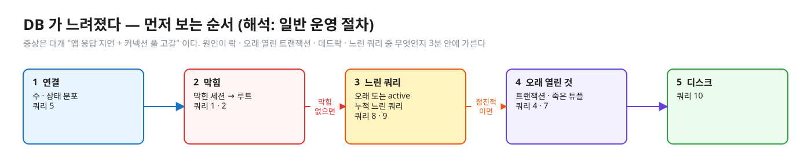
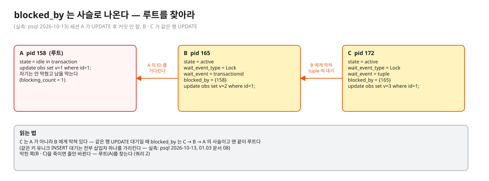
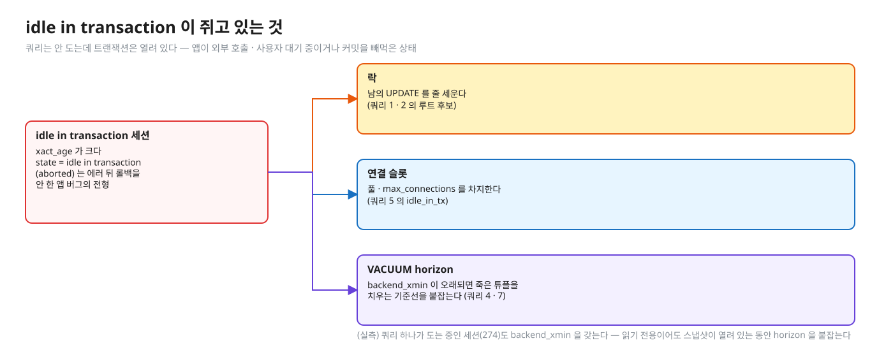
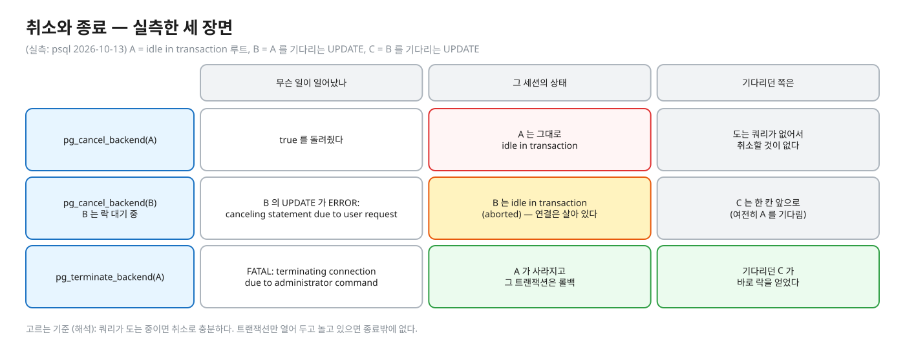
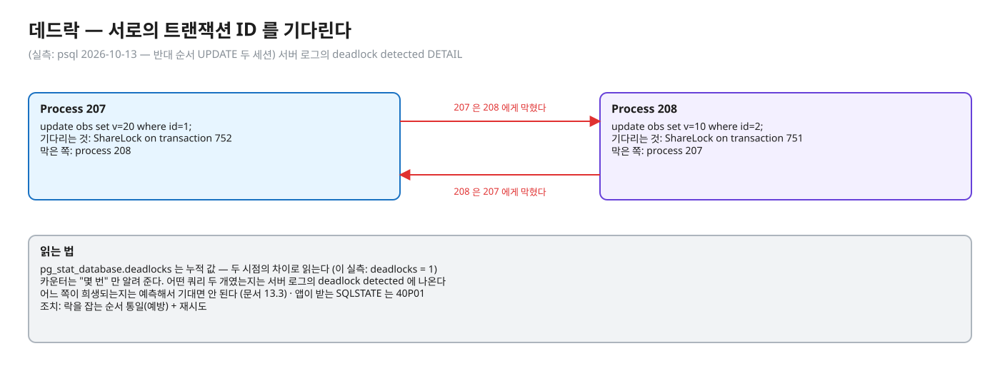
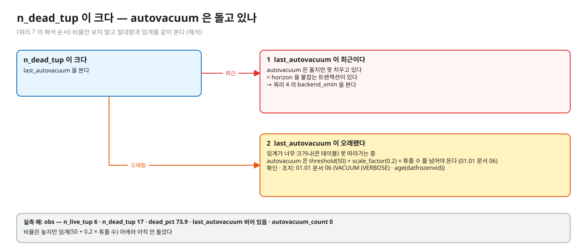
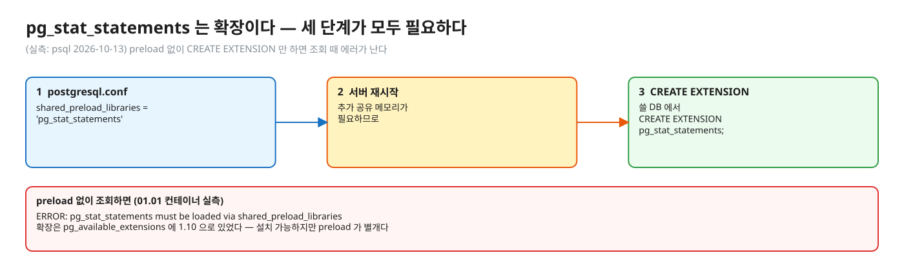
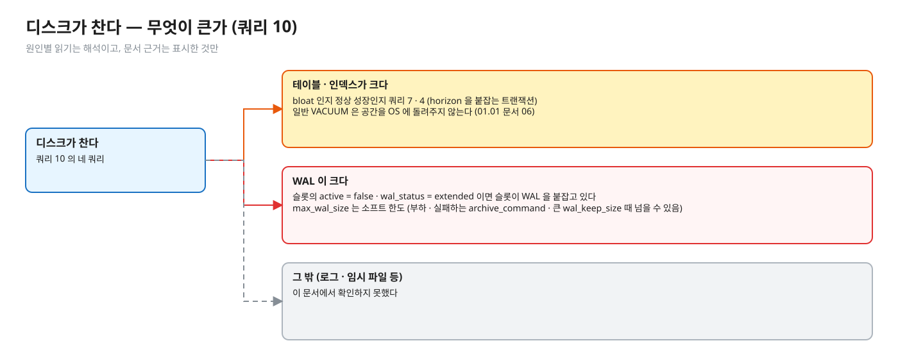

# 02. 장애 대응 쿼리 모음 — 락 · 느림 · 연결 · 죽은 튜플 · 디스크

> **이 글에서 알게 되는 것**
> 1. "DB 가 느려졌다 / 락이 걸렸다 / 디스크가 찬다" 에서 어느 뷰를 어떤 순서로 보는지 안다.
> 2. 증상마다 쿼리 결과를 어떻게 읽고(막힌 쪽이 아니라 루트를 찾는 법 등) 무엇을 의심하는지 안다.
> 3. 취소(`pg_cancel_backend`)와 종료(`pg_terminate_backend`)가 언제 무엇을 하는지 안다.
>
> **먼저 알면 좋은 것**: [01. PostgreSQL 엔진 지도](01-postgres-engine-map.md) — 연결이 프로세스라는 것, `pg_locks` 가 무엇을 보여 주는지.
> **다음 글**: [03. 동시성 · 정합성 문제 — 도구 고르기](03-concurrency-decision-guide.md)
> **구분**: 심화 — 꼬리질문 대비 (레슨을 마친 뒤 · 장애 대응 전). 레슨 예측 문항의 답은 이 문서에 없다

모든 쿼리는 PostgreSQL 16.14 컨테이너에서 실제로 돌려 확인했다.

## 장애는 대개 "앱이 느리다" 로 시작한다

증상은 대부분 "앱 응답 지연 + 커넥션 풀 고갈" 로 나타난다. 원인이 DB 락 · 오래 열린 트랜잭션 · 데드락 · 느린 쿼리 중 무엇인지 3분 안에 가르는 쿼리 묶음이 이 글이다. 좋은 대응에는 순서가 있다. 연결 상태 → 막힌 쪽과 막는 쪽 → 오래 열린 트랜잭션 → 느린 쿼리 → 원인 제거 순이다.

### 먼저 보는 순서 (해석 — 일반 운영 절차)

1. 쿼리 5 로 연결 수 · 상태 분포 → `idle in transaction` 이 많은가, `max_connections` 에 가까운가
2. 쿼리 1 로 막힌 세션이 있나 → 있으면 쿼리 2 로 루트 블로커
3. 없으면 쿼리 8 로 오래 도는 active 쿼리, 쿼리 9 로 누적 느린 쿼리
4. 쿼리 4 · 7 로 오래 열린 트랜잭션 · 죽은 튜플 (느려지는 속도가 점진적이면)
5. 쿼리 10 으로 디스크


<sub>편집: [diagrams/blog-t02-order.excalidraw](diagrams/blog-t02-order.excalidraw)</sub>

이 글의 값은 전부 [`pg_stat_activity`](https://www.postgresql.org/docs/16/monitoring-stats.html) 계열이다. 읽기 전에 알아 둘 것이 셋 있다. 첫째, `state` 와 `wait_event` 는 **독립적**이다. `active` 인 백엔드도 막혀 있을 수 있어 `wait_event` 가 null 이 아닐 수 있다 ([문서 28.2](https://www.postgresql.org/docs/16/monitoring-stats.html)). 둘째, `query` 열은 기본 1024바이트에서 잘린다(`track_activity_query_size`). 셋째, 실측 환경에서 `pg_stat_activity` 에는 보조 프로세스도 나오므로 `backend_type = 'client backend'` 를 붙인다 ([문서 01](01-postgres-engine-map.md)).

---

## 1. 락 대기 사슬 — "요청이 멈췄다 · 풀이 마른다"

**무엇이 보이나.** 요청이 응답 없이 멈춘다. 커넥션 풀이 마른다. **무엇을 의심하나.** 누군가 쥔 락을 여러 세션이 줄 서서 기다리고 있다. 이제 그 줄을 보는 쿼리를 보자.

### 쿼리 1 — 막힌 세션과 막는 세션

```sql
SELECT pid, usename, state, wait_event_type, wait_event,
       pg_blocking_pids(pid) AS blocked_by,
       now() - query_start AS waiting_for,
       left(query, 60) AS query
FROM pg_stat_activity
WHERE cardinality(pg_blocking_pids(pid)) > 0;
```

`pg_blocking_pids(pid)` 는 그 프로세스가 락을 얻는 걸 막는 세션들의 PID 배열이다. "막는다" 는 **충돌하는 락을 쥔 쪽(hard block)** 과 **충돌할 락을 기다리면서 큐에서 앞서 있는 쪽(soft block)** 둘 다다. 병렬 쿼리면 client 가 보는 PID 로 나오고 중복이 있을 수 있다. 2PC(준비된 트랜잭션)가 쥔 락은 PID `0` 으로 나온다. 자주 부르면 락 관리자 공유 상태에 잠깐 배타 접근이 필요해 성능에 영향이 있을 수 있으므로 반복 호출 폴링은 피한다 ([문서 9.26](https://www.postgresql.org/docs/16/functions-info.html)).

**결과 읽는 법** (실측: psql 2026-10-13 — 세션 A 가 `UPDATE … WHERE id=1` 후 커밋 안 함, B · C 가 같은 행 UPDATE):

```
 pid | state  | wait_event_type |  wait_event   | blocked_by |   waiting_for   |             query
 165 | active | Lock            | transactionid | {158}      | 00:00:02.050968 | update obs set v=2 where id=1;
 172 | active | Lock            | tuple         | {165}      | 00:00:00.9914   | update obs set v=3 where id=1;
```


<sub>편집: [diagrams/blog-t02-lock-chain.excalidraw](diagrams/blog-t02-lock-chain.excalidraw)</sub>

B(165)는 A(158)의 트랜잭션 ID 를 기다리고(`transactionid`), C(172)는 **A 가 아니라 B** 에게 막혀 `tuple` 락을 기다린다. 즉 `blocked_by` 는 **사슬**(C → B → A)로 나오고 맨 끝이 루트다(같은 행 UPDATE 대기일 때. 같은 키 유니크 INSERT 대기는 전부 삽입자 하나를 가리킨다 — 실측: psql 2026-10-13, 01.03 문서 08). 대기 이유가 `Lock` 이면 행 락 · 테이블 락 대기다 (01.02 문서 02 가 같은 모양을 관찰했다).

**조치.** 막힌 쪽을 죽이지 말고 **루트**를 찾는다. 다음 쿼리가 그것이다.

### 쿼리 2 — 루트 블로커

```sql
SELECT b.pid, b.usename, b.state, now() - b.xact_start AS xact_age,
       left(b.query, 60) AS last_query,
       (SELECT count(*) FROM pg_stat_activity w WHERE b.pid = ANY (pg_blocking_pids(w.pid))) AS blocking_count
FROM pg_stat_activity b
WHERE b.pid IN (SELECT unnest(pg_blocking_pids(pid)) FROM pg_stat_activity)
  AND cardinality(pg_blocking_pids(b.pid)) = 0;
```

누군가를 막고 있지만 자기는 안 막힌 세션을 찾는다. **결과 읽는 법** (실측: psql 2026-10-13):

```
 pid |        state        |    xact_age     |           last_query           | blocking_count
 158 | idle in transaction | 00:00:03.053345 | update obs set v=1 where id=1; | 1
```

`state = idle in transaction` 이면 앱이 트랜잭션을 연 채 다른 일(외부 호출 · 커밋 누락)을 하고 있는 것이다. `last_query` 는 그 세션이 **마지막으로 보낸** 쿼리이지 지금 도는 쿼리가 아니다 (`state` 가 `active` 가 아니면 마지막 쿼리 — 문서 28.2). `blocking_count` 는 직접 막는 수라 사슬 뒤쪽은 포함하지 않는다.

**조치.** 3절의 취소 · 종료 + 근본 원인(코드의 트랜잭션 경계)을 고친다.

### 쿼리 3 — 기다리는 락의 종류 (`pg_locks`)

루트를 찾았다면, 이번에는 막힌 쪽이 정확히 어떤 락을 기다리는지 본다.

```sql
SELECT l.pid, l.locktype, l.mode, l.relation::regclass AS relation, l.transactionid, l.page, l.tuple,
       now() - a.query_start AS waiting_for, left(a.query, 50) AS query
FROM pg_locks l JOIN pg_stat_activity a USING (pid)
WHERE NOT l.granted
ORDER BY a.query_start;
```

`granted = false` 인 락 요청 = 기다리는 중이다. `pg_locks` 는 일반 락 관리자와 predicate 락 관리자 두 곳의 데이터를 합쳐 보여 주고, "누가 막나" 는 `pg_locks` 자체 조인 대신 `pg_blocking_pids()` 를 쓰라고 문서가 권한다 ([문서 54.12](https://www.postgresql.org/docs/16/view-pg-locks.html)).

**결과 읽는 법** (실측: psql 2026-10-13): 행 락 대기는 `locktype = transactionid`, `mode = ShareLock` 으로 보였고 `transactionid` 열이 **막는 트랜잭션의 ID** 다 (문서 54.12: 행 락 대기자는 행 락을 쥔 트랜잭션의 영구 ID 를 기다리는 모습). 테이블 락 대기면 `locktype = relation` 과 `relation` 열에 테이블 이름이 나온다. 행 락 자체는 디스크에 있어 이 뷰에 안 나온다 ([문서 01 4절](01-postgres-engine-map.md)).

**조치.** 쿼리 1 · 2 의 결과와 함께 읽는다. 테이블 락 대기(예: `AccessExclusiveLock`)가 보이면 DDL 이 줄을 세운 것이다 (01.02 장애 시나리오 2).

### 로그로 남기기 — `log_lock_waits`

쿼리는 **지금** 의 상태만 보여 준다. 장애가 지나간 뒤에 보려면 로그가 필요하다. `log_lock_waits` 가 켜져 있으면 세션이 `deadlock_timeout` 보다 오래 락을 기다릴 때 로그가 남는다. **기본은 `off`** 다 ([문서 20.8](https://www.postgresql.org/docs/16/runtime-config-logging.html)). `deadlock_timeout` 기본은 `1s` 이고 이 값이 락 대기 로그 임계도 정한다 ([문서 20.12](https://www.postgresql.org/docs/16/runtime-config-locks.html)). 변경은 superuser 또는 해당 `SET` 권한자가 한다.

(실측: 컨테이너 설정 `log_lock_waits=on`, `deadlock_timeout=200ms`) 같은 행을 기다릴 때 서버 로그는 이렇다.

```
LOG:  process 165 still waiting for ShareLock on transaction 748 after 200.158 ms
DETAIL:  Process holding the lock: 158. Wait queue: 165.
CONTEXT:  while updating tuple (0,1) in relation "obs"
STATEMENT:  update obs set v=2 where id=1;
...
LOG:  process 172 acquired ExclusiveLock on tuple (0,1) of relation 16401 of database 16384 after 8859.750 ms
```

"still waiting" 은 기다리는 중, "acquired … after N ms" 는 락을 얻은 뒤 총 대기 시간이다. 장애가 지나간 뒤에도 **누가 누구를 얼마나 막았는지** 를 사후에 볼 수 있는 유일한 기록이다 (해석: 켜 두는 운영 판단은 부담이 작다고 알려져 있으나 이 문서에서 비용은 확인하지 못했다).

---

## 2. 오래 열린 트랜잭션 · idle in transaction

**무엇이 보이나.** 쿼리 2 의 루트가 `idle in transaction` 이었다. 또는 느려지는 속도가 점진적이고 테이블이 계속 커진다. **무엇을 의심하나.** 트랜잭션을 연 채 놀고 있는 연결이다. 이런 세션은 쿼리를 안 돌리는데도 조용히 세 가지를 쥔다.


<sub>편집: [diagrams/blog-t02-idle-in-tx.excalidraw](diagrams/blog-t02-idle-in-tx.excalidraw)</sub>

### 쿼리 4 — 트랜잭션 나이순

```sql
SELECT pid, usename, application_name, state,
       now() - xact_start AS xact_age,
       now() - state_change AS in_state_for,
       backend_xid, backend_xmin, left(query, 60) AS last_query
FROM pg_stat_activity
WHERE backend_type = 'client backend'
  AND xact_start IS NOT NULL
  AND pid <> pg_backend_pid()
ORDER BY xact_start
LIMIT 10;
```

`xact_start` = 현재 트랜잭션 시작 시각(없으면 null)이다. 위에 나오는 것이 가장 오래된 트랜잭션이다. `state_change` 는 `state` 가 마지막으로 바뀐 시각이다. `backend_xmin` 은 그 백엔드의 xmin horizon 이다 ([문서 28.2](https://www.postgresql.org/docs/16/monitoring-stats.html)).

**결과 읽는 법** (실측: psql 2026-10-13):

```
 pid |        state        |    xact_age     |  in_state_for   | backend_xid | backend_xmin |           last_query
 260 | idle in transaction | 00:00:02.790976 | 00:00:02.789876 |         757 |              | update obs set v=1 where id=1;
 267 | active              | 00:00:02.011861 | 00:00:02.011782 |         758 |          757 | update obs set v=2 where id=1;
 274 | active              | 00:00:00.998824 |                 |             |          757 | select pg_sleep(15)
```

- `xact_age` 가 크고 `state = idle in transaction` → 쿼리 2 의 루트 후보. 락 · 연결 · horizon 을 다 쥔다.
- `backend_xmin` 이 오래됐으면 VACUUM 이 치울 수 있는 죽은 튜플의 기준선(horizon)을 붙잡는다. 위 실측에서 **쿼리 하나가 도는 중인 세션(274)도 `backend_xmin` 을 갖는다** — 읽기 전용이어도 스냅샷이 열려 있는 동안 horizon 을 붙잡는다 (01.01 문서 06).
- `idle in transaction (aborted)` 는 트랜잭션 안에서 에러가 난 뒤 앱이 롤백을 안 한 상태다 (문서 28.2). 앱 버그의 전형이다.

`idle in transaction` 만 따로 보려면 이렇게 쓴다.

```sql
SELECT pid, usename, state, now() - state_change AS idle_in_tx_for, left(query, 60) AS last_query
FROM pg_stat_activity
WHERE state IN ('idle in transaction', 'idle in transaction (aborted)')
ORDER BY state_change;
```

(실측: psql 2026-10-13, 위 세션 260 만 `idle_in_tx_for = 00:00:02.79` 로 나왔다.)

**조치.** 앱의 트랜잭션 경계(외부 호출 · 사용자 대기)를 고치는 것이 근본이다. 서버 방어선은 `idle_in_transaction_session_timeout`(기본 `0` = 꺼짐, 실측 `SHOW`)이다. 세부와 부작용은 [01.01 문서 06](../l01-isolation-mvcc/docs/06-operations-vacuum-horizon.md)에 있다. 급하면 3절을 본다.

레슨 시나리오: [01.01 면접 사다리 · 장애 시나리오 1](../l01-isolation-mvcc/docs/07-interview-ladder.md) (테이블이 계속 커진다) · [01.02 장애 시나리오 1](../l02-row-locks-deadlock/docs/07-interview-ladder.md) (풀이 마른다).

---

## 3. 조치 — 취소 vs 종료

루트를 찾았다. 이제 어떻게 치우나. 두 함수가 있고, 하는 일이 다르다.

| | `pg_cancel_backend(pid)` | `pg_terminate_backend(pid [, timeout])` |
|---|---|---|
| 하는 일 | 그 세션의 **현재 쿼리**를 취소 | **세션**(연결)을 종료 |
| 근거 | "Cancels the current query of the session" ([문서 9.27](https://www.postgresql.org/docs/16/functions-admin.html)) | "Terminates the session" (같은 문서) |
| 권한 | 같은 역할의 구성원이거나 `pg_signal_backend` 권한. 슈퍼유저 백엔드는 슈퍼유저만 | 동일 |
| 반환값 | 시그널 전송 성공 여부 | `timeout` 이 없거나 0 이면 **실제로 죽었는지와 무관하게** 전송 성공이면 `true`. `timeout`(ms) > 0 이면 실제 종료까지 기다리고, 시간 초과 시 경고와 `false` |

(실측: psql 2026-10-13, 세션 A=`idle in transaction` 루트, B=A 를 기다리는 UPDATE, C=B 를 기다리는 UPDATE)


<sub>편집: [diagrams/blog-t02-cancel-terminate.excalidraw](diagrams/blog-t02-cancel-terminate.excalidraw)</sub>

1. `pg_cancel_backend(A)` → `true` 를 돌려줬지만 **A 의 상태는 그대로** `idle in transaction` — 도는 쿼리가 없어서 취소할 것이 없다. idle in transaction 루트에는 취소가 소용없다.
2. `pg_cancel_backend(B)` (B 는 락 대기 중) → B 의 UPDATE 가 `ERROR: canceling statement due to user request` 로 끝나고 B 의 상태가 **`idle in transaction (aborted)`** 가 됐다. 세션과 연결은 살아 있고, 앱이 롤백해야 한다. B 를 기다리던 C 는 줄에서 한 칸 앞으로 갔다(여전히 A 를 기다림).
3. `pg_terminate_backend(A)` → A 가 사라지고(서버 로그 `FATAL: terminating connection due to administrator command`) 그 트랜잭션은 롤백되어 기다리던 C 가 바로 락을 얻었다.
4. 대량 정리 쿼리의 형태와 `timeout` 인자 (실측: 같은 날, 1초 이상 idle in transaction 인 세션만; 운영에서는 `interval` 을 분 단위로 둔다):

```sql
SELECT pid, pg_terminate_backend(pid, 3000) AS terminated, state, left(query, 30) AS q
FROM pg_stat_activity
WHERE state IN ('idle in transaction', 'idle in transaction (aborted)')
  AND now() - state_change > interval '1 second'
  AND pid <> pg_backend_pid();
```

**고르는 기준 (해석)**: 쿼리가 **도는 중**(`active`, 긴 쿼리 · 락 대기)이면 취소로 충분하다. 트랜잭션만 열어 두고 **놀고 있으면**(`idle in transaction`) 종료밖에 없다. 종료는 연결이 끊기므로 앱 · 풀이 그 연결을 어떻게 처리하는지(죽은 연결 감지) 확인한다. `pg_stat_activity` 에서 지목한 PID 가 바뀌지 않았는지 실행 직전에 다시 본다 (PID 는 재사용될 수 있다 — 해석).

---

## 4. 데드락

**무엇이 보이나.** 간헐적인 500, 서버 로그의 `deadlock detected`. **무엇을 의심하나.** 두 트랜잭션이 서로가 쥔 락을 기다린다. 락 대기 사슬은 루트가 있었지만, 데드락은 고리라서 루트가 없다. 엔진이 한쪽을 끊어 풀어 주므로 지금 상태를 보는 쿼리보다는 **횟수 카운터와 로그**를 본다.

### 쿼리 6 — 데드락 횟수

```sql
SELECT datname, deadlocks, xact_commit, xact_rollback, stats_reset
FROM pg_stat_database WHERE datname = current_database();
```

`pg_stat_database.deadlocks` = 그 DB 에서 검출된 데드락 수다 ([문서 28.2](https://www.postgresql.org/docs/16/monitoring-stats.html)). `conflicts` 는 **스탠바이의 복구 충돌**로 취소된 쿼리 수라 데드락과 다르다.

**결과 읽는 법** (실측: psql 2026-10-13 — 반대 순서 UPDATE 두 세션 뒤): `deadlocks = 1`. 누적 값이므로 **두 시점의 차이**로 읽는다 (해석: 모니터링 도구가 이 값의 증가율을 보는 이유). `stats_reset` 이 null 이면 리셋된 적 없음.

카운터는 "몇 번" 만 알려 준다. **어떤 쿼리 두 개였는지** 는 서버 로그의 `deadlock detected` 에 나온다. (실측: 같은 로그)

```
ERROR:  deadlock detected
DETAIL:  Process 207 waits for ShareLock on transaction 752; blocked by process 208.
	Process 208 waits for ShareLock on transaction 751; blocked by process 207.
	Process 207: update obs set v=20 where id=1;
	Process 208: update obs set v=10 where id=2;
```


<sub>편집: [diagrams/blog-t02-deadlock.excalidraw](diagrams/blog-t02-deadlock.excalidraw)</sub>

어느 쪽이 희생되는지는 예측해서 기대면 안 된다 ([문서 13.3](https://www.postgresql.org/docs/16/explicit-locking.html)). 앱이 받는 SQLSTATE 는 `40P01` 이다.

**조치.** 락을 잡는 순서 통일(예방) + 재시도. 레슨: [01.02 문서 05](../l02-row-locks-deadlock/docs/05-deadlock.md) · [장애 시나리오 3](../l02-row-locks-deadlock/docs/07-interview-ladder.md).

---

## 5. 연결 수

**무엇이 보이나.** 새 연결이 거절되거나 풀이 마른다. **무엇을 의심하나.** 연결이 `max_connections` 에 가깝거나, 연결 대부분이 `idle in transaction` 이거나, 대부분이 락을 기다리고 있다. 이 글의 순서에서 가장 먼저 보는 쿼리다.

### 쿼리 5 — 상태별 분포와 한도

```sql
SELECT count(*) AS total,
       count(*) FILTER (WHERE state = 'active') AS active,
       count(*) FILTER (WHERE state = 'idle') AS idle,
       count(*) FILTER (WHERE state LIKE 'idle in transaction%') AS idle_in_tx,
       current_setting('max_connections')::int AS max_connections,
       current_setting('superuser_reserved_connections')::int AS reserved
FROM pg_stat_activity
WHERE backend_type = 'client backend';
```

**결과 읽는 법** (실측: psql 2026-10-13): `total 4 · active 3 · idle 0 · idle_in_tx 1 · max_connections 100 · reserved 3`. `total` 이 `max_connections - reserved` 에 가까우면 일반 사용자는 곧 연결 실패한다 (`superuser_reserved_connections` 는 슈퍼유저용 예비 슬롯 — 문서 20.3, 기본 3).

`idle_in_tx` 가 `total` 의 상당수면 앱이 트랜잭션을 연 채 연결을 쥐고 있다 → 쿼리 4. `active` 가 많고 대부분 `wait_event_type = Lock` 이면 쿼리 1. 사용자 · DB 별로 누가 쓰는지는 이렇게 본다.

```sql
SELECT usename, datname, state, count(*)
FROM pg_stat_activity WHERE backend_type = 'client backend'
GROUP BY usename, datname, state ORDER BY count(*) DESC;
```

같은 서비스의 풀 인스턴스가 여러 개면 `max_connections` 는 **합계**와 비교한다 (해석). 풀 설정과 PgBouncer 는 [문서 01 5절](01-postgres-engine-map.md)에 있다.

---

## 6. 죽은 튜플 · autovacuum

**무엇이 보이나.** 시간이 갈수록 쿼리가 느려지고 테이블이 커진다. **무엇을 의심하나.** 죽은 튜플이 쌓이는데 autovacuum 이 치우지 못한다.

### 쿼리 7

```sql
SELECT relname, n_live_tup, n_dead_tup,
       round(100.0 * n_dead_tup / nullif(n_live_tup + n_dead_tup, 0), 1) AS dead_pct,
       last_autovacuum, autovacuum_count, last_autoanalyze
FROM pg_stat_user_tables
ORDER BY n_dead_tup DESC
LIMIT 10;
```

`n_dead_tup` / `n_live_tup` 은 **추정** 행 수이고 `last_autovacuum` · `autovacuum_count` 는 autovacuum 이 마지막으로 / 몇 번 그 테이블을 돌았는지다 ([문서 28.2](https://www.postgresql.org/docs/16/monitoring-stats.html)).

**결과 읽는 법** (실측: psql 2026-10-13 — 작은 테이블에 UPDATE 세 번): `obs: n_live_tup 6 · n_dead_tup 17 · dead_pct 73.9 · last_autovacuum 비어 있음 · autovacuum_count 0`. autovacuum 은 `threshold(50) + scale_factor(0.2) × 튜플 수` 를 넘어야 도는데(01.01 문서 06) 이 표는 그 아래라 아직 안 돌았다 — 비율만 보지 말고 **절대량과 임계**를 같이 본다 (해석).


<sub>편집: [diagrams/blog-t02-dead-tuples.excalidraw](diagrams/blog-t02-dead-tuples.excalidraw)</sub>

**해석 순서.** ① `n_dead_tup` 이 큰데 `last_autovacuum` 이 최근이다 → autovacuum 은 돌지만 **못 치우고 있다** = horizon 을 붙잡는 트랜잭션(쿼리 4 의 `backend_xmin`). ② `last_autovacuum` 이 오래됐다 → 임계가 너무 크거나(큰 테이블) 못 따라가는 중. 확인과 조치는 [01.01 문서 06](../l01-isolation-mvcc/docs/06-operations-vacuum-horizon.md) (`VACUUM (VERBOSE)` 의 `dead but not yet removable`, wraparound 점검 `age(datfrozenxid)`).

`n_dead_tup` 등 통계는 `track_counts` 가 켜져 있어야 쌓인다 (실측 `SHOW`: `on`; 문서 25.1 도 autovacuum 에 필요하다고 명시).

---

## 7. 느린 쿼리

**무엇이 보이나.** 특정 요청이 오래 걸린다. **무엇을 의심하나.** 지금 오래 도는 쿼리가 있거나(쿼리 8), 합쳐서 시간을 많이 쓰는 쿼리가 있다(쿼리 9).

### 쿼리 8 — 지금 오래 도는 쿼리

```sql
SELECT pid, now() - query_start AS running, state, wait_event_type, wait_event, left(query, 60) AS query
FROM pg_stat_activity
WHERE state = 'active' AND backend_type = 'client backend' AND pid <> pg_backend_pid()
ORDER BY query_start
LIMIT 10;
```

**결과 읽는 법** (실측: psql 2026-10-13): `wait_event_type = Lock` 이면 락 대기(쿼리 1 로), `Timeout / PgSleep` 은 `pg_sleep` 중. `wait_event` 가 null 이면 CPU 를 쓰는 중이라는 읽기는 이 문서에서 확인하지 못했다 (문서 28.2: "기다리지 않으면 null"). 그 경우 `EXPLAIN (ANALYZE)` 로 계획을 본다 (이 문서 범위 밖).

**조치.** 3절 (취소 → 안 되면 종료). `statement_timeout` 이 설정돼 있는지는 `SHOW statement_timeout`(실측 기본 `0` = 없음)으로 본다.

### 쿼리 9 — 누적 통계: `pg_stat_statements`

쿼리 8 은 **지금** 도는 것만 본다. 가끔 느린 쿼리나 합쳐서 오래 걸리는 쿼리를 보려면 누적 통계가 필요한데, 그 확장은 설치가 필요하다. [pg_stat_statements 문서](https://www.postgresql.org/docs/16/pgstatstatements.html)에 따르면 `postgresql.conf` 의 `shared_preload_libraries = 'pg_stat_statements'` 후 **서버 재시작**(추가 공유 메모리가 필요하므로), 그다음 쓸 DB 에서 `CREATE EXTENSION pg_stat_statements;` 를 해야 한다. 쿼리 ID 계산이 켜져 있어야 하며 `compute_query_id` 가 `auto` 나 `on` 이면 된다.


<sub>편집: [diagrams/blog-t02-statements.excalidraw](diagrams/blog-t02-statements.excalidraw)</sub>

(실측: psql 2026-10-13) 01.01 컨테이너는 preload 가 없어 `CREATE EXTENSION` 은 성공해도 조회하면 `ERROR: pg_stat_statements must be loaded via shared_preload_libraries`. 확장은 `pg_available_extensions` 에는 `1.10` 으로 있었다 — 설치 가능하지만 preload 가 별개라는 뜻이다. 아래 쿼리는 `shared_preload_libraries=pg_stat_statements` 로 띄운 같은 이미지(`postgres:16-alpine`)의 임시 컨테이너에서 돌렸다.

```sql
SELECT queryid, calls, round(total_exec_time::numeric, 2) AS total_ms,
       round(mean_exec_time::numeric, 2) AS mean_ms, rows, left(query, 60) AS query
FROM pg_stat_statements
ORDER BY total_exec_time DESC
LIMIT 10;
```

**무엇을 보나.** 구조가 같은 쿼리를 하나로 묶어(리터럴은 `$1` 로 치환) 실행 횟수 · 총/평균 시간 · 행 수를 누적한다. (실측: `WHERE id = 5` 와 `WHERE id = 7` 두 번 실행 → `SELECT count(*) FROM t WHERE id = $1` 한 행, `calls = 2`.) 시간 단위는 밀리초, 컬럼 이름은 `total_exec_time` · `mean_exec_time` (PostgreSQL 16, pg_stat_statements 문서).

**결과 읽는 법.** 지금 느린 게 아니라 **전체 시간을 가장 많이 쓰는 쿼리**를 찾는다. `total_ms` 가 큰 것은 `mean_ms` 가 작아도 호출이 많은 것일 수 있다 (해석: 건당 느린 쿼리는 `mean_exec_time` 순으로도 본다). 기본 추적 상한 `pg_stat_statements.max` = 5000 (실측 `SHOW`; 문서 동일), 기본 `track = top`.

초기화는 `SELECT pg_stat_statements_reset();` 이다 (기본은 슈퍼유저, `GRANT` 로 위임 가능). 다른 사용자 쿼리 텍스트는 슈퍼유저 · `pg_read_all_stats` 만 본다.

확장 없이 쓰는 대안은 `log_min_duration_statement`(기본 `-1` = 꺼짐)로 `250ms` 이상 걸린 문장을 로그에 남기는 것이다 ([문서 20.8](https://www.postgresql.org/docs/16/runtime-config-logging.html)).

---

## 8. 디스크가 찬다

**무엇이 보이나.** 디스크 사용량이 갑자기 오른다. **무엇을 의심하나.** 테이블 · 인덱스가 커졌거나, WAL 이 안 지워지고 있다.

### 쿼리 10 — 무엇이 큰가

```sql
SELECT relname, pg_size_pretty(pg_total_relation_size(oid)) AS total_size
FROM pg_class WHERE relkind = 'r' AND relnamespace = 'public'::regnamespace
ORDER BY pg_total_relation_size(oid) DESC LIMIT 5;

SELECT pg_size_pretty(pg_database_size(current_database())) AS db_size;

SELECT count(*) AS wal_files, pg_size_pretty(sum(size)) AS wal_size FROM pg_ls_waldir();

SELECT slot_name, active, restart_lsn, wal_status FROM pg_replication_slots;
```

`pg_total_relation_size` 는 테이블 + 인덱스 + TOAST 의 합계, `pg_database_size` 는 DB 전체다 ([문서 9.27](https://www.postgresql.org/docs/16/functions-admin.html)). `pg_ls_waldir()` 은 WAL 디렉터리 파일 목록이고 **기본 권한이 슈퍼유저와 `pg_monitor` 역할**이다. `pg_replication_slots` 의 `restart_lsn` 은 "그 슬롯의 소비자가 아직 필요로 할 수 있는 가장 오래된 WAL" 이며 `max_slot_wal_keep_size` 를 넘기 전에는 체크포인트에서 지워지지 않는다 ([pg_replication_slots 문서](https://www.postgresql.org/docs/16/view-pg-replication-slots.html)).

**결과 읽는 법** (실측: psql 2026-10-13, 작은 실험 DB): 테이블 3개가 24~32kB, DB 전체 약 7.6MB, WAL 파일 1개 16MB, 슬롯 0 행. 이 실험은 크기 자체가 아니라 **쿼리가 돈다는 것**이 목적이다.


<sub>편집: [diagrams/blog-t02-disk.excalidraw](diagrams/blog-t02-disk.excalidraw)</sub>

**원인별 (해석 · 문서 근거는 표시한 것만)**:

- 테이블 · 인덱스가 큼 → bloat 인지 정상 성장인지 쿼리 7 · 4 (horizon 을 붙잡는 트랜잭션). 일반 VACUUM 은 공간을 OS 에 돌려주지 않는다 (01.01 문서 06).
- WAL 이 큼 → 슬롯의 `active = false` · `wal_status` 가 `extended` 이면 슬롯이 WAL 을 붙잡고 있다는 뜻이다 (pg_replication_slots 문서: `extended` = "`max_wal_size` 를 넘었지만 슬롯 또는 `wal_keep_size` 가 아직 보관"). 그 밖에 `max_wal_size`(소프트 한도 — 부하 · 실패하는 `archive_command` · 큰 `wal_keep_size` 때 넘을 수 있음, 문서 20.5) 와 체크포인트 주기.
- 로그 · 임시 파일 등 그 밖의 디스크 사용은 이 문서에서 확인하지 못했다.

---

## 증상 → 쿼리 → 레슨 장애 시나리오

| 증상 | 먼저 볼 쿼리 | 레슨의 장애 시나리오 |
|---|---|---|
| 응답이 점점 느려지고 풀이 마른다 | 5 → 1 → 2 → 4 | [01.02 시나리오 1](../l02-row-locks-deadlock/docs/07-interview-ladder.md) |
| 배포(ALTER) 중 서비스 전체가 멈춤 | 1 · 3 (`AccessExclusiveLock` 대기) | [01.02 시나리오 2](../l02-row-locks-deadlock/docs/07-interview-ladder.md) |
| 간헐적 500, `deadlock detected` | 6 + 서버 로그 | [01.02 시나리오 3](../l02-row-locks-deadlock/docs/07-interview-ladder.md) |
| 테이블이 계속 커지고 쿼리가 느려진다 | 4 → 7 → 10 | [01.01 시나리오 1](../l01-isolation-mvcc/docs/07-interview-ladder.md) |
| SERIALIZABLE 로 올렸더니 간헐적 500 | 서버 로그의 `40001` (재시도 설계) | [01.01 시나리오 2](../l01-isolation-mvcc/docs/07-interview-ladder.md) |
| 중복 결제 · 재시도 폭주로 커넥션 고갈 | 5 · 8 · 9 | [01.03 시나리오 1 · 2](../l03-idempotency/docs/08-interview-ladder.md) |
| 선착순 이벤트 직후 DB CPU · 락 대기 급증 | 1 · 2 · 9 | [01.04 시나리오 1](../l04-stock-concurrency/docs/07-interview-ladder.md) |
| 재배포 뒤 이벤트 중복 · 순서 역전 | (앱 로그 · inbox 테이블 확인) | [01.05 시나리오 1 · 2](../l05-event-order-dedupe/docs/07-interview-ladder.md) |

## 자주 하는 오해

1. **"`pg_cancel_backend` 로 안 죽는 세션은 이상한 세션이다."** `idle in transaction` 에는 취소할 쿼리가 없다 — 종료해야 한다 (실측).
2. **"`idle in transaction` 은 쿼리가 안 도니까 무해하다."** 락 · 연결 슬롯 · horizon 을 쥔다 (쿼리 2 · 4 · 7).
3. **"`wait_event` 가 있으면 `state` 는 `idle` 이다."** 둘은 독립이다 — 락을 기다리는 쿼리는 `state = active` 이면서 `wait_event_type = Lock` 이다 (실측 쿼리 1).
4. **"`pg_stat_statements` 는 기본으로 켜져 있다."** 확장이므로 preload + 재시작 + `CREATE EXTENSION` 이 필요하다. preload 없이는 조회가 에러다 (실측).
5. **"`n_dead_tup` 이 크면 autovacuum 이 안 도는 것이다."** 돌고 있는데 못 치울 수도 있다 — 쿼리 4 의 `backend_xmin` 을 본다.

## 한눈에 정리

| 증상 | 의심 | 쿼리 | 조치 |
|---|---|---|---|
| 요청이 멈춘다 · 풀이 마른다 | 락 대기 사슬 | 1 → 2 (루트) · 3 | 루트를 취소 · 종료 + 트랜잭션 경계 수정 |
| 트랜잭션이 오래 열려 있다 | `idle in transaction` | 4 | 앱 경계 수정 · `idle_in_transaction_session_timeout` · 종료 |
| 간헐적 500 · `deadlock detected` | 데드락 | 6 + 서버 로그 | 락 순서 통일 + 재시도 |
| 연결이 한도에 가깝다 | 연결 수 · idle_in_tx | 5 | 쿼리 4 · 1 로 원인 |
| 테이블이 커진다 | horizon 을 붙잡는 트랜잭션 | 7 → 4 | 01.01 문서 06 |
| 쿼리가 느리다 | 지금 도는 것 · 누적 | 8 · 9 | 취소 · `pg_stat_statements` |
| 디스크가 찬다 | 테이블 · WAL · 슬롯 | 10 | 슬롯 · bloat 점검 |

- 막힌 쪽을 죽이지 말고 루트를 찾는다. 막힌 쪽을 죽이면 줄만 바뀐다.
- `idle in transaction` 에는 취소가 소용없고 종료해야 한다.
- 쿼리는 **지금** 상태만 보여 주므로 사후에는 로그(`log_lock_waits` · `log_min_duration_statement`)와 누적 통계가 필요하다.
- 카운터(`deadlocks`)는 누적 값이라 두 시점의 차이로 읽는다.

## 스스로 확인

1. 락 때문에 요청이 멈췄다. 가장 먼저 무엇을 하나?
   <details><summary>답</summary>
   `pg_stat_activity` 와 `pg_blocking_pids()` 로 막힌 세션 목록(쿼리 1)을 보고, 막히지 않았는데 남을 막는 **루트**(쿼리 2)를 찾는다. 루트가 `idle in transaction` 이면 앱이 트랜잭션을 쥔 것이므로 종료(`pg_terminate_backend`)와 코드 수정이 필요하고, 긴 UPDATE 중이면 취소로 충분하다. 막힌 쪽부터 죽이면 줄만 바뀐다 (사슬 실측).
   </details>
2. `pg_cancel_backend` 와 `pg_terminate_backend` 의 차이, 그리고 반환값 `true` 의 의미는?
   <details><summary>답</summary>
   전자는 현재 쿼리 취소(세션 유지), 후자는 세션 종료. 반환 `true` 는 시그널 전송 성공일 뿐이다 — `pg_terminate_backend` 는 `timeout` 을 주면 실제 종료를 기다리고 못 죽으면 경고와 `false` (문서 9.27). 취소된 락 대기 세션이 트랜잭션 안이었다면 `idle in transaction (aborted)` 로 남는다 (실측).
   </details>
3. 같은 쿼리가 "가끔 느리다" 를 사후에 어떻게 보나?
   <details><summary>답</summary>
   로그가 남아 있어야 한다: `log_min_duration_statement` 로 느린 문장, `log_lock_waits` 로 락 대기(기본 꺼짐, `deadlock_timeout` 이상 기다릴 때 기록). 누적 통계는 `pg_stat_statements`(확장 · preload + 재시작 필요). `pg_stat_activity` 는 **지금** 상태만 보여 준다.
   </details>
4. 데드락이 났다는 걸 모니터링으로 어떻게 알고 원인은 어디서 보나?
   <details><summary>답</summary>
   `pg_stat_database.deadlocks` 의 증가로 알고(누적 값이라 증가분으로), 어떤 쿼리 · 어떤 순서였는지는 서버 로그의 `deadlock detected` DETAIL 에서 본다. 앱은 SQLSTATE `40P01` 을 받는다.
   </details>
5. 디스크가 갑자기 찬다. 테이블 말고 의심할 것은?
   <details><summary>답</summary>
   WAL. 복제 슬롯이 소비되지 않으면 슬롯의 `restart_lsn` 이후 WAL 이 지워지지 않는다(pg_replication_slots 문서). `pg_replication_slots` 의 `active` · `wal_status` 와 `pg_ls_waldir()` 로 본다(후자는 슈퍼유저 · `pg_monitor`). 그 밖의 원인(로그 · 임시 파일)은 이 문서에서 확인하지 못했다.
   </details>

## 근거를 확인하지 못해 뺀 것

- `wait_event` 별 상세 의미 전체(문서 28.2 의 이벤트 표), `EXPLAIN` 해석, 임시 파일 · 로그 디스크 사용 조사, `pg_stat_statements` 의 오버헤드 수치, `log_lock_waits` 의 비용.
- MySQL 의 대응 도구(`performance_schema`, `SHOW PROCESSLIST` 등) — 필요하면 MySQL 8.0 문서를 확인해 따로 추가한다.

## 출처

- [PostgreSQL 16 · 28.2 The Cumulative Statistics System](https://www.postgresql.org/docs/16/monitoring-stats.html) — `pg_stat_activity` · `pg_stat_database` · `pg_stat_user_tables` 컬럼
- [9.27 System Administration Functions](https://www.postgresql.org/docs/16/functions-admin.html) — `pg_cancel_backend` · `pg_terminate_backend` · 크기 함수 · `pg_ls_waldir`
- [9.26 System Information Functions](https://www.postgresql.org/docs/16/functions-info.html) — `pg_blocking_pids`
- [54.12 pg_locks](https://www.postgresql.org/docs/16/view-pg-locks.html) · [pg_replication_slots](https://www.postgresql.org/docs/16/view-pg-replication-slots.html)
- [F. pg_stat_statements](https://www.postgresql.org/docs/16/pgstatstatements.html)
- [20.8 Error Reporting and Logging](https://www.postgresql.org/docs/16/runtime-config-logging.html) · [20.12 Lock Management](https://www.postgresql.org/docs/16/runtime-config-locks.html) · [20.5 WAL](https://www.postgresql.org/docs/16/runtime-config-wal.html) · [13.3 Explicit Locking](https://www.postgresql.org/docs/16/explicit-locking.html)
- 이 트랙: [01 엔진 지도](01-postgres-engine-map.md) · [01.01 문서 06](../l01-isolation-mvcc/docs/06-operations-vacuum-horizon.md) · [01.02 문서 02](../l02-row-locks-deadlock/docs/02-waiting-and-observing.md)
