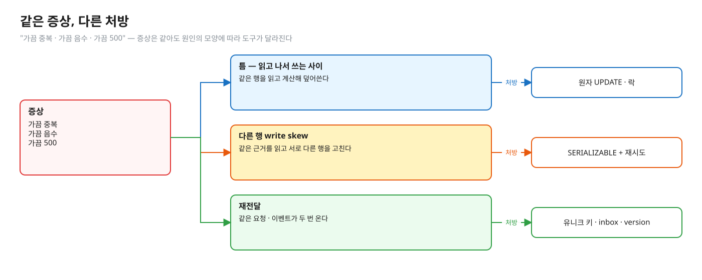
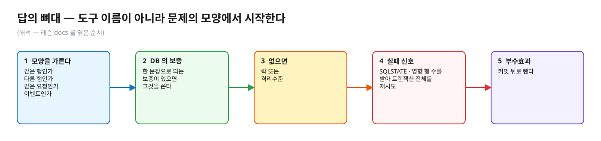
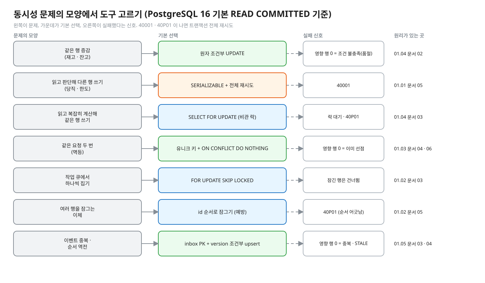
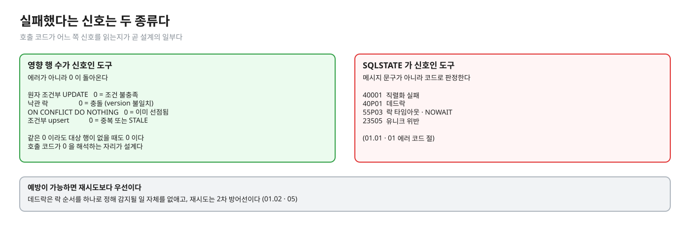
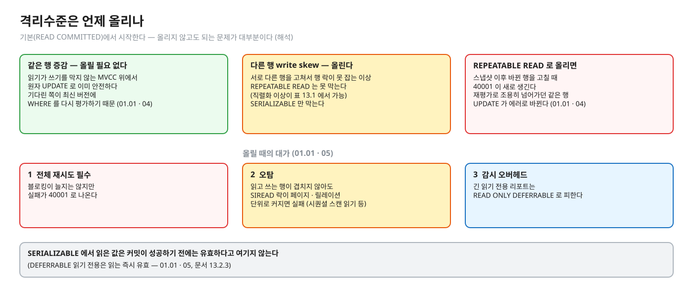
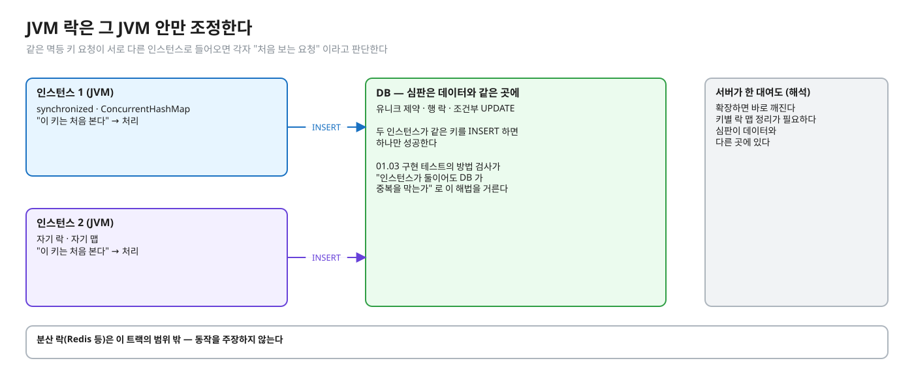
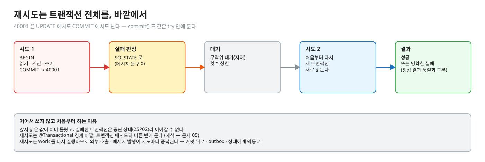
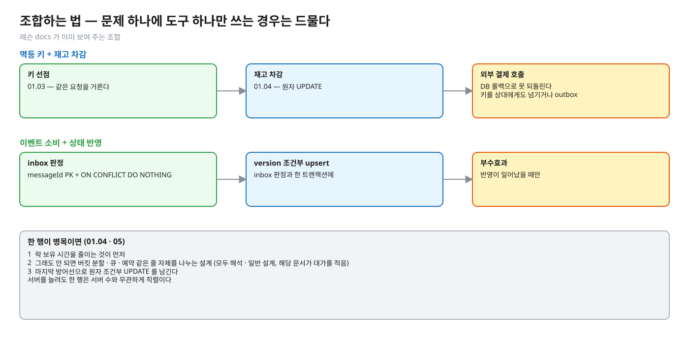

# 03. 동시성 · 정합성 문제 — 도구 고르기

> **이 글에서 알게 되는 것**
> 1. 동시성 문제를 도구 이름이 아니라 **문제의 모양**(같은 행인가, 다른 행인가, 같은 요청인가, 이벤트인가)으로 가르는 법을 안다.
> 2. 모양마다 기본 선택이 무엇이고, 실패했다는 신호가 영향 행 수로 오는지 SQLSTATE 로 오는지 안다.
> 3. 격리수준을 올리는 때와 대가, 앱 메모리 락이 답이 못 되는 이유, 재시도 설계의 공통 규칙을 안다.
>
> **먼저 알면 좋은 것**: 01.01 ~ 01.06 의 docs 를 한 번 읽은 것.
> **이전 글**: [02. 장애 대응 쿼리 모음](02-observability-playbook.md)
> **구분**: 심화 — 꼬리질문 대비 (01.01 ~ 01.06 의 docs 를 한 번 읽은 뒤 · 면접 전). 이 문서는 종합이라 새 엔진 주장을 만들지 않고, 근거는 링크한 레슨 docs 에 있다. 표와 본문에 예측 문항(Qnn)의 답이 풀려 있으니 **그 레슨의 예측을 끝낸 뒤** 읽는다

## 같은 증상, 다른 처방

"동시성 문제를 어떻게 해결하나요?" 는 열린 질문이다. `synchronized` · 낙관 락 · 비관 락 · 분산 락 이름을 늘어놓으면 "그래서 언제 무엇을 고르나" 로 되돌아온다. 실무에서도 같은 증상("가끔 중복 · 가끔 음수 · 가끔 500")이라도 원인이 틈(read-then-write) · 다른 행 write skew · 재전달 중 무엇이냐에 따라 처방이 다르다.

편집: [diagrams/blog-t03-intro.excalidraw](diagrams/blog-t03-intro.excalidraw)

그래서 답은 도구 이름이 아니라 **문제의 모양**에서 시작한다. 같은 행인가, 다른 행인가, 같은 요청인가, 이벤트인가를 가르면 도구가 거의 정해진다. 답의 뼈대는 이렇다 (해석 — 레슨 docs 를 엮은 순서): ① 어떤 모양의 문제인지 가른다 → ② DB 가 한 문장으로 보증해 주는 것이 있으면 그것을 쓴다 → ③ 없으면 락 또는 격리수준 → ④ 실패 신호(SQLSTATE · 영향 행 수)를 받아 **트랜잭션 전체**를 재시도한다 → ⑤ 부수효과는 커밋 뒤로 뺀다.

편집: [diagrams/blog-t03-skeleton.excalidraw](diagrams/blog-t03-skeleton.excalidraw)

## 문제 모양별 지도

한 장으로 보면 이렇다. 왼쪽이 문제, 가운데가 기본 선택, 오른쪽이 실패했다는 신호다.

편집: [diagrams/decision-map.excalidraw](diagrams/decision-map.excalidraw) · 다시 그리기(트랙 폴더에서): `python3 -I docs/diagrams/draw_decision.py`

아래는 PostgreSQL 16 기본(READ COMMITTED)에서 시작한다. 모양마다 "이런 상황 → 이 도구 → 왜 → 실패 신호" 를 짧게 풀고, "테스트로" 는 그 레슨에서 손으로 확인하는 곳이다. 모든 칸이 한 장의 표로 모인 것은 아래 "한눈에 정리" 에 있다. 각 "왜" 는 링크한 레슨 문서의 근거를 줄여 풀어 쓴 설명이다 (해석).

### 1. 같은 행 증감 (재고 · 잔고)

- **이 도구**: 원자 조건부 `UPDATE … SET q = q - :n WHERE … AND q >= :n`, 영향 행 수로 판정.
- **왜**: 읽고 계산하고 쓰는 세 단계를 DB 한 문장으로 줄이면 그 사이의 틈이 없다. 기다린 쪽은 최신 버전에 WHERE 를 다시 평가한다 ([01.01 · 04](../l01-isolation-mvcc/docs/04-write-conflicts.md)).
- **대안 · 비용**: 비관 락(락 보유 길다) · 낙관 락(진 쪽이 전부 다시). 한 행에 몰리면 어느 것이나 줄을 선다.
- **실패 신호**: 영향 행 0 = 조건 불충족. REPEATABLE READ 로 올리면 `40001`.
- **테스트로**: 01.04 `StockImplementTest` 결과 검사 · `StockObservationTest` 표. 읽을 곳: [01.04 · 02](../l04-stock-concurrency/docs/02-atomic-conditional-update.md) · [05](../l04-stock-concurrency/docs/05-choosing-and-hot-row.md).

### 2. 읽고 판단해서 **다른 행** 쓰기 (당직 · 한도)

- **이 도구**: SERIALIZABLE + 앱의 전체 재시도.
- **왜**: 서로 다른 행을 고치니 행 락이 못 잡는다. 판단의 근거가 깨졌는지를 엔진이 감시해야 한다.
- **대안 · 비용**: 판단 근거 행을 `FOR UPDATE`(새로 들어올 행 못 막음) · 충돌 구체화(모두가 한 행을 UPDATE).
- **실패 신호**: `40001` (UPDATE · COMMIT 어느 쪽에서도 남, 오탐 가능).
- **테스트로**: 01.01 `WriteSkewImplementTest`. 읽을 곳: [01.01 · 05](../l01-isolation-mvcc/docs/05-serializable-ssi-retry.md).

### 3. 읽고 **복잡하게** 계산한 뒤 같은 행 쓰기

- **이 도구**: `SELECT … FOR UPDATE` 로 읽는 순간 잠그기.
- **왜**: 계산이 한 문장에 안 들어가면 읽은 값이 쓸 때까지 유효해야 한다. 읽는 순간 잠그면 그 사이에 아무도 못 고친다.
- **대안 · 비용**: 한 문장으로 되면 원자 UPDATE가 낫다. 읽기와 쓰기가 다른 트랜잭션(사람의 편집)이면 낙관 락.
- **실패 신호**: 락 대기(무한정이 기본) · 여러 행이면 `40P01`.
- **테스트로**: 01.04 방법 검사 · 01.02 장면. 읽을 곳: [01.04 · 03](../l04-stock-concurrency/docs/03-pessimistic-lock.md) · [04](../l04-stock-concurrency/docs/04-optimistic-lock.md).

### 4. 같은 요청 두 번 (멱등)

- **이 도구**: 멱등 키 유니크 제약 + `INSERT … ON CONFLICT DO NOTHING` 의 영향 행 수로 선점.
- **왜**: "이미 처리했나" 의 판정을 데이터와 같은 곳(유니크 제약)에 둔다.
- **대안 · 비용**: `DO UPDATE`(기존 행 값을 `RETURNING`, 대신 충돌마다 쓰기) · 키를 먼저 커밋하는 2-트랜잭션(lease 필요).
- **실패 신호**: 영향 행 0 = 이미 선점됨. 선점 트랜잭션을 REPEATABLE READ 이상으로 올리면 스냅샷 이후 커밋된 키에서 `40001`(READ COMMITTED 전제). 에러 경로는 `23505` 뒤 `25P02`. 처리 중 키 대기는 `lock_timeout` 의 `55P03`.
- **테스트로**: 01.03 `PaymentImplementTest` (인스턴스 둘 방법 검사). 읽을 곳: [01.03 · 04](../l03-idempotency/docs/04-on-conflict.md) · [06](../l03-idempotency/docs/06-idempotency-key-design.md).

### 5. 작업 큐에서 하나씩 집기

- **이 도구**: `FOR UPDATE SKIP LOCKED` 로 집고 같은 트랜잭션에서 상태 변경.
- **왜**: 잠긴 행은 건너뛰므로 워커들이 서로 기다리지 않고 다른 행을 집는다.
- **대안 · 비용**: `FOR UPDATE` 만 쓰면 결과는 맞지만 워커가 한 줄로 선다. 큐 용도 밖에는 쓰지 않는다(일관되지 않은 뷰).
- **실패 신호**: 에러 없음(잠긴 행을 건너뜀). 줄 서지 않으려면 `NOWAIT` 의 `55P03`.
- **테스트로**: 01.02 `JobQueueImplementTest` 방법 검사. 읽을 곳: [01.02 · 03](../l02-row-locks-deadlock/docs/03-not-waiting.md).

### 6. 여러 행을 잠그는 이체

- **이 도구**: 모든 경로에서 같은 순서(예: id 오름차순)로 잠가 데드락을 **예방**.
- **왜**: 서로 반대 순서로 잠그는 두 트랜잭션이 고리를 만든다. 순서를 하나로 정하면 고리가 생길 수 없다.
- **대안 · 비용**: 순서를 못 정하면 `40P01` 을 전체 재시도로 처리.
- **실패 신호**: `40P01`.
- **테스트로**: 01.02 `TransferImplementTest` 방법 검사(엔진이 감지한 데드락 0회). 읽을 곳: [01.02 · 05](../l02-row-locks-deadlock/docs/05-deadlock.md) · [01.04 · 03](../l04-stock-concurrency/docs/03-pessimistic-lock.md).

### 7. 이벤트 중복 · 순서 역전

- **이 도구**: inbox(messageId PK + `ON CONFLICT DO NOTHING`)로 중복, `version` 조건부 upsert 로 역전, 둘을 한 트랜잭션에.
- **왜**: 재전달은 막을 수 없으니 받는 쪽이 "이미 받았나 · 더 낡은 것인가" 를 판정한다.
- **대안 · 비용**: version 이 없으면 소스에서 최신 상태 조회 · 순번 요청 (해석, 해당 문서). 이벤트가 상태 전체가 아니라 변경분(delta)이면 건너뛴 변경이 유실된다 ([01.05 · 04](../l05-event-order-dedupe/docs/04-version-ordering.md)).
- **실패 신호**: 영향 행 0 = 중복 또는 STALE.
- **테스트로**: 01.05 `EventApplierImplementTest`. 읽을 곳: [01.05 · 03](../l05-event-order-dedupe/docs/03-inbox-dedupe.md) · [04](../l05-event-order-dedupe/docs/04-version-ordering.md) · [05](../l05-event-order-dedupe/docs/05-design-patterns.md).

### 8. 맞아야 하는 숫자의 기록과 검증 (원장 · 대사)

- **이 도구**: 금액은 `numeric(p, s)`(`float8` 아님) · 거래는 append-only 원장에 두 다리로 쌓고 잔고 컬럼은 원장 합의 요약으로 둔다 · 잔고 ≥ 0 은 `CHECK`(문장마다 즉시) · 거래별 다리 합 0 은 지연 가능한 제약 트리거(`DEFERRABLE INITIALLY DEFERRED`, 커밋 때) · 그래도 생긴 어긋남은 대사 쿼리(`FULL OUTER JOIN` + `COALESCE`)로 찾는다 ([01.06 · 01](../l06-ledger-reconciliation/docs/01-numbers-float-numeric.md) · [03](../l06-ledger-reconciliation/docs/03-when-rules-are-checked.md) · [05](../l06-ledger-reconciliation/docs/05-reconciliation.md)).
- **왜**: 1 ~ 7 의 도구는 "틀리지 않게" 막는 쪽이고, 대사는 그래도 틀렸을 때 "알아채는" 쪽이다 — 둘은 대체가 아니라 겹쳐 쓴다 (해석).
- **대안 · 비용**: 최소 단위 정수(센트)를 `bigint` 에 담는 방식 (일반 개념 · 해석 — [01.06 · 01](../l06-ledger-reconciliation/docs/01-numbers-float-numeric.md)). 지연 제약은 에러가 커밋에서 나서 어느 문장이 원인인지 찾기 어렵다 (해석 — [01.06 · 03](../l06-ledger-reconciliation/docs/03-when-rules-are-checked.md)).
- **실패 신호**: `CHECK` 위반은 그 문장에서 · 지연 제약 위반은 커밋에서 · 대사는 결과 행(어긋난 계좌 · 거래).
- **테스트로**: 01.06 `LedgerImplementTest` · `ReconcilerImplementTest`. 읽을 곳: [01.06 · 01](../l06-ledger-reconciliation/docs/01-numbers-float-numeric.md) · [03](../l06-ledger-reconciliation/docs/03-when-rules-are-checked.md) · [04](../l06-ledger-reconciliation/docs/04-posting-to-the-ledger.md) · [05](../l06-ledger-reconciliation/docs/05-reconciliation.md).

### 실패 신호를 읽는 법 두 가지

편집: [diagrams/blog-t03-signals.excalidraw](diagrams/blog-t03-signals.excalidraw)

- **영향 행 수가 신호인 도구**(원자 UPDATE · 낙관 락 · ON CONFLICT · 조건부 upsert)는 에러가 아니라 0 이 돌아온다. 호출 코드가 0 을 해석하는 자리가 곧 설계의 일부다. 같은 0 이라도 조건 불일치(품절 · 충돌)일 수도, 대상 행이 아예 없을 수도 있어서 둘을 구분해야 하면 먼저 존재 여부를 알거나 `RETURNING` 을 쓴다 ([01.04 · 02](../l04-stock-concurrency/docs/02-atomic-conditional-update.md), 해석).
- **SQLSTATE 가 신호인 도구**(`40001` · `40P01` · `55P03` · `23505`)는 메시지 문구가 아니라 **코드**로 판정한다 ([01.01 · 01](../l01-isolation-mvcc/docs/01-anomalies-and-isolation-levels.md) 에러 코드 절).

## 격리수준은 언제 올리나

편집: [diagrams/blog-t03-isolation-up.excalidraw](diagrams/blog-t03-isolation-up.excalidraw)

- 기본에서 시작하는 이유: PostgreSQL 의 기본은 READ COMMITTED 이고(`default_transaction_isolation`, [01.01 · 01](../l01-isolation-mvcc/docs/01-anomalies-and-isolation-levels.md)), 읽기가 쓰기를 막지 않는 MVCC 위에서 **같은 행 증감은 원자 UPDATE 로 이미 안전하다** — 기다린 쪽이 최신 버전에 WHERE 를 다시 평가하기 때문이다 ([01.01 · 04](../l01-isolation-mvcc/docs/04-write-conflicts.md)). 올리지 않고도 되는 문제가 대부분이다 (해석 — 위 근거를 엮은 판단).
- 올리는 때: **서로 다른 행을 고쳐서 행 락이 못 잡는 이상 현상**(write skew)이 있을 때. REPEATABLE READ 는 이를 못 막고(직렬화 이상이 표 13.1 에서 가능), SERIALIZABLE 만 막는다 ([01.01 · 01](../l01-isolation-mvcc/docs/01-anomalies-and-isolation-levels.md)).
- 올릴 때의 대가 ([01.01 · 05](../l01-isolation-mvcc/docs/05-serializable-ssi-retry.md)):
  1. 블로킹이 늘지는 않지만 실패가 `40001` 로 나온다 → **앱에 전체 재시도가 필수**.
  2. 오탐이 있다 — 읽고 쓰는 행이 겹치지 않아도 SIREAD 락이 페이지 · 릴레이션 단위로 커지면 실패한다(시퀀셜 스캔 읽기 등).
  3. 감시 오버헤드. 긴 읽기 전용 리포트는 `READ ONLY DEFERRABLE` 로 피한다.
- REPEATABLE READ 로 올리면 "스냅샷 이후 바뀐 행을 고칠 때" `40001` 이 새로 생긴다 — 재평가로 조용히 넘어가던 같은 행 UPDATE 가 에러로 바뀐다는 뜻이다 ([01.01 · 04](../l01-isolation-mvcc/docs/04-write-conflicts.md)). 이유 없이 올리면 재시도 부담만 는다 (해석).
- SERIALIZABLE 에서 읽은 값은 커밋이 성공하기 전에는 유효하다고 여기지 않는다(`DEFERRABLE` 읽기 전용은 읽는 즉시 유효) ([01.01 · 05](../l01-isolation-mvcc/docs/05-serializable-ssi-retry.md), 문서 13.2.3).
- Spring: `@Transactional(isolation = …)` 의 기본은 DB 기본을 따르는 `ISOLATION_DEFAULT` 다 ([01.01 · 01](../l01-isolation-mvcc/docs/01-anomalies-and-isolation-levels.md)).
- MySQL InnoDB 는 기본이 REPEATABLE READ 이고 UPDATE 가 최신 커밋 행에 적용되어 PostgreSQL 과 같은 장면이 다르게 풀린다 — 비교는 [01.01 · 01](../l01-isolation-mvcc/docs/01-anomalies-and-isolation-levels.md) · [01.04 · 06](../l04-stock-concurrency/docs/06-mysql-innodb.md).

## 앱 메모리 락(`synchronized`)은 왜 답이 아닌가

편집: [diagrams/blog-t03-jvm-lock.excalidraw](diagrams/blog-t03-jvm-lock.excalidraw)

- JVM 락 · `ConcurrentHashMap` 은 **그 JVM 안의 스레드만** 조정한다. 인스턴스가 둘 이상이면 각자 "처음 보는 요청" 으로 판단한다 ([01.03 · 02](../l03-idempotency/docs/02-check-then-act.md)). 01.03 구현 테스트의 방법 검사가 "서비스 인스턴스가 둘이어도 DB 가 중복을 막는가" 로 이 해법을 거른다.
- 서버가 한 대여도 약점이 있다 — 확장하면 바로 깨지고, 키별 락 맵 정리가 필요하고, 심판이 데이터와 다른 곳에 있다 (해석, 같은 문서의 꼬리질문).
- 분산 락(Redis 등)은 이 트랙의 범위 밖이다. 이 트랙은 분산 락의 동작을 주장하지 않는다. 다만 01.03 문서 02 는 락 서비스와 DB 사이의 틈이 있으므로 DB 유니크 제약을 마지막 방어선으로 남긴다는 판단(해석)을 적어 둔다.
- 결론: 심판은 **데이터와 같은 곳**(DB 의 유니크 제약 · 행 락 · 조건부 UPDATE)에 둔다.

## 재시도 설계 — 공통 규칙

도구를 골랐어도 `40001` · `40P01` 이 나는 도구는 실패를 받아 다시 시도하는 쪽의 설계가 남는다.

편집: [diagrams/blog-t03-retry-loop.excalidraw](diagrams/blog-t03-retry-loop.excalidraw)

| 규칙 | 내용 | 근거 |
|---|---|---|
| 무엇을 재시도하나 | `40001`(직렬화 실패) · `40P01`(데드락) · 낙관 락의 영향 행 0. `23505` 는 보통 다시 해도 같으니 재시도하지 않는다(SERIALIZABLE 에서 존재 확인 없이 넣어 난 것은 예외 — 겹칠 키는 삽입 전에 확인하게 한다, 01.01 · 05). `55P03`(락 타임아웃)은 상한이 걸렸다는 신호라 재시도할지 409 로 돌려줄지 정책 | [01.01 · 05](../l01-isolation-mvcc/docs/05-serializable-ssi-retry.md) · [01.02 · 05](../l02-row-locks-deadlock/docs/05-deadlock.md) · [01.04 · 04](../l04-stock-concurrency/docs/04-optimistic-lock.md) · [01.03 · 06](../l03-idempotency/docs/06-idempotency-key-design.md) |
| 단위 | **트랜잭션 전체**를 처음부터. 앞서 읽은 값이 이미 틀렸고, 실패한 트랜잭션은 중단 상태(`25P02`)라 이어갈 수 없다 | [01.01 · 05](../l01-isolation-mvcc/docs/05-serializable-ssi-retry.md) · [01.03 · 05](../l03-idempotency/docs/05-failed-transaction.md) |
| 판정 | SQLSTATE 로. `commit()` 도 같은 try 안에 둔다(`40001` 이 커밋에서도 난다) | [01.01 · 05](../l01-isolation-mvcc/docs/05-serializable-ssi-retry.md) |
| 상한 · 간격 | 횟수 상한 + 무작위 대기(지터). 숫자(5회 · 20회)는 레슨의 선택이지 PostgreSQL 규정이 아니다 | [01.01 · 05](../l01-isolation-mvcc/docs/05-serializable-ssi-retry.md) · [01.04 · 04](../l04-stock-concurrency/docs/04-optimistic-lock.md) |
| 상한을 넘으면 | 품절 같은 정상 결과와 구분되는 명확한 실패로 돌려준다 (재고가 있는데 품절이라고 하지 않는다) | [01.04 · 04](../l04-stock-concurrency/docs/04-optimistic-lock.md) · [05](../l04-stock-concurrency/docs/05-choosing-and-hot-row.md) |
| Spring 위치 | 재시도는 `@Transactional` 경계 **바깥**, 트랜잭션 메서드와 다른 빈에 둔다 (해석 — 문서 05 가 이유와 함께 밝힘) | [01.01 · 05](../l01-isolation-mvcc/docs/05-serializable-ssi-retry.md) |
| 부수효과 | 재시도는 work 를 다시 실행하므로 외부 호출 · 메시지 발행이 시도마다 중복된다. 커밋 뒤로 미루거나 outbox(02.03 예정)에 기록하고, 상대에게 멱등 키를 준다 | [01.01 · 05](../l01-isolation-mvcc/docs/05-serializable-ssi-retry.md) · [01.03 · 06](../l03-idempotency/docs/06-idempotency-key-design.md) · [01.05 · 05](../l05-event-order-dedupe/docs/05-design-patterns.md) |

예방이 가능하면 재시도보다 우선이다 — 데드락은 락 순서를 하나로 정해 감지될 일 자체를 없애고, 재시도는 2차 방어선이다 ([01.02 · 05](../l02-row-locks-deadlock/docs/05-deadlock.md)).

## 조합하는 법 — 자주 나오는 구성

문제 하나에 도구 하나만 쓰는 경우는 드물다. 레슨 docs 가 이미 보여 주는 조합이다.

편집: [diagrams/blog-t03-combos.excalidraw](diagrams/blog-t03-combos.excalidraw)

- **멱등 키 + 재고 차감**: 키 선점(01.03)으로 같은 요청을 거르고, 차감은 원자 UPDATE(01.04). 외부 결제 호출은 DB 롤백으로 못 되돌리므로 키를 상대에게도 넘기거나 outbox 로 푼다 ([01.03 · 06](../l03-idempotency/docs/06-idempotency-key-design.md)).
- **이벤트 소비 + 상태 반영**: inbox 판정과 version 조건부 upsert 가 한 트랜잭션이고, 부수효과는 반영이 일어났을 때만 ([01.05 · 05](../l05-event-order-dedupe/docs/05-design-patterns.md)).
- **한 행이 병목이면**: 락 보유 시간을 줄이는 것이 먼저고, 그래도 안 되면 버킷 분할 · 큐 · 예약 같은 줄 자체를 나누는 설계(모두 해석 · 일반 설계, 해당 문서가 대가를 적음). 마지막 방어선으로 원자 조건부 UPDATE 를 남긴다 ([01.04 · 05](../l04-stock-concurrency/docs/05-choosing-and-hot-row.md)).
- **무엇이 느린지 보는 법**(락 대기 · `idle in transaction` · 데드락 로그)은 [02-observability-playbook.md](02-observability-playbook.md), 엔진이 이것을 어떻게 구현하는지는 [01-postgres-engine-map.md](01-postgres-engine-map.md).

## 자주 하는 오해

1. **"동시성 문제는 비관 락이나 격리수준을 올리면 끝난다."** 같은 행 증감은 원자 UPDATE 한 문장이 가장 단순하다. 격리수준은 다른 행 write skew 에 필요하다.
2. **"낙관 락은 락이 없다."** 읽는 동안만 없다. UPDATE 순간에는 행 락을 기다린다 ([01.04 · 04](../l04-stock-concurrency/docs/04-optimistic-lock.md)).
3. **"유니크 제약이면 멱등성이 해결된다."** 중복 행만 막는다. 외부 부수효과는 이미 일어났을 수 있다 ([01.03 · 02](../l03-idempotency/docs/02-check-then-act.md)).
4. **"`40001` 이 나면 그 문장만 다시."** 전체 재시도가 맞다.
5. **"서버를 늘리면 해결된다."** 한 행은 서버 수와 무관하게 직렬이다 ([01.04 · 05](../l04-stock-concurrency/docs/05-choosing-and-hot-row.md)).

## 한눈에 정리

위에서 문제 모양마다 풀어 쓴 내용을 한 표에 모았다. (PostgreSQL 16 기본 READ COMMITTED 에서 시작한다. "테스트로" 칸은 그 레슨에서 손으로 확인하는 곳이다.)

| 문제 모양 | 기본 선택 | 대안 · 비용 | 실패 신호 | 테스트로 | 읽을 곳 |
|---|---|---|---|---|---|
| 같은 행 증감 (재고 · 잔고) | 원자 조건부 `UPDATE … SET q = q - :n WHERE … AND q >= :n`, 영향 행 수로 판정 | 비관 락(락 보유 길다) · 낙관 락(진 쪽이 전부 다시). 한 행에 몰리면 어느 것이나 줄을 선다 | 영향 행 0 = 조건 불충족. REPEATABLE READ 로 올리면 `40001` | 01.04 `StockImplementTest` 결과 검사 · `StockObservationTest` 표 | [01.04 · 02](../l04-stock-concurrency/docs/02-atomic-conditional-update.md) · [05](../l04-stock-concurrency/docs/05-choosing-and-hot-row.md) |
| 읽고 판단해서 **다른 행** 쓰기 (당직 · 한도) | SERIALIZABLE + 앱의 전체 재시도 | 판단 근거 행을 `FOR UPDATE`(새로 들어올 행 못 막음) · 충돌 구체화(모두가 한 행을 UPDATE) | `40001` (UPDATE · COMMIT 어느 쪽에서도 남, 오탐 가능) | 01.01 `WriteSkewImplementTest` | [01.01 · 05](../l01-isolation-mvcc/docs/05-serializable-ssi-retry.md) |
| 읽고 **복잡하게** 계산한 뒤 같은 행 쓰기 | `SELECT … FOR UPDATE` 로 읽는 순간 잠그기 | 한 문장으로 되면 원자 UPDATE가 낫다. 읽기와 쓰기가 다른 트랜잭션(사람의 편집)이면 낙관 락 | 락 대기(무한정이 기본) · 여러 행이면 `40P01` | 01.04 방법 검사 · 01.02 장면 | [01.04 · 03](../l04-stock-concurrency/docs/03-pessimistic-lock.md) · [04](../l04-stock-concurrency/docs/04-optimistic-lock.md) |
| 같은 요청 두 번 (멱등) | 멱등 키 유니크 제약 + `INSERT … ON CONFLICT DO NOTHING` 의 영향 행 수로 선점 | `DO UPDATE`(기존 행 값을 `RETURNING`, 대신 충돌마다 쓰기) · 키를 먼저 커밋하는 2-트랜잭션(lease 필요) | 영향 행 0 = 이미 선점됨. 선점 트랜잭션을 REPEATABLE READ 이상으로 올리면 스냅샷 이후 커밋된 키에서 `40001`(READ COMMITTED 전제). 에러 경로는 `23505` 뒤 `25P02`. 처리 중 키 대기는 `lock_timeout` 의 `55P03` | 01.03 `PaymentImplementTest` (인스턴스 둘 방법 검사) | [01.03 · 04](../l03-idempotency/docs/04-on-conflict.md) · [06](../l03-idempotency/docs/06-idempotency-key-design.md) |
| 작업 큐에서 하나씩 집기 | `FOR UPDATE SKIP LOCKED` 로 집고 같은 트랜잭션에서 상태 변경 | `FOR UPDATE` 만 쓰면 결과는 맞지만 워커가 한 줄로 선다. 큐 용도 밖에는 쓰지 않는다(일관되지 않은 뷰) | 에러 없음(잠긴 행을 건너뜀). 줄 서지 않으려면 `NOWAIT` 의 `55P03` | 01.02 `JobQueueImplementTest` 방법 검사 | [01.02 · 03](../l02-row-locks-deadlock/docs/03-not-waiting.md) |
| 여러 행을 잠그는 이체 | 모든 경로에서 같은 순서(예: id 오름차순)로 잠가 데드락을 **예방** | 순서를 못 정하면 `40P01` 을 전체 재시도로 처리 | `40P01` | 01.02 `TransferImplementTest` 방법 검사(엔진이 감지한 데드락 0회) | [01.02 · 05](../l02-row-locks-deadlock/docs/05-deadlock.md) · [01.04 · 03](../l04-stock-concurrency/docs/03-pessimistic-lock.md) |
| 이벤트 중복 · 순서 역전 | inbox(messageId PK + `ON CONFLICT DO NOTHING`)로 중복, `version` 조건부 upsert 로 역전, 둘을 한 트랜잭션에 | version 이 없으면 소스에서 최신 상태 조회 · 순번 요청 (해석, 해당 문서). 이벤트가 상태 전체가 아니라 변경분(delta)이면 건너뛴 변경이 유실된다 ([01.05 · 04](../l05-event-order-dedupe/docs/04-version-ordering.md)) | 영향 행 0 = 중복 또는 STALE | 01.05 `EventApplierImplementTest` | [01.05 · 03](../l05-event-order-dedupe/docs/03-inbox-dedupe.md) · [04](../l05-event-order-dedupe/docs/04-version-ordering.md) · [05](../l05-event-order-dedupe/docs/05-design-patterns.md) |
| 맞아야 하는 숫자의 기록과 검증 (원장 · 대사) | `numeric` 금액 · append-only 원장 두 다리 · `CHECK`(즉시) + 지연 제약 트리거(커밋 때) · 대사 쿼리 | 정수 센트 `bigint` (해석) · 지연 제약은 원인 문장 추적이 어렵다 (해석) | 문장 에러(CHECK) · 커밋 에러(지연 제약) · 대사 결과 행 | 01.06 `LedgerImplementTest` · `ReconcilerImplementTest` | [01.06 · 01](../l06-ledger-reconciliation/docs/01-numbers-float-numeric.md) · [03](../l06-ledger-reconciliation/docs/03-when-rules-are-checked.md) · [05](../l06-ledger-reconciliation/docs/05-reconciliation.md) |

- 같은 증상이어도 원인의 모양이 다르면 처방이 다르다. 모양을 먼저 가른다.
- 같은 행 증감은 원자 UPDATE 한 문장이 가장 단순하고, 격리수준은 다른 행 write skew 에 올린다.
- 심판은 데이터와 같은 곳(유니크 제약 · 행 락 · 조건부 UPDATE)에 둔다. 앱 메모리 락은 인스턴스가 둘이면 깨진다.
- 재시도는 트랜잭션 전체를, `@Transactional` 바깥에서, 부수효과는 커밋 뒤로.

## 스스로 확인

이 글은 종합이라 레슨 문서와 달리 따로 둔 꼬리질문이 없다. 위 내용을 점검하는 질문 4개를 새로 만들었다 (해석 — 질문은 새로 지었고, 답은 위 본문과 링크한 문서의 내용이다).

1. 재고를 차감하는 코드가 가끔 음수를 낸다. 격리수준을 SERIALIZABLE 로 올리면 해결되나?
   

답

   같은 행 증감이라면 올릴 필요가 없다. 원자 조건부 UPDATE 한 문장이 가장 단순하고, 격리수준은 다른 행 write skew 에 필요하다 (위 "자주 하는 오해" 1번 · 01.04 · 02). REPEATABLE READ 이상으로 올리면 스냅샷 이후 바뀐 행을 고칠 때 `40001` 이 새로 생겨 재시도 부담만 는다 (해석).
   

2. 같은 요청이 인스턴스 둘에 동시에 들어올 때 `synchronized` 면 충분한가?
   

답

   아니다. JVM 락은 그 JVM 안의 스레드만 조정하므로 인스턴스마다 "처음 보는 요청" 으로 판단한다. 심판을 데이터와 같은 곳(멱등 키 유니크 제약 + `ON CONFLICT DO NOTHING`)에 둔다 (01.03 · 02).
   

3. `40001` 을 받았다. 실패한 문장만 다시 보내도 되나?
   

답

   안 된다. 트랜잭션 전체를 처음부터 다시 한다. 앞서 읽은 값이 이미 틀렸고, 실패한 트랜잭션은 중단 상태(`25P02`)라 이어갈 수 없다. `commit()` 도 같은 try 안에 둔다 (01.01 · 05).
   

4. 영향 행 수가 신호인 도구와 SQLSTATE 가 신호인 도구를 각각 둘씩 들어 보라.
   

답

   영향 행 수: 원자 조건부 UPDATE · 낙관 락 · `ON CONFLICT DO NOTHING` · 조건부 upsert. SQLSTATE: `40001` · `40P01` · `55P03` · `23505`. 앞의 것은 에러가 아니라 0 이 돌아오고, 뒤의 것은 메시지 문구가 아니라 코드로 판정한다.
   

## 이 레슨들에서 직접 보기

이 글은 종합이라 새 엔진 주장이 없다. 모양마다 손으로 확인하는 곳은 위 "한눈에 정리" 표의 "테스트로" · "읽을 곳" 칸에 있고, 레슨별 docs 의 시작점은 출처에 있다.

## 이 문서에서 새로 만든 주장 (해석 표시)

- "문제 모양을 가른 뒤 DB 보증 → 락 · 격리수준 → 재시도 → 부수효과" 라는 답의 뼈대는 레슨 docs 를 엮은 판단이다.
- "이유 없이 격리수준을 올리면 재시도 부담만 는다" 는 위 REPEATABLE READ 의 `40001` 근거에서 이은 판단이다.
- 표의 "기본 선택" 열은 각 레슨 문서가 권하는 것을 한 줄로 줄였다. 어느 칸이든 원문의 조건(READ COMMITTED · 영향 행 수 판정 등)은 링크한 문서에서 확인한다.

## 출처

이 문서는 레슨 docs 의 종합이며 직접 인용하는 외부 자료가 없다. 각 주장의 공식 문서 · 실측 근거는 표와 본문이 링크한 문서의 출처 절에 있다.

- [01.01 docs](../l01-isolation-mvcc/docs/README.md) · [01.02 docs](../l02-row-locks-deadlock/docs/README.md) · [01.03 docs](../l03-idempotency/docs/README.md) · [01.04 docs](../l04-stock-concurrency/docs/README.md) · [01.05 docs](../l05-event-order-dedupe/docs/README.md)
