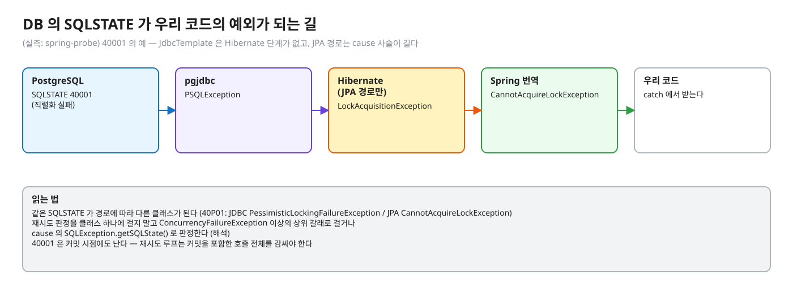
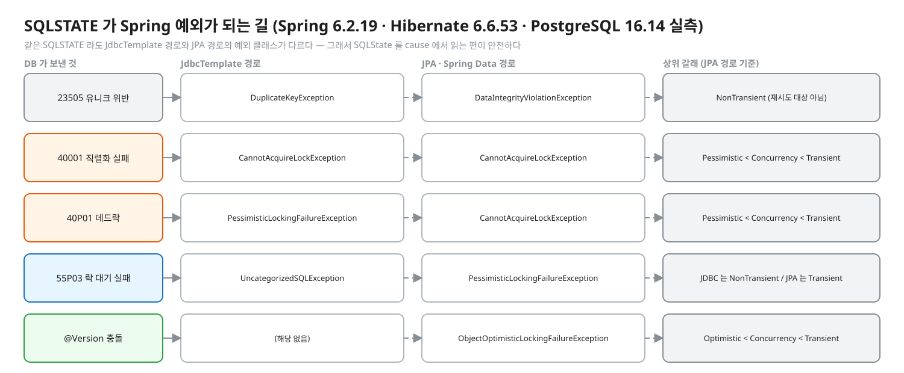
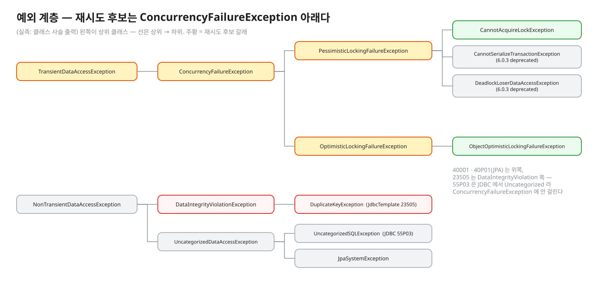
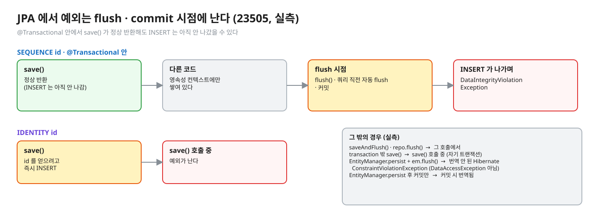
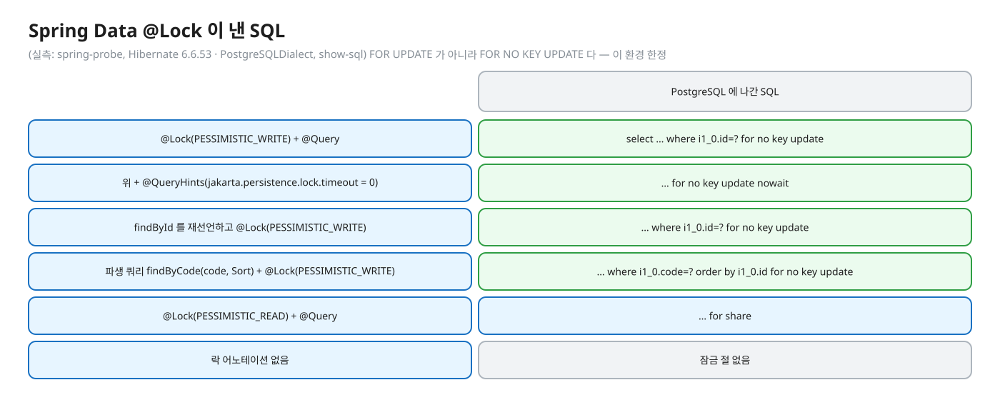
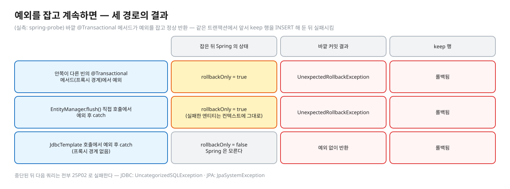
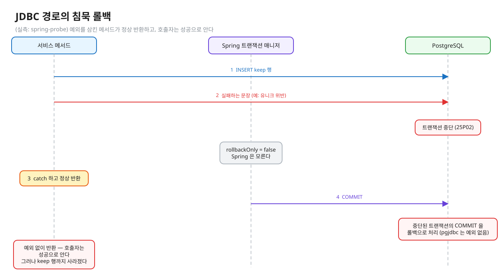
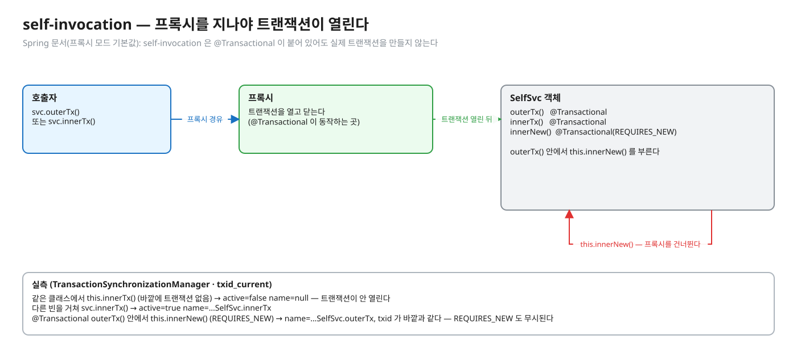
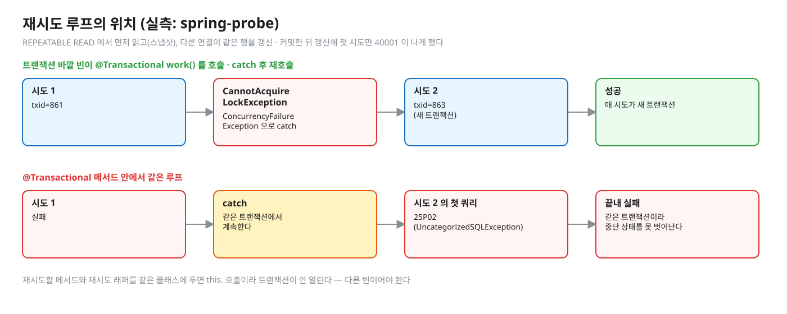
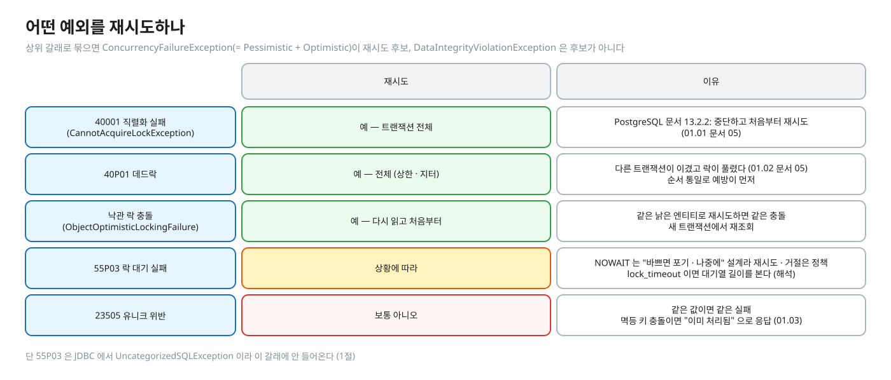

# 05. Spring · JPA 로 오면 — 예외 번역 · 락 SQL · @Version · 재시도 위치

> **이 글에서 알게 되는 것**
> 1. PostgreSQL 의 SQLSTATE 가 JdbcTemplate 경로와 JPA 경로에서 각각 어떤 예외 클래스가 되고, 언제 터지는지 안다.
> 2. 예외를 잡고 계속하면 왜 트랜잭션이 되살아나지 않는지(rollback-only · 침묵 롤백), `@Lock` 이 어떤 SQL 을 내는지 안다.
> 3. self-invocation 때문에 트랜잭션이 안 열리는 것과, 재시도를 `@Transactional` **바깥 빈**의 루프에 두는 이유를 안다.
>
> **먼저 알면 좋은 것**: 01.01 ~ 01.04 의 에러 코드 · 락 문서 (특히 [01.01 문서 05](../l01-isolation-mvcc/docs/05-serializable-ssi-retry.md)).
> **이전 글**: [03. 동시성 · 정합성 문제 — 도구 고르기](03-concurrency-decision-guide.md)
> **다음 글**: [06. DB 커밋과 메시지 발행 사이 — dual write 와 outbox](06-outbox-dual-write.md)
> **구분**: 심화 — 꼬리질문 대비 (01.01 ~ 01.04 의 에러 코드 · 락 문서를 읽은 뒤 · 면접 전)

## `catch (DataAccessException)` 한 줄의 함정

PostgreSQL 의 SQLSTATE 는 Spring 에서 경로(JdbcTemplate / JPA)마다 다른 예외 클래스가 되고, 실패한 트랜잭션은 예외를 잡아도 되살아나지 않으며, 재시도는 `@Transactional` **바깥 빈**의 루프에 둔다. 한 문장으로 줄이면 이렇다. 이 글은 그 세 가지를 실측으로 하나씩 확인한다.

실무에서 이 지점에서 장애가 난다. `catch (DataAccessException)` 한 줄로 모든 실패를 재시도하다가 유니크 위반까지 되풀이하고, 예외를 삼킨 뒤 `UnexpectedRollbackException` 을 만난다. 락 실패를 `catch` 하고 같은 트랜잭션에서 계속 쓰다가 `25P02` 를 만난다. "락 타임아웃 · 데드락이 나면 Spring 에서 어떤 예외가 오나", "`@Transactional` 안에서 예외를 잡고 계속하면", "재시도를 같은 클래스 메서드에 `@Transactional` 을 붙여 두면", "낙관적 락 충돌은" — 이 네 질문이 이 글의 뼈대다.

편집: [diagrams/blog-t05-path.excalidraw](diagrams/blog-t05-path.excalidraw)

### 이 글의 실측 환경

모든 `(실측: spring-probe)` 는 같은 환경이다 (2026-10-13): Spring Boot 3.5.16 · Spring Framework 6.2.19 · Spring Data JPA (Boot 3.5.16 BOM) · Hibernate 6.6.53.Final(`PostgreSQLDialect`) · pgjdbc 42.7.11 · PostgreSQL 16.14(`postgres:16-alpine`, Testcontainers) · 격리 기본값(READ COMMITTED) 외에는 해당 항목에 적는다. 트랜잭션 매니저는 JPA 를 쓰면 Boot 가 만드는 `JpaTransactionManager` 다 — JdbcTemplate 경로도 이 매니저 아래에서 쟀다(40001 커밋 실패만 `JdbcTransactionManager` 로 따로 확인). Spring Retry 는 쓰지 않았다.

## 1. 예외 번역 — SQLSTATE 별 (실측: spring-probe)

첫 질문은 "DB 가 던진 에러가 내 코드에 어떤 클래스로 오나" 다. 아래 그림이 한눈에 보여 주듯, 같은 SQLSTATE 라도 JdbcTemplate 경로와 JPA 경로가 다른 클래스를 준다.

편집: [diagrams/spring-exception-map.excalidraw](diagrams/spring-exception-map.excalidraw)

| SQLSTATE | JdbcTemplate 경로 | JPA · Spring Data 경로 (cause 사슬) | 상위 갈래 |
|---|---|---|---|
| `23505` 유니크 위반 | `DuplicateKeyException` | `DataIntegrityViolationException` ← Hibernate `ConstraintViolationException` ← `PSQLException` | 둘 다 `DataIntegrityViolationException` < `NonTransientDataAccessException` |
| `40001` 직렬화 실패 (SERIALIZABLE 쓰기 왜곡 · REPEATABLE READ 동시 갱신) | `CannotAcquireLockException` (문장 시점도 커밋 시점도) | `CannotAcquireLockException` ← Hibernate `LockAcquisitionException` ← `PSQLException` | `PessimisticLockingFailureException` < `ConcurrencyFailureException` < `TransientDataAccessException` |
| `40P01` 데드락 | `PessimisticLockingFailureException` (바로 그 클래스 — 하위 클래스 아님) | `CannotAcquireLockException` ← `LockAcquisitionException` | 위와 같음 |
| `55P03` (`lock_timeout` · NOWAIT) | **`UncategorizedSQLException`** (SQL state 는 메시지와 cause 에만) | `PessimisticLockingFailureException` ← Hibernate `PessimisticLockException` | JDBC: `NonTransientDataAccessException` 갈래. JPA: 위의 Pessimistic 갈래 |
| `@Version` 충돌 | — | `ObjectOptimisticLockingFailureException` ← Hibernate `StaleObjectStateException` (SQLSTATE 없음 — `UPDATE … WHERE version=?` 가 0행) | `OptimisticLockingFailureException` < `ConcurrencyFailureException` < `TransientDataAccessException` |

표에서 읽을 것이 몇 가지 있다.

- **읽는 법**: 같은 SQLSTATE 가 경로에 따라 다른 클래스가 된다 (`40P01`: JDBC `PessimisticLockingFailureException` / JPA `CannotAcquireLockException`). 재시도 판정을 클래스 하나에 걸지 말고 **`ConcurrencyFailureException` 이상의 상위 갈래**로 걸거나, cause 의 `SQLException.getSQLState()` 로 판정한다 (해석 — Spring Javadoc 도 "하위 클래스에 의존하지 말고 `PessimisticLockingFailureException` 자체를 처리하라" 고 권한다).
- **`55P03` 는 JdbcTemplate 에서 번역되지 않는다.** `CannotAcquireLockException` 이 아니라 `UncategorizedSQLException` 이어서 `catch (ConcurrencyFailureException)` 에 안 걸린다 (실측). 락 대기 실패를 JDBC 로 다루려면 `getSQLException().getSQLState()` 를 직접 본다.
- **`40001` 은 `CannotSerializeTransactionException` 이 아니다.** 직렬화 실패 전용 이름의 클래스는 있지만 6.0.3 부터 deprecated 이고 (Javadoc: "in favor of `PessimisticLockingFailureException`/`CannotAcquireLockException`"), 이 환경에서 나온 것은 `CannotAcquireLockException` 이다. `DeadlockLoserDataAccessException` 도 같은 이유로 deprecated 이고 데드락에서 나오지 않았다 (실측).
- 이름이 "Pessimistic" 이어도 `40001` 이 이 갈래에 들어온다. 갈래 이름은 락 종류가 아니라 "경합으로 실패한 트랜잭션" 에 가깝다 (해석 — 이름과 실제 의미의 어긋남은 위 실측 사실에서 읽은 것).
- 계층 확인 (실측: 클래스 사슬 출력): `CannotAcquireLockException` / `CannotSerializeTransactionException` / `DeadlockLoserDataAccessException` ⊂ `PessimisticLockingFailureException` ⊂ `ConcurrencyFailureException` ⊂ `TransientDataAccessException` ⊂ `DataAccessException`. `ObjectOptimisticLockingFailureException` ⊂ `OptimisticLockingFailureException` ⊂ `ConcurrencyFailureException`. `DuplicateKeyException` ⊂ `DataIntegrityViolationException` ⊂ `NonTransientDataAccessException`. `JpaSystemException` · `UncategorizedSQLException` ⊂ `UncategorizedDataAccessException` ⊂ `NonTransientDataAccessException`.

편집: [diagrams/blog-t05-hierarchy.excalidraw](diagrams/blog-t05-hierarchy.excalidraw)

### 언제 터지나 — JPA 는 flush · commit 시점이다

어떤 예외가 오는지 알았으니, 이번에는 그 예외가 **어디서** 나는지 보자. JPA 는 INSERT 를 바로 보내지 않을 수 있어서 `save()` 가 정상 반환해도 안심할 수 없다.

편집: [diagrams/blog-t05-when-thrown.excalidraw](diagrams/blog-t05-when-thrown.excalidraw)

| 상황 (23505, 실측) | 예외가 나는 곳 |
|---|---|
| `save()` — 트랜잭션 밖 (리포지토리가 자기 트랜잭션을 연다) | `save()` 호출 중 (그 트랜잭션의 flush · commit) |
| `save()` — `SEQUENCE` id, `@Transactional` 안 | `save()` 는 **정상 반환**. INSERT 는 flush(`flush()` · 쿼리 직전 자동 flush · 커밋)에서 나간다 |
| `saveAndFlush()` · `repo.flush()` | 그 호출 |
| `save()` — `IDENTITY` id | `save()` 호출 중 (id 를 얻으려고 즉시 INSERT) |
| `EntityManager.persist` + `em.flush()` (리포지토리 거치지 않음) | **번역 안 된 Hibernate `ConstraintViolationException`** (`PersistenceException` 계열, `DataAccessException` 아님) |
| `EntityManager.persist` 후 커밋만 | 커밋 시 `DataIntegrityViolationException` (트랜잭션 매니저가 번역) |

- 40001 도 같다. JPA 에서 수정만 하고 메서드가 끝나면 **커밋 시점**에 `CannotAcquireLockException` 이 나온다. JDBC 쪽도 SERIALIZABLE 쓰기 왜곡의 패자는 UPDATE 가 아니라 커밋에서 실패했다 (메시지: `JdbcTransactionManager` 는 `JDBC commit; …`, `JpaTransactionManager` 는 JdbcTemplate 경로여도 JPA 경로여도 `Hibernate transaction: Unable to commit against JDBC Connection; …`, 실측). 그래서 재시도 루프는 **커밋을 포함한 호출 전체**를 감싸야 한다 (01.01 문서 05 와 같은 말).
- 리포지토리 메서드는 `@Repository` 번역 대상이라 `DataAccessException` 이 오지만, 서비스에서 `EntityManager` 를 직접 쓰면 flush 에서는 Hibernate 예외가 그대로 나온다 (위 표 — 실측).

## 2. 락 SQL — Spring Data `@Lock` (실측: spring-probe, Hibernate `show-sql`)

예외의 모양을 알았으니, 락을 거는 쪽으로 가 보자. `@Lock` 어노테이션이 실제로 PostgreSQL 에 어떤 SQL 을 보내는지가 궁금한 사람이 많다.

편집: [diagrams/blog-t05-lock-sql.excalidraw](diagrams/blog-t05-lock-sql.excalidraw)

| 리포지토리 선언 | PostgreSQL 에 나간 SQL (Hibernate 6.6.53 · `PostgreSQLDialect`) |
|---|---|
| `@Lock(PESSIMISTIC_WRITE)` + `@Query` | `select … where i1_0.id=? for no key update` |
| 위 + `@QueryHints(@QueryHint(name="jakarta.persistence.lock.timeout", value="0"))` | `… for no key update nowait` |
| `findById` 를 재선언하고 `@Lock(PESSIMISTIC_WRITE)` | `… where i1_0.id=? for no key update` |
| 파생 쿼리 `findByCode(code, Sort)` + `@Lock(PESSIMISTIC_WRITE)` | `… where i1_0.code=? order by i1_0.id for no key update` |
| `@Lock(PESSIMISTIC_READ)` + `@Query` | `… for share` |
| 락 어노테이션 없음 | 잠금 절 없음 |

- `FOR UPDATE` 가 아니라 **`FOR NO KEY UPDATE`** 다 (이 환경 한정 — Hibernate 6.4 · 6.6 + PostgreSQL 방언. 7.x 는 `for no key update of s1_0` 로 다르게 나온다 → [l02 문서 06](../l02-row-locks-deadlock/docs/06-app-and-mysql.md) 의 버전별 표).
- 락 대기 시간(양수 타임아웃) 힌트가 6.x 에서 SQL 에 반영되지 않는 것, `em.lock` 이 `for update` 로 나가는 것 등 Hibernate 버전별 차이는 위 문서에 있다. 이 문서의 새 확인은 "Spring Data `@Lock` 도 같은 SQL 을 낸다" 는 것이다.
- Spring Data 문서의 `@Lock` 설명은 "쿼리 메서드에 `@Lock` 으로 락 모드를 지정하고, CRUD 메서드는 재선언해서 붙인다" 까지다. 문서의 예시는 `LockModeType.READ` 뿐이고 타임아웃 힌트 예시는 없다 — 위 SQL 과 힌트 동작은 문서가 아니라 실측이다.
- `lock_timeout` 을 세션에 걸면(`set local lock_timeout='300ms'`) `@Lock` 쿼리도 `55P03` 으로 취소되고 JPA 경로에서 `PessimisticLockingFailureException` 이 된다 (실측). 힌트 0(NOWAIT)도 같은 예외다.
- 락 SQL 이 `55P03` 으로 실패한 뒤 같은 트랜잭션에서 계속 쓰면 안 된다 (아래 3절).

## 3. 예외를 잡고 계속하면 — rollback-only 와 중단된 트랜잭션

"예외를 잡았으니 괜찮겠지" 가 이 글에서 가장 위험한 가정이다. 실패한 문장 뒤의 PostgreSQL 트랜잭션은 **중단(aborted)** 상태다 (`25P02` — 01.03 문서 05). 문제는 Spring 쪽이 경로에 따라 이 사실을 다르게 안다는 것이다. 아래는 "바깥 `@Transactional` 메서드가 예외를 잡고 정상 반환" 한 결과다 (실측: spring-probe, 같은 트랜잭션에서 앞서 `keep` 행을 INSERT 해 둔 뒤 실패시킴).

| 경로 | 잡은 뒤 상태 | 바깥 커밋 결과 | `keep` 행 |
|---|---|---|---|
| 안쪽이 **다른 빈의 `@Transactional` 메서드**(프록시 경계)이고 거기서 예외 (JPA `saveAndFlush` 든 JDBC 든) | Spring 상태 `rollbackOnly=true` | **`UnexpectedRollbackException`** ("Transaction silently rolled back because it has been marked as rollback-only") | 롤백됨 |
| `EntityManager.flush()` 직접 호출에서 예외 후 catch | `rollbackOnly=true` (Hibernate 가 표시). 실패한 엔티티는 영속성 컨텍스트에 **그대로 남는다**(`contains=true`) | `UnexpectedRollbackException` | 롤백됨 |
| JdbcTemplate 호출에서 예외 후 catch (프록시 경계 없음) | `rollbackOnly=false` — Spring 은 모른다 | **예외 없이 반환** | **롤백됨** (PostgreSQL 이 중단된 트랜잭션의 COMMIT 을 롤백으로 처리, pgjdbc 가 예외를 내지 않음) |

편집: [diagrams/blog-t05-rollback-only.excalidraw](diagrams/blog-t05-rollback-only.excalidraw)

중단된 뒤 **다음 쿼리**는 전부 `25P02` 로 실패한다. JDBC 는 `UncategorizedSQLException` (`select 1` 도), JPA 는 `repo.count()` 가 영속성 컨텍스트에 남은 실패 엔티티를 다시 flush 하려다 `JpaSystemException`(`GenericJDBCException` ← `25P02`) 이다 (실측). `em.flush()` 를 한 번 더 해도 같다.

세 경로 가운데 JDBC 경로의 침묵 롤백이 가장 위험하다. 예외를 삼킨 메서드가 정상 반환하고 호출자는 성공으로 안다. **이미 쓴 `keep` 행까지 사라진다** (실측). 시간 순서로 보면 이렇다.

편집: [diagrams/blog-t05-silent-rollback.excalidraw](diagrams/blog-t05-silent-rollback.excalidraw)

JPA 락 실패도 비슷하다. `@Lock … NOWAIT` 의 `PessimisticLockingFailureException` 을 잡고 계속해도 Spring 상태는 `rollbackOnly=false` 이고 커밋은 예외 없이 반환했다 (실측; DB 쪽 트랜잭션은 `55P03` 으로 이미 중단 — 해석, 위 JDBC 행과 같은 원리).

기본 롤백 규칙은 런타임 예외 · `Error` 롤백, 검사 예외는 롤백 안 함이다 ([Spring · Rolling Back](https://docs.spring.io/spring-framework/reference/data-access/transaction/declarative/rolling-back.html)). `UnexpectedRollbackException` 의 Javadoc: "Thrown when an attempt to commit a transaction resulted in an unexpected rollback."

**결론**: DB 예외를 잡았다면 그 트랜잭션은 끝난 것이다. 계속하려면 (a) 예외가 트랜잭션 밖으로 나가게 두고 새 트랜잭션에서 다시 하거나, (b) 정말 일부만 되돌리려면 `SAVEPOINT`(nested)나 `REQUIRES_NEW` 로 경계를 나눈다 (해석 — 이 문서는 (b) 를 실측하지 않았다).

## 4. self-invocation 과 재시도 위치 (실측: spring-probe)

그렇다면 "새 트랜잭션에서 다시" 는 어디서 해야 하나. 여기서 두 번째 함정이 나온다. `@Transactional` 은 프록시가 동작시키므로, 프록시를 지나지 않으면 아무 일도 일어나지 않는다.

편집: [diagrams/blog-t05-proxy.excalidraw](diagrams/blog-t05-proxy.excalidraw)

`TransactionSynchronizationManager.isActualTransactionActive()` · `getCurrentTransactionName()` · `select txid_current()` 로 쟀다.

| 호출 | 트랜잭션 |
|---|---|
| 같은 클래스에서 `this.innerTx()` (`@Transactional`) — 바깥에 트랜잭션 없음 | `active=false name=null` — **트랜잭션이 안 열린다** |
| 다른 빈을 거쳐 `svc.innerTx()` | `active=true name=…SelfSvc.innerTx` |
| `@Transactional outerTx()` 안에서 `this.innerNew()` (`REQUIRES_NEW`) | `name=…SelfSvc.outerTx`, **`txid` 가 바깥과 같다** — `REQUIRES_NEW` 도 무시된다 |

Spring 문서(프록시 모드 기본값): "self-invocation … does not lead to an actual transaction at runtime even if the invoked method is marked with `@Transactional`" ([Spring · @Transactional](https://docs.spring.io/spring-framework/reference/data-access/transaction/declarative/annotations.html)). 해결책으로 문서는 AspectJ 모드를 든다.

이 사실이 재시도 설계를 정한다. **재시도 루프** — REPEATABLE READ 에서 먼저 읽고(스냅샷), 다른 연결이 같은 행을 갱신·커밋한 뒤 갱신해 첫 시도만 `40001` 이 나게 했다.

| 루프의 위치 | 결과 |
|---|---|
| **트랜잭션 바깥 빈**이 `@Transactional work()` 를 호출·`catch (ConcurrencyFailureException)` 후 재호출 | 시도 1 `txid=861` → `CannotAcquireLockException` → 시도 2 `txid=863`(새 트랜잭션) → 성공. **매 시도가 새 트랜잭션** |
| **`@Transactional` 메서드 안**에서 같은 루프 | 시도 1 실패 → 시도 2 의 첫 쿼리가 `25P02` (`UncategorizedSQLException`) → 같은 트랜잭션이라 끝내 실패 |

편집: [diagrams/blog-t05-retry-place.excalidraw](diagrams/blog-t05-retry-place.excalidraw)

- 그래서 재시도는 **트랜잭션 경계 바깥**에 둔다: 별도 빈(파사드 · 재시도 래퍼) 또는 AOP. Spring 문서는 재시도 위치를 규정하지 않는다 — 이 위치는 위 실측에서 나온 설계다.
- 재시도할 메서드와 재시도 래퍼를 **같은 클래스**에 두면 `this.` 호출이라 트랜잭션이 안 열린다. 다른 빈이어야 한다.
- 시도마다 work 전체를 다시 실행하므로 외부 부수효과(메시지 발행 · 외부 API)는 커밋 뒤로 미룬다 (01.01 문서 05).

## 5. 어떤 예외를 재시도하나

마지막으로, 바깥 루프에서 무엇을 다시 시도하나.

편집: [diagrams/blog-t05-retry-which.excalidraw](diagrams/blog-t05-retry-which.excalidraw)

| 실패 | 재시도 | 이유 |
|---|---|---|
| `40001` 직렬화 실패 (`CannotAcquireLockException`) | 예 — 트랜잭션 전체 | PostgreSQL 문서 13.2.2: 중단하고 처음부터 재시도 (01.01 문서 05) |
| `40P01` 데드락 | 예 — 전체 (상한 · 지터) | 다른 트랜잭션이 이겼고 락이 풀렸다 (01.02 문서 05). 순서 통일로 예방이 먼저 |
| 낙관 락 충돌 (`ObjectOptimisticLockingFailureException`) | 예 — **다시 읽고** 처음부터 | 같은 낡은 엔티티로 재시도하면 같은 충돌. 새 트랜잭션에서 재조회 |
| `55P03` 락 대기 실패 | 상황에 따라 | NOWAIT 는 "바쁘면 포기·나중에" 설계라 재시도 · 거절은 정책. `lock_timeout` 이면 대기열 길이를 본다 (해석) |
| `23505` 유니크 위반 | 보통 **아니오** | 같은 값이면 같은 실패. 멱등 키 충돌이면 재시도가 아니라 "이미 처리됨" 으로 응답 (01.03). 동시 INSERT 를 재조회로 합치는 패턴은 의도된 설계일 때만 |

상위 갈래로 묶으면 `ConcurrencyFailureException`(= Pessimistic + Optimistic) 이 재시도 후보, `DataIntegrityViolationException` 은 후보가 아니다. 단 `55P03` 은 JDBC 에서 `UncategorizedSQLException` 이라 이 갈래에 안 들어온다 (1절).

## 자주 하는 오해

1. **"40001 은 `CannotSerializeTransactionException` 이다."** 이 이름은 deprecated 이고, 실측에서는 `CannotAcquireLockException` 이 나왔다.
2. **"JPA 는 `save()` 에서 유니크 위반이 난다."** `IDENTITY` 가 아니면 flush · 커밋 시점이다.
3. **"예외를 catch 하면 Spring 이 알아서 처리한다."** JDBC 경로는 Spring 이 모르는 채 PostgreSQL 만 중단되어 침묵 롤백한다.
4. **"같은 클래스의 `@Transactional` 메서드로 재시도를 나누면 매번 새 트랜잭션이다."** 열리지 않는다 (`REQUIRES_NEW` 도 무시).
5. **"락 타임아웃은 `CannotAcquireLockException` 이다."** JDBC 에서는 `UncategorizedSQLException`, JPA 에서는 `PessimisticLockingFailureException`.

## 한눈에 정리

| 질문 | 답 |
|---|---|
| 예외 클래스는? | 같은 SQLSTATE 라도 경로마다 다르다 — 상위 갈래(`ConcurrencyFailureException`)나 `getSQLState()` 로 판정 |
| 언제 터지나? | JPA 는 flush · 커밋 시점 (`IDENTITY` 는 `save()`). 40001 은 커밋에서도 난다 |
| `@Lock` 이 내는 SQL? | `FOR NO KEY UPDATE` (이 환경 한정) · NOWAIT 힌트는 `nowait` · READ 는 `for share` |
| 잡고 계속하면? | 트랜잭션은 끝난 것 — 다음 쿼리는 `25P02`, 커밋은 `UnexpectedRollbackException` 이거나 JDBC 경로는 침묵 롤백 |
| 재시도 위치는? | `@Transactional` 바깥 빈의 루프 (같은 클래스 `this.` 호출은 트랜잭션이 안 열린다) |

- DB 예외를 잡았다면 그 트랜잭션은 끝난 것이다.
- `55P03` 은 JDBC 에서 번역되지 않아 `UncategorizedSQLException` 으로 온다.
- 재시도는 매번 새 트랜잭션이어야 하므로 바깥 빈에 둔다. 부수효과는 커밋 뒤로 미룬다.
- 낙관 락 충돌은 SQLSTATE 가 없고 `UPDATE … WHERE version=?` 가 0행이다.

## 스스로 확인

1. 유니크 위반이 JdbcTemplate 과 JPA 에서 각각 어떤 예외로 오나요? 언제 나나요?
   

답
JdbcTemplate 은 문장 실행 시점에 `DuplicateKeyException`. JPA 는 `DataIntegrityViolationException`(cause 에 `ConstraintViolationException` ← `PSQLException` 23505)이고, `IDENTITY` 가 아니면 `save()` 가 아니라 flush · 커밋 때다. 둘 다 `DataIntegrityViolationException` 계열이라 상위 클래스로 잡으면 된다. (실측: spring-probe)

2. 직렬화 실패(40001)를 Spring 에서 어떻게 알아보나요?
   

답
`CannotAcquireLockException`(`PessimisticLockingFailureException` ⊂ `ConcurrencyFailureException` ⊂ `TransientDataAccessException`)이 오고 cause 의 SQLState 가 `40001`. 클래스 이름에 기대기보다 상위 갈래나 SQLState 로 판정한다. 커밋 시점에도 난다. (실측)

3. `@Transactional` 메서드 안에서 DB 예외를 catch 하고 계속하면 어떻게 되나요?
   

답
PostgreSQL 트랜잭션은 이미 중단이라 다음 쿼리는 25P02. 프록시 경계(다른 빈의 `@Transactional`)나 JPA flush 에서 난 예외면 Spring 이 rollback-only 로 표시해 바깥 커밋에서 `UnexpectedRollbackException`. JdbcTemplate 으로 직접 낸 예외는 Spring 이 몰라서 커밋이 예외 없이 끝나지만 DB 는 롤백한다 — 침묵 롤백. 일부만 되돌리려면 경계를 나눈다. (실측)

4. 재시도는 어디에 두나요? 같은 클래스에 두면 왜 안 되나요?
   

답
트랜잭션 바깥 빈의 루프. 트랜잭션은 프록시 경계에서 열려서 `this.` 호출은 열리지 않고(`REQUIRES_NEW` 도 무시), 트랜잭션 안에서 재시도하면 중단된 트랜잭션을 재사용해 25P02 로 계속 실패한다. 바깥 루프는 매 시도가 새 txid. 부수효과는 커밋 뒤로. (실측)

5. `@Lock(PESSIMISTIC_WRITE)` 는 SQL 로 뭐가 나가고 NOWAIT 는 어떻게 하나요?
   

답
Hibernate 6.4 · 6.6 + PostgreSQL 방언에서 `FOR NO KEY UPDATE`(FOR UPDATE 아님). `@QueryHints(jakarta.persistence.lock.timeout = 0)` 이면 `NOWAIT`. 실패하면 `55P03` → JPA 에서 `PessimisticLockingFailureException`. 7.x 는 SQL 이 다르다. (실측)

6. 낙관 락(`@Version`) 충돌은 어떤 예외이고 어떻게 재시도하나요?
   

답
`UPDATE … WHERE id=? AND version=?` 가 0행이면 `StaleObjectStateException` → `ObjectOptimisticLockingFailureException`(`OptimisticLockingFailureException` ⊂ `ConcurrencyFailureException`). 분리(detached)된 낡은 엔티티의 `save()` 도, 동시 트랜잭션의 커밋 시 flush 도 같은 예외다. 다시 읽어서 새 트랜잭션으로 재시도한다. DB 에러 코드(SQLSTATE)는 없다. (실측)

7. JDBC 에서 락 타임아웃(55P03)을 어떻게 구별하나요?
   

답
`UncategorizedSQLException` 으로 오므로 `getSQLException().getSQLState()` 가 `55P03` 인지 본다. `ConcurrencyFailureException` 으로 잡으면 놓친다. (실측)

## 이 레슨들에서 직접 보기

이 글의 실측 코드(`spring-probe`)는 저장소에 넣지 않았다. 손으로 확인하는 곳은 아래 레슨 문서다.

| 어디서 | 무엇을 |
|---|---|
| [01.01 문서 05](../l01-isolation-mvcc/docs/05-serializable-ssi-retry.md) | 40001 의 UPDATE · COMMIT 시점, 전체 재시도 |
| [01.02 문서 06](../l02-row-locks-deadlock/docs/06-app-and-mysql.md) | Hibernate 락 SQL 의 버전별 표 |
| [01.03 문서 05](../l03-idempotency/docs/05-failed-transaction.md) | 실패한 트랜잭션(`25P02`) |

## 출처

- [Spring · @Transactional](https://docs.spring.io/spring-framework/reference/data-access/transaction/declarative/annotations.html) — 프록시 모드 self-invocation, `isolation` 이 `REQUIRED`/`REQUIRES_NEW` 에서만 적용 (WebFetch 2026-10-13)
- [Spring · Rolling Back](https://docs.spring.io/spring-framework/reference/data-access/transaction/declarative/rolling-back.html) — 기본 롤백 규칙 (같은 날 확인; 이 페이지에는 `UnexpectedRollbackException` 설명이 없다)
- [`UnexpectedRollbackException` Javadoc](https://docs.spring.io/spring-framework/docs/current/javadoc-api/org/springframework/transaction/UnexpectedRollbackException.html) · [`PessimisticLockingFailureException`](https://docs.spring.io/spring-framework/docs/current/javadoc-api/org/springframework/dao/PessimisticLockingFailureException.html)(직접 하위 클래스 3개, 하위 클래스 대신 이 클래스를 처리하라는 권고) · [`DeadlockLoserDataAccessException`](https://docs.spring.io/spring-framework/docs/current/javadoc-api/org/springframework/dao/DeadlockLoserDataAccessException.html)(6.0.3 deprecated)
- [Spring Data JPA · Locking](https://docs.spring.io/spring-data/jpa/reference/jpa/locking.html) — `@Lock` 을 쿼리 메서드에 붙이거나 CRUD 메서드를 재선언 (타임아웃 예시는 없다)
- Hibernate 락 SQL 의 버전별 표: [l02 문서 06](../l02-row-locks-deadlock/docs/06-app-and-mysql.md) (Hibernate User Guide Locking 인용 포함)
- 실측: Spring Boot 3.5.16 · Spring Framework 6.2.19 · Hibernate 6.6.53.Final · pgjdbc 42.7.11 · PostgreSQL 16.14, 2026-10-13. 프로브 코드는 스크래치(`spring-probe`)에 있고 저장소에는 넣지 않았다 — 클래스 · 메시지는 버전에 따라 달라질 수 있으므로 버전을 올리면 다시 잰다.
