# 06. DB 커밋과 메시지 발행 사이 — dual write 와 outbox

> **이 글에서 알게 되는 것**
> 1. DB 에 쓰고 브로커에 발행하는 두 번의 쓰기가 왜 하나로 커밋되지 않고, 어느 순서로 해도 한쪽이 새는지 안다.
> 2. outbox 가 "발행할 것" 을 업무 데이터와 같은 트랜잭션에 쓰고 별도 릴레이(폴링 · CDC)가 발행하는 구조, 그리고 대가로 얻는 at-least-once 를 안다.
> 3. 릴레이가 여럿일 때의 순서 문제와 키 · 파티션, 소비자 멱등이 왜 필요한지 안다.
>
> **먼저 알면 좋은 것**: [01. PostgreSQL 엔진 지도](01-postgres-engine-map.md)의 WAL 절 (CDC 가 읽는 것이 WAL 이다).
> **이전 글**: [05. Spring · JPA 로 오면](05-spring-jpa-mapping.md)
> **구분**: 심화 — 꼬리질문 대비 (레슨을 마친 뒤 · 02.03 outbox 실습 전). 이 트랙 레슨의 예측 문항 답은 이 문서에 없다

## 주문은 있는데 이벤트가 없다

주문 · 결제는 DB 에 있는데 후속 시스템(정산 · 알림)에 사건이 안 간 건이 있다. 반대로 롤백된 주문의 알림이 나간 건도 있다. 대개 "저장 → 발행" 을 코드 두 줄로 쓴 곳에서 난다. 이 트랙 곳곳에서 "02.03 outbox (예정)" 으로 미뤄 둔 개념이 이 글에 있고, 02.03 은 이 글을 실습으로 옮긴다.

전체 모양을 먼저 보자. 이 글은 이 순서로 간다. dual write 실패 두 경우 → outbox → 릴레이(폴링 · CDC) → 순서 → 소비자 멱등.

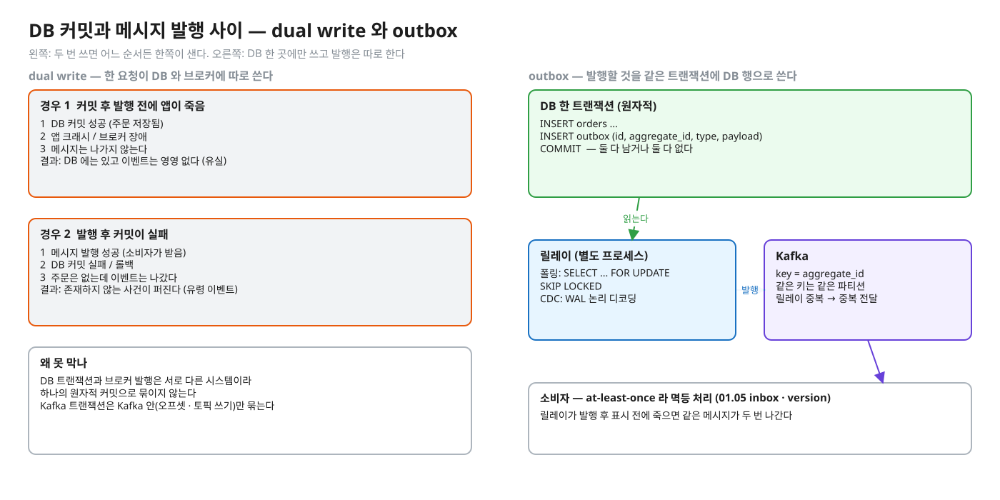
<sub>편집: [diagrams/outbox-dual-write.excalidraw](diagrams/outbox-dual-write.excalidraw)</sub>

## dual write 문제 — 두 번 쓰면 어느 쪽이든 샌다

한 요청이 DB 와 브로커 두 시스템에 쓰는 것을 dual write 라 부른다. 두 시스템은 하나의 원자적 커밋으로 묶이지 않으므로 순서와 상관없이 사이에서 죽을 수 있다.

| 순서 | 사이에서 죽으면 | 결과 |
|---|---|---|
| DB 커밋 → 발행 | 커밋은 됐고 발행은 안 됐다 | DB 에는 있는데 이벤트는 영영 없다 (유실) |
| 발행 → DB 커밋 | 발행은 됐고 커밋은 실패했다 | 없는 사건의 이벤트가 퍼진다 (유령 이벤트) |

### 경우 1 — 커밋 후 발행 전에 죽는다

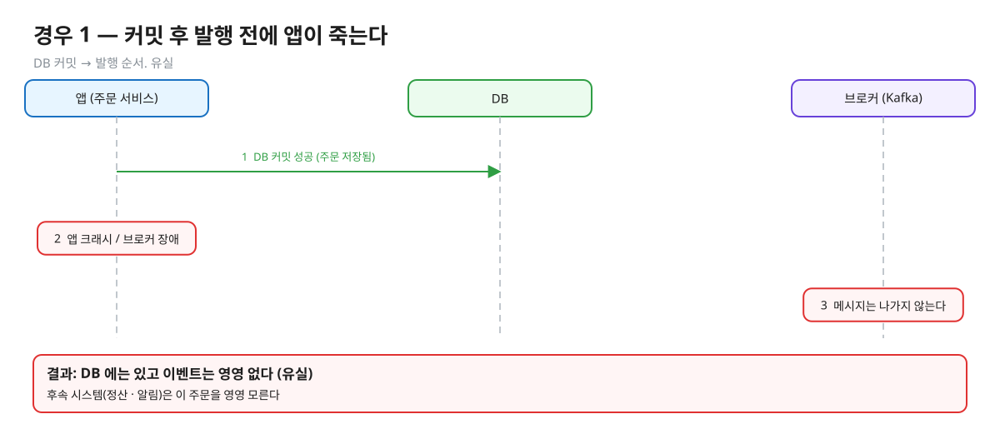
<sub>편집: [diagrams/blog-t06-dual-lost.excalidraw](diagrams/blog-t06-dual-lost.excalidraw)</sub>

"커밋 → 발행" 순서가 흔한 이유는 발행 실패가 커밋을 되돌리지 못하게 둔 대신 유실을 받아들인 설계이기 때문이다 (해석).

### 경우 2 — 발행 후 커밋이 실패한다

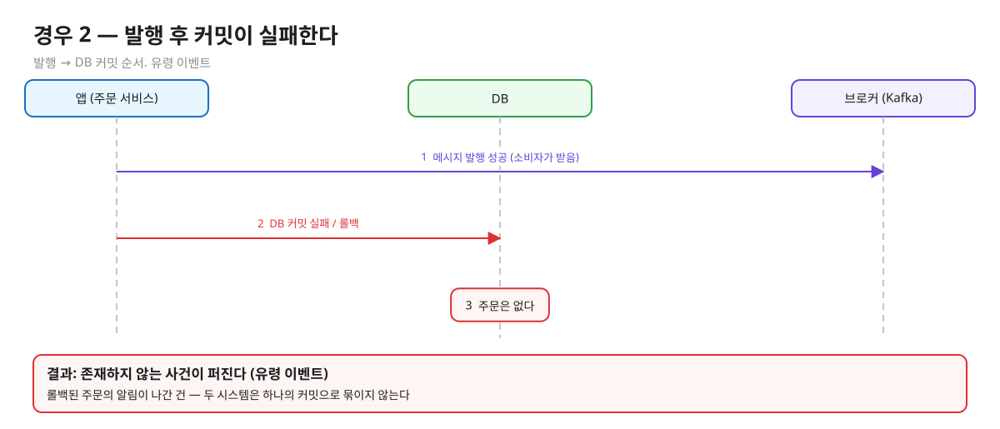
<sub>편집: [diagrams/blog-t06-dual-ghost.excalidraw](diagrams/blog-t06-dual-ghost.excalidraw)</sub>

두 순서를 바꾼다고 해결되지 않는다. 순서 변경은 장애의 모양만 바꾼다. 그렇다고 try/catch 로 발행 실패 시 보상(DB 삭제)하는 것도 해법이 아니다 — 보상 자체가 또 죽을 수 있다 (해석).

패턴 이름의 출처인 [microservices.io · Transactional outbox](https://microservices.io/patterns/data/transactional-outbox.html) 는 문제를 "DB 갱신과 메시지 발행을 어떻게 원자적으로 하나" 로 쓰고, 2PC 없이 트랜잭션 중간에 메시지를 보내는 것은 믿을 수 없다고 한다 (해석 수준으로 인용 — 그 페이지의 주장이다).

## outbox 의 구조

해법은 두 시스템을 묶으려 하지 않고, 원자성을 DB 한 곳에서만 요구하는 것이다.

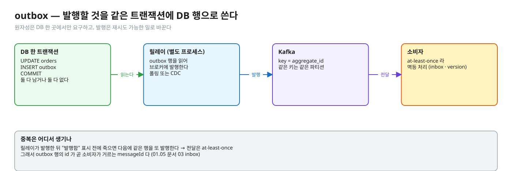
<sub>편집: [diagrams/blog-t06-outbox.excalidraw](diagrams/blog-t06-outbox.excalidraw)</sub>

1. 업무 테이블 변경과 **outbox 테이블 INSERT 를 한 트랜잭션**으로 커밋한다. 커밋되면 둘 다 남고, 롤백되면 둘 다 없다 — 이것은 DB 하나 안의 원자성이라 PostgreSQL 이 이미 준다.
2. **릴레이**가 outbox 행을 읽어 브로커에 발행한다. microservices.io 도 "별도 프로세스가 메시지를 브로커로 보낸다" 고 쓰며 구현으로 polling publisher 와 transaction log tailing 두 가지를 든다.
3. 발행의 보장은 **at-least-once** 다. 릴레이가 발행 후 "발행함" 표시 전에 죽으면 다음에 같은 행을 또 발행한다. microservices.io 도 중복 발행 가능성과 소비자 멱등을 단점으로 쓴다. 그래서 outbox 행의 id 가 곧 소비자가 거르는 `messageId` 다 → [01.05 문서 03 (inbox)](../l05-event-order-dedupe/docs/03-inbox-dedupe.md).

outbox 행의 예 (테이블 모양은 이 문서의 예시이며 표준이 아니다):

```sql
CREATE TABLE outbox (
  id           bigserial PRIMARY KEY,
  aggregate_id text        NOT NULL,   -- Kafka key 가 될 값 (예: 주문 id)
  type         text        NOT NULL,
  payload      jsonb       NOT NULL,
  created_at   timestamptz NOT NULL DEFAULT now(),
  published_at timestamptz             -- NULL 이면 아직 발행 전 (폴링 방식)
);
-- 업무 변경과 같은 트랜잭션
BEGIN;
  UPDATE orders SET status = 'PAID' WHERE id = 42;
  INSERT INTO outbox(aggregate_id, type, payload) VALUES ('42', 'OrderPaid', '{"orderId":42}');
COMMIT;
```

Debezium 의 Outbox Event Router 는 outbox 테이블에 `id` · `aggregatetype` · `aggregateid` · `type` · `payload` 열이 있다고 가정한다 ([Debezium · Outbox Event Router](https://debezium.io/documentation/reference/stable/transformations/outbox-event-router.html)).

## 릴레이 두 방식

outbox 행을 브로커로 옮기는 릴레이는 크게 두 가지다. 하나는 테이블을 주기적으로 읽는 폴링이고, 하나는 WAL 의 변경을 읽는 CDC 다.

### 1) 폴링 (polling publisher)

릴레이가 주기적으로 미발행 행을 읽어 발행하고 표시한다.

```sql
BEGIN;
SELECT id, aggregate_id, type, payload FROM outbox
 WHERE published_at IS NULL ORDER BY id LIMIT 100
 FOR UPDATE SKIP LOCKED;
-- ... 브로커에 발행 (모두 ack 확인) ...
UPDATE outbox SET published_at = now() WHERE id = ANY(:ids);
COMMIT;
```

릴레이가 **여러 개**면 같은 행을 둘이 집지 않게 `FOR UPDATE SKIP LOCKED` 를 쓴다. [PostgreSQL 16 · SELECT](https://www.postgresql.org/docs/16/sql-select.html): `SKIP LOCKED` 는 즉시 잠글 수 없는 행을 건너뛰고, 일관되지 않은 뷰를 주므로 범용 작업에는 맞지 않지만 큐 같은 테이블에 여러 소비자가 접근할 때 락 경합을 피하는 데 쓸 수 있다. 상세와 Q05 · Q06 은 [01.02 문서 03](../l02-row-locks-deadlock/docs/03-not-waiting.md).

(실측: psql 2026-10-13, PostgreSQL 16 · 두 세션이 필요해 일반 테이블 `outbox_demo` 6행을 만들었다가 지웠다) 릴레이 A 가 `LIMIT 2 FOR UPDATE SKIP LOCKED` 로 1·2번을 잡고 트랜잭션을 연 채 4초 쉬는 동안: 릴레이 B 의 같은 쿼리는 **기다리지 않고 3·4번**을 받았다. SKIP LOCKED 없이 `FOR UPDATE` 만 쓴 B2 는 `lock_timeout=1s` 에서 `canceling statement due to lock timeout` (`while locking tuple (0,1)`) 으로 끝났다 — 즉 A 가 쥔 동안 줄을 선다.

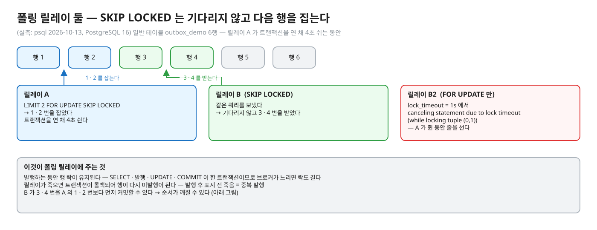
<sub>편집: [diagrams/blog-t06-polling.excalidraw](diagrams/blog-t06-polling.excalidraw)</sub>

여기에는 알아 둘 대가가 셋 있다.

첫째, **발행하는 동안 행 락이 유지된다.** SELECT · 발행 · UPDATE · COMMIT 이 한 트랜잭션이므로 브로커가 느리면 락도 길다 (01.02 문서 03 이 "락은 커밋까지 간다" 로 경고한 것과 같다). 릴레이가 죽으면 트랜잭션이 롤백되어 행이 다시 미발행이 된다 — 그래서 발행 후 표시 전 죽음 = 중복 발행이다.

둘째, **순서가 깨질 수 있다**: 위 실측에서 B 가 3·4번을 A 의 1·2번보다 먼저 커밋할 수 있다. 같은 `aggregate_id` 의 이벤트가 서로 다른 릴레이에 흩어지면 발행 순서가 뒤집힌다 (해석 — 실측은 "다른 릴레이가 다른 행을 동시에 잡는다" 까지다). 대응: 릴레이를 하나로 두거나, 릴레이마다 `aggregate_id` 해시 범위를 맡겨 같은 키는 한 릴레이만 읽게 한다 (해석).

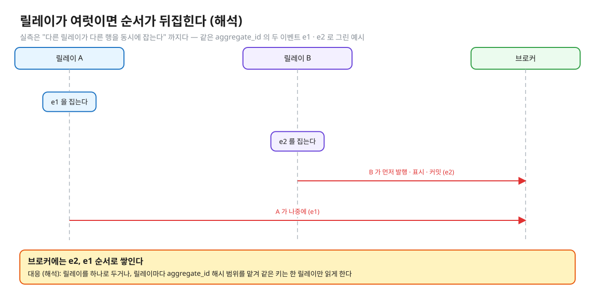
<sub>편집: [diagrams/blog-t06-order-flip.excalidraw](diagrams/blog-t06-order-flip.excalidraw)</sub>

셋째, 단일 폴러가 `id > 마지막으로 본 id` 커서로 읽는 설계는 조심한다. `bigserial` 번호는 INSERT 시점에 배정되고 커밋은 그 뒤에 일어나므로, 작은 번호가 큰 번호보다 늦게 커밋될 수 있어 커서가 앞질러 가면 그 행을 놓친다 (해석). 위 SQL 처럼 `published_at IS NULL` 플래그로 읽으면 늦게 커밋된 행도 다음 폴링에서 잡힌다.

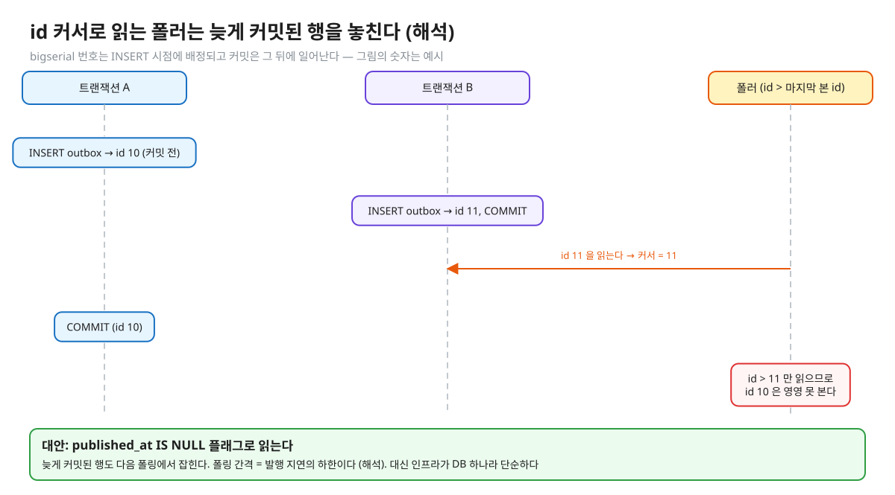
<sub>편집: [diagrams/blog-t06-cursor-miss.excalidraw](diagrams/blog-t06-cursor-miss.excalidraw)</sub>

폴링 간격은 발행 지연의 하한이다 (해석). 대신 인프라가 DB 하나라 단순하다.

### 2) CDC — PostgreSQL 논리 디코딩

릴레이가 outbox 테이블을 읽지 않고 **WAL 의 변경**을 읽는다. 폴링의 커서 · 락 문제를 엔진이 풀어 주는 방식이다 (해석 — 아래 49.6 의 커밋 순서 디코딩에서 이은 요약).

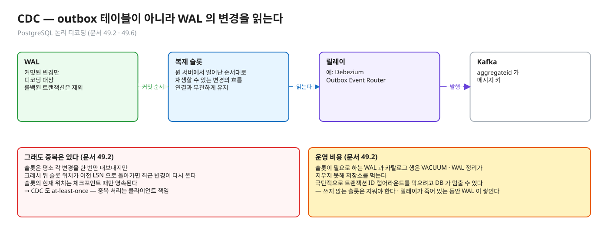
<sub>편집: [diagrams/blog-t06-cdc.excalidraw](diagrams/blog-t06-cdc.excalidraw)</sub>

[PostgreSQL 16 · 49.2 논리 디코딩 개념](https://www.postgresql.org/docs/16/logicaldecoding-explanation.html): 논리 디코딩은 WAL 내용을 해독해 테이블의 영속 변경을 해석 가능한 형태로 뽑는 과정이다. **복제 슬롯(replication slot)** 은 "원 서버에서 일어난 순서대로 클라이언트에 재생할 수 있는 변경의 흐름" 이고, 슬롯은 연결과 무관하게 유지되며 크래시에 안전하고, 한 번에 한 수신자만 쓴다.

[49.6 출력 플러그인](https://www.postgresql.org/docs/16/logicaldecoding-output-plugin.html): "동시 트랜잭션은 **커밋 순서**로 디코딩되고", 롤백된 트랜잭션은 디코딩되지 않는다. → 폴링과 달리 커밋되지 않은 행이나 늦게 커밋된 행의 문제가 없고, 순서가 커밋 순서다.

**그래도 중복은 있다**: 문서(49.2)에 따르면 슬롯은 평소 각 변경을 한 번만 내보내지만 크래시 뒤 슬롯 위치가 이전 LSN 으로 돌아가면 최근 변경이 다시 온다. "논리 디코딩 클라이언트가 같은 메시지를 두 번 처리해도 문제가 없게 하는 것은 클라이언트 책임이다." 슬롯의 현재 위치는 체크포인트 때만 영속된다고도 쓴다. → CDC 도 at-least-once 다.

**운영 비용**: 슬롯이 필요로 하는 WAL 과 카탈로그 행은 VACUUM · WAL 정리가 지우지 못해 저장소를 먹고, 극단적으로 트랜잭션 ID 랩어라운드를 막으려고 DB 가 멈출 수 있다 — 쓰지 않는 슬롯은 지워야 한다 (49.2). 릴레이가 죽어 있는 동안 WAL 이 쌓인다는 뜻이다.

Debezium 은 이 길 위에서 outbox 를 다루는 도구다. Outbox Event Router 는 outbox 테이블 변경이 `INSERT` 라고 가정하고 `DELETE` 는 자동으로 걸러내며, 기본으로 `aggregatetype` 값에서 토픽 이름(`outbox.event.<aggregatetype>`)을 만들고 **`aggregateid` 를 Kafka 메시지 키**로 쓴다 — 문서는 이것이 Kafka 파티션 안의 순서를 지키는 데 중요하다고 쓴다. `id` 는 메시지 헤더로 가며 중복 제거에 쓸 수 있다고 한다 (Debezium 문서). Debezium 이 PostgreSQL 에서 어떤 디코딩 플러그인으로 읽는지는 이 문서에서 확인하지 못했다.

두 방식을 나란히 놓으면 이렇다.

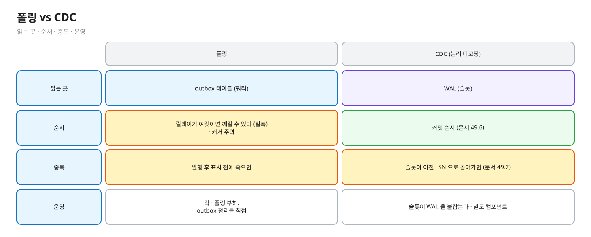
<sub>편집: [diagrams/blog-t06-poll-vs-cdc.excalidraw](diagrams/blog-t06-poll-vs-cdc.excalidraw)</sub>

| | 폴링 | CDC (논리 디코딩) |
|---|---|---|
| 읽는 곳 | outbox 테이블 (쿼리) | WAL (슬롯) |
| 순서 | 릴레이가 여럿이면 깨질 수 있다 (위 실측) · 커서 주의 | 커밋 순서 (문서 49.6) |
| 중복 | 발행 후 표시 전 죽으면 | 슬롯이 이전 LSN 으로 돌아가면 (문서 49.2) |
| 운영 | 락 · 폴링 부하, outbox 정리를 직접 | 슬롯이 WAL 을 붙잡는다 · 별도 컴포넌트 |

## 순서 — 키와 파티션

릴레이가 순서를 지켜 주더라도, 브로커 쪽에서 순서가 어디까지 보장되는지 알아야 한다. Kafka 의 순서는 한 파티션 안이다 → [01.05 문서 02](../l05-event-order-dedupe/docs/02-ordering-paths.md). outbox 에서 순서가 필요한 이벤트는 **같은 `aggregate_id` 를 메시지 키**로 보내 같은 파티션에 모은다 (Debezium 도 `aggregateid` 를 키로 쓴다).

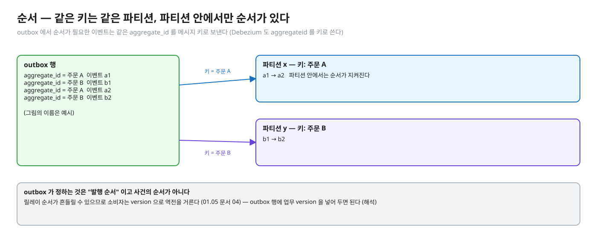
<sub>편집: [diagrams/blog-t06-key-partition.excalidraw](diagrams/blog-t06-key-partition.excalidraw)</sub>

다만 outbox 가 정하는 것은 "발행 순서" 이고 사건의 순서가 아니다. 릴레이 순서가 흔들릴 수 있으므로 (위 절) 소비자는 version 으로 역전을 거른다 → [01.05 문서 04](../l05-event-order-dedupe/docs/04-version-ordering.md). outbox 행에 업무 version 을 넣어 두면 된다 (해석).

## 소비자 멱등 — at-least-once 의 나머지 절반

outbox 가 주는 것은 "유실 없음" 이다. 커밋된 업무 변경의 이벤트는 반드시 outbox 에 있다. 대신 전달은 at-least-once 다 — 폴링 릴레이는 발행 후 표시 전 죽음으로, CDC 는 슬롯 위치가 이전 LSN 으로 돌아가서 같은 메시지를 다시 보낸다. 그래서 중복은 소비자 멱등이 푼다. outbox 행의 id 를 `messageId` 로 inbox 에서 거르고 ([01.05 문서 03](../l05-event-order-dedupe/docs/03-inbox-dedupe.md)), 순서 역전은 version 으로 거른다 ([01.05 문서 04](../l05-event-order-dedupe/docs/04-version-ordering.md)). Debezium 의 `id` 헤더도 중복 제거에 쓸 수 있다고 문서가 말한다.

## Spring Modulith 의 Event Publication Registry

[Spring Modulith · Events](https://docs.spring.io/spring-modulith/reference/events.html) 가 이 패턴을 프레임워크로 준다 (확인한 것만):

- 이벤트를 발행하면 그 이벤트를 받을 트랜잭션 리스너마다 항목을 "원래 업무 트랜잭션의 일부로" 이벤트 발행 로그에 쓴다. 리스너가 성공하면 항목을 완료로 표시하고, 실패하면 항목이 그대로 남아 재시도에 쓸 수 있다.
- 미완료 항목은 `IncompleteEventPublications` 로 재제출하거나 `spring.modulith.events.republish-outstanding-events-on-restart=true` 로 시작 시 다시 발행한다.
- 완료 항목 정리: `spring.modulith.events.completion-mode` 는 기본 `UPDATE`(완료 일시를 남긴다) · `DELETE`(완료 시 삭제) · `ARCHIVE`(보관 테이블로 복사). `CompletedEventPublications` 로 지울 수도 있다.
- `@Externalized` 이벤트는 외부 브로커로 나가며 Kafka 는 `spring-modulith-events-kafka` 가 Spring Kafka 로 보낸다. 그 실행도 트랜잭션 리스너이므로 레지스트리 보호를 받는다. 논리 라우팅 키가 Kafka 의 토픽과 메시지 키로 쓰인다.
- 문서는 "at-least-once" 라는 말을 쓰지 않는다. 실패한 항목이 남아 재제출되고 그 사이 성공한 쪽이 다시 받을 수 있다는 점에서 소비자 멱등이 필요하다고 보는 것은 (해석)이다. 구조는 "업무 트랜잭션에 항목을 남기고, 실패 항목을 재제출" 하는 방식이고 WAL 을 읽는 CDC 가 아니다 (해석).

## Kafka 트랜잭션이 DB 까지 묶어 주지 않는 이유

"Kafka 트랜잭션을 쓰면 outbox 가 필요 없지 않나" 라는 질문이 자연스럽게 따라온다.

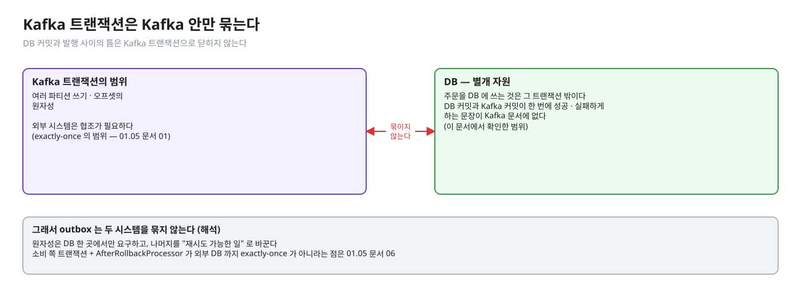
<sub>편집: [diagrams/blog-t06-kafka-tx-scope.excalidraw](diagrams/blog-t06-kafka-tx-scope.excalidraw)</sub>

Kafka 의 트랜잭션은 **Kafka 안**(여러 파티션 쓰기 · 오프셋)의 원자성이다. 문서가 말하는 exactly-once 의 범위와 "외부 시스템은 협조가 필요하다" 는 [01.05 문서 01](../l05-event-order-dedupe/docs/01-delivery-semantics.md) 에 있다. DB 는 별개 자원이라 DB 커밋과 Kafka 커밋이 한 번에 성공/실패하게 하는 문장이 Kafka 문서에 없다 (이 문서에서 확인한 범위).

그래서 outbox 는 두 시스템을 **묶지 않고**, 원자성은 DB 한 곳에서만 요구하고 나머지를 "재시도 가능한 일" 로 바꾼다 (해석). 소비 쪽 트랜잭션 + `AfterRollbackProcessor` 가 외부 DB 까지 exactly-once 가 아니라는 점은 [01.05 문서 06](../l05-event-order-dedupe/docs/06-spring-kafka-mysql.md).

## outbox 정리

가만 두면 outbox 는 계속 자란다. 정리 방식은 릴레이에 달렸다.

- 폴링: `published_at` 이 있는 행을 보관 기간 뒤 삭제한다 (직접 짠다). 인덱스는 미발행 행만 빠르게 찾게 `WHERE published_at IS NULL` 부분 인덱스 같은 것이 후보다 (해석 — 이 문서에서 측정하지 않았다).
- CDC: Debezium Outbox Event Router 는 outbox 의 `DELETE` 를 걸러내므로 행을 지워도 이벤트가 나가지 않는다 (문서). 삭제 시점 설계는 이 문서에서 확인하지 못해 쓰지 않는다.
- Spring Modulith: `completion-mode` 로 `DELETE` · `ARCHIVE`.

보관 기간은 재발행 · 장애 복구에 필요한 기간보다 길게 둔다 (해석). 소비자 inbox 보관과 같은 질문이다 → [01.05 문서 05](../l05-event-order-dedupe/docs/05-design-patterns.md).

## 자주 하는 오해

1. **"@Transactional 안에서 `kafkaTemplate.send()` 하면 원자적이다."** `send` 는 DB 트랜잭션에 참여하지 않는다. 커밋 전에 나가면 롤백돼도 이벤트가 나가고, 커밋 후에 나가면 사이에서 죽으면 유실이다 (해석 — 두 시점 모두 dual write).
2. **"outbox 를 쓰면 exactly-once 다."** 릴레이 재시작으로 중복 발행이 가능하다. outbox 가 주는 것은 "유실 없음(커밋된 업무 변경의 이벤트는 반드시 outbox 에 있다)" 이고, 중복은 소비자 멱등이 푼다.
3. **"CDC 는 중복이 없다."** 슬롯이 이전 LSN 으로 돌아가면 같은 변경이 다시 온다 (문서 49.2).
4. **"`SKIP LOCKED` 폴링이면 순서도 지켜진다."** 여러 릴레이가 서로 다른 행을 동시에 집으므로 같은 키의 순서가 뒤집힐 수 있다 (위 실측).
5. **"outbox 는 이벤트 소싱이다."** outbox 는 발행을 위한 임시 큐고, 이벤트 소싱은 이벤트가 상태의 원본이다 (해석 — 용어 구분).

## 한눈에 정리

| 질문 | 답 |
|---|---|
| 왜 두 번 쓰면 안 되나 | 하나의 원자적 커밋으로 안 묶여서 — 커밋 후 발행 전 죽음은 유실, 발행 후 커밋 실패는 유령 이벤트 |
| outbox 는 무엇을 푸나 | 원자성을 DB 한 곳에서만 요구한다 — 업무 변경 + outbox INSERT 가 한 트랜잭션 |
| 릴레이는 | 폴링(`SKIP LOCKED`, 단순 · 순서 · 커서 주의) 또는 CDC(커밋 순서 · 슬롯이 WAL 을 붙잡음) |
| 순서는 | 같은 `aggregate_id` 를 키로 같은 파티션에 · 소비자는 version 으로 역전 거르기 |
| 중복은 | 폴링 · CDC 모두 at-least-once — 소비자 멱등(inbox) |

- DB 에 쓰고 브로커에 발행하는 두 번의 쓰기는 하나로 커밋되지 않아 어느 순서로 해도 한쪽이 샌다.
- outbox 는 "발행할 것" 을 업무 데이터와 같은 트랜잭션에 DB 행으로 쓰고, 별도 릴레이가 그 행을 읽어 발행한다.
- 대가로 전달은 at-least-once 가 되어 소비자가 멱등해야 한다.
- Kafka 트랜잭션은 Kafka 안만 묶으므로 DB 커밋과 발행 사이의 틈은 outbox 가 메운다.

## 스스로 확인

1. 주문 저장 후 Kafka 발행을 코드 두 줄로 쓰면 어떤 장애가 나고, 순서를 바꾸면 해결되나?
   <details><summary>답</summary>
   DB 커밋 후 발행 전에 죽으면 주문은 있고 이벤트는 없다(유실). 순서를 바꿔 발행 후 커밋하면 커밋 실패 시 없는 주문의 이벤트가 나간다(유령). 두 시스템은 하나의 커밋으로 묶이지 않아서 순서 변경은 장애 모양만 바꾼다. 해법은 원자성을 DB 한 곳에서만 요구하는 outbox 다 — 발행할 내용을 같은 트랜잭션에 INSERT 하고 릴레이가 발행한다.
   </details>
2. outbox 릴레이가 발행은 했는데 "발행함" 표시 전에 죽었다. 어떻게 되고 누가 막나?
   <details><summary>답</summary>
   폴링이면 트랜잭션이 롤백되어 행이 다시 미발행이 되고 같은 메시지가 또 나간다. CDC 도 슬롯 위치가 체크포인트 때만 영속되어 크래시 뒤 이전 LSN 에서 재전송될 수 있다(PostgreSQL 문서 49.2). 그래서 전달은 at-least-once 이고, 소비자가 outbox 행 id 같은 `messageId` 로 inbox 에서 거른다(01.05 문서 03).
   </details>
3. 폴링 릴레이를 둘 띄우면 무엇이 좋아지고 무엇이 나빠지나?
   <details><summary>답</summary>
   `FOR UPDATE SKIP LOCKED` 로 서로 다른 행을 기다림 없이 집어 처리량이 늘고 한 릴레이가 죽어도 다른 쪽이 잇는다(실측: 한 릴레이가 잡은 행을 다른 릴레이는 건너뛰고 다음 행을 받았다). 나빠지는 것은 순서다 — 같은 aggregate 의 이벤트가 다른 릴레이로 흩어지면 발행 순서가 뒤집힐 수 있어서 키 해시로 릴레이를 나누거나 하나만 쓴다(해석). 소비자 version 검사가 마지막 방어선이다.
   </details>
4. 폴링과 CDC 중 무엇을 고르나?
   <details><summary>답</summary>
   폴링은 DB 하나로 끝나 단순하지만 지연이 폴링 간격이고 순서 · 락 · 정리를 직접 챙긴다. CDC 는 WAL 을 커밋 순서로 읽어 순서가 자연스럽지만(문서 49.6) 슬롯이 WAL 을 붙잡아 소비자가 죽으면 디스크가 차고(문서 49.2) 별도 컴포넌트를 운영해야 한다. 선택 기준은 순서 요구 · 지연 요구 · 운영 여력이다 (판단은 해석).
   </details>
5. Kafka 트랜잭션 + `read_committed` 를 쓰면 outbox 가 필요 없지 않나?
   <details><summary>답</summary>
   Kafka 트랜잭션은 Kafka 안의 쓰기 · 오프셋만 원자적으로 묶는다(Kafka 문서, 01.05 문서 01). 주문을 DB 에 쓰는 것은 그 트랜잭션 밖이라 DB 커밋과 발행 사이의 틈은 남는다. DB 가 원본인 사건을 내보내려면 DB 쪽에 기록(outbox)이 있어야 한다.
   </details>

## 이 레슨에서 직접 보기

이 글은 개념 정리다. 실습은 02.03 (예정) — 지금은 psql 로 폴링 릴레이를 손으로 해볼 수 있다: [01.02 문서 03](../l02-row-locks-deadlock/docs/03-not-waiting.md) 의 SKIP LOCKED 실습(Q05 · Q06 · `JobQueueImplementTest`) 이 폴링 릴레이의 "행 집기" 와 같은 모양이다.

## 근거를 확인하지 못해 뺀 것

- Debezium PostgreSQL 커넥터가 쓰는 디코딩 플러그인 · 슬롯 설정, outbox 삭제 시점의 정석, `wal_level` 요구사항 · 슬롯 상태 조회 방법(이 문서에서 열어 보지 않았다), Modulith 이벤트 테이블 이름과 스키마.
- PostgreSQL 16 에서 논리 디코딩은 49장(Chapter 49)이다 (49.2 · 49.6 페이지 기준).

## 출처

- [PostgreSQL 16 · 49.2 Logical Decoding Concepts](https://www.postgresql.org/docs/16/logicaldecoding-explanation.html) — 슬롯의 성질 · 중복 가능 · WAL 보유 경고
- [PostgreSQL 16 · 49.6 Logical Decoding Output Plugins](https://www.postgresql.org/docs/16/logicaldecoding-output-plugin.html) — 커밋 순서 디코딩 · 롤백 제외
- [PostgreSQL 16 · SELECT (Locking Clause)](https://www.postgresql.org/docs/16/sql-select.html) — SKIP LOCKED
- [Debezium · Outbox Event Router](https://debezium.io/documentation/reference/stable/transformations/outbox-event-router.html) — 열 · 토픽 · 키 · DELETE 필터 · id 헤더
- [Spring Modulith · Events](https://docs.spring.io/spring-modulith/reference/events.html) — Event Publication Registry · completion-mode · 재제출
- [microservices.io · Transactional outbox](https://microservices.io/patterns/data/transactional-outbox.html) — 패턴 이름 · 문제 정의 (주장은 해석 수준)
- [Kafka 문서 · Message Delivery Semantics](https://kafka.apache.org/documentation/#semantics) — Kafka 안의 exactly-once 범위 (01.05 문서 01 에서 정리)
- 실측: psql 2026-10-13 (01.01 observe 컨테이너, PostgreSQL 16)
- 레슨 연결: [01.02 문서 03](../l02-row-locks-deadlock/docs/03-not-waiting.md) · [01.05 문서 01](../l05-event-order-dedupe/docs/01-delivery-semantics.md) · [03](../l05-event-order-dedupe/docs/03-inbox-dedupe.md) · [04](../l05-event-order-dedupe/docs/04-version-ordering.md) · [05](../l05-event-order-dedupe/docs/05-design-patterns.md)
