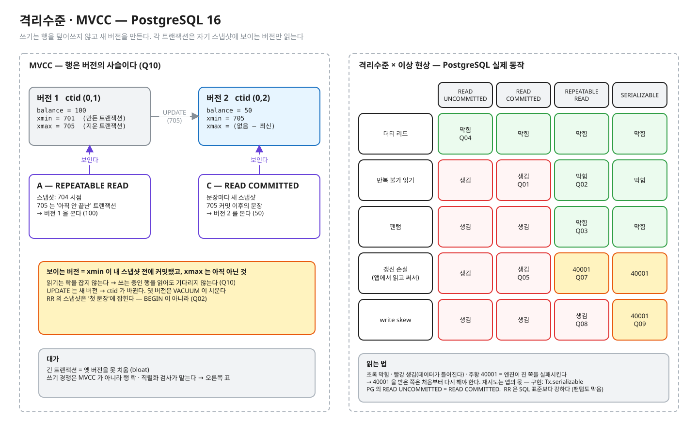

# 01.01 격리수준 · MVCC

> **완료 기준**: 예측 10문항을 먼저 적고 돌려 전부 초록 · 구현 테스트 초록 · NOTES 를 채우고 꼬리질문 5개를 해설 보기 전에 답한다 · "PostgreSQL REPEATABLE READ 에서 write skew 가 왜 생기고, SERIALIZABLE 은 어떻게 막으며, 그때 앱은 무엇을 해야 하나"를 그림 없이 3분 안에 설명한다.

공고 연결 — "동시성 처리 · 유실 없는 데이터 정합성". 잔고·주문·당직표는 전부 "읽고 판단하고 쓴다" 의 경쟁이다.
(참고) 이 레슨은 이전 실험장 `postgres-tx-playground` T-03~ (psql 실습)를 옮긴 것이다. 같은 장면을 **테스트로 판정**하고, psql 관찰은 `observe/` 로 남겼다.

---

## ① 질문 · 첫 예측 — 20분

1. READ COMMITTED 에서 같은 SELECT 를 두 번 하면 결과가 달라질 수 있나? REPEATABLE READ 에서는?
2. REPEATABLE READ 트랜잭션 안에서 같은 조건으로 두 번 센다. 그 사이에 다른 트랜잭션이 새 행을 커밋했다면 두 번째 결과는?
3. 두 트랜잭션이 같은 행을 고치면 각 격리수준에서 무슨 일이 생기나? (기다림 / 덮어씀 / 실패)
4. 당직 의사 둘이 동시에 "2명이니 빠져도 되겠지" 하면? 어떤 격리수준이 막나? 행 락은 왜 소용없나?
5. 고치는 중인 행을 다른 트랜잭션이 읽으면 기다리나? 무엇을 보나? 그게 어떻게 가능한가?

> **이어서 첫 예측**: 질문에 종이로 답해 NOTES §0 에 옮긴 뒤, `IsolationPredictTest.java` 의 예측 칸 `"?"` 를 **감으로** 채워 `./gradlew 01.01-predict` 를 돌린다. 틀려도 된다 — 틀린 문항이 ② 를 읽는 이유가 된다. PROGRESS 의 "예측 적중"은 이 첫 예측으로 센다.

## ② 원리 — 75분



<sub>편집: [diagrams/mvcc-isolation.excalidraw](diagrams/mvcc-isolation.excalidraw) · 다시 그리기(만든 사람용 · 레슨 폴더에서): `python3 -I diagrams/draw.py`</sub>

1차 자료 (블로그 요약 말고 이것부터):

공식 문서에서 아래 "찾을 것" 문장을 직접 찾아 표시하고, 한 줄로 번역해 NOTES 나 여백에 적어 둔다.

| 자료 | 읽으면서 찾을 것 |
|---|---|
| [개념 정리 docs/](docs/README.md) | **필수 03 · 05** 를 읽으며 ① 에서 틀린 문항이 왜 틀렸는지 찾는다 (나머지 글은 심화 — 레슨을 마친 뒤 · 면접 전). 공식 문서 행은 docs 가 링크하는 곳에서 같이 연다 · 예측 답은 접힌 칸에만 |
| [PostgreSQL 16 · 13.2 Transaction Isolation](https://www.postgresql.org/docs/16/transaction-iso.html) | 표 13.1 의 "Allowed, but not in PG" 칸 · RR 에서 "could not serialize access due to concurrent update" 가 나는 조건 · SERIALIZABLE 의 재시도 권고 |
| [13.1 MVCC Introduction](https://www.postgresql.org/docs/16/mvcc-intro.html) | "읽기는 쓰기를 막지 않고, 쓰기는 읽기를 막지 않는다" 의 근거 |
| [5.5 System Columns](https://www.postgresql.org/docs/16/ddl-system-columns.html) | xmin · xmax · ctid 의 정의 (Q10 ctid · observe 장면 2 의 xmin/xmax) |
| 『데이터 중심 애플리케이션 설계』 7장 | 스냅샷 격리 · 갱신 손실 · write skew · 충돌 구체화 |
| (선택) Ports & Grittner, *Serializable Snapshot Isolation in PostgreSQL*, VLDB 2012 | SSI 가 rw-의존성 "위험한 구조"를 어떻게 잡나 |

## ③ 재현 — 30분 · 세 가지 손 작업

파일 경로는 이 레슨 폴더(`01-concurrency-consistency/l01-isolation-mvcc/`) 기준이다. 명령은 두 곳에서 친다.

```bash
# deep-dive 폴더에서 — ./gradlew 는 전부 여기서
./gradlew 01.01-predict
./gradlew 01.01-implement
```

```bash
# deep-dive 폴더에서 레슨 폴더로 들어간 뒤 — observe 스크립트는 여기서
cd 01-concurrency-consistency/l01-isolation-mvcc
observe/up.sh
```

IntelliJ 로 한다면: deep-dive 폴더를 Gradle 프로젝트로 열고(코드를 바꾼 뒤 Gradle 창에서 Reload), 테스트 메서드 옆 ▶ 로 한 문항씩 돌려도 된다. 자세히는 [GUIDE.md](../../GUIDE.md).

| 작업 | 실행 | 무엇을 |
|---|---|---|
| **예측** (되짚기) | `./gradlew 01.01-predict` | `src/test/java/deepdive/c01/l01/IsolationPredictTest.java` 의 Q01~Q10(10문항 · 예측 칸 14곳)을 ① 에서 감으로 적었다. 틀린 문항을 ② 를 읽은 뒤 되짚어 다시 적고 초록으로 만든다 (NOTES §1 에 한 줄). 한 문항씩 돌리는 법: [GUIDE](../../GUIDE.md) §2-3. 출력의 A/B 타임라인은 예측을 적은 문항만 보인다 |
| **구현** (코드) | `./gradlew 01.01-implement` | 구현 대상 `src/main/java/deepdive/c01/l01/Tx.java` 의 `TODO(구현)` — SERIALIZABLE + 40001 재시도. 검사는 `src/test/java/deepdive/c01/l01/WriteSkewImplementTest.java`. 실패 메시지가 "정합성 깨짐: 당직 0명" 부터 알려 준다 |
| **관찰** (진짜 엔진) | `observe/up.sh` → [observe/SCRIPT.md](observe/SCRIPT.md) | psql 두 개로 write skew · xmin/xmax · 락 대기를 직접 |

테스트는 진짜 PostgreSQL 16 컨테이너(Testcontainers)에서 돈다. Docker 가 떠 있어야 한다. 첫 실행은 이미지 준비로 느릴 수 있다.

한 문항만 (deep-dive 폴더에서): `./gradlew :01-concurrency-consistency:l01-isolation-mvcc:predict --tests '*Q05*'` (IDE 에서 메서드 하나 실행해도 된다)

구현 테스트는 6개다. **결과 검사**는 "당직은 동시에 빠져도 항상 1명 이상" 하나다. 나머지 5개는 `Tx.serializable` 이 이름대로 도는지 본다 — 진 쪽의 재시도 · commit 시점 40001 도 전체 재실행 · 계속 실패하면 MAX_ATTEMPTS 에서 포기 · 직렬화 실패가 아닌 오류는 재시도 안 함 · 정말 SERIALIZABLE 로 돈다(**방법 검사**).
빈칸 상태에서 빨강 5 · 초록 1 이다. "직렬화 실패가 아닌 오류는 재시도 안 함" 은 가드라 처음부터 초록이다.
다른 해법 — 판단 근거 행을 `SELECT … FOR UPDATE` 로 잠그기 — 을 `src/main/java/deepdive/c01/l01/OnCallService.java` 에서 시도해 볼 수도 있다. 그때 결과 검사는 초록이고 방법 검사는 빨간 게 정상이다 (NOTES 꼬리질문 2번).

## ④ 내 말로 — 20분

1. [NOTES.md](NOTES.md) — 틀린 예측 · 3분 설명 · 꼬리질문 5개(답을 먼저 쓰고 해설과 비교) · §6 내 실무와 연결(권장 — 내가 일하는 서비스를 떠올려 한 줄씩)
2. `/kata:discuss PostgreSQL 격리수준과 MVCC, write skew` — 면접관 역할의 꼬리질문
3. 버텼으면 [../../PROGRESS.md](../../PROGRESS.md) 에 테스트 ✅ · 내 말로 ✅

---

💡 **실무**: SERIALIZABLE 은 "켜면 끝"이 아니다 — 진 쪽이 40001 을 받으므로 **재시도 루프가 앱에 있어야** 한다.
재시도 단위는 트랜잭션 전체이고, 그 안에서 외부 API 호출·메시지 발행을 하면 재시도 때 중복된다 → 02.03 outbox 로 이어진다.

정답 patch: [../../solutions/01.01.patch](../../solutions/01.01.patch) — 구현 정답과 **예측 답**이 들어 있다. 예측 · 구현을 끝낸 뒤 연다 (deep-dive 폴더에서 `less solutions/01.01.patch`). 내 코드와 비교한다.
