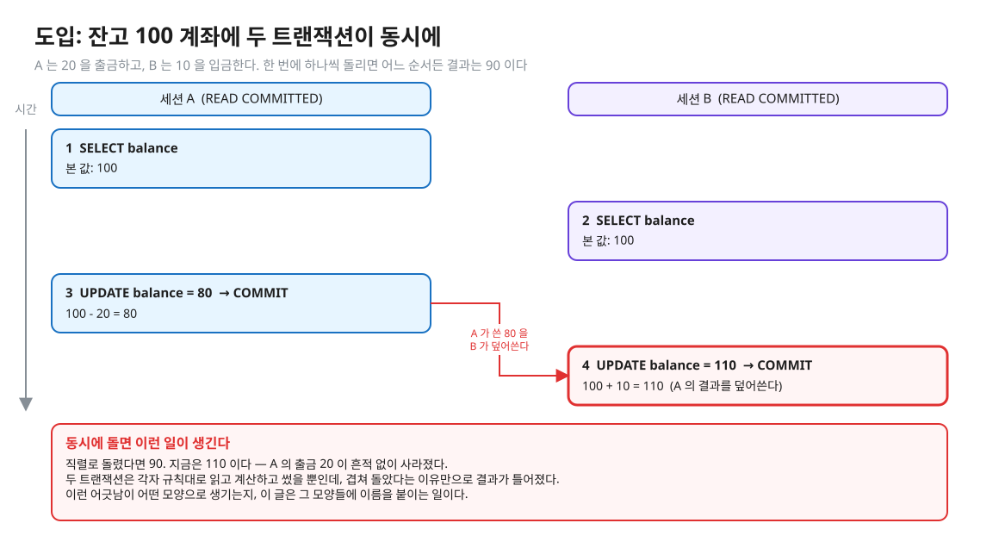
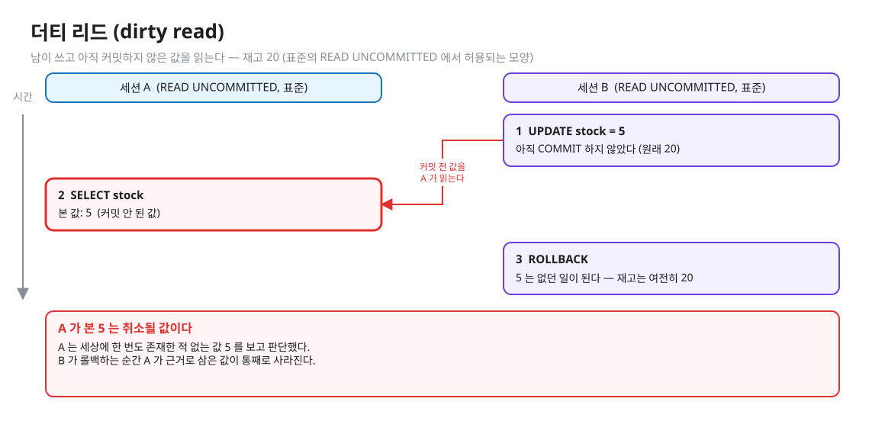
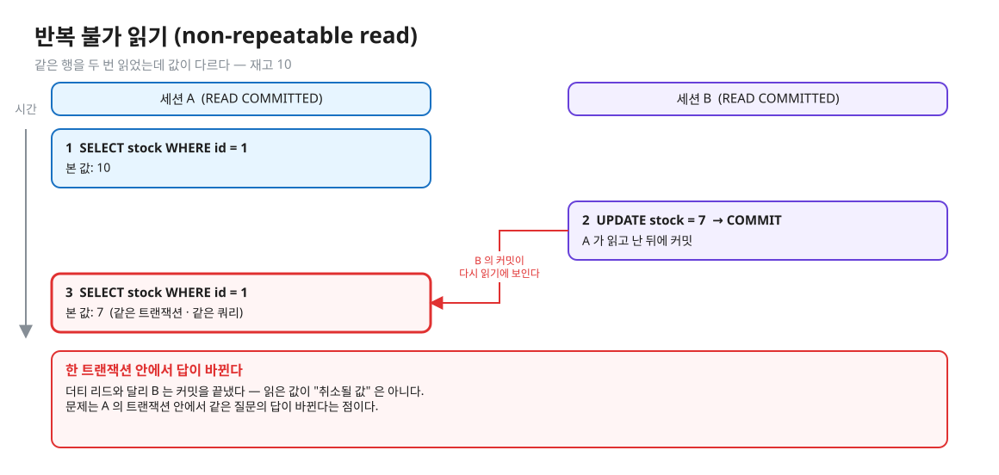
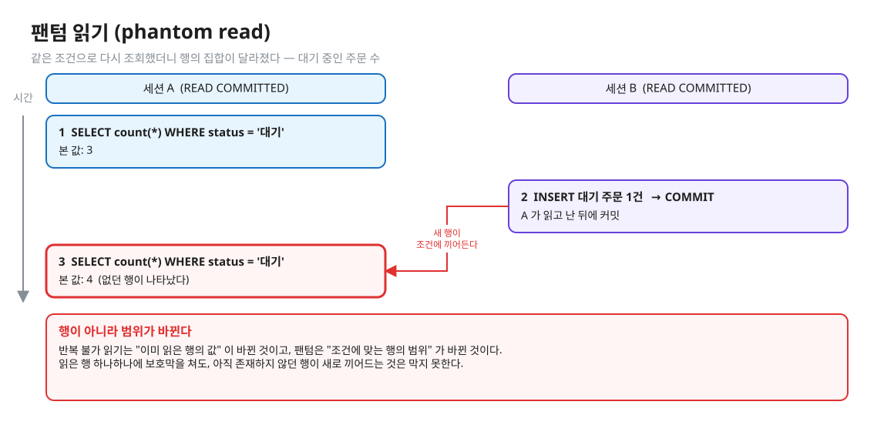
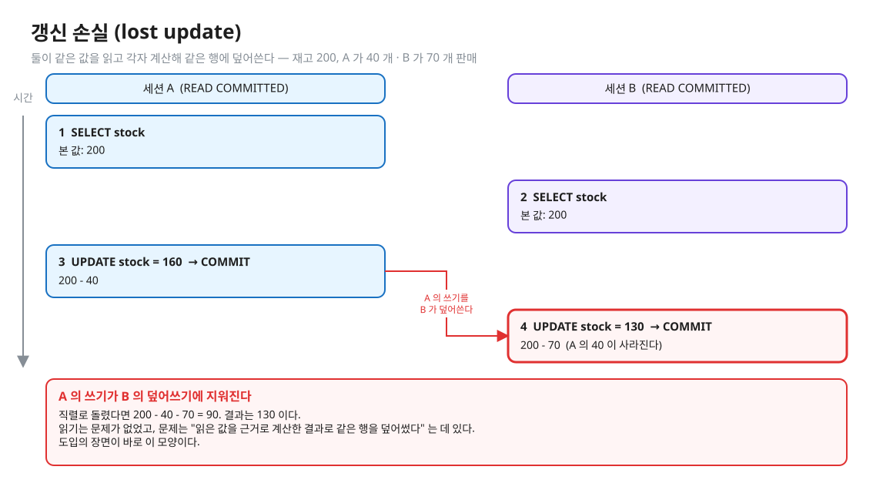
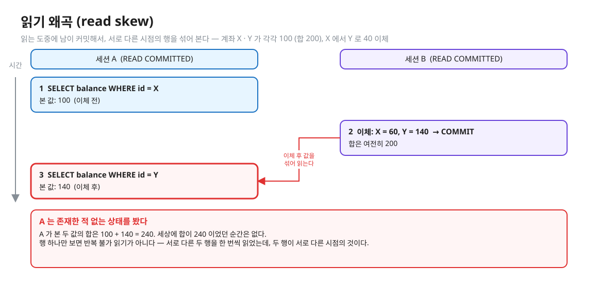
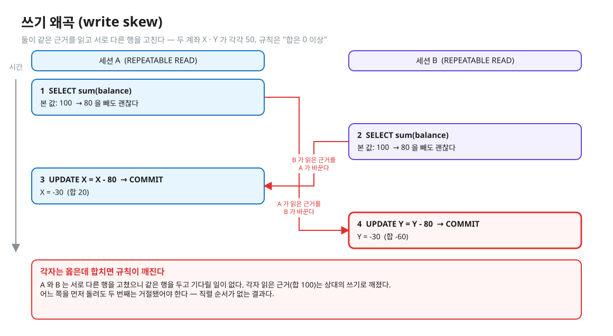
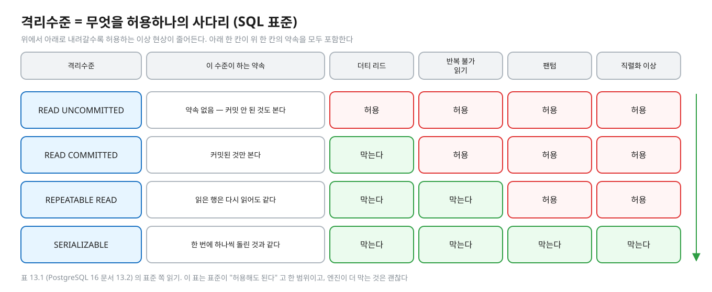
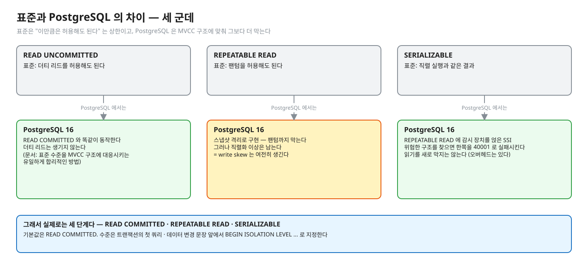
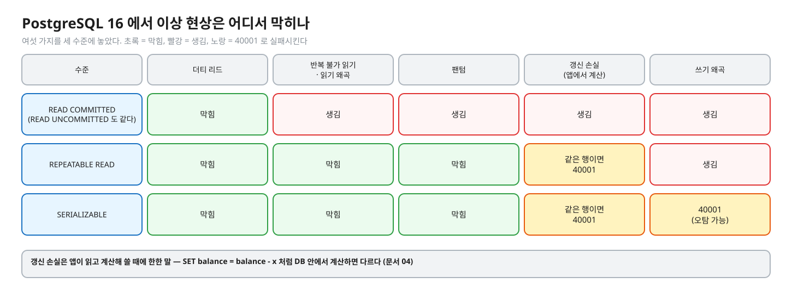

# 01. 트랜잭션 이상 현상과 격리수준

> **이 글에서 알게 되는 것**
> 1. 트랜잭션이 동시에 돌면 어떤 모양의 어긋남(이상 현상)이 생기는지 여섯 가지를 구분할 수 있다.
> 2. 격리수준이 "무엇을 허용하나" 의 등급표(약속의 사다리)라는 것을 안다.
> 3. PostgreSQL 이 표준 표보다 한 칸씩 더 막는다는 것, 그래도 REPEATABLE READ 에서 write skew 가 남는다는 것을 안다.
>
> **먼저 알면 좋은 것**: 트랜잭션이 "전부 되거나 전부 안 되는" 묶음이라는 것 정도면 된다.
> **다음 글**: [02. MVCC 저장 구조](02-mvcc-tuple-storage.md) → [03. 스냅샷과 가시성](03-snapshot-visibility.md)
> **구분**: 심화 — 꼬리질문 대비 (레슨을 마친 뒤 · 면접 전)

## 동시에 돌면 무슨 일이 생기나

잔고가 100 인 계좌가 있다. 트랜잭션 A 는 20 을 출금하고, 트랜잭션 B 는 10 을 입금한다. 한 번에 하나씩 차례로 돌리면 어느 순서든 결과는 90 이다.

편집: [diagrams/blog01-intro.excalidraw](diagrams/blog01-intro.excalidraw)

그림처럼 둘이 겹쳐 돌면 110 이 나올 수 있다. A 의 출금이 흔적 없이 사라진 것이다. 두 트랜잭션 모두 자기 규칙대로 읽고, 계산하고, 썼을 뿐이다. 겹쳐 돌았다는 사실만으로 결과가 틀어졌다.

이 글은 이런 어긋남을 **모양별로 이름 붙이는** 글이다. 이름이 있어야 "어느 격리수준이 어느 모양을 막아 주나" 를 말할 수 있다. 먼저 용어 두 개만 잡고 가자. **트랜잭션**은 여러 문장을 "전부 되거나 전부 안 되게" 묶는 단위이고, **격리(isolation)** 는 동시에 도는 트랜잭션이 서로의 중간 상태를 얼마나 보나를 정하는 성질이다. 완전한 격리는 "한 번에 하나씩 차례로 돈 것과 같은 결과(직렬 실행)" 인데, 그렇게 하면 느리다. 그래서 일부 어긋남을 허용하는 대신 빠른 등급을 둔다. 그 등급표가 이 글의 주제다.

## 이상 현상을 하나씩 보자

표준(SQL 표준)이 정의한 이름이 세 개, PostgreSQL 문서가 하나를 더 붙여 부르는 이름이 하나 있다. 그리고 표준 표에는 없지만 실무와 면접에서 자주 쓰는 이름이 셋 더 있다. 이 순서로 하나씩 본다. 아래 그림은 모두 왼쪽이 세션 A, 오른쪽이 세션 B 이고, 시간은 위에서 아래로 흐른다. 빨간 카드가 문제가 생기는 지점이다.

### 1. 더티 리드 (dirty read)

**동시에 도는, 아직 커밋하지 않은 트랜잭션이 쓴 데이터를 읽는 것**이다. ([문서 13.2](https://www.postgresql.org/docs/16/transaction-iso.html))

편집: [diagrams/blog01-dirty-read.excalidraw](diagrams/blog01-dirty-read.excalidraw)

B 는 재고를 5 로 바꿨지만 커밋하지 않았다. 이 시점에 A 가 5 를 읽는다. 그런데 B 가 롤백하면 5 는 없던 값이 된다. A 는 세상에 한 번도 존재한 적 없는 값을 근거로 판단한 셈이다. 가장 기본적인 어긋남이라, 표준의 두 번째 단계(READ COMMITTED)부터 막는다. (PostgreSQL 은 첫 단계인 READ UNCOMMITTED 에서도 막는다. 뒤에서 본다.)

### 2. 반복 불가 읽기 (non-repeatable read)

**이미 읽은 데이터를 다시 읽었더니, 그 사이 커밋한 다른 트랜잭션이 바꿔 놓은 것**이다. ([문서 13.2](https://www.postgresql.org/docs/16/transaction-iso.html))

편집: [diagrams/blog01-nonrepeatable.excalidraw](diagrams/blog01-nonrepeatable.excalidraw)

더티 리드와 무엇이 다른가. 이번에는 B 가 **커밋을 끝냈다**. A 가 본 값이 "취소될 값" 은 아니다. 문제는 A 의 한 트랜잭션 안에서 같은 질문의 답이 바뀐다는 점이다. 한 트랜잭션 안에서 "읽고 → 판단하고 → 쓴다" 를 하는 코드는 읽은 값이 판단하는 동안 그대로이기를 기대한다. 표준에서는 세 번째 단계(REPEATABLE READ)부터 막는다.

### 3. 팬텀 읽기 (phantom read)

**조건에 맞는 행 집합을 다시 조회했더니, 그 사이 커밋한 다른 트랜잭션 때문에 집합이 달라진 것**이다. ([문서 13.2](https://www.postgresql.org/docs/16/transaction-iso.html))

편집: [diagrams/blog01-phantom.excalidraw](diagrams/blog01-phantom.excalidraw)

반복 불가 읽기가 "읽은 **행 하나**의 값" 이 바뀐 것이라면, 팬텀은 "조건에 맞는 행의 **범위**" 가 바뀐 것이다. 읽은 행 하나하나를 보호해도, 아직 존재하지 않던 행이 새로 끼어드는 것은 막지 못한다. 그래서 별도의 이름을 갖는다. 표준에서는 맨 위 단계인 SERIALIZABLE 에서야 막힌다. 다만 PostgreSQL 은 REPEATABLE READ 에서 이미 막는다.

### 4. 직렬화 이상 (serialization anomaly)

PostgreSQL 문서가 표준 세 가지 외에 하나 더 정의한 이름이다. **커밋에 성공한 트랜잭션 묶음의 결과가, 그것들을 한 번에 하나씩 돌리는 어떤 순서와도 일치하지 않는 것**이다. ([문서 13.2](https://www.postgresql.org/docs/16/transaction-iso.html))

앞의 세 가지가 "무엇이 눈에 보였나" 의 이름이라면, 이것은 "결과가 어떤 직렬 실행으로도 설명되지 않는다" 는 가장 일반적인 정의다. 아래의 갱신 손실 · 쓰기 왜곡이 이 부류에 가깝다. 문서 13.2 가 SERIALIZABLE 절에서 든 `mytab` 예(class 1 의 합을 class 2 로, class 2 의 합을 class 1 로 삽입)도 이 모양이다. 각자 읽은 것을 상대가 바꿔서, 어느 쪽을 먼저 돌려도 같은 값이 나오지 않는다.

여기까지가 문서 13.2 의 정의다. 이제 문서에는 없지만 면접에서 자주 쓰이는 이름들이다. 이 세 이름은 DDIA 7장의 용어이고, 아래의 분류는 (해석)이다. PostgreSQL 문서는 이 이름을 쓰지 않으니, 이름보다 **어떤 모양인지**를 기억하자.

### 5. 갱신 손실 (lost update)

**둘이 같은 값을 읽고, 각자 계산해서, 같은 행에 덮어쓴다 → 한쪽 결과가 사라진다.** (해석, DDIA)

편집: [diagrams/blog01-lost-update.excalidraw](diagrams/blog01-lost-update.excalidraw)

글 첫머리의 장면이 바로 이것이다. 읽기 자체에는 문제가 없다. 문제는 읽은 값으로 계산한 결과를 같은 행에 덮어썼다는 점이다. 직렬로 돌렸다면 200 - 40 - 70 = 90 인데 결과는 130 이다. 둘이 **같은 행**을 두고 경쟁한다는 것이 핵심이고, 이 경쟁은 문서 04 에서 자세히 다룬다.

주의할 점이 하나 있다. 이 현상은 **앱이 읽고 계산해서 쓸 때**의 이야기다. `SET balance = balance - x` 처럼 DB 안에서 계산하면 다르다(문서 04).

### 6. 읽기 왜곡 (read skew)

**한 트랜잭션이 읽는 중에 다른 트랜잭션이 커밋해서, 서로 다른 시점의 행들을 섞어 보는 것**이다. 반복 불가 읽기의 한 형태로 분류한다. (해석, DDIA)

편집: [diagrams/blog01-read-skew.excalidraw](diagrams/blog01-read-skew.excalidraw)

반복 불가 읽기는 같은 행을 두 번 읽지만, 읽기 왜곡은 **서로 다른 두 행을 한 번씩** 읽는다. 각각은 올바른 값인데 두 값을 합치면 세상에 존재한 적 없는 상태가 된다. 그림에서 A 가 본 합은 240 인데, 이체 전에도 후에도 합은 200 이었다. 반복 불가 읽기를 막는 수준이면 이것도 함께 막힌다.

### 7. 쓰기 왜곡 (write skew)

**둘이 같은 근거를 읽고, 서로 다른 행을 고친다 → 근거가 깨진다.** 직렬화 이상의 한 형태다. (해석, DDIA)

편집: [diagrams/blog01-write-skew.excalidraw](diagrams/blog01-write-skew.excalidraw)

갱신 손실과 무엇이 다른가. 갱신 손실은 **같은 행**을 덮어써서 한쪽이 지워진다. 쓰기 왜곡은 A 가 X 를, B 가 Y 를 고치는 **서로 다른 행**이다. 같은 행을 두고 기다릴 일이 없어서, 행 락(row lock)으로 걸러지지 않는다. 각자 읽은 근거("합이 100 이니 80 을 빼도 된다")는 상대의 쓰기로 깨진다. 어느 쪽을 먼저 돌려도 두 번째는 거절됐어야 하므로, 직렬 순서가 없는 결과다. 이 문제는 문서 05 에서 SERIALIZABLE 로 막는 법을 본다.

### 정리: 여섯 개의 관계

| 이름 | 한 줄로 | 앞의 것과 다른 점 |
|---|---|---|
| 더티 리드 | 커밋 안 된 값을 읽는다 | — |
| 반복 불가 읽기 | 읽은 행이 커밋으로 바뀐다 | 커밋된 값이다 |
| 팬텀 | 조건에 맞는 행의 범위가 바뀐다 | 행 하나가 아니라 범위 |
| 갱신 손실 | 같은 값을 읽고 같은 행에 덮어쓴다 | 읽기가 아니라 쓰기가 사라진다 |
| 읽기 왜곡 | 서로 다른 시점의 행을 섞어 본다 | 한 행이 아니라 두 행 |
| 쓰기 왜곡 | 같은 근거를 읽고 다른 행을 고친다 | 같은 행이 아니라 다른 행 |

## 격리수준은 약속이다

이제 격리수준이 무엇인지 말할 수 있다. 격리수준은 "이 수준에서는 위 이상 현상 중 이것까지는 일어나지 않게 해 주겠다" 는 **약속**이고, 거꾸로 말하면 "이것은 일어나도 된다" 는 허용 범위다. SQL 표준은 이 약속을 네 단계로 정했다. 위에서 아래로 갈수록 약속이 늘고 허용하는 것이 줄어든다.

편집: [diagrams/blog01-ladder-standard.excalidraw](diagrams/blog01-ladder-standard.excalidraw)

PostgreSQL 문서의 표 13.1 이 이 사다리의 정확한 형태다. ([문서 13.2 · 표 13.1](https://www.postgresql.org/docs/16/transaction-iso.html))

| 격리수준 | 더티 리드 | 반복 불가 읽기 | 팬텀 | 직렬화 이상 |
|---|---|---|---|---|
| READ UNCOMMITTED | 표준은 허용, **PG 는 아님** | 가능 | 가능 | 가능 |
| READ COMMITTED | 불가 | 가능 | 가능 | 가능 |
| REPEATABLE READ | 불가 | 불가 | 표준은 허용, **PG 는 아님** | 가능 |
| SERIALIZABLE | 불가 | 불가 | 불가 | 불가 |

표를 읽는 요령이 있다. 표준은 "이만큼은 허용해도 된다" 는 **상한**일 뿐이라, 엔진이 더 막는 것은 괜찮다. 그래서 표의 "가능" 은 "표준이 허용하는 범위" 이지 "반드시 일어난다" 는 뜻이 아니다. 표 13.1 의 "PG 는 아님" 두 칸이 바로 PostgreSQL 이 표준보다 더 막는 곳이다.

## PostgreSQL 에서는

### 실제로는 세 단계다

PostgreSQL 은 네 수준을 모두 받아들이지만, 구현은 다르게 되어 있다. 그림으로 먼저 보자.

편집: [diagrams/blog01-standard-vs-pg.excalidraw](diagrams/blog01-standard-vs-pg.excalidraw)

- **READ UNCOMMITTED 는 READ COMMITTED 처럼 동작한다.** 문서는 이것이 표준 수준을 MVCC 구조에 대응시키는 "유일하게 합리적인 방법"이라고 쓴다. ([문서 13.2](https://www.postgresql.org/docs/16/transaction-iso.html), [SET TRANSACTION](https://www.postgresql.org/docs/16/sql-set-transaction.html)) 그러니 PostgreSQL 에서 더티 리드는 어떤 수준에서도 생기지 않는다.
- **REPEATABLE READ 는 스냅샷 격리(snapshot isolation)** 로 구현돼 있다. 그래서 표준이 허용하는 팬텀까지 막는다. 대신 직렬화 이상은 남는다. ([문서 13.2.2](https://www.postgresql.org/docs/16/transaction-iso.html)) 팬텀이 막히는 이유는 트랜잭션이 스냅샷 하나로 읽기 때문이고, 그 원리는 [03. 스냅샷과 가시성](03-snapshot-visibility.md) 에서 본다.
- **SERIALIZABLE 은 REPEATABLE READ 에 "직렬화 이상이 생길 조건"을 감시하는 장치를 얹은 것**이다. 이것이 SSI 이다. 감시가 REPEATABLE READ 에 없던 **블로킹을 늘리지는 않지만**(예외: `READ ONLY DEFERRABLE` 트랜잭션은 안전한 스냅샷을 얻을 때까지 시작이 블록된다 — 문서 03) 오버헤드는 있다. ([문서 13.2.3](https://www.postgresql.org/docs/16/transaction-iso.html)) 이 감시가 어떻게 동작하는지는 [05. SERIALIZABLE 과 SSI](05-serializable-ssi-retry.md) 에서 본다.
- 기본 수준은 `read committed` 다. `default_transaction_isolation` 의 기본값이다. (PostgreSQL 16, [문서 20.11](https://www.postgresql.org/docs/16/runtime-config-client.html); 실측: psql 2026-10-13 `SHOW default_transaction_isolation`)
- 수준은 트랜잭션의 **첫 쿼리 · 데이터 변경 문장 전에** 정해야 한다. 이후엔 바꿀 수 없다. ([SET TRANSACTION](https://www.postgresql.org/docs/16/sql-set-transaction.html)) `BEGIN ISOLATION LEVEL REPEATABLE READ;` 처럼 시작할 때 지정한다.

스냅샷이 무엇인지는 [02. MVCC 저장 구조](02-mvcc-tuple-storage.md) 에서 행이 버전의 사슬이라는 것을 본 뒤 [03](03-snapshot-visibility.md) 에서 이어진다. 이 글에서는 "REPEATABLE READ 는 스냅샷으로 읽고, 그 스냅샷이 팬텀까지 막아 준다" 만 가져가면 된다.

### 이상 현상이 실제로 어디서 막히나

앞의 여섯 가지(더티 리드, 반복 불가 읽기 · 읽기 왜곡, 팬텀, 갱신 손실, 쓰기 왜곡)를 PostgreSQL 16 의 세 수준에 놓으면 이렇다.

편집: [diagrams/blog01-pg-matrix.excalidraw](diagrams/blog01-pg-matrix.excalidraw)

| | READ COMMITTED | REPEATABLE READ | SERIALIZABLE |
|---|---|---|---|
| 더티 리드 | 막힘 | 막힘 | 막힘 |
| 반복 불가 읽기 · 읽기 왜곡 | 생김 | 막힘 | 막힘 |
| 팬텀 | 생김 | 막힘 | 막힘 |
| 갱신 손실 (앱에서 읽고 계산해 쓰기) | 생김 | 같은 행이면 `40001` | 같은 행이면 `40001` |
| 쓰기 왜곡 | 생김 | 생김 | `40001` (오탐 가능) |

근거: 반복 불가·팬텀은 표 13.1. REPEATABLE READ 의 갱신 충돌 `40001` 은 [문서 13.2.2](https://www.postgresql.org/docs/16/transaction-iso.html) ("could not serialize access due to concurrent update"). SERIALIZABLE 의 감시는 [문서 13.2.3](https://www.postgresql.org/docs/16/transaction-iso.html). 갱신 손실은 앞서 말한 것처럼 앱이 읽고 계산해 쓸 때에 한한 이야기다.

이 표에서 눈여겨볼 곳이 둘이다. 첫째, **REPEATABLE READ 에서 쓰기 왜곡이 "생김"** 이다. 스냅샷 하나를 일관되게 읽으니 읽기 쪽 이상 현상은 모두 사라지지만, 서로 다른 행을 고치는 두 트랜잭션은 서로를 모른다. 둘째, **`40001` 은 엔진이 "이대로면 직렬화가 깨진다" 며 거절하는 정상 동작**이다. 에러라서 무서워 보이지만, 조용히 틀린 결과가 남는 것보다 낫다 (해석). 그래서 앱에는 트랜잭션 전체를 다시 하는 재시도가 필요하다(문서 05).

### 에러 코드 (SQLSTATE)

[부록 A](https://www.postgresql.org/docs/16/errcodes-appendix.html): `40001` = `serialization_failure`, `40P01` = `deadlock_detected` (둘 다 class 40 "Transaction Rollback"), `25P02` = `in_failed_sql_transaction`, `23505` = `unique_violation`. 문서는 앱이 메시지 문구가 아니라 **코드**를 검사하라고 권한다. 코드가 릴리스 · 언어 설정에 덜 흔들리기 때문이다.

실패한 트랜잭션에서 다음 문장을 보내면 `current transaction is aborted, commands ignored until end of transaction block` (= 25P02) 가 나온다 (실측: psql 2026-10-13). 그래서 40001 을 받으면 `ROLLBACK` 부터 해야 한다.

### 자주 하는 오해

위 내용을 오해하기 쉬운 곳을 모았다.

1. **"격리수준이 높을수록 락을 더 많이 잡는다."** PostgreSQL 에서 REPEATABLE READ 와 SERIALIZABLE 의 읽기는 행 락을 잡지 않는다. 높은 수준은 "무엇을 보여 주나(스냅샷)" 와 "충돌을 감지하면 실패시킨다" 로 구현된다. ([문서 13.1](https://www.postgresql.org/docs/16/mvcc-intro.html): 읽기는 쓰기를 막지 않는다. [문서 13.2.3](https://www.postgresql.org/docs/16/transaction-iso.html): SERIALIZABLE 의 predicate lock 은 블로킹하지 않는다.)
2. **"REPEATABLE READ 면 팬텀이 생긴다 (표준이 그렇다)."** 표준의 허용 범위일 뿐, PostgreSQL 은 막는다 (표 13.1 의 "Allowed, but not in PG").
3. **"REPEATABLE READ 면 정합성이 보장된다."** 직렬화 이상은 가능하다. 문서도 이 수준에서 업무 규칙을 지키려면 "명시적 락을 조심스럽게 써서 충돌 트랜잭션을 막아야 한다"고 쓴다 ([문서 13.2.2](https://www.postgresql.org/docs/16/transaction-iso.html)).
4. **"READ UNCOMMITTED 를 쓰면 더 빨라진다."** PostgreSQL 에서는 READ COMMITTED 와 같게 동작한다.
5. **"읽기 전용 트랜잭션이면 격리수준과 무관하다."** READ COMMITTED 에서 읽기 전용이어도 문장마다 다른 데이터를 볼 수 있다. 반대로 REPEATABLE READ 에서 읽기 전용 트랜잭션은 직렬화 충돌을 겪지 않는다 ([문서 13.2.2](https://www.postgresql.org/docs/16/transaction-iso.html): "read-only transactions will never have serialization conflicts").

### 앱 · 프레임워크에서는

- JDBC: `Connection.setTransactionIsolation(Connection.TRANSACTION_SERIALIZABLE)` (이 레슨의 `Tx.serializable` 이 쓰는 호출). 수준을 바꾸려면 트랜잭션 시작 시점에 해야 한다.
- Spring: `@Transactional(isolation = Isolation.SERIALIZABLE)`. 기본은 `ISOLATION_DEFAULT` 로, 데이터베이스 기본값을 따른다는 뜻이다 ([Spring 레퍼런스 · @Transactional](https://docs.spring.io/spring-framework/reference/data-access/transaction/declarative/annotations.html): "The isolation level is `ISOLATION_DEFAULT`"). 그리고 `isolation` · `timeout` · `readOnly` 설정은 "propagation 이 REQUIRED 또는 REQUIRES_NEW 일 때만 적용된다" 고 명시돼 있다. 재시도 위치까지 포함한 설계는 문서 05.

## MySQL InnoDB 는 어떻게 다른가

같은 이름의 수준이라도 엔진마다 다르다. MySQL 8.0 (InnoDB) 과 나란히 놓으면 이렇다.

| | PostgreSQL 16 | MySQL 8.0 (InnoDB) |
|---|---|---|
| 기본 격리수준 | READ COMMITTED | **REPEATABLE READ** ([MySQL 17.7.2.1](https://dev.mysql.com/doc/refman/8.0/en/innodb-transaction-isolation-levels.html): "default isolation level for InnoDB") |
| RR 에서 보는 스냅샷 | 트랜잭션 첫 문장에서 잡힌 하나 | "첫 번째 읽기(consistent read)가 세운 스냅샷" ([MySQL 17.7.2.3](https://dev.mysql.com/doc/refman/8.0/en/innodb-consistent-read.html)) |
| RR 에서 남이 커밋한 행을 UPDATE | `40001` 로 실패 (문서 04) | UPDATE/DELETE 는 스냅샷이 아니라 최신 커밋 상태에 적용된다 — 같은 17.7.2.3 의 주의 문단 |
| RR 의 팬텀 막는 방법 | 스냅샷 하나만 본다 | 읽기는 스냅샷, **잠그는 읽기**는 next-key 락(레코드 락 + 앞 간격 락)으로 간격에 삽입을 막는다 ([MySQL 17.7.4 Phantom Rows](https://dev.mysql.com/doc/refman/8.0/en/innodb-next-key-locking.html)) |
| SERIALIZABLE | RR + 직렬화 이상 감시(SSI), 읽기는 안 막는다 | RR 과 같지만 autocommit 꺼진 상태의 일반 SELECT 를 `SELECT … FOR SHARE` 로 바꾼다 (17.7.2.1) — **잠금으로** 직렬화 |

한 줄로 줄이면, **PostgreSQL 은 "보여 주는 것(스냅샷)과 충돌 감지로", MySQL 은 "읽기는 스냅샷 + 잠그는 읽기와 SERIALIZABLE 은 락으로"** 푼다. (해석)

MySQL RR 에서 write skew 가 생기는지는 공식 문서에 그 단어로 적혀 있지 않다. 다만 일반 SELECT 는 락을 걸지 않는 consistent read 이고 UPDATE 가 유니크 인덱스(PK)의 유니크 조건으로 행을 찾으면 그 레코드만 잠그므로([17.7.2.1](https://dev.mysql.com/doc/refman/8.0/en/innodb-transaction-isolation-levels.html): "locks only the index record found, not the gap before it"), 서로 다른 행을 고치는 두 트랜잭션이 서로 안 막힌다고 **추론**할 수 있다 (해석 — 직접 돌려 보지 않았다). 다른 조건(범위 · 비유니크)이면 스캔한 범위를 next-key/gap 락으로 잠가 달라진다.

## 한눈에 정리

| | 어떤 모양인가 | 표준에서 막는 수준 | PostgreSQL 16 에서 막는 수준 |
|---|---|---|---|
| 더티 리드 | 커밋 안 된 값을 읽는다 | READ COMMITTED 부터 | 어떤 수준에서도 안 생김 |
| 반복 불가 읽기 · 읽기 왜곡 | 읽은 것이 커밋으로 바뀐다 · 시점이 섞인다 | REPEATABLE READ 부터 | REPEATABLE READ 부터 |
| 팬텀 | 조건에 맞는 행의 범위가 바뀐다 | SERIALIZABLE | REPEATABLE READ 부터 |
| 갱신 손실 | 같은 행을 읽고 계산해 덮어쓴다 | (표 13.1 에 없음) | RR · SER 에서 같은 행이면 `40001` |
| 쓰기 왜곡 | 같은 근거를 읽고 다른 행을 고친다 | SERIALIZABLE (직렬화 이상) | SERIALIZABLE 만, `40001` |

- 격리수준은 "어떤 이상 현상까지 허용하나" 의 등급표이고, 표준 표는 허용의 **상한**이다.
- PostgreSQL 은 표준보다 한 칸씩 더 막는다 — READ UNCOMMITTED 는 READ COMMITTED 이고, REPEATABLE READ 는 팬텀까지 막는 스냅샷 격리다.
- 그래도 REPEATABLE READ 는 write skew 를 못 막는다. 막으려면 SERIALIZABLE(SSI) 이거나 앱이 명시적 락을 써야 한다.
- 높은 수준은 락을 더 잡는 것이 아니라, 무엇을 보여 주나(스냅샷)와 충돌 시 실패시키기로 구현된다. 그래서 `40001` 에 대비한 재시도가 필수다.

## 스스로 확인

1. 표준 SQL 의 READ UNCOMMITTED 를 PostgreSQL 에서 쓰면 무슨 일이 생기나? 왜 그렇게 만들었다고 문서는 말하나?
   

답

   READ COMMITTED 와 똑같이 동작한다 — 더티 리드가 안 생긴다. 문서 13.2 는 이것이 표준 수준을 PostgreSQL 의 MVCC 구조에 대응시키는 "유일하게 합리적인 방법"이라고 설명한다. MVCC 에서는 읽기가 커밋된 버전만 고르는 것이 기본 동작이라, "커밋 안 된 것도 보는" 수준을 따로 만들 이유가 없다 (이유 부분은 해석).
   

2. "REPEATABLE READ 에서 팬텀이 안 생기니까 SERIALIZABLE 은 불필요하다"는 주장에 어떻게 반박하나?
   

답

   팬텀은 "같은 조건 재조회 결과가 달라지는 것" 이고 스냅샷 하나로 막힌다. 그러나 직렬화 이상은 다른 문제다 — 각자 일관된 스냅샷을 보고도 서로 다른 행을 고쳐 결과가 어떤 직렬 순서와도 안 맞을 수 있다(write skew, 문서 13.2 의 mytab 예). 표 13.1 에서 REPEATABLE READ 의 직렬화 이상 칸이 "Possible" 이다.
   

3. 읽기 전용 트랜잭션에서 REPEATABLE READ 와 SERIALIZABLE 의 차이가 있나?
   

답

   일반 읽기 전용 REPEATABLE READ 트랜잭션은 직렬화 충돌이 없다. SERIALIZABLE 의 읽기 전용은 SSI 위험한 구조에서 Tin 이 될 수 있어 상황에 따라 충돌 · 오버헤드가 있고, `SERIALIZABLE READ ONLY DEFERRABLE` 은 안전한 스냅샷을 얻을 때까지 시작이 블록되는 대신 이후 충돌 없이 돈다 (문서 05, [SET TRANSACTION](https://www.postgresql.org/docs/16/sql-set-transaction.html) 의 DEFERRABLE 설명).
   

4. 격리수준을 올렸더니 `40001` 이 쏟아진다. 격리수준 문제인가 앱 문제인가?
   

답

   둘 다다. 40001 은 엔진이 "이대로 커밋하면 직렬화가 깨진다 / 스냅샷 이후 바뀐 행을 고치려 한다" 고 판단한 정상 동작이다. 앱은 트랜잭션 전체를 다시 하는 재시도를 가져야 한다 (문서 13.2.2 · 13.2.3 의 권고). 빈도를 줄이려면 트랜잭션을 짧게, 읽기 전용은 `READ ONLY` 로, 인덱스 스캔이 되게 한다 (문서 13.2.3 의 성능 팁 — 문서 05).
   

5. 읽기 왜곡과 팬텀은 둘 다 "읽는 도중 남이 커밋해서 생기는" 현상이다. 무엇으로 구분하나?
   

답

   무엇이 달라졌는지로 구분한다. 읽기 왜곡은 **서로 다른 행**을 한 번씩 읽는데 두 행이 서로 다른 시점의 것이라 섞여 보이는 것이다. 팬텀은 **같은 조건**을 두 번 조회했을 때 조건에 맞는 **행의 집합**이 달라지는 것이다. PostgreSQL 에서는 둘 다 REPEATABLE READ 부터 막힌다 (이 글의 분류. 읽기 왜곡 쪽은 해석).
   

## 이 레슨에서 직접 보기

| 어디서 | 무엇을 |
|---|---|
| Q01 · Q02 | READ COMMITTED 와 REPEATABLE READ 에서 같은 SELECT 를 두 번 (반복 불가 읽기) |
| Q03 | REPEATABLE READ 에서 팬텀 |
| Q04 | READ UNCOMMITTED 에서 더티 리드 |
| Q05 · Q07 | 갱신 손실과 REPEATABLE READ 의 갱신 충돌 (문서 04 에서 자세히) |
| Q08 · Q09 | write skew (문서 05 에서 자세히) |
| 장면 1 (observe/SCRIPT.md) | psql 두 개로 write skew |

이 글의 그림은 일부러 문항과 다른 숫자(재고 · 대기 주문 · 두 계좌)로 그렸다. 예측 문항의 값을 직접 적어 보고 나서 확인한다.

실측 — 예측을 끝낸 뒤 펼친다 (Q01 · Q02 · Q03 · Q04)

정답 상태 기준 ([정답 patch](../../../solutions/01.01.patch)):

| Q | 상황 | 결과 |
|---|---|---|
| Q01 | READ COMMITTED, 사이에 남이 100 → 50 커밋 | 두 번째 SELECT = 50 |
| Q02 | REPEATABLE READ, 같은 상황 | 두 번째 SELECT = 100 |
| Q03 | REPEATABLE READ, 사이에 남이 seoul 지점 신규 행 커밋 | 두 번째 count = 2 (처음과 같다) |
| Q04 | READ UNCOMMITTED, 남은 0 으로 바꾸고 커밋 전 | 읽은 잔고 = 100 (더티 리드 없음) |

## 출처

- [PostgreSQL 16 · 13.2 Transaction Isolation](https://www.postgresql.org/docs/16/transaction-iso.html) — 이상 현상 정의 · 표 13.1 · RU=RC · RR=스냅샷 격리 · SERIALIZABLE 감시 · 40001 메시지
- [13.1 Introduction (MVCC)](https://www.postgresql.org/docs/16/mvcc-intro.html) — 읽기는 쓰기를 막지 않는다
- [SET TRANSACTION](https://www.postgresql.org/docs/16/sql-set-transaction.html) — 수준 지정 시점 · READ UNCOMMITTED 취급 · DEFERRABLE
- [20.11 Client Connection Defaults](https://www.postgresql.org/docs/16/runtime-config-client.html) — `default_transaction_isolation` 기본값
- [Appendix A · Error Codes](https://www.postgresql.org/docs/16/errcodes-appendix.html) — 40001 · 40P01 · 25P02 · 23505
- [MySQL 8.0 · 17.7.2.1 Transaction Isolation Levels](https://dev.mysql.com/doc/refman/8.0/en/innodb-transaction-isolation-levels.html) · [17.7.2.3 Consistent Nonlocking Reads](https://dev.mysql.com/doc/refman/8.0/en/innodb-consistent-read.html) · [17.7.4 Phantom Rows (next-key)](https://dev.mysql.com/doc/refman/8.0/en/innodb-next-key-locking.html)
- [Spring Framework · @Transactional](https://docs.spring.io/spring-framework/reference/data-access/transaction/declarative/annotations.html)
- 갱신 손실 · 읽기 왜곡 · 쓰기 왜곡의 이름과 분류: DDIA 7장의 용어 (해석 — 문서 13.2 는 이 이름을 쓰지 않는다)
