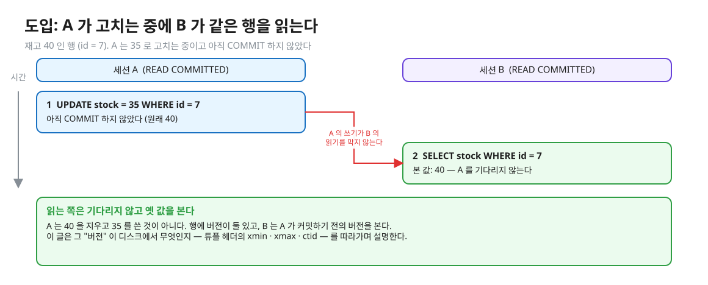
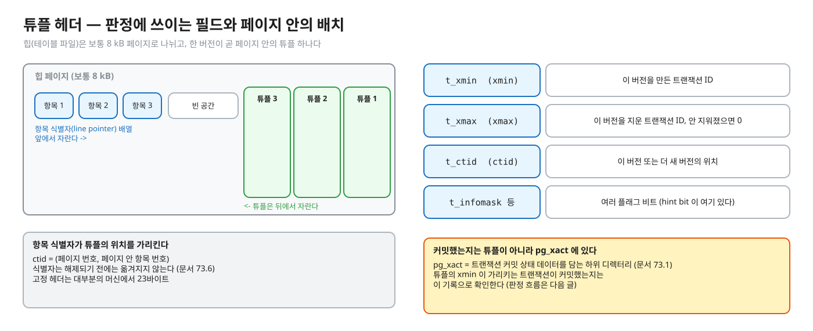
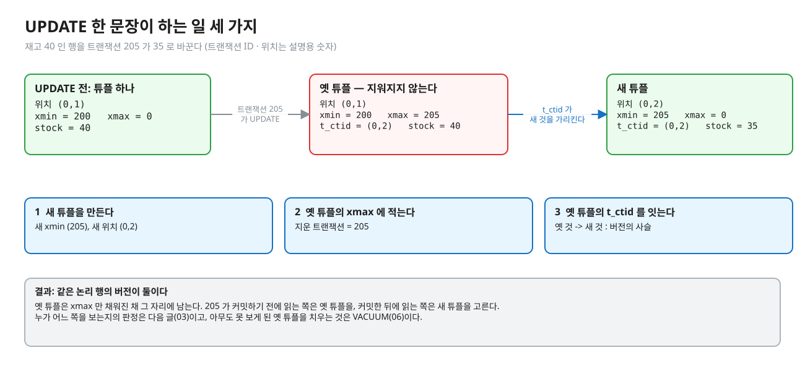
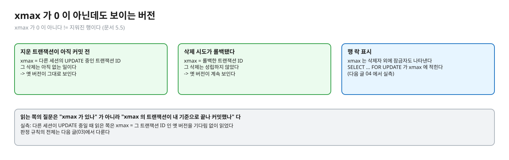
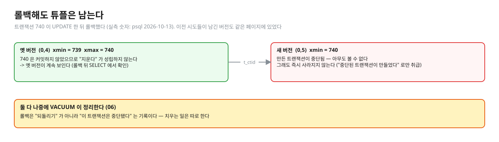
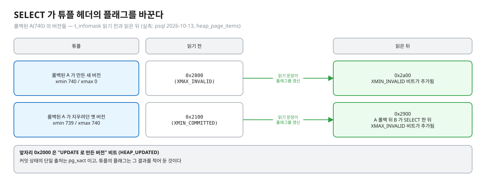
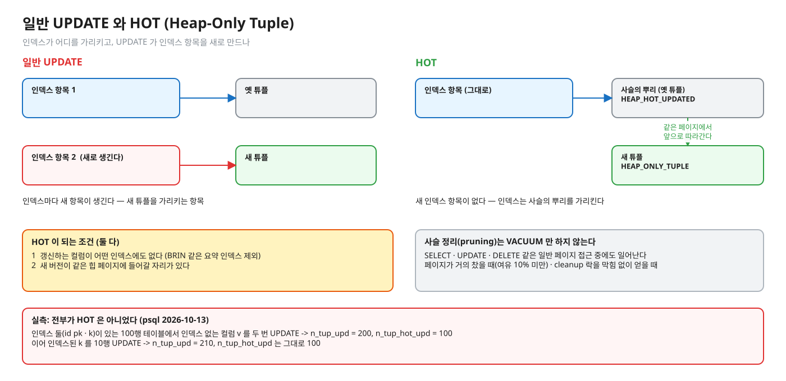
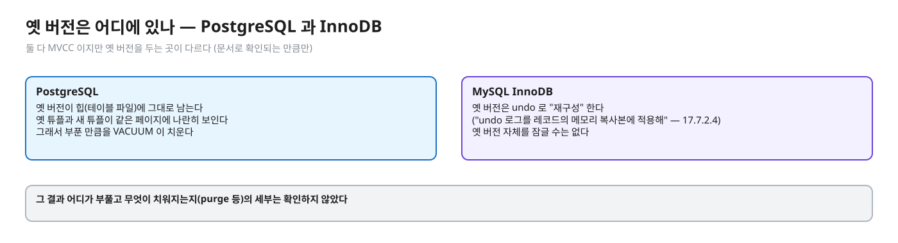

# 02. MVCC 저장 구조 — 행은 버전의 사슬이다

> **이 글에서 알게 되는 것**
> 1. PostgreSQL 이 UPDATE 를 "덮어쓰기" 가 아니라 "새 버전(튜플) 만들기 + 옛 버전에 지운 트랜잭션 적기" 로 처리한다는 것을 안다.
> 2. 튜플 헤더의 `xmin` · `xmax` · `ctid` · `t_infomask` 가 각각 무엇을 말하는지 읽을 수 있다.
> 3. 롤백 · hint bit · HOT 이 모두 "버전이 힙에 남는다" 는 하나의 구조 위에서 설명된다는 것을 안다.
>
> **먼저 알면 좋은 것**: [01. 트랜잭션 이상 현상과 격리수준](01-anomalies-and-isolation-levels.md) — 동시에 도는 트랜잭션이 어떤 어긋남을 만드는지, 격리수준이 그 허용 범위라는 것.
> **다음 글**: [03. 스냅샷과 가시성](03-snapshot-visibility.md) → [04. 같은 행을 쓰는 경쟁](04-write-conflicts.md)
> **구분**: 심화 — 꼬리질문 대비 (레슨을 마친 뒤 · 면접 전)

## 쓰는 중인 행을 읽으면 무슨 일이 생기나

재고가 40 인 행이 있다. 세션 A 가 이 행을 35 로 고치는 중이고, 아직 커밋하지 않았다. 이때 세션 B 가 같은 행을 읽는다.


<sub>편집: [diagrams/blog02-intro.excalidraw](diagrams/blog02-intro.excalidraw)</sub>

B 는 기다리지 않고, 커밋 전의 값이 아닌 옛 값을 본다. A 가 40 을 지우고 35 를 쓴 것이 아니라서 가능한 일이다. 행에는 버전이 둘 있고, B 는 A 가 커밋하기 전의 버전을 본다. 이 "버전" 이 디스크 위에서 정확히 무엇인지가 이 글의 주제다.

이 구조를 알아 두면 실무에서 마주치는 세 가지가 한 번에 설명된다. 같은 행을 계속 UPDATE 하는 테이블이 점점 커지는 이유(bloat), `ctid` 를 행 식별자로 쓰면 안 되는 이유, 그리고 `xmin` · `xmax` 를 읽어 트랜잭션 번호를 추적하는 디버깅이다. "UPDATE 하면 디스크에서 무슨 일이 일어나는가" 에 답하려면 결국 "그래서 VACUUM 이 왜 필요한가" 까지 이어서 말할 수 있어야 하는데, 그 답의 뼈대가 아래의 "버전 사슬" 이다.

## MVCC — 한 행의 여러 버전을 동시에 둔다

**MVCC(Multi-Version Concurrency Control)** 는 한 행의 여러 **버전**을 동시에 두고, 각 트랜잭션이 자기 시점에 맞는 버전을 읽게 하는 방식이다. 얻는 것은 "읽기 위해 잡는 락은 쓰기를 위해 잡는 락과 충돌하지 않는다" 는 성질이다. 읽기는 쓰기를 막지 않고, 쓰기는 읽기를 막지 않는다. ([문서 13.1](https://www.postgresql.org/docs/16/mvcc-intro.html)) 치르는 것은 옛 버전이 저장소에 남는다는 점이다.

PostgreSQL 에서 버전은 **테이블 파일(힙) 안의 튜플** 그 자체다. 별도 undo 영역에서 옛 값을 복원하는 방식이 아니다. 이 문장은 아래 실측으로 확인된 것이다. 옛 버전과 새 버전이 같은 힙 페이지에 나란히 보인다. (InnoDB 가 어떤지는 뒤의 MySQL 절에서 본다.)

## PostgreSQL 에서는

### 튜플 헤더 — 판정에 쓰이는 필드

버전 하나는 페이지 안의 튜플 하나이고, 튜플 앞에는 고정 헤더가 붙는다. 헤더에서 이 글과 다음 글이 쓰는 필드는 네 가지다. ([문서 5.5 시스템 컬럼](https://www.postgresql.org/docs/16/ddl-system-columns.html), [문서 73.6 페이지 레이아웃](https://www.postgresql.org/docs/16/storage-page-layout.html))


<sub>편집: [diagrams/blog02-tuple-header.excalidraw](diagrams/blog02-tuple-header.excalidraw)</sub>

| 필드 (SQL 에서의 이름) | 뜻 |
|---|---|
| `t_xmin` (`xmin`) | 이 버전을 **만든**(insert) 트랜잭션 ID. "행의 UPDATE 마다 같은 논리 행의 새 버전이 생긴다" (문서 5.5) |
| `t_xmax` (`xmax`) | 이 버전을 **지운**(delete) 트랜잭션 ID, 지워지지 않았으면 0. **보이는 버전에서도 0 이 아닐 수 있다** — 지운 트랜잭션이 아직 커밋 전이거나, 삭제 시도가 롤백된 경우 (문서 5.5) |
| `t_ctid` (`ctid`) | 이 버전 또는 **더 새 버전**의 물리 위치. `(페이지 번호, 페이지 안 항목 번호)` |
| `t_infomask` 등 | "여러 플래그 비트" (문서 73.6) — 아래 hint bit 절 |

몇 가지를 덧붙인다.

- 튜플 고정 헤더는 "대부분의 머신에서 23바이트" 다 (문서 73.6). 페이지는 보통 8 kB 이고, 페이지 안에서 항목 식별자(line pointer) 배열이 앞에서 자라고 튜플은 뒤에서 자란다.
- `ctid` 는 UPDATE 나 `VACUUM FULL` 로 바뀐다. 문서는 "장기 식별자로 쓸모없다 — 논리 행은 기본 키로 식별하라" 고 쓴다 (문서 5.5).
- 트랜잭션 ID 는 **32비트**여서 한 바퀴 돈다 (문서 5.5). 운영 문제는 [06. 운영](06-operations-vacuum-horizon.md) 에서 다룬다.
- 커밋 여부 자체는 튜플이 아니라 `pg_xact` 에 기록된다. [문서 73.1](https://www.postgresql.org/docs/16/storage-file-layout.html) 은 "트랜잭션 커밋 상태 데이터를 담는 하위 디렉터리" 라고만 적는다. 튜플의 xmin 이 가리키는 트랜잭션이 커밋했는지는 이 기록으로 확인한다 (판정 흐름은 [03](03-snapshot-visibility.md)).

### UPDATE 는 새 버전을 만든다

UPDATE 한 문장이 하는 일은 세 가지다. ① 새 튜플(새 `xmin`, 새 `ctid`)을 만든다. ② 옛 튜플의 `xmax` 에 자기 트랜잭션 ID 를 적는다. ③ 옛 튜플의 `t_ctid` 가 새 튜플을 가리키게 한다. 옛 튜플은 지워지지 않는다. 이 사슬이 아래 그림이다.


<sub>편집: [diagrams/blog02-update-chain.excalidraw](diagrams/blog02-update-chain.excalidraw)</sub>

앞의 도입 장면이 이제 설명된다. A 가 UPDATE 중일 때 B 가 읽으면 옛 튜플(xmax = A 의 트랜잭션 ID)을 만난다. 그 xmax 의 트랜잭션이 아직 커밋하지 않았으니, "지웠다" 는 아직 없는 일이다. 그래서 옛 튜플이 보인다. 누가 어떤 튜플을 보는지를 고르는 규칙은 [03](03-snapshot-visibility.md) 에서 정리한다. 같은 모양을 한 장으로 그린 그림도 있다. 아래 판정 그림은 03 에서 다시 쓴다.


<sub>편집: [diagrams/tuple-visibility.excalidraw](diagrams/tuple-visibility.excalidraw)</sub>

<details><summary>실측 — 예측(Q10)과 관찰(장면 2)을 끝낸 뒤 펼친다 (psql 2026-10-13)</summary>

```
-- A: BEGIN;  SELECT ctid, xmin, xmax, * FROM account;
 ctid  | xmin | xmax | id | balance
 (0,4) |  739 |    0 |  1 |     100
-- A: UPDATE account SET balance = 0 WHERE id = 1;   (A 의 트랜잭션 ID = 740)
-- A: SELECT ctid, xmin, xmax, * FROM account;
 (0,5) |  740 |    0 |  1 |       0           <- 새 버전. ctid · xmin 이 바뀌었다
-- B: SELECT ctid, xmin, xmax, * FROM account;   (A 는 아직 커밋 전)
 (0,4) |  739 |  740 |  1 |     100           <- 옛 버전이 그대로 보인다. xmax = 740 (A 가 지우는 중). 기다리지 않았다
```

같은 페이지를 `pageinspect`(contrib 확장)의 `heap_page_items` 로 열면 옛 버전이 `t_xmax = 740`, `t_ctid = (0,5)` — "더 새 버전은 (0,5)" 를 가리키는 사슬이 보인다. 이전 시도들이 남긴 버전들도 같은 페이지에 있다.

</details>

### xmax 가 0 이 아닌데 왜 읽히나

여기서 가장 많이 헷갈리는 지점이 있다. `xmax` 가 0 이 아니면 지워진 행이라고 읽기 쉬운데, 문서 5.5 는 보이는 버전도 xmax 가 0 이 아닐 수 있다고 명시한다.


<sub>편집: [diagrams/blog02-xmax-nonzero.excalidraw](diagrams/blog02-xmax-nonzero.excalidraw)</sub>

실측에서도 다른 세션이 UPDATE 중일 때 읽은 쪽은 xmax = 그 트랜잭션 ID 인 옛 버전을 기다림 없이 읽었다. 그리고 xmax 는 "삭제" 뿐 아니라 행 락 표시로도 쓰인다. 이 부분은 [04](04-write-conflicts.md) 에서 본다. 읽는 쪽이 던지는 질문은 "xmax 가 있나" 가 아니라 "xmax 의 트랜잭션이 내 기준으로 끝났고 커밋했나" 다.

### 롤백해도 튜플은 남는다

A 가 롤백하면 어떻게 되나. 새로 만든 버전 (0,5) 는 지워지지 않고 "만든 트랜잭션이 중단됨" 으로 남는다. 옛 버전의 `xmax = 740` 도 그대로이지만, 740 이 커밋하지 않았으므로 지우기가 성립하지 않아 옛 버전이 계속 보인다. 실측에서도 롤백 후 `SELECT` 에서 xmin = 739, xmax = 740 인 (0,4) 가 계속 보였다. 둘 다 나중에 VACUUM 이 정리한다 ([06](06-operations-vacuum-horizon.md)).


<sub>편집: [diagrams/blog02-rollback.excalidraw](diagrams/blog02-rollback.excalidraw)</sub>

롤백이 "되돌리기" 가 아니라 "이 트랜잭션은 중단됐다" 는 기록이라는 점이 핵심이다. 치우는 일은 따로 한다.

### hint bit — 커밋 상태를 튜플에 적어 두는 플래그

`t_infomask` 에는 `HEAP_XMIN_COMMITTED (0x0100)` · `HEAP_XMIN_INVALID (0x0200)` · `HEAP_XMAX_COMMITTED (0x0400)` · `HEAP_XMAX_INVALID (0x0800)` 같은 비트가 있다. (소스: [htup_details.h](https://github.com/postgres/postgres/blob/REL_16_STABLE/src/include/access/htup_details.h) — "t_xmin committed", "t_xmin invalid/aborted" 주석) "hint bit" 라는 이름은 이 헤더와 13·73 장에는 없고, 공식 문서에서는 [`wal_log_hints`](https://www.postgresql.org/docs/16/runtime-config-wal.html) 설명에 "so-called hint bits" 로 지나가듯 나올 뿐 정의는 없다. 그래서 아래는 **관찰한 것**이다.

(실측: psql 2026-10-13, `heap_page_items` 의 `t_infomask`. 앞자리 `0x2000` 은 "UPDATE 로 만든 버전" 비트(HEAP_UPDATED))


<sub>편집: [diagrams/blog02-hintbit.excalidraw](diagrams/blog02-hintbit.excalidraw)</sub>

| 튜플 | t_xmin / t_xmax | 읽기 전 | 읽은 뒤 |
|---|---|---|---|
| 롤백된 A 가 만든 새 버전 | 740 / 0 | `0x2800` (XMAX_INVALID) | `0x2a00` — XMIN_INVALID 비트가 추가됨 |
| 롤백된 A 가 지우려던 옛 버전 | 739 / 740 | `0x2100` (XMIN_COMMITTED) | `0x2900` — **A 의 롤백 뒤 B 가 SELECT 한 뒤** XMAX_INVALID 비트가 추가됨 |

읽기 문장이 튜플 헤더 플래그를 갱신했다. 이 플래그가 있으면 다음 읽기가 `pg_xact` 를 다시 조회하지 않아도 된다고 해석할 수 있지만 (해석), 그 최적화 효과를 이 레슨에서 직접 재지는 않았다. 실무에서 기억할 만한 선은 "커밋 상태의 단일 출처는 `pg_xact` 이고, 튜플의 플래그는 그 결과를 적어 둔 것" 정도다.

### UPDATE 는 인덱스에도 영향을 준다 — HOT

일반 UPDATE 는 새 튜플을 가리키는 **새 인덱스 항목**을 인덱스마다 만든다. [README.HOT](https://github.com/postgres/postgres/blob/REL_16_STABLE/src/backend/access/heap/README.HOT) 의 최적화(HOT, Heap-Only Tuple)는 이 비용을 피한다.


<sub>편집: [diagrams/blog02-hot.excalidraw](diagrams/blog02-hot.excalidraw)</sub>

- 조건: ① 갱신하는 컬럼이 어떤 인덱스(BRIN 같은 요약 인덱스 제외)에도 포함되지 않는다. ② 새 버전이 **같은 힙 페이지**에 들어갈 자리가 있다.
- 만족하면 새 버전은 `HEAP_ONLY_TUPLE`, 이전 버전은 `HEAP_HOT_UPDATED` 로 표시되고 **새 인덱스 항목이 없다**. 인덱스는 사슬의 뿌리(root)를 가리키고, 읽기는 같은 페이지 안에서 앞으로 따라간다.
- 사슬 정리(pruning)는 VACUUM 만 하는 것이 아니라 **일반 페이지 접근 중에도**(SELECT · UPDATE · DELETE) 일어난다 (VACUUM 도 프루닝한다). 페이지가 거의 찼을 때(여유 10% 미만)와 버퍼 cleanup 락을 막힘 없이 얻을 수 있을 때 작동한다 (README.HOT).

(실측: psql 2026-10-13) 인덱스 둘(`id` pk · `k`)이 있는 100행 테이블에서 인덱스 없는 컬럼 `v` 를 두 번 UPDATE 했더니 `n_tup_upd = 200 / n_tup_hot_upd = 100` — **전부가 HOT 은 아니었다**. 이어 인덱스된 `k` 를 10행 UPDATE 하자 `n_tup_upd = 210` 인데 `n_tup_hot_upd` 는 그대로 100. 앞쪽 절반이 HOT 이 아닌 이유는 같은 페이지에 자리가 없어서일 것이다 (해석 — 페이지 여유는 직접 확인하지 않았다).

### 자주 하는 오해

1. **"UPDATE 는 같은 자리에 값을 덮어쓴다."** 새 튜플을 만든다. HOT 이어도 새 튜플이 같은 페이지에 생길 뿐이다.
2. **"`xmax` 가 0 이 아니면 지워진 행이다."** 문서 5.5 가 명시한다. 보이는 버전도 xmax 가 0 이 아닐 수 있다 (지운 트랜잭션이 커밋 전이거나 롤백).
3. **"`ctid` 를 행 식별자로 쓸 수 있다."** UPDATE 와 `VACUUM FULL` 로 바뀐다. 기본 키를 쓴다.
4. **"롤백하면 새로 만든 버전이 즉시 사라진다."** 튜플은 남고 "중단된 트랜잭션이 만들었다" 로만 취급된다. 치우는 것은 VACUUM 이다.
5. **"SELECT 는 데이터를 바꾸지 않는다."** 논리 값은 안 바꾸지만, 위 실측처럼 SELECT 가 튜플 헤더의 플래그를 갱신하는 경우가 있다.

### 앱 · 프레임워크로 오면

직접 접점은 적다. 간접적으로, **같은 행을 자주 UPDATE 하는 설계**(카운터 · 최근 접속 시각)는 버전을 계속 만든다. HOT 이 먹히는지(인덱스된 컬럼이 아닌가)가 쓰기 비용과 bloat 속도를 가른다. 실제 영향은 앱 부하로 재 봐야 한다 (이 레슨은 재지 않았다).

## MySQL InnoDB 는 어떻게 다른가

InnoDB 도 MVCC 다. 다만 [MySQL 17.7.2.3](https://dev.mysql.com/doc/refman/8.0/en/innodb-consistent-read.html) 이 설명하는 것은 "snapshot 이 세워지고 일관된 읽기가 그것을 읽는다" 까지다. 옛 버전은 undo 로 "재구성(reconstructed)" 된다고 [MySQL 17.7.2.4](https://dev.mysql.com/doc/refman/8.0/en/innodb-locking-reads.html) 가 쓴다 ("Old versions of a record cannot be locked; they are reconstructed by applying undo logs on an in-memory copy of the record").


<sub>편집: [diagrams/blog02-vs-undo.excalidraw](diagrams/blog02-vs-undo.excalidraw)</sub>

즉 PostgreSQL 은 **힙에 옛 버전이 남는 구조**, InnoDB 는 **undo 로 옛 버전을 복원하는 구조**라는 정도의 차이가 문서로 확인된다. 그 결과 어디가 부풀고 무엇이 치워지는지의 세부(purge 등)는 확인하지 않았다.

## 한눈에 정리

| 대상 | 무슨 일이 일어나나 | 남는 것 |
|---|---|---|
| UPDATE | 새 튜플 생성 · 옛 튜플 xmax 기록 · 옛 `t_ctid` 가 새 튜플을 가리킴 | 옛 튜플 (VACUUM 이 치운다) |
| ROLLBACK | 만든 쪽은 "중단됨" · 지운 쪽은 지우기가 불성립 | 두 튜플 모두 (VACUUM 이 치운다) |
| SELECT | 판정에 필요하면 튜플의 hint bit 를 갱신하기도 한다 | 플래그 비트 |
| HOT UPDATE | 새 튜플이 같은 페이지에 · 새 인덱스 항목 없음 | 사슬 (프루닝 대상) |

- PostgreSQL 은 행을 덮어쓰지 않는다. UPDATE 는 새 튜플을 만들고 옛 튜플에 "지운 트랜잭션" 을 적는다.
- `xmax != 0` 은 "지워졌다" 가 아니다. 그 트랜잭션이 내 기준으로 커밋했는지가 판정한다.
- 롤백한 튜플도, 옛 버전도 즉시 사라지지 않는다. 치우는 것은 VACUUM 이다.
- `ctid` 는 순간의 위치일 뿐 식별자가 아니다. 논리 행은 기본 키로 식별한다.

## 스스로 확인

1. 같은 행을 1만 번 UPDATE 한 테이블이 느려지고 커진다. 왜이고 어떻게 확인하나?
   <details><summary>답</summary>
   UPDATE 마다 새 튜플이 생기고 옛 튜플은 "죽은(dead)" 채로 남는다(VACUUM 전까지). 죽은 튜플이 페이지를 차지해 테이블이 커지고 스캔이 느려진다. HOT 이 아니면 인덱스 항목도 늘어난다. 확인은 `pg_stat_user_tables` 의 `n_dead_tup` · `n_tup_hot_upd` (실측으로 `n_tup_upd` · `n_tup_hot_upd` 를 이 뷰에서 읽었다), `VACUUM (VERBOSE)` 출력. 원인과 조치는 [06](06-operations-vacuum-horizon.md).
   </details>
2. `xmax` 가 나와 있는 행이 SELECT 로 읽힌다. 왜 읽히고, 이 xmax 는 무슨 뜻인가?
   <details><summary>답</summary>
   xmax 의 트랜잭션이 아직 커밋하지 않았거나 롤백됐다면 그 삭제(UPDATE 포함)는 아직 없는 일이라 옛 버전이 보인다 (문서 5.5). 실측: 다른 세션이 UPDATE 중일 때 읽은 쪽은 xmax = 그 트랜잭션 ID 인 옛 버전을 기다림 없이 읽었다. xmax 는 "삭제" 뿐 아니라 행 락 표시로도 쓰인다 ([04](04-write-conflicts.md)).
   </details>
3. `ctid` 가 같은 두 시점의 행은 같은 버전인가? 다른 버전의 ctid 가 같을 수 있나?
   <details><summary>답</summary>
   같은 ctid 는 같은 물리 위치다. VACUUM 이 죽은 튜플을 치우고 그 자리(항목 식별자)를 다시 쓰면 다른 시점에 다른 버전이 같은 ctid 를 가질 수 있다 — 문서 73.6 은 "항목 식별자는 해제되기 전에는 옮겨지지 않는다" 고 쓰므로, 해제되면 재사용될 수 있다는 것은 **추론**이다 (해석). 그래서 ctid 는 순간의 위치 정보일 뿐이다.
   </details>
4. HOT 업데이트가 일어나지 않는 두 가지 조건은?
   <details><summary>답</summary>
   ① 인덱스가 걸린 컬럼(요약 인덱스 제외)을 바꾼다. ② 새 버전을 놓을 같은 페이지의 여유가 없다 (README.HOT). 그래서 자주 바뀌는 컬럼에 인덱스를 거는 것은 쓰기 비용 · bloat 둘 다에 불리하다.
   </details>

## 이 레슨에서 직접 보기

| 어디서 | 무엇을 |
|---|---|
| Q10 | 쓰는 중인 행을 읽으면 기다리나 · 무엇이 보이나 · UPDATE 전후 `ctid` |
| 장면 2 (observe/SCRIPT.md) | A 가 고치는 중에 B 가 `ctid, xmin, xmax` 를 읽는다. 롤백 후에도 xmax 가 남는데 왜 그래도 보이나 |

이 글의 도입 그림은 일부러 문항과 다른 숫자(재고 40 · 35)로 그렸다. 예측 문항의 값을 직접 적어 보고 나서 확인한다.

<details><summary>실측 — 예측을 끝낸 뒤 펼친다 (Q10)</summary>

- B 의 SELECT 는 기다리지 않는다 (`bWaited = false`).
- B 가 읽은 잔고는 100 — 커밋 전의 0 이 아니라 옛 버전.
- A 의 UPDATE 전후 `ctid` 는 다르다 (새 버전이 만들어졌으므로).

([정답 patch](../../../solutions/01.01.patch) 의 Q10 예측 칸: `false` · `100` · `다르다`)
</details>

## 출처

- [PostgreSQL 16 · 5.5 System Columns](https://www.postgresql.org/docs/16/ddl-system-columns.html) — xmin · xmax · ctid 정의 · xmax 비영 · 32비트 ID
- [73.6 Database Page Layout](https://www.postgresql.org/docs/16/storage-page-layout.html) — 튜플 헤더 필드 · 8 kB 페이지 · 항목 식별자
- [73.1 Database File Layout](https://www.postgresql.org/docs/16/storage-file-layout.html) — pg_xact
- [13.1 Introduction](https://www.postgresql.org/docs/16/mvcc-intro.html) — 읽기와 쓰기가 서로 막지 않는다
- [README.HOT](https://github.com/postgres/postgres/blob/REL_16_STABLE/src/backend/access/heap/README.HOT) · [htup_details.h](https://github.com/postgres/postgres/blob/REL_16_STABLE/src/include/access/htup_details.h)
- [MySQL 8.0 · 17.7.2.3](https://dev.mysql.com/doc/refman/8.0/en/innodb-consistent-read.html) · [17.7.2.4](https://dev.mysql.com/doc/refman/8.0/en/innodb-locking-reads.html)
