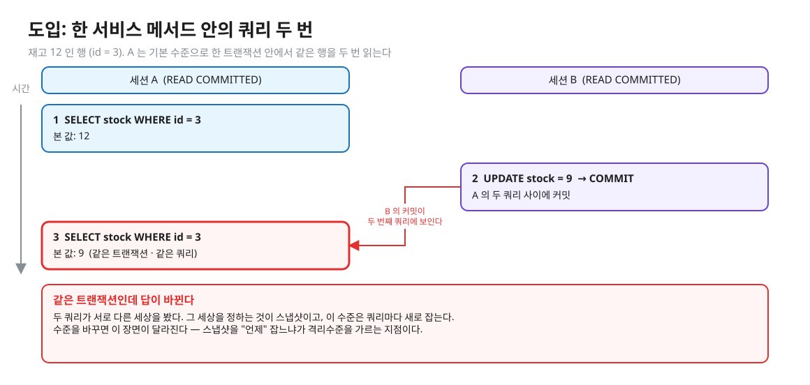
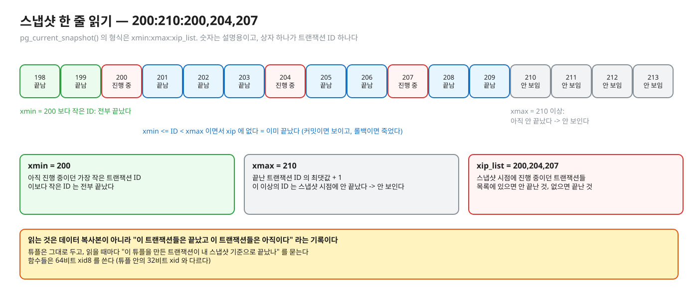
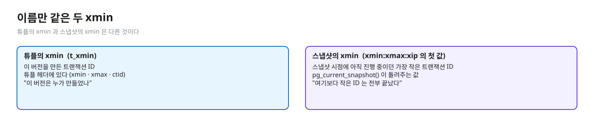
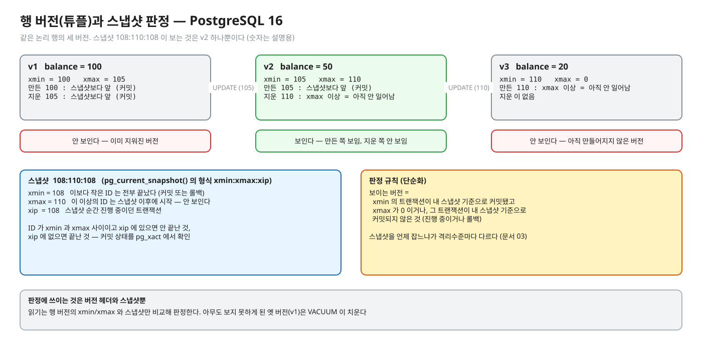
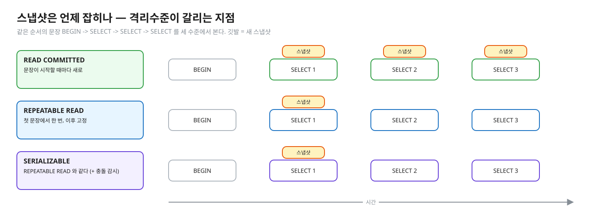
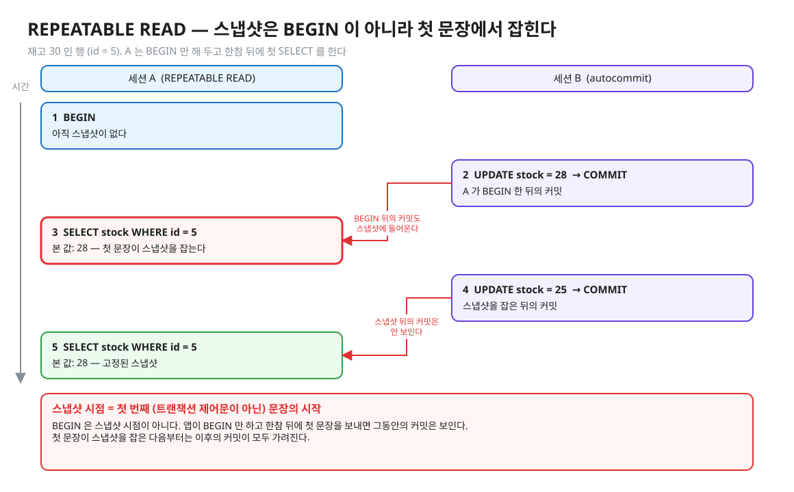
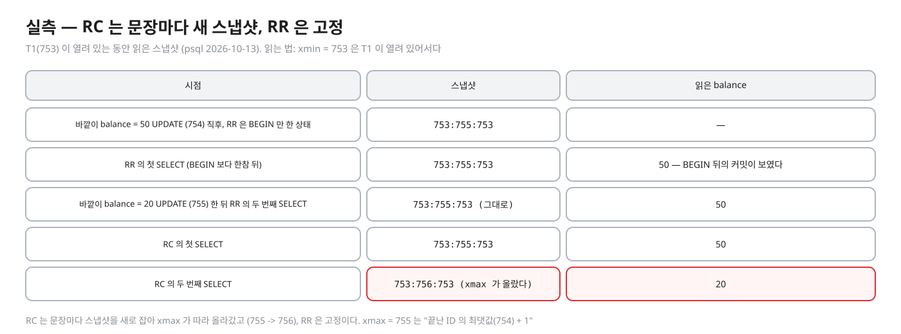
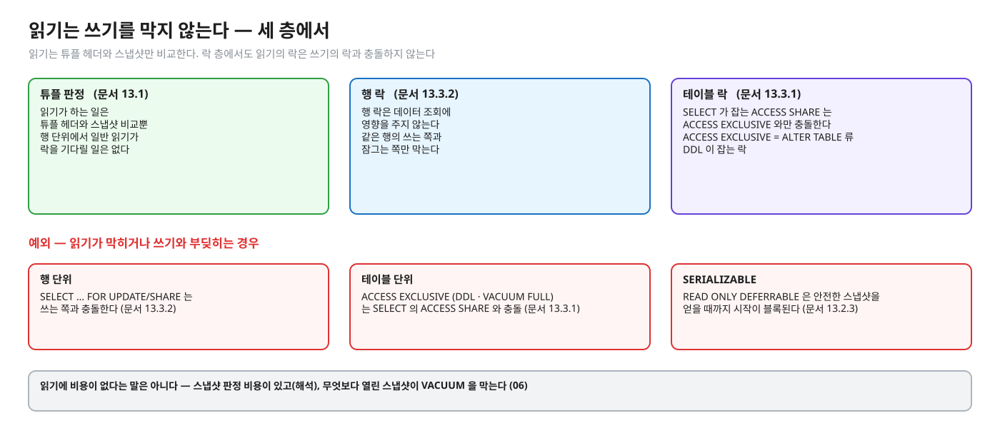
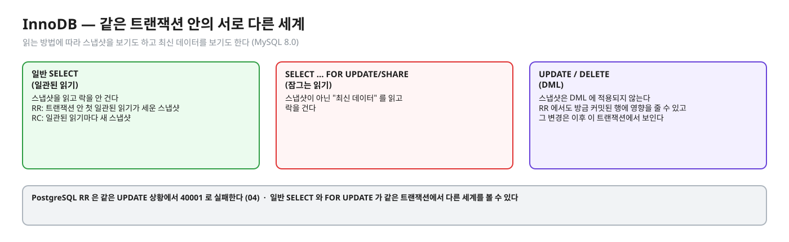

# 03. 스냅샷과 가시성 — 누가 어떤 버전을 보나

> **이 글에서 알게 되는 것**
> 1. 스냅샷이 데이터 복사본이 아니라 "내 시점에 끝난 트랜잭션은 누구인가" 의 기록이고, 읽기가 그 기록과 튜플의 xmin/xmax 를 비교해 버전을 고른다는 것을 안다.
> 2. READ COMMITTED 와 REPEATABLE READ 의 차이가 "스냅샷을 문장마다 vs 트랜잭션에서 한 번" 이라는 것, 그리고 그 한 번이 BEGIN 이 아니라 첫 문장이라는 것을 안다.
> 3. 읽기가 쓰기를 막지 않는 이유와 그 예외를 안다.
>
> **먼저 알면 좋은 것**: [02. MVCC 저장 구조](02-mvcc-tuple-storage.md) — 행이 버전(튜플)의 사슬이고 튜플 헤더에 xmin · xmax 가 있다는 것.
> **다음 글**: [04. 같은 행을 쓰는 경쟁](04-write-conflicts.md)
> **구분**: 필수 — ② 원리 (① 에서 예측을 먼저 한 뒤 읽는다)

## 같은 트랜잭션인데 답이 바뀐다

Spring 서비스 메서드 하나가 `@Transactional` 안에서 쿼리를 두 번 날린다고 하자. 재고가 12 인 행을 처음 읽었고, 그 사이 다른 세션이 9 로 고쳐 커밋했다. 두 번째 쿼리는 무엇을 볼까.

편집: [diagrams/blog03-intro.excalidraw](diagrams/blog03-intro.excalidraw)

기본 수준에서는 위 그림처럼 9 가 보인다. 같은 트랜잭션 안의 두 쿼리가 서로 다른 시점의 데이터를 섞어 보는 것이다. 둘을 조합해 계산하면 어긋난 결과가 나올 수 있고, 반대로 오래 열려 있는 REPEATABLE READ 트랜잭션은 옛 데이터를 계속 본다. 두 현상 모두 한 가지로 설명된다. 어느 세상을 볼지를 정하는 **스냅샷**을 언제 잡느냐다. "READ COMMITTED 와 REPEATABLE READ 는 구현에서 뭐가 다른가" 의 정답이 "스냅샷을 문장마다 잡느냐, 트랜잭션에서 한 번 잡느냐" 인 이유다. "읽기가 쓰기를 안 막는 건 어떻게 가능한가" 도 같은 글에서 답이 나온다.

## 스냅샷이란

**스냅샷(snapshot)** 은 어떤 순간의 "이 트랜잭션들은 끝났고 이 트랜잭션들은 아직이다" 라는 기록이다. 데이터를 복사하는 것이 아니다. 튜플은 그대로 두고, 읽을 때마다 "이 튜플을 만든 트랜잭션이 내 스냅샷 기준으로 끝났나" 를 묻는다.

### 스냅샷이 담는 것

[문서 9.26 (pg_snapshot)](https://www.postgresql.org/docs/16/functions-info.html): `pg_current_snapshot()` 은 지금 진행 중인 트랜잭션 ID 를 보여 주는 스냅샷을 돌려주고, 문자열 형식은 `xmin:xmax:xip_list` 다 (예: `10:20:10,14,15`). 아래 그림은 `200:210:200,204,207` 이라는 스냅샷을 상자로 풀어 쓴 것이다. 숫자는 설명용이다.

편집: [diagrams/blog03-snapshot-anatomy.excalidraw](diagrams/blog03-snapshot-anatomy.excalidraw)

| 요소 | 뜻 (문서 9.26 · Table 9.81) |
|---|---|
| `xmin` | 아직 진행 중이던 가장 작은 트랜잭션 ID. 이보다 작은 ID 는 전부 끝났다 — 커밋돼 보이거나 롤백돼 죽었다 |
| `xmax` | 끝난 트랜잭션 ID 의 최댓값 + 1. 이 이상의 ID 는 스냅샷 시점에 아직 안 끝났다 → **안 보인다** |
| `xip_list` | 스냅샷 시점에 진행 중이던 트랜잭션들. `xmin <= X < xmax` 이면서 목록에 없는 X 는 이미 끝난 것 — 커밋 상태에 따라 보이거나 죽었다 |

- 이 함수들은 64비트 `xid8` 를 쓴다. 설치 수명 동안 한 바퀴 돌지 않는다. 32비트 `xid`(튜플 안의 xmin/xmax)는 40억 트랜잭션마다 돈다 (문서 9.26).
- 서브트랜잭션 ID 는 스냅샷 문자열에 나오지 않는다 (문서 9.26). 이 레슨은 서브트랜잭션을 다루지 않는다.
- `pg_visible_in_snapshot(xid8, pg_snapshot)` 로 "그 트랜잭션이 이 스냅샷 기준으로 끝났나" 를 직접 물을 수 있다 (문서 9.26).

그런데 이 `xmin` 은 02 에서 본 튜플 헤더의 `xmin` 과 이름만 같다. 헷갈리기 쉬운 지점이라 한 번 구분해 둔다.

편집: [diagrams/blog03-two-xmins.excalidraw](diagrams/blog03-two-xmins.excalidraw)

### 판정 — 어느 버전이 보이나 (단순화)

이제 스냅샷과 튜플 헤더가 모였다. 아래 그림은 같은 논리 행의 세 버전을 한 스냅샷으로 판정하는 규칙이다. 한 튜플이 내 스냅샷에서 **보이려면** 두 조건을 모두 만족해야 한다.

편집: [diagrams/tuple-visibility.excalidraw](diagrams/tuple-visibility.excalidraw)

1. `xmin` 의 트랜잭션이 내 스냅샷 기준으로 끝났고 **커밋**했다 (또는 내 트랜잭션 자신이다), 그리고
2. `xmax` 가 0 이거나, `xmax` 의 트랜잭션이 내 스냅샷 기준으로 아직 안 끝났거나 롤백했다.

"커밋했나" 는 `pg_xact` 를 보고 안다 ([문서 73.1](https://www.postgresql.org/docs/16/storage-file-layout.html)). 이 규칙은 해석을 위한 단순화다. 실제 코드는 같은 트랜잭션 안의 앞선 명령(`cmin`/`cmax`), 서브트랜잭션, 튜플의 플래그 비트([02](02-mvcc-tuple-storage.md))까지 쓴다. [문서 13.2.1](https://www.postgresql.org/docs/16/transaction-iso.html) 이 확인해 주는 한 조각은 이것이다. "SELECT 는 자기 트랜잭션의 앞선 (아직 커밋 안 된) 갱신 효과를 본다."

### 스냅샷은 언제 잡히나 — 격리수준이 갈리는 지점

판정 규칙은 모든 수준이 같다. 갈리는 것은 스냅샷을 잡는 시점이다.

편집: [diagrams/blog03-when-snapshot.excalidraw](diagrams/blog03-when-snapshot.excalidraw)

| 수준 | 스냅샷 시점 | 근거 |
|---|---|---|
| READ COMMITTED | **문장(쿼리)이 시작하는 순간** — 문장마다 새로 | 문서 13.2.1: "SELECT 는 쿼리가 실행되기 시작한 순간의 스냅샷을 본다" · 같은 트랜잭션의 두 SELECT 가 다른 데이터를 볼 수 있다 |
| REPEATABLE READ | 트랜잭션의 **첫 번째 (트랜잭션 제어문이 아닌) 문장**이 시작하는 순간, 이후 고정 | 문서 13.2.2: "트랜잭션 안의 첫 non-transaction-control 문장의 시작" — **BEGIN 이 아니다** |
| SERIALIZABLE | REPEATABLE READ 와 같다 (+ 충돌 감시) | 문서 13.2.3 |

맨 앞의 장면이 이 표로 설명된다. READ COMMITTED 의 두 번째 SELECT 는 새 스냅샷을 잡았으니 그 사이의 커밋이 보였다. REPEATABLE READ 라면 첫 문장의 스냅샷이 고정되어 있어 같은 값이 나온다.

"BEGIN 이 아니다" 라는 점은 한 번 더 그림으로 보자. `BEGIN` 뒤 한참 있다 첫 SELECT 를 하면 그때까지의 커밋이 스냅샷에 들어온다.

편집: [diagrams/blog03-begin-lag.excalidraw](diagrams/blog03-begin-lag.excalidraw)

이 레슨의 Q07 테스트도 "스냅샷이 여기서 잡힌다" 주석이 달린 첫 SELECT 로 스냅샷 시점을 정한다. 그 밖에 `SET TRANSACTION SNAPSHOT` · `pg_export_snapshot()` 으로 다른 세션이 같은 스냅샷을 쓰게 할 수 있다. 단, 받는 쪽이 REPEATABLE READ 또는 SERIALIZABLE 이어야 한다. READ COMMITTED 는 문장마다 새 스냅샷을 잡아서 받은 것이 즉시 버려지기 때문이다. ([SET TRANSACTION](https://www.postgresql.org/docs/16/sql-set-transaction.html))

실측 — 예측(Q01 · Q02)을 끝낸 뒤 펼친다 (psql 2026-10-13)

세션 T1 이 트랜잭션 753 을 연 채(`xip` 에 들어간다), 세션 RR · RC 가 같은 행을 읽고, 그 사이 바깥 세션이 UPDATE 를 두 번 autocommit 한다.

| 시점 | 스냅샷 (`pg_current_snapshot()`) | 읽은 balance |
|---|---|---|
| 바깥이 balance = 50 으로 UPDATE (트랜잭션 754) 직후, RR 은 `BEGIN` 만 한 상태 | `753:755:753` | — |
| RR 의 **첫 SELECT** (BEGIN 보다 한참 뒤) | `753:755:753` | **50** — BEGIN 뒤의 커밋이 보였다 |
| 바깥이 balance = 20 으로 UPDATE (755) 한 뒤 RR 의 **두 번째 SELECT** | `753:755:753` (그대로) | 50 |
| RC 의 첫 SELECT | `753:755:753` | 50 |
| RC 의 **두 번째 SELECT** | `753:756:753` (xmax 가 올랐다) | **20** |

읽는 법: `xmin = 753` 은 T1 이 아직 열려 있기 때문이다. `xmax = 755` 는 "끝난 트랜잭션 ID 의 최댓값(754) + 1" 이다 (문서 9.26). RC 는 문장마다 스냅샷을 새로 잡아 xmax 가 따라 올라갔고 (755 → 756), RR 은 고정이다.

편집: [diagrams/blog03-measured.excalidraw](diagrams/blog03-measured.excalidraw)

### 읽기는 쓰기를 막지 않는다 — 어떻게 가능한가

스냅샷으로 버전을 고르는 구조가 이 성질의 바탕이다. 읽기가 하는 일은 튜플 헤더와 스냅샷 비교뿐이라, 행 단위에서 일반 읽기가 락을 기다릴 일은 없다 (예외: 테이블 단위 `ACCESS EXCLUSIVE` 를 쥔 DDL 은 `SELECT` 의 `ACCESS SHARE` 와 충돌한다 — 아래). MVCC 의 이점이 정확히 이것이다. "읽기 위해 잡는 락은 쓰기를 위해 잡는 락과 충돌하지 않는다" ([문서 13.1](https://www.postgresql.org/docs/16/mvcc-intro.html)).

편집: [diagrams/blog03-nonblocking.excalidraw](diagrams/blog03-nonblocking.excalidraw)

- 행 락도 마찬가지다. "행 락은 데이터 조회에 영향을 주지 않는다 — 같은 행의 **쓰는 쪽과 잠그는 쪽**만 막는다" ([문서 13.3.2](https://www.postgresql.org/docs/16/explicit-locking.html)).
- 테이블 락 수준에서도 `SELECT` 가 잡는 `ACCESS SHARE` 는 `ACCESS EXCLUSIVE` 와만 충돌한다 ([문서 13.3.1](https://www.postgresql.org/docs/16/explicit-locking.html)). `ACCESS EXCLUSIVE` 는 `ALTER TABLE` 류 DDL 이 잡는 락이다. 이 레슨 밖이며, [06](06-operations-vacuum-horizon.md) 의 "VACUUM FULL 은 ACCESS EXCLUSIVE" 와 같은 부류다.

### PostgreSQL 에서는 — 요약

- 스냅샷은 `xmin:xmax:xip_list` 이고, `pg_current_snapshot()` 으로 볼 수 있다.
- READ COMMITTED = 문장마다 / REPEATABLE READ · SERIALIZABLE = 트랜잭션 첫 문장에서 한 번.
- 읽기는 락을 기다리지 않는다. 쓰기끼리의 충돌은 [04](04-write-conflicts.md).
- 열린 트랜잭션의 스냅샷이 "아직 이 버전을 볼 수 있다" 로 취급되어 옛 버전을 못 치우게 한다 — [06](06-operations-vacuum-horizon.md).

### 자주 하는 오해

1. **"REPEATABLE READ 의 스냅샷은 BEGIN 시점에 잡힌다."** 첫 쿼리/데이터 변경 문장 시점이다 (문서 13.2.2). 앱이 `BEGIN` 만 하고 한참 뒤 첫 문장을 보내면 그동안의 커밋은 보인다.
2. **"READ COMMITTED 는 트랜잭션 시작 시점의 데이터를 본다."** 문장 시작 시점이다. 한 서비스 메서드 안의 두 쿼리가 서로 다른 세상을 볼 수 있다.
3. **"스냅샷은 데이터를 복사해 둔다."** 진행 중 ID 목록(xmin · xmax · xip) 일 뿐이다. 그래서 가볍지만, 그 대가로 옛 튜플을 치우지 못하게 만든다 ([06](06-operations-vacuum-horizon.md)).
4. **"읽기가 안 막히니 읽기에는 아무 비용이 없다."** 스냅샷 판정 비용이 있고(해석), 무엇보다 열린 스냅샷이 VACUUM 을 막는다.
5. **"`xmin` 컬럼 = 스냅샷의 `xmin`."** 이름만 같다. 튜플의 `xmin` 은 만든 트랜잭션 ID, 스냅샷의 `xmin` 은 아직 진행 중인 가장 작은 ID 다.

### 앱 · 프레임워크에서는

- Spring 의 한 `@Transactional` 메서드 안에서 쿼리 A, B 를 순서대로 날린다. 기본(READ COMMITTED)이면 A 와 B 가 서로 다른 스냅샷이다 — 둘을 조합해 계산하면 읽기 왜곡이 생길 수 있다. 일관된 조합이 필요하면 `isolation = Isolation.REPEATABLE_READ` 로 올리거나 한 쿼리로 합친다. 수준을 올리면 갱신 충돌에서 `40001` 이 나므로 재시도가 따라온다 ([05](05-serializable-ssi-retry.md)).
- `isolation` · `readOnly` 는 propagation 이 REQUIRED/REQUIRES_NEW 일 때만 적용된다고 Spring 문서가 쓴다 ([Spring](https://docs.spring.io/spring-framework/reference/data-access/transaction/declarative/annotations.html)). 이미 열린 트랜잭션에 참여(join)하는 메서드에서 isolation 을 바꿔 봐야 효과가 없다는 뜻으로 읽을 수 있다 (해석 — 코드로 확인하지 않았다).

## MySQL InnoDB 는 어떻게 다른가 (심화)

- 읽기: **일관된 읽기(consistent read)** — 일반 SELECT 는 스냅샷을 읽고 락을 안 건다. REPEATABLE READ 에서는 "트랜잭션 안 첫 일관된 읽기가 세운 스냅샷", READ COMMITTED 에서는 "일관된 읽기마다 새 스냅샷" ([MySQL 17.7.2.3](https://dev.mysql.com/doc/refman/8.0/en/innodb-consistent-read.html), [17.7.2.1](https://dev.mysql.com/doc/refman/8.0/en/innodb-transaction-isolation-levels.html)). PostgreSQL 의 문장 vs 트랜잭션 구분과 같은 축이다.
- **스냅샷은 DML 에 적용되지 않는다**: RR 에서도 UPDATE/DELETE 는 다른 트랜잭션이 방금 커밋한 행에 영향을 줄 수 있고, 그 변경은 이후 이 트랜잭션에서 보인다 (17.7.2.3). PostgreSQL RR 은 같은 상황에서 `40001` ([04](04-write-conflicts.md)).
- **잠그는 읽기(locking read)**: `SELECT … FOR UPDATE/SHARE` 는 스냅샷이 아닌 "최신 데이터"를 읽고 락을 건다 ([MySQL 17.7.2.4](https://dev.mysql.com/doc/refman/8.0/en/innodb-locking-reads.html): "reads the latest available data"). 일반 SELECT 와 FOR UPDATE 가 같은 트랜잭션에서 다른 세계를 볼 수 있다는 점은 InnoDB 에서 특히 헷갈리기 쉬운 지점이다.

편집: [diagrams/blog03-mysql.excalidraw](diagrams/blog03-mysql.excalidraw)

## 한눈에 정리

| | READ COMMITTED | REPEATABLE READ · SERIALIZABLE |
|---|---|---|
| 스냅샷을 잡는 때 | 문장이 시작할 때마다 | 트랜잭션의 첫 (제어문이 아닌) 문장에서 한 번 |
| 같은 트랜잭션의 두 SELECT | 다른 데이터를 볼 수 있다 | 같은 스냅샷을 본다 |
| 읽기가 락을 기다리나 | 아니오 (행 단위) | 아니오 (행 단위) |

- 스냅샷은 데이터 복사본이 아니라 `xmin:xmax:xip_list`, 즉 "누가 끝났나" 의 기록이다.
- 격리수준은 판정 규칙이 아니라 스냅샷을 **언제 잡느냐**로 갈린다. REPEATABLE READ 의 시점은 BEGIN 이 아니라 첫 문장이다.
- 읽기는 튜플 헤더와 스냅샷만 비교하므로 행 단위에서 쓰기를 기다리지 않는다. 예외는 `FOR UPDATE/SHARE`, `ACCESS EXCLUSIVE`, `READ ONLY DEFERRABLE` 이다.

## 스스로 확인

1. REPEATABLE READ 트랜잭션이 몇 시간 열려 있다. 그동안 이 트랜잭션에 읽기 외에 어떤 일이 생기나?
   

답

   읽기는 계속 옛 스냅샷의 세상을 본다. 이 트랜잭션이 쓰려는 행이 그 사이 다른 트랜잭션에 의해 바뀌었다면 `40001`. 그리고 이 스냅샷의 xmin 이 VACUUM 이 옛 튜플을 치우는 것을 막는다 — 실측: 열린 REPEATABLE READ 트랜잭션이 있는 동안 `VACUUM (VERBOSE)` 가 "100 are dead but not yet removable" 이라고 출력했다 ([06](06-operations-vacuum-horizon.md)).
   

2. `pg_current_snapshot()` 이 `100:110:103,107` 이다. 트랜잭션 105 가 만든 튜플은 보이나? 107 은? 120 은?
   

답

   105: `100 <= 105 < 110` 이고 xip 에 없으므로 이 스냅샷 시점에 끝난 트랜잭션이다 — 커밋했다면 보이고 롤백했다면 죽었다(`pg_xact` 로 판정). 107: xip 에 있으므로 진행 중이었다 → 안 보인다. 120: xmax(110) 이상이므로 스냅샷 이후에 시작 → 안 보인다. (문서 9.26 Table 9.81 의 정의를 적용한 것)
   

3. "읽기는 쓰기를 막지 않는다"에 예외가 있나?
   

답

   행 단위에서는 일반 `SELECT` 가 막히지 않지만, `SELECT … FOR UPDATE/SHARE` 는 쓰는 쪽과 충돌한다(문서 13.3.2). 테이블 단위에서는 `SELECT` 의 `ACCESS SHARE` 와 충돌하는 `ACCESS EXCLUSIVE`(DDL, VACUUM FULL) 가 있다 (문서 13.3.1). SERIALIZABLE 에서는 `READ ONLY DEFERRABLE` 트랜잭션이 안전한 스냅샷을 얻을 때까지 시작이 블록된다 — 문서 13.2.3 은 이것이 "Serializable 은 블록되는데 Repeatable Read 는 안 되는 유일한 경우" 라고 쓴다.
   

4. 같은 `@Transactional` 메서드 안에서 `findById` 를 두 번 호출하면 값이 바뀔 수 있나?
   

답

   DB 격리수준이 READ COMMITTED 이고 두 호출이 실제로 SQL 두 번이면 가능하다. JPA(Hibernate)의 1차 캐시가 두 번째 조회를 SQL 없이 처리하면 같은 값이 나오는데, 그건 DB 가 아니라 영속성 컨텍스트 때문이다 — 이 글에서 코드로 확인하지는 않았다(해석 수준). 값 일관성을 DB 에 맡기려면 격리수준을 명시한다.
   

## 이 레슨에서 직접 보기

| 어디서 | 무엇을 |
|---|---|
| Q01 · Q02 | RC 는 두 번째 SELECT 가 달라지는가 · RR 은 |
| Q03 | RR 에서 팬텀 — 스냅샷이 고정이면 새 행도 안 보이나 |
| Q04 | READ UNCOMMITTED 는 커밋 전 값을 보나 |
| Q10 | 쓰는 중인 행을 읽으면 기다리나 · 무엇이 보이나 |
| 장면 2 | 같은 장면을 `xmin`/`xmax` 로 |

이 글의 그림은 일부러 문항과 다른 숫자(재고 12 · 9 · 30 · 28)로 그렸다. 예측 문항의 값을 직접 적어 보고 나서 확인한다.

실측 — 예측을 끝낸 뒤 펼친다 (Q01 · Q02 · Q03 · Q04 · Q10)

Q01 = 50, Q02 = 100, Q03 = 2, Q04 = 100, Q10 = (기다림 없음, 100, ctid 다름). 근거: [정답 patch](../../../solutions/01.01.patch) 의 예측 답 · 위 psql 실측.

## 출처

- [PostgreSQL 16 · 9.26 System Information Functions — Transaction IDs and Snapshots](https://www.postgresql.org/docs/16/functions-info.html) — `pg_current_snapshot` · xmin/xmax/xip 정의 · `xid8`
- [13.2 Transaction Isolation](https://www.postgresql.org/docs/16/transaction-iso.html) — RC 문장 스냅샷 · RR 첫 문장 스냅샷
- [13.1 Introduction](https://www.postgresql.org/docs/16/mvcc-intro.html) · [13.3 Explicit Locking](https://www.postgresql.org/docs/16/explicit-locking.html) — 읽기/쓰기 비충돌 · 행 락과 조회
- [SET TRANSACTION](https://www.postgresql.org/docs/16/sql-set-transaction.html) — SET TRANSACTION SNAPSHOT
- [73.1 Database File Layout](https://www.postgresql.org/docs/16/storage-file-layout.html) — pg_xact
- [MySQL 8.0 · 17.7.2.1](https://dev.mysql.com/doc/refman/8.0/en/innodb-transaction-isolation-levels.html) · [17.7.2.3](https://dev.mysql.com/doc/refman/8.0/en/innodb-consistent-read.html) · [17.7.2.4](https://dev.mysql.com/doc/refman/8.0/en/innodb-locking-reads.html)
- [Spring · @Transactional](https://docs.spring.io/spring-framework/reference/data-access/transaction/declarative/annotations.html)
