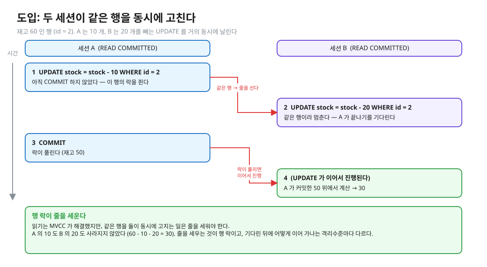
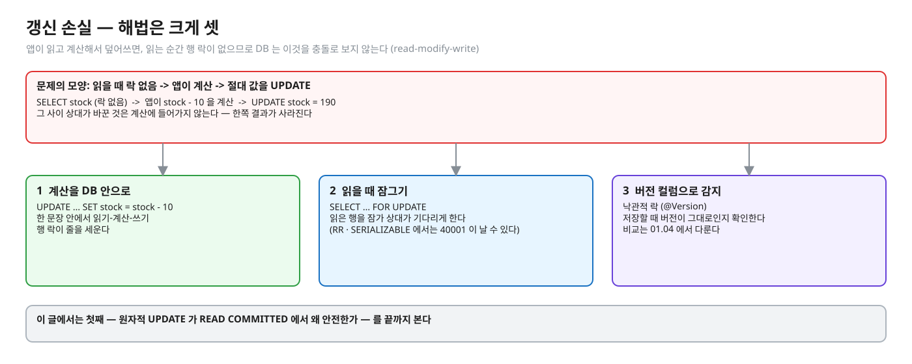
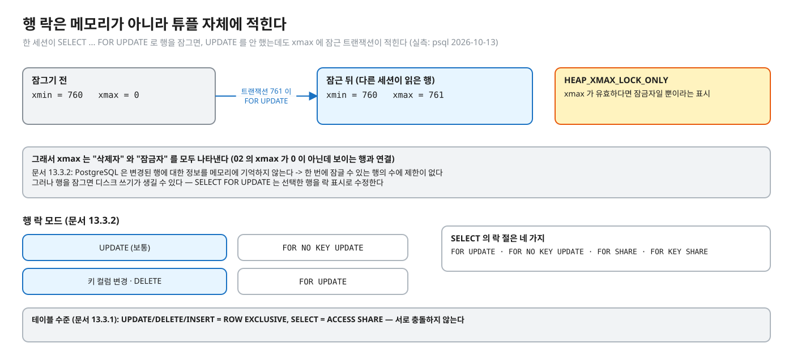
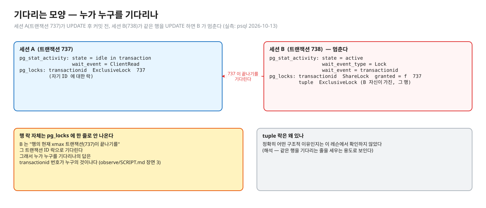
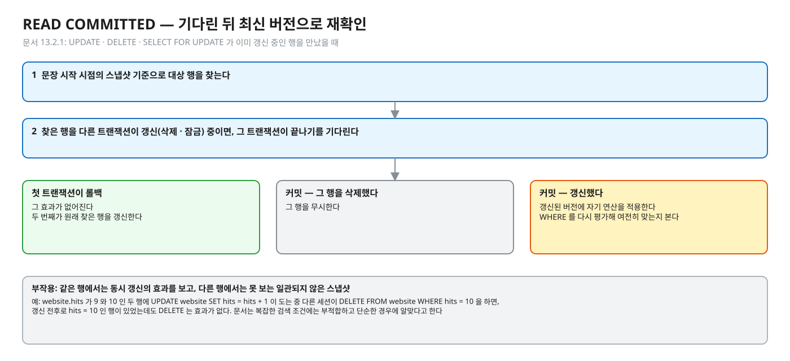
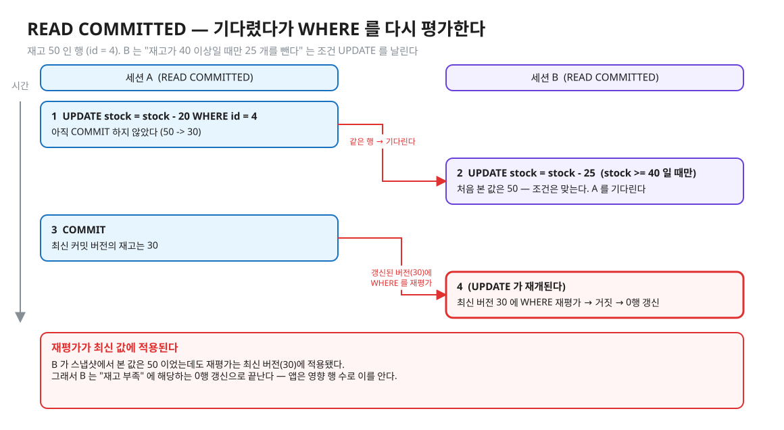
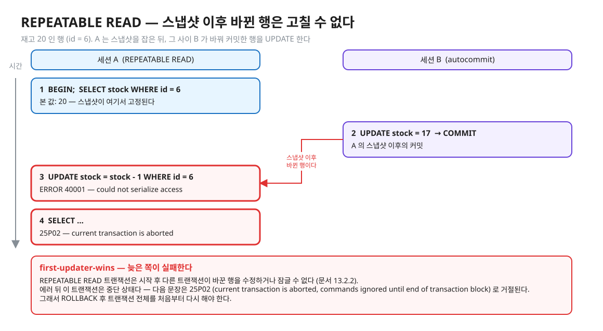
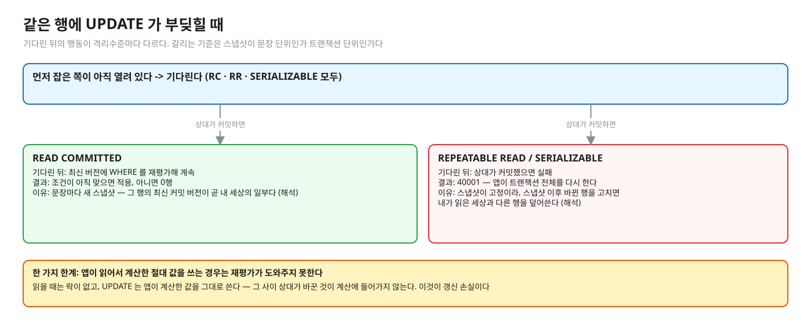
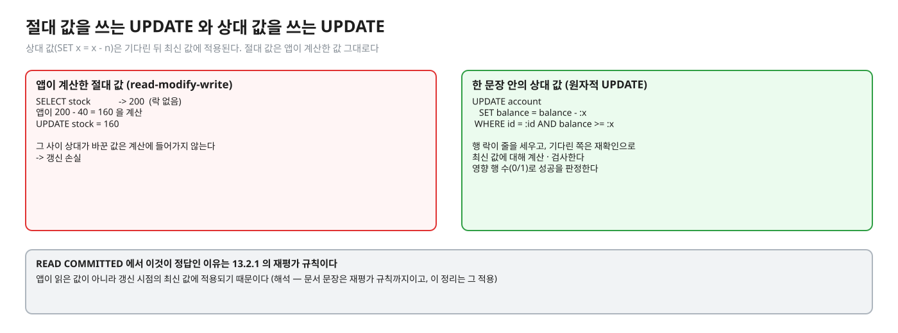

# 04. 같은 행을 쓰는 경쟁 — 행 락 · 재확인 · 40001 · 갱신 손실

> **이 글에서 알게 되는 것**
> 1. MVCC 가 읽기를 해결해도 같은 행을 동시에 쓰는 문제는 **행 락**이 줄을 세워 푼다는 것, 그 락이 어디에 어떻게 기록되는지를 안다.
> 2. 기다린 뒤의 행동이 격리수준마다 다르다는 것을 안다 — READ COMMITTED 는 최신 버전으로 재확인해 계속하고, REPEATABLE READ 는 `40001` 로 실패한다.
> 3. 갱신 손실이 왜 생기고, `SET balance = balance - x` 같은 원자적 UPDATE 가 왜 안전한지 설명할 수 있다.
>
> **먼저 알면 좋은 것**: [02. MVCC 저장 구조](02-mvcc-tuple-storage.md)의 xmin · xmax, [03. 스냅샷과 가시성](03-snapshot-visibility.md)의 "스냅샷을 언제 잡나".
> **다음 글**: [05. SERIALIZABLE 과 SSI](05-serializable-ssi-retry.md)
> **구분**: 심화 — 꼬리질문 대비 (레슨을 마친 뒤 · 면접 전)

## 두 세션이 같은 행을 동시에 고치면

재고가 60 인 행이 있다. 세션 A 가 10 개를, 세션 B 가 20 개를 빼는 UPDATE 를 거의 동시에 날린다.

편집: [diagrams/blog04-intro.excalidraw](diagrams/blog04-intro.excalidraw)

읽기는 MVCC 가 해결해 주지만 이 장면은 다르다. 한 버전에는 xmax 가 하나뿐이라 "지금 지우는 중인 트랜잭션" 이 하나만 있을 수 있기 때문이다 (해석 — 02 의 xmax). 그래서 UPDATE · DELETE · `SELECT … FOR UPDATE` 는 대상 행에 **행 락**을 잡고, 같은 행에 먼저 잡은 트랜잭션이 끝나기를 기다린다. 이것이 "잔고 차감에서 동시성 이슈를 어떻게 막나" 에 대한 1차 답이다. 그림에서는 A 의 10 도 B 의 20 도 사라지지 않았다. 하지만 "기다린 뒤 B 는 무엇을 보고 계산하나" 는 격리수준마다 다르고, 이 글의 나머지가 그 이야기다. 실무에서는 읽고 계산해 쓰는 코드(`findById` → 값 변경 → `save`)가 만드는 갱신 손실, 그리고 락 대기가 길어져 커넥션 풀이 마르는 장애(01.02 · 01.04 로 이어진다)가 이 글의 주제와 직결된다.

## 행 락이 줄을 세운다

[문서 13.3.2](https://www.postgresql.org/docs/16/explicit-locking.html): "두 트랜잭션은 같은 행에 충돌하는 락을 가질 수 없다. 행 락은 조회에는 영향을 주지 않고 같은 행의 쓰는 쪽과 잠그는 쪽만 막는다. 트랜잭션이 끝날 때 풀린다." 읽기를 막지 않는 이유는 [03](03-snapshot-visibility.md) 에서 봤다. 여기서 막히는 것은 쓰는 쪽끼리, 그리고 잠그는 쪽과 쓰는 쪽이다.

## 갱신 손실 (lost update)

[01](01-anomalies-and-isolation-levels.md) 에서 이름만 붙였던 갱신 손실을 이제 구체적으로 본다. 둘이 같은 값을 **앱에서** 읽고, 계산하고, 결과를 덮어쓰면 한쪽이 사라진다 (`read-modify-write`). 읽는 순간 행 락이 없으므로 DB 는 이것을 충돌로 보지 않는다. 해법은 크게 셋이다. 계산을 DB 안으로(원자적 UPDATE), 읽을 때 잠그기(`FOR UPDATE`), 버전 컬럼으로 감지(낙관적 락, 01.04).

편집: [diagrams/blog04-three-fixes.excalidraw](diagrams/blog04-three-fixes.excalidraw)

이 글에서는 첫 번째 해법이 왜 안전한지를, 격리수준별 "기다린 뒤의 행동" 을 거쳐 끝에서 설명한다.

## PostgreSQL 에서는

### 행 락은 어디에 기록되나

락 정보는 메모리 락 테이블이 아니라 **튜플 자체**에 적힌다. 문서 13.3.2: "PostgreSQL 은 변경된 행에 대한 정보를 메모리에 기억하지 않는다. 그래서 한 번에 잠글 수 있는 행의 수에 제한이 없다. 그러나 행을 잠그면 디스크 쓰기가 생길 수 있다 — `SELECT FOR UPDATE` 는 선택한 행을 락 표시로 수정한다."

편집: [diagrams/blog04-lock-in-tuple.excalidraw](diagrams/blog04-lock-in-tuple.excalidraw)

- 실측 (psql 2026-10-13): 한 세션이 `SELECT * FROM account WHERE id = 1 FOR UPDATE` 를 하고 트랜잭션 761 로 열려 있을 때, 다른 세션이 읽은 그 행은 `xmin = 760, xmax = 761` 이었다 — **UPDATE 를 하지 않았는데도** xmax 에 잠근 트랜잭션이 적혔다. 소스의 `HEAP_XMAX_LOCK_ONLY` 는 "xmax 가 유효하다면 잠금자일 뿐" 이라는 표시다 ([htup_details.h](https://github.com/postgres/postgres/blob/REL_16_STABLE/src/include/access/htup_details.h)). 즉 xmax 는 "삭제자" 와 "잠금자" 를 모두 나타낸다 ([02](02-mvcc-tuple-storage.md) 의 xmax 비영 보이는 행과 연결).
- 모드 (문서 13.3.2): `UPDATE` 는 보통 `FOR NO KEY UPDATE` 를, 키(외래키로 쓸 수 있는 유니크 인덱스) 컬럼을 바꾸거나 `DELETE` 할 때는 `FOR UPDATE` 를 잡는다. `SELECT` 의 락 절은 `FOR UPDATE` · `FOR NO KEY UPDATE` · `FOR SHARE` · `FOR KEY SHARE` 네 가지다.
- 테이블 수준에서는 `UPDATE`/`DELETE`/`INSERT` 가 `ROW EXCLUSIVE`, `SELECT` 가 `ACCESS SHARE` 를 잡는다 (문서 13.3.1) — 서로 충돌하지 않는다.

### 기다리는 모양 — pg_stat_activity · pg_locks

(실측: psql 2026-10-13) 세션 A(트랜잭션 737)가 `UPDATE … WHERE id = 1` 후 커밋 전, 세션 B(738)가 같은 행을 UPDATE 하면 B 가 멈춘다.

편집: [diagrams/blog04-pg-locks.excalidraw](diagrams/blog04-pg-locks.excalidraw)

| 조회 | 결과 |
|---|---|
| `pg_stat_activity` | B: `state = active`, `wait_event_type = Lock`, `wait_event = transactionid`. A: `idle in transaction` (`wait_event = ClientRead`) |
| `pg_locks` (B) | `transactionid` 락 `ShareLock`, `granted = f`, `transactionid = 737` (A 의 ID). 그리고 B 자신이 가진 `tuple` 락 `ExclusiveLock` (그 행) |
| `pg_locks` (A) | `transactionid` `ExclusiveLock` 737 (자기 ID 에 대해) |

즉 **행 락 자체는 pg_locks 에 한 줄로 안 나오고**, B 는 "행의 현재 xmax 트랜잭션(737)이 끝나기를" 그 트랜잭션 ID 락으로 기다린다. 그래서 누가 누구를 기다리나의 답은 `transactionid` 번호가 누구의 것이냐다 (observe/SCRIPT.md 장면 3). tuple 락이 정확히 어떤 구조적 이유로 있는지는 이 레슨에서 확인하지 않았다 (해석 — 같은 행을 기다리는 줄을 세우는 용도로 보인다).

### READ COMMITTED — 기다린 뒤 최신 버전으로 재확인

기다림이 끝난 뒤가 문제다. A 가 커밋하고 나면 B 는 어떤 값 위에서 계속하나. [문서 13.2.1](https://www.postgresql.org/docs/16/transaction-iso.html) 의 요지는 이렇다.

편집: [diagrams/blog04-rc-steps.excalidraw](diagrams/blog04-rc-steps.excalidraw)

1. UPDATE/DELETE/SELECT FOR UPDATE 는 **문장 시작 시점 스냅샷** 기준으로 대상 행을 찾는다.
2. 그런데 찾은 행을 이미 다른 트랜잭션이 갱신(삭제·잠금) 중이면 **그 트랜잭션이 끝나기를 기다린다**.
3. 첫 트랜잭션이 롤백하면 그 효과가 없어지고 두 번째가 원래 찾은 행을 갱신한다. 커밋했으면, 삭제했을 경우 그 행을 무시하고, 아니면 **갱신된 버전에 자기 연산을 적용**한다. 이때 `WHERE` 절을 **다시 평가**해 갱신된 버전이 여전히 조건에 맞는지 본다.
4. 부작용: 갱신 명령은 같은 행에서는 동시 갱신의 효과를 보면서 다른 행에서는 보지 못하는 **일관되지 않은 스냅샷**을 볼 수 있다. 문서는 그래서 복잡한 검색 조건에는 부적합하고 단순한 경우에 알맞다고 한다. 예: `website.hits` 가 9 와 10 인 두 행에 `UPDATE website SET hits = hits + 1` 을 도는 중 다른 세션이 `DELETE FROM website WHERE hits = 10` 을 하면, 갱신 전후로 hits = 10 인 행이 있었는데도 DELETE 는 효과가 없다.

조건이 붙은 UPDATE 로 보면 재평가가 무슨 뜻인지 선명하다.

편집: [diagrams/blog04-rc-recheck.excalidraw](diagrams/blog04-rc-recheck.excalidraw)

실측 — 예측(Q06)을 끝낸 뒤 펼친다 (psql 2026-10-13)

잔고 100 인 행에서 A 가 `balance = balance - 30` 을 커밋 전으로 두고, B 가 `UPDATE … SET balance = balance - 50 WHERE id = 1 AND balance >= 80` 을 날리면 B 는 멈췄다가, A 커밋 후 **0행 갱신**이 됐다 (잔고 70 으로 `balance >= 80` 재평가가 거짓). B 가 처음 스냅샷에서 본 값은 100 이었는데도 재평가가 최신 버전(70)에 적용된 것이다.

### REPEATABLE READ — 스냅샷 이후 바뀐 행은 실패 (first-updater-wins)

REPEATABLE READ 는 스냅샷이 트랜잭션 단위로 고정이라 같은 상황의 결론이 다르다. [문서 13.2.2](https://www.postgresql.org/docs/16/transaction-iso.html):

> 첫 갱신자가 커밋하면 (그리고 실제로 갱신·삭제했으면 — 락만 걸었던 것이 아니라) REPEATABLE READ 트랜잭션은 `ERROR: could not serialize access due to concurrent update` 로 롤백된다. REPEATABLE READ 트랜잭션은 시작 후 다른 트랜잭션이 바꾼 행을 수정하거나 잠글 수 없기 때문이다.

편집: [diagrams/blog04-rr-40001.excalidraw](diagrams/blog04-rr-40001.excalidraw)

문서는 이 에러를 받으면 "현재 트랜잭션을 중단하고 **처음부터 전체를 다시** 하라" 고, 이 수준을 쓰는 애플리케이션은 직렬화 실패에 대비해야 한다고 쓴다. **갱신하는 트랜잭션만** 재시도가 필요하고 읽기 전용은 직렬화 충돌이 없다.

실측 — 예측(Q07)을 끝낸 뒤 펼친다 (psql 2026-10-13)

두 경로 모두 같은 `ERROR:  could not serialize access due to concurrent update` 가 나왔다.
- (가) A(RR)가 스냅샷을 잡은 뒤, 다른 세션이 이미 UPDATE+커밋한 행을 A 가 UPDATE — 기다림 없이 바로 에러.
- (나) 다른 세션이 UPDATE 를 열어 둔 상태에서 A(RR)가 같은 행 UPDATE → 멈춤 → 상대가 커밋하자 에러.

에러 후 같은 트랜잭션의 다음 문장은 `current transaction is aborted, commands ignored until end of transaction block` (= 25P02).

### 정리 — 같은 행에 UPDATE 가 부딪힐 때

편집: [diagrams/blog04-decision.excalidraw](diagrams/blog04-decision.excalidraw)

| | 기다리나 | 기다린 뒤 | 결과 |
|---|---|---|---|
| READ COMMITTED | 예 | 최신 버전에 WHERE 재평가해 계속 | 조건이 아직 맞으면 적용, 아니면 0행 |
| REPEATABLE READ / SERIALIZABLE | 예 (상대가 아직 열려 있으면) | 상대가 커밋했으면 실패 | `40001` — 앱이 전체 재시도 |

앱이 **읽어서 계산한 절대 값**을 쓰는 경우는 위 표의 재평가가 도와주지 못한다. 읽을 때는 락이 없고, UPDATE 는 앱이 계산한 값을 그대로 쓰므로 그 사이 상대가 바꾼 것이 계산에 들어가지 않는다. 이것이 갱신 손실이다.

### 원자적 UPDATE 가 안전한 이유

`UPDATE account SET balance = balance - :x WHERE id = :id AND balance >= :x` 는 읽기-계산-쓰기를 **한 문장**에서 한다. 같은 행의 행 락이 줄을 세우고, 기다린 쪽은 위의 재확인으로 최신 값에 대해 계산·검사한다. 영향 행 수(0/1)로 성공을 판정한다. READ COMMITTED 에서 이것이 정답인 이유가 13.2.1 의 재평가 규칙이다. 앱이 읽은 값이 아니라 **갱신 시점의 최신 값**에 적용되기 때문이다 (해석 — 문서 문장은 재평가 규칙까지이고, 이 정리는 그 적용).

편집: [diagrams/blog04-atomic.excalidraw](diagrams/blog04-atomic.excalidraw)

### 자주 하는 오해

1. **"READ COMMITTED 에서 같은 행을 동시에 UPDATE 하면 마지막 것이 덮어쓴다."** 문장이 `SET x = x - n` 처럼 상대 값이면 기다린 뒤 최신 값에 적용된다. 덮어쓰는 것은 앱이 계산한 **절대 값**을 쓸 때다.
2. **"락을 기다리면 데이터가 안전하다."** 기다린 뒤 읽은 값에 근거한 판단을 이미 앱이 끝냈다면 안전하지 않다. 기다림이 해결하는 것은 같은 행의 동시 쓰기뿐이다.
3. **"`SELECT … FOR UPDATE` 는 읽기라서 락이 안 생긴다 / 메모리에만 잡힌다."** 디스크의 튜플(xmax)에 기록되고, 쓰기를 일으킨다 (문서 13.3.2, 위 실측).
4. **"REPEATABLE READ 에서 에러가 나면 마지막 문장만 다시 하면 된다."** 읽은 값에 근거한 판단 전체가 무효다 — 트랜잭션 전체를 처음부터. 어차피 중단된 트랜잭션은 25P02 로 이후 문장을 거절한다.
5. **"`40001` 은 버그 신호다."** 엔진이 의도한 정상 경로다. 앱의 재시도가 있어야 완성된다.

### 앱 · 프레임워크에서는

- JPA 의 `find` → 필드 변경 → 커밋(더티 체킹)은 "읽고 계산해서 쓰기" 형태다. 기본 격리수준에서 같은 엔티티를 둘이 수정하면 마지막 쓰기가 이길 수 있고(해석), 이를 막는 도구가 `@Version`(낙관적 락)·비관적 락·원자적 UPDATE 쿼리다 — 비교는 01.04 에서 다룬다. 이 글에서는 Hibernate 동작을 코드로 확인하지 않았다.
- 재시도를 둘 곳은 [05](05-serializable-ssi-retry.md) (트랜잭션 **밖**).

## MySQL InnoDB 는 어떻게 다른가

- InnoDB 의 UPDATE/DELETE 는 RR 에서도 스냅샷이 아니라 **최신 커밋 상태**에 닿을 수 있다 ([MySQL 17.7.2.3](https://dev.mysql.com/doc/refman/8.0/en/innodb-consistent-read.html): RR 에서도 DELETE/UPDATE 가 방금 커밋된 행에 영향을 줄 수 있다). PostgreSQL RR 의 `40001` 대신 **기다린 뒤 적용**된다는 방향이다. 따라서 "갱신 손실" 이 일어나는 조건이 PostgreSQL RR 과 다르다 — 정확한 경계(어떤 쿼리 형태에서 어떻게 되는지)는 직접 확인하지 않았다.
- READ COMMITTED 의 UPDATE 는 "반일관 읽기(semi-consistent read)": 이미 잠긴 행이면 최신 커밋 버전을 MySQL 에 돌려 `WHERE` 에 맞는지 보고, 맞으면 다시 읽어 락을 얻거나 기다린다 ([MySQL 17.7.2.1](https://dev.mysql.com/doc/refman/8.0/en/innodb-transaction-isolation-levels.html)). PostgreSQL RC 의 재평가와 비슷한 목적이다.

## 한눈에 정리

| 상황 | PostgreSQL 16 에서 일어나는 일 |
|---|---|
| 같은 행을 둘이 UPDATE | 먼저 잡은 쪽의 행 락 때문에 늦은 쪽이 기다린다 (xmax 의 트랜잭션 ID 를 기다림) |
| 기다린 뒤, READ COMMITTED | 최신 버전에 WHERE 재평가 → 맞으면 적용, 아니면 0행 |
| 기다린 뒤, REPEATABLE READ · SERIALIZABLE | 상대가 커밋했으면 `40001` → 트랜잭션 전체 재시도 |
| 앱이 계산한 절대 값 UPDATE | 갱신 손실 — 락도 재평가도 도와주지 못한다 |
| `SET x = x - n` 한 문장 | RC 에서 안전 — 갱신 시점의 최신 값에 적용 |

- 행 락은 메모리가 아니라 튜플의 xmax 에 적히고, 기다림은 `transactionid` 락으로 보인다.
- 격리수준이 갈리는 지점은 스냅샷 단위다. RC 는 문장마다 새 스냅샷이라 최신 버전을 받아들이고, RR 은 고정 스냅샷이라 이후 바뀐 행을 거부한다.
- `40001` 은 버그가 아니라 정상 경로이고, 읽은 값에 근거한 판단 전체가 무효이므로 트랜잭션 전체를 다시 한다.

## 스스로 확인

1. READ COMMITTED 에서 `UPDATE account SET balance = balance - 50 WHERE id = 1 AND balance >= 50` 두 개가 동시에 와서 잔고가 70 이다. 결과는?
   

답

   먼저 행 락을 잡은 쪽이 70 → 20 으로 갱신하고 커밋한다. 늦은 쪽은 기다렸다가 갱신된 버전(20)에 대해 `WHERE balance >= 50` 를 다시 평가해 거짓이므로 0행 갱신이다 (문서 13.2.1 재평가 규칙, 실측으로 같은 모양을 확인: 100-30=70 에서 `>= 80` 조건이 0행). 앱은 영향 행 수 0 을 "잔고 부족" 으로 처리한다.
   

2. REPEATABLE READ 에서 `40001` 이 날 때와 READ COMMITTED 에서 "기다렸다 계속" 이 될 때, 엔진은 무엇을 기준으로 가르나?
   

답

   스냅샷이 문장 단위인지 트랜잭션 단위인지다. RC 는 문장마다 새 스냅샷을 잡으므로 "그 행의 최신 커밋 버전" 이 곧 내 세상의 일부라 적용해도 되지만, RR 은 트랜잭션 스냅샷을 고정해 둔 상태에서 스냅샷 이후 바뀐 행을 고치면 "내가 읽은 세상과 다른 행" 을 덮어쓰게 되므로 실패시킨다 (문서 13.2.2: "cannot modify or lock rows changed by other transactions after the repeatable read transaction began"). 해석 부분: 이 대비는 문서 문장을 요약한 것이다.
   

3. `SELECT … FOR UPDATE` 로 잠근 행의 xmax 에는 무엇이 있나? 롤백하면?
   

답

   잠근 트랜잭션 ID 가 xmax 에 적힌다(실측: 761). 소스의 `HEAP_XMAX_LOCK_ONLY` 는 xmax 가 잠금자일 뿐이라는 표시다. 롤백하면 그 잠금은 효력이 없고, 다음에 읽는 쪽이 롤백된 xmax 를 무효로 판정한다 — [02](02-mvcc-tuple-storage.md) 의 hint bit 관찰과 같은 성질 (롤백한 트랜잭션의 xmax 는 무효 취급, 그 무효 판정이 플래그로 남음).
   

4. 두 UPDATE 가 서로를 기다리면(A 가 1번 행 → 2번 행, B 가 2번 행 → 1번 행)?
   

답

   데드락이다 — 엔진이 감지해 한쪽을 `40P01 deadlock_detected` 로 취소한다 (부록 A). 이 글의 범위 밖이며 01.02 에서 다룬다. 감지까지 걸리는 시간과 그 설정은 이 레슨에서 확인하지 않았다.
   

## 이 레슨에서 직접 보기

| 어디서 | 무엇을 |
|---|---|
| Q05 | RC 에서 앱이 읽고 계산해 쓰면 |
| Q06 | RC 에서 `SET balance = balance - x` 는 기다리나 · 결과 |
| Q07 | RR 에서 스냅샷 이후 바뀐 행을 고치면 |
| 장면 3 | 두 UPDATE 가 부딪힐 때 pg_stat_activity · pg_locks |

이 글의 그림은 일부러 문항과 다른 숫자(재고 60 · 50 · 20 같은 값)로 그렸다. 예측 문항의 값을 직접 적어 보고 나서 확인한다.

실측 — 예측을 끝낸 뒤 펼친다 (Q05 · Q06 · Q07)

| Q | 결과 |
|---|---|
| Q05 | 최종 잔고 50 — A 의 출금 30 이 사라졌다 (B 가 자기가 읽은 100 에서 50 을 뺀 값을 덮어씀) |
| Q06 | B 의 UPDATE 는 기다린다 (`true`), 최종 잔고 20 (100 - 30 - 50) |
| Q07 | A 의 UPDATE 는 `에러 40001` |

근거: [정답 patch](../../../solutions/01.01.patch) 의 예측 칸 · 테스트 코드 (`IsolationPredictTest` Q05~Q07).

## 출처

- [PostgreSQL 16 · 13.2 Transaction Isolation](https://www.postgresql.org/docs/16/transaction-iso.html) — RC 의 UPDATE 재평가 문단 · RR 의 40001 · 재시도 권고
- [13.3 Explicit Locking](https://www.postgresql.org/docs/16/explicit-locking.html) — 행 락 모드 · 행 락의 저장(디스크 쓰기) · 테이블 락
- [Appendix A](https://www.postgresql.org/docs/16/errcodes-appendix.html) — 40001 · 40P01 · 25P02
- [htup_details.h](https://github.com/postgres/postgres/blob/REL_16_STABLE/src/include/access/htup_details.h) — HEAP_XMAX_LOCK_ONLY
- [MySQL 8.0 · 17.7.2.3](https://dev.mysql.com/doc/refman/8.0/en/innodb-consistent-read.html) · [17.7.2.1](https://dev.mysql.com/doc/refman/8.0/en/innodb-transaction-isolation-levels.html)
