# 05. SERIALIZABLE 과 SSI — write skew 를 막고, 재시도를 설계한다

> **이 글에서 알게 되는 것**
> 1. write skew 가 서로 다른 행을 고쳐서 행 락이 못 잡는 이상 현상이라는 것, 그래서 REPEATABLE READ 를 통과한다는 것을 안다.
> 2. SERIALIZABLE 이 "읽은 것을 상대가 바꿨나" 를 추적해(SSI) 위험한 순간에 한쪽을 `40001` 로 실패시키는 방식이라는 것을 안다.
> 3. 그래서 앱에 **트랜잭션 전체를 다시 하는 재시도**가 필수라는 것, 그리고 재시도를 어디에 어떻게 둬야 하는지 안다.
>
> **먼저 알면 좋은 것**: [01. 이상 현상과 격리수준](01-anomalies-and-isolation-levels.md)의 write skew, [03. 스냅샷과 가시성](03-snapshot-visibility.md), [04. 같은 행을 쓰는 경쟁](04-write-conflicts.md)의 `40001`.
> **다음 글**: [06. 운영 — VACUUM · xmin horizon](06-operations-vacuum-horizon.md)
> **구분**: 필수 — ② 원리 (① 에서 예측을 먼저 한 뒤 읽는다)

## 각자는 옳은데 규칙이 깨진다

당직·좌석·한도 검사 같은 "조건 확인 후 다른 행 쓰기" 로직을 생각해 보자. 당직이 3명 있고 규칙은 "당직은 2명 이상" 이다. 두 사람이 동시에 "나는 당직에서 빠지겠다" 고 하는데, 각자 먼저 당직 인원을 센다.

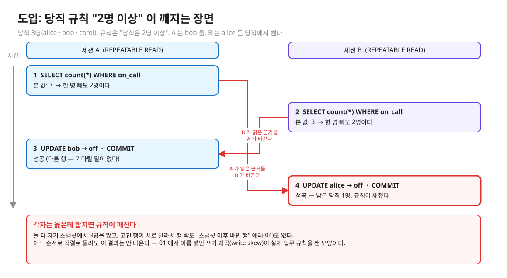
<sub>편집: [diagrams/blog05-intro.excalidraw](diagrams/blog05-intro.excalidraw)</sub>

이 모양은 01 에서 이름 붙인 쓰기 왜곡(write skew)이다. 실무에서 격리수준만 올리고 재시도를 안 넣으면 사용자에게 `40001` 이 그대로 새고, 재시도에 부수효과를 넣으면 중복 호출이 난다. "REPEATABLE READ 에서 무엇이 안 막히나 → SERIALIZABLE 은 어떻게 막나 → 락을 많이 잡나 → 그럼 앱은 무엇을 해야 하나 → 재시도 안에서 외부 API 를 부르면?" 의 사슬이 이 글의 순서다.

## write skew — 왜 RR 을 통과하나

이 레슨의 문항은 위 그림의 2명 버전이다. 규칙은 "당직은 1명 이상" 이고, 트랜잭션 A 와 B 가 각각 `SELECT count(*) FROM on_call WHERE on_call` 로 "2명" 을 읽은 뒤, A 는 alice 를, B 는 bob 을 `false` 로 만든다.

- 둘 다 **자기 스냅샷**에서 2명을 봤다 — 읽기는 문제없다.
- 고친 행이 **서로 다르다** → 행 락이 겹치지 않아 기다림도, "스냅샷 이후 바뀐 행" 에러([04](04-write-conflicts.md))도 없다.
- 결과: 둘 다 커밋되면 근거(2명)가 깨진다. 이 모양이 문서 13.2 가 말하는 직렬화 이상(serialization anomaly)이다 — 어떤 직렬 순서로 돌려도 이 결과는 안 나온다. 표 13.1 에서 REPEATABLE READ 의 해당 칸이 "Possible" 인 이유다.

04 의 행 락은 "같은 행" 을 두고 줄을 세우는 장치였다. 여기서는 같은 행이 하나도 없다. 막으려면 "내가 읽은 것을 상대가 바꿨나" 를 따지는 다른 장치가 필요하다.

## 막는 방법 세 가지

| 방법 | 원리 | 단점 |
|---|---|---|
| **SERIALIZABLE** | 엔진이 읽기-쓰기 의존성을 추적해 위험하면 실패시킨다 | 앱에 재시도 필요 · 오탐 · 오버헤드 |
| **판단 근거를 `SELECT … FOR UPDATE`** | 읽은 행을 잠가 상대가 기다리게 한다 | 존재하는 행만 잠근다 — 조건에 **새로 들어올** 행(팬텀)은 못 막는다 (아래 근거) |
| **충돌 구체화(materialize)** | "당직 인원" 행을 하나 두고 모두가 그 행을 UPDATE → 같은 행이라 행 락이 줄 세운다 | 설계 변경 · 한 행이 병목 |

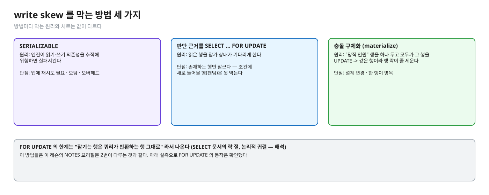
<sub>편집: [diagrams/blog05-three-ways.excalidraw](diagrams/blog05-three-ways.excalidraw)</sub>

- FOR UPDATE 는 "잠기는 행은 쿼리가 반환하는 행 그대로" 이다 ([SELECT · 락 절](https://www.postgresql.org/docs/16/sql-select.html)) — 그래서 위 단점이 나온다 (논리적 귀결 — 해석).
- 이 방법들은 이 레슨의 NOTES 꼬리질문 2번이 다루는 것과 같다. 아래 실측으로 FOR UPDATE 의 동작은 확인했다.

(실측: psql 2026-10-13, 두 세션이 `SELECT doctor FROM on_call WHERE on_call FOR UPDATE` 후 같은 판단을 한다)
- READ COMMITTED: 늦은 세션은 기다렸다가 `count(*)` 가 **1** 로 보였다 → 앱이 "빠지면 안 된다" 로 거절할 수 있다.
- REPEATABLE READ: 늦은 세션은 `FOR UPDATE` 자리에서 `ERROR: could not serialize access due to concurrent update` — 문서 13.3.2 의 "REPEATABLE READ 나 SERIALIZABLE 트랜잭션에서는 잠그려는 행이 트랜잭션 시작 이후 바뀌었으면 에러" 와 일치한다.

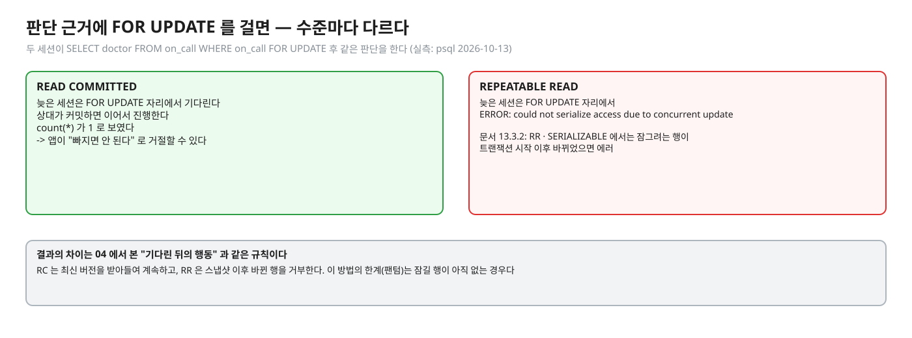
<sub>편집: [diagrams/blog05-forupdate.excalidraw](diagrams/blog05-forupdate.excalidraw)</sub>

## PostgreSQL 에서는 — SSI (Serializable Snapshot Isolation)

이제 첫 번째 방법을 자세히 보자. [문서 13.2.3](https://www.postgresql.org/docs/16/transaction-iso.html) · [README-SSI](https://github.com/postgres/postgres/blob/REL_16_STABLE/src/backend/storage/lmgr/README-SSI) · 논문 Ports & Grittner, *Serializable Snapshot Isolation in PostgreSQL*, VLDB 2012 에 따르면 이렇다.

- **기반**: REPEATABLE READ(스냅샷 격리)에 "직렬화 이상을 일으킬 조건을 감시" 를 얹은 것. 문서는 이 감시가 REPEATABLE READ 에 없던 **블로킹을 도입하지 않는다**고 쓴다 (오버헤드는 있다).

### SIREAD 락과 granularity

- **SIREAD 락(predicate lock)**: "이전 읽기 결과에 영향을 줬을 쓰기" 를 알아내기 위해 읽은 범위를 기록한다. **블로킹하지 않으므로 데드락에 참여하지 않는다.** `pg_locks` 에 `mode = SIReadLock` 으로 보인다 (문서 13.2.3). README-SSI 는 이것이 "락이라기보다 깃발(flag)" 이라고 표현한다.
- **granularity**: 튜플 락이 페이지 락으로, 페이지 락이 릴레이션 락으로 **합쳐질 수 있다** (메모리 절약). 시퀀셜 스캔은 항상 릴레이션 수준 predicate 락을 필요로 한다 (문서 13.2.3 의 성능 팁). 커밋 뒤에도 겹친 읽기-쓰기 트랜잭션이 끝날 때까지 남을 수 있다.

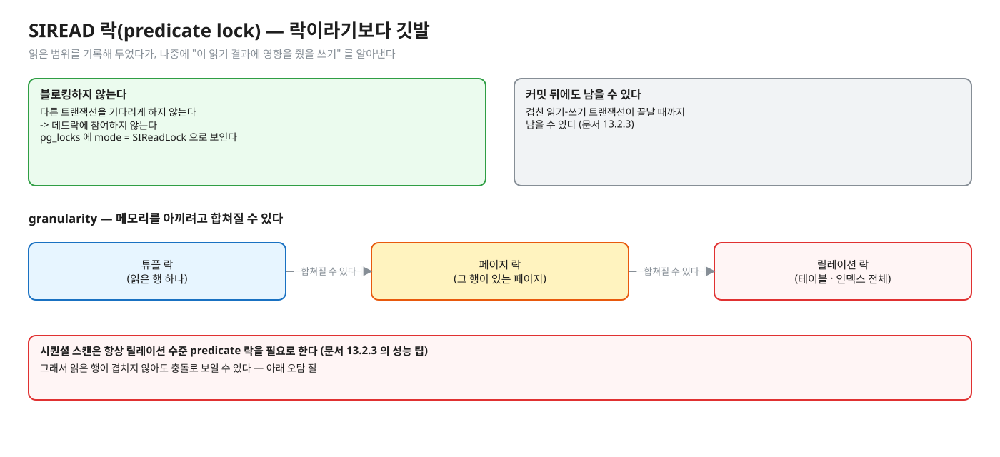
<sub>편집: [diagrams/blog05-siread.excalidraw](diagrams/blog05-siread.excalidraw)</sub>

### rw-의존성과 위험한 구조

- **rw-의존성(rw-conflict)**: 한 트랜잭션이 읽으려는 데이터를 동시 트랜잭션이 썼거나 쓸 예정이라 **볼 수 없을 때** 생긴다 (README-SSI). 읽은 쪽 → 쓴 쪽 방향의 화살표다. "읽은 쪽은 쓴 쪽보다 먼저 일어난 것처럼 보여야 한다" 는 뜻.
- **위험한 구조(dangerous structure)**: 스냅샷 격리의 모든 이상은 "가운데(pivot) 트랜잭션에 두 개의 인접한 rw-화살표가 있는 고리" 를 포함한다 (README-SSI). `Tin -rw-> Tpivot -rw-> Tout` 이고 **Tout 이 가장 먼저 커밋**할 때만 위험하다 — "We only roll back a transaction if Tout commits before Tpivot and Tin."

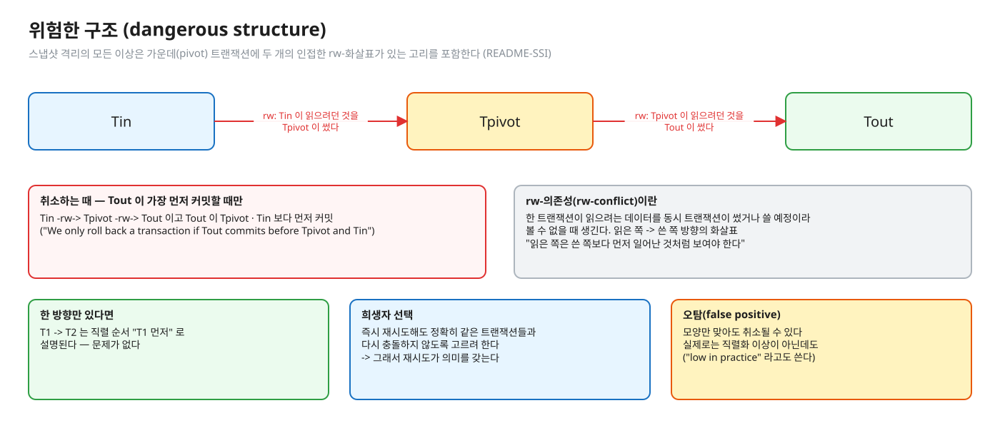
<sub>편집: [diagrams/blog05-dangerous.excalidraw](diagrams/blog05-dangerous.excalidraw)</sub>

앞의 당직 예에 대면 이렇다. A 가 읽은 것을 B 가 고치고, B 가 읽은 것을 A 가 고치는 두 방향이 모두 있는 고리다. 한 방향(T1 → T2)만 있으면 직렬 순서 "T1 먼저" 로 설명되므로 문제가 없다.

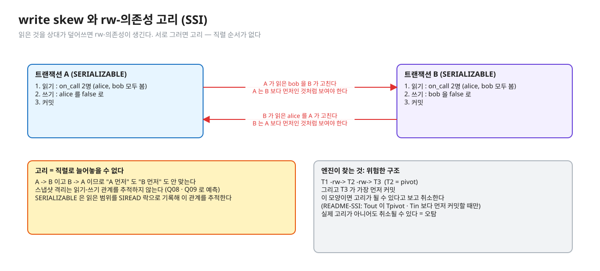
<sub>편집: [diagrams/ssi-rw-cycle.excalidraw](diagrams/ssi-rw-cycle.excalidraw)</sub>

- **희생자 선택**: 엔진은 가능하면 "즉시 재시도해도 정확히 같은 트랜잭션들과 다시 충돌하지 않도록" 희생자를 고른다 (README-SSI). 그래서 재시도가 의미를 갖는다.
- **오탐(false positive)**: README-SSI 가 "일부 오탐이 생긴다" 고 쓴다 (실제로는 직렬화 이상이 아닌데 위험한 구조 모양만으로 취소). 실무에서 낮다고도 쓰지만("low in practice"), 아래 실측처럼 granularity 에 따라 눈에 띌 수 있다.

### 실패는 어디서 나나 — 쓰기 중 또는 커밋 시점

<details><summary>실측 — 예측(Q09)과 관찰(장면 1)을 끝낸 뒤 펼친다 (psql 2026-10-13)</summary>

같은 당직 시나리오를 SERIALIZABLE 로 두 번 돌렸다.

1. A 가 먼저 UPDATE → B 가 UPDATE 후 `pg_locks` 확인 → A 커밋 → B 커밋 시도:
   ```
   ERROR:  could not serialize access due to read/write dependencies among transactions
   DETAIL:  Reason code: Canceled on identification as a pivot, during commit attempt.
   HINT:  The transaction might succeed if retried.
   ```
   남은 당직은 bob 1명. B 가 UPDATE 후 본 `pg_locks` 의 `SIReadLock`: `page` (인덱스 `on_call_pkey`, page 1) · `relation` (`on_call`) 이 각 2개씩.
2. 타이밍을 바꿔 B 가 먼저 커밋하고 A 가 나중에 UPDATE 하자 — 실패가 **UPDATE 자리**에서 났다:
   `Reason code: Canceled on identification as a pivot, during write.`

즉 40001 은 UPDATE 에서도, COMMIT 에서도 날 수 있다. 호출 코드는 `commit()` 까지 같은 try 안에 둬야 한다 (`WriteSkewImplementTest` 의 "commit 시점 40001" 테스트).

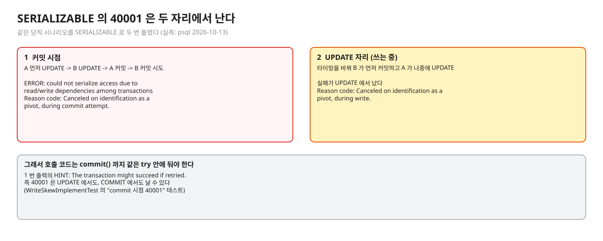
<sub>편집: [diagrams/blog05-error-timing.excalidraw](diagrams/blog05-error-timing.excalidraw)</sub>

</details>

문서 13.2.3 과 부록 A 에서 확인되는 일반 사실: 에러 메시지는 `could not serialize access due to read/write dependencies among transactions`, SQLSTATE 는 `40001` 이다.

### 오탐 — 실제로 어떻게 보이나

(실측: psql 2026-10-13) 테이블 `fp(id PK, v)` 1000행. 두 SERIALIZABLE 트랜잭션이 각자 `SELECT count(*) FROM fp WHERE id = X` 로 **자기 행만 읽고** 같은 X 의 `v` 를 UPDATE 한다. 서로 읽고 쓰는 행이 겹치지 않는다.

| X (A / B) | 읽기 방식 | 결과 |
|---|---|---|
| 1 / 2 | 인덱스 스캔 | A 가 `40001` (commit attempt) |
| 1 / 999 | 인덱스 스캔 | **둘 다 커밋** |
| 1 / 999 | 인덱스·비트맵 스캔 끈 시퀀셜 스캔 | A 가 `40001` (commit attempt) |

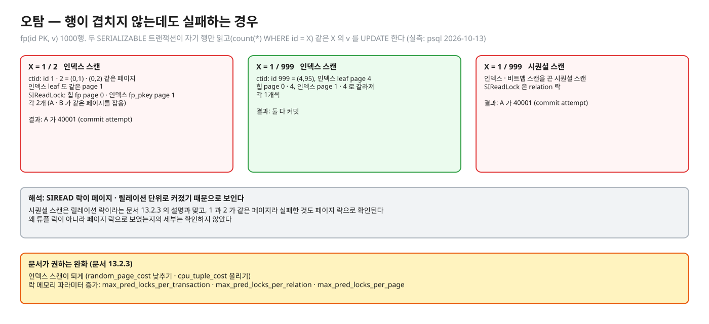
<sub>편집: [diagrams/blog05-false-positive.excalidraw](diagrams/blog05-false-positive.excalidraw)</sub>

해석: 행은 겹치지 않는데도 실패한 것은 SIREAD 락이 페이지·릴레이션 단위로 커졌기 때문으로 보인다 — 시퀀셜 스캔은 릴레이션 락이라는 문서 13.2.3 의 설명과 맞고, 1 과 2 가 같은 페이지에 있어 실패한 것도 페이지 락으로 확인된다 (실측: psql 2026-10-13 — `ctid` 는 id 1·2 = `(0,1)`·`(0,2)`, id 999 = `(4,95)`. pk 인덱스 leaf 는 id 1·2 가 page 1, id 999 가 page 4. 1 / 2 에서 B 가 UPDATE 한 뒤 `pg_locks` 의 `SIReadLock` 은 `page` 수준만 — 힙 `fp` page 0 · 인덱스 `fp_pkey` page 1 이 각 2개(A · B 가 같은 페이지를 잡음). 1 / 999 는 힙 page 0·4, 인덱스 page 1·4 로 갈라져 각 1개씩이고 둘 다 커밋. 시퀀셜 스캔은 `relation` 락). 왜 튜플 락이 아니라 페이지 락으로 보였는지의 세부는 확인하지 않았다. 문서가 권하는 완화: 인덱스 스캔이 되게(`random_page_cost` ↓ / `cpu_tuple_cost` ↑), 락 메모리 파라미터(`max_pred_locks_per_transaction` · `…_per_relation` · `…_per_page`) 증가 (문서 13.2.3).

### 읽기 전용과 DEFERRABLE

- `READ ONLY` 로 선언하면 SSI 가 더 효율적이다 (문서 13.2.3 성능 팁, README-SSI "significantly improved if … READ ONLY").
- `SERIALIZABLE READ ONLY DEFERRABLE` 트랜잭션은 안전한 스냅샷을 얻을 때까지 **시작 시점에 블록**될 수 있고, 이후엔 일반 SERIALIZABLE 의 오버헤드 없이, 직렬화 실패에 기여하거나 취소될 위험 없이 돈다. 긴 리포트·백업에 적합하다 ([SET TRANSACTION](https://www.postgresql.org/docs/16/sql-set-transaction.html), 문서 13.2.3). 이것이 "Serializable 은 블록되는데 Repeatable Read 는 안 되는 유일한 경우" 이다. (실측: `BEGIN ISOLATION LEVEL SERIALIZABLE READ ONLY DEFERRABLE;` 가 받아들여지고 `transaction_deferrable = on`.)
- 또 하나: SERIALIZABLE 에서 읽은 데이터는 **커밋에 성공하기 전까지는 유효하다고 여기면 안 된다** — 읽기 전용이어도 마찬가지(단 DEFERRABLE 읽기 전용은 읽는 즉시 유효) (문서 13.2.3).
- 유니크 제약 오류 주의: 문서는 겹치는 SERIALIZABLE 트랜잭션끼리 충돌해, **존재하지 않음을 먼저 확인했어도** 유니크 위반이 날 수 있다고 쓴다. 대응은 겹칠 수 있는 키를 넣는 모든 SERIALIZABLE 트랜잭션이 삽입 전에 존재 여부를 확인하게 하는 것이다 (문서 13.2.3).

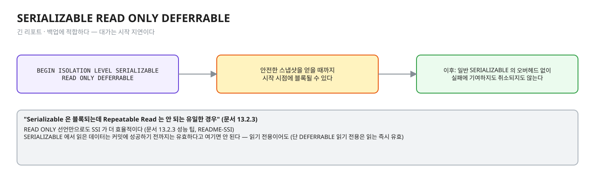
<sub>편집: [diagrams/blog05-deferrable.excalidraw](diagrams/blog05-deferrable.excalidraw)</sub>

## 재시도 설계 — `Tx.serializable`

엔진이 `40001` 로 한쪽을 거절하면 그다음은 앱의 몫이다. [정답 patch](../../../solutions/01.01.patch) 와 `Tx.java` 의 설계를 이유와 함께 정리한다. 문서 13.2.3 은 "어떤 트랜잭션이 의존성에 기여해 롤백돼야 하는지 예측하기 매우 어려우므로 직렬화 실패(항상 SQLSTATE `40001`)를 처리하는 **일반적인 방법**을 가져야 한다" 고 쓴다.

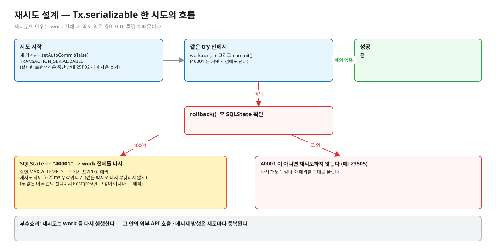
<sub>편집: [diagrams/blog05-retry-loop.excalidraw](diagrams/blog05-retry-loop.excalidraw)</sub>

| 설계 | 이유 |
|---|---|
| 새 커넥션 · `setAutoCommit(false)` · `TRANSACTION_SERIALIZABLE` 로 매 시도 시작 | 실패한 트랜잭션은 중단 상태(25P02)라 재사용할 수 없다. 격리수준은 첫 문장 전에 정한다 (SET TRANSACTION) |
| `work.run` 과 `commit()` 을 **같은 try** 안에 | 40001 이 커밋 시점에도 난다 (위 실측) |
| 실패 시 `rollback()` 후 SQLState 가 `"40001"` 이면 **work 전체**를 다시 | 앞서 읽은 값(당직 2명)이 이미 틀렸다. 문서 13.2.2: "현재 트랜잭션을 중단하고 처음부터 전체를 재시도" |
| `40001` 이 아니면 재시도하지 않는다 (예: `23505`) | 다시 해도 똑같다 |
| `MAX_ATTEMPTS = 5` 에서 포기하고 예외 | 무한 재시도는 부하가 높을 때 장애를 키운다 (해석 — 상한 값 5 는 이 레슨의 선택이지 PostgreSQL 규정이 아니다. 이유: 충돌 경합자가 소수인 당직 시나리오라 몇 번이면 끝난다. 재고 레슨은 20회 · 대기 없음을 고른다 — 이유는 01.04 문서 04 · 비교는 T/03 재시도 표) |
| 재시도 사이 5~25ms 무작위 대기 | 같은 박자로 다시 부딪히지 않게 (해석 — 이 레슨의 선택. 01.04 는 대기를 두지 않는다, 같은 근거로 일반 설계는 지터를 권한다) |

**부수효과**: 재시도는 work 를 다시 실행한다. 그 안에서 외부 API 호출 · 메시지 발행을 하면 시도마다 중복된다. 부수효과는 커밋 **이후**로 미루거나 outbox 로 (02.03). 시도 횟수 = 부수효과 횟수가 되지 않게 하는 것이 요점이다.

### Spring 에서는

- `@Transactional(isolation = Isolation.SERIALIZABLE)` 로 수준을 지정한다 ([Spring](https://docs.spring.io/spring-framework/reference/data-access/transaction/declarative/annotations.html)). 문서에 따라 `isolation` 은 propagation 이 `REQUIRED`/`REQUIRES_NEW` 일 때만 적용된다.
- **재시도는 `@Transactional` 경계의 바깥**에 둔다 (해석). 이유: 트랜잭션은 프록시 경계에서 시작·종료된다 — 메서드 안에서 `try { … } catch` 로 40001 을 잡아 다시 시도하면 같은 중단된 트랜잭션 안에서 재실행하게 된다(25P02). 호출하는 쪽(예: 파사드 · 상위 서비스 · 별도 AOP)에서 트랜잭션 메서드를 통째로 다시 호출해야 새 트랜잭션이 열린다. Spring 문서 자체는 재시도 위치를 규정하지 않는다.
- 같은 클래스 안에서 `this.method()` 로 부르면 프록시를 안 거쳐 트랜잭션이 안 열린다 (Spring 문서의 프록시 모드 self-invocation 경고). 재시도 래퍼와 트랜잭션 메서드를 **다른 빈**에 두는 이유다.
- 예외 (실측: Spring Boot 3.5.16 · Spring 6.2.19 · Hibernate 6.6.53 · pgjdbc 42.7.11 · PostgreSQL 16.14, 2026-10-13): PostgreSQL 의 `40001` 은 JdbcTemplate 경로에서도 JPA 경로에서도 `CannotAcquireLockException`(`PessimisticLockingFailureException` ⊂ `ConcurrencyFailureException` ⊂ `TransientDataAccessException`)으로 왔다 — cause 의 `PSQLException.getSQLState()` 가 `40001`. SERIALIZABLE 쓰기 왜곡의 패자는 UPDATE 가 아니라 **커밋 시점**에 실패했고(JPA 는 flush 도 커밋에서), REPEATABLE READ 동시 갱신은 UPDATE 문장에서 `40001`("could not serialize access due to concurrent update")이 났다. 전용 이름의 `CannotSerializeTransactionException` 은 6.0.3 부터 deprecated 이고 이 환경에서 나오지 않았다. 판정은 상위 갈래(`ConcurrencyFailureException`) 또는 SQLState 로 한다. 번역 표 · 실패한 뒤 rollback-only · 재시도 위치 실측은 [05-spring-jpa-mapping.md](../../docs/05-spring-jpa-mapping.md).
- 롤백 규칙: 기본으로 `RuntimeException`·`Error` 는 롤백, 검사 예외는 롤백하지 않는다 (Spring 문서). 재시도 대상 예외가 검사 예외로 감싸져 올라오면 롤백이 안 될 수 있으니 `rollbackFor` 를 점검한다.

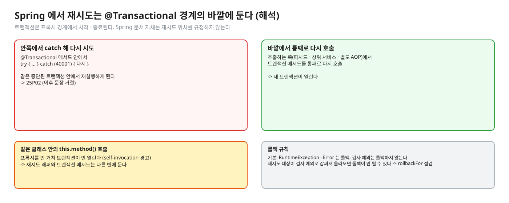
<sub>편집: [diagrams/blog05-spring-retry.excalidraw](diagrams/blog05-spring-retry.excalidraw)</sub>

### 자주 하는 오해

1. **"SERIALIZABLE 은 모든 트랜잭션을 한 줄로 세워 느리다."** REPEATABLE READ 보다 블로킹을 늘리지 않는다고 문서가 쓴다 (13.2.3) — 유일한 예외는 `READ ONLY DEFERRABLE` 트랜잭션이 안전한 스냅샷을 얻을 때까지 시작이 블록되는 경우다 ([03](03-snapshot-visibility.md)). 비용은 감시 오버헤드와 실패·재시도다.
2. **"SERIALIZABLE 은 락을 걸어 막는다."** SIREAD 락은 블로킹하지 않고 데드락도 만들지 않는다 — 실패시키는 방식이다.
3. **"40001 이 나면 DB 가 고장난 것 / 그 문장만 다시."** 정상 동작이고, 전체 재시도가 맞다.
4. **"재시도하면 항상 성공한다."** 계속 부딪히면 또 실패할 수 있다 — 그래서 상한이 필요하다. 엔진은 즉시 재시도가 같은 상대와 안 부딪히도록 희생자를 고르려 애쓸 뿐이다 (README-SSI).
5. **"SERIALIZABLE 이면 `FOR UPDATE` 가 더 필요하다."** 문서가 성능 팁으로 "SERIALIZABLE 이 자동으로 주는 보호가 있으면 명시적 락·`FOR UPDATE`/`FOR SHARE` 를 없애라" 고 쓴다.
6. **"에러는 COMMIT 에서만 난다."** 실측처럼 UPDATE 자리에서도 난다.

## MySQL InnoDB 는 어떻게 다른가 (심화)

- 기본이 REPEATABLE READ 이고 일반 SELECT 는 락 없는 일관된 읽기라, "읽고 → 다른 행 쓰기" 의 write skew 가 막히지 않는다고 **추론**된다 (해석 — 직접 돌려 보지 않았다. 근거: [17.7.2.3](https://dev.mysql.com/doc/refman/8.0/en/innodb-consistent-read.html) 일반 SELECT 는 스냅샷 읽기, [17.7.2.1](https://dev.mysql.com/doc/refman/8.0/en/innodb-transaction-isolation-levels.html) UPDATE 는 유니크 인덱스의 유니크 조건이면 찾은 레코드만, 그 밖의 조건이면 스캔 범위를 gap/next-key 로 잠금).
- InnoDB 의 해법은 **잠그는 읽기**다: `SELECT … FOR UPDATE`/`FOR SHARE` 는 "최신 데이터를 읽고 같은 락을 건다" ([17.7.2.4](https://dev.mysql.com/doc/refman/8.0/en/innodb-locking-reads.html)). 범위 조건이면 next-key/gap 락으로 삽입까지 막는다 ([17.7.4 Phantom Rows](https://dev.mysql.com/doc/refman/8.0/en/innodb-next-key-locking.html)) — PostgreSQL 의 FOR UPDATE 가 존재하는 행만 잠그는 것과 대비된다 (해석).
- SERIALIZABLE 은 autocommit 이 꺼진 일반 SELECT 를 `FOR SHARE` 로 바꿔 **잠금 기반**으로 구현한다 (17.7.2.1). SSI(실패시키기)와 접근이 다르다. 이 방식의 대기·교착 특성은 확인하지 않았다.

## 한눈에 정리

| | REPEATABLE READ | SERIALIZABLE (SSI) |
|---|---|---|
| write skew | 막지 못한다 (표 13.1 "Possible") | `40001` 로 한쪽을 실패시킨다 |
| 읽기가 하는 일 | 스냅샷으로 읽는다 | 스냅샷 + 읽은 범위를 SIREAD 락으로 기록 (블로킹 없음) |
| 앱이 해야 할 일 | 명시적 락 등으로 직접 막기 | `40001` 에 트랜잭션 전체 재시도 |
| 대가 | — | 감시 오버헤드 · 오탐(granularity) · 재시도 |

- write skew 는 서로 다른 행을 고쳐서 행 락이 못 잡는다. 막는 길은 SERIALIZABLE, 판단 근거 잠그기(`FOR UPDATE`, 팬텀은 못 막음), 충돌 구체화 셋이다.
- SSI 는 rw-의존성이 이루는 위험한 구조(Tout 이 가장 먼저 커밋)를 찾아 한쪽을 `40001` 로 실패시킨다. 락으로 기다리게 하지 않는다. 오탐이 있고, 읽은 범위가 페이지·릴레이션으로 합쳐지면 더 눈에 띈다.
- 40001 은 UPDATE 에서도 COMMIT 에서도 난다. 그래서 `commit()` 까지 같은 try 안에서 트랜잭션 전체를 새 트랜잭션으로 다시 하고, 재시도는 `@Transactional` 바깥에 둔다.
- 재시도는 work 를 다시 실행하므로 외부 호출 같은 부수효과는 커밋 이후로 미룬다.

## 스스로 확인

1. SERIALIZABLE 로 올렸는데 락 대기는 안 늘고 `40001` 만 늘었다. 왜인가? 사용자에게 이 에러가 보이면 안 되는 이유는?
   <details><summary>답</summary>
   SIREAD 락은 블로킹하지 않는다 (문서 13.2.3) — 위험한 구조가 생기면 기다리게 하지 않고 한쪽을 실패시킨다. `40001` 은 "다시 하면 될 수도 있다" 는 신호이고(HINT: "The transaction might succeed if retried"), 사용자에게 새면 정상 요청이 실패한 것처럼 보인다. 그래서 앱에서 재시도로 흡수하고, 상한을 넘으면 의미 있는 오류로 변환한다.
   </details>
2. rw-의존성이 한 방향만 있으면 취소되나? 두 방향이면?
   <details><summary>답</summary>
   한 방향(T1 → T2)은 직렬 순서 "T1 먼저" 로 설명되므로 문제가 없다. 위험한 구조는 pivot 에 **인접한 두 화살표**가 있고 Tout 이 가장 먼저 커밋할 때다 (README-SSI). 위의 당직 예는 A → B, B → A 두 방향이 모두 있는 고리다. 실제 고리가 아니어도 모양이 맞으면 취소될 수 있다 — 오탐.
   </details>
3. `Tx.serializable` 의 재시도 루프 안에서 결제 API 를 호출한다. 무슨 일이 생기나? 어떻게 고치나?
   <details><summary>답</summary>
   시도마다 work 가 처음부터 다시 실행되므로 결제가 재시도 횟수만큼 중복 호출될 수 있다(커밋이 실패해도 외부 호출은 이미 일어났다). 외부 호출은 트랜잭션 **밖·커밋 이후**로 옮기거나, 트랜잭션 안에서는 outbox 행만 쓰고 별도 프로세스가 발행하게 한다 (02.03). 멱등 키로 상대가 중복을 흡수하게 하는 방법도 있다 (01.03).
   </details>
4. 이 `Tx.serializable` 의 `MAX_ATTEMPTS = 5` 와 5~25ms 지터는 PostgreSQL 이 정한 값인가?
   <details><summary>답</summary>
   아니다. 이 레슨의 설계 선택이다. PostgreSQL 문서는 재시도해야 한다는 것만 말하고 횟수나 대기 시간을 정하지 않는다. 값은 부하·SLA 로 정하며, 지수 백오프를 쓰는 선택도 있다 (해석).
   </details>
5. 긴 리포트 쿼리를 SERIALIZABLE 로 돌리면 쓰기 트랜잭션이 대신 실패한다는 얘기를 들었다. 어떻게 피하나?
   <details><summary>답</summary>
   `SERIALIZABLE READ ONLY DEFERRABLE` — 안전한 스냅샷을 얻을 때까지 시작에서 기다린 뒤, 이후에는 직렬화 실패에 기여하지도 취소되지도 않고 오버헤드 없이 돈다 (SET TRANSACTION 문서). 대가는 시작 지연이다. "긴 리포트·백업에 알맞다" 고 문서가 쓴다.
   </details>

## 이 레슨에서 직접 보기

| 어디서 | 무엇을 |
|---|---|
| Q08 | REPEATABLE READ 당직 둘이 동시에 빠지면 남는 당직 수 |
| Q09 | SERIALIZABLE 에서 B 의 COMMIT · 남는 당직 수 |
| 장면 1 | psql 로 같은 시나리오, 에러 메시지 원문 |
| `WriteSkewImplementTest` | `Tx.serializable` 구현 6개 — 결과 검사 1 · 방법 검사 1 · 재시도 3 · 가드 1 |
| `OnCallService` | 손대지 않는 서비스 — 어디에서 `Tx.serializable` 을 부르나 |

이 글의 도입 그림은 일부러 문항과 다른 숫자(당직 3명 · 규칙 2명 이상)로 그렸다. 예측 문항의 값을 직접 적어 보고 나서 확인한다.

<details><summary>실측 — 예측을 끝낸 뒤 펼친다 (Q08 · Q09)</summary>

| Q | 결과 |
|---|---|
| Q08 | 남은 당직 0 (둘 다 커밋 — 규칙 위반) |
| Q09 | B 의 COMMIT = `에러 40001`, 남은 당직 1 |

근거: [정답 patch](../../../solutions/01.01.patch) 의 예측 칸 · 위 psql 실측 (commit 자리에서 pivot 으로 취소).
</details>

## 출처

- [PostgreSQL 16 · 13.2.3 Serializable Isolation Level](https://www.postgresql.org/docs/16/transaction-iso.html) — SIREAD · 블로킹 없음 · 재시도 권고 · DEFERRABLE · 유니크 오류 주의 · 성능 팁
- [13.3 Explicit Locking](https://www.postgresql.org/docs/16/explicit-locking.html) — FOR UPDATE 가 RR/SERIALIZABLE 에서 에러
- [SELECT · The Locking Clause](https://www.postgresql.org/docs/16/sql-select.html) — 잠기는 행 = 반환 행
- [SET TRANSACTION](https://www.postgresql.org/docs/16/sql-set-transaction.html) — DEFERRABLE
- [README-SSI](https://github.com/postgres/postgres/blob/REL_16_STABLE/src/backend/storage/lmgr/README-SSI) — rw-conflict · 위험한 구조 · 희생자 선택 · 오탐
- Ports & Grittner, *Serializable Snapshot Isolation in PostgreSQL*, VLDB 2012 (README-SSI 가 인용하는 원 논문 — 이 글에서는 직접 열어 보지 않았다)
- [Spring · @Transactional](https://docs.spring.io/spring-framework/reference/data-access/transaction/declarative/annotations.html) · [CannotSerializeTransactionException](https://docs.spring.io/spring-framework/docs/current/javadoc-api/org/springframework/dao/CannotSerializeTransactionException.html)
- [MySQL 8.0 · 17.7.2.1](https://dev.mysql.com/doc/refman/8.0/en/innodb-transaction-isolation-levels.html) · [17.7.2.3](https://dev.mysql.com/doc/refman/8.0/en/innodb-consistent-read.html) · [17.7.2.4](https://dev.mysql.com/doc/refman/8.0/en/innodb-locking-reads.html) · [17.7.4](https://dev.mysql.com/doc/refman/8.0/en/innodb-next-key-locking.html)
