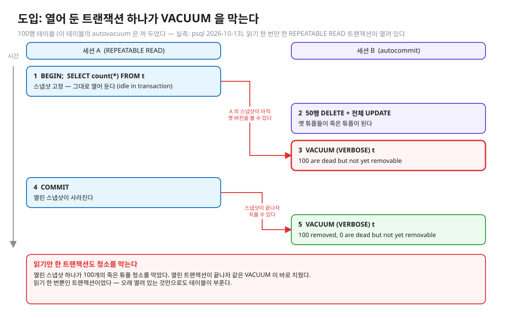
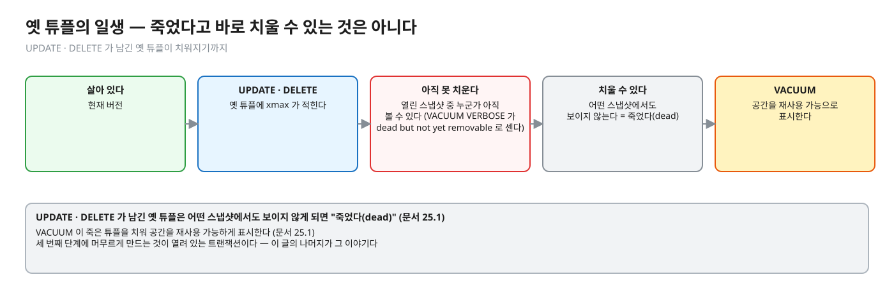
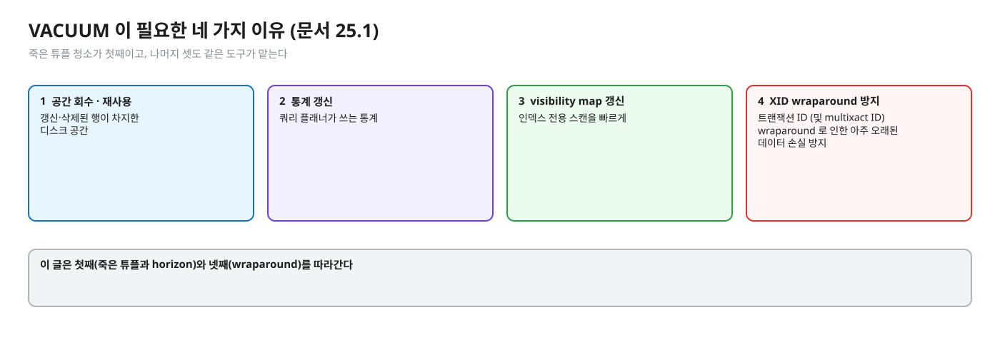
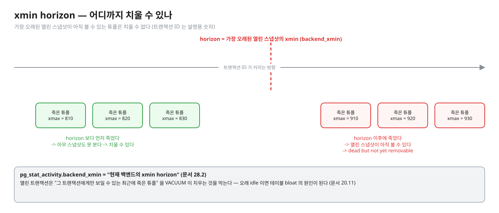
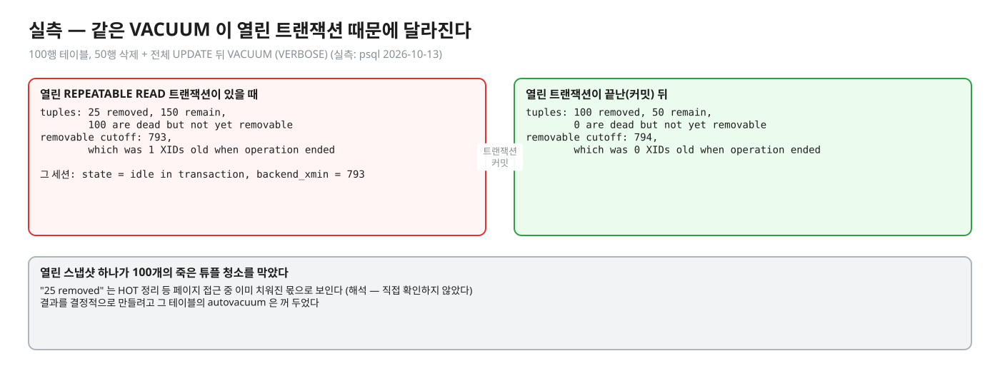
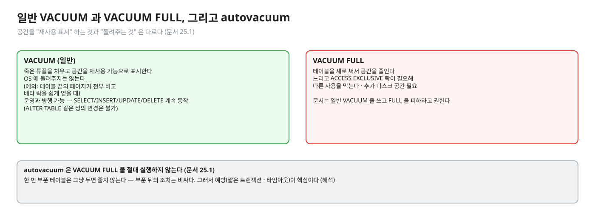
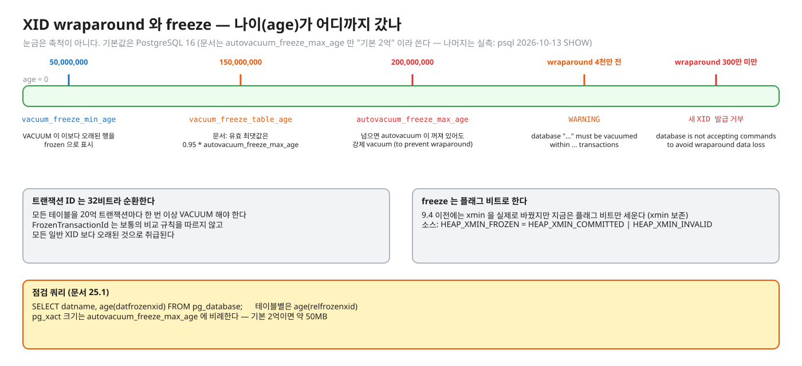
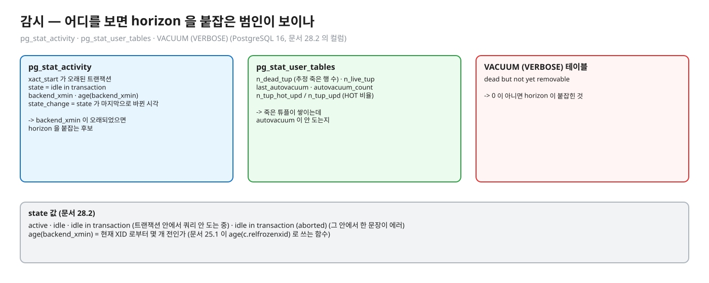
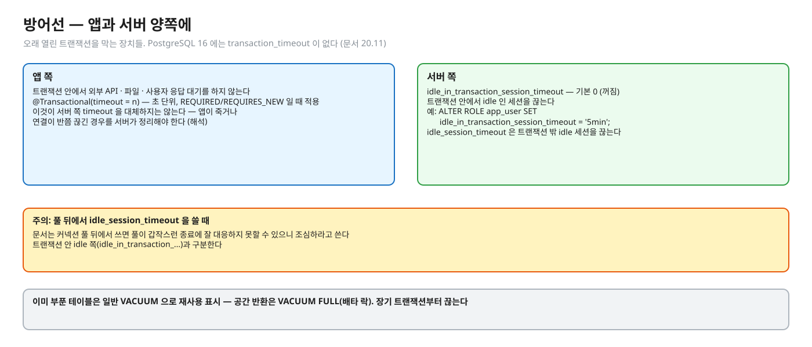

# 06. 운영 — VACUUM · xmin horizon · 오래 열린 트랜잭션 · XID wraparound

> **이 글에서 알게 되는 것**
> 1. MVCC 가 남기는 옛 버전을 VACUUM 이 치우는 일, 그리고 열려 있는 트랜잭션이 "아직 볼 수 있다" 고 붙잡으면 못 치우는 이유(xmin horizon)를 안다.
> 2. 테이블이 부풀 때(bloat) 무엇을 어떤 쿼리로 확인하고 어떻게 조치하는지 안다 — 특히 `idle in transaction`.
> 3. 32비트 트랜잭션 ID 가 순환해서 생기는 wraparound 와 freeze 의 기본 구조를 안다.
>
> **먼저 알면 좋은 것**: [02. MVCC 저장 구조](02-mvcc-tuple-storage.md)(옛 버전이 힙에 남는다), [03. 스냅샷과 가시성](03-snapshot-visibility.md)(스냅샷이 "아직 볼 수 있는 버전" 을 정한다).
> **다음 글**: [07. 면접 사다리](07-interview-ladder.md) — 지금까지의 개념을 질문 사슬로 다시 묶는다.
> **구분**: 심화 — 꼬리질문 대비 (레슨을 마친 뒤 · 면접 전)

## 열어 둔 트랜잭션 하나가 청소를 막는다

테이블이 계속 커지고, 쿼리가 점점 느려지고, 배치 하나가 오래 열려 있는 동안 서비스 테이블 전체가 부푼다. 극단적으로는 wraparound 경고까지 나온다. "MVCC 의 단점이 뭔가" 에서 시작해 "VACUUM 은 무엇을 하고 왜 안 지워질 때가 있나", "`idle in transaction` 이 왜 위험한가", "XID wraparound 가 무엇인가" 로 깊어지는 이야기가 모두 이 한 장면에서 풀린다. 02 에서 본 대로 UPDATE · DELETE 는 옛 버전을 남긴다. 그 청구서를 누가 언제 치우나가 이 글의 주제다.


<sub>편집: [diagrams/blog06-intro.excalidraw](diagrams/blog06-intro.excalidraw)</sub>

A 는 읽기를 한 번 했을 뿐인데, 그 스냅샷 하나가 100개의 죽은 튜플 청소를 막았다. 이 숫자는 아래 실측과 같다. 이제 하나씩 풀어 보자.

## 죽은 튜플과 VACUUM

UPDATE · DELETE 가 남긴 옛 튜플은 어떤 스냅샷에서도 보이지 않게 되면 "죽었다(dead)". VACUUM 이 죽은 튜플을 치워 공간을 재사용 가능하게 표시한다.


<sub>편집: [diagrams/blog06-dead-life.excalidraw](diagrams/blog06-dead-life.excalidraw)</sub>

[문서 25.1](https://www.postgresql.org/docs/16/routine-vacuuming.html) 이 든 VACUUM 의 네 가지 이유는 이렇다.

1. 갱신·삭제된 행이 차지한 디스크 공간을 회수·재사용
2. 쿼리 플래너가 쓰는 통계 갱신
3. visibility map 갱신(인덱스 전용 스캔을 빠르게)
4. **트랜잭션 ID wraparound** (및 multixact ID wraparound) 로 인한 아주 오래된 데이터 손실 방지


<sub>편집: [diagrams/blog06-vacuum-reasons.excalidraw](diagrams/blog06-vacuum-reasons.excalidraw)</sub>

## xmin horizon — 어디까지 치울 수 있나

죽은 튜플이 "정말 아무도 못 보나" 의 기준선이 horizon 이다. 가장 오래된 열린 스냅샷이 아직 볼 수 있는 튜플은 치울 수 없다.


<sub>편집: [diagrams/blog06-horizon.excalidraw](diagrams/blog06-horizon.excalidraw)</sub>

문서가 확인해 주는 문장은 두 개다.

- `idle_in_transaction_session_timeout` 설명: "열린 트랜잭션은 **그 트랜잭션에게만 보일 수 있는 최근에 죽은 튜플**을 VACUUM 이 치우는 것을 막는다. 그래서 오래 idle 이면 테이블 bloat 의 원인이 된다" ([문서 20.11](https://www.postgresql.org/docs/16/runtime-config-client.html)).
- `pg_stat_activity.backend_xmin`: "현재 백엔드의 xmin horizon" ([문서 28.2](https://www.postgresql.org/docs/16/monitoring-stats.html)).

도입의 장면을 실측으로 다시 보자. (실측: psql 2026-10-13; 결과를 결정적으로 만들려고 그 테이블의 autovacuum 은 꺼 두었다) 100행 테이블에서 REPEATABLE READ 트랜잭션을 연 채(쿼리 1회 후 대기), 다른 세션이 50행 삭제 + 전체 UPDATE 한 뒤 `VACUUM (VERBOSE)`:

```
tuples: 25 removed, 150 remain, 100 are dead but not yet removable
removable cutoff: 793, which was 1 XIDs old when operation ended
```

열린 트랜잭션이 끝나(커밋)고 다시 VACUUM:

```
tuples: 100 removed, 50 remain, 0 are dead but not yet removable
removable cutoff: 794, which was 0 XIDs old when operation ended
```

`pg_stat_activity` 에서도 그 세션은 `state = idle in transaction`, `backend_xmin = 793` 이었다. 즉 **열린 스냅샷 하나가 100개의 죽은 튜플 청소를 막았다.** (`25 removed` 는 HOT 정리 등 페이지 접근 중 이미 치워진 몫으로 보인다 — 해석, 직접 확인하지 않았다.)


<sub>편집: [diagrams/blog06-measured.excalidraw](diagrams/blog06-measured.excalidraw)</sub>

## bloat 와 공간 반환

VACUUM 이 죽은 튜플을 치운다고 디스크가 줄어드는 것은 아니다.


<sub>편집: [diagrams/blog06-vs-full.excalidraw](diagrams/blog06-vs-full.excalidraw)</sub>

- 일반 `VACUUM` 은 죽은 튜플을 치우고 공간을 **재사용 가능으로 표시**할 뿐, 운영체제에 돌려주지는 않는다 — 테이블 끝의 페이지가 전부 비고 배타 락을 쉽게 얻을 때만 예외 (문서 25.1).
- `VACUUM FULL` 은 테이블을 새로 써서 공간을 줄이지만 느리고 `ACCESS EXCLUSIVE` 락이 필요해 다른 사용을 막는다. 문서는 일반 VACUUM 을 쓰고 FULL 을 피하라고 권한다. **autovacuum 은 `VACUUM FULL` 을 절대 실행하지 않는다** (문서 25.1).
- 한 번 부푼 테이블은 그냥 두면 줄지 않는다 — 부푼 뒤의 조치는 비싸다. 그래서 예방(짧은 트랜잭션 · 타임아웃)이 핵심이다 (해석).

## autovacuum

[문서 25.1](https://www.postgresql.org/docs/16/routine-vacuuming.html): 상주 launcher 가 worker 를 띄워 VACUUM/ANALYZE 를 자동 실행한다(`track_counts` 필요). 대상 판정은

`vacuum threshold = base threshold + scale factor * 튜플 수`

(기본값, PostgreSQL 16 — 실측: psql 2026-10-13 `SHOW`: `autovacuum_vacuum_threshold = 50`, `autovacuum_vacuum_scale_factor = 0.2`). 큰 테이블일수록 "20%" 가 커서 늦게 돈다 — 튜닝은 테이블별로 한다 (해석). autovacuum 도 열린 트랜잭션 때문에 못 치우는 건 똑같다.

## XID wraparound 와 freeze

- 트랜잭션 ID 는 32비트라 순환한다. 문서 25.1: 모든 테이블을 **20억 트랜잭션마다 한 번 이상** VACUUM 해야 한다.
- VACUUM 은 오래된 행을 **frozen** 으로 표시해 해결한다. 특별한 XID `FrozenTransactionId` 는 보통의 비교 규칙을 따르지 않고 모든 일반 XID 보다 오래된 것으로 취급된다. 9.4 이전에는 xmin 을 실제로 바꿨지만, 지금은 플래그 비트만 세운다 (xmin 보존). (문서 25.1, 소스 `HEAP_XMIN_FROZEN = HEAP_XMIN_COMMITTED|HEAP_XMIN_INVALID`)
- 기본값 (PostgreSQL 16; 문서는 `autovacuum_freeze_max_age` 만 "기본 2억" 이라 쓴다 — 나머지는 실측: psql 2026-10-13 `SHOW`):

| 설정 | 기본값 |
|---|---|
| `autovacuum_freeze_max_age` | 200,000,000 |
| `vacuum_freeze_table_age` | 150,000,000 (문서: 유효 최댓값은 `0.95 * autovacuum_freeze_max_age`) |
| `vacuum_freeze_min_age` | 50,000,000 |


<sub>편집: [diagrams/blog06-xid-bar.excalidraw](diagrams/blog06-xid-bar.excalidraw)</sub>

- `autovacuum_freeze_max_age` 를 넘긴 XID 를 가진 테이블은 autovacuum 이 **꺼져 있어도** 강제로 vacuum 한다. 이 모양은 `pg_stat_activity` 에 `(to prevent wraparound)` 로 보이고 자동으로 중단되지 않는다 (문서 25.1).
- 경고·한계: wraparound 지점까지 **4천만** 트랜잭션 남으면 `WARNING: database "…" must be vacuumed within … transactions`, **300만 미만**이면 새 XID 발급을 거부(`database is not accepting commands to avoid wraparound data loss`)한다 ("읽기 전용만 계속 돈다" 는 XID 가 필요 없는 트랜잭션이므로 가능하다는 **해석** — 문서 문장 아님). 문서는 힌트의 "postmaster 를 멈추고 single-user 모드" 가 필수는 아니라고도 쓴다 (문서 25.1).
- 점검 쿼리 (문서 25.1): `SELECT datname, age(datfrozenxid) FROM pg_database;` · `age(relfrozenxid)` 로 테이블별.
- `pg_xact` 크기는 `autovacuum_freeze_max_age` 에 비례한다 — 기본 2억이면 약 50MB (문서 25.1).
- 오래 열린 트랜잭션이 freeze 에도 영향을 주는지는 문서에서 확인하지 못해 다루지 않는다.

wraparound 는 오래된 시스템에서나 나는 일이 아니다. 쓰기가 많은 서비스는 20억 트랜잭션마다 한 번 vacuum 해야 하고, 기본 2억에서 강제 autovacuum 이 돌기 때문에 정상적으로 이 영역에 들어온다 (해석).

## 감시 쿼리 (PostgreSQL 16, 문서 28.2 의 컬럼)

장애 대응에서는 "누가 horizon 을 붙잡고 있나" 를 먼저 찾는다.

```sql
-- 오래 열린 트랜잭션 · idle in transaction (xact_start 는 "현재 트랜잭션 시작 시각", 없으면 null)
SELECT pid, state, now() - xact_start AS xact_age, now() - state_change AS in_state,
       backend_xid, backend_xmin, age(backend_xmin) AS xmin_age, left(query, 60) AS last_query
FROM pg_stat_activity
WHERE xact_start IS NOT NULL
ORDER BY xact_start;
```


<sub>편집: [diagrams/blog06-monitor.excalidraw](diagrams/blog06-monitor.excalidraw)</sub>

- `state` 값: `active` · `idle` · `idle in transaction`(트랜잭션 안에서 쿼리 안 도는 중) · `idle in transaction (aborted)`(그 안에서 한 문장이 에러). `state_change` 는 state 가 마지막으로 바뀐 시각 (문서 28.2).
- `backend_xmin` 이 오래되었으면 horizon 을 붙잡는 후보다. `age(backend_xmin)` 은 현재 XID 로부터 몇 개 전인가(문서 25.1 이 `age(c.relfrozenxid)` 로 쓰는 함수).
- 테이블별: `pg_stat_user_tables` 의 `n_dead_tup`("추정 죽은 행 수") · `n_live_tup` · `last_autovacuum` · `autovacuum_count`, HOT 비율은 `n_tup_hot_upd / n_tup_upd` ("HOT 갱신 = 인덱스에 후속 버전이 필요 없는 갱신", 문서 28.2).
- 일회성: `VACUUM (VERBOSE) 테이블` 의 `dead but not yet removable` 이 0 이 아니면 horizon 이 붙잡힌 것.

## 조치

| 상황 | 조치 |
|---|---|
| `idle in transaction` 이 길다 | 앱이 트랜잭션을 연 채 외부 호출 · 사용자 입력 · 대기를 하고 있는지 코드를 본다. 서버 쪽 방어선: `idle_in_transaction_session_timeout` — 기본 `0`(꺼짐). 문서가 "idle 세션이 락을 오래 잡지 않게" 하는 용도라고 쓴다. 예: `ALTER ROLE app_user SET idle_in_transaction_session_timeout = '5min';` |
| 풀이 끊긴 연결에 놀람 | `idle_session_timeout` 은 트랜잭션 **밖**의 idle 세션을 끊는다 — 문서는 커넥션 풀 뒤에서 쓰면 풀이 갑작스런 종료에 잘 대응하지 못할 수 있으니 조심하라고 쓴다. 트랜잭션 안 idle 쪽(`idle_in_transaction…`)과 구분한다 |
| 이미 부푼 테이블 | 일반 VACUUM 으로 재사용 가능하게 표시. 공간 반환은 `VACUUM FULL`(배타 락 — 서비스 시간 주의). 장기 트랜잭션부터 끊는다 |
| wraparound 경고 | `age(datfrozenxid)` 로 위치 확인, 문서가 안내하는 DB 전체 VACUUM. 강제 autovacuum 이 돌고 있는지(`(to prevent wraparound)`) 확인 |
| 긴 리포트 · 백업 | 길게 열어야 하면 어떤 수준으로 열지 의도적으로 고른다 — 스냅샷을 오래 들고 있게 되므로 그동안 horizon 이 묶인다. SERIALIZABLE 이면 `READ ONLY DEFERRABLE` ([05](05-serializable-ssi-retry.md)) |

`transaction_timeout`(트랜잭션 전체 시간 제한) 설정은 PostgreSQL 16 문서 20.11 에 없다 — 16 에서는 앱(Spring `@Transactional(timeout=…)`)·풀·`idle_in_transaction_session_timeout` 로 대응한다.


<sub>편집: [diagrams/blog06-defenses.excalidraw](diagrams/blog06-defenses.excalidraw)</sub>

### 자주 하는 오해

1. **"VACUUM 이 있으니 bloat 는 자동으로 해결된다."** 못 치우는 조건(열린 트랜잭션)이 있으면 autovacuum 도 같다.
2. **"VACUUM 하면 디스크가 줄어든다."** 일반 VACUUM 은 재사용 표시일 뿐 OS 에 돌려주지 않는다 (예외: 끝 페이지). 줄이려면 `VACUUM FULL`(배타 락).
3. **"idle 세션은 해가 없다."** 트랜잭션 밖 idle 은 큰 비용이 없다고 문서가 쓰지만, **트랜잭션 안** idle 은 락을 잡고 VACUUM 을 막는다 (문서 20.11).
4. **"SELECT 만 하는 트랜잭션은 안전하다."** 열려 있는 한 스냅샷(REPEATABLE READ 이상, 또는 문장 하나가 오래 도는 경우)이 horizon 을 붙잡는다. 위 실측의 열린 트랜잭션도 읽기 한 번뿐이었다.
5. **"wraparound 는 오래된 시스템에서나 나는 일."** 20억 트랜잭션마다 한 번은 vacuum 해야 하고, 기본 200M 에서 강제 autovacuum 이 돈다 — 쓰기가 많은 서비스는 정상적으로 이 영역에 들어온다 (해석).

### 앱 · 프레임워크에서는

- 트랜잭션 안에서 외부 API·파일·사용자 응답 대기를 하지 않는다 — DB 스냅샷과 락을 그동안 붙잡는다. 이 레슨의 `Tx.serializable` 이 재시도에서 외부 호출을 금하는 이유와 같은 뿌리다.
- `@Transactional(timeout = n)` 은 초 단위이고 propagation 이 REQUIRED/REQUIRES_NEW 일 때 적용된다 ([Spring](https://docs.spring.io/spring-framework/reference/data-access/transaction/declarative/annotations.html)). 이것이 서버 쪽 `idle_in_transaction_session_timeout` 을 대체하지는 않는다 (앱이 죽거나 연결이 반쯤 끊긴 경우를 서버가 정리해야 한다 — 해석).
- ORM 이 트랜잭션을 연 채 뷰 렌더링까지 연결을 잡는지 등은 프레임워크 설정의 문제이고 이 글에서 확인하지 않았다.

## MySQL InnoDB 는 어떻게 다른가

이 글의 주제(VACUUM · horizon · wraparound)는 PostgreSQL 힙 구조에 묶인 것이다. InnoDB 는 undo 로 옛 버전을 복원하므로(17.7.2.4 — [02](02-mvcc-tuple-storage.md)) 같은 운영 문제의 형태가 다를 것이나, 오래 열린 트랜잭션이 InnoDB 에서 어떤 비용을 만드는지는 이번에 근거 문서를 확인하지 못해 쓰지 않는다.

## 한눈에 정리

| 증상 | 의심 | 확인 | 조치 |
|---|---|---|---|
| 테이블이 계속 커진다 (autovacuum 은 돈다) | 열린 트랜잭션이 horizon 을 붙잡음 | `pg_stat_activity` 의 `xact_start` · `backend_xmin` · `VACUUM (VERBOSE)` 의 not yet removable | 트랜잭션을 끝낸다 · `idle_in_transaction_session_timeout` |
| 이미 부풀었다 | 청소가 오래 밀림 | `n_dead_tup` · `last_autovacuum` | 일반 VACUUM (공간 반환은 FULL — 배타 락) |
| wraparound 경고 | XID 나이가 한계에 접근 | `age(datfrozenxid)` · `(to prevent wraparound)` | DB 전체 VACUUM |

- MVCC 의 청구서는 옛 버전이다. VACUUM 이 치우지만, 열린 스냅샷이 "아직 볼 수 있다" 고 붙잡으면 못 치운다.
- 읽기만 하는 트랜잭션도, 특히 `idle in transaction` 이 horizon 을 붙잡는다. 그래서 오래 열린 트랜잭션이 운영 장애의 단골 원인이다.
- 일반 VACUUM 은 공간을 재사용 표시할 뿐이다. 예방(짧은 트랜잭션 · 타임아웃)이 부푼 뒤의 조치보다 싸다 (해석).
- 32비트 XID 는 20억 트랜잭션마다 한 번 이상 VACUUM(freeze)이 필요하고, 기본 2억에서 강제 autovacuum 이 돈다.

## 스스로 확인

1. 테이블 크기가 계속 커진다. autovacuum 은 돌고 있다. 무엇을 확인하나?
   <details><summary>답</summary>
   horizon 을 붙잡는 것: `pg_stat_activity` 에서 `xact_start` 가 오래된 트랜잭션, 특히 `idle in transaction` 의 `backend_xmin`. `VACUUM (VERBOSE)` 의 `dead but not yet removable`(실측: 열린 트랜잭션 동안 100). 그 다음 autovacuum 임계(`threshold + scale_factor × 튜플 수`)가 큰 테이블에 너무 큰지, `n_dead_tup` · `last_autovacuum` 을 본다. 열린 트랜잭션이 끝나면 같은 VACUUM 이 바로 죽은 튜플 100개를 치웠다 (실측).
   </details>
2. `idle_in_transaction_session_timeout` 을 짧게 걸면 어떤 부작용이 있나?
   <details><summary>답</summary>
   초과한 세션을 서버가 끊는다(문서 20.11). 앱은 그 연결에서 다음 문장을 보낼 때 연결 오류를 받으므로, 트랜잭션 안에서 길게 쉬는 코드(외부 호출 대기 등)가 실패한다. 커넥션 풀이 죽은 연결을 어떻게 다루는지도 확인해야 한다 — 문서는 `idle_session_timeout` 에 대해 풀이 갑작스런 종료에 잘 대응하지 못할 수 있다고 경고한다. 값은 정상 트랜잭션의 최대 길이보다 충분히 크게 둔다 (해석).
   </details>
3. VACUUM 과 VACUUM FULL 의 차이, 서비스 중에 쓸 수 있는 쪽은?
   <details><summary>답</summary>
   일반 VACUUM 은 운영과 병행 가능(SELECT/INSERT/UPDATE/DELETE 계속 동작, 단 `ALTER TABLE` 같은 정의 변경은 불가), 공간은 재사용 표시만. VACUUM FULL 은 테이블을 새로 써 공간을 돌려주지만 `ACCESS EXCLUSIVE` 락이 필요해 병행 사용이 불가능하고 추가 디스크 공간이 필요하다 (문서 25.1).
   </details>
4. XID 가 32비트인데 `pg_current_xact_id()` 는 왜 64비트(`xid8`) 인가?
   <details><summary>답</summary>
   `xid8` 는 설치 수명 동안 한 바퀴 돌지 않는 64비트 값이라(문서 9.26) 스냅샷 함수 · `pg_xact_status` 같은 외부 인터페이스에서 모호함이 없다. 튜플 헤더 안의 xmin/xmax 는 4바이트(`xid`)이고 그래서 freeze 가 필요하다. 이 설계 이유 중 "튜플 크기 절약" 부분은 해석이다.
   </details>

## 이 레슨에서 직접 보기

| 어디서 | 무엇을 |
|---|---|
| NOTES 꼬리질문 4 | MVCC 의 대가 · 오래 열린 트랜잭션의 영향 |
| `observe/` 장면 2 | 롤백된 버전이 남아 있는 것을 `xmin`/`xmax` 로 |
| 이 글의 실측 | `VACUUM (VERBOSE)` 의 "dead but not yet removable" (레슨 테스트에는 없다 — psql 로만 본 것) |

## 출처

- [PostgreSQL 16 · 25.1 Routine Vacuuming](https://www.postgresql.org/docs/16/routine-vacuuming.html) — VACUUM 이유 · FULL · wraparound · freeze 설정 · autovacuum · visibility map
- [20.11 Client Connection Defaults](https://www.postgresql.org/docs/16/runtime-config-client.html) — `idle_in_transaction_session_timeout` · `idle_session_timeout` 기본값과 설명
- [28.2 The Cumulative Statistics System](https://www.postgresql.org/docs/16/monitoring-stats.html) — `pg_stat_activity` · `pg_stat_all_tables`
- [9.26 System Information Functions](https://www.postgresql.org/docs/16/functions-info.html) — `xid8` · `pg_xact_status`
- [htup_details.h](https://github.com/postgres/postgres/blob/REL_16_STABLE/src/include/access/htup_details.h) — frozen 플래그
- [Spring · @Transactional](https://docs.spring.io/spring-framework/reference/data-access/transaction/declarative/annotations.html)
