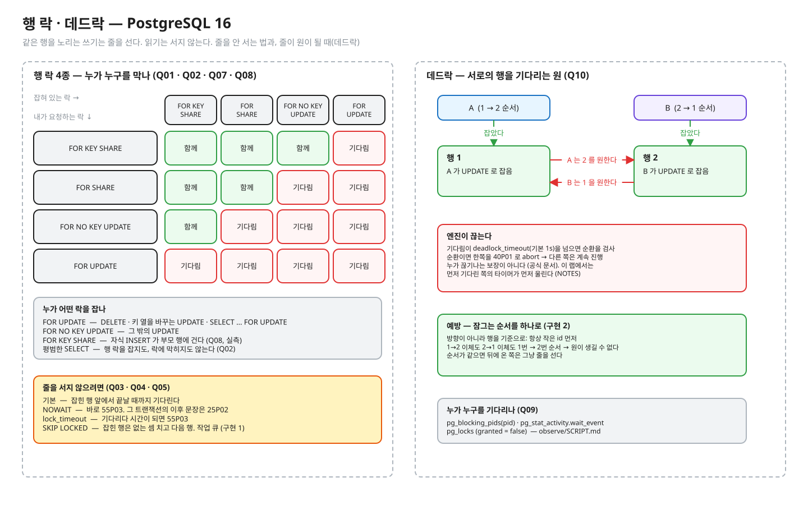

# 01.02 행 락 · 데드락

> **완료 기준**: 예측 10문항을 먼저 적고 돌려 전부 초록 · 구현 테스트 초록 · NOTES 를 채우고 꼬리질문 5개를 해설 보기 전에 답한다 · "같은 행을 노리는 쓰기는 어떻게 줄을 서고, 줄을 서지 않는 방법은 무엇이며, 데드락은 누가 어떻게 끊고 앱은 어떻게 예방하나"를 그림 없이 3분 안에 설명한다.

01.01 의 결론 — "서로 다른 행을 고치는 경쟁은 행 락으로 못 막는다" — 에서 출발해, 이번에는 **같은 행**을 노리는 경쟁에서 행 락이 무엇을 해 주고 무엇을 못 하는지 본다.

공고 연결 — "동시성 처리 · 유실 없는 데이터 정합성". 작업 큐 중복 처리, 이체 데드락은 DB 를 쓰는 서비스에서 가장 흔한 두 사고다.
(참고) 이 레슨은 이전 실험장 `postgres-tx-playground` T-02(락 대기) · T-04(조건부 UPDATE) · T-05~06(데드락 · 워커 경쟁)를 옮긴 것이다. 같은 장면을 **테스트로 판정**하고, psql 관찰은 `observe/` 로 남겼다.

---

## ① 질문 · 첫 예측 — 20분

1. A 가 `SELECT … FOR UPDATE` 로 잡은 행을 B 가 UPDATE 하면? 같은 행을 B 가 평범하게 SELECT 하면?
2. 줄을 서지 않으려면 — `NOWAIT` · `lock_timeout` · `SKIP LOCKED` 는 각각 무엇을 돌려주나? 실패한 뒤 그 트랜잭션은?
3. 공유 락(`FOR SHARE`)끼리는 막나? 자식 행을 INSERT 하면 부모 행에 어떤 락이 걸리고, 부모를 고치는 쪽은 언제 기다리나?
4. 데드락은 어떻게 생기고, 누가 어떻게 끊고, 끊긴 쪽은 무엇을 받나? 앱은 사후에 대응하나 사전에 막나?
5. 워커 여럿이 "다음 작업 하나"를 집어 가는 큐를 DB 로 만들면 어떻게 짜야 중복도 누락도 없고 줄도 서지 않나?

> **이어서 첫 예측**: 질문에 종이로 답해 NOTES §0 에 옮긴 뒤, `RowLockPredictTest.java` 의 예측 칸 `"?"` 를 **감으로** 채워 `./gradlew 01.02-predict` 를 돌린다. 틀려도 된다 — 틀린 문항이 ② 를 읽는 이유가 된다. PROGRESS 의 "예측 적중"은 이 첫 예측으로 센다.

## ② 원리 — 85분



<sub>편집: [diagrams/row-locks-deadlock.excalidraw](diagrams/row-locks-deadlock.excalidraw) · 다시 그리기(만든 사람용 · 레슨 폴더에서): `python3 -I diagrams/draw.py`</sub>

1차 자료 (블로그 요약 말고 이것부터):

공식 문서에서 아래 "찾을 것" 문장을 직접 찾아 표시하고, 한 줄로 번역해 NOTES 나 여백에 적어 둔다.

| 자료 | 읽으면서 찾을 것 |
|---|---|
| [개념 정리 docs/](docs/README.md) | **필수 02 · 03 · 05** 를 읽으며 ① 에서 틀린 문항이 왜 틀렸는지 찾는다 (나머지 글은 심화 — 레슨을 마친 뒤 · 면접 전). 공식 문서 행은 docs 가 링크하는 곳에서 같이 연다 · 예측 답은 접힌 칸에만 |
| [PostgreSQL 16 · 13.3 Explicit Locking](https://www.postgresql.org/docs/16/explicit-locking.html) | Row-Level Locks 4종과 표 13.3 충돌표 · "Row-level locks do not affect data querying; they block only writers and lockers to the same row" (Q02) · Deadlocks 절의 "consistent order" 권고 |
| [SELECT · The Locking Clause](https://www.postgresql.org/docs/16/sql-select.html) | NOWAIT 는 "reports an error, rather than waiting" · SKIP LOCKED 는 "queue-like table" 용이며 일관된 뷰가 아니라는 경고 · READ COMMITTED 에서 ORDER BY + 락 절이 순서를 어긋나게 할 수 있다는 주의 |
| [20.11 Client Connection Defaults · lock_timeout](https://www.postgresql.org/docs/16/runtime-config-client.html) | 기본 0(꺼짐) · 락 대기에서만 발동 · 락 획득 시도마다 따로 적용 |
| [20.12 Lock Management · deadlock_timeout](https://www.postgresql.org/docs/16/runtime-config-locks.html) | 기본 1초 · "The check for deadlock is relatively expensive" — 기다리기 시작하자마자 검사하지 않는 이유 (Q10) |
| [pg_locks](https://www.postgresql.org/docs/16/view-pg-locks.html) · [pg_blocking_pids](https://www.postgresql.org/docs/16/functions-info.html) | granted · 누가 누구를 막는지 (Q09, observe) |
| 『데이터 중심 애플리케이션 설계』 7장 | 명시적 락 · 데드락 · 갱신 손실 방지 |

## ③ 재현 — 30분 · 세 가지 손 작업

파일 경로는 이 레슨 폴더(`01-concurrency-consistency/l02-row-locks-deadlock/`) 기준이다. 명령은 두 곳에서 친다.

```bash
# deep-dive 폴더에서 — ./gradlew 는 전부 여기서
./gradlew 01.02-predict
./gradlew 01.02-implement
```

```bash
# deep-dive 폴더에서 레슨 폴더로 들어간 뒤 — observe 스크립트는 여기서
cd 01-concurrency-consistency/l02-row-locks-deadlock
observe/up.sh
```

IntelliJ 로 한다면: deep-dive 폴더를 Gradle 프로젝트로 열고(코드를 바꾼 뒤 Gradle 창에서 Reload), 테스트 메서드 옆 ▶ 로 한 문항씩 돌려도 된다. 자세히는 [GUIDE.md](../../GUIDE.md).

| 작업 | 실행 | 무엇을 |
|---|---|---|
| **예측** (되짚기) | `./gradlew 01.02-predict` | `src/test/java/deepdive/c01/l02/RowLockPredictTest.java` 의 Q01~Q10(10문항 · 예측 칸 16곳)을 ① 에서 감으로 적었다. 틀린 문항을 ② 를 읽은 뒤 되짚어 다시 적고 초록으로 만든다 (NOTES §1 에 한 줄). 한 문항씩 돌리는 법: [GUIDE](../../GUIDE.md) §2-3. 출력의 A/B/C 타임라인은 예측을 적은 문항만 보인다 |
| **구현** (코드) | `./gradlew 01.02-implement` | 두 건을 ① JobQueue → ② Transfer 순서로 한다. ① `src/main/java/deepdive/c01/l02/JobQueue.java` 의 `claimNext` (검사: `…/test/java/deepdive/c01/l02/JobQueueImplementTest.java`) — 워커 4개 × 작업 40개에서 중복 0 · 누락 0. ② `src/main/java/deepdive/c01/l02/TransferService.java` 의 `transfer` (검사: `…/test/java/deepdive/c01/l02/TransferImplementTest.java`) — 반대 방향 이체에서 40P01 0건 · 잔고 합 보존. 실패 메시지가 무엇이 깨졌는지("정합성 깨짐" · "가용성 깨짐")부터 알려 준다 |
| **관찰** (진짜 엔진) | `observe/up.sh` → [observe/SCRIPT.md](observe/SCRIPT.md) | psql 세 개(A · B · C)로 락 대기 · NOWAIT · 외래키 락 · 데드락을 직접. C 에서 `pg_locks` · `pg_blocking_pids` |

테스트는 진짜 PostgreSQL 16 컨테이너(Testcontainers)에서 돈다. Docker 가 떠 있어야 한다. 테스트용 컨테이너는 `deadlock_timeout=200ms`, 관찰용은 `5s` 다.

예측은 10문항이다. 다만 Q10 은 **끊긴 에러의 SQLState 만** 예측한다. **누가 끊기는지**는 예측 문항이 아니라 관찰 항목이다 — 출력의 "엔진이 끊은 쪽" 줄(과 observe 장면 4)을 보고 NOTES 의 관찰 메모에 적는다 (공식 문서가 예측하지 말라고 한 동작).

한 문항만 (deep-dive 폴더에서): `./gradlew :01-concurrency-consistency:l02-row-locks-deadlock:predict --tests '*Q05*'` (IDE 에서 메서드 하나 실행해도 된다)

구현 테스트는 9개다 (JobQueueImplementTest 5 + TransferImplementTest 4).

| 테스트 | 무엇을 보나 | 빈칸에서 |
|---|---|---|
| `JobQueueImplementTest` 워커_여럿이_집어도_작업은_각각_정확히_한_번 | 결과 검사 — 워커 4개 × 작업 40개에서 중복 0 · 누락 0 · 일을 나눠 가짐 | 빨강 |
| 〃 큐가_비면_비어_있다고_답한다 | 가드 (동작) — 하나뿐인 작업을 집은 뒤 다시 집으면 "없음" 으로 답한다 | 초록 |
| 〃 집은_작업은_running_이_되고_집은_워커가_기록된다 | 가드 (동작) — 가장 앞의 pending 을 집고 running · 집은 워커 이름이 기록된다 | 초록 |
| 〃 남이_하나를_잡고_있어도_두_워커가_동시에_집으면_서로_다른_작업을_받는다 | 결과 검사 — 동시에 집어도 서로 다른 작업 | 빨강 |
| 〃 방법_검사_남이_잡고_있는_작업은_기다리지_않고_건너뛴다 | **방법 검사** — SKIP LOCKED 가 약속한 동작. `FOR UPDATE` 만 붙이면 위 정확히-한-번 검사는 초록이어도 이것이 빨갛다 (NOTES 꼬리질문 3번) | 빨강 |
| `TransferImplementTest` 반대_방향_이체를_동시에_돌려도_데드락이_나지_않고_잔고_합이_보존된다 | 결과 검사 — 40P01 0건 · 잔고 합 보존 | 빨강 |
| 〃 반대_방향_이체를_동시에_돌려도_엔진이_감지한_데드락은_0회 | **방법 검사** — 락 순서로 예방했는지. 40P01 을 잡아 재시도로 가면 빨갛다 (예방은 감지될 일 자체가 없는 것) | 빨강 |
| 〃 한_방향으로만_몰려도_합이_보존된다 | 가드 — 같은 방향으로만 몰리면 순환이 없으니 처음부터 초록이어야 한다 (락 순서를 잘못 짜면 깨진다) | 초록 |
| 〃 잔고가_모자라면_거절하고_아무것도_바꾸지_않는다 | 가드 (동작) — 잔고가 모자라면 거절하고 아무것도 바꾸지 않는다 | 초록 |

빈칸 상태에서 **빨강 5 · 초록 4**. 초록 넷(가드)은 빈칸 코드가 이미 하는 동작이라 처음부터 초록이다 — 고치는 동안 깨뜨리지 않으면 된다.

---

## ④ 내 말로 — 20분

1. [NOTES.md](NOTES.md) — 틀린 예측 · 3분 설명 · 꼬리질문 5개(답을 먼저 쓰고 해설과 비교) · §6 내 실무와 연결(권장 — 내가 일하는 서비스를 떠올려 한 줄씩)
2. `/kata:discuss PostgreSQL 행 락과 데드락, SKIP LOCKED` — 면접관 역할의 꼬리질문
3. 버텼으면 [../../PROGRESS.md](../../PROGRESS.md) 에 테스트 ✅ · 내 말로 ✅

---

💡 **실무**: 데드락은 "엔진이 알아서 끊어 주니 괜찮다"가 아니다 — 끊긴 쪽은 에러를 받고, 그 트랜잭션은 처음부터 다시 해야 한다.
그래서 **여러 행을 잠그는 코드는 순서를 하나로 정하는 것**이 1차 방어이고, 재시도(01.01 의 Tx.serializable 같은)는 2차 방어다.
작업 큐는 `FOR UPDATE SKIP LOCKED` 가 정석이지만, "잠근 채 외부 호출"을 하면 락이 그만큼 길어진다 — 집고 → 커밋 → 처리 → 결과 기록으로 나누는 설계는 02.03 outbox 로 이어진다.

정답 patch: [../../solutions/01.02.patch](../../solutions/01.02.patch) — 구현 정답과 **예측 답**이 들어 있다. 예측 · 구현을 끝낸 뒤 연다 (deep-dive 폴더에서 `less solutions/01.02.patch`). 내 코드와 비교한다.
