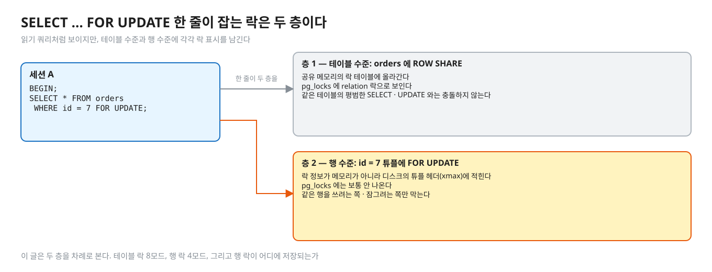
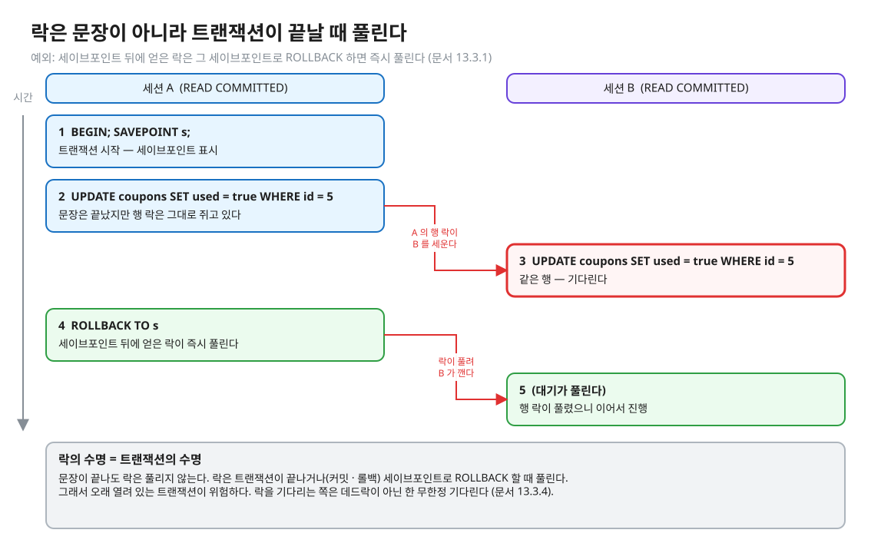
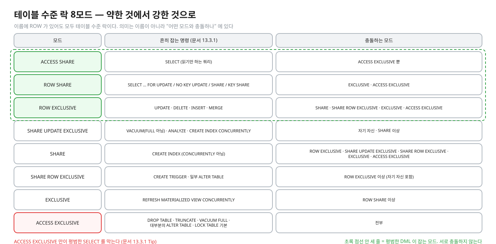
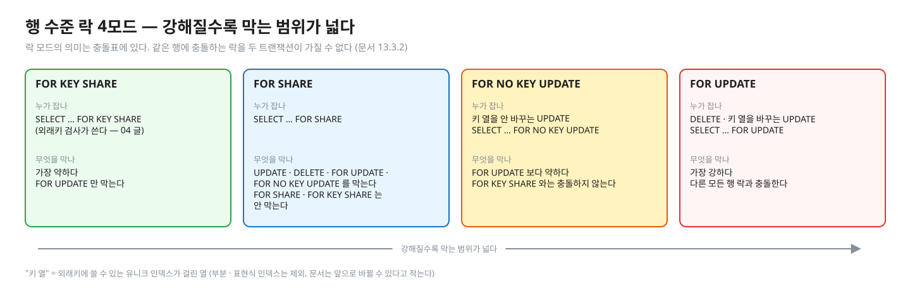
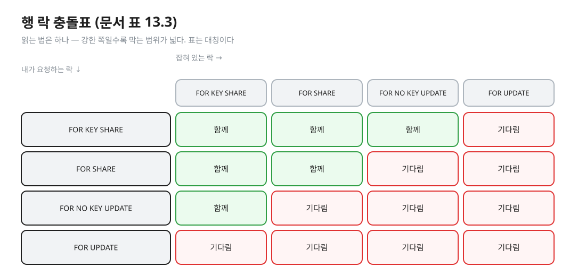
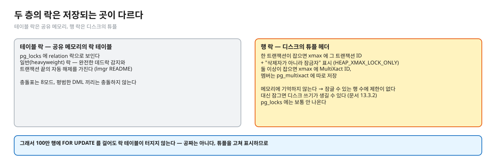
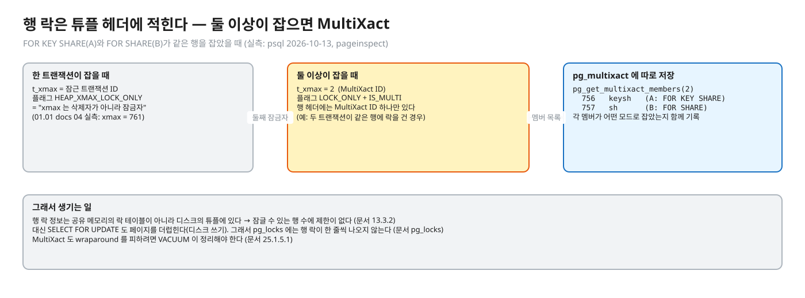

# 01. 락의 층 — 테이블 락 · 행 락 4모드 · 튜플에 적힌 락

> **이 글에서 알게 되는 것**
> 1. PostgreSQL 의 락이 두 층(테이블 수준 8모드 · 행 수준 4모드)이라는 것, 그리고 모드의 의미가 이름이 아니라 **충돌표**에 있다는 것을 안다.
> 2. 행 락 4모드(`FOR UPDATE` · `FOR NO KEY UPDATE` · `FOR SHARE` · `FOR KEY SHARE`)가 각각 누구와 부딪히는지 읽을 수 있다.
> 3. 행 락이 메모리의 락 테이블이 아니라 **튜플 헤더**에 적힌다는 것, 그래서 생기는 결과(행 수 제한 없음 · 디스크 쓰기 · MultiXact)를 안다.
>
> **먼저 알면 좋은 것**: [01.01 · 04. 같은 행을 쓰는 경쟁](../../l01-isolation-mvcc/docs/04-write-conflicts.md) — "읽기는 쓰기를 막지 않는다 · 같은 행 쓰기는 행 락이 줄 세운다" 까지. 이 글은 그 락의 **종류와 저장 방식**을 판다.
> **다음 글**: [02. 줄 서기의 실제 모양](02-waiting-and-observing.md)
> **구분**: 심화 — 꼬리질문 대비 (레슨을 마친 뒤 · 면접 전)

## 읽기처럼 보이는 문장이 두 층의 락을 잡는다

`SELECT * FROM orders WHERE id = 7 FOR UPDATE` 는 이름에 SELECT 가 들어 있어서 읽기 쿼리처럼 보인다. 하지만 이 한 줄은 서로 다른 두 곳에 락 표시를 남긴다. orders 테이블 전체에 거는 **테이블 수준 락**, 그리고 id = 7 인 그 행에 거는 **행 수준 락**이다.

편집: [diagrams/blog01-intro.excalidraw](diagrams/blog01-intro.excalidraw)

이 구분을 모르면 `pg_locks` 에 찍힌 `RowExclusiveLock` · `AccessExclusiveLock` 이 무슨 뜻인지 못 읽고, "ALTER TABLE 하나가 서비스를 멈췄다" 같은 장애(02 글의 장면)를 설명하지 못한다. 이 글은 두 층을 차례로 보고, 마지막에 각 층의 락이 **어디에 저장되는지**를 본다.

## 락은 "누가 누구와 함께 있을 수 있나"의 표다

락 모드의 의미는 이름이 아니라 **충돌표**에 있다. 두 트랜잭션은 같은 대상에 충돌하는 락을 동시에 가질 수 없고, 한 트랜잭션은 자기 자신과 충돌하지 않는다. 충돌하면 나중에 온 쪽이 기다린다. 락은 보통 트랜잭션이 끝날 때 풀리고, 세이브포인트 뒤에 얻은 락은 그 세이브포인트로 ROLLBACK 하면 즉시 풀린다. ([문서 13.3.1](https://www.postgresql.org/docs/16/explicit-locking.html))

편집: [diagrams/blog01-lock-lifetime.excalidraw](diagrams/blog01-lock-lifetime.excalidraw)

그림처럼 문장이 끝나도 락은 풀리지 않는다. "락은 문장이 끝나면 풀린다" 는 흔한 오해이고(아래 "자주 하는 오해"), 이것이 오래 열린 트랜잭션이 위험한 이유다. 락을 기다리는 쪽은 데드락이 아닌 한 **무한정** 기다린다 ([문서 13.3.4](https://www.postgresql.org/docs/16/explicit-locking.html)).

## 층 1 — 테이블 수준 락 (8모드)

이름에 "ROW" 가 들어 있어도 **테이블 수준** 락이다(역사적인 이름, 문서 13.3.1). 모드 사이의 차이는 "어떤 모드와 충돌하나" 뿐이다.

편집: [diagrams/blog01-table-modes.excalidraw](diagrams/blog01-table-modes.excalidraw)

같은 내용을 글로 옮기면 이렇다. ([문서 13.3.1](https://www.postgresql.org/docs/16/explicit-locking.html))

| 모드 | 흔히 잡는 명령 | 충돌하는 모드 |
|---|---|---|
| ACCESS SHARE | `SELECT` (읽기만 하는 쿼리) | ACCESS EXCLUSIVE 뿐 |
| ROW SHARE | `SELECT … FOR UPDATE / NO KEY UPDATE / SHARE / KEY SHARE` | EXCLUSIVE · ACCESS EXCLUSIVE |
| ROW EXCLUSIVE | `UPDATE` · `DELETE` · `INSERT` · `MERGE` | SHARE · SHARE ROW EXCLUSIVE · EXCLUSIVE · ACCESS EXCLUSIVE |
| SHARE UPDATE EXCLUSIVE | `VACUUM`(FULL 아님) · `ANALYZE` · `CREATE INDEX CONCURRENTLY` | 자기 자신 · SHARE 이상 |
| SHARE | `CREATE INDEX` (CONCURRENTLY 아님) | ROW EXCLUSIVE · SHARE UPDATE EXCLUSIVE · SHARE ROW EXCLUSIVE · EXCLUSIVE · ACCESS EXCLUSIVE |
| SHARE ROW EXCLUSIVE | `CREATE TRIGGER` · 일부 `ALTER TABLE` | ROW EXCLUSIVE 이상 (자기 자신 포함) |
| EXCLUSIVE | `REFRESH MATERIALIZED VIEW CONCURRENTLY` | ROW SHARE 이상 |
| ACCESS EXCLUSIVE | `DROP TABLE` · `TRUNCATE` · `VACUUM FULL` · 대부분의 `ALTER TABLE` · `LOCK TABLE` 기본 | 전부 |

외울 것은 두 줄이다. 첫째, 평범한 DML(`SELECT` · `INSERT` · `UPDATE` · `DELETE`)이 잡는 ACCESS SHARE · ROW SHARE · ROW EXCLUSIVE 끼리는 **서로 충돌하지 않는다**. 같은 테이블의 다른 행을 두 세션이 동시에 UPDATE 할 수 있는 이유이고, 그래서 행 단위의 별도 락이 필요하다. 둘째, 문서의 Tip 대로 "ACCESS EXCLUSIVE 락만이 평범한 `SELECT` 를 막는다" ([문서 13.3.1](https://www.postgresql.org/docs/16/explicit-locking.html)). `DROP` · `TRUNCATE` · 대부분의 `ALTER TABLE` · `VACUUM FULL` 이 이 락을 잡으므로, 이런 명령이 읽기까지 멈추게 만든다.

테이블 락은 "테이블 전체"를 두고 부딪힌다. 그런데 평범한 DML 끼리는 부딪히지 않으니, 같은 행을 두고 경쟁하는 문제는 다른 층이 맡아야 한다. 그것이 행 락이다.

## 층 2 — 행 수준 락 (4모드)

[문서 13.3.2](https://www.postgresql.org/docs/16/explicit-locking.html) 는 이렇게 적는다. 같은 행에 대해 서로 충돌하는 락을 두 트랜잭션이 가질 수는 없고, 행 락은 조회에는 영향을 주지 않으며 같은 행의 **쓰는 쪽과 잠그는 쪽**만 막는다. 모드는 넷이고, 약한 것에서 강한 것 순서로 보면 이렇다.

편집: [diagrams/blog01-row-modes.excalidraw](diagrams/blog01-row-modes.excalidraw)

| 모드 | 누가 잡나 | 한마디 |
|---|---|---|
| `FOR UPDATE` | `DELETE` · 키 열을 바꾸는 `UPDATE` · `SELECT … FOR UPDATE` | 가장 강하다. 다른 모든 행 락과 충돌 |
| `FOR NO KEY UPDATE` | 위 외의 `UPDATE` · `SELECT … FOR NO KEY UPDATE` | FOR UPDATE 보다 약하다 — `FOR KEY SHARE` 와는 충돌하지 않는다 |
| `FOR SHARE` | `SELECT … FOR SHARE` | 공유 락. UPDATE · DELETE · FOR UPDATE · FOR NO KEY UPDATE 를 막고, FOR SHARE · FOR KEY SHARE 는 안 막는다 |
| `FOR KEY SHARE` | `SELECT … FOR KEY SHARE` (외래키 검사가 쓴다 — [04 글](04-foreign-keys-and-lock-modes.md)) | 가장 약하다. FOR UPDATE 만 막는다 |

여기서 "키 열" 이 무엇인지가 중요하다. 문서에 정의가 있다. 지금 버전에서는 **외래키에 쓸 수 있는 유니크 인덱스가 걸린 열**이다(부분 인덱스 · 표현식 인덱스는 제외, "앞으로 바뀔 수 있다" 고 문서가 적는다). UPDATE 가 이 열을 건드리면 `FOR UPDATE`, 건드리지 않으면 `FOR NO KEY UPDATE` 를 잡는다. `DELETE` 는 항상 `FOR UPDATE` 다.

네 모드가 서로 어떻게 부딪히는지는 충돌표(표 13.3)로 한눈에 본다. `X` 는 충돌, 즉 기다림이다.

편집: [diagrams/blog01-conflict-matrix.excalidraw](diagrams/blog01-conflict-matrix.excalidraw)

| 요청 \ 잡혀 있는 락 | FOR KEY SHARE | FOR SHARE | FOR NO KEY UPDATE | FOR UPDATE |
|---|---|---|---|---|
| FOR KEY SHARE | | | | X |
| FOR SHARE | | | X | X |
| FOR NO KEY UPDATE | | X | X | X |
| FOR UPDATE | X | X | X | X |

표는 대칭이고, 읽는 법은 "강한 쪽일수록 막는 범위가 넓다" 하나다. 같은 표를 다른 그림으로 본 것이 [../diagrams/row-locks-deadlock.svg](../diagrams/row-locks-deadlock.svg) 의 왼쪽이다.

테이블 락과 달리 행 락은 "누가 잡느냐" 가 겉으로 잘 안 보인다. 모드 이름이 `UPDATE` 인데도 `SELECT` 로 잡을 수 있고, 반대로 `UPDATE` 가 항상 `FOR UPDATE` 를 잡지도 않는다. 이 락들이 실제로 **어디에 기록되는지**를 보면 이 이상한 점이 풀린다.

## PostgreSQL 에서는 — 행 락은 튜플에 적힌다

두 층의 락은 저장되는 곳이 다르다.

편집: [diagrams/blog01-where-stored.excalidraw](diagrams/blog01-where-stored.excalidraw)

문서 13.3.2 는 이렇게 쓴다. PostgreSQL 은 변경된 행에 대한 정보를 메모리에 기억하지 않는다. 그래서 한 번에 잠글 수 있는 행의 수에 제한이 없다. 그러나 행을 잠그면 디스크 쓰기가 생길 수 있다 — `SELECT FOR UPDATE` 는 선택한 행을 락 표시로 수정한다.

한 트랜잭션이 행을 잠그면 튜플의 `xmax` 에 그 트랜잭션 ID 가 들어가고, "이 xmax 는 삭제자가 아니라 잠금자" 라는 `HEAP_XMAX_LOCK_ONLY` 표시가 붙는다 (01.01 문서 04 의 실측: 잠근 트랜잭션 761 이 xmax). `pg_locks` 에도 행 락은 한 줄씩 나오지 않는다. 문서는 "행 수준 락의 정보는 디스크에 저장되므로 보통 이 뷰에 나타나지 않는다" 고 적는다. ([pg_locks](https://www.postgresql.org/docs/16/view-pg-locks.html))

문제는 **둘 이상이 같은 행을 동시에 잠글 수 있는 모드**(예: FOR SHARE 끼리, FOR KEY SHARE 와 FOR SHARE)다. 튜플 헤더에는 트랜잭션 ID 를 하나밖에 못 쓴다. 그래서 **MultiXact ID** 를 쓴다. [문서 25.1.5.1](https://www.postgresql.org/docs/16/routine-vacuuming.html) 에 따르면 튜플 헤더에는 락 정보를 저장할 공간이 제한적이라, 한 행을 동시에 잠근 트랜잭션이 둘 이상이면 그 정보를 "multiple transaction ID" 로 인코딩한다. 어떤 트랜잭션 ID 들이 포함되는지는 `pg_multixact` 에 따로 저장되고, 튜플 헤더의 `xmax` 에는 MultiXact ID 만 나온다.

(실측: psql 2026-10-13) 세션 A 가 `FOR KEY SHARE`, 세션 B 가 `FOR SHARE` 로 같은 행을 잡은 상태에서 `pageinspect` 로 튜플 헤더를 보니 `t_xmax = 2` 에 `LOCK_ONLY` · `IS_MULTI` 비트가 켜져 있었고, `pg_get_multixact_members(2)` 는 `756 keysh` · `757 sh` 두 줄(= A 와 B, 각자 잡은 모드)이었다. 같은 행 한 줄에 락 모드가 사람 수만큼 따로 기록되는 것이다.

편집: [diagrams/multixact.excalidraw](diagrams/multixact.excalidraw)

이 저장 방식에서 두 가지 결과가 나온다.

1. 락을 100만 행에 걸어도 락 테이블이 터지지 않는다(행 수 제한 없음).
2. 대신 **읽는 쿼리처럼 보이는 `FOR UPDATE` 도 페이지를 더럽혀 WAL · 디스크 쓰기를 만든다** (해석: "디스크 쓰기가 생길 수 있다" 는 문서 문장의 적용). MultiXact ID 도 트랜잭션 ID 처럼 wraparound 를 피하려고 VACUUM 이 정리해야 하며, 멤버 저장소가 약 10GB 를 넘으면 aggressive VACUUM 이 더 자주 돈다 (문서 25.1.5.1).

테이블 락은 반대다. 공유 메모리의 락 테이블에 있다. [lmgr README](https://github.com/postgres/postgres/blob/REL_16_STABLE/src/backend/storage/lmgr/README) 는 일반(heavyweight) 락이 "완전한 데드락 감지와 트랜잭션 끝의 자동 해제" 를 가진다고 설명한다. `pg_locks` 에 `relation` 락으로 보이는 것이 이쪽이다. 그러면 행 락 대기는 `pg_locks` 에 어떻게 보일까. 상대 **트랜잭션 ID 락**으로 보이는데, 그 이유는 [02 글](02-waiting-and-observing.md) 에서 본다.

### 자주 하는 오해

1. **"`SELECT … FOR UPDATE` 는 읽기라서 락이 메모리에만 잠깐 잡힌다."** 튜플(xmax)에 적히고 디스크 쓰기를 만든다 (문서 13.3.2).
2. **"행 락이 `pg_locks` 에 행마다 한 줄씩 나온다."** 안 나온다. 기다리는 쪽이 상대 트랜잭션 ID 를 기다리는 모습으로 보인다 (02 글).
3. **"UPDATE 는 항상 FOR UPDATE 를 잡는다."** 키가 아닌 열만 바꾸는 UPDATE 는 `FOR NO KEY UPDATE` 다. 키 열 UPDATE 와 DELETE 만 `FOR UPDATE` (문서 13.3.2). 그래서 `FOR KEY SHARE` 를 든 쪽(04 글의 외래키 검사)이 비키 UPDATE 를 못 막는다.
4. **"ROW EXCLUSIVE 가 행을 잠근다."** 테이블 수준 락이다. UPDATE 가 잡는 ROW EXCLUSIVE 끼리는 충돌하지 않는다 — 같은 테이블의 다른 행을 동시에 UPDATE 할 수 있는 이유.
5. **"락은 문장이 끝나면 풀린다."** 트랜잭션이 끝나거나 세이브포인트로 ROLLBACK 할 때 풀린다. 그래서 오래 열린 트랜잭션이 위험하다 (문서 13.3.4: 락을 기다리는 쪽은 데드락이 아닌 한 **무한정** 기다린다).

### 앱 · 프레임워크에서는

- JPA 의 `LockModeType.PESSIMISTIC_WRITE` 가 `find` · JPQL 에서는 `FOR NO KEY UPDATE`, `PESSIMISTIC_READ` 가 `FOR SHARE` 로 이어지는 것은 [06 글](06-app-and-mysql.md) 에서 실행 로그로 확인한다.
- `@Version` 낙관적 락은 DB 행 락이 아니라 UPDATE 의 WHERE 조건이다 — 01.04 에서 다룬다.

## MySQL InnoDB 는 어떻게 다른가

- 모드 구성이 다르다. InnoDB 는 행 락을 공유(S) · 배타(X) 두 종류와 테이블 수준 **의도 락(IS · IX)** 으로 나눈다 ([MySQL 8.0 · 17.7.1 InnoDB Locking](https://dev.mysql.com/doc/refman/8.0/en/innodb-locking.html)). PostgreSQL 의 `NO KEY UPDATE` · `KEY SHARE` 같은 "키 여부로 나눈 모드" 는 문서에서 찾지 못했다.
- InnoDB 의 락은 **인덱스 레코드**에 걸린다 (문서: "Record locks always lock index records"). 자세한 건 [06 글](06-app-and-mysql.md).

## 한눈에 정리

| | 테이블 락 | 행 락 |
|---|---|---|
| 모드 수 | 8 | 4 |
| 저장 위치 | 공유 메모리의 락 테이블 | 디스크의 튜플 헤더(`xmax`) |
| `pg_locks` | `relation` 으로 보인다 | 보통 안 나온다 |
| 평범한 DML 끼리 | 충돌 없음 | 같은 행의 쓰는 쪽 · 잠그는 쪽만 충돌 |
| 잠글 수 있는 개수 | — | 제한 없음 (대신 디스크 쓰기) |

- 락 모드의 의미는 이름이 아니라 충돌표에 있다. 강한 모드일수록 막는 범위가 넓다.
- 테이블 락 중 평범한 `SELECT` 를 막는 것은 ACCESS EXCLUSIVE 뿐이다.
- 행 락은 튜플 `xmax` 에 적힌다. 둘 이상이 잡으면 MultiXact 로 바뀐다.
- 그래서 `FOR UPDATE` 는 읽기처럼 보여도 쓰기를 만들고, 락은 문장이 아니라 트랜잭션이 끝날 때 풀린다.

## 스스로 확인

1. 락을 100만 행에 걸면 PostgreSQL 은 메모리를 얼마나 쓰나? 그러면 공짜인가?
   

답

   행 락 정보를 메모리에 기억하지 않으므로 잠글 수 있는 행 수에 제한이 없고 락 테이블 메모리를 쓰지 않는다 (문서 13.3.2). 공짜는 아니다 — 잠근 행의 튜플을 수정해 표시하므로 디스크 쓰기(페이지 더럽힘 · 그에 따른 WAL)가 생긴다 (해석 — WAL 부분은 문서 문장 "disk writes" 의 적용).
   

2. 두 트랜잭션이 같은 행에 FOR SHARE 를 걸었다. xmax 에는 무엇이 있나?
   

답

   MultiXact ID 가 있다. 튜플 헤더에는 트랜잭션 ID 하나만 쓸 수 있어서, 둘 이상이 동시에 잠그면 멤버 목록을 `pg_multixact` 에 두고 헤더에는 그 ID 만 적는다 (문서 25.1.5.1). 실측으로 멤버가 `keysh` · `sh` 처럼 모드와 함께 기록되는 것을 봤다 (psql 2026-10-13, `pg_get_multixact_members`).
   

3. `UPDATE` 가 `FOR NO KEY UPDATE` 를 잡는 것과 `FOR UPDATE` 를 잡는 것은 언제 갈리나?
   

답

   외래키로 참조될 수 있는 유니크 인덱스의 열(키)을 바꾸면 `FOR UPDATE`, 아니면 `FOR NO KEY UPDATE`. `DELETE` 는 항상 `FOR UPDATE`. 왜 나눴나: 외래키 검사(`FOR KEY SHARE`)가 키가 안 바뀌는 UPDATE 와 충돌하지 않게 하려는 것으로 보인다 (해석 — 문서는 모드 정의만 적고 도입 이유는 적지 않는다; 04 글).
   

4. 평범한 `SELECT` 를 막는 락은?
   

답

   테이블의 ACCESS EXCLUSIVE 락뿐이다 (문서 13.3.1 Tip). 행 락은 `FOR UPDATE` 계열 잠금과 쓰기만 막는다. `DROP` · `TRUNCATE` · 대부분의 `ALTER TABLE` · `VACUUM FULL` 이 이 락을 잡는다.
   

## 이 레슨에서 직접 보기

| 어디서 | 무엇을 |
|---|---|
| Q07 | FOR SHARE 끼리는 막나 · 그 위에 UPDATE 는 |
| Q08 | 자식 INSERT 가 부모 행에 거는 락 (04 글에서 자세히) |
| 장면 3 (observe/SCRIPT.md) | psql 두 개로 외래키 락 |

실측 — 예측을 끝낸 뒤 펼친다 (Q07)

정답 상태 기준 ([정답 patch](../../../solutions/01.02.patch)):

| Q | 상황 | 결과 |
|---|---|---|
| Q07 | A · B 가 같은 행을 `FOR SHARE` | B 는 기다리지 않는다 (`false`) |
| Q07 | 그 위에서 C 가 `UPDATE` | C 는 기다린다 (`true`) |

## 출처

- [PostgreSQL 16 · 13.3 Explicit Locking](https://www.postgresql.org/docs/16/explicit-locking.html) — 표 13.2 · 13.3 · 행 락 4모드 · 행 락 저장(디스크 쓰기) · 락 수명 · ACCESS EXCLUSIVE Tip
- [25.1.5 Preventing Transaction ID Wraparound Failures · Multixacts](https://www.postgresql.org/docs/16/routine-vacuuming.html) — MultiXact 정의 · `pg_multixact`
- [pg_locks](https://www.postgresql.org/docs/16/view-pg-locks.html) — 행 락은 보통 이 뷰에 안 나온다
- [lmgr README](https://github.com/postgres/postgres/blob/REL_16_STABLE/src/backend/storage/lmgr/README) — 일반 락의 성질
- [MySQL 8.0 · 17.7.1 InnoDB Locking](https://dev.mysql.com/doc/refman/8.0/en/innodb-locking.html) — S/X · 의도 락 · 레코드 락
