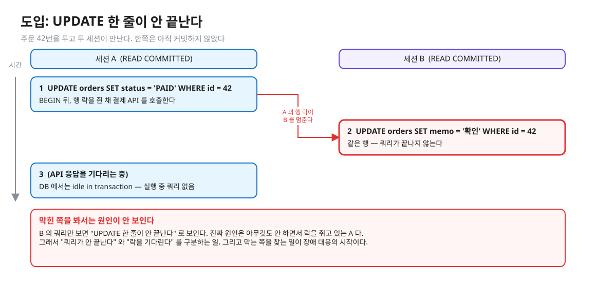
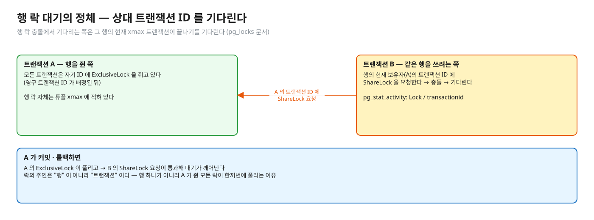
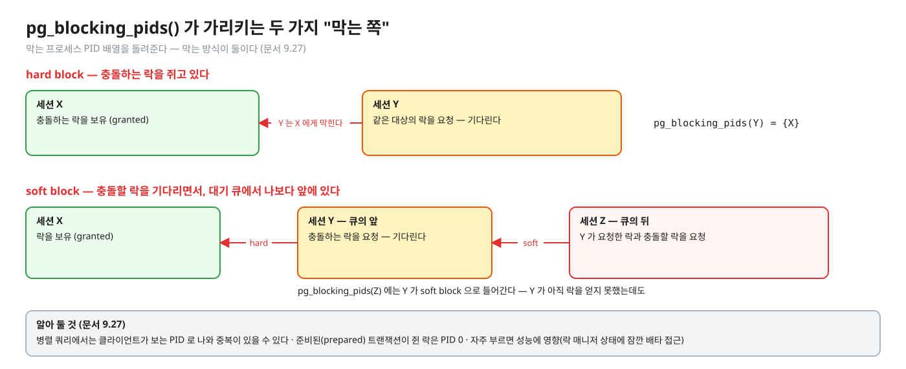
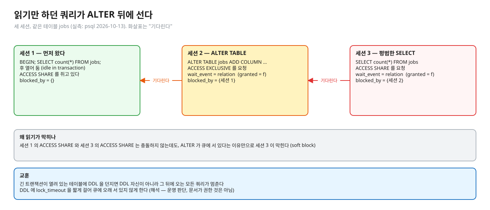
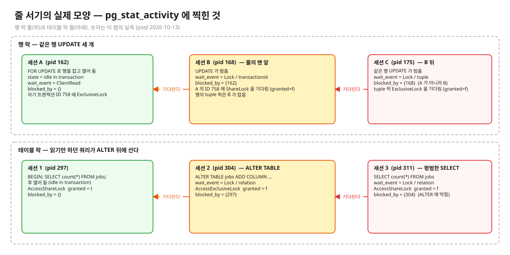
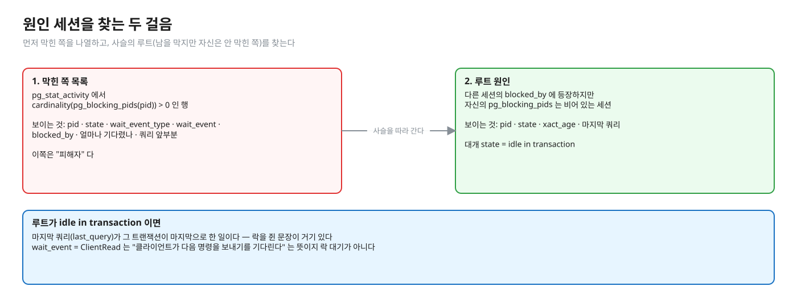

# 02. 줄 서기의 실제 모양 — 누가 누구를 기다리나

> **이 글에서 알게 되는 것**
> 1. 락을 기다리는 세션이 `pg_stat_activity` 에서 어떻게 보이는지(`wait_event_type = Lock`), 행 락 대기가 왜 "상대 **트랜잭션 ID** 를 기다리는" 모양인지 안다.
> 2. 누가 막는지를 `pg_locks` 조인이 아니라 `pg_blocking_pids()` 로 읽는 이유와, hard block · soft block 의 차이를 안다.
> 3. 사슬의 루트(대개 `idle in transaction`)를 찾는 쿼리와, DDL 하나가 뒤따르는 읽기까지 멈추게 하는 장면을 설명할 수 있다.
>
> **먼저 알면 좋은 것**: [01. 락의 층](01-lock-modes-and-storage.md) — 충돌표와 "행 락은 튜플에 적힌다".
> **다음 글**: [03. 줄 서지 않기](03-not-waiting.md)
> **구분**: 필수 — ② 원리 (① 에서 예측을 먼저 한 뒤 읽는다)

## 도입: 쿼리가 안 끝날 때, 막힌 쪽을 봐서는 모른다

주문 42번을 두고 두 세션이 만난다. 세션 A 는 주문 상태를 UPDATE 한 뒤 커밋하지 않은 채 외부 결제 API 응답을 기다린다. 이때 세션 B 가 같은 주문을 UPDATE 하면 B 의 쿼리는 끝나지 않는다.


<sub>편집: [diagrams/blog02-intro.excalidraw](diagrams/blog02-intro.excalidraw)</sub>

B 의 쿼리만 보면 "UPDATE 한 줄이 안 끝난다" 로 보인다. 그런데 원인은 B 가 아니라, 아무것도 실행하지 않으면서 락을 쥐고 있는 A 다. 실무에서 락 대기 장애의 원인은 대개 막는 쪽이 **`idle in transaction`** 으로 락을 쥔 채 멈춰 있는 것이다(외부 호출 중, 커밋을 잊음). 막히는 쪽의 쿼리만 봐서는 원인을 못 찾는다.

그래서 이 글의 순서는 이렇다. 먼저 "쿼리가 안 끝난다" 와 "락을 기다린다" 를 구분하고(기다림의 정체), 막는 쪽을 함수로 읽고(`pg_blocking_pids`), 사슬의 루트를 찾는 쿼리를 쓴다.

## 기다림의 대상

락 충돌에서 기다리는 것은 둘로 나뉜다.

- **행 락** 충돌: 기다리는 쪽은 그 행의 현재 xmax 트랜잭션이 끝나기를 기다린다.
- **테이블 락** 충돌: `relation` 락을 기다린다 ([01 글](01-lock-modes-and-storage.md) 의 충돌표).

행 락 대기를 좀 더 들여다보자. 그 대기는 "상대 트랜잭션 ID 에 대한 ShareLock 요청" 으로 구현된다. 문서가 이렇게 쓴다: "행 수준 락을 기다리는 프로세스는 보통 뷰에서 그 행 락의 현재 보유자의 영구 트랜잭션 ID 를 기다리는 것으로 나타난다" ([pg_locks](https://www.postgresql.org/docs/16/view-pg-locks.html)). 모든 트랜잭션은 자기 ID 에 ExclusiveLock 을 쥐고 있고(영구 ID 가 배정된 뒤), 남이 끝나기를 기다리는 쪽이 그 ID 의 ShareLock 을 요청한다. 상대가 끝나면 ExclusiveLock 이 풀려 대기가 깨어난다.


<sub>편집: [diagrams/blog02-xid-lock.excalidraw](diagrams/blog02-xid-lock.excalidraw)</sub>

그래서 행 락 대기에서는 락의 주인이 "행"이 아니라 **트랜잭션**이다. A 가 끝나야 풀린다. 행 하나가 아니라 A 가 쥔 모든 락이 한꺼번에 풀리는 것도 같은 이유다. `pg_locks` 에서 행 락이 행마다 한 줄씩 나오지 않는 것([01 글](01-lock-modes-and-storage.md))과도 이어지는 이야기다. 행 락 정보는 튜플에 있고, 뷰에서는 "상대 트랜잭션 ID 를 기다리는" 모양만 보인다.

## 누가 누구를 막나 — 직접 조인하지 말고 함수로

막는 쪽을 찾겠다고 `pg_locks` 를 자기 자신과 조인하는 쿼리를 쓰고 싶어진다. 권장되지 않는다. 문서가 드는 이유는 이렇다. 그러려면 "어떤 락 모드끼리 충돌하는지" 를 쿼리가 알아야 하고, 이 뷰는 대기 큐 순서나 병렬 워커 관계를 보여 주지 않는다. 대신 `pg_blocking_pids(pid)` 를 쓴다 ([문서 9.27 · functions-info](https://www.postgresql.org/docs/16/functions-info.html)).

이 함수는 막는 프로세스 PID 배열을 돌려준다. 막는 방식은 두 가지다. 충돌하는 락을 **쥐고 있거나**(hard block), 충돌할 락을 **기다리면서 큐에서 나보다 앞에 있거나**(soft block).


<sub>편집: [diagrams/blog02-hard-soft.excalidraw](diagrams/blog02-hard-soft.excalidraw)</sub>

몇 가지 주의가 있다. 병렬 쿼리에서는 클라이언트가 보는 PID 로 나오므로 중복이 있을 수 있고, 준비된(prepared) 트랜잭션이 쥔 락은 PID 0 으로 나온다. 자주 부르면 성능에 영향이 있다. 락 매니저 공유 상태에 잠깐 배타 접근이 필요하기 때문이다. 감시 쿼리를 촘촘히 폴링하지 않는다.

soft block 이라는 개념이 낯설 수 있다. 다음 절의 장면이 그 실제 모양이다.

## PostgreSQL 에서는

### 읽기만 하던 쿼리가 ALTER 뒤에 선다 (실측: psql 2026-10-13)

테이블 락에서도 같은 사슬이 생긴다. 세션 1 이 `BEGIN; SELECT count(*) FROM jobs;` 로 ACCESS SHARE 를 쥔 채 열어 두고, 세션 2 가 `ALTER TABLE jobs ADD COLUMN …`(ACCESS EXCLUSIVE 요청), 세션 3 이 평범한 `SELECT count(*) FROM jobs` 를 날렸다.


<sub>편집: [diagrams/blog02-ddl-queue.excalidraw](diagrams/blog02-ddl-queue.excalidraw)</sub>

- 세션 2: `wait_event = relation`, `ACCESS EXCLUSIVE granted = f`, `blocked_by = {세션 1}`.
- 세션 3: `ACCESS SHARE granted = f`, `blocked_by = {세션 2}` — **ALTER 가 큐에 서 있다는 이유만으로** 읽기가 막혔다. 세션 1 의 ACCESS SHARE 와 세션 3 의 ACCESS SHARE 는 충돌하지 않는데도 그렇다.

이것이 `pg_blocking_pids` 문서의 soft block(충돌할 락을 기다리며 큐에서 앞에 있는 쪽)의 실제 모양이다. 교훈: 긴 트랜잭션이 열려 있는 테이블에 DDL 을 던지면, DDL 자신이 아니라 **그 뒤에 오는 모든 쿼리**가 멈춘다. DDL 에는 `lock_timeout` 을 짧게 걸어([03 글](03-not-waiting.md)) 큐에 오래 서 있지 않게 한다 (해석 — 문서가 권하는 것은 아니고 이 관찰에서 나온 운영 판단).

### 같은 행을 기다리는 줄은 어떤 모양인가

같은 행을 세 세션이 기다릴 때 `blocked_by` 가 어떻게 나오는지는 직접 관찰할 항목이다. 예측 문항(Q09)의 값이 섞여 있어서 접어 둔다.

<details><summary>실측 1 — Q09 를 예측한 뒤 펼친다 (psql 2026-10-13)</summary>

A 가 `FOR UPDATE` 로 행을 잡고 열어 둔 채, B 와 C 가 차례로 같은 행을 UPDATE 했다.



<sub>편집: [diagrams/wait-queue.excalidraw](diagrams/wait-queue.excalidraw)</sub>

관찰:

- A: `state = idle in transaction`, `wait_event = ClientRead`(= 클라이언트가 다음 명령을 보내기를 기다림 — 락 대기가 아니다), `blocked_by = {}`.
- B: `wait_event_type = Lock`, `wait_event = transactionid`, `blocked_by = {A}`. `pg_locks` 에서 B 는 A 의 트랜잭션 ID 에 `ShareLock granted = f` 이고, 그 행의 `tuple` 락 `ExclusiveLock` 은 **B 가 쥐고 있다**.
- C: `wait_event = tuple`, `blocked_by = {B}` — A 가 아니다. `pg_locks` 에서 C 는 그 `tuple` 락을 `granted = f` 로 기다린다.

즉 같은 행을 기다리는 줄이 생기면 **맨 앞 대기자(B)가 tuple 락을 쥐고 상대 트랜잭션을 기다리고, 뒤의 대기자(C)는 tuple 락에서 줄을 선다.** tuple 락이 이 줄을 세우는 장치라는 해석은 (해석) 이다 — 이 레슨은 소스(`heapam.c`)를 읽지 않았다. 확인한 것은 위 관찰뿐이다. 행 락 대기 세션이 많을 때 `blocked_by` 가 **사슬**(C → B → A)로 나오는 이유다 — 루트(막히지 않은 쪽, A)를 찾아야 한다. 이 모양은 같은 행 **UPDATE · SELECT FOR UPDATE** 대기에서 그렇다. 같은 키의 유니크 **INSERT** 대기는 다르다 — 대기자 전부가 삽입한 트랜잭션의 `transactionid` 를 기다려 `blocked_by` 가 모두 그 삽입자 하나를 가리킨다 (실측: psql 2026-10-13 — 삽입자 1 + 같은 키 INSERT 3 → 3개 모두 `Lock/transactionid`, `blocked_by = {삽입자}`; 같은 행 UPDATE 3 → `transactionid` → `tuple` → `tuple`, 마지막은 `{앞 두 대기자}`).

</details>

사슬이 나올 수 있으니, 원인을 찾을 때는 막힌 쪽 목록에서 멈추지 않고 **루트**까지 올라가야 한다. 다음 절의 쿼리가 그 일을 한다.

### 감시 쿼리 — 막힌 쪽, 그리고 루트


<sub>편집: [diagrams/blog02-monitor.excalidraw](diagrams/blog02-monitor.excalidraw)</sub>

```sql
-- 누가 누구를 기다리나 (막힌 쪽 기준)
SELECT pid, state, wait_event_type, wait_event, pg_blocking_pids(pid) AS blocked_by,
       now() - query_start AS waiting_for, left(query, 60) AS query
FROM pg_stat_activity
WHERE cardinality(pg_blocking_pids(pid)) > 0;

-- 루트 원인: 남을 막고 있지만 자신은 안 막힌 세션 (대개 idle in transaction)
SELECT pid, state, now() - xact_start AS xact_age, left(query, 60) AS last_query
FROM pg_stat_activity
WHERE pid IN (SELECT unnest(pg_blocking_pids(pid)) FROM pg_stat_activity)
  AND cardinality(pg_blocking_pids(pid)) = 0;
```

두 번째 쿼리는 직접 돌려 확인했다 (실측: psql 2026-10-13 — A 가 `FOR UPDATE` 후 열어 둔 채 B · C 가 같은 행 UPDATE 일 때 A 한 줄이 나왔다: `idle in transaction`, `last_query` = `SELECT id FROM jobs WHERE id=1 FOR UPDATE;`). 쿼리 형태는 `pg_blocking_pids` 문서의 예에서 따왔다. 루트가 `idle in transaction` 이면 `last_query` 가 그 트랜잭션이 **마지막으로 한 일**이다. 락을 쥔 문장이 거기 있다.

### 로그로 남기기

`log_lock_waits` 를 켜면 락 대기가 `deadlock_timeout` 을 넘을 때 로그가 남는다 ([문서 20.12](https://www.postgresql.org/docs/16/runtime-config-locks.html): "이 파라미터가 설정되면 `deadlock_timeout` 이 로그 메시지를 내기 전에 기다릴 시간도 정한다"). 이 랩의 관찰 컨테이너는 `log_lock_waits=on` 으로 띄운다 ([docker-compose.yml](../observe/docker-compose.yml)). 기본값은 `off` 다 ([문서 20.8](https://www.postgresql.org/docs/16/runtime-config-logging.html)).

### 자주 하는 오해

1. **"락을 기다리는 세션은 `wait_event = Lock` 이 아니라 CPU 를 먹고 있다."** 기다리는 세션은 CPU 를 거의 쓰지 않는다. 대기 폭증의 증상은 CPU 가 아니라 **active 세션 수 · 커넥션 풀 고갈**로 나타난다 (해석).
2. **"막는 세션은 뭔가 실행 중일 것이다."** 대개 반대다 — `idle in transaction`(`wait_event = ClientRead`) 으로 아무것도 안 하면서 락을 쥐고 있다.
3. **"`pg_locks` 에서 `granted = false` 인 행의 `pid` 가 문제 세션이다."** 그건 피해자(기다리는 쪽)다. 원인은 `pg_blocking_pids` 가 가리키는 쪽, 그 사슬의 루트다.
4. **"읽기 쿼리는 락에 안 막히니 DDL 이 돌아도 읽기는 안전하다."** ACCESS EXCLUSIVE 를 기다리는 DDL 이 큐에 있는 동안 뒤에 오는 평범한 SELECT 도 막힌다 (위 실측).

### 앱 · 프레임워크에서는

- 커넥션 풀(HikariCP 등)은 락 대기 중인 쿼리도 커넥션을 쥐고 있으므로, 락 대기가 쌓이면 풀이 마르고 그 뒤 요청은 "커넥션을 못 얻는" 증상으로 나타난다 (해석 — 이 레슨은 풀 동작을 확인하지 않았다). 그래서 증상은 앱 로그의 풀 타임아웃인데 원인은 DB 락인 경우가 생긴다.

## MySQL InnoDB 는 어떻게 다른가 (심화)

같은 일을 보는 도구가 다르다. 이 레슨은 MySQL 의 `performance_schema` / `sys` 스키마 락 대기 뷰를 확인하지 않았다. 확인한 것은 `SHOW ENGINE INNODB STATUS` 로 가장 최근 데드락을 본다는 것뿐이다 ([MySQL 17.7.5.3](https://dev.mysql.com/doc/refman/8.0/en/innodb-deadlocks-handling.html)).

## 한눈에 정리

| 보고 싶은 것 | 도구 | 읽는 법 |
|---|---|---|
| 락을 기다리나 | `pg_stat_activity.wait_event_type = Lock` | 행 락이면 `transactionid`, 테이블 락이면 `relation` |
| 누가 막나 | `pg_blocking_pids(pid)` | hard(쥐고 있다) + soft(큐에서 앞) |
| 루트 원인 | 막지만 안 막힌 세션 | 대개 `idle in transaction`, `last_query` 가 단서 |
| 대기 로그 | `log_lock_waits` | `deadlock_timeout` 넘으면 기록 (기본 off) |

- 행 락 대기는 "상대 트랜잭션 ID 를 기다리는" 모양이고, 락의 주인은 행이 아니라 트랜잭션이다.
- 막는 쪽은 `pg_locks` 조인이 아니라 `pg_blocking_pids()` 로 읽는다.
- `blocked_by` 는 사슬일 수 있다. 루트를 찾아야 한다.
- DDL 이 큐에 서 있으면 뒤에 오는 평범한 읽기도 멈춘다.

## 스스로 확인

1. `pg_stat_activity` 에서 `wait_event_type = Lock, wait_event = transactionid` 가 보인다. 무엇을 기다리나?
   <details><summary>답</summary>
   다른 트랜잭션의 ID 에 대한 ShareLock 이다 — "그 트랜잭션이 끝나기를" 기다린다. 행 락 충돌에서 흔히 이렇게 보인다 ([pg_locks](https://www.postgresql.org/docs/16/view-pg-locks.html): 행 락을 기다리면 보통 현재 보유자의 영구 트랜잭션 ID 를 기다리는 모습). 누구의 ID 인지는 `pg_locks.transactionid` 와 `pg_blocking_pids` 로 찾는다.
   </details>
2. 같은 행을 세 세션이 기다린다. `blocked_by` 는 모두 첫 번째 세션을 가리키나?
   <details><summary>답</summary>
   아니다(실측: psql 2026-10-13). 두 번째 대기자는 첫 세션을, 세 번째 대기자는 **두 번째 대기자**를 가리켰다 — 세 번째는 `wait_event = tuple` 로 줄을 서 있었다. 그래서 사슬의 끝(루트)을 찾아야 한다. `pg_blocking_pids` 의 soft block 정의와 맞는다.
   </details>
3. `pg_locks` 를 self-join 해서 막는 쪽을 찾는 쿼리는 왜 권장되지 않나?
   <details><summary>답</summary>
   쿼리가 락 모드 충돌 규칙을 직접 알아야 하고, 뷰가 대기 큐 순서와 병렬 워커 관계를 보여 주지 않기 때문이다 ([pg_locks](https://www.postgresql.org/docs/16/view-pg-locks.html)). `pg_blocking_pids()` 를 쓰되, 이 함수도 자주 부르면 락 매니저 상태에 대한 배타 접근 때문에 성능에 영향이 있다.
   </details>
4. 뒤늦게 `ALTER TABLE` 이 들어오자 읽기 쿼리까지 멈췄다. 왜?
   <details><summary>답</summary>
   ALTER 가 ACCESS EXCLUSIVE 를 요청하며 큐에 섰고, 그 뒤에 오는 ACCESS SHARE 요청은 큐에서 앞선 ALTER 의 요청과 충돌하는 락을 기다리는 것이 되어 막힌다(soft block). 실측에서 세 번째 세션의 `blocked_by` 가 ALTER 세션이었다. 대응은 DDL 앞에 `SET lock_timeout`, 그리고 오래 열린 트랜잭션을 먼저 치우는 것이다.
   </details>

## 이 레슨에서 직접 보기

| 어디서 | 무엇을 |
|---|---|
| Q01 | FOR UPDATE 로 잡힌 행을 UPDATE 하면 |
| Q02 | 락이 걸린 행을 평범한 SELECT 로 읽으면 |
| Q09 | 기다리는 세션의 `wait_event` 와 `pg_blocking_pids` |
| 장면 1 (observe/SCRIPT.md) | C 에서 두 조회 |

<details><summary>실측 — 예측을 끝낸 뒤 펼친다 (Q01 · Q02 · Q09)</summary>

([정답 patch](../../../solutions/01.02.patch))

| Q | 결과 |
|---|---|
| Q01 | A 가 `FOR UPDATE` 로 잡은 행을 B 가 UPDATE 하면 기다린다 (`true`) |
| Q02 | B 의 평범한 SELECT 는 기다리지 않는다 (`false`), 읽은 값은 A 가 바꾸기 전 `pending` |
| Q09 | B 의 `wait_event_type/wait_event` = `Lock/transactionid`, `pg_blocking_pids(B)` 는 A 의 pid 하나 (`true`) |

</details>

## 출처

- [PostgreSQL 16 · pg_locks](https://www.postgresql.org/docs/16/view-pg-locks.html) — `granted` · 트랜잭션 ID 락 대기 · self-join 비권장
- [PostgreSQL 16 · 9.27 System Information Functions](https://www.postgresql.org/docs/16/functions-info.html) — `pg_blocking_pids` hard/soft block · 비용
- [20.12 Lock Management](https://www.postgresql.org/docs/16/runtime-config-locks.html) — `deadlock_timeout` 이 `log_lock_waits` 의 대기 시간도 정함
- [20.8 Error Reporting and Logging](https://www.postgresql.org/docs/16/runtime-config-logging.html) — `log_lock_waits` 기본값 off
- [MySQL 8.0 · 17.7.5.3](https://dev.mysql.com/doc/refman/8.0/en/innodb-deadlocks-handling.html) — `SHOW ENGINE INNODB STATUS`
