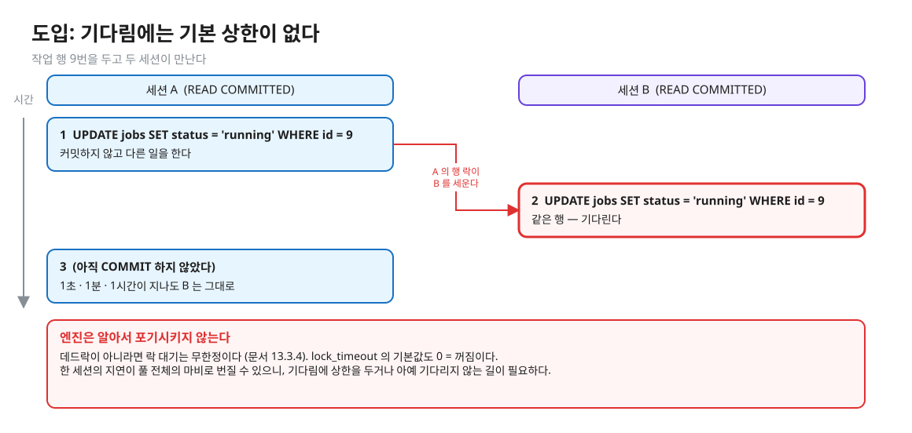
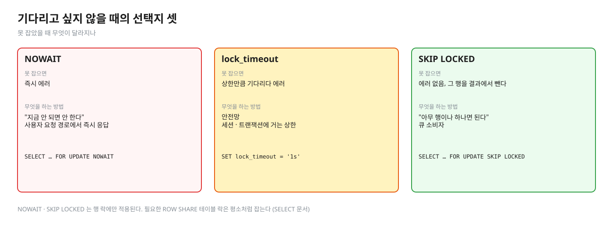
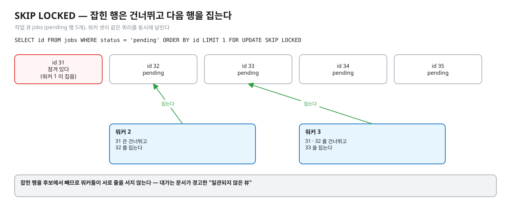
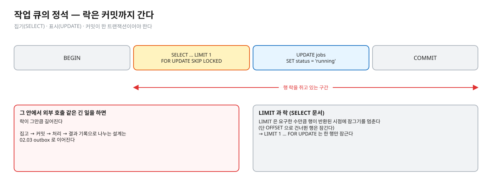
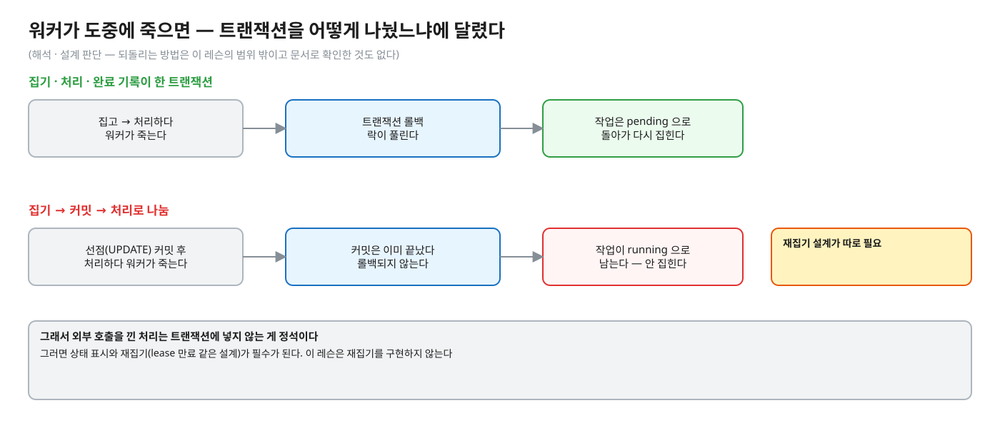
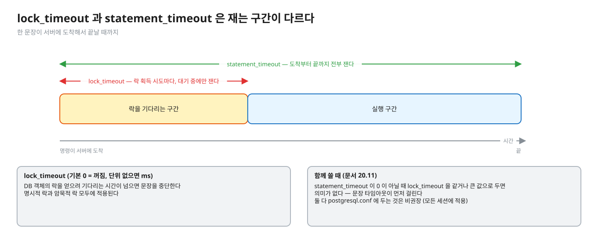
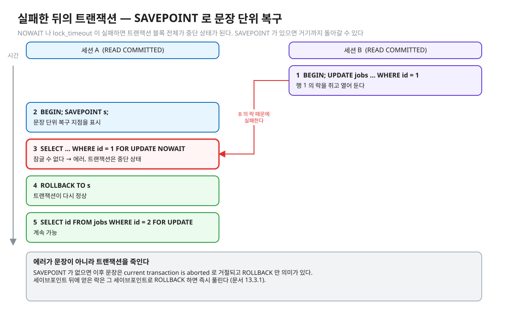

# 03. 줄 서지 않기 — NOWAIT · lock_timeout · SKIP LOCKED

> **이 글에서 알게 되는 것**
> 1. 락 대기의 기본값이 "끝날 때까지 **무한정**" 이라는 것, 그리고 기다림을 다루는 길이 셋(NOWAIT · `lock_timeout` · SKIP LOCKED)이라는 것을 안다.
> 2. 작업 큐를 `FOR UPDATE SKIP LOCKED` 로 짜는 모양과 그 대가(일관되지 않은 뷰), `lock_timeout` 과 `statement_timeout` 의 차이를 설명할 수 있다.
> 3. 락 실패가 문장이 아니라 **트랜잭션을 중단 상태**로 만든다는 것, SAVEPOINT 로 문장 단위 복구를 하는 법을 안다.
>
> **먼저 알면 좋은 것**: [02. 줄 서기의 실제 모양](02-waiting-and-observing.md) — 락 대기가 `pg_stat_activity` 에서 어떻게 보이나.
> **다음 글**: [04. 외래키와 락 모드](04-foreign-keys-and-lock-modes.md)
> **구분**: 필수 — ② 원리 (① 에서 예측을 먼저 한 뒤 읽는다)

## 도입: 기다림에는 기본 상한이 없다

작업 행 9번을 세션 A 가 UPDATE 하고 커밋하지 않은 채 다른 일을 하고 있다. 이때 세션 B 가 같은 행을 UPDATE 하면 B 는 기다린다. 1초가 지나도, 1분이 지나도, 1시간이 지나도 그대로다.


<sub>편집: [diagrams/blog03-intro.excalidraw](diagrams/blog03-intro.excalidraw)</sub>

데드락이 아니라면 락 대기는 **무한정**이다 ([문서 13.3.4](https://www.postgresql.org/docs/16/explicit-locking.html)). `lock_timeout` 의 기본값도 0, 즉 꺼짐이다. 락 대기에 상한이 없으면 한 세션의 지연이 풀 전체의 마비로 번진다([02 글](02-waiting-and-observing.md)). 반대로 상한만 걸고 **실패 후 처리**를 안 하면 25P02 가 쏟아진다. 이 글은 그 두 가지, 기다림을 끊는 법과 끊긴 뒤의 처리를 다룬다. DB 로 작업 큐를 만들 때(여러 소비자가 같은 행을 두고 경쟁)가 대표적인 장면이다 (해석).

## 기다리는 것이 싫을 때 선택지는 셋이다


<sub>편집: [diagrams/blog03-three-ways.excalidraw](diagrams/blog03-three-ways.excalidraw)</sub>

| 방법 | 못 잡으면 | 무엇을 하는 방법 |
|---|---|---|
| `NOWAIT` | 즉시 에러 | "지금 안 되면 안 한다" — 사용자 요청 경로에서 즉시 응답 |
| `lock_timeout` | 상한만큼 기다리다 에러 | 안전망 — 세션 · 트랜잭션에 거는 상한 |
| `SKIP LOCKED` | 에러 없음, 그 행을 결과에서 뺀다 | "아무 행이나 하나면 된다" — 큐 소비자 |

앞의 둘은 "기다림의 길이" 를 다루고, 셋째는 "기다릴 대상 자체를 피한다" 는 점이 다르다. 순서대로 보자.

### SKIP LOCKED 와 작업 큐

[SELECT 문서 · The Locking Clause](https://www.postgresql.org/docs/16/sql-select.html) 의 문장이다.

> "`SKIP LOCKED` 를 쓰면 즉시 잠글 수 없는 행은 건너뛴다. 잠긴 행을 건너뛰는 것은 데이터의 **일관되지 않은 뷰**를 주므로 범용 작업에는 맞지 않지만, 큐 같은 테이블에 여러 소비자가 접근할 때 락 경합을 피하는 데 쓸 수 있다."


<sub>편집: [diagrams/blog03-skip-locked.excalidraw](diagrams/blog03-skip-locked.excalidraw)</sub>

SKIP LOCKED 의 대가는 문서가 정확히 적었다. "전체에 대한 일관된 답" 이 필요한 쿼리(합계 · 개수)에 쓰면 안 된다. 큐처럼 "아무 하나" 면 충분한 곳에서만 쓴다. NOWAIT · SKIP LOCKED 는 **행 락에만** 적용되고 필요한 ROW SHARE 테이블 락은 평소처럼 잡는다 (같은 문서).

작업 큐의 정석 모양은 이렇다.

```sql
BEGIN;
SELECT id FROM jobs WHERE status = 'pending' ORDER BY id LIMIT 1 FOR UPDATE SKIP LOCKED;
UPDATE jobs SET status = 'running', claimed_by = :worker WHERE id = :id;
COMMIT;
```


<sub>편집: [diagrams/blog03-queue-shape.excalidraw](diagrams/blog03-queue-shape.excalidraw)</sub>

이 쿼리에는 알아 둘 점이 넷 있다.

- **`LIMIT` 과 락**: 문서에 따르면 `LIMIT` 을 쓰면 요구한 수만큼 행이 반환된 시점에 잠그기를 멈춘다(단 `OFFSET` 으로 건너뛴 행은 잠긴다). 그래서 `LIMIT 1 … FOR UPDATE` 는 한 행만 잠근다.
- **`ORDER BY` 와 락 (READ COMMITTED 주의)**: 문서 경고 — `ORDER BY` 가 먼저 적용되고 그 뒤에 락을 잡으려 막힌다. 풀렸을 때 정렬 열 값이 바뀌어 있으면 행이 정렬 순서에서 어긋난 채 돌아올 수 있다. REPEATABLE READ · SERIALIZABLE 에서는 대신 40001 이다. 이 레슨의 `claimNext` 는 `ORDER BY id` 라 id 가 안 바뀌므로 해당이 없다.
- **락은 커밋까지 간다.** 집기(SELECT) · 표시(UPDATE) · 커밋이 한 트랜잭션이어야 한다. 그 안에서 외부 호출 같은 긴 일을 하면 락이 그만큼 길어진다. 집고 → 커밋 → 처리 → 결과 기록으로 나누는 설계는 02.03 outbox 로 이어진다.
- **워커가 죽으면?** 선점(위 UPDATE)을 따로 커밋했다면 집은 작업이 `running` 으로 남는다. 집기 · 처리 · 완료 기록을 **한 트랜잭션**에 넣었다면 워커가 죽을 때 롤백되어 락이 풀리고 작업은 `pending` 으로 돌아가 다시 집힌다 (아래 그림 · 스스로 확인 3번 · 해석). 되돌리는 방법(lease · 하트비트 · 재집기)은 이 레슨의 범위 밖이며 문서로 확인한 것도 없다 (설계 이슈, 해석).


<sub>편집: [diagrams/blog03-worker-dies.excalidraw](diagrams/blog03-worker-dies.excalidraw)</sub>

SKIP LOCKED 는 줄을 없애 준다. 하지만 "이 행이어야만 한다" 인 경우에는 다른 행으로 피할 수 없으니 기다려야 하고, 그럴 때는 기다림의 상한이 필요하다. 그 도구가 `lock_timeout` 이다.

### lock_timeout 과 statement_timeout

[문서 20.11](https://www.postgresql.org/docs/16/runtime-config-client.html) 은 두 설정을 이렇게 정의한다.

- `lock_timeout`: "테이블 · 인덱스 · 행 등 DB 객체의 락을 얻으려 **기다리는** 시간이 이를 넘으면 문장을 중단한다. 시간 제한은 락 획득 시도마다 따로 적용된다. 명시적 락(`LOCK TABLE`, NOWAIT 없는 `SELECT FOR UPDATE`)과 암묵적 락 모두에 적용된다." 기본 0(꺼짐), 단위 없이 쓰면 ms.
- `statement_timeout`: 명령이 서버에 도착해서 끝날 때까지 시간. 기본 0.


<sub>편집: [diagrams/blog03-timeouts.excalidraw](diagrams/blog03-timeouts.excalidraw)</sub>

문서에 따르면 `lock_timeout` 은 `statement_timeout` 과 달리 **락 대기 중에만** 발동한다. `statement_timeout` 이 0 이 아닐 때 `lock_timeout` 을 같거나 큰 값으로 두는 것은 무의미하다(문장 타임아웃이 먼저 걸리므로). 둘 다 `postgresql.conf` 에 두는 것은 비권장이다(모든 세션에 적용).

`NOWAIT` · `lock_timeout` · `statement_timeout` 이 각각 어떤 에러 코드로 끝나는지는 문항 Q03 · Q04 로 예측하고, 아래 "이 레슨에서 직접 보기"의 실측 칸에서 확인한다. 코드 이름은 [부록 A](https://www.postgresql.org/docs/16/errcodes-appendix.html) 에 있다.

기다림을 끊는 데 성공했다고 끝이 아니다. 끊긴 뒤의 트랜잭션이 어떤 상태인지가 다음 문제다.

### 실패한 뒤의 트랜잭션

PostgreSQL 에서는 에러가 문장이 아니라 **트랜잭션**을 죽인다. 트랜잭션 블록 안에서 NOWAIT · `lock_timeout` 이 실패하면 이후 문장은 `current transaction is aborted, commands ignored until end of transaction block` 로 거절되고 `ROLLBACK` 만 의미가 있다 (실측: 01.01 docs 01 · 이 레슨 Q03 — 이때의 SQLSTATE 는 Q03 으로 예측하고 실측 칸에서 확인한다). 문장 단위로 복구하려면 **SAVEPOINT** 를 앱이 명시한다.

```sql
BEGIN;
SAVEPOINT s;
SELECT * FROM jobs WHERE id = 1 FOR UPDATE NOWAIT;   -- 실패
ROLLBACK TO s;                                        -- 트랜잭션은 다시 정상
SELECT id FROM jobs WHERE id = 2 FOR UPDATE;          -- 계속 가능
COMMIT;
```


<sub>편집: [diagrams/blog03-savepoint.excalidraw](diagrams/blog03-savepoint.excalidraw)</sub>

이 흐름이 실제로 동작하는 것은 실측 칸에서 확인했다. 문서 13.3.1: 세이브포인트 뒤에 얻은 락은 그 세이브포인트로 ROLLBACK 하면 즉시 풀린다.

## PostgreSQL 에서는

위 내용이 곧 엔진 동작이다. 한 줄로 이어 두면 이렇다.

1. 락 요청이 충돌 → 기본은 대기. 대기 중 `deadlock_timeout` 이 지나면 데드락 검사([05 글](05-deadlock.md)).
2. `NOWAIT` → 대기 대신 즉시 에러. `lock_timeout` → 대기 상한 후 에러. `SKIP LOCKED` → 행 단위로 잠글 수 없는 행을 후보에서 뺀다.
3. 실패는 트랜잭션을 abort 상태로 둔다 (이후 문장은 거절).

### 자주 하는 오해

1. **"락을 기다리다 시간이 지나면 엔진이 알아서 포기한다."** 데드락이 아니면 **무한정** 기다린다 (문서 13.3.4). `lock_timeout` 은 기본 0(꺼짐)이다.
2. **"`lock_timeout` 에 걸리면 그 문장만 실패하고 계속 쓸 수 있다."** 트랜잭션 블록 안에서는 트랜잭션이 aborted 가 된다. SAVEPOINT 를 두었을 때만 문장 단위 복구다.
3. **"`statement_timeout` 이 있으니 `lock_timeout` 은 필요 없다."** `statement_timeout` 은 긴 쿼리도 자르고(락 때문이 아니어도), 코드도 `57014` 로 다르다. 락 대기만 자르고 싶으면 `lock_timeout`. 단 `lock_timeout ≥ statement_timeout` 이면 의미가 없다.
4. **"SKIP LOCKED 를 쓰면 안전하게 개수를 센다."** 문서가 이 쿼리는 일관되지 않은 뷰라고 경고한다. 큐 소비자 용도만이다.
5. **"`FOR UPDATE` 만 붙이면 작업 큐 완성이다."** 중복 문제는 풀리지만 처리량 문제가 남는다. 이미 잡힌 행을 만난 워커는 건너뛰지 않고 기다리기 때문이다. SKIP LOCKED 는 그 기다림을 건너뛰기로 바꾼다 (이 장면은 Q06 으로 직접 확인한다).

### 앱 · 프레임워크에서는

- 락 실패 · 중단 상태는 JDBC 에서 `SQLException.getSQLState()` 로 읽는다. 메시지 문구가 아니라 **SQLSTATE** 를 검사하라는 것이 문서 부록 A 의 권고다(01.01 docs 01).
- Hibernate 의 NOWAIT · SKIP LOCKED 힌트가 어떤 SQL 이 되는지는 [06 글](06-app-and-mysql.md).

## MySQL InnoDB 는 어떻게 다른가 (심화)

- MySQL 8.0 도 `SELECT … FOR UPDATE / FOR SHARE` 에 `NOWAIT` · `SKIP LOCKED` 를 둔다 ([17.7.2.4 Locking Reads](https://dev.mysql.com/doc/refman/8.0/en/innodb-locking-reads.html)). 의미는 같다 — NOWAIT 는 즉시 에러(문서 예: `ERROR 3572 (HY000): Do not wait for lock.`), SKIP LOCKED 는 잠긴 행을 결과에서 뺀다. 이 둘은 MySQL 8.0.1 에서 추가됐다 ([8.0.1 릴리스 노트](https://dev.mysql.com/doc/relnotes/mysql/8.0/en/news-8-0-1.html): "InnoDB now supports NOWAIT and SKIP LOCKED options with SELECT ... FOR SHARE and SELECT ... FOR UPDATE"). 문서도 같은 경고를 한다: 일관되지 않은 뷰라 일반 트랜잭션 작업에는 맞지 않고, 큐 같은 테이블에 적합하다. 둘 다 row 락에만 적용된다.
- 락 대기 상한은 `innodb_lock_wait_timeout`(기본 50초). [06 글](06-app-and-mysql.md).

## 한눈에 정리

| | 못 잡으면 | 트랜잭션은 | 기본값 |
|---|---|---|---|
| (아무것도 안 함) | 무한정 기다린다 (데드락이면 예외) | 정상 | — |
| `NOWAIT` | 즉시 에러 | 중단 상태 | 쓸 때만 |
| `lock_timeout` | 상한 뒤 에러 | 중단 상태 | 0 (꺼짐) |
| `SKIP LOCKED` | 그 행을 뺀다 | 정상 | 쓸 때만 |

- 기본은 무한정 기다림이다. 상한이 필요하면 `lock_timeout`, 아예 기다리기 싫으면 NOWAIT, 줄 대신 다음 행이면 SKIP LOCKED.
- SKIP LOCKED 는 큐 소비자에만 맞다. "일관된 전체" 가 필요한 쿼리에는 쓰지 않는다.
- 실패는 트랜잭션을 죽인다. 문장 단위 복구는 SAVEPOINT 로 앱이 명시한다.
- 코드를 보고 처리한다. 메시지 문구가 아니다.

## 스스로 확인

1. 작업 큐에서 `FOR UPDATE` 만 쓰는 것과 `FOR UPDATE SKIP LOCKED` 의 차이는? 둘 다 중복은 막는데.
   <details><summary>답</summary>
   `FOR UPDATE` 는 두 번째 워커가 첫 워커의 커밋을 기다린다(행 락 줄 서기). 깨어난 뒤 행이 조건에서 탈락하면 다음 행을 이어서 가져오므로 결과는 맞다(Q06). 그러나 워커 수만큼 한 줄로 서서 처리량이 직렬화된다. `SKIP LOCKED` 는 잡힌 행을 후보에서 빼 서로 다른 행을 동시에 집게 한다. 대가는 문서가 경고한 "일관되지 않은 뷰"다.
   </details>
2. NOWAIT 와 `lock_timeout = 0` 은 같은가?
   <details><summary>답</summary>
   아니다. `lock_timeout = 0` 은 "타임아웃 꺼짐" = 무한 대기다 (문서: 0 이 기본이며 비활성). NOWAIT 는 대기 자체를 안 하고 즉시 실패한다. (Hibernate 에서 `jakarta.persistence.lock.timeout = 0` 이 NOWAIT 인 것과는 별개의 규약이다 — 06 글.)
   </details>
3. SKIP LOCKED 로 큐를 만들었는데 워커가 일하다 죽었다. 작업은?
   <details><summary>답</summary>
   트랜잭션이 하나인 구현(집고 처리하고 커밋)이면 워커가 죽을 때 트랜잭션이 롤백되어 락이 풀리고 작업은 다시 pending 이 되어 집힌다. 반면 "집기 → 커밋 → 처리" 로 나눈 구현이면 `running` 으로 남아 영영 안 집힌다 — lease 만료 같은 재집기 설계가 별도로 필요하다(해석 · 설계 판단 — 이 레슨은 재집기를 구현하지 않는다). 그래서 외부 호출을 낀 처리는 트랜잭션에 넣지 않는 게 정석이고, 그러면 상태 표시와 재집기가 필수가 된다.
   </details>
4. 락 대기 타임아웃을 거는 데 `SET` 과 `SET LOCAL` 중 무엇을 쓰나? 커넥션 풀에서는?
   <details><summary>답</summary>
   `SET`(= `SET SESSION`)은 세션이 끝날 때까지(트랜잭션 안에서 했다가 롤백되면 사라짐), `SET LOCAL` 은 **현재 트랜잭션이 끝날 때까지**만 유효하다 ([SET](https://www.postgresql.org/docs/16/sql-set.html)). 풀은 커넥션(=세션)을 재사용하므로 `SET` 은 다음 요청에 값이 새어 나갈 수 있다 (해석 — 풀 동작은 확인하지 않았다). 그래서 특정 트랜잭션에만 거는 타임아웃은 트랜잭션 안에서 `SET LOCAL` 이 맞다. 문서는 `postgresql.conf` 전역 설정을 비권장한다.
   </details>

## 이 레슨에서 직접 보기

| 어디서 | 무엇을 |
|---|---|
| Q03 | NOWAIT 의 결과와 다음 문장 |
| Q04 | `lock_timeout` 의 결과 (Q03 과 비교) |
| Q05 | SKIP LOCKED 가 집는 행 |
| Q06 | SKIP LOCKED 없이 `LIMIT 1 FOR UPDATE` 를 하면 |
| 구현 1 · `JobQueueImplementTest` | 워커 4 × 작업 40 에서 중복 0 · 누락 0 · 방법 검사(SKIP LOCKED 를 썼나) |
| 장면 2 (observe/SCRIPT.md) | NOWAIT 메시지 원문 · lock_timeout · SKIP LOCKED |

<details><summary>실측 — 예측을 끝낸 뒤 펼친다 (Q03 · Q04 · Q05 · Q06)</summary>

([정답 patch](../../../solutions/01.02.patch))

| Q | 결과 |
|---|---|
| Q03 | NOWAIT = `에러 55P03`, 같은 트랜잭션의 다음 `SELECT 1` = `에러 25P02` |
| Q04 | `lock_timeout` 건 UPDATE = `에러 55P03` (NOWAIT 와 같은 코드) |
| Q05 | A 가 1번을 잡은 상태에서 B 의 `… ORDER BY id LIMIT 1 FOR UPDATE SKIP LOCKED` = 2번 |
| Q06 | SKIP LOCKED 없이 `LIMIT 1 FOR UPDATE` 면 B 는 기다린다 (`true`), A 가 1번을 `running` 으로 바꿔 커밋하면 B 가 받은 id = 2 (1번은 조건 탈락) |

직접 돌려 본 것 (psql 2026-10-13, 다른 세션이 행을 잡은 상태에서 같은 행 UPDATE):

- NOWAIT: 바로 돌아옴(약 1ms), `ERROR: could not obtain lock on row in relation "jobs"`, SQLSTATE `55P03`.
- `lock_timeout = 1s`: 약 1.00 초 뒤 `canceling statement due to lock timeout`, SQLSTATE `55P03`.
- `statement_timeout = 1s`(lock_timeout 0): 약 1.00 초 뒤 `canceling statement due to statement timeout`, SQLSTATE `57014`(`query_canceled`). **같은 락 대기에서 두 타임아웃의 코드가 다르다.** 앱은 `55P03` 으로 "락 때문에 못 했다" 를 구분할 수 있고, `57014` 는 락 대기가 아닐 수도 있다.
- 같은 트랜잭션의 다음 문장: `current transaction is aborted, commands ignored until end of transaction block` (`25P02`).
- SAVEPOINT 흐름: `ROLLBACK TO s` 뒤 다음 SELECT 성공.

Q06 의 뜻: `FOR UPDATE` 만 붙여도 **결과는 맞다**(중복 0). 그러나 워커들이 한 줄로 선다 — 그래서 구현 1 에 결과 검사 말고 "방법 검사" 가 따로 있다.

</details>

## 출처

- [PostgreSQL 16 · SELECT · The Locking Clause](https://www.postgresql.org/docs/16/sql-select.html) — NOWAIT · SKIP LOCKED · LIMIT · ORDER BY 경고
- [20.11 Client Connection Defaults](https://www.postgresql.org/docs/16/runtime-config-client.html) — `lock_timeout` · `statement_timeout`
- [13.3 Explicit Locking](https://www.postgresql.org/docs/16/explicit-locking.html) — 세이브포인트와 락 · 무한 대기 문장
- [SET](https://www.postgresql.org/docs/16/sql-set.html) — SET 과 SET LOCAL 의 범위
- [Appendix A](https://www.postgresql.org/docs/16/errcodes-appendix.html) — 55P03 · 57014 · 25P02
- [MySQL 8.0 · 17.7.2.4 Locking Reads](https://dev.mysql.com/doc/refman/8.0/en/innodb-locking-reads.html) — NOWAIT · SKIP LOCKED
