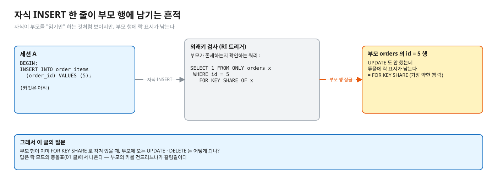
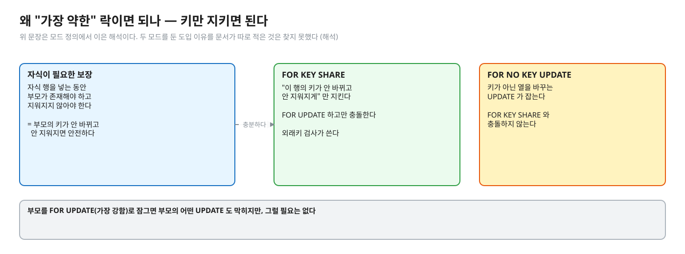
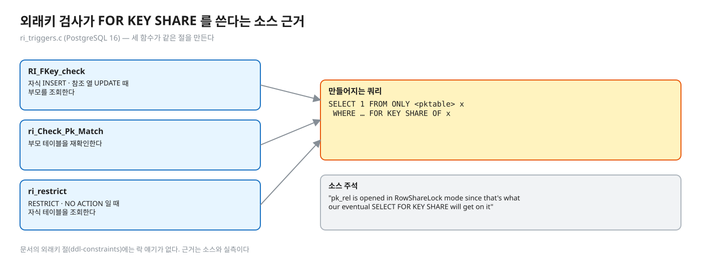
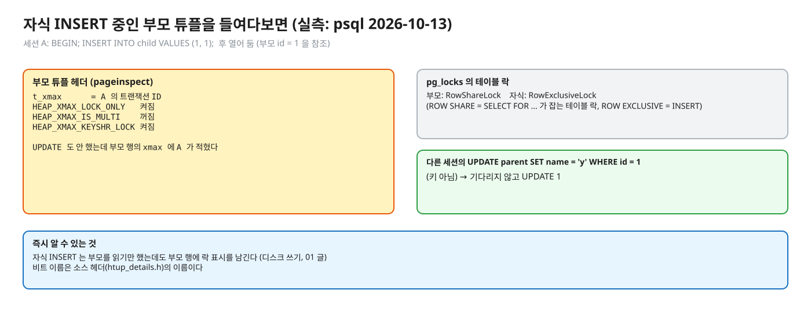
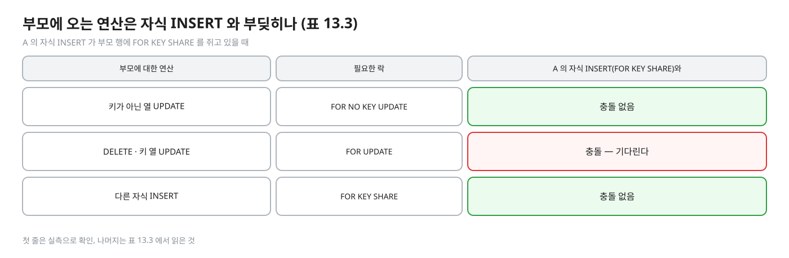
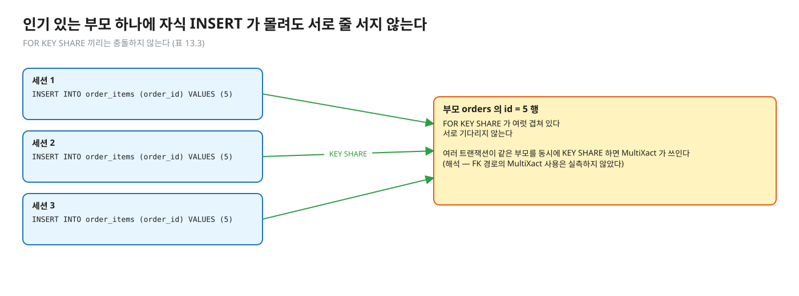
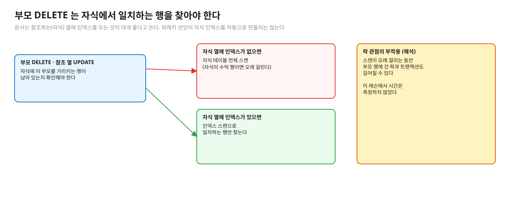

# 04. 외래키와 락 모드 — 자식 INSERT 가 부모 행에 거는 락

> **이 글에서 알게 되는 것**
> 1. 외래키 검사가 부모 행에 **가장 약한 행 락(`FOR KEY SHARE`)** 을 건다는 것, 그리고 그 근거(소스 · 실측)를 안다.
> 2. 부모에 오는 연산(키가 아닌 열 UPDATE · DELETE · 키 UPDATE · 다른 자식 INSERT)이 `FOR KEY SHARE` 와 부딪히는지를 표 13.3 으로 설명할 수 있다.
> 3. 자식 쪽 외래키 열에 인덱스가 필요한 이유와, 외래키 선언이 그 인덱스를 자동으로 만들지 않는다는 것을 안다.
>
> **먼저 알면 좋은 것**: [01. 락의 층](01-lock-modes-and-storage.md) — 행 락 4모드와 충돌표 (표 13.3).
> **다음 글**: [05. 데드락](05-deadlock.md)
> **구분**: 심화 — 꼬리질문 대비 (레슨을 마친 뒤 · 면접 전)

## 도입: 부모를 읽기만 했는데

주문(부모) 상태를 바꾸는 쪽과 주문 항목(자식)을 넣는 쪽이 같은 부모 행에서 부딪히는 장면을 생각해 보자. 자식 INSERT 는 SQL 로 보면 부모 테이블을 건드리지 않는다. 그런데 외래키가 있으면 엔진이 "그 부모가 존재하는지" 를 확인하고, 이 확인이 부모 행에 락을 남긴다.

편집: [diagrams/blog04-intro.excalidraw](diagrams/blog04-intro.excalidraw)

이 락이 어떤 모드이고 무엇과 부딪히는지에 따라, 부모 UPDATE 와 자식 INSERT 가 서로 줄을 서기도 하고 아니기도 하다. 모드를 나눠 두지 않았다면 부모 UPDATE 와 자식 INSERT 가 서로 줄을 섰을 것이다. 이 글은 그 모드가 왜 그렇게 정해졌는지와, 부모 · 자식 양쪽에서 무슨 일이 생기는지 본다.

## 외래키는 부모 행에 가장 약한 락을 건다

외래키가 있으면 자식에 행을 넣을 때 "그 부모가 존재하고, 내가 넣는 동안 지워지지 않아야" 한다. 그 보장을 부모 행에 대한 **행 락**으로 한다. 부모를 `FOR UPDATE`(가장 강함)로 잠그면 부모의 어떤 UPDATE 도 막히지만 그럴 필요는 없다. 부모의 **키**만 안 바뀌고 안 지워지면 자식은 안전하다. 그래서 두 모드가 있다.

편집: [diagrams/blog04-why-two-modes.excalidraw](diagrams/blog04-why-two-modes.excalidraw)

- `FOR KEY SHARE`: "이 행의 키가 안 바뀌고 안 지워지게" 만 지킨다. `FOR UPDATE` 하고만 충돌한다.
- `FOR NO KEY UPDATE`: 키가 아닌 열을 바꾸는 UPDATE 가 잡는다. `FOR KEY SHARE` 와 충돌하지 않는다.

([문서 13.3.2](https://www.postgresql.org/docs/16/explicit-locking.html), [01 글](01-lock-modes-and-storage.md) 의 표.) 이 두 모드를 둔 **도입 이유**는 문서가 따로 적은 것을 찾지 못했다. 위 설명은 모드 정의에서 이은 해석이다.

반면 외래키 검사가 `FOR KEY SHARE` 를 쓴다는 것은 **소스**와 **실측**으로 확인했다. 소스는 [ri_triggers.c](https://github.com/postgres/postgres/blob/REL_16_STABLE/src/backend/utils/adt/ri_triggers.c) 다. `RI_FKey_check`(자식 INSERT · 참조 열 UPDATE 때 부모 조회)가 `SELECT 1 FROM ONLY <pktable> x WHERE … FOR KEY SHARE OF x` 를 만들고, `ri_Check_Pk_Match`(부모 테이블 재확인)와 `ri_restrict`(RESTRICT · NO ACTION 일 때 자식 테이블 조회)도 같은 절을 쓴다. 주석에도 이렇게 있다: "pk_rel is opened in RowShareLock mode since that's what our eventual SELECT FOR KEY SHARE will get on it". 문서의 외래키 절([ddl-constraints](https://www.postgresql.org/docs/16/ddl-constraints.html))에는 락 얘기가 없다.

편집: [diagrams/blog04-ri-source.excalidraw](diagrams/blog04-ri-source.excalidraw)

소스만 읽으면 "그럴 것 같다" 에서 끝난다. 실제 튜플에 무엇이 적히는지는 직접 봤다. 이 관찰은 예측 문항(Q08)과 겹쳐서 접어 둔다.

## PostgreSQL 에서는

### 실측 — 자식 INSERT 한 뒤 부모 튜플

실측 — Q08 을 예측한 뒤 펼친다 (psql 2026-10-13)

세션 A 가 `BEGIN; INSERT INTO child VALUES (1, 1);` (부모 id=1 을 참조) 후 열어 둔 상태에서:

- 부모 튜플 헤더(`pageinspect`): `t_xmax` = A 의 트랜잭션 ID, `LOCK_ONLY` 켜짐, `IS_MULTI` 꺼짐, `KEYSHR_LOCK` 켜짐 — **UPDATE 도 안 했는데 부모 행의 xmax 에 A 가 적혔다.** 비트 이름은 소스 헤더의 이름이다 ([htup_details.h](https://github.com/postgres/postgres/blob/REL_16_STABLE/src/include/access/htup_details.h)).
- `pg_locks` 의 테이블 락: 부모에 `RowShareLock`, 자식에 `RowExclusiveLock` ([01 글](01-lock-modes-and-storage.md): ROW SHARE = SELECT FOR … 가 잡는 테이블 락, ROW EXCLUSIVE = INSERT).
- 다른 세션이 `UPDATE parent SET name = 'y' WHERE id = 1` (키 아님) → 기다리지 않고 `UPDATE 1`.

편집: [diagrams/blog04-tuple-flags.excalidraw](diagrams/blog04-tuple-flags.excalidraw)

즉 자식 INSERT 는 부모를 **읽기만** 했는데도 부모 행에 락 표시를 남긴다(디스크 쓰기, [01 글](01-lock-modes-and-storage.md)).

### 부모에서 오는 쪽

자식 INSERT 가 부모 행에 `FOR KEY SHARE` 를 쥐고 있을 때, 부모에 오는 연산은 이렇게 된다.

| 부모에 대한 연산 | 필요한 락 |
|---|---|
| 키가 아닌 열 UPDATE | `FOR NO KEY UPDATE` |
| `DELETE` · 키 열 UPDATE | `FOR UPDATE` |
| 다른 자식 INSERT | `FOR KEY SHARE` |

이 락들이 A 의 `FOR KEY SHARE` 와 부딪히는지는 [01 글](01-lock-modes-and-storage.md) 의 표 13.3 으로 직접 읽을 수 있다. 연산마다 부딪힘 여부를 적은 그림은 Q08 의 예측 값과 그대로 겹치므로, 예측을 끝낸 뒤에 펼치도록 접어 둔다.

그림 — 부모에 오는 연산과 자식 INSERT 의 충돌 (Q08 을 예측한 뒤 펼친다)

편집: [diagrams/blog04-parent-side.excalidraw](diagrams/blog04-parent-side.excalidraw)

자식 INSERT 끼리도 막지 않는다. 인기 있는 부모 하나에 자식 INSERT 가 몰려도 서로 줄을 서지 않는다 (표 13.3: KEY SHARE 끼리 충돌 없음). 다만 여러 트랜잭션이 같은 부모를 동시에 `KEY SHARE` 하면 [01 글](01-lock-modes-and-storage.md) 의 MultiXact 가 쓰인다 (해석 — 이 레슨은 FK 경로의 MultiXact 사용을 따로 실측하지 않았다. 01 글의 실측은 `SELECT FOR KEY SHARE` / `FOR SHARE` 직접 호출이었다).

편집: [diagrams/blog04-many-children.excalidraw](diagrams/blog04-many-children.excalidraw)

지금까지는 "부모에 락이 남는다" 는 이야기였다. 반대 방향, 부모를 지우거나 키를 바꿀 때 자식 쪽에서 벌어지는 일이 남았다.

### 자식 쪽 인덱스

부모의 `DELETE` · 참조 열 `UPDATE` 는 자식 테이블에서 일치하는 행을 찾는 스캔이 필요하므로, 문서는 **참조하는(자식) 열에 인덱스를 두는 것이 대개 좋다**고 쓴다. 외래키 선언이 자식 쪽 인덱스를 자동으로 만들지는 않는다 ([ddl-constraints](https://www.postgresql.org/docs/16/ddl-constraints.html)). 락 관점의 부작용(자식이 크고 인덱스가 없을 때 부모 DELETE 가 오래 걸려 락을 길게 쥠)은 이 레슨에서 측정하지 않았다 (해석).

편집: [diagrams/blog04-child-index.excalidraw](diagrams/blog04-child-index.excalidraw)

### 자주 하는 오해

1. **"자식 INSERT 는 부모를 읽을 뿐이니 부모에 아무 영향이 없다."** 부모 행에 `FOR KEY SHARE` 락 표시를 남긴다(실측). 읽기 전용 쿼리처럼 보여도 부모 행에 락이 남아, 충돌하는 모드를 요구하는 연산과는 표 13.3 대로 부딪힌다.
2. **"부모를 UPDATE 하면 자식 INSERT 가 항상 막힌다."** UPDATE 는 키 열을 바꾸는지에 따라 잡는 모드가 갈리고, 막히는지는 그 모드가 `FOR KEY SHARE` 와 충돌하느냐에 달렸다 (표 13.3 · Q08 에서 직접 본다).
3. **"외래키를 선언하면 자식 열에 인덱스가 생긴다."** 안 생긴다 (문서).
4. **"자식 INSERT 가 몰리면 서로 대기한다."** `FOR KEY SHARE` 끼리는 충돌하지 않는다 (표 13.3).

### 앱 · 프레임워크에서는

- JPA 의 `@ManyToOne` 자식 저장은 SQL 로는 자식 INSERT 한 줄이다. 부모 락은 DB(외래키 제약)가 알아서 건다 — 앱이 `@Lock` 을 쓰지 않아도 생기는 락이다. 이 점이 "부모 상태를 바꾸는 배치가 자식 INSERT 를 막을까?" 의 답이 된다(키가 안 바뀌면 안 막는다).

## MySQL InnoDB 는 어떻게 다른가

- InnoDB 는 외래키 제약 검사에서 **관련된 레코드에 공유 락**을 건다는 점을 문서에서 확인하지 못했다. 확인한 것: READ COMMITTED 에서 갭 락이 꺼지지만 "외래키 제약 검사와 중복 키 검사에는 쓰인다" ([17.7.1](https://dev.mysql.com/doc/refman/8.0/en/innodb-locking.html)). `NO KEY UPDATE` 같은 모드 구분은 찾지 못했다.

## 한눈에 정리

Q08 을 예측한 뒤에 읽는 요약이다.

| 방향 | 무슨 일이 생기나 |
|---|---|
| 자식 INSERT → 부모 | 부모 행에 `FOR KEY SHARE` (RowShareLock 테이블 락 + 튜플 xmax 표시) |
| 부모의 키 아닌 열 UPDATE | `FOR NO KEY UPDATE` — `FOR KEY SHARE` 와 충돌하지 않는다 |
| 부모 DELETE · 키 UPDATE | `FOR UPDATE` — 자식 INSERT 가 끝날 때까지 기다린다 |
| 부모 DELETE · 참조 열 UPDATE → 자식 | 자식에서 일치하는 행 스캔 — 인덱스가 없으면 전체 스캔 |

- 외래키 검사는 부모 행에 가장 약한 행 락(`FOR KEY SHARE`)을 건다. 소스 · 실측으로 확인했다.
- 약해서 부모의 키가 아닌 열 UPDATE 와 다른 자식 INSERT 는 막지 않는다. 막는 것은 부모 DELETE · 키 UPDATE 뿐이다.
- 외래키 선언은 자식 열 인덱스를 만들지 않는다. 직접 둔다.
- 앱이 `@Lock` 을 쓰지 않아도 이 락은 DB 가 알아서 건다.

## 스스로 확인

1. 자식 테이블에 INSERT 가 한창인데 부모 행의 `status` 열을 UPDATE 한다. 막히나? 부모를 DELETE 하면?
   

답

   `status` UPDATE 는 `FOR NO KEY UPDATE` 로 자식 INSERT 가 건 `FOR KEY SHARE` 와 충돌하지 않아 안 막힌다. DELETE 는 `FOR UPDATE` 가 필요해 충돌하므로 자식 INSERT 트랜잭션이 끝날 때까지 기다린다 (문서 13.3.2 · 표 13.3, 실측: Q08).
   

2. `FOR KEY SHARE` 와 `FOR SHARE` 는 무엇이 다른가?
   

답

   `FOR SHARE` 는 `FOR NO KEY UPDATE`(키 아닌 열 UPDATE)까지 막고, `FOR KEY SHARE` 는 `FOR UPDATE`(DELETE · 키 UPDATE)만 막는다. 외래키 검사에는 후자로 충분하다 (표 13.3).
   

3. 자식이 수억 행인데 외래키 열에 인덱스가 없다. 부모 DELETE 가 느리고 락이 길다. 왜?
   

답

   부모의 DELETE · 참조 열 UPDATE 는 자식에서 일치하는 행을 스캔해야 하고, 인덱스가 없으면 전체 스캔이다 (문서 ddl-constraints 의 "자식 열에 인덱스를 두는 것이 좋다"). 스캔이 오래 걸리는 동안 부모 행에 건 락과 트랜잭션도 길어진다 (해석 — 이 레슨에서 시간은 측정하지 않았다).
   

## 이 레슨에서 직접 보기

| 어디서 | 무엇을 |
|---|---|
| Q08 | 자식 INSERT 중인 부모의 키 아닌 열 UPDATE · 이미 끝난 뒤 DELETE |
| 장면 3 (observe/SCRIPT.md) | psql 두 개로 같은 것 + C 에서 `pg_locks` |

실측 — 예측을 끝낸 뒤 펼친다 (Q08)

([정답 patch](../../../solutions/01.02.patch))

| Q | 결과 |
|---|---|
| Q08 | A 가 자식을 INSERT 하고 열어 둔 채 B 가 `UPDATE parent SET name …` → 기다리지 않는다 (`false`) |
| Q08 | B 가 커밋한 뒤 C 의 `DELETE FROM parent WHERE id = 1`(남은 것은 A 의 미커밋 자식 INSERT 뿐) → 기다린다 (`true`) |

## 출처

- [PostgreSQL 16 · 13.3 Explicit Locking](https://www.postgresql.org/docs/16/explicit-locking.html) — 행 락 모드 · 표 13.3
- [5.4 Constraints · Foreign Keys](https://www.postgresql.org/docs/16/ddl-constraints.html) — 자식 열 인덱스 권고 · ON DELETE
- [ri_triggers.c](https://github.com/postgres/postgres/blob/REL_16_STABLE/src/backend/utils/adt/ri_triggers.c) — 외래키 검사 쿼리의 `FOR KEY SHARE OF x`
- [htup_details.h](https://github.com/postgres/postgres/blob/REL_16_STABLE/src/include/access/htup_details.h) — 튜플 헤더 비트 이름
- [MySQL 8.0 · 17.7.1 InnoDB Locking](https://dev.mysql.com/doc/refman/8.0/en/innodb-locking.html) — READ COMMITTED 의 갭 락과 외래키
