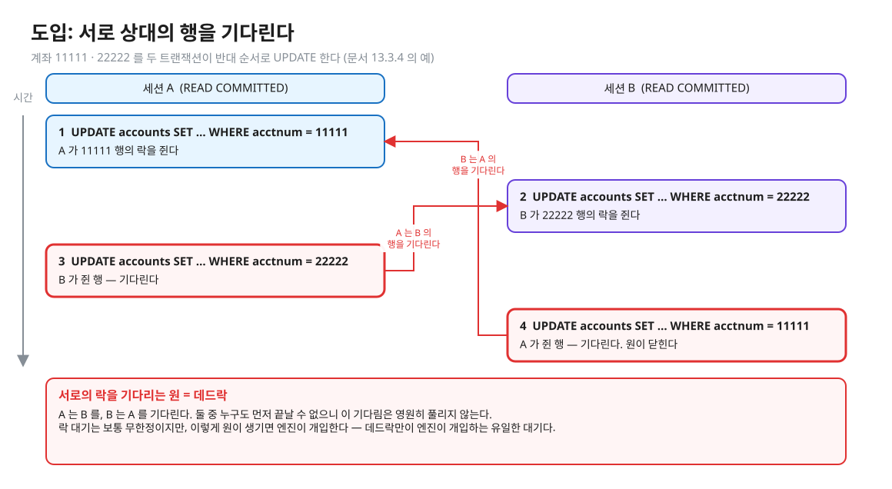
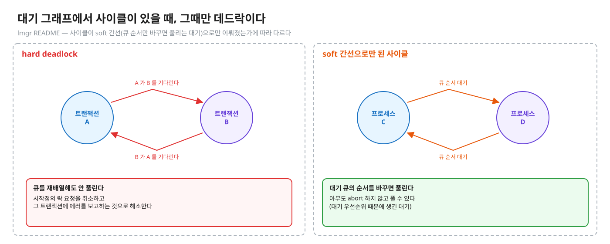
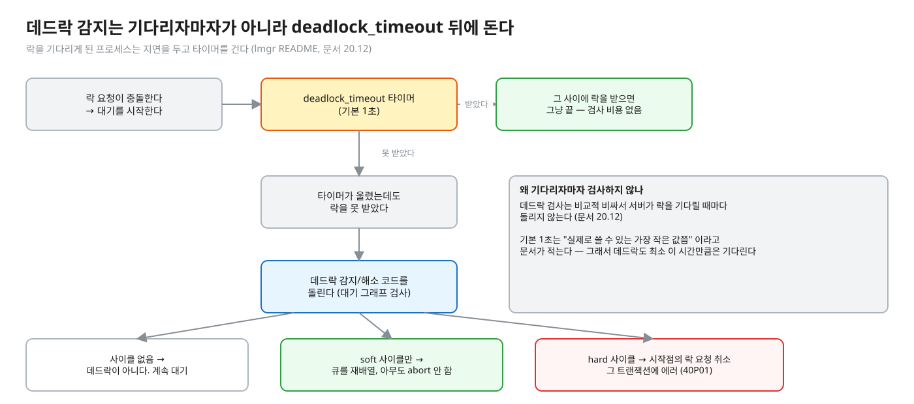
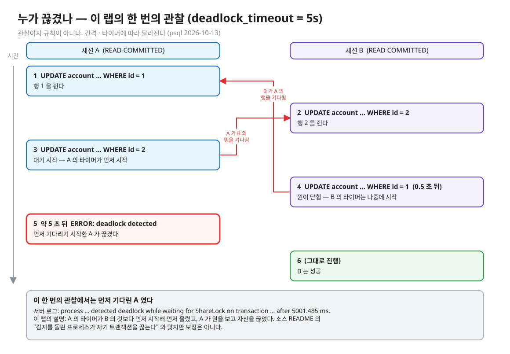
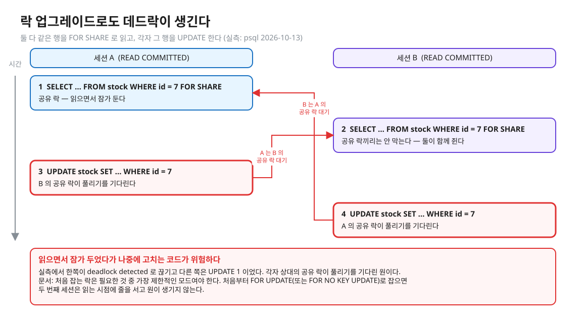
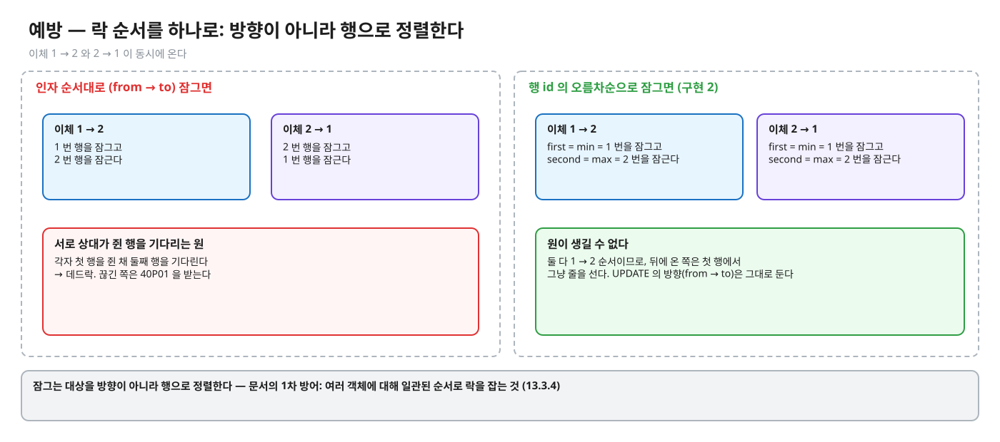
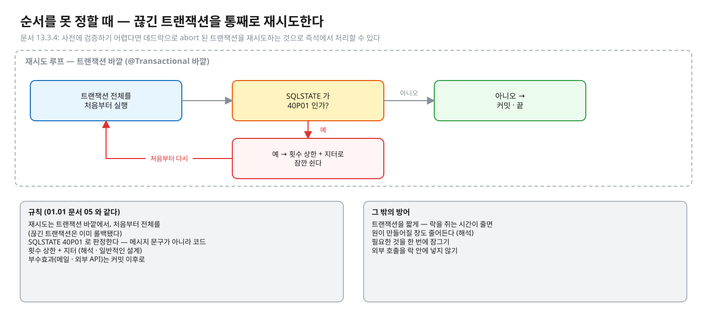

# 05. 데드락 — 감지 · 40P01 · 예방 vs 재시도

> **이 글에서 알게 되는 것**
> 1. 데드락이 "서로의 락을 기다리는 **원**" 이라는 것, 엔진이 `deadlock_timeout` 뒤에 대기 그래프에서 원을 찾아 한쪽을 `40P01` 로 끊는다는 것을 안다.
> 2. 누가 끊기는지는 공식 문서가 "예측하기 어렵고 의존하면 안 된다" 고 말한다는 것, 그래서 앱은 이를 가정하지 않는다는 것을 안다.
> 3. 데드락을 락 **순서를 하나로** 정해 예방하는 법(1차)과, 끊긴 트랜잭션을 통째로 재시도하는 법(2차)을 설명할 수 있다.
>
> **먼저 알면 좋은 것**: [02. 줄 서기의 실제 모양](02-waiting-and-observing.md) · [03. 줄 서지 않기](03-not-waiting.md) — 데드락이 아니면 락 대기는 무한정이다.
> **다음 글**: [06. 앱 · 프레임워크 · MySQL](06-app-and-mysql.md)
> **구분**: 필수 — ② 원리 (① 에서 예측을 먼저 한 뒤 읽는다)

## 도입: 서로 상대의 행을 기다린다

계좌 이체나 재고 차감처럼 **두 행 이상**을 잠그는 코드를 생각해 보자. 호출 인자 순서대로 잠그면, 반대 방향의 요청 둘이 만났을 때 이런 일이 생긴다. 아래는 문서 13.3.4 의 예와 같은 모양이다. 트랜잭션 1 은 행 11111 을 UPDATE 한 뒤 22222 를, 트랜잭션 2 는 22222 를 UPDATE 한 뒤 11111 을 UPDATE 한다.


<sub>편집: [diagrams/blog05-intro.excalidraw](diagrams/blog05-intro.excalidraw)</sub>

A 는 B 를 기다리고 B 는 A 를 기다린다. 어느 쪽도 먼저 끝날 수 없다. 데드락이 아니라면 락 대기는 **무한정**이지만([02](02-waiting-and-observing.md) · [03](03-not-waiting.md) 글), 이렇게 원이 생기면 엔진이 개입한다. 데드락만이 "엔진이 개입하는" 유일한 대기다. 에러가 호출자에게 새면 사용자는 500 을 본다.

## 데드락이란

"트랜잭션 둘 이상이 각자 락을 쥐고 서로가 쥔 락을 기다린다." ([문서 13.3.4](https://www.postgresql.org/docs/16/explicit-locking.html)) 테이블 락뿐 아니라 **행 락**에서도, 명시적 락을 안 써도 생긴다. 위 장면이 바로 명시적 락 없이 UPDATE 만으로 생긴 데드락이다.

## 감지 — 대기 그래프의 원

엔진은 이 원을 어떻게 찾을까. [lmgr README](https://github.com/postgres/postgres/blob/REL_16_STABLE/src/backend/storage/lmgr/README) 의 설명은 이렇다.

- 락을 기다리게 된 프로세스는 `deadlock_timeout` 의 지연을 두고 타이머를 건다. "지연이 끝났는데도 락을 못 받았으면 데드락 감지/해소 코드를 돌린다."
- 대기 그래프(wait-for graph, WFG)가 **사이클을 가질 때, 그리고 그때만** 데드락이다.
- 사이클이 "soft" 간선(큐 순서만 바꾸면 풀리는 대기 우선순위 대기)으로만 구성되면 **대기 큐의 순서를 바꿔** 아무도 abort 하지 않고 풀 수도 있다. 큐를 재배열해도 안 풀리면 hard deadlock 이다.
- hard deadlock 은 "시작점의 락 요청을 취소하고 그 트랜잭션에 에러를 보고하는 것으로" 해소한다. 즉 **감지를 돌린 프로세스(= 타이머가 먼저 울린 쪽)가 자기 트랜잭션을 끊는 것이 보통이다**(README 문장의 요지 — "usually").


<sub>편집: [diagrams/blog05-wait-graph.excalidraw](diagrams/blog05-wait-graph.excalidraw)</sub>

그러면 감지는 언제 도는가. 기다리자마자가 아니다. [문서 20.12](https://www.postgresql.org/docs/16/runtime-config-locks.html) 는 "데드락 검사는 비교적 비싸서 서버가 락을 기다릴 때마다 돌리지 않는다" 고 쓴다. `deadlock_timeout` 기본 1초이고 "실제로 쓸 수 있는 가장 작은 값쯤" 이라고 문서가 적는다.


<sub>편집: [diagrams/blog05-detect-flow.excalidraw](diagrams/blog05-detect-flow.excalidraw)</sub>

### 누가 끊기나 — 공식 문장

원이 닫혔을 때 둘 중 누가 끊기는지가 궁금해진다. 문서의 답은 이것이다.

> "(Exactly which transaction will be aborted is difficult to predict and should not be relied upon.)" — [문서 13.3.4](https://www.postgresql.org/docs/16/explicit-locking.html)

그래서 이 레슨의 Q10 은 "누가 끊기나" 가 아니라 **끊긴 에러의 SQLState 만** 예측한다. "누가 끊겼나" 는 예측이 아니라 **관찰 항목**이다. 장면 4 에서 직접 보고, 이 랩의 실측은 아래 접힌 칸에 있다("이런 타이밍에서 이렇게 나왔다" 이지 규칙이 아니다).

## PostgreSQL 에서는

### 반대 순서 UPDATE — 원이 닫히면

SQLSTATE `40P01` = `deadlock_detected` (부록 A). 같은 class 40 의 `40001` 과 함께 "재시도하면 성공할 수 있는 실패" 군이다.

<details><summary>실측 — 관찰(장면 4)을 끝낸 뒤 펼친다 (psql 2026-10-13, `deadlock_timeout = 5s` · 누가 끊겼나 포함)</summary>

A 가 행 1 을 UPDATE → B 가 행 2 를 UPDATE → A 가 행 2 를 UPDATE(대기 시작) → 0.5 초 뒤 B 가 행 1 을 UPDATE(원이 닫힘).



<sub>편집: [diagrams/blog05-who-cut.excalidraw](diagrams/blog05-who-cut.excalidraw)</sub>

- 중간(양쪽 대기 중) `pg_stat_activity`: 둘 다 `wait_event = transactionid`, `blocked_by` 가 **서로의 pid** — 원이 눈에 보인다 ([02 글](02-waiting-and-observing.md)).
- 약 5 초 뒤 **먼저 기다리기 시작한 A** 가 끊겼다. 서버 로그: `process … detected deadlock while waiting for ShareLock on transaction … after 5001.485 ms`. B 는 그대로 진행해 성공.
- 에러 원문 (A 에게):

```
ERROR:  deadlock detected
DETAIL:  Process 282 waits for ShareLock on transaction 778; blocked by process 281.
Process 281 waits for ShareLock on transaction 777; blocked by process 282.
HINT:  See server log for query details.
CONTEXT:  while updating tuple (0,6) in relation "account"
```

서버 로그에는 같은 DETAIL 에 **각 프로세스가 실행 중이던 쿼리**도 붙는다(클라이언트에게는 "See server log for query details" 로 안내만 한다). 즉 원인 분석은 서버 로그가 필요하다.

- 이 랩의 설명: A 의 타이머가 B 의 것보다 **먼저 시작**했으므로 먼저 울려 A 가 원을 보고 자신을 끊었다. 반대로 A 가 기다리자마자 B 가 곧바로 원을 닫으면 (간격이 짧으면) 이 랩에서는 A 가 끊기고, 간격이 `deadlock_timeout` 보다 길면 B 가 끊겼다 (NOTES 해설 — 테스트 Q10 은 `deadlock_timeout = 200ms` 에서 이 둘을 모두 본다). 이 설명은 README 의 "감지를 돌린 프로세스가 자기 트랜잭션을 끊는다" 와 맞지만 **보장은 아니다.**

</details>

### 데드락은 반대 순서 UPDATE 만이 아니다 — 락 업그레이드

문서: "한 트랜잭션에서 한 객체에 대해 **처음 잡는 락은 필요한 것 중 가장 제한적인 모드**여야 한다" (13.3.4). 실측 (psql 2026-10-13): 두 세션이 같은 행을 `SELECT … FOR SHARE` 로 읽고(공유 락끼리의 관계는 [01 글](01-lock-modes-and-storage.md) 의 충돌표대로) 각자 그 행을 `UPDATE` 하자 **한쪽이 `deadlock detected`** 로 끊기고 다른 쪽은 `UPDATE 1`. 각자 상대의 공유 락이 풀리기를 기다린 원이다. "읽으면서 잠가 두었다가 나중에 고친다" 는 코드가 위험한 이유다 — 처음부터 `FOR UPDATE`(또는 `FOR NO KEY UPDATE`)로 잡으면 두 번째 세션은 그 시점에서 **줄을 서고** 원이 생기지 않는다.


<sub>편집: [diagrams/blog05-upgrade.excalidraw](diagrams/blog05-upgrade.excalidraw)</sub>

원이 생기는 길을 알았으니 이제 막는 법이다. 데드락 대응은 두 겹이다. 1차는 원이 아예 생기지 않게 하는 예방, 2차는 생겨도 끊긴 쪽을 다시 돌리는 재시도다.

### 예방 — 락 순서를 하나로

문서의 1차 방어: "여러 객체에 대해 **일관된 순서**로 락을 잡는 것" (13.3.4). 이 레슨의 `TransferService.transfer` 가 그 구현이다.


<sub>편집: [diagrams/blog05-lock-order.excalidraw](diagrams/blog05-lock-order.excalidraw)</sub>

- 잠그는 대상을 **방향(from → to)이 아니라 행**으로 정렬한다 — `first = min(from, to)`, `second = max(from, to)` ([정답 patch](../../../solutions/01.02.patch)). 1→2 이체도 2→1 이체도 1번 → 2번 순서이므로 원이 생길 수 없고, 뒤에 온 쪽은 그냥 줄을 선다.
- `TransferImplementTest` 의 **방법 검사**("엔진이 감지한 데드락 0회")가 이것을 확인한다 — 40P01 을 잡아 재시도하는 구현은 결과(잔고 합 보존)는 맞아도 이 검사에서 빨갛다. 예방은 감지될 일 자체가 없는 것이다.
- 여러 행을 한 문장으로 잠글 때 순서: `SELECT … WHERE id IN (…) ORDER BY id FOR UPDATE` 는 이 레슨 NOTES 가 쓰는 형태이지만, **락을 정렬 순서대로 얻는다는 보장 문장은 문서에서 못 찾았다.** [SELECT 레퍼런스 Caution](https://www.postgresql.org/docs/16/sql-select.html)은 READ COMMITTED 에서 `ORDER BY` 와 락 절을 같이 쓰면 "`ORDER BY` 가 먼저 적용되고" 락을 기다린 뒤 행이 정렬에서 어긋나 보일 수 있다고만 쓴다(RR · SERIALIZABLE 은 `40001`). 확실히 하려면 id 를 앱에서 정렬해 한 건씩 같은 순서로 잠근다 (해석).

### 순서를 못 정할 때 — 재시도

문서: "사전에 검증하기 어렵다면 데드락으로 abort 된 트랜잭션을 **재시도**하는 것으로 즉석에서 처리할 수 있다" (13.3.4). 재시도의 규칙은 40001 과 같다 ([01.01 문서 05](../../l01-isolation-mvcc/docs/05-serializable-ssi-retry.md)).

- 재시도는 **트랜잭션 바깥**에서, **처음부터 전체**를 다시 (끊긴 트랜잭션은 이미 롤백됐다).
- SQLSTATE `40P01` 로 판정한다(메시지 문구가 아니라 코드).
- 횟수 상한 + 지터(해석 · 일반적인 설계). 부수효과(메일 · 외부 API)는 커밋 이후로.

그 밖의 방어: 트랜잭션을 **짧게** (락을 쥐는 시간이 줄면 원이 만들어질 창도 줄어든다 — 해석) · 필요한 것을 **한 번에** 잠그기 · 외부 호출을 락 안에 넣지 않기.


<sub>편집: [diagrams/blog05-retry.excalidraw](diagrams/blog05-retry.excalidraw)</sub>

### 데드락과 타임아웃의 관계

`lock_timeout` 은 데드락과 무관하게 동작한다. `lock_timeout` 이 `deadlock_timeout` 보다 **짧으면** 데드락 검사가 돌기 전에 `55P03` 으로 먼저 끊길 수 있다 (해석 — 두 설정의 정의에서 이은 판단; 이 레슨은 이 조합을 실측하지 않았다). 앱 입장에서는 `40P01` 과 `55P03` 이 서로 다른 의미(원 · 상한)이니 구분해 처리한다.

### 자주 하는 오해

1. **"데드락은 DB 가 알아서 풀어 주니 신경 쓸 필요 없다."** 끊긴 쪽은 에러를 받고 그 트랜잭션은 롤백된다. 호출자가 재시도하지 않으면 사용자 오류다.
2. **"늦게 온 쪽(원을 닫은 쪽)이 끊긴다."** 보장이 없다 (문서 13.3.4). 감지를 돌린 쪽(타이머가 먼저 울린 쪽)이 끊기는 것이 보통이라는 것이 소스 README 의 설명이다("usually").
3. **"데드락은 락을 거는 순서가 달라서만 생긴다."** 락 업그레이드(FOR SHARE → UPDATE)로도 생긴다 (실측).
4. **"데드락 감지는 락을 기다리는 즉시 돈다."** `deadlock_timeout`(기본 1초) 뒤에 돈다. 그 사이는 그냥 대기다 — 그래서 데드락도 최소 이 시간만큼은 기다린다.
5. **"재시도하면 순서를 정할 필요가 없다."** 재시도는 2차 방어다. 순서를 정하면 감지 비용(대기 · 롤백 · 재실행)이 아예 없다. 순서를 못 정할 때의 대안이다.
6. **"한 방향으로만 이체하면 데드락이 난다."** 순환이 없으면 안 난다 (`한_방향으로만_몰려도_합이_보존된다` 가드).

### 앱 · 프레임워크에서는

- 재시도 위치는 `@Transactional` **바깥**이다 ([01.01 문서 05](../../l01-isolation-mvcc/docs/05-serializable-ssi-retry.md)). 서비스 메서드 안에서 try/catch 하면 이미 중단된 같은 트랜잭션에서 계속하게 된다.
- `40P01` 은 `SQLException.getSQLState()` 로 판정한다. 프레임워크가 어떤 예외 타입으로 감싸는지는 이 레슨에서 확인하지 않았다.
- Spring 의 `@Retryable` 같은 도구 사용은 이 레슨의 범위 밖이다 (확인하지 않음).

## MySQL InnoDB 는 어떻게 다른가 (심화)

- InnoDB 도 데드락을 자동 감지해 트랜잭션을 롤백한다. 기본 감지 ON, 큰 차이: **희생자를 고르는 기준**이 문서에 있다 — "작은 트랜잭션(삽입 · 수정 · 삭제한 행 수)을 롤백하려 한다" ([17.7.5.2 Deadlock Detection](https://dev.mysql.com/doc/refman/8.0/en/innodb-deadlock-detection.html)). PostgreSQL 은 "예측 불가" 로 문서화한 것과 대비된다(이 레슨은 InnoDB 의 희생자 선택을 실측하지 않았다).
- 데드락은 전체 트랜잭션을 롤백한다 → 트랜잭션 전체를 재시도 ([InnoDB Error Handling](https://dev.mysql.com/doc/refman/8.0/en/innodb-error-handling.html)). 매뉴얼: "데드락은 위험하지 않다. 다시 시도하라" · "작고 짧은 트랜잭션" · "일관된 순서" ([17.7.5.3](https://dev.mysql.com/doc/refman/8.0/en/innodb-deadlocks-handling.html)).
- 모든 데드락 로그를 남기려면 `innodb_print_all_deadlocks`, 최근 하나는 `SHOW ENGINE INNODB STATUS` (17.7.5.3). `innodb_deadlock_detect` 를 끄는 옵션은 [06 글](06-app-and-mysql.md).

## 한눈에 정리

| | 무엇 | 근거 |
|---|---|---|
| 정의 | 서로 상대가 쥔 락을 기다리는 원 | 문서 13.3.4 |
| 감지 | `deadlock_timeout`(기본 1초) 뒤, 대기 그래프에 사이클이 있을 때 | lmgr README · 문서 20.12 |
| 해소 | soft 사이클이면 큐 재배열, hard 면 시작점의 락 요청 취소 → `40P01` | lmgr README · 부록 A |
| 누가 끊기나 | 예측하기 어렵고 의존하면 안 된다 | 문서 13.3.4 |
| 1차 방어 | 락 순서를 하나로 (방향이 아니라 행 기준) | 문서 13.3.4 |
| 2차 방어 | 트랜잭션 바깥에서 전체 재시도 (상한 + 지터 — 해석) | 문서 13.3.4 |

- 데드락은 원이다. 엔진이 `deadlock_timeout` 뒤에 원을 찾아 한쪽을 `40P01` 로 끊는다.
- 누가 끊기는지는 보장이 아니므로 앱은 가정하지 않는다. 누가 끊기든 `40P01` 이면 전체 재시도다.
- 반대 순서 UPDATE 뿐 아니라 락 업그레이드(FOR SHARE → UPDATE)로도 생긴다. 처음 잡는 락을 가장 제한적인 모드로 한다.
- 예방(순서 통일)이 1차, 재시도가 2차다.

## 스스로 확인

1. 이체에서 A→B 와 B→A 가 동시에 오면? 어떻게 예방하나?
   <details><summary>답</summary>
   각자 "출금 계좌 → 입금 계좌" 순서로 잠그면 서로 상대가 쥔 행을 기다려 데드락이다. 방향이 아니라 **행 id** 를 기준으로 작은 id 먼저 잠그면 두 요청 모두 같은 순서라 원이 생기지 않는다. 잠근 뒤 UPDATE 방향은 그대로 둔다 (이 레슨 구현 2). 근거: 문서 13.3.4 "일관된 순서".
   </details>
2. 데드락이 났을 때 PostgreSQL 은 누구를 끊나? 앱이 그걸 가정해도 되나?
   <details><summary>답</summary>
   문서가 "예측하기 어렵고 의존하면 안 된다"고 쓴다. 구현 설명(README)상 `deadlock_timeout` 뒤에 감지를 돌린 프로세스가 자기 트랜잭션에 에러를 내는 것이 보통이어서, 이 랩에서는 먼저 기다린 쪽의 타이머가 먼저 울려 그쪽이 끊겼다. 앱은 "누가 끊기든 `40P01` 이면 전체 재시도" 로 짠다.
   </details>
3. `deadlock_timeout` 을 0 에 가깝게 줄이면 데드락이 더 빨리 풀려 좋은가?
   <details><summary>답</summary>
   문서가 이유를 적었다 — 검사가 "비교적 비싸서" 기다릴 때마다 돌리지 않는다. 너무 줄이면 데드락이 아닌 평범한 대기(곧 풀릴 대기)에서도 검사 비용을 낸다. 기본 1초가 "실제로 쓸 만한 가장 작은 값쯤" 이라고 문서가 말한다. 늘리면 반대로 진짜 데드락이 오래 방치된다.
   </details>
4. 두 세션이 같은 행을 `FOR SHARE` 로 읽고 각자 UPDATE 하면?
   <details><summary>답</summary>
   데드락이다(실측: psql 2026-10-13, 한쪽 `deadlock detected`). 공유 락은 서로 안 막지만 UPDATE 는 상대의 공유 락이 풀리기를 기다리므로 서로 기다리는 원이 된다. 처음부터 `FOR UPDATE` 로 잡으면 두 번째 세션이 읽기 시점에 줄을 서서 원이 안 생긴다 (문서: 처음 잡는 락은 필요한 중 가장 제한적인 모드).
   </details>
5. 순서를 정할 수 없는 경우(어떤 행을 잠가야 할지 실행 중에야 안다)는?
   <details><summary>답</summary>
   `40P01` 재시도(트랜잭션 바깥, 전체, 상한 · 지터)로 받는다. 트랜잭션을 짧게 하고, 필요한 것을 한 번에 잠가 락 순서를 DB 문장 하나에 맡기고, 외부 호출을 락 안에 넣지 않는다 (문서 13.3.4: 재시도가 마지막 수단).
   </details>

## 이 레슨에서 직접 보기

| 어디서 | 무엇을 |
|---|---|
| Q10 | 반대 순서 UPDATE → 끊긴 에러의 SQLState (끊긴 쪽은 출력에서 관찰) |
| 구현 2 · `TransferImplementTest` | 40P01 0건 · 잔고 합 보존 · 감지된 데드락 0회 · 잔고 부족 거절 · 한 방향은 처음부터 초록 |
| 장면 4 (observe/SCRIPT.md) | C 에서 원 보기 · 에러 원문 · 7 초 뒤에 닫으면 |

<details><summary>실측 — 예측을 끝낸 뒤 펼친다 (Q10)</summary>

([정답 patch](../../../solutions/01.02.patch))

| Q | 결과 |
|---|---|
| Q10 | 엔진이 끊은 쪽의 SQLState = `40P01` |

누가 끊겼는지는 테스트 출력("엔진이 끊은 쪽")과 observe 장면 4 에서 직접 보고 NOTES 에 적는다. 위 실측(A 가 5 초 뒤 끊김)과 다를 수 있다 — 간격 · 타이머에 따라 달라진다는 것이 이 절의 요점이다.

</details>

## 출처

- [PostgreSQL 16 · 13.3.4 Deadlocks](https://www.postgresql.org/docs/16/explicit-locking.html) — 정의 · "difficult to predict" · 일관된 순서 · 가장 제한적인 모드 · 재시도 · 무한정 대기
- [20.12 Lock Management · deadlock_timeout](https://www.postgresql.org/docs/16/runtime-config-locks.html) — 기본 1초 · 검사가 비싸다
- [lmgr README · Deadlock Detection](https://github.com/postgres/postgres/blob/REL_16_STABLE/src/backend/storage/lmgr/README) — 대기 그래프 · soft/hard · 큐 재배열 · 시작점 요청 취소
- [Appendix A](https://www.postgresql.org/docs/16/errcodes-appendix.html) — 40P01
- [PostgreSQL 16 · SELECT 레퍼런스 (Locking Clause Caution)](https://www.postgresql.org/docs/16/sql-select.html) — ORDER BY 와 락 절
- [MySQL 8.0 · 17.7.5.2 Deadlock Detection](https://dev.mysql.com/doc/refman/8.0/en/innodb-deadlock-detection.html) · [17.7.5.3 How to Minimize and Handle Deadlocks](https://dev.mysql.com/doc/refman/8.0/en/innodb-deadlocks-handling.html) · [InnoDB Error Handling](https://dev.mysql.com/doc/refman/8.0/en/innodb-error-handling.html)
