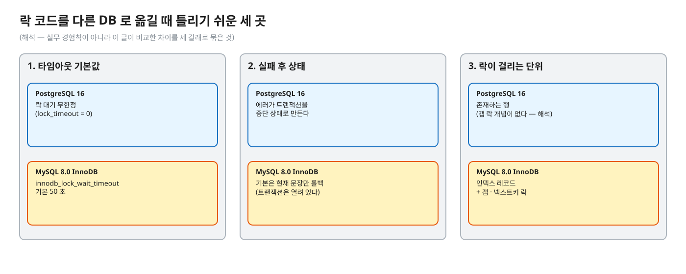
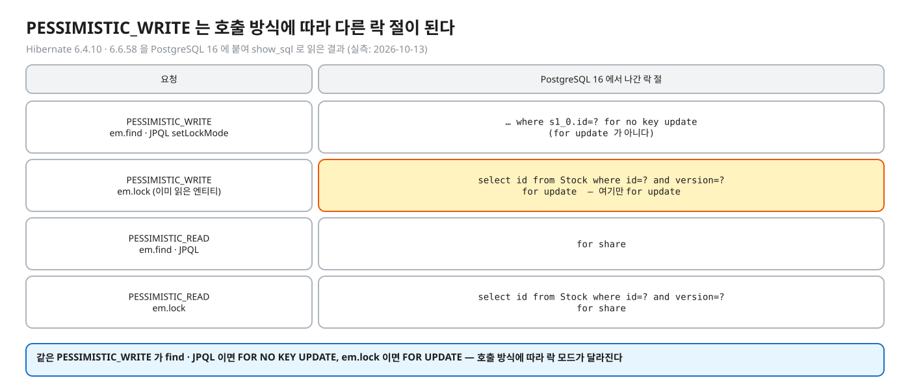
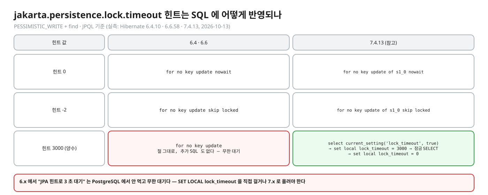
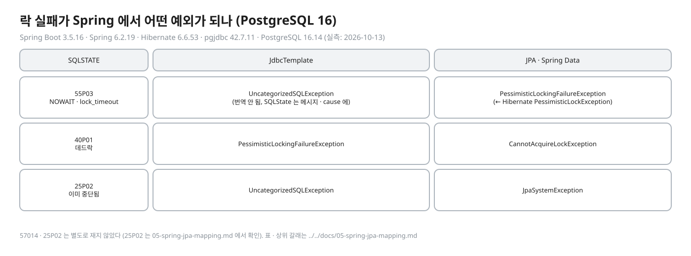
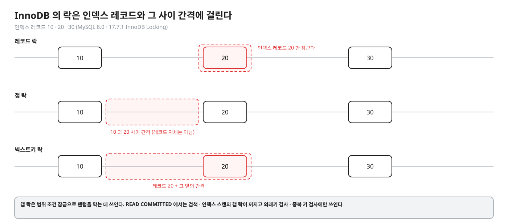
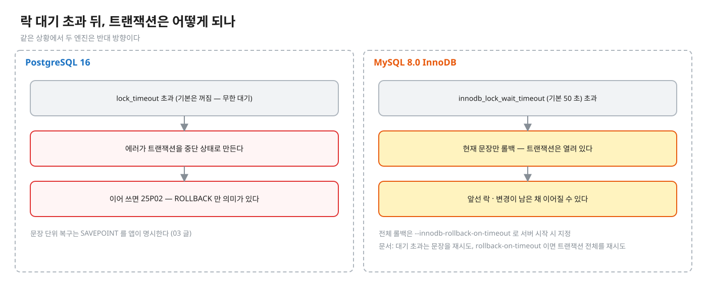
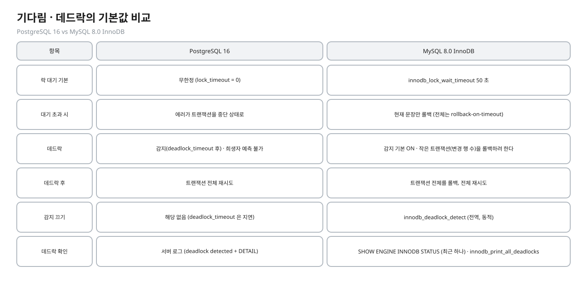
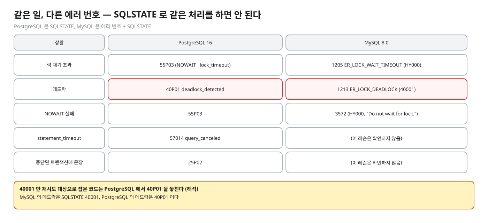

# 06. 앱 · 프레임워크 · MySQL — 같은 문제, 다른 도구

> **이 글에서 알게 되는 것**
> 1. JPA(Hibernate)의 `PESSIMISTIC_WRITE` 가 PostgreSQL 에서 어떤 SQL 이 되는지(`find` · JPQL 은 `FOR NO KEY UPDATE`, `em.lock` 은 `FOR UPDATE`), 타임아웃 힌트가 어디까지 번역되는지 안다.
> 2. 락 실패가 Spring 에서 어떤 예외로 올라오는지, 그리고 실패 뒤 같은 트랜잭션을 이어 쓰면 안 되는 이유를 안다.
> 3. MySQL InnoDB 가 인덱스 레코드에 락을 걸고(갭 · 넥스트키), 기다림 · 데드락의 기본 동작이 PostgreSQL 과 다르다는 것을 설명할 수 있다.
>
> **먼저 알면 좋은 것**: [01](01-lock-modes-and-storage.md) ~ [05](05-deadlock.md) 글 — 이 글은 그 내용을 앱과 다른 DB 로 옮긴다.
> **다음 글**: [07. 면접 사다리](07-interview-ladder.md)
> **구분**: 심화 — 꼬리질문 대비 (레슨을 마친 뒤 · 면접 전)

## 도입: 락 코드를 옮길 때 틀리기 쉬운 곳

팀이 JPA + MySQL 이거나 JPA + PostgreSQL 이거나, 락 코드를 다른 환경으로 옮길 일이 생긴다. 가장 자주 틀리는 곳이 타임아웃 기본값 · 실패 후 상태(트랜잭션 전체인가 문장인가) · 갭 락이다.

편집: [diagrams/blog06-intro.excalidraw](diagrams/blog06-intro.excalidraw)

이 글은 앞의 다섯 글을 두 방향으로 옮긴다. 먼저 앱(JPA · Spring)에서 같은 락이 어떤 SQL 과 예외가 되는지 보고, 다음으로 MySQL InnoDB 에서 같은 문제가 어떻게 달라지는지 본다. 비관적 락을 JPA 로 쓸 때 어떤 SQL 이 나가는지, 락 대기 시간 초과는 어떻게 처리하는지, MySQL 의 갭 락은 무엇인지가 핵심 질문이다.

## JPA(Hibernate) 에서

PostgreSQL 16 에 붙여 SQL 로그(`hibernate.show_sql`)를 직접 읽었다 (실측: Hibernate 6.4.10 · 6.6.58 · 참고로 7.4.13, 2026-10-13). 6.4 와 6.6 은 아래 표의 모든 칸이 같고, 7.x 는 다른 칸에 따로 적는다. 소스 해석이 아니라 실행 결과다.

편집: [diagrams/blog06-jpa-sql.excalidraw](diagrams/blog06-jpa-sql.excalidraw)

| 요청 | Hibernate 의 의미 (User Guide) | PostgreSQL 16 에서 나간 락 절 (6.4.10 · 6.6.58 로그) |
|---|---|---|
| `PESSIMISTIC_WRITE` — `em.find` · JPQL `setLockMode` | "명시적 락으로 엔티티를 잠근다" | `… where s1_0.id=? for no key update` (`for update` 가 아니다) |
| `PESSIMISTIC_WRITE` + 타임아웃 힌트 0 / -2 | 0 = 락을 못 잡으면 바로 실패, -2 = "이미 잠긴 행을 건너뛴다" | `for no key update nowait` / `for no key update skip locked` |
| `PESSIMISTIC_WRITE` + 타임아웃 힌트 3000 · 힌트 없음 | 힌트는 기다리는 밀리초 | `for no key update` — **절은 그대로이고 추가 SQL 도 없다**. 양수 타임아웃은 SQL 에 반영되지 않는다 |
| `PESSIMISTIC_READ` (`find` · JPQL) | "DB 가 지원하면 공유 락" | `for share` (힌트 0 이면 `for share nowait`) |
| `em.lock(entity, PESSIMISTIC_WRITE)` (이미 읽은 엔티티) | 읽은 뒤 잠금 | 별도 SELECT: `select id from Stock where id=? and version=? for update` (힌트 0 이면 `for update nowait`). **여기만 `for update`** 이고 `@Version` 이 있으면 `version=?` 조건이 붙는다 |
| `em.lock(entity, PESSIMISTIC_READ)` | 읽은 뒤 공유 잠금 | `select id from Stock where id=? and version=? for share` |
| 7.4.13 (참고) | | 같은 요청이 `for no key update of s1_0` · `for share of s1_0` · `… nowait` · `… skip locked` 로 나가고, `em.lock` 도 `for no key update of s1_0` 다. **양수 타임아웃은 SQL 로 나간다** — `select current_setting('lock_timeout', true)` → `set local lock_timeout = 3000` → 잠금 SELECT → `set local lock_timeout = 0` |

출처는 Hibernate 문서의 Locking 장(`Locking.adoc` — Pessimistic locking 절)이다. 위 의미와 "타임아웃 힌트는 락 획득 요청이 예외를 던지기 전에 **기다리는 밀리초**" · "모든 JDBC 드라이버가 락 타임아웃을 지원하지는 않으며, 지원 안 되면 dialect 가 힌트를 무시한다" 가 거기 있다. 이 중 6.4 · 6.6 에서 양수 값이 PostgreSQL 에 무시되는 것은 위 로그가 확인한다.

### 타임아웃 힌트는 어디까지 번역되나

편집: [diagrams/blog06-timeout-hint.excalidraw](diagrams/blog06-timeout-hint.excalidraw)

양의 타임아웃(예: 3000ms)은 6.4 · 6.6 에서 SQL 에 반영되지 않는다 (실측: Hibernate 6.4.10 · 6.6.58, 2026-10-13). "JPA 힌트로 3 초 대기" 는 PostgreSQL 에서 안 먹고 무한 대기다 — `SET LOCAL lock_timeout` 을 직접 걸거나 7.x 로 올려야 한다. 7.4.13 은 힌트를 `set local lock_timeout` 으로 번역한다 (참고: 이 레슨은 6.x 가 대상). 0 · -2 는 세 버전 모두 NOWAIT · SKIP LOCKED 다.

### 어떤 락 모드가 되는가

`find` · JPQL 의 `PESSIMISTIC_WRITE` 는 `FOR NO KEY UPDATE` 라서 [01 글](01-lock-modes-and-storage.md) 대로 키가 아닌 열 UPDATE 와 같은 강도다. 같은 행에 `FOR KEY SHARE` 를 쥔 자식 INSERT 와 충돌하지 않는다 ([04 글](04-foreign-keys-and-lock-modes.md); 충돌표 기반 해석 — 이 조합을 직접 돌리지는 않았다). 반면 `em.lock` 은 `FOR UPDATE` 라서 `FOR KEY SHARE` 와도 충돌한다. 같은 `PESSIMISTIC_WRITE` 가 호출 방식에 따라 다른 락 모드가 된다 (실측: Hibernate 6.4.10 · 6.6.58, 2026-10-13).

- 락은 **트랜잭션 안에서만** 의미가 있다 — `@Transactional` 없이 쓰면 조회 한 번에 락이 풀린다(해석, autocommit 의 일반 동작).
- 낙관적 락(`@Version`)은 행 락이 아니라 UPDATE 의 WHERE 조건이다 → 01.04.

### 에러 처리

락 실패는 JDBC 에서 `SQLException` 의 SQLSTATE 로 온다. `55P03`(NOWAIT · `lock_timeout`), `40P01`(데드락), `57014`(`statement_timeout`), `25P02`(이미 중단됨) — [03](03-not-waiting.md) · [05](05-deadlock.md) 글. Spring 에서 어떤 예외가 되는지는 실측했다 (Spring Boot 3.5.16 · Spring 6.2.19 · Hibernate 6.6.53 · pgjdbc 42.7.11 · PostgreSQL 16.14, 2026-10-13).

편집: [diagrams/blog06-spring-map.excalidraw](diagrams/blog06-spring-map.excalidraw)

글로 옮기면, `55P03` 은 **JdbcTemplate 에서 `UncategorizedSQLException`**(번역 안 됨, SQLState 는 메시지 · cause 에), **JPA · Spring Data 에서 `PessimisticLockingFailureException`**(← Hibernate `PessimisticLockException`; `@Lock` + 힌트 0 의 NOWAIT 도, `lock_timeout` 도 같다)이다. `40P01` 은 JDBC `PessimisticLockingFailureException` / JPA `CannotAcquireLockException` 이다. `57014` · `25P02` 는 이 문서에서 별도로 재지 않았다(`25P02` 는 JDBC `UncategorizedSQLException`, JPA `JpaSystemException` 으로 확인 — 아래 `05-spring-jpa-mapping.md`). 표 · 상위 갈래는 [05-spring-jpa-mapping.md](../../docs/05-spring-jpa-mapping.md).

실패하면 PostgreSQL 트랜잭션은 중단 상태다([03 글](03-not-waiting.md)). JPA 에서 예외를 잡고 같은 `EntityManager` 로 계속하는 코드는 이 상태에서 틀린다 — 트랜잭션을 롤백하고 새로 시작한다 (해석 — 일반 원칙).

## MySQL InnoDB 는 어떻게 다른가

근거는 모두 [MySQL 8.0 Reference Manual](https://dev.mysql.com/doc/refman/8.0/en/) 이다. 이 레슨은 MySQL 을 **직접 돌려 보지 않았다.** 아래는 전부 문서에서 읽은 것이다.

### 락의 종류와 단위

[17.7.1 InnoDB Locking](https://dev.mysql.com/doc/refman/8.0/en/innodb-locking.html):

| 종류 | 정의 (문서 요지) |
|---|---|
| 공유(S) / 배타(X) 락 | S 는 읽기 허용, X 는 갱신 · 삭제 허용 |
| 의도 락(IS · IX) | 테이블 수준. "이 테이블의 개별 행에 S/X 를 잡을 의도" 를 표시 |
| 레코드 락 | **인덱스 레코드**에 거는 락. `SELECT c1 FROM t WHERE c1 = 10 FOR UPDATE` 는 `c1 = 10` 행의 삽입 · 수정 · 삭제를 막는다 |
| 갭 락 | 인덱스 레코드 **사이의** 간격(첫 레코드 앞 · 마지막 뒤 포함)에 거는 락 |
| 넥스트키 락 | 인덱스 레코드의 레코드 락 + 그 앞 간격의 갭 락 |
| 삽입 의도 락 | INSERT 가 넣기 전에 거는 갭 락의 일종. 같은 간격의 다른 위치에 넣는 트랜잭션끼리는 기다리지 않는다 |

편집: [diagrams/blog06-innodb-locks.excalidraw](diagrams/blog06-innodb-locks.excalidraw)

- "레코드 락은 인덱스가 하나도 없는 테이블이라도 **항상 인덱스 레코드**를 잠근다. 그런 경우 InnoDB 는 숨은 클러스터 인덱스를 만들어 그것으로 잠근다." (문서) 즉 인덱스를 못 타는 조건의 `FOR UPDATE` · UPDATE 는 훑은 레코드를 폭넓게 잠글 수 있다 (문서가 "모든 행" 이라고 직접 쓰지는 않는다 — 해석).
- 갭 락의 쓰임: 범위 조건 잠금으로 **팬텀을 막는다** (01.01 문서 01 의 MySQL 절). READ COMMITTED 로 바꾸면 "검색과 인덱스 스캔에서 갭 락이 꺼지고, **외래키 제약 검사와 중복 키 검사에만** 쓰인다" (17.7.1). PostgreSQL 에는 갭 락 개념이 없다 — 행 락은 존재하는 행에만 걸린다 (해석 — 문서 13.3 의 행 락 정의에서).
- 갭 락끼리는 충돌하지 않는다는 점, 어떤 문장이 정확히 어떤 락을 거는지는 [17.7.3 Locks Set by Different SQL Statements](https://dev.mysql.com/doc/refman/8.0/en/innodb-locks-set.html) 에 있다 (이 레슨은 읽지 않았다).

### 기다림 · 데드락의 기본값

편집: [diagrams/blog06-wait-timeout.excalidraw](diagrams/blog06-wait-timeout.excalidraw)

편집: [diagrams/blog06-compare.excalidraw](diagrams/blog06-compare.excalidraw)

| 항목 | PostgreSQL 16 | MySQL 8.0 InnoDB |
|---|---|---|
| 락 대기 기본 | 무한정 (`lock_timeout = 0`) | `innodb_lock_wait_timeout` **50 초** ([17.14 InnoDB Startup Options and System Variables](https://dev.mysql.com/doc/refman/8.0/en/innodb-parameters.html)) |
| 대기 초과 시 롤백 범위 | 에러가 트랜잭션을 중단 상태로 | **현재 문장만** 롤백 (트랜잭션 유지). 전체 롤백은 `--innodb-rollback-on-timeout` 으로 서버 시작 시 지정 |
| 데드락 | 감지(`deadlock_timeout` 후) · 희생자 예측 불가 | 감지 기본 ON · "작은 트랜잭션(변경 행 수)을 롤백하려 한다" |
| 데드락 후 | 트랜잭션 전체 재시도 | **트랜잭션 전체를 롤백**, 전체 재시도 ([InnoDB Error Handling](https://dev.mysql.com/doc/refman/8.0/en/innodb-error-handling.html)) |
| 감지 끄기 | 해당 없음(`deadlock_timeout` 은 지연) | `innodb_deadlock_detect` (전역, 동적). 문서: "동시성이 높은 시스템에서는 여러 스레드가 같은 락을 기다릴 때 데드락 감지가 **느려질 수 있다**. 감지를 끄고 `innodb_lock_wait_timeout` 으로 롤백하는 것이 더 효율적일 때도 있다" |
| 데드락 확인 | 서버 로그(`deadlock detected` + DETAIL) | `SHOW ENGINE INNODB STATUS` (최근 하나), `innodb_print_all_deadlocks` (전부 에러 로그) |

핵심 대비 하나: **대기 초과(lock wait timeout)** 후 InnoDB 는 트랜잭션을 열어 둔 채 문장만 롤백하므로, 앱이 "타임아웃 났으니 처음부터" 하지 않고 계속 진행하면 앞선 락 · 변경이 남은 채 이어진다. 문서도 "대기 초과는 문장을 재시도, `rollback-on-timeout` 이면 트랜잭션 전체를 재시도" 라고 구분해서 적는다. PostgreSQL 에서는 에러 뒤 같은 트랜잭션을 이어 쓸 수 없다(25P02)는 것과 반대 방향이다.

감지 불가 경우: InnoDB 는 `innodb_table_locks = 1`(기본) · `autocommit = 0` 일 때만 테이블 락을 인지하며, `LOCK TABLES` 나 다른 스토리지 엔진의 락이 낀 데드락은 감지하지 못한다 — 그럴 때는 `innodb_lock_wait_timeout` 으로 해소한다 ([17.7.5.2](https://dev.mysql.com/doc/refman/8.0/en/innodb-deadlock-detection.html)).

### 에러 번호

[Server Error Message Reference](https://dev.mysql.com/doc/mysql-errors/8.0/en/server-error-reference.html): 락 대기 초과 = **1205** `ER_LOCK_WAIT_TIMEOUT` (SQLSTATE `HY000`, "Lock wait timeout exceeded; try restarting transaction"), 데드락 = **1213** `ER_LOCK_DEADLOCK` (SQLSTATE `40001`, "Deadlock found when trying to get lock; try restarting transaction"). NOWAIT 실패는 3572(`HY000`, 17.7.2.4 의 예). PostgreSQL 은 데드락이 `40P01` 이라 SQLSTATE 로 같은 처리를 하면 안 된다(해석: 40001 만 재시도 대상으로 잡은 코드는 PostgreSQL 에서 40P01 을 놓친다).

편집: [diagrams/blog06-errors.excalidraw](diagrams/blog06-errors.excalidraw)

### 잠금 읽기 — NOWAIT · SKIP LOCKED · FOR SHARE

[17.7.2.4 Locking Reads](https://dev.mysql.com/doc/refman/8.0/en/innodb-locking-reads.html): `SELECT … FOR SHARE` 는 `LOCK IN SHARE MODE` 의 대체이고 둘은 동등하되 `FOR SHARE` 만 `OF 테이블` · `NOWAIT` · `SKIP LOCKED` 를 지원한다. NOWAIT 는 "락을 얻으려 기다리지 않고 즉시 에러"(문서 예: `ERROR 3572 (HY000): Do not wait for lock.`), SKIP LOCKED 는 "기다리지 않고 잠긴 행을 결과에서 뺀다". 문서의 경고도 PostgreSQL 과 같다 — 일관되지 않은 뷰라 일반 작업에는 부적합하고 큐 같은 테이블에서 쓴다. 둘 다 **행 락에만** 적용되며 문장 기반 복제에서는 unsafe 다. 두 옵션은 **MySQL 8.0.1** 에서 추가됐다 ([8.0.1 릴리스 노트](https://dev.mysql.com/doc/relnotes/mysql/8.0/en/news-8-0-1.html)).

## 자주 하는 오해

1. **"PESSIMISTIC_WRITE 는 `FOR UPDATE` 로 나간다."** `find` · JPQL 은 `for no key update` 다. `em.lock` 만 `for update` 다 (실측: Hibernate 6.4.10 · 6.6.58, 2026-10-13).
2. **"`jakarta.persistence.lock.timeout` 을 주면 PostgreSQL 이 그 시간만 기다린다."** 0 · -2 만 NOWAIT · SKIP LOCKED 로 번역된다. 양의 값은 6.4 · 6.6 에서 SQL 에 반영되지 않는다 (실측: Hibernate 6.4.10 · 6.6.58, 2026-10-13).
3. **"MySQL 도 락 대기는 무한정이다."** 기본 50 초 후 에러.
4. **"락 대기 타임아웃이 나면 MySQL 도 트랜잭션이 롤백된다."** 기본은 문장만.
5. **"갭 락은 PostgreSQL 에도 있다."** 없다. 팬텀은 스냅샷(RR)과 SSI(SERIALIZABLE)로 다룬다 (01.01).
6. **"InnoDB 도 인덱스 없이 `FOR UPDATE` 해도 그 행 하나만 잠근다."** 락이 인덱스 레코드에 걸리므로 인덱스를 타는지가 락 범위를 좌우한다 (문서; 범위의 정확한 규칙은 확인하지 않음).

## 한눈에 정리

| | JPA · Spring (PostgreSQL) | MySQL InnoDB |
|---|---|---|
| 락 모드 | `find` · JPQL: `FOR NO KEY UPDATE`, `em.lock`: `FOR UPDATE` (6.x) | S · X + 의도 락, 인덱스 레코드 · 갭 · 넥스트키 |
| 타임아웃 | 힌트 0 → NOWAIT, -2 → SKIP LOCKED, 양수는 6.x 에서 무시 | `innodb_lock_wait_timeout` 50 초 |
| 실패 후 | 트랜잭션 중단 — 롤백하고 새로 시작 | 문장만 롤백 (기본) |
| 데드락 | `40P01`, 희생자 예측 불가 | 1213 (`40001`), 작은 트랜잭션을 롤백하려 한다 |

- JPA 의 `PESSIMISTIC_WRITE` 는 호출 방식에 따라 `FOR NO KEY UPDATE` 와 `FOR UPDATE` 로 갈린다. 양수 타임아웃 힌트는 6.x 에서 PostgreSQL 에 안 먹는다.
- Spring 에서 락 실패는 JDBC 와 JPA 에서 다른 예외 타입이 된다. SQLSTATE 로 판정한다.
- InnoDB 는 락이 인덱스 레코드에 걸리고, 대기 초과 때 문장만 롤백하며, 기본 대기 상한이 50 초다.
- PostgreSQL 에는 갭 락 개념이 없다.

## 스스로 확인

1. JPA 에서 `PESSIMISTIC_WRITE` 로 조회하면 PostgreSQL 에 어떤 SQL 이 나가나? NOWAIT 로 바꾸려면?
   

답

   `find` · JPQL 이면 `select … for no key update` 가 나간다 (`em.lock` 이면 `select id … for update`). `jakarta.persistence.lock.timeout` 힌트를 0 으로 주면 `for no key update nowait`, -2 면 `for no key update skip locked` 다. 양수는 SQL 에 안 나온다 (실측: Hibernate 6.4.10 · 6.6.58, 2026-10-13). 실패 시 SQLSTATE 는 `55P03`([03 글](03-not-waiting.md)).
   

2. MySQL 에서 `SELECT * FROM t WHERE c BETWEEN 10 AND 20 FOR UPDATE` 후 다른 세션이 15 를 INSERT 하면?
   

답

   REPEATABLE READ(MySQL 기본)에서는 범위를 넥스트키 락(레코드 + 갭)으로 잠가 삽입이 기다린다 — 팬텀 방지 (17.7.1 · 01.01 문서 01 의 MySQL 절). READ COMMITTED 에서는 갭 락이 꺼져 삽입이 통과한다. 이 레슨에서 직접 실행하지는 않았고 문서 정의로 한 답이다.
   

3. 같은 이체 코드를 MySQL 로 옮겼다. 데드락 후 처리는 달라지나?
   

답

   방향은 같다 — 감지되어 한쪽이 전체 롤백되므로 전체 재시도 + 락 순서 일관성. 다른 점: 희생자는 "작은 트랜잭션" 을 고르려 한다고 문서화돼 있고(PostgreSQL 은 예측 불가), 대기 초과는 기본이 문장 롤백이라 `innodb_lock_wait_timeout` 처리가 별도로 필요하다.
   

4. `innodb_deadlock_detect` 를 끄는 이유와 위험은?
   

답

   동시성이 높아 같은 락을 기다리는 스레드가 많으면 감지 자체가 느려질 수 있어서, 끄고 `innodb_lock_wait_timeout` 으로 롤백하게 하는 것이 더 효율적일 때가 있다(문서). 위험: 데드락이 감지되지 않고 타임아웃(기본 50 초)까지 걸리므로 그동안 기다린다 (해석 — 정의에서 이은 판단).
   

## 이 레슨에서 직접 보기

직접 실행하는 항목이 없다. [01](01-lock-modes-and-storage.md) ~ [05](05-deadlock.md) 글의 Q · 구현이 PostgreSQL 쪽 근거다.

## 출처

- [Hibernate ORM 6.4 · Locking (User Guide)](https://docs.hibernate.org/orm/6.4/userguide/html_single/Hibernate_User_Guide.html#locking-pessimistic) — 락 모드 · 타임아웃 힌트 의미 (Locking.adoc 로 읽음)
- 이 글의 SQL 은 Hibernate 6.4.10 · 6.6.58 · 7.4.13 을 PostgreSQL 16 에 붙여 `show_sql` 로 읽은 결과다 (2026-10-13). 소스 해석은 쓰지 않았다.
- [MySQL 8.0 · 17.7.1 InnoDB Locking](https://dev.mysql.com/doc/refman/8.0/en/innodb-locking.html) · [17.7.2.4 Locking Reads](https://dev.mysql.com/doc/refman/8.0/en/innodb-locking-reads.html) · [17.7.5.2 Deadlock Detection](https://dev.mysql.com/doc/refman/8.0/en/innodb-deadlock-detection.html) · [17.7.5.3 Minimize and Handle Deadlocks](https://dev.mysql.com/doc/refman/8.0/en/innodb-deadlocks-handling.html) · [InnoDB Error Handling](https://dev.mysql.com/doc/refman/8.0/en/innodb-error-handling.html) · [InnoDB System Variables](https://dev.mysql.com/doc/refman/8.0/en/innodb-parameters.html)
- [PostgreSQL 16 · SELECT 락 절](https://www.postgresql.org/docs/16/sql-select.html) — NOWAIT · SKIP LOCKED 구문만 있다는 비교 근거
