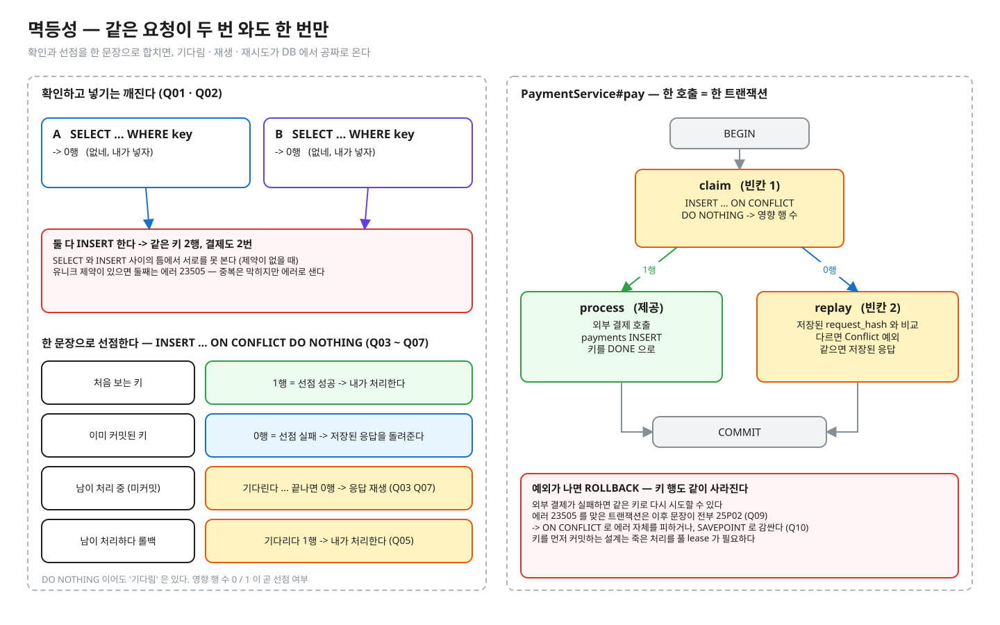

# 01.03 멱등성

> **완료 기준**: 예측 10문항을 먼저 적고 돌려 전부 초록 · 구현 테스트 초록 · NOTES 를 채우고 꼬리질문 5개를 해설 보기 전에 답한다 · "타임아웃 뒤 같은 요청이 다시 오면 왜 두 번 처리되기 쉽고, 유니크 제약 · ON CONFLICT 는 정확히 무엇을 보장하며, 처리 중인 같은 키 · 다른 내용의 같은 키 · 실패한 첫 요청은 각각 어떻게 다뤄야 하나"를 그림 없이 3분 안에 설명한다.

공고 연결 — "결제·주문 같은 유실 없는 데이터 정합성". 클라이언트에게 "응답을 못 받았다" 와 "처리가 안 됐다" 는 구분되지 않는다. 그래서 재시도는 정상 동작이고, 막을 책임은 서버에 있다.
(참고) 이 레슨은 이전 실험장 `order-flow-playground` 의 `docs/02-idempotency.md` · `stage2` (메모리 `ConcurrentHashMap` 버전)를 옮긴 것이다. 여기서는 **서버가 2대여도 통하는 DB 버전**으로 같은 문제를 푼다.

---

## ① 질문 · 첫 예측 — 20분

1. 클라이언트가 타임아웃 뒤 같은 요청을 다시 보내면 무슨 일이 생기나? 클라이언트는 무엇을 잘못했나?
2. "키가 있나 SELECT → 없으면 INSERT" 는 왜 깨지나? 유니크 제약을 걸면 무엇이 달라지고, 무엇은 여전히 남나?
3. 같은 키가 거의 동시에 두 번 INSERT 되면 두 번째는 기다리나? 첫째가 커밋하면? 롤백하면?
4. `ON CONFLICT DO NOTHING` 의 영향 행 수와 `RETURNING` 은 무엇을 알려 주나? `DO UPDATE … RETURNING` 은 무엇을 돌려주나?
5. 같은 키로 이미 **처리 중**인 요청이 또 오면? 같은 키에 **다른 내용**이 오면? 첫 요청이 **실패**했으면?

> **이어서 첫 예측**: 질문에 종이로 답해 NOTES §0 에 옮긴 뒤, `IdempotencyPredictTest.java` 의 예측 칸 `"?"` 를 **감으로** 채워 `./gradlew 01.03-predict` 를 돌린다. 틀려도 된다 — 틀린 문항이 ② 를 읽는 이유가 된다. PROGRESS 의 "예측 적중"은 이 첫 예측으로 센다.

## ② 원리 — 85분



<sub>편집: [diagrams/idempotency.excalidraw](diagrams/idempotency.excalidraw) · 다시 그리기(만든 사람용 · 레슨 폴더에서): `python3 -I diagrams/draw.py`</sub>

1차 자료 (블로그 요약 말고 이것부터):

공식 문서에서 아래 "찾을 것" 문장을 직접 찾아 표시하고, 한 줄로 번역해 NOTES 나 여백에 적어 둔다.

| 자료 | 읽으면서 찾을 것 |
|---|---|
| [개념 정리 docs/](docs/README.md) | **필수 03 · 04 · 06** 를 읽으며 ① 에서 틀린 문항이 왜 틀렸는지 찾는다 (나머지 글은 심화 — 레슨을 마친 뒤 · 면접 전). 공식 문서 행은 docs 가 링크하는 곳에서 같이 연다 · 예측 답은 접힌 칸에만 |
| [PostgreSQL 16 · INSERT](https://www.postgresql.org/docs/16/sql-insert.html) 의 ON CONFLICT 절 | "Only rows that were successfully inserted or updated will be returned" (Q06) · DO UPDATE 가 "atomic INSERT or UPDATE outcome … even under high concurrency" 를 보장한다는 문장 (Q08) |
| [13.2 Transaction Isolation](https://www.postgresql.org/docs/16/transaction-iso.html) 의 Read Committed 절 | `INSERT … ON CONFLICT DO NOTHING` 이 "다른 트랜잭션의 결과 때문에 삽입이 진행되지 않을 수 있다" 는 문단 (Q07). RR 에서는 어떻게 다른가? (생각해 보기 — 이 레슨은 RR 로 돌려 보는 문항 · 장면이 없다. 궁금하면 observe 장면 2 의 `BEGIN;` 을 `BEGIN ISOLATION LEVEL REPEATABLE READ;` 로 바꿔 직접 해 보고 NOTES 관찰 메모에 적는다) |
| [Stripe API · Idempotent requests](https://docs.stripe.com/api/idempotent_requests) | 첫 요청의 상태코드·본문을 저장해 같은 키에 그대로 돌려준다 (실패 · 500 포함) · 24시간 뒤 정리 · 파라미터가 다르면 에러 · 동시에 실행 중인 요청과 충돌하면 결과를 저장하지 않는다 → 우리 구현과 어디가 같고 다른가 |
| 원본 `order-flow-playground/docs/02-idempotency.md` | fingerprint · in-flight · 실패 저장 여부 · TTL (NOTES 꼬리질문) |

## ③ 재현 — 30분 · 세 가지 손 작업

파일 경로는 이 레슨 폴더(`01-concurrency-consistency/l03-idempotency/`) 기준이다. 명령은 두 곳에서 친다.

```bash
# deep-dive 폴더에서 — ./gradlew 는 전부 여기서
./gradlew 01.03-predict
./gradlew 01.03-implement
```

```bash
# deep-dive 폴더에서 레슨 폴더로 들어간 뒤 — observe 스크립트는 여기서
cd 01-concurrency-consistency/l03-idempotency
observe/up.sh
```

IntelliJ 로 한다면: deep-dive 폴더를 Gradle 프로젝트로 열고(코드를 바꾼 뒤 Gradle 창에서 Reload), 테스트 메서드 옆 ▶ 로 한 문항씩 돌려도 된다. 자세히는 [GUIDE.md](../../GUIDE.md).

| 작업 | 실행 | 무엇을 |
|---|---|---|
| **예측** (되짚기) | `./gradlew 01.03-predict` | `src/test/java/deepdive/c01/l03/IdempotencyPredictTest.java` 의 Q01~Q10(10문항 · 예측 칸 14곳)을 ① 에서 감으로 적었다. 틀린 문항을 ② 를 읽은 뒤 되짚어 다시 적고 초록으로 만든다 (NOTES §1 에 한 줄). 한 문항씩 돌리는 법: [GUIDE](../../GUIDE.md) §2-3. 출력의 A/B 타임라인은 예측을 적은 문항만 보인다 |
| **구현** (코드) | `./gradlew 01.03-implement` | 구현 대상 `src/main/java/deepdive/c01/l03/PaymentService.java` 의 `TODO(구현)` 두 곳 — 키 선점 `claim` · 지문 비교 `replay`. 실패 메시지가 "정합성 깨짐: 결제 N건" 부터 알려 준다. 검사는 `src/test/java/deepdive/c01/l03/PaymentImplementTest.java` |
| **관찰** (진짜 엔진) | `observe/up.sh` → [observe/SCRIPT.md](observe/SCRIPT.md) | psql 두 개로 같은 키 경쟁 · 락 대기(`pg_locks`) · 23505 뒤의 트랜잭션을 직접 (포트 55434) |

테스트는 진짜 PostgreSQL 16 컨테이너(Testcontainers)에서 돈다. Docker 가 떠 있어야 한다.

한 문항만 (deep-dive 폴더에서): `./gradlew :01-concurrency-consistency:l03-idempotency:predict --tests '*Q07*'` (IDE 에서 메서드 하나 실행해도 된다)

빈칸 상태에서 구현 테스트는 **빨강 3 · 초록 4** 이다 (빨강 = `방법_검사_서비스_인스턴스가_둘이어도_DB_가_중복을_막는다` · `같은_키로_20번_동시에_호출해도_결제는_한_번이고_응답은_모두_같다` · `같은_키로_내용이_다르면_거절하고_원래_결제는_그대로다`).
구현 테스트 7개 중 **결과 검사**는 "같은 키 20번 동시 → 결제 1건 · 모두 같은 응답" 과 "같은 키 다른 내용 → 거절" 이고,
순차 재전송 · 실패 뒤 재시도 · 다른 키끼리 안 막기 · 빈 키 거절은 **지켜야 할 동작(가드)** 이라 빈칸 상태에서도 초록이다.
`방법_검사_서비스_인스턴스가_둘이어도…` 는 JVM 안의 락(`synchronized` · `ConcurrentHashMap`)으로 푼 해법을 거르는 **방법 검사**다.
다른 해법 — `payments` 에 유니크 제약을 걸거나, 키 행을 먼저 커밋하는 2-트랜잭션 설계 — 은 NOTES 꼬리질문 3 · 5.

## ④ 내 말로 — 20분

1. [NOTES.md](NOTES.md) — 틀린 예측 · 3분 설명 · 꼬리질문 5개(답을 먼저 쓰고 해설과 비교) · §6 내 실무와 연결(권장 — 내가 일하는 서비스를 떠올려 한 줄씩)
2. `/kata:discuss 멱등성 키 설계, ON CONFLICT 와 동시성` — 면접관 역할의 꼬리질문
3. 버텼으면 [../../PROGRESS.md](../../PROGRESS.md) 에 테스트 ✅ · 내 말로 ✅

---

💡 **실무**: 이 구현은 "키 선점 → 외부 호출 → 기록" 을 **한 트랜잭션**에 넣어서 기다림 · 재생 · 실패 뒤 재시도가 공짜로 온다. 대가는 외부 호출 내내 커넥션과 락을 쥐는 것 —
처리 시간이 긴 API 면 키를 먼저 커밋(IN_PROGRESS)하고 별도 트랜잭션에서 처리하되, 죽은 처리를 풀어 줄 lease 가 필요해진다 (NOTES 꼬리질문 5).
외부 결제가 성공한 뒤 DB 커밋이 실패하면 돈은 이미 나갔다 → 이 틈은 02.03 outbox 로 이어진다.

정답 patch: [../../solutions/01.03.patch](../../solutions/01.03.patch) — 구현 정답과 **예측 답**이 들어 있다. 예측 · 구현을 끝낸 뒤 연다 (deep-dive 폴더에서 `less solutions/01.03.patch`). 내 코드와 비교한다.
