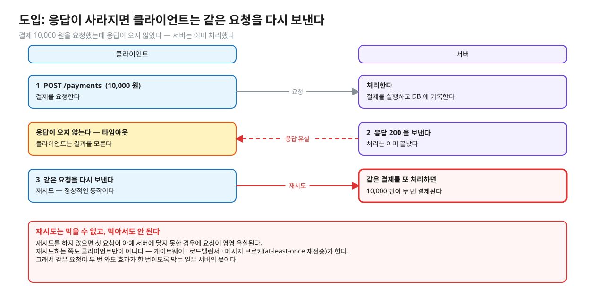
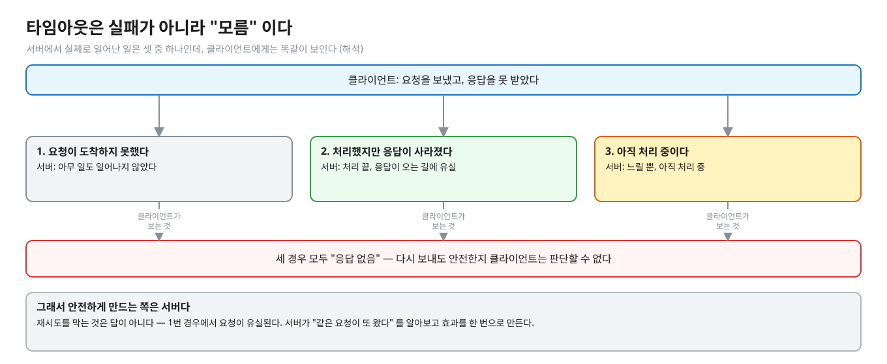
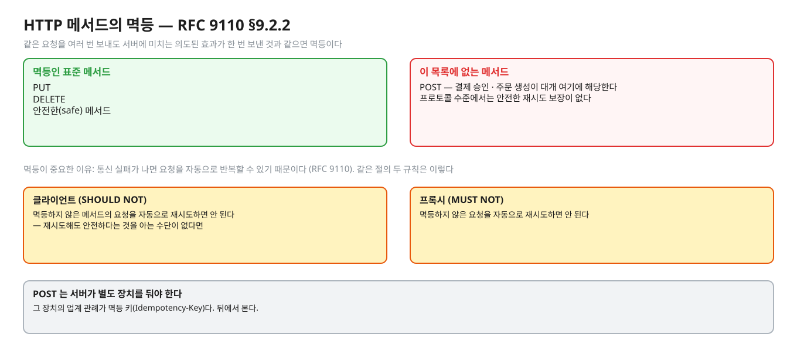
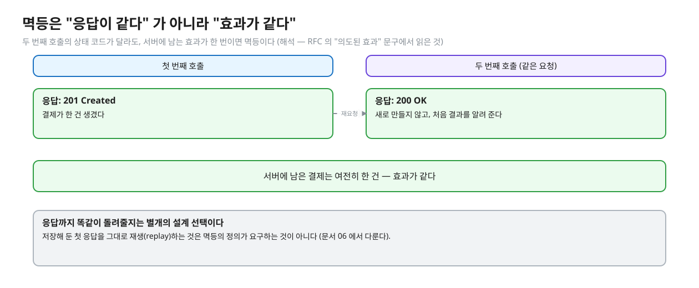
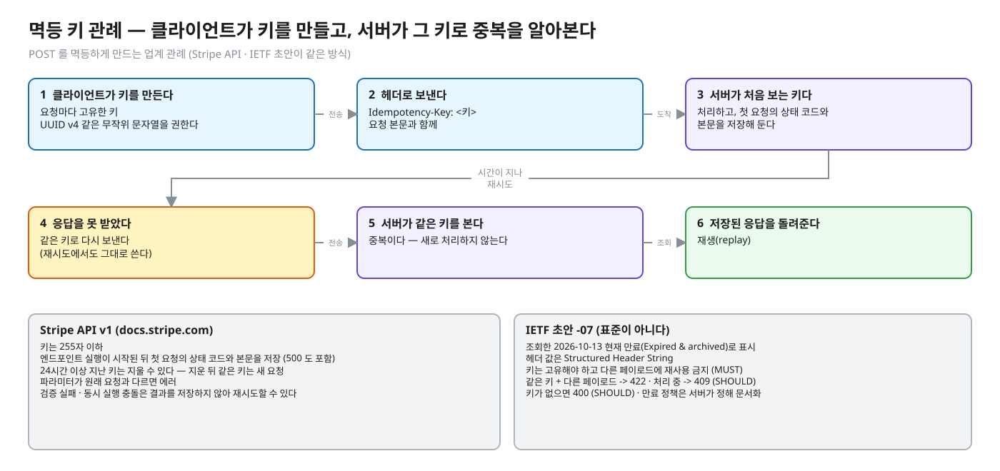
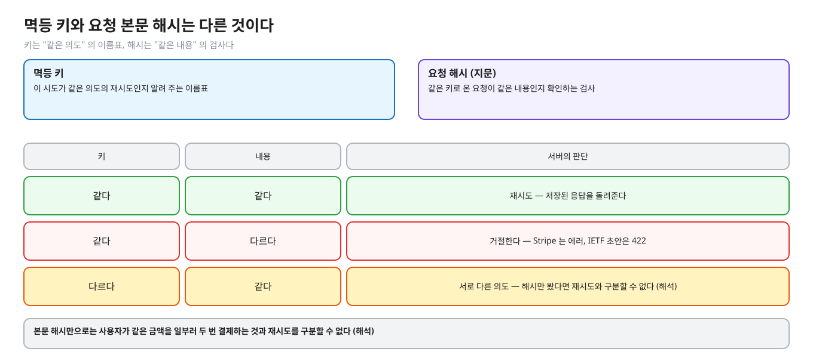
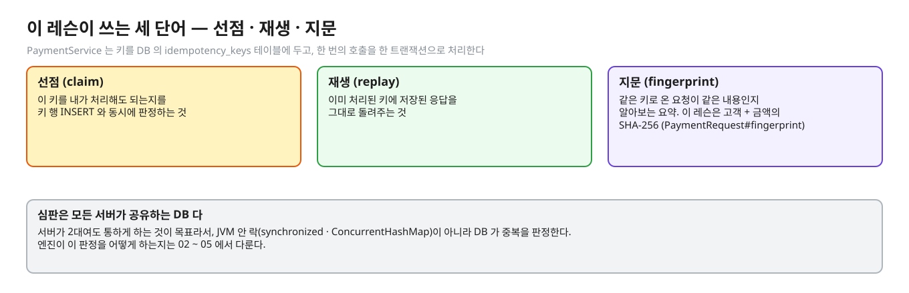

# 01. 멱등성과 재시도 — 타임아웃은 "모름"이다

> **이 글에서 알게 되는 것**
> 1. 타임아웃이 "실패" 가 아니라 "모름" 인 이유, 그래서 재시도가 정상 동작이라는 것을 안다.
> 2. 멱등(idempotent)의 정의와, `POST` 에는 프로토콜 수준의 재시도 보장이 없다는 것을 안다.
> 3. 멱등 키(Idempotency-Key) 관례가 무엇이고, 이 헤더가 아직 표준이 아니라는 것을 안다.
>
> **다음 글**: [02. 확인하고 넣기(check-then-act)의 경쟁](02-check-then-act.md)
> **구분**: 심화 — 꼬리질문 대비 (레슨을 마친 뒤 · 면접 전)

## 응답이 사라지면 무슨 일이 생기나

결제 API 에 10,000 원 결제를 요청했는데 응답이 오지 않는다. 서버 로그를 보니 결제는 이미 끝나 있다. 응답이 오는 길에서 사라졌을 뿐이다. 클라이언트는 그 사실을 모르니 타임아웃이 나자 같은 요청을 다시 보낸다.

편집: [diagrams/blog01-double-charge.excalidraw](diagrams/blog01-double-charge.excalidraw)

서버가 두 번째 요청을 아무 생각 없이 처리하면 10,000 원이 두 번 나간다. 중복 결제 · 중복 주문 · 포인트 이중 적립이 이렇게 생긴다. 원인은 대개 버그가 아니라 정상적인 재시도다. 재시도하는 쪽도 클라이언트만이 아니라 게이트웨이, 메시지 브로커의 at-least-once 재전송까지 여럿이다. 이 글은 "같은 요청이 두 번 와도 효과가 한 번이도록" 만든다는 문제가 어떻게 정의되는지를 본다. 엔진이 그것을 어떻게 해 주는지는 02 ~ 05 의 몫이다.

## 개념을 하나씩 보자

### 1. 타임아웃이 알려 주는 것

클라이언트가 요청을 보내고 응답을 못 받았을 때, 서버에서 일어났을 수 있는 일은 세 가지다.

편집: [diagrams/blog01-timeout-three.excalidraw](diagrams/blog01-timeout-three.excalidraw)

| 서버에서 실제로 일어난 일 | 클라이언트가 아는 것 |
|---|---|
| 요청이 도착하지 못했다 | 응답 없음 |
| 처리했지만 응답이 오는 길에 사라졌다 | 응답 없음 |
| 아직 처리 중이다 (느릴 뿐) | 응답 없음 |

세 경우가 클라이언트에게는 똑같이 보인다 (해석). 그래서 "다시 보내도 안전한가" 를 클라이언트가 판단할 수 없고, 안전하게 만드는 쪽은 서버다. 그렇다고 재시도를 막는 것이 답은 아니다. 재시도하지 않으면 첫 번째 경우에서 요청이 영영 유실된다.

그러면 "다시 보내도 안전하다" 는 성질에 이름이 필요하다. 그것이 멱등이다.

### 2. 멱등(idempotent)의 정의

[RFC 9110 §9.2.2](https://www.rfc-editor.org/rfc/rfc9110.html#name-idempotent-methods) 는 같은 요청을 여러 번 보냈을 때 **서버에 미치는 의도된 효과**가 한 번 보냈을 때와 같으면 멱등이라고 정의한다. 표준 메서드 중 멱등인 것은 `PUT` · `DELETE` · 안전한(safe) 메서드이고, 문서는 이 구분의 이유를 "통신 실패가 나면 요청을 자동으로 반복할 수 있기 때문" 이라고 쓴다.

편집: [diagrams/blog01-methods.excalidraw](diagrams/blog01-methods.excalidraw)

같은 절에는 자동 재시도에 관한 두 규칙도 있다.

- 클라이언트는 멱등하지 않은 메서드의 요청을 자동으로 재시도하면 안 된다 (SHOULD NOT) — 재시도해도 안전하다는 것을 아는 수단이 없다면.
- 프록시는 멱등하지 않은 요청을 자동 재시도하면 안 된다 (MUST NOT).

문제는 `POST` 가 위 목록에 없다는 점이다. 결제 승인 · 주문 생성이 대개 `POST` 인데, 프로토콜 수준에서는 안전한 재시도 보장이 없다. 그래서 `POST` 에는 서버가 별도의 장치를 둬야 한다. 같은 `PUT` 을 반복해도 서버 상태가 같은 것은 리소스를 그 표현으로 교체하기 때문이고, `POST` 는 "한 번 더 보내면 한 번 더 만들어질 수 있다". 다만 `PUT` 이 멱등이라는 것은 프로토콜의 기대이고, 구현이 `PUT` 안에서 카운터를 올리면 깨질 수 있다 (해석).

### 3. 멱등은 "효과" 가 같다는 것이다

멱등성은 "응답이 같다" 가 아니라 "효과가 같다" 는 뜻이다. 두 번째 호출이 `201` 대신 `200` 을 돌려줘도 효과가 한 번이면 멱등이다 (해석 — 위 정의의 "의도된 효과" 문구에서 읽은 것).

편집: [diagrams/blog01-effect-vs-response.excalidraw](diagrams/blog01-effect-vs-response.excalidraw)

앞의 정의와 이어 보면, 멱등의 기준은 서버에 남는 결과다. 재생 응답이 원래 응답과 같도록 설계하는 것은 별개의 선택이다 (문서 06).

### 4. 멱등 키(Idempotency-Key) 관례

`POST` 를 멱등하게 만드는 업계 관례는 **클라이언트가 요청마다 고유한 키를 만들어 헤더로 보내고, 서버가 그 키로 중복을 알아보는 것**이다.

편집: [diagrams/blog01-key-flow.excalidraw](diagrams/blog01-key-flow.excalidraw)

**Stripe API** ([문서](https://docs.stripe.com/api/idempotent_requests)):
- 키는 255자 이하이고, V4 UUID 같은 무작위 문자열을 권한다.
- API v1 은 **엔드포인트 실행이 시작된 뒤** 첫 요청의 상태 코드와 본문을 저장하고, 같은 키의 재시도에는 그 저장본을 돌려준다 — `500` 도 포함.
- 24시간 이상 지난 키는 지울 수 있고, 지워진 뒤 같은 키가 오면 새 요청으로 처리한다.
- 들어온 파라미터를 원래 요청과 비교해 다르면 에러를 낸다.
- 파라미터 검증에 실패했거나 동시에 실행 중인 다른 요청과 충돌한 경우는 결과를 저장하지 않으므로 재시도할 수 있다.

**IETF 초안** ["The Idempotency-Key HTTP Header Field"](https://datatracker.ietf.org/doc/html/draft-ietf-httpapi-idempotency-key-header-07) (draft-ietf-httpapi-idempotency-key-header-07)는 **표준(RFC)이 아니다.** 조회한 2026-10-13 현재 데이터트래커 페이지는 이 초안을 만료(Expired & archived)로 표시하고 Intended RFC status 도 정해지지 않았다. 초안 본문도 "work in progress 로만 인용하라" 고 적는다. 그래도 요구가 업계 관례와 같아 어휘로는 쓸 만하다.
- 헤더 값은 Structured Header String 이다.
- 키는 고유해야 하고 다른 페이로드에 재사용하면 안 된다 (MUST). UUID 같은 무작위 값을 권장한다.
- 같은 키에 다른 페이로드면 `422`, 원래 요청이 아직 처리 중이면 `409`, 키가 없으면 `400` 으로 응답하라(SHOULD)고 한다.
- 만료 정책은 서버가 정해 문서화하라고 한다.

실무에서 이 헤더를 설명할 때는 "IETF 에서 표준화 중인 헤더가 있지만 아직 초안(그것도 조회 시점에 만료 상태)이고, 업계는 Stripe 방식을 사실상 관례로 쓴다" 정도로 말하면 정확하다.

그런데 왜 키를 클라이언트가 만들까? 키는 "이 시도가 같은 의도의 재시도다" 를 알리는 수단인데, 응답을 못 받은 클라이언트는 서버가 만든 키를 받지 못했을 수 있다. 첫 요청 전에 클라이언트가 만든 값만 재시도에서도 그대로 다시 보낼 수 있다 (해석). Stripe · IETF 초안 모두 클라이언트가 만드는 쪽이다.

### 5. 키와 본문 해시는 다른 것이다

키가 있으면 요청 본문 해시는 필요 없을까? 아니다. 둘은 서로 다른 질문에 답한다.

편집: [diagrams/blog01-key-vs-hash.excalidraw](diagrams/blog01-key-vs-hash.excalidraw)

키는 "같은 의도" 를 가리키는 이름표이고, 해시는 "같은 내용" 을 확인하는 검사다. 본문 해시만으로는 사용자가 같은 금액을 일부러 두 번 결제하는 것과 재시도를 구분할 수 없다 (해석). 키가 같고 내용이 다르면 거절한다 — Stripe 는 에러, 초안은 `422`.

### 정리: 네 개의 관계

| 개념 | 한 줄로 | 앞의 것과 다른 점 |
|---|---|---|
| 타임아웃 | 처리됐는지 모른다 | — |
| 멱등 | 여러 번 보내도 효과가 한 번이다 | "모름" 을 서버가 흡수하게 만드는 성질 |
| 멱등 키 | 같은 의도를 알려 주는 이름표 | `POST` 에는 멱등이 보장되지 않으니 덧붙이는 관례 |
| 요청 해시 | 같은 내용인지 확인하는 검사 | 의도가 아니라 내용을 본다 |

## PostgreSQL 에서는

이 글은 엔진 이전의 이야기다. 엔진이 하는 일은 02 ~ 05 에서 다룬다. 여기서는 이 레슨이 쓰는 용어만 맞춘다.

편집: [diagrams/blog01-terms.excalidraw](diagrams/blog01-terms.excalidraw)

- **선점(claim)**: 이 키를 내가 처리해도 되는지를 키 행 INSERT 와 동시에 판정하는 것.
- **재생(replay)**: 이미 처리된 키에 저장된 응답을 그대로 돌려주는 것.
- **지문(fingerprint · request hash)**: 같은 키로 온 요청이 "같은 내용" 인지 알아보는 요약. 이 레슨은 고객 + 금액의 SHA-256 이다 (`PaymentRequest#fingerprint`).

이 레슨의 `PaymentService` 는 키를 DB 의 `idempotency_keys` 테이블에 두고 한 번의 호출을 한 트랜잭션으로 처리한다. 서버가 2대여도 통하게 하는 것이 목표라서 JVM 안 락(`synchronized` · `ConcurrentHashMap`)이 아니라 **모든 서버가 공유하는 DB 가 심판**이다 (다음 글).

### 자주 하는 오해

1. **"타임아웃이면 실패한 것이니 재시도해도 된다."** 타임아웃은 실패가 아니라 "모름" 이다. 이미 처리됐을 수 있다.
2. **"GET 만 안전하게 재시도하면 된다."** 안전한 메서드 · `PUT` · `DELETE` 는 정의상 멱등이지만, 결제 승인처럼 `POST` 인 것에는 서버가 별도로 장치를 둬야 한다.
3. **"멱등이면 응답도 항상 같다."** 효과가 같다는 뜻이다. 재생 응답이 원래 응답과 같도록 설계하는 것은 별개의 선택이다 (문서 06).
4. **"Idempotency-Key 는 IETF 표준이다."** 초안이다 — 위 상태 참고.
5. **"클라이언트가 재시도를 안 하게 막으면 된다."** 재시도는 클라이언트 말고도 게이트웨이 · 로드밸런서 · 메시지 큐가 한다. 서버가 중복을 흡수해야 한다.

## 한눈에 정리

| | 무엇인가 | 근거 |
|---|---|---|
| 타임아웃 | 실패가 아니라 "모름". 세 경우가 구분되지 않는다 | (해석) |
| 멱등 | 같은 요청을 여러 번 보낸 효과가 한 번과 같다 | RFC 9110 §9.2.2 |
| `PUT` · `DELETE` · safe | 정의상 멱등 | RFC 9110 §9.2.2 |
| `POST` | 목록에 없다 — 서버가 별도 장치를 둔다 | RFC 9110 §9.2.2 |
| Idempotency-Key | 업계 관례. IETF 초안은 표준이 아니고 조회 시점에 만료 상태 | Stripe 문서 · IETF 초안 -07 |

- 타임아웃이 나면 처리됐는지 알 수 없으니 재시도는 정상 동작이고, 중복을 막는 책임은 서버에 있다.
- 멱등은 응답이 아니라 효과가 같다는 뜻이다.
- 키는 "같은 의도", 해시는 "같은 내용" 이다. 둘 다 필요하다.
- 이 레슨의 심판은 JVM 이 아니라 모든 서버가 공유하는 DB 다.

## 스스로 확인

1. 왜 결제 요청은 `POST` 인데 멱등 키가 필요하고 `PUT` 은 필요 없나?
   

답

   RFC 9110 이 `PUT` · `DELETE` 를 정의상 멱등으로 둔다 — 같은 `PUT` 을 반복해도 서버 상태가 같다(리소스를 그 표현으로 교체). `POST` 는 목록에 없어 "한 번 더 보내면 한 번 더 만들어질 수 있다". 다만 `PUT` 이 멱등이라는 것은 프로토콜의 기대이고, 구현이 `PUT` 안에서 카운터를 올리면 깨질 수 있다 (해석).
   

2. 클라이언트가 키를 만들게 하는 이유는? 서버가 만들어 주면 안 되나?
   

답

   키는 "이 시도가 같은 의도의 재시도다" 를 알리는 수단인데, 응답을 못 받은 클라이언트는 서버가 만든 키를 받지 못했을 수 있다. 첫 요청 전에 클라이언트가 만든 값만 재시도에서도 그대로 다시 보낼 수 있다 (해석). Stripe · IETF 초안 모두 클라이언트가 만드는 쪽이다.
   

3. 멱등 키와 요청 본문 해시는 같은 것인가?
   

답

   아니다. 키는 "같은 의도" 를 가리키는 이름표이고, 해시는 "같은 내용" 을 확인하는 검사다. 본문 해시만으로는 사용자가 같은 금액을 일부러 두 번 결제하는 것과 재시도를 구분할 수 없다 (해석). 키가 같고 내용이 다르면 거절한다 — Stripe 는 에러, 초안은 `422`.
   

## 이 레슨에서 직접 보기

| 어디서 | 무엇을 |
|---|---|
| README ① 질문 1 | 타임아웃 뒤 같은 요청이 오면 무슨 일이 나나 |
| `PaymentImplementTest` 순차로_다시_보낸_같은_요청… | 두 번째 요청은 새로 처리하지 않고 같은 응답 |
| `PaymentImplementTest` 같은_키로_20번_동시에… | 동시에 20번 와도 결제는 한 번 |

## 출처

- [RFC 9110 §9.2.2 Idempotent Methods](https://www.rfc-editor.org/rfc/rfc9110.html#name-idempotent-methods) — 멱등 정의 · PUT/DELETE/safe 가 멱등 · 자동 재시도 규칙
- [IETF draft-ietf-httpapi-idempotency-key-header-07](https://datatracker.ietf.org/doc/html/draft-ietf-httpapi-idempotency-key-header-07) · [datatracker 페이지](https://datatracker.ietf.org/doc/draft-ietf-httpapi-idempotency-key-header/) — 헤더 형식 · 422 / 409 / 400 · 초안 · 만료 상태 (조회 2026-10-13)
- [Stripe API · Idempotent requests](https://docs.stripe.com/api/idempotent_requests) — 저장 범위 · 24시간 · 파라미터 비교 · 동시 요청
