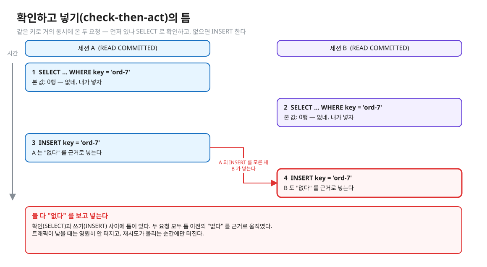
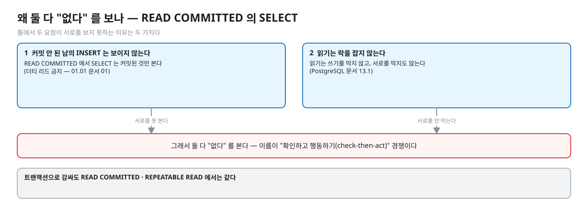
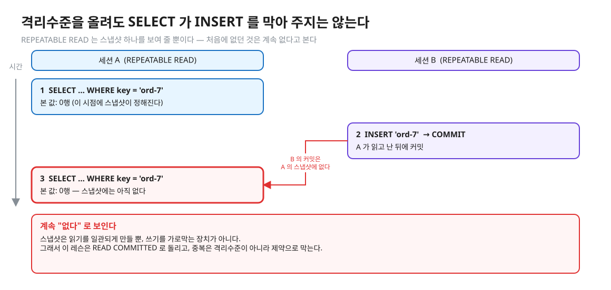
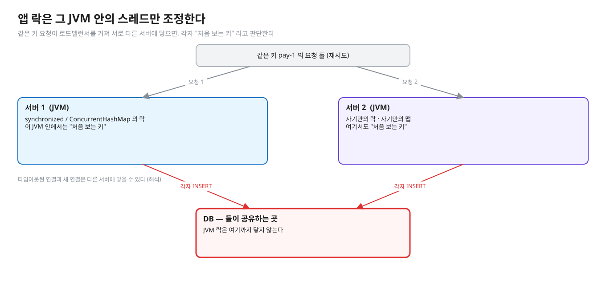
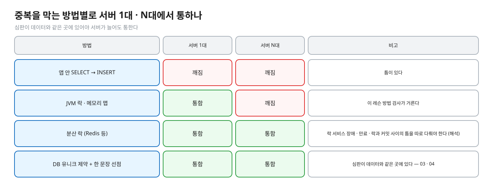
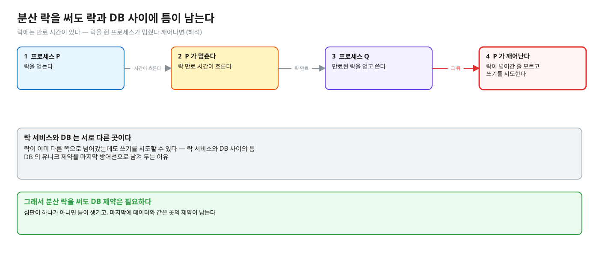
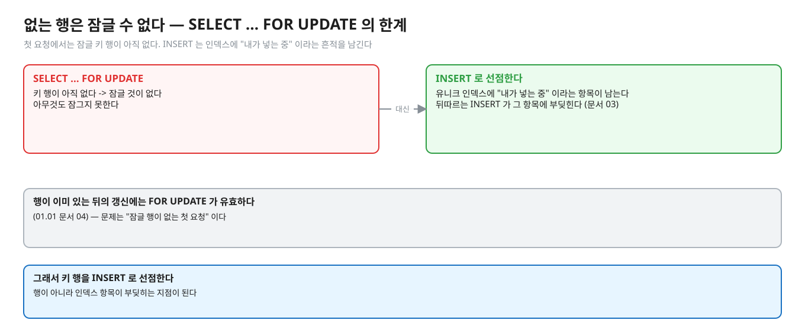
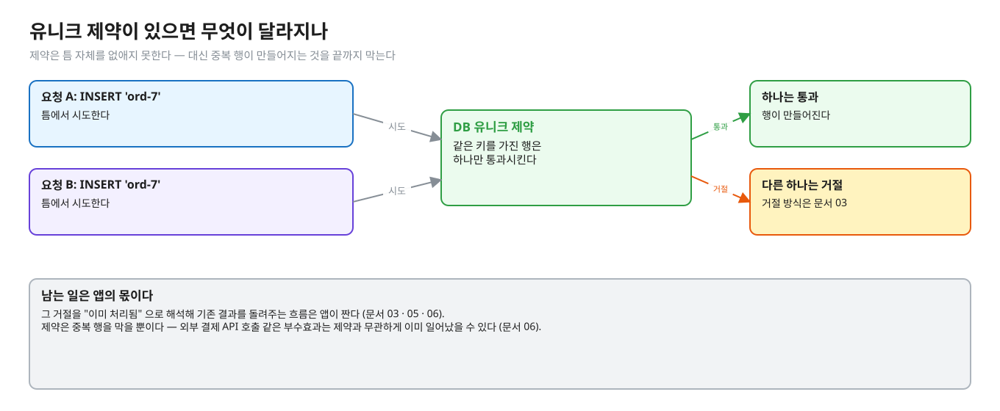

# 02. 확인하고 넣기(check-then-act)의 경쟁

> **이 글에서 알게 되는 것**
> 1. "있나 SELECT → 없으면 INSERT" 가 SELECT 와 INSERT 사이의 틈에서 깨지는 이유를 안다.
> 2. 애플리케이션 락(JVM 락 · 분산 락)이 어디까지 통하고 어디서 깨지는지 안다.
> 3. 유니크 제약이 틈을 없애지는 못해도 무엇을 해 주는지, 그리고 그 뒤에 앱이 할 일이 남는다는 것을 안다.
>
> **먼저 알면 좋은 것**: [01. 멱등성과 재시도](01-idempotency-and-retry.md) — 재시도로 같은 요청이 두 번 올 수 있다는 것.
> **다음 글**: [03. 유니크 제약과 동시 INSERT](03-unique-constraint-concurrent-insert.md)
> **구분**: 심화 — 꼬리질문 대비 (레슨을 마친 뒤 · 면접 전)

## 트래픽이 낮을 때는 안 터지는 코드

코드 리뷰에서 가장 흔히 보는 형태가 있다. `if (!repo.existsByKey(k)) repo.save(...)`. 키가 이미 있는지 먼저 확인하고, 없으면 넣는다. 읽기에는 아주 자연스럽다. 이 코드는 트래픽이 낮을 때는 영원히 안 터지고, 재시도가 몰리는 순간에만 터진다.

같은 키로 거의 동시에 두 요청 A · B 가 들어왔다고 하자.


<sub>편집: [diagrams/blog02-race.excalidraw](diagrams/blog02-race.excalidraw)</sub>

순서를 글로 적으면 이렇다.

1. A: `SELECT … WHERE key = 'pay-1'` → 0행 (없네, 내가 넣자)
2. B: `SELECT … WHERE key = 'pay-1'` → 0행 (없네, 내가 넣자)
3. A: `INSERT`
4. B: `INSERT`

두 요청 모두 "없다" 는 틈 이전의 사실을 근거로 움직였다. 이 글은 이 틈이 왜 생기는지, 어떤 방어가 어디까지 통하는지를 차례로 본다.

## 개념을 하나씩 보자

### 1. 틈(race window)

확인(SELECT)과 쓰기(INSERT) 사이에 다른 요청이 끼어들 수 있는 구간이다. 그런데 B 의 SELECT 는 왜 A 의 INSERT 를 못 볼까? 이유가 둘이다.


<sub>편집: [diagrams/blog02-why-blind.excalidraw](diagrams/blog02-why-blind.excalidraw)</sub>

READ COMMITTED 에서 SELECT 는 아직 커밋되지 않은 남의 INSERT 를 보지 못하고 (더티 리드 금지, [01.01 문서 01](../../l01-isolation-mvcc/docs/01-anomalies-and-isolation-levels.md)), 읽기는 락을 잡지 않아 서로를 막지도 않는다 ([문서 13.1](https://www.postgresql.org/docs/16/mvcc-intro.html): 읽기는 쓰기를 막지 않는다). 그래서 둘 다 "없다" 를 본다. 이 이름이 "확인하고 행동하기(check-then-act)" 경쟁이다.

### 2. 격리수준을 올리면 되지 않나

격리수준을 올려도 SELECT 가 INSERT 를 막아 주지는 않는다. REPEATABLE READ 는 스냅샷 하나를 보여 줄 뿐이라 오히려 "처음에 없던 것" 을 계속 없다고 본다.


<sub>편집: [diagrams/blog02-rr-blind.excalidraw](diagrams/blog02-rr-blind.excalidraw)</sub>

앞의 이유와 무엇이 다른가. READ COMMITTED 에서는 "커밋 전이라서" 못 보는 것이고, REPEATABLE READ 에서는 "내 스냅샷 이후라서" 못 본다. 어느 쪽이든 SELECT 는 읽기일 뿐이라 상대의 INSERT 를 막지 못한다. 이 레슨은 READ COMMITTED 로 돌린다.

### 3. 앱 락으로는 왜 안 되나

그렇다면 앱에서 락을 잡으면 어떨까. `synchronized` · `ReentrantLock` · `ConcurrentHashMap.putIfAbsent` 는 **그 JVM 안의** 스레드만 조정한다. 서버(인스턴스)가 둘 이상이면 각자 "처음 보는 키" 라고 판단한다. 로드밸런서가 같은 키를 다른 인스턴스로 보내는 것은 재시도에서 오히려 흔하다 (타임아웃된 연결과 새 연결은 다른 서버에 닿을 수 있다 — 해석).


<sub>편집: [diagrams/blog02-app-lock.excalidraw](diagrams/blog02-app-lock.excalidraw)</sub>

방법별로 비교하면 이렇다.


<sub>편집: [diagrams/blog02-methods.excalidraw](diagrams/blog02-methods.excalidraw)</sub>

| 방법 | 서버 1대 | 서버 N대 | 비고 |
|---|---|---|---|
| 앱 안 SELECT → INSERT | 깨짐 | 깨짐 | 틈이 있다 |
| JVM 락 · 메모리 맵 | 통함 | **깨짐** | 이 레슨 방법 검사가 거른다 |
| 분산 락(Redis 등) | 통함 | 통함 | 락 서비스 장애 · 만료 · 락과 커밋 사이의 틈을 따로 다뤄야 한다 (해석) |
| DB 유니크 제약 + 한 문장 선점 | 통함 | 통함 | 심판이 데이터와 같은 곳에 있다 — 03 · 04 |

서버가 한 대이고 `synchronized` 로 키별 락을 쓰면 충분할까? 지금 당장은 틈이 닫히지만 세 가지 약점이 있다. 서버를 늘리면 바로 깨진다. 키별 락 맵이 커져서 정리가 필요하다. 프로세스가 죽거나 재배포되면 락은 사라지지만 DB 에는 반쯤 쓴 상태가 남을 수 있다(커밋 안 된 트랜잭션은 롤백되므로 데이터는 안전하나, 외부 호출은 되돌릴 수 없다). 근본적으로 심판이 데이터와 다른 곳에 있다 (해석).

### 4. 분산 락이면 되지 않나

서버가 여러 대라서 분산 락(Redis)을 쓰면 DB 제약은 필요 없을까? 필요하다. 락은 시간 제한(만료)이 있어서 락을 쥔 프로세스가 멈췄다 깨어나면 락이 이미 다른 쪽으로 넘어갔는데도 쓰기를 시도할 수 있다 — 락 서비스와 DB 사이의 틈이다 (해석).


<sub>편집: [diagrams/blog02-dist-lock.excalidraw](diagrams/blog02-dist-lock.excalidraw)</sub>

JVM 락과 무엇이 다른가. 분산 락은 서버가 여럿이어도 통하지만, 심판(락 서비스)이 데이터(DB)와 여전히 다른 곳에 있다. 유니크 제약은 마지막 방어선으로 DB 에 남겨 둔다.

### 5. `SELECT … FOR UPDATE` 로 키 행을 잠그면 되지 않나

잠글 행이 아직 없는 첫 요청에서는 `FOR UPDATE` 가 아무것도 잠그지 못한다 — "없는 행" 은 잠글 수 없다. 이것이 키 행을 INSERT 로 선점하는 이유다. INSERT 가 유니크 인덱스에 "내가 넣는 중" 이라는 항목을 남겨서 뒤따르는 INSERT 가 부딪힌다 (문서 03).


<sub>편집: [diagrams/blog02-for-update.excalidraw](diagrams/blog02-for-update.excalidraw)</sub>

행이 이미 있는 뒤의 갱신에는 `FOR UPDATE` 가 유효하다 ([01.01 문서 04](../../l01-isolation-mvcc/docs/04-write-conflicts.md)). 문제는 "잠글 행이 없는 첫 요청" 이다.

### 6. 유니크 제약이 있으면 무엇이 달라지나

제약은 틈 자체를 없애지는 못하지만 **중복 행이 만들어지는 것을 끝까지 막는다**. 틈에서 둘 다 INSERT 를 시도해도 DB 가 하나만 통과시키고 다른 하나는 거절한다 (거절 방식은 문서 03).


<sub>편집: [diagrams/blog02-unique-guard.excalidraw](diagrams/blog02-unique-guard.excalidraw)</sub>

남는 일이 있다. 그 거절을 "이미 처리됨" 으로 해석해 기존 결과를 돌려주는 흐름은 앱이 짠다 (문서 03 · 05 · 06).

### 정리: 방어의 층

| 방어 | 막는 것 | 못 막는 것 |
|---|---|---|
| SELECT 로 확인 | — | 틈 |
| 격리수준 올리기 | 읽기의 일관성 | 상대의 INSERT |
| JVM 락 | 한 JVM 안의 경쟁 | 서버 둘 이상 |
| 분산 락 | 서버 여럿의 경쟁 | 락 만료와 DB 사이의 틈 (해석) |
| 유니크 제약 | 중복 행 | 외부 호출 같은 부수효과 |

## PostgreSQL 에서는

제약이 없는 테이블에 대한 INSERT 는 다른 세션의 활동에 막히지 않는다. [INSERT 문서](https://www.postgresql.org/docs/16/sql-insert.html) 는 "유니크 인덱스가 없는 테이블에 대한 INSERT 는 동시 활동에 의해 막히지 않는다. 유니크 인덱스가 있는 테이블은, 동시 세션이 삽입하려는 유니크 인덱스 값과 맞는 행을 락하거나 수정하면 막힐 수 있다 (자세한 것은 64.5)" 는 취지로 쓴다 (원문 의역). 즉 제약이 없으면 부딪힐 곳 자체가 없고, 제약이 생기면 그 인덱스 항목이 부딪히는 지점이 된다 (그 결과는 Q01 · Q02 로 예측한다).

### 자주 하는 오해

1. **"SELECT 로 확인했으니 안전하다."** 확인과 쓰기 사이의 틈이 열려 있다. 트랜잭션으로 감싸도 READ COMMITTED · REPEATABLE READ 에서는 같다.
2. **"`@Transactional` 을 붙이면 중복이 막힌다."** 트랜잭션은 원자성(전부 or 전무)과 격리를 주지만, 두 트랜잭션이 서로 다른 행을 INSERT 하는 상황을 막지는 않는다 — 같은 키 행을 만드는 두 트랜잭션은 제약이 있어야 부딪힌다.
3. **"SERIALIZABLE 로 올리면 확인 후 INSERT 가 안전하다."** [문서 13.2.3](https://www.postgresql.org/docs/16/transaction-iso.html) 은 SERIALIZABLE 에서도 "키가 없음을 명시적으로 확인한 뒤 INSERT 해도, 겹치는 SERIALIZABLE 트랜잭션과의 충돌로 유니크 제약 위반을 볼 수 있다" 고 쓴다. 에러 종류가 바뀔 뿐 재시도는 여전히 필요하다.
4. **"유니크 제약이 있으면 멱등성이 해결된다."** 제약은 중복 **행**을 막는다. 외부 결제 API 호출 같은 부수효과는 제약과 무관하게 이미 일어났을 수 있다 (문서 06).

### 앱 · 프레임워크로 오면

`existsBy…` 후 `save` 는 같은 모양이다. Spring Data JPA 의 `save` 가 persist 와 merge 중 무엇을 부르는지는 문서 07.

## 한눈에 정리

| | 한 줄로 | 근거 |
|---|---|---|
| 틈 | SELECT 와 INSERT 사이에 남의 INSERT 가 끼어든다 | 문서 13.1 · 01.01 문서 01 |
| 격리수준 | 올려도 SELECT 가 INSERT 를 막지 못한다 | 문서 13.2.3 (SERIALIZABLE 에서도 유니크 위반) |
| JVM 락 | 한 JVM 안에서만 통한다 | (해석) |
| 분산 락 | 만료 · 락과 DB 사이의 틈이 남는다 | (해석) |
| 유니크 제약 | 중복 행을 끝까지 막는다. 거절의 해석은 앱 | INSERT 문서 · 문서 03 |

- "확인 후 INSERT" 는 SELECT 와 INSERT 사이의 틈에서 서로를 못 봐서 깨진다.
- 격리수준을 올려도 SELECT 가 INSERT 를 막아 주지는 않는다. SERIALIZABLE 에서도 유니크 위반을 볼 수 있고, 에러 종류가 바뀔 뿐 재시도는 필요하다.
- 앱 락은 서버가 한 대일 때만 틈을 닫는다. 심판은 데이터와 같은 곳에 있어야 한다.
- 제약이 있어야 두 트랜잭션이 부딪힌다. 그리고 그 거절을 다루는 일은 앱이 한다.

## 스스로 확인

1. 서버가 한 대이고 `synchronized` 로 키별 락을 쓰면 충분한가?
   <details><summary>답</summary>
   지금 당장은 틈이 닫히지만 세 가지 약점이 있다. 서버를 늘리면 바로 깨진다. 키별 락 맵이 커져서 정리가 필요하다. 프로세스가 죽거나 재배포되면 락은 사라지지만 DB 에는 반쯤 쓴 상태가 남을 수 있다(커밋 안 된 트랜잭션은 롤백되므로 데이터는 안전하나, 외부 호출은 되돌릴 수 없다). 근본적으로 심판이 데이터와 다른 곳에 있다 (해석).
   </details>
2. `SELECT … FOR UPDATE` 로 키 행을 잠그면 되지 않나?
   <details><summary>답</summary>
   잠글 행이 아직 없는 첫 요청에서는 `FOR UPDATE` 가 아무것도 잠그지 못한다 — "없는 행" 은 잠글 수 없다. 이것이 키 행을 INSERT 로 선점하는 이유다: INSERT 가 유니크 인덱스에 "내가 넣는 중" 이라는 항목을 남겨서 뒤따르는 INSERT 가 부딪힌다 (문서 03). 행이 이미 있는 뒤의 갱신에는 `FOR UPDATE` 가 유효하다 ([01.01 문서 04](../../l01-isolation-mvcc/docs/04-write-conflicts.md)).
   </details>
3. 서버가 여러 대라서 분산 락(Redis)을 쓰면 DB 제약은 필요 없나?
   <details><summary>답</summary>
   필요하다. 락은 시간 제한(만료)이 있어서 락을 쥔 프로세스가 멈췄다 깨어나면 락이 이미 다른 쪽으로 넘어갔는데도 쓰기를 시도할 수 있다 — 락 서비스와 DB 사이의 틈이다 (해석). 유니크 제약은 마지막 방어선으로 DB 에 남겨 둔다.
   </details>

## 이 레슨에서 직접 보기

| 어디서 | 무엇을 |
|---|---|
| Q01 | 제약 없는 `loose` 테이블 — 두 세션이 모두 SELECT 로 없음을 확인한 뒤 각자 INSERT |
| Q02 | 유니크 제약이 있는 `idem` 에 같은 키 INSERT |
| 장면 1 (observe/SCRIPT.md) | psql 두 개로 위를 그대로. 4번에서 B 가 기다리나? |
| `PaymentImplementTest` 방법_검사_서비스_인스턴스가_둘이어도… | 서비스 인스턴스 둘이 같은 DB 를 쓸 때 JVM 락 해법을 거른다 |

<details><summary>실측 — 예측을 끝낸 뒤 펼친다 (Q01 · Q02)</summary>

정답 상태 기준 ([정답 patch](../../../solutions/01.03.patch)):

| Q | 상황 | 결과 |
|---|---|---|
| Q01 | 제약 없음, 둘 다 SELECT 0 을 본 뒤 INSERT · COMMIT | `key = 'pay-1'` 행 2개 (실측: Q01) |
| Q02 | 이미 있는 `k1` 을 autocommit 으로 INSERT | 에러 `23505` (실측: Q02) |

psql 에서 같은 INSERT 의 메시지 원문 (실측: psql 2026-10-13, PostgreSQL 16.14):

```
ERROR:  duplicate key value violates unique constraint "idem_pkey"
DETAIL:  Key (key)=(k2) already exists.
```

</details>

## 출처

- [PostgreSQL 16 · 13.1 Introduction](https://www.postgresql.org/docs/16/mvcc-intro.html) — 읽기는 쓰기를 막지 않는다
- [PostgreSQL 16 · INSERT](https://www.postgresql.org/docs/16/sql-insert.html) — 유니크 인덱스가 없는 테이블의 INSERT 는 막히지 않는다
- [PostgreSQL 16 · 13.2 Transaction Isolation](https://www.postgresql.org/docs/16/transaction-iso.html) — SERIALIZABLE 에서도 유니크 위반이 보일 수 있다 (13.2.3)
