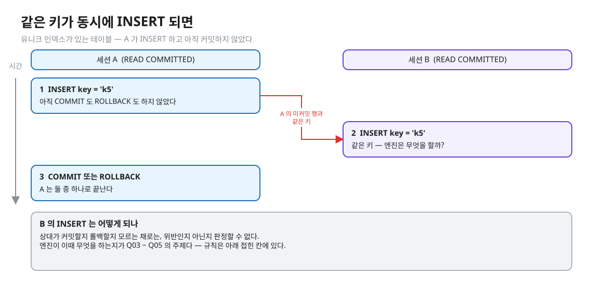
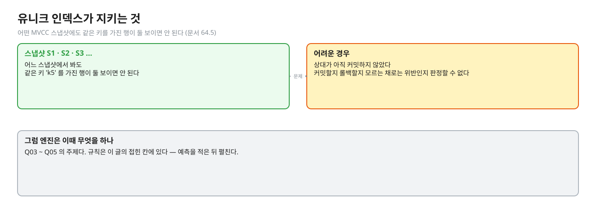
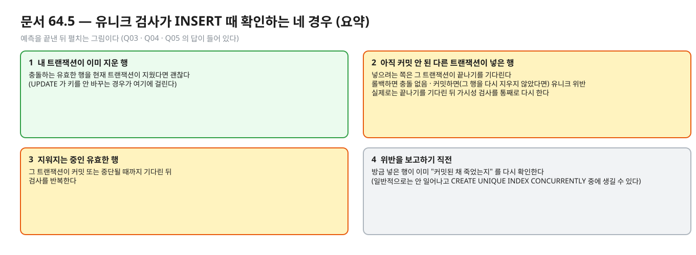
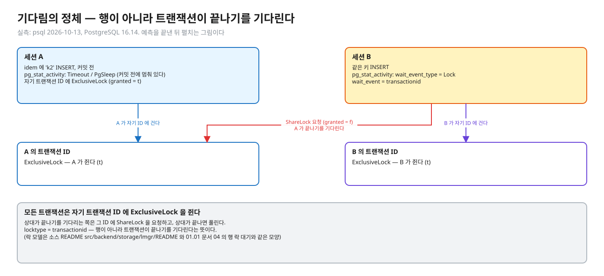
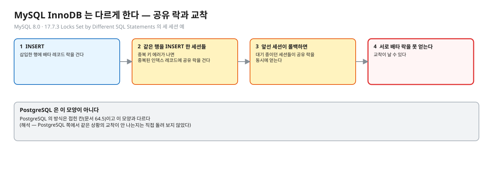
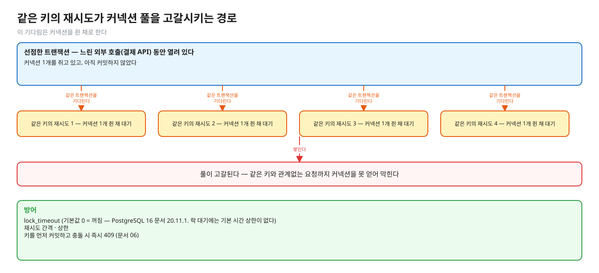

# 03. 유니크 제약과 동시 INSERT — 기다림 · 23505 · 롤백

> **이 글에서 알게 되는 것**
> 1. 같은 키의 INSERT 가 동시에 올 때 뒤의 것이 어떻게 되는지는 앞선 트랜잭션이 어떻게 끝나느냐에 갈린다는 것을 안다 (엔진의 규칙과 결과는 접힌 칸).
> 2. 그 기다림이 `pg_stat_activity` · `pg_locks` 에서 어떻게 보이는지 안다.
> 3. 이 기다림이 커넥션 풀 장애로 번질 수 있는 경로와 `lock_timeout` 의 기본값을 안다.
>
> **먼저 알면 좋은 것**: [02. 확인하고 넣기(check-then-act)의 경쟁](02-check-then-act.md) — 유니크 제약이 중복 행을 막는다는 것.
> **다음 글**: [04. ON CONFLICT](04-on-conflict.md)
> **구분**: 필수 — ② 원리 (① 에서 예측을 먼저 한 뒤 읽는다)

## 멱등 키 INSERT 가 멈춰 서 있다

실무에서 이런 장애를 본다. 멱등 키를 INSERT 하는 요청이 "처리 중" 인 같은 키에 부딪혀, 커넥션을 쥔 채 오래 멈춘다. `pg_stat_activity` 의 `wait_event` 로 보이는 멈춤의 정체가 이것이다 (접힌 칸에서 본다).

문제의 장면은 단순하다.


<sub>편집: [diagrams/blog03-scene.excalidraw](diagrams/blog03-scene.excalidraw)</sub>

A 가 같은 키를 INSERT 해 두고 아직 끝내지 않았다. B 가 그 키를 INSERT 하려 한다. 02 에서는 "유니크 제약이 있으면 중복 행이 안 생긴다" 까지 봤다. 이 글은 그 "안 생긴다" 가 구체적으로 어떤 순서로 일어나는지를 본다.

## 개념을 하나씩 보자

### 1. 유니크 인덱스가 지키는 것

유니크 인덱스는 "어떤 MVCC 스냅샷에도 같은 키를 가진 행이 둘 보이면 안 된다" 를 지킨다 ([문서 64.5](https://www.postgresql.org/docs/16/index-unique-checks.html)).


<sub>편집: [diagrams/blog03-invariant.excalidraw](diagrams/blog03-invariant.excalidraw)</sub>

같은 키를 넣으려는 두 트랜잭션이 있을 때 문제는 **상대가 아직 커밋하지 않았을 때**다. 상대가 커밋할지 롤백할지 모르는 채로는 위반인지 아닌지 판정할 수 없다. 엔진이 이때 무엇을 하는지가 Q03 ~ Q05 의 주제다 (아래 규칙은 접혀 있다).

앞 글과 이어 보면, 02 의 SELECT 는 이 "상대가 아직 모른다" 를 볼 수 없었다. 인덱스는 다르다. 인덱스는 같은 키가 들어올 때 상대 트랜잭션의 상태를 따져야 한다 (문서 64.5 의 규칙).

## PostgreSQL 에서는

### 엔진의 규칙 (문서 64.5)

[PostgreSQL 16 · 64.5 Index Uniqueness Checks](https://www.postgresql.org/docs/16/index-unique-checks.html) 는 인덱스 접근 방식이 INSERT 때 확인해야 하는 경우를 나열한다. 요지는 다음과 같다 (원문 요약).

<details><summary>규칙 — Q03 · Q04 · Q05 의 답이 이 안에 들어 있다. 예측을 적은 뒤 펼친다</summary>


<sub>편집: [diagrams/blog03-rules.excalidraw](diagrams/blog03-rules.excalidraw)</sub>

- 충돌하는 유효한 행을 **현재 트랜잭션이** 이미 지웠다면 괜찮다 (UPDATE 가 키를 안 바꾸는 경우가 여기에 걸린다).
- 충돌하는 행이 **아직 커밋되지 않은 다른 트랜잭션**이 넣은 것이면, 넣으려는 쪽은 그 트랜잭션이 커밋하는지 기다려야 한다. 롤백하면 충돌이 없다. 커밋하면서 그 행을 다시 지우지 않았다면 유니크 위반이다. 문서는 "실제로는 상대 트랜잭션이 끝나기를 기다렸다가 가시성 검사를 통째로 다시 한다" 고 쓴다.
- 충돌하는 유효한 행이 아직 커밋되지 않은 다른 트랜잭션에서 지워지는 중이면, 그 트랜잭션이 커밋 또는 중단될 때까지 기다린 뒤 검사를 반복한다.
- 위반을 보고하기 직전에는 방금 넣은 행이 이미 "커밋된 채 죽었는지" 를 다시 확인한다 (일반적으로는 일어나지 않고 `CREATE UNIQUE INDEX CONCURRENTLY` 중에 생길 수 있다).

</details>

<details><summary>실측 — 대기의 모양 · 끝나는 방식별 결과 (Q03 · Q04 · Q05 의 답이 들어 있다. 예측 뒤에 펼친다)</summary>

#### 무엇을 기다리나 — transactionid 락

기다림은 실제로 락 대기로 보인다. 아래는 직접 돌린 것이다 (실측: psql 2026-10-13, PostgreSQL 16.14). 세션 A 가 `idem` 에 `k2` 를 INSERT 하고 커밋 전에 멈춰 있고, B 가 같은 키를 INSERT 한 상태에서 세 번째 세션에서 조회:

```
 state  | wait_event_type |  wait_event   |                        q
--------+-----------------+---------------+-------------------------------------------------
 active | Timeout         | PgSleep       | SELECT pg_sleep(2);            <- A (커밋 전)
 active | Lock            | transactionid | INSERT INTO idem(key,payload) VALUES('k2','B');   <- B

   locktype    |     mode      | granted
---------------+---------------+---------
 transactionid | ExclusiveLock | t       <- A 가 자기 트랜잭션 ID 에 건 락
 transactionid | ExclusiveLock | t       <- B 가 자기 트랜잭션 ID 에 건 락
 transactionid | ShareLock     | f       <- B 가 A 의 ID 를 기다리는 중
```


<sub>편집: [diagrams/blog03-txid.excalidraw](diagrams/blog03-txid.excalidraw)</sub>

- 모든 트랜잭션은 자기 트랜잭션 ID 에 ExclusiveLock 을 쥔다. 상대가 끝나기를 기다리는 쪽은 그 ID 에 ShareLock 을 요청하고, 상대가 끝나면 풀린다. (이 락 모델은 소스 README `src/backend/storage/lmgr/README` 와 [01.01 문서 04](../../l01-isolation-mvcc/docs/04-write-conflicts.md) 에서 다룬 행 락 대기와 같은 모양이다.)
- `wait_event_type = Lock`, `wait_event = transactionid`: 행이 아니라 **트랜잭션이 끝나기를** 기다린다는 뜻이다.
- 그림: 같은 키로 두 요청이 부딪히는 타임라인 — 그림에 Q03 ~ Q07 의 결과가 그대로 있어 접어 둔다.

<details><summary>그림 — 예측(Q03 ~ Q07)을 끝낸 뒤 펼친다</summary>


<sub>편집: [diagrams/key-race.excalidraw](diagrams/key-race.excalidraw)</sub>

</details>

#### 끝나는 방식에 따라 갈린다

문서 64.5 의 규칙이 그대로 모양이 된다. 커밋이면 위반, 롤백이면 통과. B 가 받는 에러는 (실측: psql 2026-10-13):

```
ERROR:  duplicate key value violates unique constraint "idem_pkey"
DETAIL:  Key (key)=(k2) already exists.
```

SQLSTATE 는 `23505` (`unique_violation`, [부록 A](https://www.postgresql.org/docs/16/errcodes-appendix.html)). 롤백 쪽에서 B 가 성공하면 그 INSERT 는 `INSERT 0 1` 이 되고 B 가 커밋하면 B 의 값이 남는다 (실측: psql, Q05).

> 이 대기가 "처리 중인 같은 키를 기다린다" 의 정체다 — 직접 sleep · polling 을 짜지 않아도 된다. 대가: 기다리는 동안 B 의 커넥션과 트랜잭션이 열려 있다. 무제한으로 둘지는 `lock_timeout` 으로 정한다 (문서 06).

</details>

### 자주 하는 오해

1. **"같은 키 INSERT 의 결과는 하나다."** 상대가 커밋 전인지 · 어떻게 끝나는지에 따라 결과가 갈린다 (접힌 칸).
2. **"기다리다 에러가 나니 뒷 요청이 틀린 것이다."** 에러는 "이미 처리됨" 신호다. 처리 방법은 ON CONFLICT (문서 04) 나 에러 코드 분기다.
3. **"B 는 A 의 행(row)을 기다린다."** `pg_locks` 의 대상은 트랜잭션 ID 다. B 가 보고 있는 것은 인덱스 항목이 가리키는 행의 트랜잭션이다.
4. **"롤백된 INSERT 도 키를 선점한다."** 롤백된 INSERT 가 키를 남기는지는 문서 64.5 의 접힌 규칙(둘째 항목)과 Q05 로 확인한다. 이 레슨의 "실패한 요청은 같은 키로 재시도 가능" 이 그 성질에서 나온다.
5. **"타임아웃은 기본으로 걸려 있다."** `lock_timeout` 기본값은 0(꺼짐)이다 ([문서 20.11.1](https://www.postgresql.org/docs/16/runtime-config-client.html)). 락 대기에는 기본 시간 상한이 없다.

### 앱 · 프레임워크로 오면

JDBC 에서 위 에러는 `SQLException` 의 `getSQLState()` 가 `"23505"` 로 온다. Spring 의 번역은 문서 07.

## MySQL InnoDB 는 어떻게 다른가 (심화)

대기 · 락 방식이 다르다. [MySQL 8.0 · 17.7.3 Locks Set by Different SQL Statements](https://dev.mysql.com/doc/refman/8.0/en/innodb-locks-set.html): `INSERT` 는 삽입한 행에 배타 레코드 락을 건다. 중복 키 에러가 나면 **중복된 인덱스 레코드에 공유 락**을 건다. 같은 행을 여러 세션이 동시에 INSERT 하다가 앞선 세션이 롤백하면 대기 중이던 세션들이 공유 락을 동시에 얻고 서로 배타 락을 못 얻어 **교착**이 날 수 있다는 예가 문서에 있다 (세 세션 예).


<sub>편집: [diagrams/blog03-mysql.excalidraw](diagrams/blog03-mysql.excalidraw)</sub>

PostgreSQL 의 방식은 위 접힌 칸(문서 64.5)이고 이 모양과 다르다 (해석 — PostgreSQL 쪽에서 같은 상황의 교착이 안 나는지는 직접 돌려 보지 않았다).

## 한눈에 정리

| | 한 줄로 | 근거 |
|---|---|---|
| 유니크 인덱스 | 어떤 스냅샷에도 같은 키 행이 둘 보이면 안 된다 | 문서 64.5 |
| 상대가 미커밋일 때 | 결과는 상대가 어떻게 끝나느냐에 갈린다 (접힌 칸) | 문서 64.5 · 실측: Q03 ~ Q05 |
| 멈춤의 정체 | `pg_locks` 의 대상은 트랜잭션 ID 다. 행이 아니다 | 실측: psql 2026-10-13 |
| `lock_timeout` | 기본 0(꺼짐) — 대기에 기본 상한이 없다 | 문서 20.11.1 |
| MySQL | 공유 락 + 교착 가능 | MySQL 17.7.3 |

- 상대가 커밋할지 롤백할지 모르는 채로는 위반을 판정할 수 없다. 엔진이 그 사이 무엇을 하는지는 접힌 칸에 있다.
- 엔진이 하는 일은 `pg_stat_activity` · `pg_locks` 로 볼 수 있고, 대상은 행이 아니라 트랜잭션 ID 다 (접힌 칸).
- 같은 키가 처리 중일 때의 멈춤은 커넥션을 쥔 채 이루어지므로 풀 고갈로 번질 수 있다. `lock_timeout` 기본값은 0(꺼짐)이라 기본 타임아웃은 없다.
- 에러가 나면 그것은 "이미 처리됨" 신호이고, 다루는 방법은 ON CONFLICT 나 에러 코드 분기다.

## 스스로 확인

1. 유니크 인덱스에서 B 가 기다리는 동안 `pg_locks` 에 무엇이 보이나? 어떻게 확인하나?
   <details><summary>답</summary>
   `locktype = 'transactionid'` 에서 B 가 `ShareLock`, `granted = f` 로 보이고, 기다리는 대상은 A 의 트랜잭션 ID 다 (A 는 자기 ID 에 ExclusiveLock 을 쥔다). `pg_stat_activity` 에서는 `wait_event_type = Lock`, `wait_event = transactionid`. 실측: psql 2026-10-13.
   </details>
2. 기다리던 INSERT 는 A 가 커밋하면 왜 에러이고, 롤백하면 왜 성공인가?
   <details><summary>답</summary>
   엔진이 상대가 끝난 뒤 가시성 검사를 처음부터 다시 하기 때문이다 (문서 64.5). 커밋됐으면 같은 키의 유효한 행이 있으니 위반, 롤백됐으면 그 항목은 없던 것이라 충돌이 없다.
   </details>
3. 20개 요청이 같은 키로 동시에 INSERT 하면 대기 줄이 어떻게 서나?
   <details><summary>답</summary>
   첫 번째가 선점하고 나머지는 모두 그 트랜잭션 ID 를 기다린다. 첫째가 커밋하면 나머지가 차례로(또는 한꺼번에 풀려 각자 재검사해) 위반을 본다. 첫째가 롤백하면 풀린 쪽 중 하나가 새 선점자가 되고 나머지는 다시 그 트랜잭션을 기다린다 (해석 — 풀리는 순서는 직접 관찰하지 않았다. 이 레슨의 20번 동시 호출 테스트는 결과만 보고 순서는 보지 않는다).
   </details>
4. 이 기다림이 커넥션 풀 장애로 번질 수 있나?
   <details><summary>답</summary>
   된다. 느린 외부 호출(결제 API) 동안 선점 트랜잭션이 열려 있고, 같은 키의 재시도가 줄줄이 같은 트랜잭션을 기다리면 각자 커넥션 하나를 쥐고 멈춘다. 풀이 고갈되면 관계없는 요청까지 막힌다. 방어: `lock_timeout`, 재시도 간격 · 상한, 또는 키를 먼저 커밋하고 충돌 시 즉시 409 (문서 06).

   
   <sub>편집: [diagrams/blog03-pool.excalidraw](diagrams/blog03-pool.excalidraw)</sub>
   </details>

## 이 레슨에서 직접 보기

| 어디서 | 무엇을 |
|---|---|
| Q03 | A 가 INSERT 하고 커밋 전 — B 의 INSERT 는 기다리나 |
| Q04 | A 가 커밋하면 기다리던 B 는 |
| Q05 | A 가 롤백하면 기다리던 B 는, 그리고 최종 payload |
| 장면 2 | psql 두 개 + 구경꾼 C 의 `pg_stat_activity` · `pg_locks` |

<details><summary>실측 — 예측을 끝낸 뒤 펼친다 (Q03 · Q04 · Q05)</summary>

| Q | 상황 | 결과 |
|---|---|---|
| Q03 | A 커밋 전, B 가 같은 키 INSERT | 기다린다 (true) |
| Q04 | A 가 커밋 | B 는 에러 `23505` |
| Q05 | A 가 롤백 | B 는 성공, B 커밋 뒤 payload = `from B` |

</details>

## 출처

- [PostgreSQL 16 · 64.5 Index Uniqueness Checks](https://www.postgresql.org/docs/16/index-unique-checks.html) — 미커밋 충돌은 기다림 · 롤백이면 충돌 없음 · 커밋이면 위반
- [PostgreSQL 16 · Appendix A Error Codes](https://www.postgresql.org/docs/16/errcodes-appendix.html) — 23505 `unique_violation`
- [PostgreSQL 16 · 20.11.1 Client Connection Defaults](https://www.postgresql.org/docs/16/runtime-config-client.html) — `lock_timeout` 기본값 0
- [MySQL 8.0 · 17.7.3 Locks Set by Different SQL Statements](https://dev.mysql.com/doc/refman/8.0/en/innodb-locks-set.html) — 중복 키 시 공유 락 · 교착 예
- 직접 실행: `observe/` 컨테이너 PostgreSQL 16.14 (실측: psql 2026-10-13)
