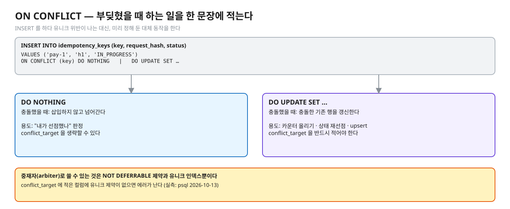
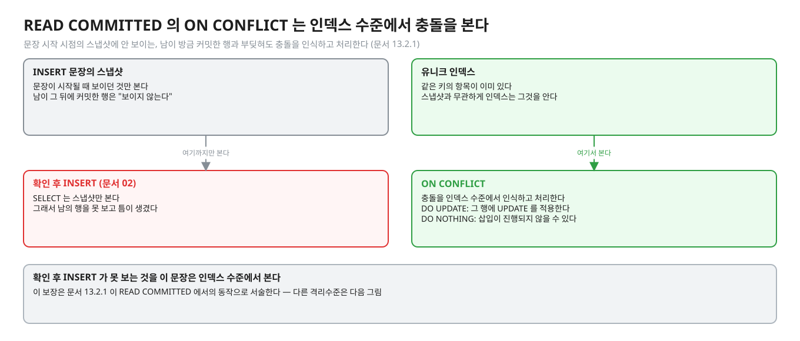
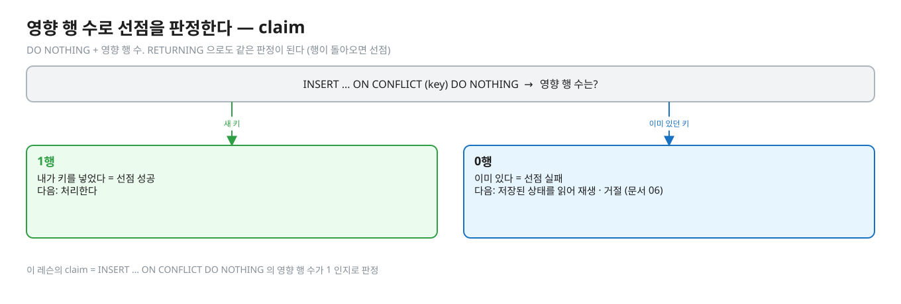
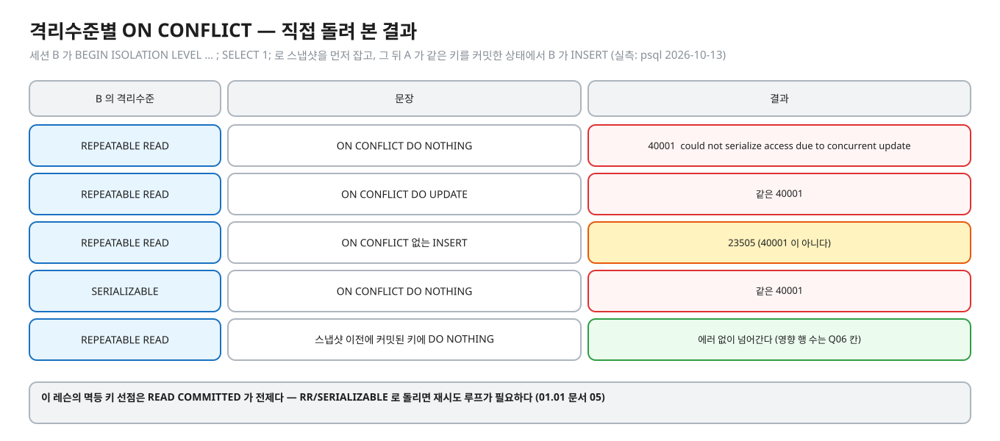
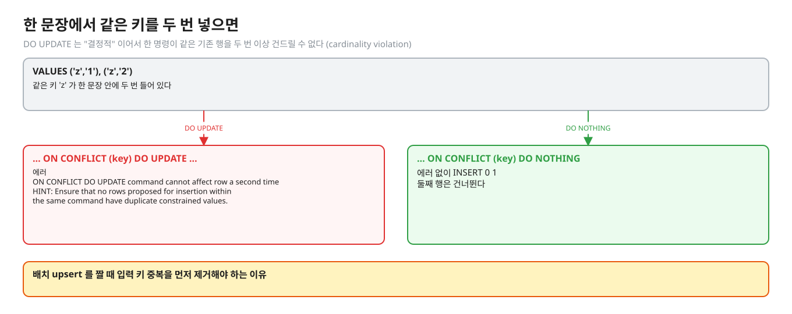
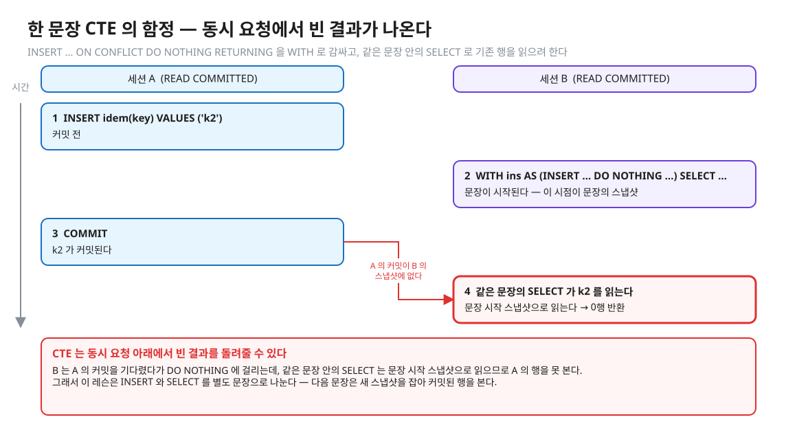
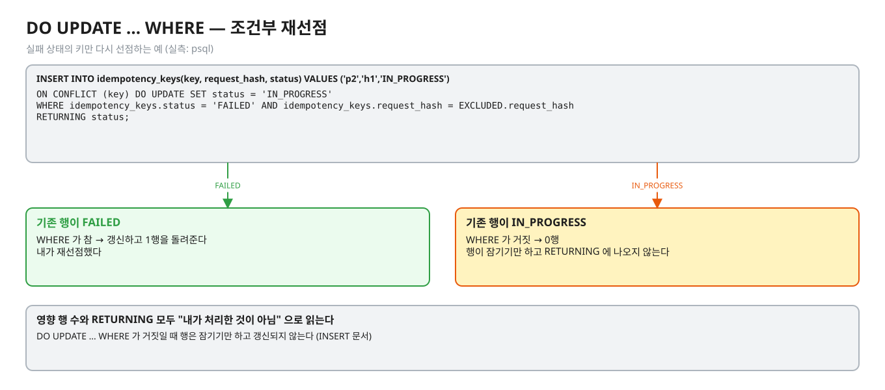
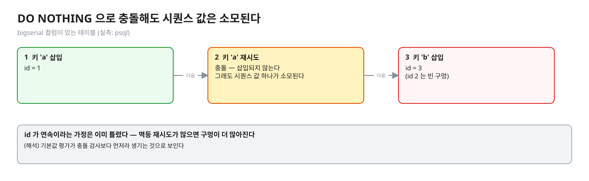

# 04. ON CONFLICT — 한 문장으로 선점하기

> **이 글에서 알게 되는 것**
> 1. `INSERT … ON CONFLICT` 가 "넣거나, 부딪히면 대신 이것을 한다" 를 한 문장으로 원자적으로 한다는 것, `DO NOTHING` 과 `DO UPDATE` 가 언제 각각 쓰이는지 안다.
> 2. 영향 행 수와 `RETURNING` 으로 내가 선점했는지 판정하는 방법과, 그 판정이 READ COMMITTED 를 전제한다는 것을 안다.
> 3. 한 문장 CTE · 배치 upsert · 시퀀스 소모 같은 함정이 왜 생기는지 안다.
>
> **먼저 알면 좋은 것**: [02. 확인하고 넣기(check-then-act)의 경쟁](02-check-then-act.md) · [03. 유니크 제약과 동시 INSERT](03-unique-constraint-concurrent-insert.md)
> **다음 글**: [05. 실패한 트랜잭션](05-failed-transaction.md)
> **구분**: 필수 — ② 원리 (① 에서 예측을 먼저 한 뒤 읽는다)

## 에러를 피하면서 선점하고 싶다

03 에서 같은 키의 INSERT 가 동시에 올 때의 결과가 앞선 트랜잭션이 어떻게 끝나느냐에 갈리는 것을 봤다. 위반 에러는 정상 동작이지만, 멱등 키를 선점하려는 코드에서 "이미 있다" 는 에러가 매번 예외로 올라오는 것은 다루기 번거롭다 (해석). 그래서 묻게 된다. 중복 INSERT 를 에러 없이 처리하려면 어떻게 할까? `DO NOTHING` 과 `DO UPDATE` 는 언제 각각 쓸까? 동시에 와도 안전할까?

실무에서 이것은 멱등 키 선점의 핵심 문장이다. 영향 행 수 하나로 "내가 처리자인가" 를 판정한다.

```sql
INSERT INTO idempotency_keys (key, request_hash, status)
VALUES ('pay-1', 'h1', 'IN_PROGRESS')
ON CONFLICT (key) DO NOTHING;
```

## 개념을 하나씩 보자

### 1. ON CONFLICT 와 두 가지 절

[INSERT 문서](https://www.postgresql.org/docs/16/sql-insert.html) 에 따르면 `ON CONFLICT` 는 유니크 위반 · 배타 제약 위반 에러를 내는 대신 할 **대체 동작**을 정한다.


<sub>편집: [diagrams/blog04-clauses.excalidraw](diagrams/blog04-clauses.excalidraw)</sub>

| 절 | 충돌했을 때 | 용도 |
|---|---|---|
| `DO NOTHING` | 삽입하지 않고 넘어간다 | "내가 선점했나" 판정 |
| `DO UPDATE SET …` | 충돌한 **기존 행**을 갱신한다 | 카운터 올리기 · 상태 재선점 · upsert |

INSERT 문서의 규칙은 이렇다.

- `DO NOTHING` 은 conflict_target 을 생략할 수 있다(충돌 가능한 모든 제약을 처리). `DO UPDATE` 는 **conflict_target 을 반드시** 적어야 한다 — 생략하면 `ON CONFLICT DO UPDATE requires inference specification or constraint name` (실측: psql 2026-10-13).
- 중재자(arbiter)로 쓸 수 있는 것은 `NOT DEFERRABLE` 제약과 유니크 인덱스뿐이다. conflict_target 에 적은 컬럼에 유니크 제약이 없으면 `there is no unique or exclusion constraint matching the ON CONFLICT specification` (실측: psql).
- **`DO UPDATE` 의 보장**: "`ON CONFLICT DO UPDATE` 는 원자적인 INSERT 또는 UPDATE 결과를 보장한다. 독립적인 에러가 없다면 높은 동시성에서도 둘 중 하나가 보장된다" (INSERT 문서 · ON CONFLICT 절). upsert 라는 이름이 여기서 온다. 13.2.1 은 이 보장을 READ COMMITTED 에서의 동작으로 서술한다 — 다른 격리수준은 아래에서 본다.

### 2. 어떻게 틈 없이 동작하나 — READ COMMITTED 에서의 의미

02 의 "확인 후 INSERT" 는 스냅샷만 봐서 남의 행을 못 봤다. `ON CONFLICT` 는 무엇이 다를까. [문서 13.2.1](https://www.postgresql.org/docs/16/transaction-iso.html) 은 이렇게 쓴다.

- `DO UPDATE`: "READ COMMITTED 에서 삽입하려던 각 행은 삽입되거나 갱신된다. 무관한 에러가 없다면 둘 중 하나가 보장된다. 충돌이 **아직 INSERT 에게 보이지 않는 다른 트랜잭션**에서 비롯됐다면, UPDATE 절은 그 행에 적용된다 — 그 행의 어떤 버전도 명령에게 관례적으로는 보이지 않을 수 있는데도."
- `DO NOTHING`: "다른 트랜잭션의 결과(그 효과가 INSERT 의 스냅샷에 보이지 않는) 때문에 어떤 행의 삽입이 진행되지 않을 수 있다. 이것도 READ COMMITTED 모드에서만 그렇다."


<sub>편집: [diagrams/blog04-rc.excalidraw](diagrams/blog04-rc.excalidraw)</sub>

풀어 쓰면: 문장 시작 시점의 스냅샷에 없던 행(남이 방금 커밋한)과 부딪혀도 `ON CONFLICT` 는 그 충돌을 인식하고 처리한다. 확인 후 INSERT(문서 02)가 보지 못하는 것을 이 문장은 인덱스 수준에서 본다.

상대가 아직 커밋하지 않은 키 앞에서는 어떻게 될까? `DO NOTHING` 도 상대가 아직 커밋하지 않은 키 앞에서 어떻게 되는지는 문서 03 의 유니크 검사 규칙이 정한다. 기다리는지 · 풀린 뒤 몇 행인지는 Q07 로 예측한다.

### 3. 영향 행 수와 RETURNING

선점을 판정하려면 "내가 넣었나" 를 알아야 한다. 두 가지 신호가 있다.

- INSERT 의 명령 태그는 `INSERT oid count` 이고 `count` 는 **삽입되거나 갱신된 행 수**다 (`oid` 는 항상 0). JDBC `executeUpdate()` 가 이 값을 돌려준다.
- `RETURNING` 은 "실제로 삽입된(또는 `DO UPDATE` 로 갱신된) 각 행" 을 돌려준다. "성공적으로 삽입 또는 갱신된 행만 돌려준다. 예: `DO UPDATE … WHERE` 조건이 안 맞아 잠기기만 하고 갱신되지 않은 행은 반환되지 않는다" (INSERT 문서).

<details><summary>실측 — 예측을 끝낸 뒤 펼친다 (Q06 · Q07 · Q08)</summary>

정답 상태 기준 ([정답 patch](../../../solutions/01.03.patch)):

| Q | 상황 | 결과 |
|---|---|---|
| Q06 | 이미 있는 `k1` 에 `DO NOTHING` | 영향 행 0 · `RETURNING key` 0행 (실측: Q06) |
| Q07 | A 커밋 전, B 가 `DO NOTHING` | 기다린다(true). A 가 커밋하면 영향 행 0 (실측: Q07) |
| Q08 | `DO UPDATE SET hits = idem.hits + 1 RETURNING payload, hits` | payload = `first`, hits = 2 (실측: Q08) |

Q08 의 payload 가 `first` 인 이유: `DO UPDATE` 는 SET 에 적은 컬럼만 바꾸고 나머지는 기존 값을 둔다. 새로 넣으려던 `second` 는 `EXCLUDED.payload` 로만 참조할 수 있다.

같은 상황을 psql 로 (실측: psql 2026-10-13):

```
-- A 가 k2 INSERT 후 커밋 전, B 의 DO NOTHING 은 멈춰 있다가 A 커밋 뒤:
INSERT 0 0
-- A 가 롤백한 뒤 B 의 DO NOTHING RETURNING key:
 key
-----
 k2        ->  INSERT 0 1   (B 가 선점)
-- A 가 커밋한 뒤 B 의 DO UPDATE … RETURNING payload, hits:
 payload | hits
---------+------
 A       |    2              (B 에게 "보이지 않던" A 의 행을 갱신해 돌려준다)
```

</details>

### 4. 영향 행 수로 선점을 판정하는 방법

`DO NOTHING` + 영향 행 수가 이 레슨의 `claim` 이다. `RETURNING` 으로도 같은 판정이 된다 (행이 돌아오면 선점).

<details><summary>판정표 — Q06 · Q07 의 답이 들어 있다. 예측 뒤에 펼친다</summary>


<sub>편집: [diagrams/blog04-claim.excalidraw](diagrams/blog04-claim.excalidraw)</sub>

| 결과 | 의미 | 다음 |
|---|---|---|
| 1행 | 내가 키를 넣었다 | 처리한다 |
| 0행 | 이미 있다 | 저장된 상태를 읽어 재생 · 거절 (문서 06) |

</details>

### 정리: 세 개의 관계

| 개념 | 한 줄로 | 앞의 것과 다른 점 |
|---|---|---|
| `DO NOTHING` | 부딪히면 넘어간다 | — |
| `DO UPDATE` | 부딪히면 기존 행을 갱신한다 | 선점 판정만이 아니라 갱신까지 하고, conflict_target 이 필수다 |
| `claim` | 영향 행 수가 1 인지로 선점을 판정한다 | `DO NOTHING` 의 결과를 쓰는 방법 |

## PostgreSQL 에서는

### 격리수준별 차이 — 문서에 있는 것과 직접 본 것

- READ COMMITTED: 위 문서 13.2.1 의 두 문단. 이 레슨이 쓰는 수준이다.
- REPEATABLE READ · SERIALIZABLE: 13.2 문서의 REPEATABLE READ 절은 `ON CONFLICT` 를 언급하지 않는다. 같은 절의 "스냅샷 이후 다른 트랜잭션이 바꾼 행을 고치거나 잠그려 하면 `could not serialize access due to concurrent update`" 규칙이 나열하는 문장은 UPDATE · DELETE · MERGE · SELECT FOR UPDATE/SHARE 이다. 직접 돌려 본 것 (실측: psql 2026-10-13, 세션 B 가 `BEGIN ISOLATION LEVEL … ; SELECT 1;` 로 스냅샷을 먼저 잡고, 그 뒤 A 가 같은 키를 커밋한 상태에서 B 가 INSERT):


<sub>편집: [diagrams/blog04-isolation.excalidraw](diagrams/blog04-isolation.excalidraw)</sub>

| B 의 격리수준 | 문장 | 결과 |
|---|---|---|
| REPEATABLE READ | `ON CONFLICT DO NOTHING` | `ERROR: could not serialize access due to concurrent update` (40001) |
| REPEATABLE READ | `ON CONFLICT DO UPDATE` | 같은 40001 |
| REPEATABLE READ | ON CONFLICT 없는 INSERT | `23505` (40001 이 아니다) |
| SERIALIZABLE | `ON CONFLICT DO NOTHING` | 같은 40001 |
| REPEATABLE READ | 스냅샷 **이전에** 커밋된 키에 `DO NOTHING` | 에러 없이 넘어간다 (영향 행 수는 Q06 의 접힌 칸) |

(해석) 스냅샷 이후에 커밋된 충돌 행은 B 의 스냅샷에 보이지 않는데 갱신/무시할 수도 없어서 엔진이 직렬화 실패로 처리하는 것으로 보인다. 소스를 읽어 확인하지는 않았다. **이 레슨의 멱등 키 선점은 READ COMMITTED 가 전제다** — RR/SERIALIZABLE 로 돌리면 재시도 루프가 필요하다 ([01.01 문서 05](../../l01-isolation-mvcc/docs/05-serializable-ssi-retry.md)). 문서 13.2.3 은 SERIALIZABLE 에서 확인 후 INSERT 해도 유니크 위반을 볼 수 있다고 쓴다 (문서 02).

### 한 문장에서 같은 키를 두 번 넣으면

`DO UPDATE` 는 "결정적(deterministic)" 이어서 한 명령이 같은 기존 행을 두 번 이상 건드릴 수 없다 — 위반하면 cardinality violation (INSERT 문서).


<sub>편집: [diagrams/blog04-batch-dup.excalidraw](diagrams/blog04-batch-dup.excalidraw)</sub>

실측: `VALUES ('z','1'),('z','2') ON CONFLICT (key) DO UPDATE …` → `ON CONFLICT DO UPDATE command cannot affect row a second time` + `HINT: Ensure that no rows proposed for insertion within the same command have duplicate constrained values.` 같은 문장을 `DO NOTHING` 으로 바꾸면 에러 없이 `INSERT 0 1` (둘째 행은 건너뜀). 배치 upsert 를 짤 때 입력 키 중복을 먼저 제거해야 하는 이유.

### 충돌한 기존 행이 필요할 때 — CTE 한 문장의 함정

충돌한 기존 값을 읽는 방법은 Q06 의 접힌 칸을 본 뒤 생각한다. 보통은 INSERT 문장과 SELECT 문장, 두 문장이 된다. 한 문장으로 하려는 CTE 패턴:

```sql
WITH ins AS (INSERT INTO idem(key,payload) VALUES ('k2','B') ON CONFLICT (key) DO NOTHING RETURNING key, payload)
SELECT 'inserted' src, * FROM ins
UNION ALL
SELECT 'existing', key, payload FROM idem WHERE key = 'k2' AND NOT EXISTS (SELECT 1 FROM ins);
```

이미 **커밋된** 키라면 'existing' 이 나온다 (실측: psql). 그러나 A 가 같은 키를 INSERT 하고 커밋 전일 때 B 가 이 문장을 실행하면 어떻게 될까? 문서 03 의 규칙과 Q07 을 예측한 뒤 아래 접힌 칸을 펼친다.

<details><summary>동시 실행 결과 — Q07 의 답이 들어 있다. 예측 뒤에 펼친다</summary>

B 는 A 의 커밋을 기다렸다가 `DO NOTHING` 에 걸리는데 같은 문장 안의 SELECT 는 **문장 시작 스냅샷**으로 읽으므로 A 의 행을 못 본다 → **0행**이 반환됐다 (실측: psql 2026-10-13).

</details>

즉 이 CTE 는 동시 요청 아래에서 빈 결과를 돌려줄 수 있다. 그래서 이 레슨은 INSERT 와 SELECT 를 **별도 문장**으로 나눈다 (`claim` → `replay`). READ COMMITTED 에서 다음 문장은 새 스냅샷을 잡아 커밋된 행을 본다.

<details><summary>그림 — Q07 의 답(기다리는 동작)이 들어 있다. 예측 뒤에 펼친다</summary>


<sub>편집: [diagrams/blog04-cte-trap.excalidraw](diagrams/blog04-cte-trap.excalidraw)</sub>

</details>

### DO UPDATE 의 비용과 쓰임

`DO UPDATE` 는 충돌 때마다 기존 행에 쓴다 — 행 락을 잡고(이미 행 락이 잡혀 있으면 기다린다: 실측 psql, 다른 세션이 같은 행을 갱신 중일 때 `DO UPDATE` 가 그 커밋까지 기다렸다가 최신 값 위에서 갱신해 hits = 12 를 돌려줬다), 새 튜플 버전을 만들어 WAL 과 죽은 튜플이 생긴다 ([01.01 문서 02](../../l01-isolation-mvcc/docs/02-mvcc-tuple-storage.md)). 선점 판정만 필요하면 쓰기 없는 `DO NOTHING` 이 싸다 (해석 — 비용 크기는 측정하지 않았다).

`DO UPDATE … WHERE` 는 조건부 재선점에 쓸 수 있다. 실패 상태의 키만 다시 선점하는 예 (실측: psql):

```sql
INSERT INTO idempotency_keys(key, request_hash, status) VALUES ('p2','h1','IN_PROGRESS')
ON CONFLICT (key) DO UPDATE SET status = 'IN_PROGRESS'
WHERE idempotency_keys.status = 'FAILED' AND idempotency_keys.request_hash = EXCLUDED.request_hash
RETURNING status;
```


<sub>편집: [diagrams/blog04-reclaim.excalidraw](diagrams/blog04-reclaim.excalidraw)</sub>

기존 행이 `FAILED` 일 때는 1행을 돌려주고(내가 재선점), `IN_PROGRESS` 일 때는 0행이다 — WHERE 가 거짓이면 행이 잠기기만 하고 `RETURNING` 에 나오지 않는다 (INSERT 문서).

### 시퀀스 값 소모

`bigserial` 컬럼이 있는 테이블에 `DO NOTHING` 으로 충돌시키면 시퀀스 값이 소모된다. 실측: 키 `a` 삽입(id 1), `a` 재시도(충돌), 키 `b` 삽입 → `b` 의 id 는 3 (실측: psql).


<sub>편집: [diagrams/blog04-seq-gap.excalidraw](diagrams/blog04-seq-gap.excalidraw)</sub>

id 에 빈 구멍이 생기므로 "id 가 연속" 을 가정하는 코드는 이미 틀렸지만, 특히 멱등 재시도가 많으면 구멍이 많아진다 (해석 — 기본값 평가가 충돌 검사보다 먼저라 생기는 것으로 보인다).

### 자주 하는 오해

1. **"`DO NOTHING` 이니 기다림이 없다."** 이름만 보고 판단하지 않는다 — 미커밋 충돌 앞에서의 동작은 Q07 의 접힌 칸.
2. **"`ON CONFLICT` 는 락 없이 동작한다."** 판정을 위해 유니크 인덱스 검사(문서 03)와 행 락을 쓴다. "에러를 피한다" 와 "대기가 없다" 는 다른 말이다.
3. **"`DO NOTHING RETURNING` 으로 기존 행을 읽을 수 있다."** 충돌 때 `RETURNING` 이 무엇을 돌려주는지는 Q06 의 접힌 칸에서 확인한다.
4. **"`ON CONFLICT` 는 모든 격리수준에서 같다."** 문서는 READ COMMITTED 의 의미를 쓰고, 스냅샷 이후 커밋된 키에서는 RR · SERIALIZABLE 이 40001 을 냈다 (실측).
5. **"`ON CONFLICT` 가 있으면 SAVEPOINT 가 필요 없다."** 맞다 — 에러 자체가 없으므로 (문서 05). 단 `ON CONFLICT` 가 다루지 않는 에러(다른 제약 위반)는 여전히 에러다.
6. **"`DO UPDATE` 는 새 값으로 전부 덮어쓴다."** 어떤 컬럼이 바뀌는지는 Q08 의 접힌 칸에서 확인한다.

### 앱 · 프레임워크로 오면

JDBC: `PreparedStatement#executeUpdate()` 가 `INSERT 0 N` 의 N 을 돌려준다 (이 레슨 `claim`). JPA 의 `save` 는 `ON CONFLICT` 를 쓰지 않는다 — 네이티브 쿼리가 필요하다 (문서 07).

## MySQL InnoDB 는 어떻게 다른가 (심화)

비슷한 도구가 둘 있다 ([문서 07](07-app-framework-mysql.md) 에 상세): `INSERT IGNORE` 와 `INSERT … ON DUPLICATE KEY UPDATE`. PostgreSQL 의 `DO NOTHING` 에 가장 가까운 것이 `INSERT IGNORE` 인데 무시하는 에러가 중복 키뿐이 아니다.

## 한눈에 정리

| | 한 줄로 | 근거 |
|---|---|---|
| `DO NOTHING` | 부딪히면 넘어간다. conflict_target 은 생략 가능 | INSERT 문서 |
| `DO UPDATE` | 부딪히면 기존 행을 갱신한다. conflict_target 필수. READ COMMITTED 에서 삽입 또는 갱신이 보장된다 | INSERT 문서 · 문서 13.2.1 |
| 영향 행 수 · `RETURNING` | 삽입되거나 갱신된 행만 센다 · 돌려준다 | INSERT 문서 |
| REPEATABLE READ · SERIALIZABLE | 스냅샷 이후 커밋된 키에는 `ON CONFLICT` 도 40001 | 실측: psql 2026-10-13 |
| 한 문장 CTE | 문장 시작 스냅샷으로 읽어 동시 요청에서 빈 결과가 날 수 있다 | 실측: psql 2026-10-13 |
| 시퀀스 | `DO NOTHING` 충돌에도 소모된다 | 실측: psql |

- `ON CONFLICT` 는 에러 대신 대체 동작을 정하고, `DO NOTHING` + 영향 행 수가 `claim` 이다.
- 문서가 서술하는 보장은 READ COMMITTED 에서의 것이다. RR · SERIALIZABLE 에서는 40001 이 나서 재시도 루프가 필요하다.
- "에러를 피한다" 와 "대기가 없다" 는 다른 말이다. 미커밋 충돌 앞에서는 문서 03 의 규칙이 적용된다.
- 충돌한 기존 행을 읽으려면 별도 SELECT 문장으로 나눈다. 같은 문장 안의 SELECT 는 새 행을 못 본다.

## 스스로 확인

1. `ON CONFLICT DO NOTHING` 이 0행이면 무엇을 알 수 있고 무엇을 모르나?
   <details><summary>답</summary>
   "이미 같은 키의 행이 있다(커밋됐거나, 내 트랜잭션이 기다리다 풀려 보게 된)" 는 것만 안다. 그 행이 어떤 상태인지(처리 중 · 완료 · 다른 내용)는 모른다 — 별도 SELECT 로 읽는다 (문서 06). 같은 문장의 CTE SELECT 는 동시 요청에서 비어 나올 수 있다.
   </details>
2. `DO UPDATE` 가 "atomic INSERT or UPDATE" 라는 것은 정확히 무엇을 보장하나?
   <details><summary>답</summary>
   문서 문장은 "독립적인 에러가 없다면 삽입 또는 갱신 둘 중 하나가 보장된다" 이고, 13.2.1 은 이것을 READ COMMITTED 에서의 의미로 쓴다 (REPEATABLE READ · SERIALIZABLE 은 위 표의 40001). 그 범위에서 충돌한 행이 "삽입도 갱신도 안 된 채" 끝나지는 않는다. READ COMMITTED 에서는 B 의 스냅샷에 보이지 않던 남의 커밋 행도 갱신한다 (문서 13.2.1, 실측: psql). 갱신 결과가 비즈니스적으로 맞다는 보장은 아니다 — `SET` 의 식은 앱이 맞게 써야 한다.
   </details>
3. 격리수준을 REPEATABLE READ 로 올리면 `ON CONFLICT` 는 어떻게 되나?
   <details><summary>답</summary>
   문서는 이 조합을 언급하지 않는다. 직접 돌려 보니 스냅샷을 잡은 뒤 다른 트랜잭션이 같은 키를 커밋하면 `DO NOTHING` · `DO UPDATE` 둘 다 `40001` 로 실패했고, 스냅샷 전에 커밋된 키에는 에러 없이 0행이었다 (실측: psql 2026-10-13). 그래서 키 선점 트랜잭션은 READ COMMITTED 로 두거나 40001 재시도를 둔다.
   </details>
4. 영향 행 수 대신 `RETURNING` 을 쓰는 것과 차이가 있나?
   <details><summary>답</summary>
   판정은 같다 (행이 돌아오면 삽입됨). `RETURNING` 은 서버가 생성한 값(id 등)도 같이 받는다는 이점이 있다. `DO UPDATE … WHERE` 가 거짓일 때는 행이 안 나오므로 영향 행 수와 `RETURNING` 모두 "내가 처리한 것이 아님" 으로 읽는다.
   </details>

## 이 레슨에서 직접 보기

| 어디서 | 무엇을 |
|---|---|
| Q06 | `DO NOTHING` 의 영향 행 수와 `RETURNING` |
| Q07 | 처리 중인 키에 `DO NOTHING` — 기다리나 |
| Q08 | `DO UPDATE … RETURNING` 은 무엇을 돌려주나 |
| 구현 `claim` | `INSERT … ON CONFLICT DO NOTHING` 의 영향 행 수가 1 인지로 판정 |
| 장면 2 · 3 · 4 | psql 로 같은 흐름 |

## 출처

- [PostgreSQL 16 · INSERT](https://www.postgresql.org/docs/16/sql-insert.html) — ON CONFLICT 절 · atomic 보장 · conflict_target 필수 · arbiter · deterministic · RETURNING 범위 · 명령 태그
- [PostgreSQL 16 · 13.2 Transaction Isolation](https://www.postgresql.org/docs/16/transaction-iso.html) — Read Committed 의 INSERT ON CONFLICT 두 문단 · Repeatable Read 의 concurrent update · SERIALIZABLE 의 유니크 위반
- [PostgreSQL 16 · 64.5 Index Uniqueness Checks](https://www.postgresql.org/docs/16/index-unique-checks.html) — 미커밋 충돌 대기
- 직접 실행: PostgreSQL 16.14 (실측: psql 2026-10-13)
