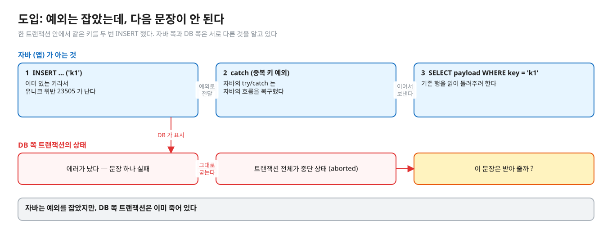
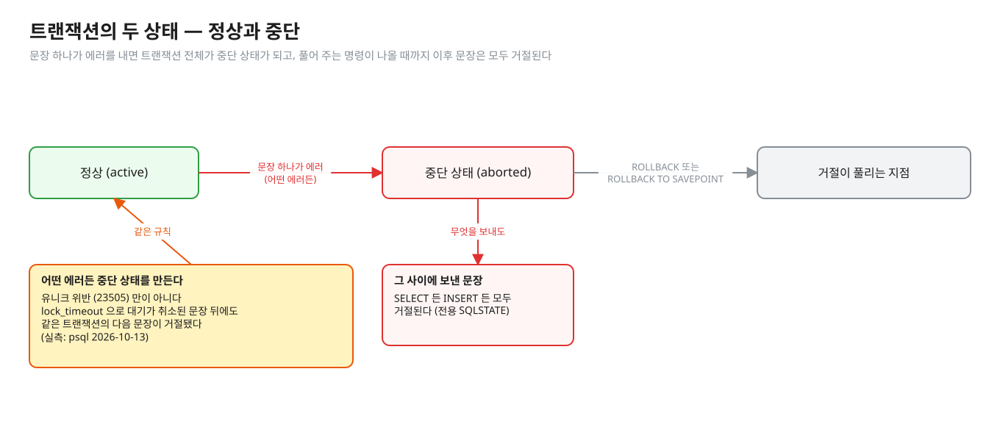
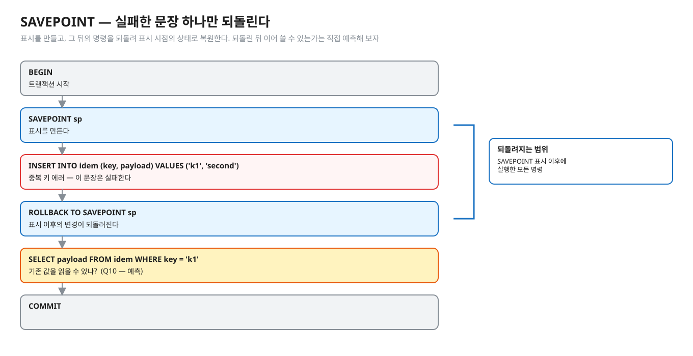
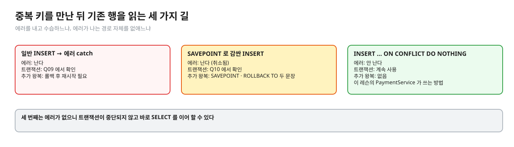
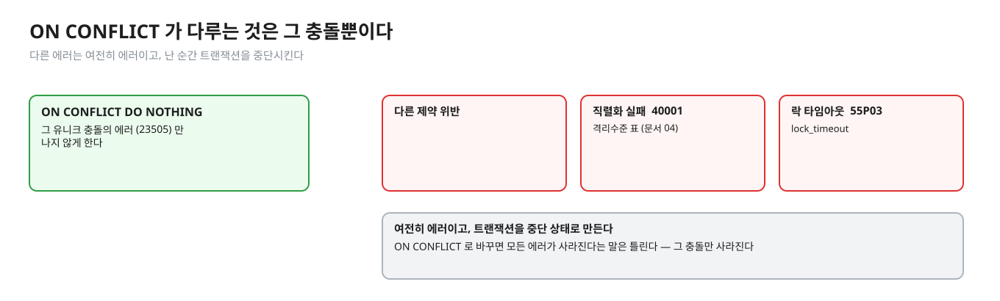
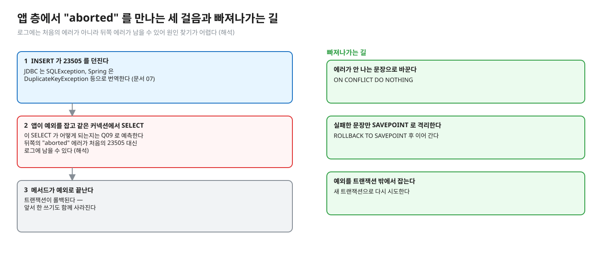

# 05. 실패한 트랜잭션 — 에러 뒤의 트랜잭션, SAVEPOINT, ON CONFLICT

> **이 글에서 알게 되는 것**
> 1. PostgreSQL 은 트랜잭션 안에서 에러가 나면 그 트랜잭션 전체를 "중단 상태" 로 만들어 이후 문장을 거절한다는 것, 자바에서 예외를 잡아도 이 상태는 풀리지 않는다는 것을 안다.
> 2. 에러를 잡고 이어 가려면 SAVEPOINT 가 필요하다는 것, 애초에 에러를 내지 않는 방법이 ON CONFLICT 라는 것을 안다.
> 3. 앱 층(Spring · JDBC)에서 이 상태가 어떤 모양으로 보이는지, 빠져나가는 길이 무엇인지 안다.
>
> **먼저 알면 좋은 것**: [04. ON CONFLICT](04-on-conflict.md) — 중복 키에서 에러를 내지 않는 INSERT.
> **다음 글**: [06. 멱등 키 설계](06-idempotency-key-design.md)
> **구분**: 심화 — 꼬리질문 대비 (레슨을 마친 뒤 · 면접 전)

## 예외를 잡았는데 다음 문장이 안 된다

`@Transactional` 메서드 안에서 중복 키 예외(`DuplicateKeyException`)를 잡고 `findByKey` 로 기존 행을 조회하는 코드가 있다. 읽기에는 자연스럽다. "이미 있으면 그걸 돌려주면 되지." 그런데 이런 코드가 운영에서 터진다. 자바에서는 예외를 잡았는데, DB 쪽 트랜잭션은 이미 죽어 있기 때문이다.


<sub>편집: [diagrams/blog05-intro.excalidraw](diagrams/blog05-intro.excalidraw)</sub>

그림의 위쪽 줄은 자바가 아는 것이다. 예외가 났고, catch 로 잡았고, 이어서 SELECT 를 보냈다. 아래쪽 줄은 DB 가 아는 것이다. 첫 INSERT 가 에러를 냈으니 트랜잭션은 이미 "중단" 으로 표시됐다. 두 쪽의 상태가 어긋난 채로 SELECT 가 들어간다. 이 글은 그 어긋남이 무엇이고, 어떻게 피하는지를 다룬다.

## 개념을 하나씩 보자

### 1. 중단 상태 (aborted)

자바의 try/catch 는 자바의 흐름을 복구한다. 하지만 DB 서버 쪽 트랜잭션 상태는 별개다. PostgreSQL 은 문장 하나가 에러를 내면 트랜잭션 전체를 **중단 상태(aborted)** 로 표시하고, 이후의 문장은 `ROLLBACK`(또는 `ROLLBACK TO SAVEPOINT`)이 나올 때까지 모두 거절한다. 이 거절에는 전용 SQLSTATE 가 있다. ([부록 A](https://www.postgresql.org/docs/16/errcodes-appendix.html) · 코드와 메시지 원문은 Q09 의 접힌 칸 · [01.01 문서 01](../../l01-isolation-mvcc/docs/01-anomalies-and-isolation-levels.md) 도 같은 메시지를 실측으로 확인)


<sub>편집: [diagrams/blog05-tx-states.excalidraw](diagrams/blog05-tx-states.excalidraw)</sub>

여기서 짚을 점이 하나 있다. 중단 상태는 유니크 위반(`23505`)만이 아니라 **어떤 에러든** 만든다. 예를 들어 `lock_timeout` 으로 대기가 취소된 문장 뒤에 같은 트랜잭션에서 다음 문장을 보내도 거절됐다. (실측: psql 2026-10-13: `ERROR: canceling statement due to lock timeout` 다음 `SELECT 1` 이 `current transaction is aborted…`) 그러니 이 글의 규칙은 중복 키에만 해당하는 특수 사정이 아니다. 에러가 나면 그 트랜잭션은 거기서 끝이라고 생각하는 편이 안전하다.

그렇다면 중복 키를 만났을 때 기존 행을 읽으려면 어떻게 해야 할까. 길은 세 가지다. 하나는 에러가 난 뒤에 문장 단위로 수습하는 SAVEPOINT 이고, 하나는 에러가 나는 경로 자체를 없애는 ON CONFLICT 이며, 나머지는 롤백하고 새 트랜잭션으로 다시 하는 것이다.

## PostgreSQL 에서는

### 문장 단위 복구 — SAVEPOINT

[SAVEPOINT](https://www.postgresql.org/docs/16/sql-savepoint.html) 는 "트랜잭션 안에 표시를 만들어, 그 이후 실행한 모든 명령을 되돌려 표시 시점의 상태로 복원할 수 있게 하는 것" 이다. `ROLLBACK TO SAVEPOINT` 로 돌아가면 그 표시 이후의 변경이 되돌려진다. 중단 상태와 무엇이 다른가. 중단 상태는 트랜잭션 전체가 쓸 수 없게 되는 것이고, SAVEPOINT 는 그 안에서 되돌아갈 지점을 미리 찍어 두는 장치다.


<sub>편집: [diagrams/blog05-savepoint.excalidraw](diagrams/blog05-savepoint.excalidraw)</sub>

```sql
BEGIN;
SAVEPOINT sp;
INSERT INTO idem (key, payload) VALUES ('k1', 'second');   -- 중복 키 에러
ROLLBACK TO SAVEPOINT sp;
SELECT payload FROM idem WHERE key = 'k1';                 -- 기존 값을 읽을 수 있나? (Q10)
COMMIT;
```

에러가 난 트랜잭션이 이어 쓸 수 있는지는 Q10 으로 예측한다. 결과는 아래 "이 레슨에서 직접 보기" 의 접힌 칸에 있다.

SAVEPOINT 의 비용 · 하위 트랜잭션(subtransaction) 수 한계는 이 문서에서 근거를 확인하지 않았다 — 빼 둔다.

### 에러를 피하는 방법 — ON CONFLICT

`INSERT … ON CONFLICT DO NOTHING` 은 중복 키에서 **에러를 내지 않는다** (문서 04). 에러가 없으니 트랜잭션이 중단되지 않고 바로 SELECT 를 이어 할 수 있다. SAVEPOINT 와 무엇이 다른가. SAVEPOINT 는 에러가 난 뒤 수습하고, ON CONFLICT 는 에러가 나지 않게 한다.


<sub>편집: [diagrams/blog05-three-ways.excalidraw](diagrams/blog05-three-ways.excalidraw)</sub>

| 방법 | 에러 | 트랜잭션 | 추가 왕복 |
|---|---|---|---|
| 일반 INSERT → 에러 catch | 난다 | Q09 에서 확인 | 롤백 후 재시작 필요 |
| SAVEPOINT 로 감싼 INSERT | 난다 (취소됨) | Q10 에서 확인 | SAVEPOINT · ROLLBACK TO 두 문장 |
| `ON CONFLICT DO NOTHING` | 안 난다 | 계속 사용 | 없음 |

이 레슨의 `PaymentService` 는 세 번째를 쓴다. 에러가 나는 경로 자체를 만들지 않았다. 다만 `ON CONFLICT` 가 다루는 것은 **그 충돌뿐**이다.


<sub>편집: [diagrams/blog05-on-conflict-scope.excalidraw](diagrams/blog05-on-conflict-scope.excalidraw)</sub>

다른 제약 위반 · 직렬화 실패(40001, 문서 04 의 격리수준 표) · 락 타임아웃(55P03)은 여전히 에러이고 트랜잭션을 중단시킨다.

### 앱 층에서 "aborted" 를 만나는 모양

실제 코드에서는 이런 순서로 나타난다.


<sub>편집: [diagrams/blog05-app-layers.excalidraw](diagrams/blog05-app-layers.excalidraw)</sub>

1. 트랜잭션 안에서 INSERT 가 `23505` 를 던진다. JDBC 는 `SQLException`, Spring 은 `DuplicateKeyException` 등으로 번역한다 (문서 07).
2. 앱이 예외를 잡고 같은 트랜잭션(같은 커넥션)에서 SELECT 를 보낸다. 거절된다. 이때 에러 메시지는 처음의 23505 가 아니라 이 뒤쪽의 "aborted" 일 수 있어, 로그에서 원인을 찾기 어렵다 (해석).
3. 메서드가 예외로 끝나면 트랜잭션은 롤백된다. 앞서 한 쓰기도 함께 사라진다.

해결은 셋 중 하나다. 에러가 안 나는 문장으로 바꾸거나(ON CONFLICT), 실패한 문장만 SAVEPOINT 로 격리하거나, 예외를 **트랜잭션 밖**에서 잡아 새 트랜잭션으로 다시 시도한다. 재시도 설계는 [01.01 문서 05](../../l01-isolation-mvcc/docs/05-serializable-ssi-retry.md) 에서 본다.

### 자주 하는 오해

1. **"예외를 catch 했으니 트랜잭션은 멀쩡하다."** DB 쪽은 중단 상태다 (Q09).
2. **"SAVEPOINT 는 성능 최적화다."** 문장 단위 복구 도구다. 남발이 괜찮은지는 이 문서에서 확인하지 못했다.
3. **"뒤에 난 \"aborted\" 에러가 원인이다."** 아니다. 결과다. 진짜 원인은 그 앞에 난 첫 에러다.
4. **"롤백하지 않고 SELECT 를 한 번 더 보내면 풀린다."** 풀리지 않는다. `ROLLBACK` 또는 `ROLLBACK TO SAVEPOINT` 가 필요하다.
5. **"ON CONFLICT 로 바꾸면 모든 에러가 사라진다."** 그 충돌만 사라진다.

### 앱 · 프레임워크에서는

- Spring `@Transactional` 은 기본적으로 런타임 예외가 메서드 밖으로 나오면 롤백으로 표시한다. ([Spring · Rolling Back a Declarative Transaction](https://docs.spring.io/spring-framework/reference/data-access/transaction/declarative/rolling-back.html): "RuntimeException 의 인스턴스나 서브클래스일 때 롤백만 가능으로 표시", 체크 예외는 기본 설정에서 롤백하지 않음) 중복 키 예외를 안쪽 메서드에서 잡아 바깥 트랜잭션을 이어 가는 구조가 위험한 이유는 위 DB 쪽 규칙 때문이다.
- 안쪽 `REQUIRES_NEW` 로 새 트랜잭션에서 시도하는 방법이 있지만 이것은 별도 커넥션을 하나 더 쓴다 (해석 — 커넥션 풀 크기와 함께 따져야 한다).
- JDBC 드라이버가 문장마다 자동으로 SAVEPOINT 를 거는 옵션이 있는지는 이 문서에서 확인하지 않았다.

## 한눈에 정리

| | 일반 INSERT → catch | SAVEPOINT | ON CONFLICT DO NOTHING |
|---|---|---|---|
| 중복 키에서 | 에러 | 에러 (취소됨) | 에러 없음 |
| 같은 트랜잭션에서 이어 쓰기 | Q09 | Q10 | 가능 (계속 사용) |
| 비용 | 롤백 후 재시작 | SAVEPOINT · ROLLBACK TO 두 문장 | 없음 |

- 에러가 난 트랜잭션은 중단 상태가 되고, 풀어 주는 명령(`ROLLBACK` · `ROLLBACK TO SAVEPOINT`)이 나올 때까지 모든 문장이 거절된다. 자바의 try/catch 와는 무관하다.
- 중단 상태는 유니크 위반만이 아니라 어떤 에러든 만든다 (lock_timeout 취소도 실측).
- 에러를 피하는 것은 ON CONFLICT, 실패한 문장만 되돌리는 것은 SAVEPOINT, 처음부터 다시 하는 것은 롤백 후 새 트랜잭션이다.
- ON CONFLICT 는 그 충돌만 다룬다. 40001 · 55P03 · 다른 제약 위반은 여전히 에러다.

## 스스로 확인

1. 중복 키 예외를 catch 한 뒤 같은 트랜잭션에서 SELECT 하면 어떻게 되나? 왜?
   <details><summary>답</summary>
   `25P02` 로 거절된다. PostgreSQL 은 에러가 난 트랜잭션을 중단 상태로 두고 ROLLBACK (또는 ROLLBACK TO SAVEPOINT) 전까지 모든 문장을 무시한다 (실측: Q09).
   </details>
2. 그럼 중복 키를 만났을 때 기존 행을 읽는 방법 세 가지는?
   <details><summary>답</summary>
   ① `ON CONFLICT DO NOTHING` 으로 에러를 없애고 0행이면 SELECT. ② SAVEPOINT 로 INSERT 를 감싸고 에러 시 `ROLLBACK TO SAVEPOINT` 후 SELECT (실측: Q10). ③ 트랜잭션을 롤백하고 새 트랜잭션에서 SELECT. 이 레슨은 ①.
   </details>
3. `lock_timeout` 에 걸린 뒤에도 같은 트랜잭션을 이어 쓸 수 있나?
   <details><summary>답</summary>
   없다 — 타임아웃도 에러라서 트랜잭션이 중단 상태가 되고 다음 문장은 25P02 였다 (실측: psql 2026-10-13). 롤백하고 다시 시작해야 한다.
   </details>

## 이 레슨에서 직접 보기

| 어디서 | 무엇을 |
|---|---|
| Q09 | 23505 뒤 같은 트랜잭션의 다음 문장 |
| Q10 | SAVEPOINT 로 감싸면 |
| 장면 3 | psql 프롬프트가 `!` 로 바뀌는 것을 직접 본다 |
| 구현 `pay` | 예외가 나면 `rollback()` 후 다시 던진다 — 키 행도 같이 사라져 같은 키로 재시도할 수 있다 |

문항을 직접 묻는 그림(도입 · SAVEPOINT · 앱 층)은 결과를 `?` 나 "예측" 으로 남겼다. 예측한 뒤에 확인한다.

<details><summary>실측 — 예측을 끝낸 뒤 펼친다 (Q09 · Q10)</summary>

| Q | 상황 | 결과 |
|---|---|---|
| Q09 | 23505 를 받은 트랜잭션에서 에러를 잡고 같은 트랜잭션에서 SELECT | 에러 `25P02` (실측: Q09) |
| Q10 | SAVEPOINT 로 감싼 INSERT 가 23505, `ROLLBACK TO SAVEPOINT` 뒤 SELECT | 성공 (실측: Q10) |

SQLSTATE `25P02` = `in_failed_sql_transaction`, 메시지 `current transaction is aborted, commands ignored until end of transaction block`. psql 에서는 프롬프트 `!` 로 중단 상태가 보인다 (이 레슨 `observe/psql.sh` 의 `%x`).

</details>

## 출처

- [PostgreSQL 16 · Appendix A Error Codes](https://www.postgresql.org/docs/16/errcodes-appendix.html) — 23505 · 25P02 · 55P03
- [PostgreSQL 16 · SAVEPOINT](https://www.postgresql.org/docs/16/sql-savepoint.html) — 표시 이후 명령을 되돌려 상태 복원
- [Spring Framework · Rolling Back a Declarative Transaction](https://docs.spring.io/spring-framework/reference/data-access/transaction/declarative/rolling-back.html) — 기본 롤백 규칙
- [01.01 문서 01](../../l01-isolation-mvcc/docs/01-anomalies-and-isolation-levels.md) — 25P02 메시지 실측
- 직접 실행: PostgreSQL 16.14 (실측: psql 2026-10-13)
