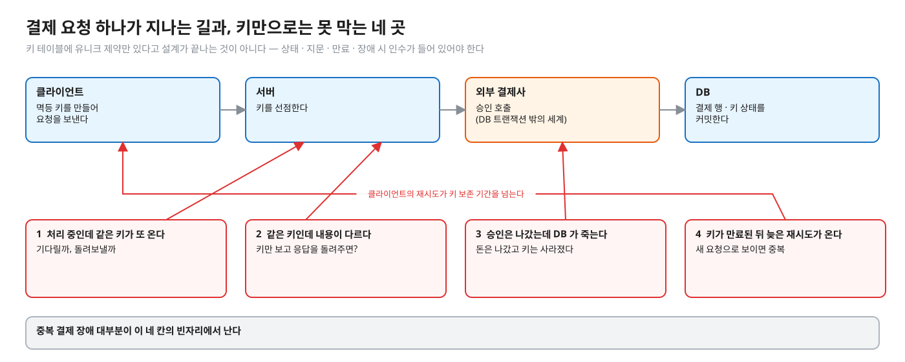
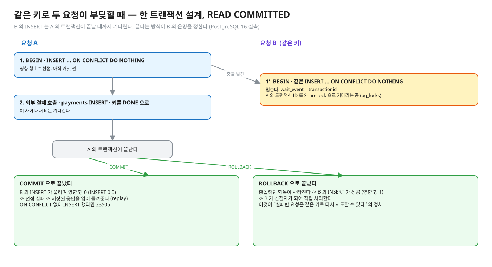
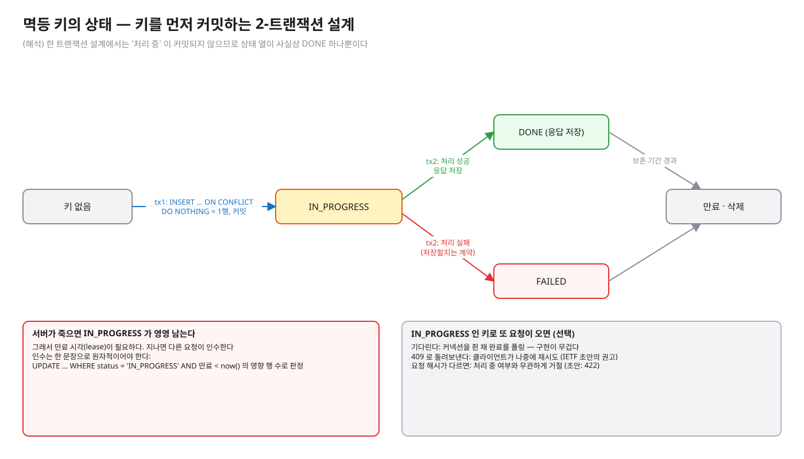
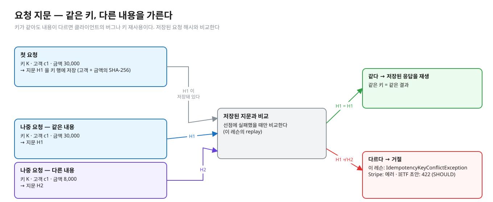
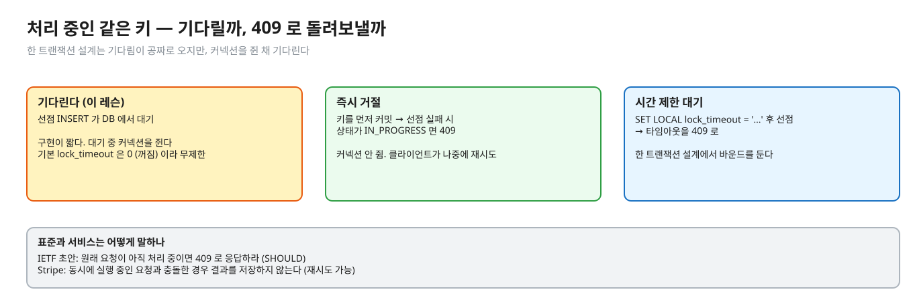
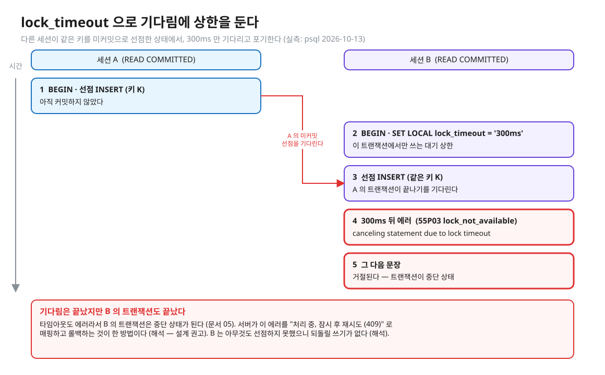
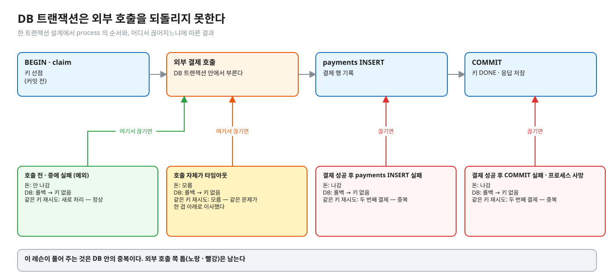
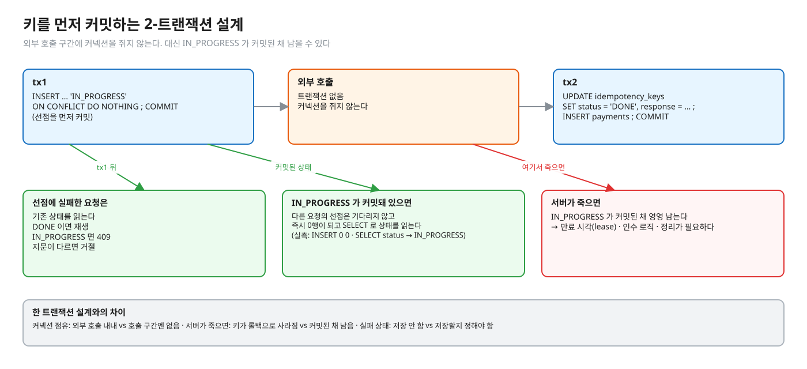
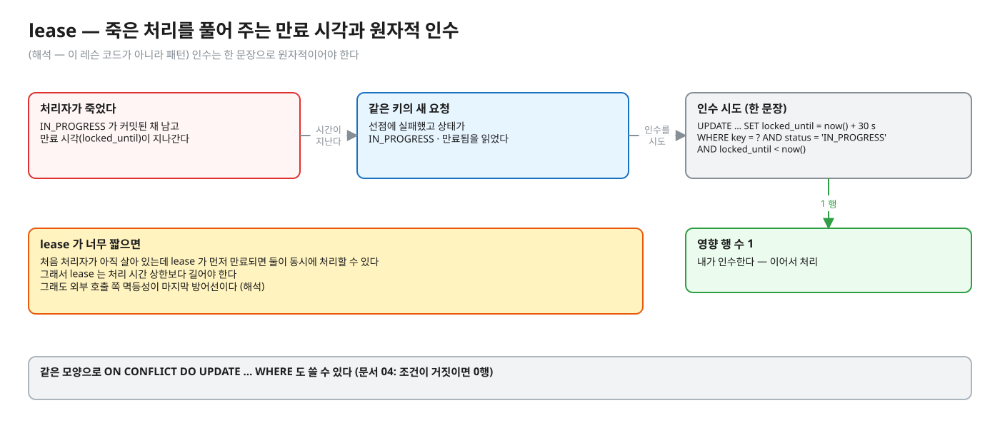

# 06. 멱등 키 설계 — 선점 · 재생 · 지문 · 처리 중 · 만료 · 외부 부수효과

> **이 글에서 알게 되는 것**
> 1. 키 행을 INSERT 로 선점하고, 상태 · 요청 지문 · 응답을 함께 저장해 "재생" 과 "충돌" 을 가르는 설계를 설명할 수 있다.
> 2. 처리 중인 같은 키 · 만료 · 서버 사망 같은 경계에서 선택지가 무엇이고 각각의 대가가 무엇인지 안다.
> 3. 외부 부수효과(결제 승인 호출)가 DB 트랜잭션 밖에 있어서 생기는 틈과, 그 틈을 메우는 방향을 안다.
>
> **먼저 알면 좋은 것**: [03. 유니크 제약과 동시 INSERT](03-unique-constraint-concurrent-insert.md) · [04. ON CONFLICT](04-on-conflict.md) · [05. 실패한 트랜잭션](05-failed-transaction.md)
> **다음 글**: [07. 앱 · 프레임워크 · MySQL](07-app-framework-mysql.md)
> **구분**: 필수 — ② 원리 (① 에서 예측을 먼저 한 뒤 읽는다)

## 키만 있으면 되는 게 아니다

결제 API 에 멱등 키를 도입했다고 하자. 키 테이블에 유니크 제약을 걸었고, 같은 키가 두 번 오면 두 번째 INSERT 가 막힌다. 그런데 운영에서 이런 일이 생긴다. 첫 요청이 아직 결제사 응답을 기다리는 중인데 같은 키가 또 온다. 같은 키로 금액만 다른 요청이 온다. 결제사 승인은 났는데 그 직후 서버가 죽는다. 클라이언트가 며칠 뒤에 같은 키로 재시도한다. 중복 결제 장애 대부분이 이 질문들의 빈 칸에서 난다. 키만 있으면 되는 것이 아니라 상태 전이 · 만료 · 장애 시 인수가 설계에 들어 있어야 한다.


<sub>편집: [diagrams/blog06-intro.excalidraw](diagrams/blog06-intro.excalidraw)</sub>

이 글은 이 네 칸을 하나씩 메운다. 먼저 이 레슨이 택한 설계의 뼈대를 보고, 그 위에 상태 · 재생 · 지문 · 처리 중 · 만료 · 외부 부수효과를 얹는다.

## 개념을 하나씩 보자

### 1. 이 레슨의 설계 — 한 호출 = 한 트랜잭션 (`PaymentService`)

```
BEGIN
  claim   INSERT INTO idempotency_keys (key, request_hash, status)
          VALUES (?, ?, 'IN_PROGRESS') ON CONFLICT (key) DO NOTHING   -- 영향 행 수 판정
    선점 성공 -> process : 외부 결제 호출 -> payments INSERT -> 키를 DONE 으로, 응답 저장
    선점 실패 -> replay  : 저장된 request_hash 와 비교 -> 같으면 저장된 응답, 다르면 예외
COMMIT   (예외면 ROLLBACK -- 키 행도 같이 사라진다)
```

테이블은 `idempotency_keys (key PK, request_hash, status, response)` 와 `payments (id, customer_id, amount)` 다 (`observe/seed.sql`). 이 설계에서 공짜로 오는 것이 셋 있다.

- **처리 중 대기**: 선점은 키 행의 미커밋 INSERT 이므로 같은 키의 다음 요청은 DB 가 기다리게 한다 (문서 03).
- **재생**: 선점 트랜잭션이 DONE 을 커밋하면 기다리던 쪽이 풀려 0행을 받고 저장된 응답을 읽는다.
- **실패 뒤 재시도**: 처리 중 예외 → 롤백 → 키 행이 사라지므로 같은 키로 다시 선점할 수 있다. 롤백이면 충돌이 없는 규칙(문서 03)에서 나온다.



<sub>편집: [diagrams/key-race.excalidraw](diagrams/key-race.excalidraw)</sub>

그림처럼 B 의 INSERT 는 A 의 트랜잭션이 끝날 때까지 기다리고, A 가 COMMIT 으로 끝나면 B 는 0행을 받아 재생으로, ROLLBACK 으로 끝나면 B 가 선점자가 되어 직접 처리한다. 이 뼈대가 "같은 키 = 같은 결과" 를 DB 의 규칙으로 만들어 준다. 이제 이 뼈대에 얹는 개념들을 보자.

### 2. 상태 — 처리 중 · 완료 · 실패

키 행은 상태를 가진다. 이 레슨(한 트랜잭션)과 키를 먼저 커밋하는 2-트랜잭션 설계에서 같은 상태가 다르게 보인다.

| 상태 | 뜻 | 이 레슨(한 트랜잭션) | 2-트랜잭션 설계 |
|---|---|---|---|
| (없음) | 처음 보는 키 | 선점하러 간다 | 같음 |
| IN_PROGRESS | 누군가 처리 중 | **커밋되지 않은 채** 존재 — 남에게는 보이지 않고 INSERT 대기로만 느껴진다 | **커밋됨** — 다른 요청이 읽을 수 있다 |
| DONE | 끝남, 응답 저장 | 커밋과 함께 보인다 | 같음 |
| FAILED | 처리 실패 | 저장하지 않는다 — 롤백으로 키가 사라진다 | 저장할지 말지는 계약 |



<sub>편집: [diagrams/key-states.excalidraw](diagrams/key-states.excalidraw)</sub>

핵심 차이는 IN_PROGRESS 가 커밋되느냐다. 한 트랜잭션에서는 커밋되지 않으니 상태 열이 사실상 DONE 하나뿐이다(해석). 상태가 커밋돼 보이는 쪽은 2-트랜잭션이고, 그 대가는 뒤에서 본다.

### 3. 응답 재생(replay)

재생은 "같은 키 = 같은 결과" 를 계약으로 만든다. 무엇을 저장할지는 설계 선택이다.

- 이 레슨: 결제 id 만 `response` 에 저장하고 `PaymentResult.replayed(id)` 로 돌려준다.
- Stripe API v1: 첫 요청의 상태 코드와 본문을 저장해 같은 키에 그대로 돌려주고, `500` 도 포함해 저장한다. ([문서](https://docs.stripe.com/api/idempotent_requests))

저장한 응답을 재생할 때 응답이 원래와 정확히 같아야 하는지(예: "새로 만들었음" vs "이미 처리됨" 표시)는 API 계약으로 정한다 (해석).

### 4. 요청 지문(fingerprint) — 같은 키, 다른 내용

키가 같아도 내용이 다르면 클라이언트의 버그나 키 재사용이다. 저장된 요청 해시와 비교해 다르면 거절한다.


<sub>편집: [diagrams/blog06-fingerprint.excalidraw](diagrams/blog06-fingerprint.excalidraw)</sub>

- 이 레슨: `IdempotencyKeyConflictException` (구현 빈칸 `replay`). 지문은 고객 + 금액의 SHA-256 (`PaymentRequest#fingerprint`).
- Stripe: 들어온 파라미터를 원래 요청과 비교해 다르면 에러.
- IETF 초안: 같은 키에 다른 페이로드면 `422` 로 응답하라 (SHOULD). 키는 다른 페이로드에 재사용하면 안 된다 (MUST NOT).

지문에 무엇을 넣을지는 비즈니스 결정이다 (해석). 전부 해시하면 타임스탬프 · 필드 순서 때문에 재시도가 항상 "다른 요청" 이 되고, 너무 적게 보면 다른 요청을 같다고 본다. 결제라면 보통 대상 · 금액 · 통화가 기준이다.

이 레슨 `replay` 는 지문 비교를 **선점에 실패했을 때만** 한다. 그림의 비교 상자가 그 자리다. 그렇다면 같은 키 · 다른 내용이 **처리 중**일 때는 어떻게 되나. 다음 절에서 본다.

### 5. 처리 중인 같은 키 — 기다릴까, 409 로 돌려보낼까


<sub>편집: [diagrams/blog06-in-progress.excalidraw](diagrams/blog06-in-progress.excalidraw)</sub>

| 선택 | 어떻게 | 장 · 단 |
|---|---|---|
| 기다린다 (이 레슨) | 선점 INSERT 가 DB 에서 대기 | 구현이 짧다. 대기 중 커넥션을 쥔다. 기본 `lock_timeout` 은 0(꺼짐)이라 무제한 |
| 즉시 거절 | 키를 먼저 커밋 → 선점 실패 시 상태가 IN_PROGRESS 면 409 | 커넥션 안 쥠. 클라이언트가 나중에 재시도 |
| 시간 제한 대기 | `SET LOCAL lock_timeout = '…'` 후 선점 → 타임아웃을 409 로 | 한 트랜잭션 설계에서 바운드를 둔다 |

IETF 초안은 원래 요청이 아직 처리 중이면 `409` 로 응답하라 (SHOULD) 고 한다. Stripe 는 동시에 실행 중인 요청과 충돌한 경우 결과를 저장하지 않는다고 쓴다 (재시도 가능).

세 번째 선택이 실제로 어떻게 동작하는지는 직접 쟀다. (실측: psql 2026-10-13, 다른 세션이 같은 키를 미커밋 선점한 상태에서 `SET LOCAL lock_timeout='300ms'` 후 선점 INSERT)


<sub>편집: [diagrams/blog06-lock-timeout.excalidraw](diagrams/blog06-lock-timeout.excalidraw)</sub>

```
ERROR:  canceling statement due to lock timeout
CONTEXT:  while inserting index tuple (0,1) in relation "idempotency_keys"
```

그 다음 문장은 거절됐다 — 타임아웃도 에러라서 트랜잭션이 중단 상태가 된다 (문서 05). SQLSTATE 는 `55P03` `lock_not_available` 이다. ([부록 A](https://www.postgresql.org/docs/16/errcodes-appendix.html)) 서버가 이 에러를 "처리 중, 잠시 후 재시도(409)" 로 매핑하고 **롤백**하는 것이 한 방법이다 (해석 — 설계 권고). 롤백하는 쪽은 아무것도 선점하지 못했으므로 되돌릴 쓰기가 없다 (해석). `lock_timeout` 은 "락 하나를 기다리는 시간" 이고 ([문서 20.11.1](https://www.postgresql.org/docs/16/runtime-config-client.html): 각 락 획득 시도에 별도로 적용) 문장 전체 시간이 아니다.

### 6. 키 만료

키를 영원히 보관할 수는 없다. 언제 지우는가가 설계의 한 칸이다.

- Stripe API v1: 24시간 이상 지난 키는 시스템에서 지울 수 있고, 지워진 뒤 같은 키가 오면 새 요청으로 처리한다.
- IETF 초안: 서버가 만료 정책을 정하고 문서화하라.
- 설계 규칙 (해석): 만료는 클라이언트가 재시도할 수 있는 **최대 기간보다 길어야** 한다. 짧으면 지연 재시도가 새 요청이 되어 중복이 생긴다. 지우는 일은 파티션 · 배치 삭제 · `created_at` 인덱스 등 운영 설계다 (이 레슨 범위 밖).

### 7. 외부 부수효과(결제 승인 호출)와의 경계

여기가 가장 위험한 칸이다. `process` 는 `externalCharge.run()` 을 DB 트랜잭션 **안에서** 부르고, 그 뒤 `payments` 를 INSERT 한다. 가능한 끊어짐은 이렇다.


<sub>편집: [diagrams/blog06-side-effect.excalidraw](diagrams/blog06-side-effect.excalidraw)</sub>

| 어디서 실패 | 돈 | DB | 같은 키 재시도 |
|---|---|---|---|
| 결제 호출 전 · 중 실패 (예외) | 안 나감 | 롤백 → 키 없음 | 새로 처리 — 정상 |
| 결제 성공 후 `payments` INSERT 실패 | **나감** | 롤백 → 키 없음 | 두 번째 결제 — **중복** |
| 결제 성공 후 COMMIT 실패 · 프로세스 사망 | **나감** | 롤백 → 키 없음 | 두 번째 결제 — **중복** |
| 결제 호출 자체가 타임아웃 | **모름** | 롤백 → 키 없음 | 모름 — 같은 문제가 한 겹 아래로 이사했다 |

DB 트랜잭션은 외부 호출을 되돌리지 못한다. 이 레슨이 풀어 주는 것은 **DB 안의 중복**이고, 위 틈은 남는다. 해결의 방향은 이렇다 (해석 — 이 레슨에서 구현하지 않는다).

- 외부 결제사 API 에도 멱등 키를 전달한다 (같은 키를 쓰면 결제사가 중복을 흡수한다 — Stripe 같은 API 가 이 방식이다).
- 외부 호출 의도를 먼저 DB 에 기록하고(outbox) 별도 프로세스가 호출 · 재시도하게 해 두 단계를 분리한다 → 02.03.
- 정산(reconciliation): 결제사 기록과 내 DB 를 대조해 틈을 사후에 찾는다.

### 8. 키를 먼저 커밋하는 2-트랜잭션 설계

위 틈 중 "처리 중 커넥션을 쥔다" 는 문제를 푸는 다른 설계가 있다. 키를 먼저 커밋하고, 외부 호출은 트랜잭션 밖에서 하고, 결과를 다시 커밋한다.

```
tx1: INSERT idempotency_keys ... 'IN_PROGRESS' ON CONFLICT DO NOTHING ; COMMIT   -- 선점을 먼저 커밋
     (선점 실패 -> 기존 상태 읽기: DONE 이면 재생, IN_PROGRESS 면 409, 지문 다르면 거절)
...  외부 호출 (트랜잭션 없음 -- 커넥션을 쥐지 않는다)
tx2: UPDATE idempotency_keys SET status='DONE', response=... ; INSERT payments ; COMMIT
```


<sub>편집: [diagrams/blog06-two-tx.excalidraw](diagrams/blog06-two-tx.excalidraw)</sub>

IN_PROGRESS 가 커밋돼 있으면 다른 요청의 선점은 **기다리지 않고 즉시** 0행이 되고, SELECT 로 상태를 읽는다. (실측: psql 2026-10-13: `INSERT … ON CONFLICT DO NOTHING` → `INSERT 0 0`, `SELECT status` → `IN_PROGRESS`) 두 설계를 나란히 놓으면 이렇다.

| | 한 트랜잭션 (이 레슨) | 2-트랜잭션 |
|---|---|---|
| 커넥션 점유 | 외부 호출 내내 | 호출 구간엔 없음 |
| 처리 중 같은 키 | DB 락 대기 (선택으로 lock_timeout) | 즉시 상태 읽기 · 409 |
| 서버가 죽으면 | 롤백으로 키가 사라진다 — 정리 불필요 | IN_PROGRESS 가 **커밋된 채 영영 남는다** |
| 필요한 장치 | 없음 | lease(만료 시각) · 인수 로직 · 정리 |
| 실패 상태 | 저장 안 함(롤백) | FAILED 저장 여부를 정해야 함 |

**"트랜잭션 안에서 외부 호출 금지" 와 이 레슨의 관계**: 01.01 · 01.02 문서의 그 원칙(락 · 스냅샷 · 커넥션을 오래 쥐지 않는다)은 일반 규칙이고, 이 레슨은 의도적으로 예외를 둔다 (해석 — 설계 판단).

- 한 트랜잭션으로 둔 이유: 선점 → 외부 호출 → 기록이 한 단위라 서버가 죽으면 키까지 롤백되어 정리할 것이 없고, 처리 중인 같은 키는 DB 가 줄 세워 주며(문서 03), 재생 · 실패 뒤 재시도가 별도 상태 없이 따라온다. 멱등성의 핵심(유니크 · `ON CONFLICT`)을 가르는 데 상태 기계를 얹지 않으려는 학습 설계다.
- 대가: 외부 호출 내내 커넥션과 키 행의 락을 쥔다. 기본 `lock_timeout = 0` 이라 같은 키 재시도가 무제한 대기한다 (위 표 · 아래 장애 시나리오는 08). 외부 호출이 느려지면 풀이 마른다.
- 원칙이 다시 우선하는 조건 (해석): 외부 호출이 수백 ms 를 넘거나 변동이 크다 · 같은 키 재시도가 잦다 · 풀 여유가 작다 → 위 2-트랜잭션 설계(키 선점 커밋 → 호출 → 결과 커밋)로 옮기고 lease · 인수 · 정리를 같이 들인다. 외부 쪽 멱등 키는 어느 설계에서나 필요하다.

### 9. lease 와 인수

2-트랜잭션에서는 죽은 처리를 풀어 줄 만료 시각이 필요하고, 인수는 한 문장으로 원자적이어야 한다.


<sub>편집: [diagrams/blog06-lease.excalidraw](diagrams/blog06-lease.excalidraw)</sub>

예 (해석 — 이 레슨 코드가 아니라 패턴): `UPDATE idempotency_keys SET locked_until = now() + interval '30 s' WHERE key = ? AND status = 'IN_PROGRESS' AND locked_until < now()` 의 영향 행 수 1 이면 내가 인수한다. 같은 모양으로 `ON CONFLICT DO UPDATE … WHERE` 도 쓸 수 있다 (문서 04: 조건이 거짓이면 0행). 처음 처리자가 아직 살아 있는데 lease 가 먼저 만료되면 둘이 동시에 처리할 수 있으므로 lease 는 처리 시간 상한보다 길어야 하고, 그래도 외부 호출 쪽 멱등성이 마지막 방어선이다 (해석).

### 정리: 아홉 개의 조각

| 조각 | 한 줄 |
|---|---|
| 선점 | 키 행 INSERT 의 영향 행 수로 판정 |
| 상태 | 한 트랜잭션은 사실상 DONE 하나, 2-트랜잭션은 IN_PROGRESS 가 커밋됨 |
| 재생 | 저장한 응답을 같은 키에 돌려준다 |
| 지문 | 같은 키 · 다른 내용을 거절 |
| 처리 중 | 기다림 · 즉시 거절 · 시간 제한 대기 |
| 만료 | 클라이언트의 최대 재시도 기간보다 길게 (해석) |
| 외부 부수효과 | DB 가 되돌리지 못한다 — 외부 멱등 키 · outbox · 정산 |
| 2-트랜잭션 | 커넥션은 풀지만 lease · 인수 · 정리를 들인다 |
| lease | 죽은 처리를 원자적으로 인수 |

## PostgreSQL 에서는

이 글의 엔진 의존 부분은 문서 03(미커밋 INSERT 대기 · 롤백 시 충돌 없음) · 04(`ON CONFLICT` 영향 행 수 · 격리수준) · 05(`lock_timeout` 에러 뒤 중단 상태)에 있다. 설계는 READ COMMITTED 를 전제한다 — 선점 트랜잭션이 RR/SERIALIZABLE 이면 스냅샷 이후에 커밋된 키에서 40001 이 났다 (문서 04 실측).

### 자주 하는 오해

1. **"키 테이블에 유니크 제약만 있으면 된다."** 상태 · 지문 · 응답 재생 · 만료까지 정해야 설계다.
2. **"요청이 실패하면 키도 영원히 점유한다."** 이 레슨은 롤백으로 키가 사라진다. Stripe 는 반대로 실패 결과도 저장한다 — 둘 다 유효하고 계약이다.
3. **"`payments.idempotency_key UNIQUE` 한 줄이면 된다."** 중복 **행**은 막지만 외부 결제는 이미 나갔다. 선점은 부수효과보다 앞에 두는 것이 원칙이다 (해석). 안전망으로 같이 두는 것은 좋다 (NOTES 해설 3).
4. **"트랜잭션이 있으니 외부 호출도 롤백된다."** 외부 시스템은 롤백하지 않는다.
5. **"키는 서버가 만들어 준다."** 클라이언트가 만든다 (문서 01).

### 앱 · 프레임워크에서는

- 키 선점은 JDBC `executeUpdate()` 의 반환값으로 판정한다 (구현 `claim`).
- `lock_timeout` 에러(55P03)의 Spring 번역은 문서 07.

## 한눈에 정리

| | 한 트랜잭션 (이 레슨) | 2-트랜잭션 |
|---|---|---|
| 선점 | INSERT … ON CONFLICT DO NOTHING, 커밋 전 | 같은 INSERT 를 먼저 커밋 |
| 처리 중 같은 키 | DB 대기 (선택으로 lock_timeout → 409) | 즉시 0행 → 상태 읽기 → 409 |
| 서버 사망 | 롤백으로 키 소멸 | IN_PROGRESS 잔류 → lease |
| 외부 호출 쪽 틈 | 남는다 | 남는다 (외부 멱등 키가 어느 쪽에서나 필요) |

- 키 행을 선점하고 상태 · 지문 · 응답을 함께 저장해야 재생과 충돌을 가를 수 있다.
- 처리 중 · 만료 · 서버 사망은 각각 선택지와 대가가 있고, 대부분 계약(문서화)으로 정해야 하는 문제다.
- 외부 부수효과는 DB 트랜잭션이 되돌리지 못한다. 외부 쪽 멱등 키 · outbox · 정산이 그 틈을 맡는다.
- 이 레슨은 학습 설계로 한 트랜잭션을 택했고, 그 대가(커넥션 점유 · 무제한 대기)를 알고 있어야 한다.

## 스스로 확인

1. 같은 키에 다른 금액이 오면 어떻게 하고, 왜 키만으로 판단하지 않나?
   <details><summary>답</summary>
   저장된 요청 지문과 비교해 다르면 거절한다 (Stripe: 에러, IETF 초안: `422`). 키만 보고 저장된 응답을 돌려주면 클라이언트는 5만 원 결제를 낸 줄 알지만 실제로는 1만 원이 처리된 상태가 된다 (이 레슨 구현 테스트가 같은 시나리오로 잡는다). 지문은 "같은 의도" 를 확인하는 장치다.
   </details>
2. 처리 중인 같은 키가 오면 기다리는 것과 409 중 무엇이 낫나?
   <details><summary>답</summary>
   한 트랜잭션 설계는 기다림이 공짜로 오지만 커넥션을 쥐고 `lock_timeout` 기본이 꺼짐이라 무제한이므로, 시간 제한을 걸고 타임아웃을 409 로 매핑하는 것이 안전하다. 처리 시간이 긴 API 라면 키를 먼저 커밋해 즉시 409 를 돌려주는 설계가 커넥션 풀에 덜 위험하다. 대신 lease 가 필요하다. (선택 기준은 해석)
   </details>
3. 서버가 처리 도중 죽으면 키는 어떻게 되나?
   <details><summary>답</summary>
   한 트랜잭션이면 커밋 전에 연결이 끊겨 트랜잭션이 롤백되므로(해석 — 일반적인 동작, 직접 죽여 보지 않았다) 키 행이 없던 것이 되고 재시도가 새로 처리한다 (롤백이면 충돌 없음, 문서 03). 이미 나간 외부 결제는 되돌아오지 않으므로 그 틈은 외부 멱등성 · outbox · 정산이 맡는다. 2-트랜잭션이면 IN_PROGRESS 가 커밋돼 있어 lease 로 풀어 줘야 한다.
   </details>
4. 실패 결과를 키에 저장해야 하나?
   <details><summary>답</summary>
   "재시도하면 결과가 달라질 수 있나" 가 기준이다. 일시 오류(네트워크 · 5xx)면 저장하지 않고 같은 키로 재시도하게 두는 것이 자연스럽고, 검증 오류 같은 영구 오류는 저장해도 된다. Stripe v1 은 500 까지 저장하고 클라이언트가 새 키로 다시 시도하는 방식이며, 이 레슨은 롤백으로 저장하지 않는다. 계약으로 문서화해야 한다 (해석).
   </details>
5. 키 만료 기간은 어떻게 정하나?
   <details><summary>답</summary>
   클라이언트의 최대 재시도 기간 + 여유보다 길게 (해석). Stripe v1 은 24시간 이상 지나면 지울 수 있다고 쓴다. 너무 길면 테이블이 커지고, 너무 짧으면 늦은 재시도가 새 요청이 된다.
   </details>

## 이 레슨에서 직접 보기

| 어디서 | 무엇을 |
|---|---|
| 구현 `claim` · `replay` | 선점 · 지문 비교 (빈칸 2곳) |
| `PaymentImplementTest` 같은_키로_20번_동시에… | 선점 → 결제 한 번 · 응답 모두 같음 |
| 〃 같은_키로_내용이_다르면… | 지문 불일치 거절 · 원래 결제 그대로 |
| 〃 첫_요청이_실패하면… | 롤백으로 키가 사라져 재시도 가능 |
| 〃 순차로_다시_보낸_같은_요청… | 두 번째는 새로 처리 안 함 |
| 장면 4 | 구현 테스트가 하는 일을 psql 두 개로 |
| NOTES 꼬리질문 4 · 5 | 지문 · 실패 저장 · 2-트랜잭션 |

## 출처

- [Stripe API · Idempotent requests](https://docs.stripe.com/api/idempotent_requests) — 응답 저장(500 포함) · 24시간 · 파라미터 비교 · 동시 요청 충돌 시 저장 안 함
- [IETF draft-ietf-httpapi-idempotency-key-header-07](https://datatracker.ietf.org/doc/html/draft-ietf-httpapi-idempotency-key-header-07) — 422 · 409 · 만료 정책 (초안)
- [PostgreSQL 16 · 20.11.1 Client Connection Defaults](https://www.postgresql.org/docs/16/runtime-config-client.html) — `lock_timeout` 의미 · 기본값 0
- [PostgreSQL 16 · Appendix A](https://www.postgresql.org/docs/16/errcodes-appendix.html) — 55P03 `lock_not_available`
- 이 레슨 코드: [PaymentService](../src/main/java/deepdive/c01/l03/PaymentService.java) · [PaymentRequest](../src/main/java/deepdive/c01/l03/PaymentRequest.java)
- 직접 실행: PostgreSQL 16.14 (실측: psql 2026-10-13)
