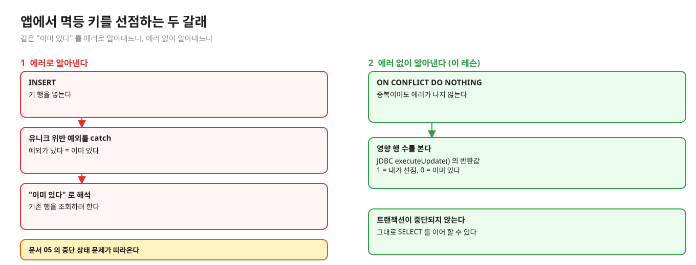
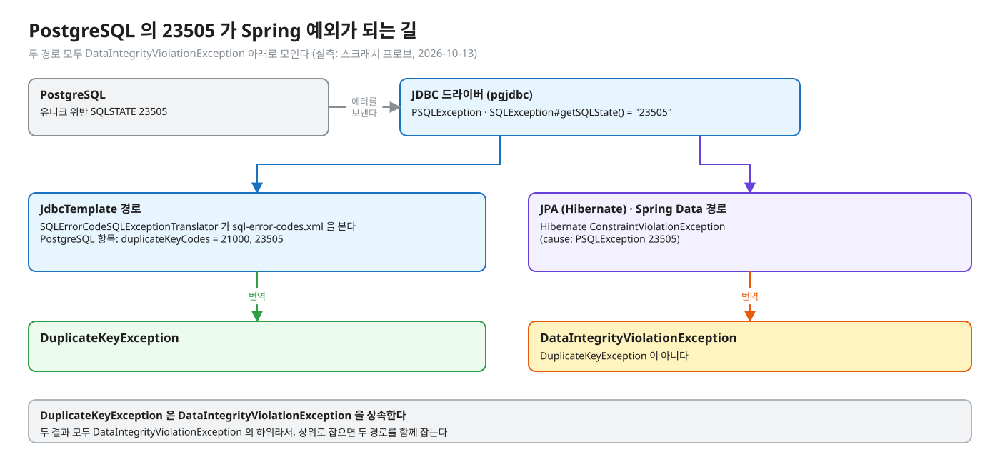
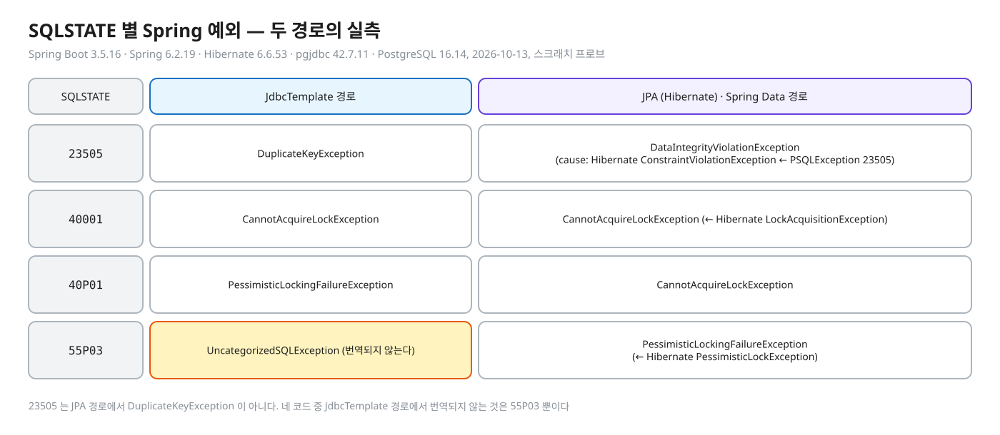
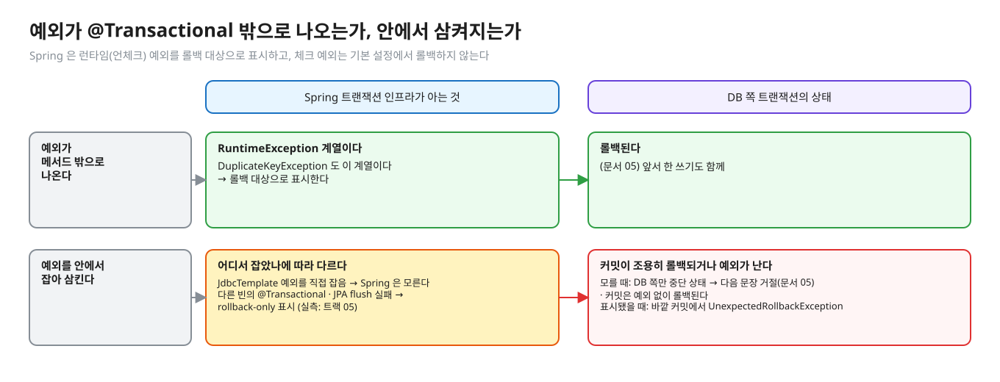
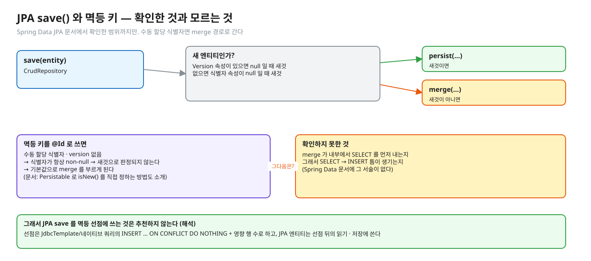
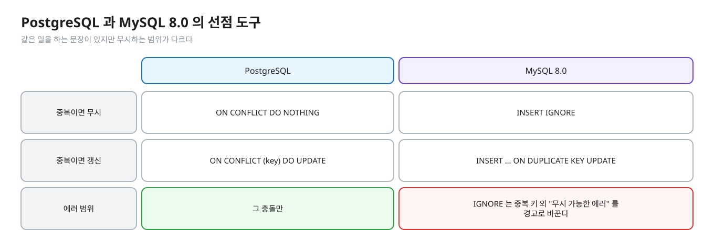
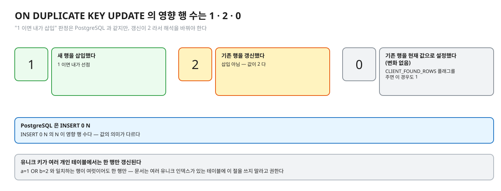
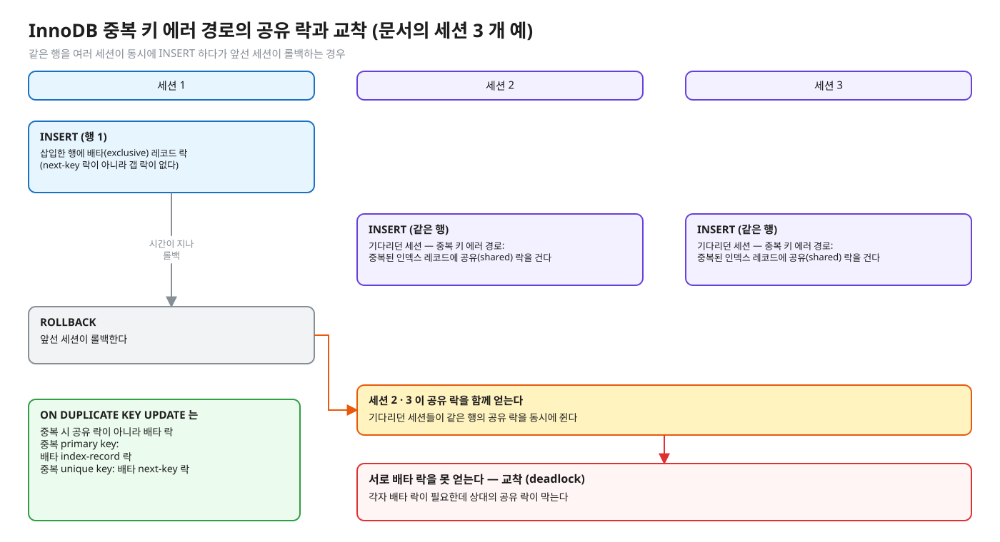

# 07. 앱 · 프레임워크 · MySQL — 23505 의 번역과 다른 DB 의 도구

> **이 글에서 알게 되는 것**
> 1. Spring 이 PostgreSQL 의 `23505` 를 어떤 예외로 번역하는지, JdbcTemplate 경로와 JPA 경로가 왜 다른 예외를 내는지 안다.
> 2. 예외가 `@Transactional` 밖으로 나오는지 삼켜지는지에 따라 Spring 과 DB 의 상태가 어떻게 달라지는지, JPA `save` 를 멱등 선점에 쓸 때 확인한 것과 모르는 것을 구분한다.
> 3. MySQL 의 `INSERT IGNORE` · `ON DUPLICATE KEY UPDATE` 가 PostgreSQL 의 `ON CONFLICT` 와 어디서 다른지(무시 범위 · 영향 행 수 · 락)를 안다.
>
> **먼저 알면 좋은 것**: [05. 실패한 트랜잭션](05-failed-transaction.md) · [06. 멱등 키 설계](06-idempotency-key-design.md)
> **다음 글**: [08. 면접 사다리](08-interview-ladder.md)
> **구분**: 심화 — 꼬리질문 대비 (레슨을 마친 뒤 · 면접 전)

## DB 에서는 에러 코드 한 줄인데

PostgreSQL 에서 중복 키는 `23505` 라는 에러 코드 한 줄이다. 그런데 앱에서는 이 한 줄이 번역된 예외 · 트랜잭션 롤백 표시 · 재시도 경계까지 얽힌 문제가 된다. "Spring 에서 중복 키를 어떻게 잡나", "JPA `save` 로 해도 되나", "DB 가 MySQL 이면 무엇이 달라지나" 같은 질문이 현장에서 실제로 나온다.

앱에서 멱등 키 선점을 하는 방법은 두 갈래다.

편집: [diagrams/blog07-intro.excalidraw](diagrams/blog07-intro.excalidraw)

1. **에러로 알아낸다**: INSERT → 유니크 위반 예외를 catch → "이미 있다" 로 해석 (문서 05 의 중단 상태 문제가 따라온다).
2. **에러 없이 알아낸다**: `ON CONFLICT DO NOTHING` + 영향 행 수 (이 레슨). JDBC `executeUpdate()` 의 반환값을 본다.

이 글은 첫 번째 길에서 앱이 실제로 받는 예외가 무엇인지, 그리고 DB 가 바뀌면(MySQL) 같은 두 갈래가 어떤 문장으로 바뀌는지를 다룬다.

## 개념을 하나씩 보자

### 1. Spring 이 23505 를 어떻게 번역하나 (확인한 것)

(엔진 쪽은 문서 03 ~ 05.) 클라이언트가 받는 모양부터 보자. JDBC `SQLException#getSQLState()` 가 `"23505"` 다. 문서는 앱이 메시지 문구 대신 코드를 검사하라고 권한다. ([부록 A](https://www.postgresql.org/docs/16/errcodes-appendix.html) 를 인용한 01.01 문서 01)

Spring JDBC 의 기본 SQL 에러 코드 표 [`sql-error-codes.xml`](https://github.com/spring-projects/spring-framework/blob/main/spring-jdbc/src/main/resources/org/springframework/jdbc/support/sql-error-codes.xml) 의 PostgreSQL 항목은 이렇다. (조회 2026-10-13, main 브랜치)

- `duplicateKeyCodes` = `21000, 23505`
- `dataIntegrityViolationCodes` = `23000, 23502, 23503, 23514`
- `cannotAcquireLockCodes` = `55P03`
- `cannotSerializeTransactionCodes` = `40001`
- `deadlockLoserCodes` = `40P01`

MySQL 항목의 `duplicateKeyCodes` = `1062` (MySQL 에러 번호) 다.

`DuplicateKeyException` 은 `DataIntegrityViolationException` 을 상속한다. ([Javadoc](https://docs.spring.io/spring-framework/docs/current/javadoc-api/org/springframework/dao/DuplicateKeyException.html): "Exception thrown when an attempt to insert or update data results in violation of a primary key or unique constraint", "더 넓은 범위를 포함하는 `DataIntegrityViolationException` 을 대신 처리하는 것을 고려하라" 는 안내도 있다)

위 표는 **JDBC 경로**(`JdbcTemplate` 등 `SQLErrorCodeSQLExceptionTranslator`)의 코드 표다. 표에 `21000` 이 중복 키 코드로 들어 있다는 것과, [부록 A](https://www.postgresql.org/docs/16/errcodes-appendix.html) 에서 `21000` 이 `cardinality_violation` 이라는 것만 확인했다. 04 에서 본 "한 명령이 같은 행을 두 번 건드림" 에러가 이 계열이라는 INSERT 문서 문구(cardinality violation)와 이으면 그 에러도 `DuplicateKeyException` 으로 번역될 수 있다 (해석 — 그 에러의 SQLSTATE 는 직접 확인하지 않았다).

그렇다면 JPA 로 같은 INSERT 를 하면 어떤 예외가 나올까. 위 표는 JDBC 경로의 코드 표일 뿐이라, JPA 경로는 직접 재 보았다.

편집: [diagrams/blog07-translation.excalidraw](diagrams/blog07-translation.excalidraw)

실측 (Spring Boot 3.5.16 · Spring 6.2.19 · Hibernate 6.6.53 · pgjdbc 42.7.11 · PostgreSQL 16.14, 2026-10-13, 스크래치 프로브):

| SQLSTATE | JdbcTemplate 경로 | JPA(Hibernate) · Spring Data 경로 |
|---|---|---|
| `23505` | `DuplicateKeyException` | `DataIntegrityViolationException` (cause: Hibernate `ConstraintViolationException` ← `PSQLException` 23505). `DuplicateKeyException` 이 **아니다** — 둘 다 `DataIntegrityViolationException` 의 하위라 상위로 잡으면 두 경로를 함께 잡는다 |
| `40001` | `CannotAcquireLockException` | `CannotAcquireLockException` (← Hibernate `LockAcquisitionException`) |
| `40P01` | `PessimisticLockingFailureException` | `CannotAcquireLockException` |
| `55P03` | `UncategorizedSQLException` (번역되지 않는다) | `PessimisticLockingFailureException` (← Hibernate `PessimisticLockException`) |

편집: [diagrams/blog07-error-table.excalidraw](diagrams/blog07-error-table.excalidraw)

표에서 눈여겨볼 곳은 두 군데다. 첫째, 같은 `23505` 인데 경로에 따라 예외 클래스가 다르다. 그래서 중복 키를 잡으려고 `DuplicateKeyException` 만 catch 하면 JPA 경로에서는 놓친다. 둘째, `55P03`(락 타임아웃)은 JdbcTemplate 경로에서 번역되지 않고 `UncategorizedSQLException` 으로 나온다. 06 에서 `lock_timeout` 으로 대기를 끊는 설계를 보았는데, 그 에러를 앱에서 받는 모양이 이렇다.

JPA 에서 `SEQUENCE` id 로 `save()` 하면 INSERT 가 flush · 커밋까지 미뤄져 `save()` 자체는 정상 반환하고 유니크 위반은 그 뒤에 난다(`IDENTITY` 는 `save()` 에서 즉시). `EntityManager` 를 직접 쓰면 flush 에서 번역 안 된 Hibernate `ConstraintViolationException` 이 나온다. 전체 번역 표 · 상위 갈래 · rollback-only · 재시도 위치는 [01 트랙 05-spring-jpa-mapping.md](../../docs/05-spring-jpa-mapping.md) 에서 본다.

### 2. 롤백 표시

앞 절의 예외가 `@Transactional` 메서드에서 어떻게 되는지 보자. [Spring · Rolling Back](https://docs.spring.io/spring-framework/reference/data-access/transaction/declarative/rolling-back.html): 기본 설정에서 트랜잭션 인프라는 런타임(언체크) 예외를 롤백 대상으로 표시하고, 체크 예외는 롤백하지 않는다. `DuplicateKeyException` 은 `RuntimeException` 계열이다 (위 Javadoc 의 상속 사슬). 그래서 이 예외가 `@Transactional` 메서드 밖으로 나오면 롤백된다.

편집: [diagrams/blog07-rollback-mark.excalidraw](diagrams/blog07-rollback-mark.excalidraw)

반대로 예외를 안에서 잡아 삼키면 어디서 잡았나에 따라 갈린다. JdbcTemplate 에서 난 예외를 그 메서드 안에서 직접 잡으면 Spring 은 모르는 채 DB 쪽만 중단 상태가 되고(문서 05), 커밋은 예외 없이 끝나지만 이미 쓴 행까지 조용히 롤백된다. 반면 예외가 다른 빈의 `@Transactional` 메서드(프록시 경계)를 지나왔거나 JPA flush 가 실패했다면 rollback-only 가 표시되어, 바깥 커밋에서 `UnexpectedRollbackException` 이 난다 (실측: Spring Boot 3.5.16 — [트랙 05](../../docs/05-spring-jpa-mapping.md)). 앞 절의 번역은 "무슨 예외로 보이나" 였고, 이 절은 "그 예외가 어디서 끝나나" 다.

### 3. JPA `save` 와 멱등 키 (확인한 것 + 모르는 것)

[Spring Data JPA · Entity Persistence](https://docs.spring.io/spring-data/jpa/reference/jpa/entity-persistence.html) 에서 확인한 것은 이렇다.

- `CrudRepository.save(…)` 는 엔티티가 새것이면 `entityManager.persist(…)`, 아니면 `entityManager.merge(…)` 를 부른다.
- 새 엔티티 판정: Version 속성(null 이면 새것) → 없으면 식별자 속성(null 이면 새것). 식별자가 수동 할당이고 version 이 없으면 식별자가 항상 non-null 이라 **새것으로 판정되지 않는다** — 문서가 `Persistable` 을 구현해 `isNew()` 를 직접 정하는 방법을 소개한다.

편집: [diagrams/blog07-jpa-save.excalidraw](diagrams/blog07-jpa-save.excalidraw)

멱등 키를 엔티티의 `@Id` 로 쓰는 것은 수동 할당 식별자의 전형인데, 이 경우 `save` 는 기본값으로 `merge` 를 부르게 된다. `merge` 가 내부에서 SELECT 를 먼저 내는지, 그래서 "SELECT → INSERT" 틈이 생기는지는 이 문서에서 **확인하지 못했다** (Spring Data 문서에는 그 서술이 없다). 따라서 JPA `save` 를 멱등 선점에 쓰는 것은 추천하지 않고, 확인된 방법은 아래다 (해석).

- 선점은 JdbcTemplate/네이티브 쿼리의 `INSERT … ON CONFLICT DO NOTHING` + 영향 행 수로 한다.
- JPA 엔티티는 선점 뒤의 읽기 · 저장에 쓴다.

(JPA 영속성 컨텍스트가 예외 뒤에 어떤 상태가 되는지, flush 시점에 위반이 보이는지는 [05-spring-jpa-mapping.md](../../docs/05-spring-jpa-mapping.md) 에 실측으로 정리했다.)

### 정리: 세 개의 관계

| 절 | 질문 | 답 |
|---|---|---|
| 번역 | 어떤 예외로 보이나 | JdbcTemplate 은 `DuplicateKeyException`, JPA 는 `DataIntegrityViolationException` (상위) |
| 롤백 표시 | 그 예외가 어디서 끝나나 | 밖으로 나오면 롤백, 안에서 삼키면 Spring 만 모른다 |
| `save` | 멱등 선점에 써도 되나 | merge 경로까지만 확인 — 선점은 JdbcTemplate/네이티브로 |

## PostgreSQL 에서는

위 번역의 출발점은 엔진이 보낸 SQLSTATE 한 줄이고, 엔진 쪽 동작(미커밋 INSERT 대기 · `ON CONFLICT` · 중단 상태)은 문서 03 ~ 05 에 있다. 이 글에서 새로 확인한 엔진 사실은 없고, 앱이 받는 모양(위 실측 표)만 더했다.

### 자주 하는 오해

1. **"`DuplicateKeyException` 을 catch 하면 트랜잭션이 이어진다."** DB 쪽은 중단 상태다 (문서 05).
2. **"Spring 은 모든 중복 에러를 `DuplicateKeyException` 으로 바꾼다."** 표의 PostgreSQL 중복 키 코드는 `21000` 과 `23505` 다. JPA 경로는 `DuplicateKeyException` 이 아니라 `DataIntegrityViolationException`(그 상위)으로 왔다 (실측 — 위 표).
3. **"MySQL `INSERT IGNORE` 는 PostgreSQL `DO NOTHING` 과 같다."** `IGNORE` 는 중복 외 에러도 경고로 바꾼다.
4. **"MySQL 에서 ON DUPLICATE KEY UPDATE 영향 행 수 1 이 선점이다."** 1 = 삽입, 2 = 갱신, 0 = 변화 없음이라 해석을 바꿔야 한다.
5. **"JPA `save` 로 키 선점해도 된다."** 수동 할당 식별자면 merge 경로로 가는 것까지만 확인했다.

## MySQL InnoDB 는 어떻게 다른가

MySQL 에서의 선점 도구 둘과 락 동작. 공식 문서에서 확인한 것만 쓴다.

편집: [diagrams/blog07-mysql-tools.excalidraw](diagrams/blog07-mysql-tools.excalidraw)

| | PostgreSQL | MySQL 8.0 |
|---|---|---|
| 중복이면 무시 | `ON CONFLICT DO NOTHING` | `INSERT IGNORE` |
| 중복이면 갱신 | `ON CONFLICT (key) DO UPDATE` | `INSERT … ON DUPLICATE KEY UPDATE` |
| 에러 범위 | 그 충돌만 | `IGNORE` 는 중복 키 외 "무시 가능한 에러" 를 경고로 바꾼다 |

### INSERT IGNORE

[MySQL 8.0 · INSERT](https://dev.mysql.com/doc/refman/8.0/en/insert.html): `IGNORE` 를 쓰면 INSERT 중 생긴 **무시 가능한 에러**가 무시된다. 예: `UNIQUE`/`PRIMARY KEY` 와 중복되는 행은 에러 없이 버려지고 경고만 남는다. 같은 절에서 데이터 변환 에러도 `IGNORE` 면 값이 가장 가까운 값으로 조정돼 삽입되고 경고만 생긴다고 쓴다. 즉 "중복 키만" 무시하는 것이 아니다 — 의도하지 않은 잘못된 값이 조용히 들어갈 수 있다. 멱등 키 선점에서는 영향 행 수로 판정하더라도 이 부작용을 알고 써야 한다.

### ON DUPLICATE KEY UPDATE

[MySQL 8.0 · INSERT … ON DUPLICATE KEY UPDATE](https://dev.mysql.com/doc/refman/8.0/en/insert-on-duplicate.html):

- 행당 영향 행 값: 새 행 삽입이면 **1**, 기존 행 갱신이면 **2**, 기존 행을 현재 값으로 설정(변화 없음)하면 **0**. (`CLIENT_FOUND_ROWS` 플래그를 주면 마지막 경우도 1.) PostgreSQL 의 `INSERT 0 N` 과 값의 의미가 다르다 — "1 = 내가 삽입" 판정은 같지만 "갱신 = 2" 가 있다.
- 유니크 키가 여러 개인 테이블에서는 `a=1 OR b=2` 와 일치하는 행이 여럿이어도 **한 행만** 갱신된다. 문서는 여러 유니크 인덱스가 있는 테이블에 이 절을 쓰지 말라고 권한다.
- 자동 증가 컬럼이 있는 InnoDB 테이블에서 이 INSERT 문은 자동 증가 값을 올리지만 같은 효과의 UPDATE 문은 올리지 않는다고 문서가 설명한다. (PostgreSQL 에서 `DO NOTHING` 충돌 시 시퀀스 값이 소모되는 것과 비슷한 모양이다 — 해석, 문서 04 실측.)
- `VALUES()` 로 새 행 값을 참조하는 방식은 MySQL 8.0.20 부터 deprecated 이고 행 · 컬럼 별칭을 쓰라고 한다.

편집: [diagrams/blog07-odku-rows.excalidraw](diagrams/blog07-odku-rows.excalidraw)

### 중복 검사 때의 락 (InnoDB)

[MySQL 8.0 · 17.7.3 Locks Set by Different SQL Statements](https://dev.mysql.com/doc/refman/8.0/en/innodb-locks-set.html):

- `INSERT` 는 삽입한 행에 **배타(exclusive) 레코드 락**을 건다 (next-key 락이 아니라 갭 락이 없다). 삽입 전에 insert intention 갭 락을 건다.
- 중복 키 에러가 나면 **중복된 인덱스 레코드에 공유(shared) 락**을 건다. 같은 행을 여러 세션이 동시에 INSERT 하다가 앞선 세션이 롤백하면, 기다리던 세션들이 공유 락을 함께 얻어 서로 배타 락을 못 얻는 **교착(deadlock)** 이 생길 수 있다는 예가 문서에 있다 (세션 3 개 예, 삭제 후 INSERT 변형도).
- `INSERT … ON DUPLICATE KEY UPDATE` 는 중복 시 공유 락이 아니라 **배타 락**을 건다: 중복 primary key 에는 배타 index-record 락, 중복 unique key 에는 배타 next-key 락.

편집: [diagrams/blog07-innodb-locks.excalidraw](diagrams/blog07-innodb-locks.excalidraw)

PostgreSQL 은 "상대의 트랜잭션이 끝나기를 기다렸다가 검사를 다시" 하는 모델이고 (문서 03), MySQL 의 중복 키 에러 경로는 공유 락 → 교착 가능성이 문서에 명시돼 있다는 차이가 있다. PostgreSQL 에서 같은 시나리오가 교착하지 않는지는 이 문서에서 직접 실험하지 않았다 (해석).

## 한눈에 정리

| | PostgreSQL | MySQL 8.0 (InnoDB) |
|---|---|---|
| 중복 에러의 Spring 번역 | 코드 `21000` · `23505` → JdbcTemplate: `DuplicateKeyException` · JPA: `DataIntegrityViolationException` | 코드 `1062` |
| 중복이면 무시 | `ON CONFLICT DO NOTHING` (그 충돌만) | `INSERT IGNORE` (중복 외 에러도 경고로) |
| 영향 행 수 읽기 | 1 = 삽입, 0 = 이미 있음 (`INSERT 0 N`) | ODKU: 삽입 1 · 갱신 2 · 변화 없음 0 |
| 중복 검사 락 | 상대 트랜잭션 끝을 기다렸다 재검사 (문서 03) | 중복 키 에러 → 공유 락 (교착 가능), ODKU → 배타 락 |

- 같은 `23505` 가 JdbcTemplate 에서는 `DuplicateKeyException`, JPA 에서는 `DataIntegrityViolationException` 이다. 상위로 잡으면 둘을 함께 잡는다.
- 예외가 `@Transactional` 밖으로 나오면 롤백된다. 안에서 삼키면 Spring 은 모르는 채 DB 쪽만 중단 상태일 수 있다.
- JPA `save` 를 멱등 선점에 쓰는 것은 확인되지 않은 부분이 있어 추천하지 않는다 (해석). 선점은 JdbcTemplate/네이티브 쿼리로 한다.
- MySQL 은 `IGNORE` 의 무시 범위, ODKU 의 영향 행 수(1 · 2 · 0), 중복 키 경로의 공유 락이 PostgreSQL 과 다르다.

## 스스로 확인

1. Spring 에서 PostgreSQL 유니크 위반은 어떤 예외가 되나?
   

답

   JDBC 템플릿 경로에서는 Spring 의 PostgreSQL 에러 코드 표가 `23505` 를 `duplicateKeyCodes` 에 넣어 두므로 `DuplicateKeyException`(`DataIntegrityViolationException` 의 하위)이 된다고 읽힌다. JPA 경로는 직접 확인해야 한다.
   

2. `@Transactional` 안에서 이 예외를 잡고 기존 행을 조회하려면?
   

답

   그냥 잡으면 DB 쪽이 중단 상태라 안 된다 (문서 05). 에러 없는 `ON CONFLICT DO NOTHING` 으로 바꾸거나, SAVEPOINT 로 감싸거나, 예외를 트랜잭션 밖으로 내보내 새 트랜잭션에서 읽는다.
   

3. MySQL 에서 멱등 키 선점을 하려면 어떤 문장을 쓰고 영향 행 수를 어떻게 읽나?
   

답

   `INSERT IGNORE` 나 `ON DUPLICATE KEY UPDATE` 가 후보다. `INSERT IGNORE` 는 중복 외 에러도 경고로 바꾸는 부작용이 있고, `ON DUPLICATE KEY UPDATE` 는 영향 행 수가 삽입 1 · 갱신 2 · 변화 없음 0 이라 "1 이면 내가 선점" 으로 읽는다. 중복 키 에러 경로는 공유 락을 건다는 점도 알아 둔다.
   

## 이 레슨에서 직접 보기

이 글은 레슨의 테스트 · 장면과 직접 대응하지 않는다. 구현은 JDBC `executeUpdate()` 반환값 판정이고 (`PaymentService#claim`), JPA 경로는 이 레슨에 없다.

## 출처

- [Spring Framework · sql-error-codes.xml (main)](https://github.com/spring-projects/spring-framework/blob/main/spring-jdbc/src/main/resources/org/springframework/jdbc/support/sql-error-codes.xml) — PostgreSQL · MySQL 에러 코드 분류 (조회 2026-10-13)
- [Spring Framework · DuplicateKeyException Javadoc](https://docs.spring.io/spring-framework/docs/current/javadoc-api/org/springframework/dao/DuplicateKeyException.html) — 설명 · 상속
- [Spring Framework · Rolling Back a Declarative Transaction](https://docs.spring.io/spring-framework/reference/data-access/transaction/declarative/rolling-back.html) — 롤백 규칙
- [Spring Data JPA · Entity Persistence](https://docs.spring.io/spring-data/jpa/reference/jpa/entity-persistence.html) — persist/merge · isNew · Persistable
- [Spring Framework · HibernateJpaDialect Javadoc](https://docs.spring.io/spring-framework/docs/current/javadoc-api/org/springframework/orm/jpa/vendor/HibernateJpaDialect.html) — 번역을 EntityManagerFactoryUtils 에 위임
- [MySQL 8.0 · INSERT](https://dev.mysql.com/doc/refman/8.0/en/insert.html) · [INSERT … ON DUPLICATE KEY UPDATE](https://dev.mysql.com/doc/refman/8.0/en/insert-on-duplicate.html) · [17.7.3 Locks Set by Different SQL Statements](https://dev.mysql.com/doc/refman/8.0/en/innodb-locks-set.html)
- [PostgreSQL 16 · Appendix A](https://www.postgresql.org/docs/16/errcodes-appendix.html)
