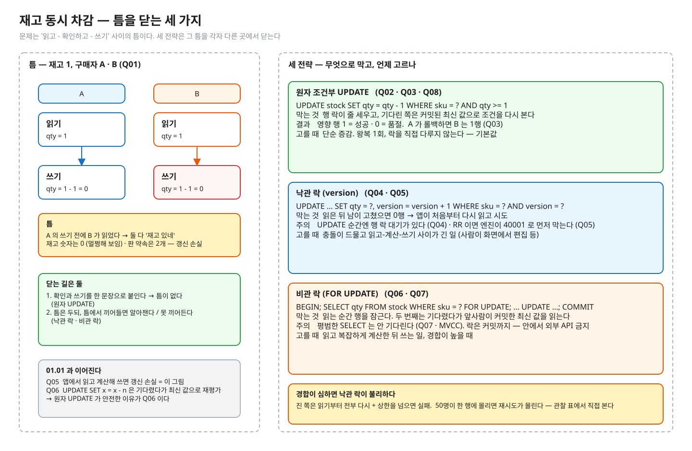

# 01.04 재고·잔고 동시 차감

> **완료 기준**: 예측 8문항을 먼저 적고 돌려 전부 초록 · 구현 테스트 초록 · NOTES 를 채우고 꼬리질문 5개를 해설 보기 전에 답한다 · "재고 10개에 50명이 동시에 사면 어디서 뚫리고, 원자 UPDATE · 낙관 락 · 비관 락은 각각 무엇으로 막으며, 언제 무엇을 고르나"를 그림 없이 3분 안에 설명한다.

공고 연결 — "동시성 처리 · 유실 없는 데이터 정합성". 재고·잔고·쿠폰·좌석은 전부 "확정 전에 잡아두는 자원" 이고, 같은 모양의 경쟁이다.
(참고) 이 레슨은 이전 실험장 `order-flow-playground` docs/03 · stage3 `InventoryService` (JVM 메모리 락으로 푼 버전)를 옮긴 것이다. 여기서는 **DB 가 진실의 원천**일 때의 세 전략을 진짜 PostgreSQL 위에서 비교한다.
01.01 의 Q05(읽고 계산해서 쓰면 갱신 손실) · Q06(`SET x = x - n` 은 기다렸다 최신 값으로 재평가) 의 연장선이다.

---

## ① 질문 · 첫 예측 — 20분

1. 재고 10개에 50명이 동시에 1개씩 사면? "읽고 → 확인 → 쓰기" 사이의 틈은 정확히 어디고, 그 결과 재고 숫자는 어떻게 보이나?
2. `UPDATE … SET qty = qty - 1 WHERE id = ? AND qty >= 1` 은 왜 안전한가? 두 번째 쪽은 기다리나? 첫 쪽이 커밋하면 영향 행 수는? 롤백하면?
3. 낙관 락(`WHERE version = ?`)이 막는 것은? 진 쪽은 무엇을 받고, 앱은 무엇을 해야 하나?
4. 비관 락(`SELECT … FOR UPDATE`)은 무엇을 잠그고 언제 푸나? 그 사이 평범한 SELECT 는?
5. 경합이 심하면 낙관 락은 왜 불리한가? 세 전략을 각각 언제 고르나?

> **이어서 첫 예측**: 질문에 종이로 답해 NOTES §0 에 옮긴 뒤, `StockPredictTest.java` 의 예측 칸 `"?"` 를 **감으로** 채워 `./gradlew 01.04-predict` 를 돌린다. 틀려도 된다 — 틀린 문항이 ② 를 읽는 이유가 된다. PROGRESS 의 "예측 적중"은 이 첫 예측으로 센다.

## ② 원리 — 75분



<sub>편집: [diagrams/stock-concurrency.excalidraw](diagrams/stock-concurrency.excalidraw) · 다시 그리기(만든 사람용 · 레슨 폴더에서): `python3 -I diagrams/draw.py`</sub>

1차 자료 (블로그 요약 말고 이것부터):

공식 문서에서 아래 "찾을 것" 문장을 직접 찾아 표시하고, 한 줄로 번역해 NOTES 나 여백에 적어 둔다.

| 자료 | 읽으면서 찾을 것 |
|---|---|
| [개념 정리 docs/](docs/README.md) | **필수 02 · 03 · 04** 를 읽으며 ① 에서 틀린 문항이 왜 틀렸는지 찾는다 (나머지 글은 심화 — 레슨을 마친 뒤 · 면접 전). 공식 문서 행은 docs 가 링크하는 곳에서 같이 연다 · 예측 답은 접힌 칸에만 |
| [PostgreSQL 16 · 13.2 Transaction Isolation](https://www.postgresql.org/docs/16/transaction-iso.html) | Read Committed 절: UPDATE 가 이미 갱신 중인 행을 만나면 "첫 갱신자가 커밋/롤백할 때까지 기다리고, 커밋했으면 갱신된 버전에 WHERE 를 **다시 평가**한다" (Q02 · Q03 · Q04) · Repeatable Read 절의 "could not serialize access due to concurrent update" (Q05) |
| [13.3 Explicit Locking — Row-Level Locks](https://www.postgresql.org/docs/16/explicit-locking.html#LOCKING-ROWS) | FOR UPDATE: 다른 UPDATE · DELETE · SELECT FOR UPDATE 를 트랜잭션 끝까지 막는다 · "Row-level locks do not affect data querying; they block only writers and lockers" (Q06 · Q07) |
| 『데이터 중심 애플리케이션 설계』 7장 | 갱신 손실(lost update) · 원자적 쓰기 · 명시적 잠금 · compare-and-set(= 낙관 락의 정체) |
| 원본 `order-flow-playground/docs/03-concurrency-and-stock.md` §4 | 같은 세 방법의 선택표 — 내가 정리한 표와 비교 |

## ③ 재현 — 40분 · 세 가지 손 작업 + 이 레슨만 관찰 테스트

파일 경로는 이 레슨 폴더(`01-concurrency-consistency/l04-stock-concurrency/`) 기준이다. 명령은 두 곳에서 친다.

```bash
# deep-dive 폴더에서 — ./gradlew 는 전부 여기서
./gradlew 01.04-predict
./gradlew 01.04-implement
```

```bash
# deep-dive 폴더에서 레슨 폴더로 들어간 뒤 — observe 스크립트는 여기서
cd 01-concurrency-consistency/l04-stock-concurrency
observe/up.sh
```

IntelliJ 로 한다면: deep-dive 폴더를 Gradle 프로젝트로 열고(코드를 바꾼 뒤 Gradle 창에서 Reload), 테스트 메서드 옆 ▶ 로 한 문항씩 돌려도 된다. 자세히는 [GUIDE.md](../../GUIDE.md).

| 작업 | 실행 | 무엇을 |
|---|---|---|
| **예측** (되짚기) | `./gradlew 01.04-predict` | `src/test/java/deepdive/c01/l04/StockPredictTest.java` 의 Q01~Q08(8문항 · 예측 칸 13곳)을 ① 에서 감으로 적었다. 틀린 문항을 ② 를 읽은 뒤 되짚어 다시 적고 초록으로 만든다 (NOTES §1 에 한 줄). 한 문항씩 돌리는 법: [GUIDE](../../GUIDE.md) §2-3. 출력의 A/B 타임라인은 예측을 적은 문항만 보인다 |
| **구현** (코드) | `./gradlew 01.04-implement` | 구현 대상 `src/main/java/deepdive/c01/l04/` 의 세 파일의 `reserve` 의 `TODO(구현)` 을 쉬운 것부터 ① `AtomicUpdateStockService.java`(원자 UPDATE) → ② `PessimisticLockStockService.java`(비관 락) → ③ `OptimisticLockStockService.java`(낙관 락 · 재시도 상한 포함) 순서로 채운다. 실패 메시지가 "정합성 깨짐: 재고 10개를 N명에게 팔았다" 부터 알려 준다. 검사는 `src/test/java/deepdive/c01/l04/StockImplementTest.java` |
| **관찰 테스트** (숫자) | `./gradlew :01-concurrency-consistency:l04-stock-concurrency:test --tests '*Observation*'` (deep-dive 폴더에서) | `src/test/java/deepdive/c01/l04/StockObservationTest.java` — 세 전략 × 경합 세기별 성공 · 품절 · 재시도소진 · 재시도 · 걸린 ms 표. 단언 없음 — **숫자를 NOTES §1-2 관찰 표에 옮겨 적고 해석한다** (아래) |
| **관찰** (진짜 엔진, psql) | `observe/up.sh` → [observe/SCRIPT.md](observe/SCRIPT.md) | psql 두 개로 틈 · 행 락 대기 · 낙관 락의 0행 · FOR UPDATE |

테스트는 진짜 PostgreSQL 16 컨테이너(Testcontainers)에서 돈다. Docker 가 떠 있어야 한다.

빈칸 상태에서 구현 테스트는 **빨강 5 · 초록 1** 이다 (초록은 `재고가_모자라면_세_전략_모두_거절하고_재고는_그대로다`). 관찰 테스트는 단언이 없어 항상 초록이다.
구현 테스트 6개 중 **결과 검사**는 전략별 "재고 10 · 구매자 50 → 성공 정확히 10 · 초과 판매 0 · 최종 재고 0" 셋과 "낙관 락 재시도 상한을 넘으면 명확히 실패" 이고,
`방법_검사_` 하나(충돌을 만나면 다시 읽고 다시 쓴다)와 재고 부족 가드(처음부터 초록)가 나머지다.

**관찰 해석 과제** — 표를 보고 NOTES §1-2 의 "해석" 칸에 답한다: (a) 경합 낮음 → 높음에서 낙관 락의 재시도 수와 시간은 어떻게 변했나 (b) "재시도소진" 칸의 의미 — 재고가 남았는데도 재시도 상한까지 져서 포기한 수다 (c) 품절 경쟁(재고 10)에서는 왜 낙관 락도 괜찮아 보이나 (d) 그래도 원자 UPDATE 를 기본값으로 삼는 이유.

## ④ 내 말로 — 20분

1. [NOTES.md](NOTES.md) — 틀린 예측 · 관찰 표 · 3분 설명 · 꼬리질문 5개(답을 먼저 쓰고 해설과 비교) · §6 내 실무와 연결(권장 — 내가 일하는 서비스를 떠올려 한 줄씩)
2. `/kata:discuss 재고 동시성 — 조건부 UPDATE vs 낙관 락 vs 비관 락` — 면접관 역할의 꼬리질문
3. 버텼으면 [../../PROGRESS.md](../../PROGRESS.md) 에 테스트 ✅ · 내 말로 ✅

---

💡 **실무**: "동시성 = 락" 이 아니다. 조건을 UPDATE 문 안으로 밀어 넣으면 락을 직접 다루지 않고도 원자성이 나온다.
낙관 락은 화면에서 값을 불러와 한참 뒤 저장하는 편집 흐름에, 비관 락은 읽고 복잡하게 계산한 뒤 쓰는 짧은 트랜잭션에 맞다 — 둘 다 트랜잭션 안에서 외부 API 를 부르면 안 된다.
같은 인기 상품 한 행에 요청이 몰리면 어느 전략이든 한 행이 줄을 선다 → 그때는 재고를 N 개 행으로 쪼개기 · 큐 직렬화를 검토한다 (원본 docs/03 §4 표).

정답 patch: [../../solutions/01.04.patch](../../solutions/01.04.patch) — 구현 정답과 **예측 답**이 들어 있다. 예측 · 구현을 끝낸 뒤 연다 (deep-dive 폴더에서 `less solutions/01.04.patch`). 내 코드와 비교한다.
