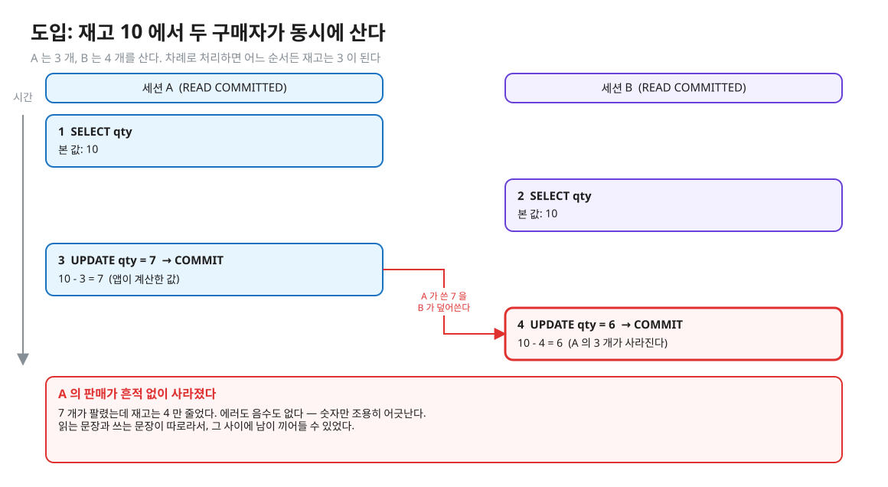
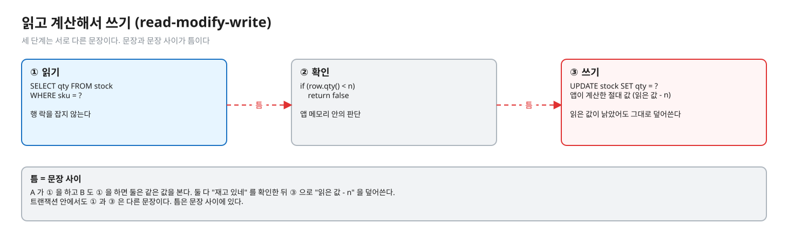
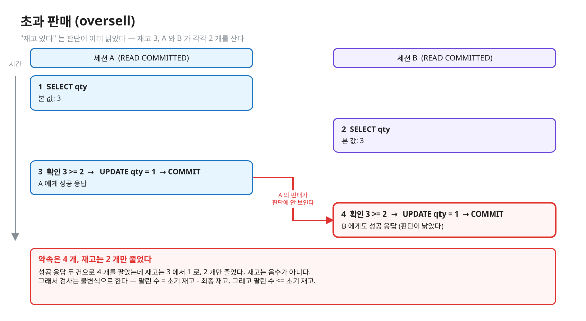
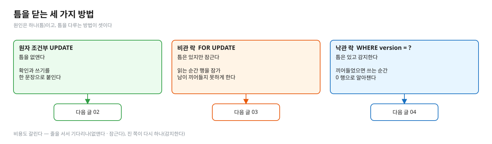
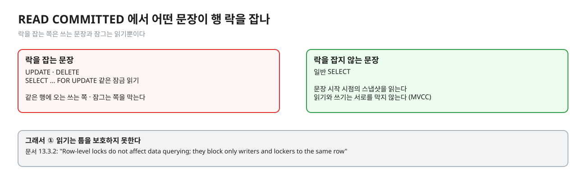

# 01. 읽고 계산해서 쓰기 — 갱신 손실 · 초과 판매 · 검사와 차감 사이의 틈

> **이 글에서 알게 되는 것**
> 1. 재고가 뚫리는 원인이 "읽고 → 확인 → 쓰기" 가 서로 다른 문장이라서 그 사이(틈)에 남이 끼어들 수 있다는 것 하나뿐임을 안다.
> 2. 갱신 손실(lost update)과 초과 판매(oversell)가 한 뿌리의 두 얼굴이며, 음수가 나오지 않아도 사고라는 것을 안다.
> 3. 틈을 닫는 세 가지 방법(원자 UPDATE · 비관 락 · 낙관 락)이 어떻게 갈리는지 큰 그림을 안다.
>
> **먼저 알면 좋은 것**: [01.01 격리수준 · MVCC](../../l01-isolation-mvcc/docs/01-anomalies-and-isolation-levels.md) 의 갱신 손실 정도면 된다.
> **다음 글**: [02. 원자 조건부 UPDATE](02-atomic-conditional-update.md) → [03. 비관 락](03-pessimistic-lock.md) → [04. 낙관 락](04-optimistic-lock.md)
> **구분**: 심화 — 꼬리질문 대비 (레슨을 마친 뒤 · 면접 전)

## 재고 10 에 두 사람이 동시에 사면

재고가 10 개인 상품이 있다. 구매자 A 는 3 개를, 구매자 B 는 4 개를 산다. 한 명씩 차례로 처리하면 어느 순서든 재고는 3 이 된다.


<sub>편집: [diagrams/blog01-intro.excalidraw](diagrams/blog01-intro.excalidraw)</sub>

둘이 겹쳐 돌면 6 이 남을 수 있다. 7 개가 팔렸는데 재고는 4 만 줄었다. 에러도 없고 음수도 없다. 숫자만 조용히 어긋난다. 재고 · 잔고 · 쿠폰 수량 · 좌석은 모두 "확정 전에 잡아 두는 자원" 이라 같은 모양의 경쟁이 생기고, 이런 사고는 보통 이렇게 **조용하다**.

"재고 10 개에 50명이 동시에 주문하면 어떻게 되나? 어떻게 막나?" 는 백엔드 동시성의 대표 질문이다. 답은 "락을 건다" 가 아니라 "틈이 어디이고, 그 틈을 어떻게 없애거나 감지하나" 여야 한다. 이 시리즈(01 ~ 06)는 그 답을 하나씩 만들어 간다. 첫 글은 틈이 정확히 어디인지부터 본다.

## 읽고 계산해서 쓰기 (read-modify-write)

**읽고 계산해서 쓰기**는 값을 읽어 앱 메모리에서 계산한 뒤, 그 결과를 다시 DB 에 쓰는 패턴이다. 이 레슨의 시작 상태(빈칸)가 정확히 이 모양이다 (`AtomicUpdateStockService#reserve` 의 시작 코드).

```java
Row row = select("SELECT qty FROM stock WHERE sku = ?");   // ① 읽기
if (row.qty() < n) return false;                           // ② 확인
update("UPDATE stock SET qty = ? WHERE sku = ?", row.qty() - n);  // ③ 쓰기 — 앱이 계산한 "절대 값"
```


<sub>편집: [diagrams/blog01-rmw.excalidraw](diagrams/blog01-rmw.excalidraw)</sub>

①과 ③ 은 서로 다른 문장이고, ① 은 행 락을 잡지 않는다. 그래서 A 가 ① 을 하고 B 도 ① 을 하면 둘은 같은 값을 본다. 둘 다 "재고 있네" 를 확인하고, ③ 으로 "읽은 값 - n" 을 **덮어쓴다**. 먼저 쓴 쪽의 갱신은 나중에 쓴 쪽에 덮여 사라진다.

기존 그림으로 보면 왼쪽이 이 틈이고, 오른쪽이 02 ~ 04 에서 볼 세 전략이다.


<sub>편집: [../diagrams/stock-concurrency.excalidraw](../diagrams/stock-concurrency.excalidraw) (레슨 기존 그림)</sub>

## 같은 버그의 두 이름

이 틈에서 생기는 문제는 보는 쪽에 따라 이름이 둘이다.

| 이름 | 무엇이 잘못됐나 | 어떻게 보이나 |
|---|---|---|
| 갱신 손실(lost update) | 앱이 계산한 절대 값을 덮어써 남의 갱신이 사라진다 | 판 개수만큼 재고가 줄지 않는다 |
| 초과 판매(oversell) | "재고 있다" 는 판단이 이미 낡았다 | 재고보다 많이 팔았다 |

갱신 손실은 위 도입 장면이다. 이번에는 초과 판매를 같은 틈에서 보자. 재고가 3 이고 A 와 B 가 각각 2 개를 사는데, 둘 다 "3 >= 2" 를 확인하고 통과한다.


<sub>편집: [diagrams/blog01-oversell.excalidraw](diagrams/blog01-oversell.excalidraw)</sub>

둘은 한 뿌리다. 갱신 손실은 쓰기가 사라진 쪽에서, 초과 판매는 확인이 낡은 쪽에서 같은 틈을 본 것이다. 그림에서도 재고는 1 이라 **음수가 아니다**. 약속은 4 개인데 숫자는 멀쩡해 보인다. 그래서 검사는 불변식으로 한다: `팔린 수 = 초기 재고 - 최종 재고` 이고 `팔린 수 <= 초기 재고`. 이 레슨의 `StockImplementTest` 가 정확히 이것을 본다.

## 틈을 닫는 세 갈래

틈이 원인이라면 해결은 "틈을 없애거나, 막거나, 알아채거나" 셋 중 하나다. 앞으로 세 글에서 하나씩 다룬다.


<sub>편집: [diagrams/blog01-three-ways.excalidraw](diagrams/blog01-three-ways.excalidraw)</sub>

| 방법 | 틈을 어떻게 하나 | 문서 |
|---|---|---|
| 원자 조건부 UPDATE | 확인과 쓰기를 한 문장으로 붙여 틈을 없앤다 | [02](02-atomic-conditional-update.md) |
| 비관 락 `SELECT … FOR UPDATE` | 틈은 있지만 읽는 순간 행을 잠가 남이 못 끼어들게 한다 | [03](03-pessimistic-lock.md) |
| 낙관 락 `WHERE version = ?` | 틈은 있고 끼어들 수도 있지만, 끼어들었으면 쓰는 순간 0행으로 알아챈다 | [04](04-optimistic-lock.md) |

없애거나 막는 쪽은 줄을 서서 기다리고, 감지하는 쪽은 진 쪽이 다시 한다. 비용이 대기냐 재작업이냐로 갈린다는 점을 기억해 두자.

## PostgreSQL 에서는 왜 ① 읽기가 틈을 못 지키나

READ COMMITTED(기본값)에서 일반 `SELECT` 는 문장 시작 시점의 스냅샷을 읽고 락을 잡지 않는다 ([문서 13.2.1](https://www.postgresql.org/docs/16/transaction-iso.html) · 읽기와 쓰기가 서로를 막지 않는 MVCC — [01.01 docs 03](../../l01-isolation-mvcc/docs/03-snapshot-visibility.md)). 락을 잡는 것은 쓰는 문장(UPDATE · DELETE)과 `SELECT … FOR UPDATE` 같은 잠금 읽기뿐이다 ([문서 13.3.2](https://www.postgresql.org/docs/16/explicit-locking.html)). 그래서 ① 읽기는 틈을 보호하지 못한다.


<sub>편집: [diagrams/blog01-rc-locks.excalidraw](diagrams/blog01-rc-locks.excalidraw)</sub>

READ COMMITTED 에서 쓰는 문장이 하는 일(행 락 대기 → 커밋됐으면 갱신된 버전에 WHERE 재평가)은 [01.01 docs 04](../../l01-isolation-mvcc/docs/04-write-conflicts.md) 가 설명했다. 여기서 중요한 것은 그 재평가가 **문장 안의** 계산에만 적용된다는 점이다. 앱이 ① 에서 읽어 둔 값은 문장 밖에 있어서 재평가의 도움을 받지 못한다 — 01.01 Q05 와 이 레슨 Q01 이 같은 현상이다.

### 빈칸 상태로 돌려 보면

관찰 테스트(`StockObservationTest`)를 정답 구현 **전** 빈칸 상태로 돌리면 이 손실이 숫자로 보인다. 우리 환경에서 빈칸 상태로 한 번 돌렸을 때(실측: 관찰 테스트 2026-10-13) 구매자 4명에 재고 1000이었는데 최종 재고가 999 로 나왔고, 재고 10 · 구매자 50 이면 성공이 50 으로 찍혔다. 숫자는 실행마다 다르다.

### 자주 하는 오해

1. **"재고가 음수가 안 됐으니 초과 판매는 없다."** 갱신 손실은 음수를 만들지 않는다 (Q01 의 장면 — 답은 아래 접힌 칸). 불변식(팔린 수 = 줄어든 재고)으로 검사한다.
2. **"`@Transactional` 을 붙였으니 안전하다."** 기본 격리수준(PostgreSQL 은 READ COMMITTED)에서 트랜잭션 안의 일반 `SELECT` 는 락이 없다. 트랜잭션은 원자성(atomicity)이지 "내가 읽은 값이 안 바뀐다" 는 보장이 아니다 (해석 — 01.01 docs 01 의 격리수준 설명 + 문서 13.3.2 의 "락은 쓰는 쪽과 잠그는 쪽만 막는다").
3. **"자바에서 `synchronized` 로 막으면 된다."** 서버가 1대일 때만 된다. 서버가 2대면 JVM 락은 서로 보이지 않는다. 이 레슨의 전제는 DB 가 진실의 원천이라는 것이다 (원본 `order-flow-playground` stage3 는 JVM 락 버전).
4. **"확인과 차감을 한 트랜잭션에 넣었으니 틈이 없다."** 트랜잭션 안에서도 ① 과 ③ 은 다른 문장이다. 틈은 문장 사이에 있다.

### 앱 · 프레임워크에서는

JPA 의 `find` → 필드 변경 → 커밋(더티 체킹)은 이 모양이다 — 엔티티를 읽어 앱 메모리에서 `qty - n` 을 계산하고 flush 시 UPDATE 로 낸다 (실측: Hibernate 6.4.10 · 6.6.58, 2026-10-13 — `@Version` 이 없는 엔티티의 flush SQL 은 따로 돌리지 않았다. `@Version` 이 있으면 `update Stock set qty=?,version=? where id=? and version=?`). `@Version` 이 없으면 위와 같은 갱신 손실이 가능하다고 보고 설계해야 한다. 대응은 04 의 낙관 락(`@Version`) · 03 의 비관 락 · 02 의 원자 UPDATE(`@Modifying` 쿼리 — 확인은 하지 않았다).

## 한눈에 정리

| 질문 | 답 |
|---|---|
| 재고가 어긋나는 원인은? | ① 읽기와 ③ 쓰기가 다른 문장이라 사이에 틈이 있다 |
| 갱신 손실과 초과 판매는? | 같은 틈의 두 얼굴. 쓰기가 사라지면 갱신 손실, 판단이 낡으면 초과 판매 |
| 어떻게 검사하나? | 불변식: 팔린 수 = 초기 재고 - 최종 재고, 팔린 수 <= 초기 재고 |
| 틈을 닫는 방법은? | 없앤다(원자 UPDATE) · 잠근다(비관 락) · 감지한다(낙관 락) |

- 일반 `SELECT` 는 락을 잡지 않으므로 읽기만으로는 틈을 지키지 못한다.
- 갱신 손실은 음수를 만들지 않는다. 숫자가 멀쩡해 보여서 사고가 조용하다.
- 트랜잭션 · `synchronized` 는 이 틈의 해법이 아니다.

## 스스로 확인

1. 재고 10 에 50명이 동시에 사서 최종 재고가 3, 판매 기록(주문 행)이 12건이다. 무엇이 일어났고 어디를 보면 확인되나?
   <details><summary>답</summary>
   불변식 `판매 기록 수 = 초기 재고 - 최종 재고` 가 깨졌다 (12 ≠ 7). 일부 구매자가 같은 값을 읽고 같은 값을 덮어써 일부 차감이 사라졌다(갱신 손실). 재고 숫자는 음수가 아니라 이상이 눈에 안 띈다. 확인은 주문 테이블 count 와 stock 의 차이를 비교하는 대사(reconciliation) 쿼리로 한다. (숫자는 설명용 예시)
   </details>
2. 같은 코드를 READ COMMITTED 가 아니라 REPEATABLE READ 로 돌리면 갱신 손실이 사라지나?
   <details><summary>답</summary>
   손실 대신 에러가 된다. REPEATABLE READ 는 스냅샷 이후 다른 트랜잭션이 바꾼 행을 고치려 하면 `40001` 로 실패시키므로 덮어쓰기가 막힌다 ([문서 13.2.2](https://www.postgresql.org/docs/16/transaction-iso.html), 01.01 Q07). 대신 앱이 트랜잭션 전체를 재시도해야 한다 — 결국 "충돌 시 재시도" 라는 점에서 낙관 락과 같은 부담을 진다.
   </details>
3. 틈을 "없애는" 방법과 "감지하는" 방법을 구분해 보라.
   <details><summary>답</summary>
   없애는 쪽: 원자 UPDATE(한 문장), 비관 락(읽는 순간 잠가 끼어듦을 막음). 감지하는 쪽: 낙관 락(쓸 때 version 비교), REPEATABLE READ 의 `40001`. 없애는 쪽은 줄을 서서 기다리고, 감지하는 쪽은 진 쪽이 다시 한다 — 비용이 대기냐 재작업이냐로 갈린다.
   </details>

## 이 레슨에서 직접 보기

| 어디서 | 무엇을 |
|---|---|
| Q01 | 재고 1 에서 A 와 B 가 둘 다 읽은 뒤 각자 `읽은 값 - 1` 을 쓴다 — 최종 재고 |
| 장면 1 ([observe/SCRIPT.md](../observe/SCRIPT.md)) | psql 두 개로 같은 틈을 손으로 만든다 |
| `StockImplementTest` | 빈칸 상태에서 빨강: "정합성 깨짐: 재고 10개를 N명에게 팔았다" |

이 글의 그림은 일부러 문항과 다른 숫자(재고 10 · 재고 3)로 그렸다. 예측 문항의 값을 직접 적어 보고 나서 확인한다.

<details><summary>실측 — 예측을 끝낸 뒤 펼친다 (Q01)</summary>

Q01 의 최종 재고는 `0` 이다 (실측: Q01). A 도 B 도 "성공" 을 받았는데 재고 1 짜리가 2번 팔렸고, DB 어디에도 그 흔적이 없다. 재고 1, 둘이 동시에 사면 둘 다 성공하고 재고는 `1 - 1 = 0` 이다 — 음수가 아니다. 근거: [정답 patch](../../../solutions/01.04.patch) 의 예측 칸 · `StockPredictTest` Q01.
</details>

## 출처

- [PostgreSQL 16 · 13.2 Transaction Isolation](https://www.postgresql.org/docs/16/transaction-iso.html) — READ COMMITTED 의 재평가 · REPEATABLE READ 의 40001
- [13.3 Explicit Locking](https://www.postgresql.org/docs/16/explicit-locking.html) — "Row-level locks do not affect data querying; they block only writers and lockers to the same row"
