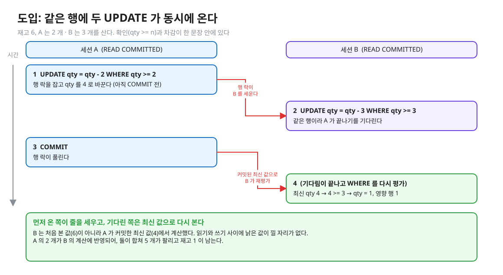
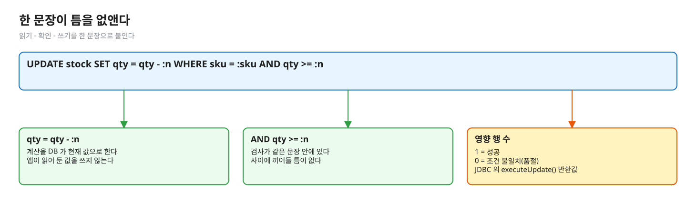
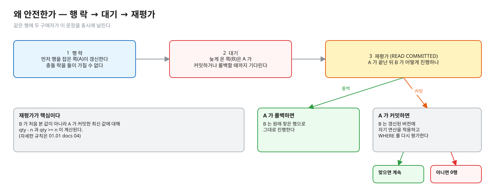
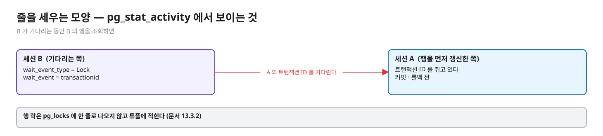
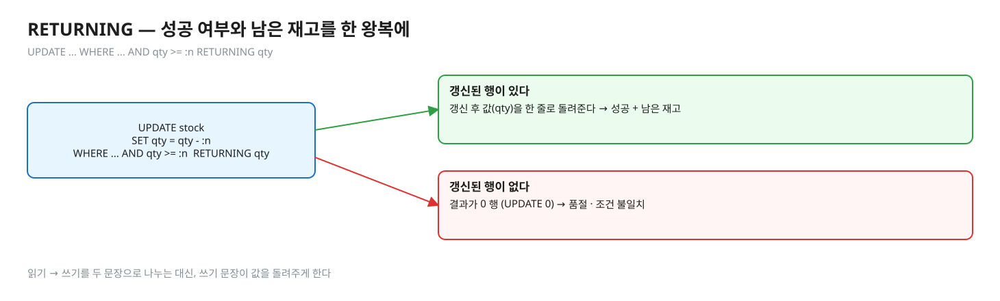
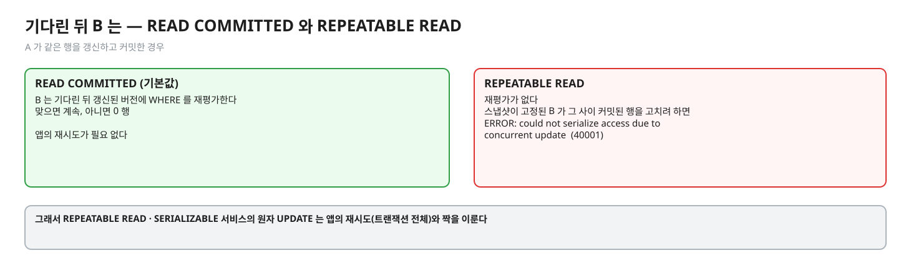
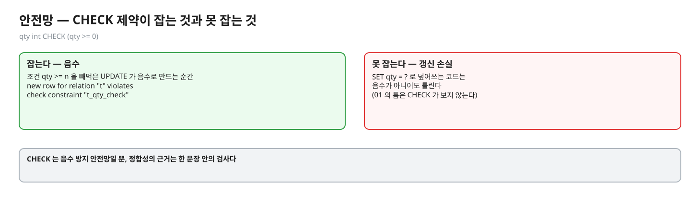

# 02. 원자 조건부 UPDATE — 틈을 없애는 방법

> **이 글에서 알게 되는 것**
> 1. `UPDATE stock SET qty = qty - n WHERE sku = ? AND qty >= n` 이 확인과 차감을 한 문장으로 붙여 틈을 없앤다는 것을 안다.
> 2. 같은 행에 두 문장이 오면 "행 락 → 대기 → 재평가" 세 단계로 줄이 서고, 기다린 쪽이 커밋된 최신 값으로 조건을 다시 본다는 것을 안다.
> 3. 성공 여부를 **영향 행 수**로 읽고, REPEATABLE READ 에서는 이 동작이 달라진다는 것을 안다.
>
> **먼저 알면 좋은 것**: [01. 읽고 계산해서 쓰기](01-lost-update-and-the-gap.md) 의 틈, 그리고 [01.01 docs 04](../../l01-isolation-mvcc/docs/04-write-conflicts.md) 의 READ COMMITTED 재평가.
> **다음 글**: [03. 비관 락](03-pessimistic-lock.md)
> **구분**: 필수 — ② 원리 (① 에서 예측을 먼저 한 뒤 읽는다)

## 락을 직접 쓰지 않고도 안전하다

01 에서 본 틈은 "읽기, 확인, 쓰기" 가 서로 다른 문장이라서 생겼다. 그렇다면 한 문장으로 붙이면 틈이 없어진다. 대부분의 재고 · 잔고 차감은 이 한 문장으로 끝난다. 락 코드를 직접 다루지 않아 실수할 여지가 가장 적고, 락을 쥐는 시간도 가장 짧다.

"락을 안 쓰는데 어떻게 안전한가?", "두 번째 요청은 무엇을 기다리나?", "A 가 롤백하면?" 이 이 글을 읽고 나서 답할 수 있어야 하는 꼬리 질문이다. 답은 `행 락 → 대기 → 재평가` 의 세 단계다. 먼저 장면을 보자. 재고가 6 이고, A 는 2 개를, B 는 3 개를 같은 순간에 산다.


<sub>편집: [diagrams/blog02-intro.excalidraw](diagrams/blog02-intro.excalidraw)</sub>

B 는 처음 본 값이 아니라 A 가 커밋한 최신 값에서 계산했다. 읽은 값이 낡을 자리가 문장 안에 없기 때문이다.

## 한 문장이 틈을 없앤다

```sql
UPDATE stock SET qty = qty - :n WHERE sku = :sku AND qty >= :n
```


<sub>편집: [diagrams/blog02-one-statement.excalidraw](diagrams/blog02-one-statement.excalidraw)</sub>

- `qty = qty - :n` — 계산을 **DB 가 현재 값으로** 한다. 앱이 읽어 둔 값을 쓰지 않는다.
- `AND qty >= :n` — 검사가 같은 문장 안에 있다. 읽기-확인-쓰기가 한 문장이므로 사이에 끼어들 틈이 없다.
- 영향 행 수 1 = 성공, 0 = 조건 불일치(품절). JDBC 에서는 `executeUpdate()` 의 반환값이다 — 이 레슨의 `AtomicUpdateStockService` 가 `== 1` 로 판정한다. PostgreSQL 은 `UPDATE count` 로 갱신된 행 수를 돌려주고 0 은 에러가 아니다 ([UPDATE 레퍼런스](https://www.postgresql.org/docs/16/sql-update.html) Outputs).

01 의 코드와 무엇이 다른가. 01 은 앱이 읽은 값에서 계산한 **절대 값**을 덮어썼고, 이 문장은 DB 가 **현재 값**에서 상대 값으로 계산한다. 검사도 앱 메모리에서 문장 안으로 옮겨 왔다.

## 왜 안전한가 — 세 단계

두 구매자가 같은 행에 이 문장을 동시에 날리면 PostgreSQL 은 이렇게 줄을 세운다.


<sub>편집: [diagrams/blog02-three-steps.excalidraw](diagrams/blog02-three-steps.excalidraw)</sub>

1. **행 락**: 먼저 행을 잡은 쪽(A)이 그 행을 갱신한다. 같은 행에 충돌하는 락을 둘이 가질 수 없고 트랜잭션이 끝날 때 풀린다 ([문서 13.3.2](https://www.postgresql.org/docs/16/explicit-locking.html)).
2. **대기**: 늦게 온 쪽(B)은 A 가 커밋하거나 롤백할 때까지 기다린다.
3. **재평가** (READ COMMITTED): A 가 롤백하면 B 는 원래 찾은 행으로 진행한다. A 가 커밋했으면 B 는 **갱신된 버전**에 자기 연산을 적용하고, `WHERE` 절을 다시 평가해 갱신된 버전이 아직 조건에 맞는지 본다 ([문서 13.2.1](https://www.postgresql.org/docs/16/transaction-iso.html)). 맞으면 계속, 아니면 건너뛴다 (= 0행).

3 의 재평가가 핵심이다. 자세한 규칙은 [01.01 docs 04](../../l01-isolation-mvcc/docs/04-write-conflicts.md). B 가 처음 본 값이 아니라 A 가 커밋한 **최신 값**에 대해 `qty - n` 과 `qty >= n` 이 계산된다.

## PostgreSQL 에서는

### 줄을 세우는 모양

B 가 기다리는 동안 `pg_stat_activity` 의 B 는 `wait_event_type = Lock`, `wait_event = transactionid` 로 보이고, 기다리는 대상은 A 의 트랜잭션 ID 다 (실측: psql 2026-10-13 · 장면 2 ([observe/SCRIPT.md](../observe/SCRIPT.md)) — 01.01 docs 04 의 pg_locks 관찰과 같은 모양).


<sub>편집: [diagrams/blog02-wait.excalidraw](diagrams/blog02-wait.excalidraw)</sub>

행 락은 `pg_locks` 에 한 줄로 나오지 않고 튜플에 적힌다 ([문서 13.3.2](https://www.postgresql.org/docs/16/explicit-locking.html): "PostgreSQL doesn't remember any information about modified rows in memory" — 같은 문단이 `SELECT FOR UPDATE` 는 선택한 행을 락 표시로 바꿔 디스크 쓰기를 일으킨다고 설명한다).

### RETURNING — 차감 뒤 값이 필요할 때

```sql
UPDATE stock SET qty = qty - :n WHERE sku = :sku AND qty >= :n RETURNING qty
```

`RETURNING` 은 실제로 갱신된 행의 **갱신 후** 값을 돌려준다 ([UPDATE 레퍼런스](https://www.postgresql.org/docs/16/sql-update.html)). 갱신된 행이 없으면 결과가 0 행이다. 그래서 "성공했나 + 남은 재고" 를 한 왕복에 얻는다. 읽기 → 쓰기를 두 문장으로 나누는 대신 쓰기 문장이 값을 돌려주게 하는 방법이다.


<sub>편집: [diagrams/blog02-returning.excalidraw](diagrams/blog02-returning.excalidraw)</sub>

(실측: psql 2026-10-13) 재고 1 에서 `RETURNING qty` 를 붙인 같은 문장을 연달아 두 번 돌렸을 때 첫 문장은 `qty = 0` 을, 둘째 문장은 `(0 rows)` 와 `UPDATE 0` 을 돌려줬다.

### REPEATABLE READ 에서는 (실측: psql 2026-10-13)

READ COMMITTED 의 재평가는 REPEATABLE READ 에 없다. 트랜잭션 첫 문장 뒤 스냅샷이 고정된 B 가, 그 사이 A 가 커밋한 같은 행에 이 UPDATE 를 날리면 `ERROR: could not serialize access due to concurrent update` (`40001`) 가 났다 ([문서 13.2.2](https://www.postgresql.org/docs/16/transaction-iso.html) 와 일치). 그래서 REPEATABLE READ · SERIALIZABLE 로 올린 서비스의 원자 UPDATE 는 앱의 재시도(트랜잭션 전체)와 짝을 이룬다. 기본 READ COMMITTED 에서는 필요 없다.

<details><summary>그림 — 두 수준의 차이 (04 의 Q05 와 같은 규칙이라 접어 둔다)</summary>


<sub>편집: [diagrams/blog02-rc-vs-rr.excalidraw](diagrams/blog02-rc-vs-rr.excalidraw)</sub>
</details>

### 안전망 — CHECK 제약

`qty int CHECK (qty >= 0)` 를 걸면 조건을 빼먹은 UPDATE 가 음수로 만드는 순간 에러가 난다 (실측: psql 2026-10-13: `new row for relation "t" violates check constraint "t_qty_check"`). 다만 이것은 **음수 방지** 안전망일 뿐 갱신 손실(01)은 못 잡는다 — `SET qty = ?` 로 덮어쓰는 코드는 음수가 아니어도 틀린다.


<sub>편집: [diagrams/blog02-check.excalidraw](diagrams/blog02-check.excalidraw)</sub>

### 자주 하는 오해

1. **"락을 안 걸었으니 동시성 보호가 없다."** UPDATE 는 자동으로 행 락을 잡는다. 락을 *직접 다루지 않을* 뿐이다.
2. **"영향 행 0 은 에러다."** 에러가 아니다. 조건 불일치이고, 앱이 "품절" 로 번역한다. 같은 0 이라도 `WHERE` 에 `sku` 만 있었다면 "없는 SKU", `qty >= n` 때문이면 "품절" 이므로 둘을 구분해야 하면 먼저 존재 여부를 알거나 RETURNING 을 쓴다 (해석).
3. **"`qty >= n` 검사를 앱에서 먼저 해도 같다."** 앱 검사는 그 값이 낡을 수 있다(01). 원자성은 검사가 UPDATE 안에 있어서 나온다. 앱 검사는 빠른 거절(최적화)로는 써도 좋지만 정합성의 근거가 아니다.
4. **"기다린 B 는 A 가 읽은 값을 본다."** 기다린 뒤 A 가 **커밋한** 최신 버전에 적용한다. A 가 롤백하면 원래 행이다 (같은 장면을 Q03 에서 예측한다 — 답은 접힌 칸).

### 앱 · 프레임워크에서는

- JDBC: `PreparedStatement#executeUpdate()` 의 반환값이 영향 행 수다 — 이 레슨 구현이 그대로 쓴다.
- JPA/Spring Data 의 `@Modifying @Query("update … set qty = qty - :n where … and qty >= :n")` 같은 JPQL 로도 쓸 수 있다고 알려져 있지만, 이 레슨에서 Spring Data/Hibernate 문서로 확인하지는 않았다. 쓴다면 영속성 컨텍스트가 이 UPDATE 를 모르므로 이미 로드한 엔티티가 낡는다는 점을 확인해 봐야 한다 (확인 안 함).

## MySQL InnoDB 는 어떻게 다른가 (심화)

같은 문장이 같은 이유로 안전해 보인다 — 갱신 문장은 최신 커밋된 행에 적용된다고 MySQL 8.0 문서(17.7.2.3)가 쓰기 때문이다 (해석 — MySQL 을 직접 돌려 보지 않았다). 근거와 차이는 [06](06-mysql-innodb.md).

## 한눈에 정리

| 질문 | 답 |
|---|---|
| 틈이 왜 없나? | 검사와 계산이 한 문장 안에 있고, 계산은 DB 의 현재 값으로 한다 |
| 줄은 어떻게 서나? | 행 락 → 대기 → (READ COMMITTED) 재평가 |
| 성공은 어떻게 아나? | 영향 행 수 1 = 성공, 0 = 조건 불일치 (에러가 아니다) |
| REPEATABLE READ 에서는? | 재평가가 없고 `40001`, 앱이 트랜잭션 전체를 재시도 |

- 원자 UPDATE 는 락이 없는 것이 아니라 락을 직접 다루지 않는 것이다.
- 기다린 쪽은 A 가 커밋한 최신 값에서 조건을 다시 본다. 롤백했다면 원래 행이다.
- CHECK 제약은 음수만 막는 안전망이다. 정합성은 한 문장 안의 검사에서 나온다.

## 스스로 확인

1. `UPDATE … SET qty = qty - 1 WHERE sku = 'A' AND qty >= 1` 에서 `qty >= 1` 을 빼면 어떻게 되나?
   <details><summary>답</summary>
   갱신 손실은 없다(상대 값 `qty - 1` 이라 기다린 뒤 최신 값에서 뺀다). 하지만 재고가 0 일 때도 UPDATE 가 성공해 음수가 된다 — 확인(검사)이 사라졌기 때문이다. 음수 방지는 CHECK 제약이 마지막 방어선이다 (실측: psql — 위 CHECK 에러).
   </details>
2. 원자 UPDATE 를 쓰는 서비스에서 장바구니 여러 상품을 한 트랜잭션에서 차례로 차감하면 문제가 없나?
   <details><summary>답</summary>
   각 문장은 원자적이지만, 문장들을 한 트랜잭션에 묶으면 행 락이 커밋까지 유지된다. 트랜잭션 T1 이 A→B, T2 가 B→A 순서로 차감하면 서로를 기다려 데드락이다 — 엔진이 감지해 한쪽을 `40P01` 로 취소한다 (실측: psql 2026-10-13, 03 에서). 상품 ID 를 정렬해 같은 순서로 잡으면 피한다 ([문서 13.3.4](https://www.postgresql.org/docs/16/explicit-locking.html): 일관된 순서로 락을 얻는 것이 가장 좋은 방어). 상세는 [01.02 docs](../../l02-row-locks-deadlock/docs/README.md).
   </details>
3. A 가 `UPDATE` 후 커밋하지 않고 오래 멈춰 있다(`idle in transaction`). B 는?
   <details><summary>답</summary>
   B 는 A 가 끝날 때까지 기다린다. 잠금 대기에는 기본 타임아웃이 없다 — 문서는 데드락이 아닌 한 락을 원하는 트랜잭션은 "무기한 기다린다" 고 한다 ([문서 13.3.4](https://www.postgresql.org/docs/16/explicit-locking.html)). 그래서 `lock_timeout` 으로 대기 상한을 거는 것이 방어선이다 (실측: psql 2026-10-13 — `SET lock_timeout='500ms'` 뒤 `ERROR: canceling statement due to lock timeout`). 커넥션을 쥔 채 멈춘 쪽이 원인이면 근본 처방은 트랜잭션 경계 안에서 외부 호출을 빼는 것이다.
   </details>

## 이 레슨에서 직접 보기

| 어디서 | 무엇을 |
|---|---|
| Q02 | A 가 UPDATE 후 커밋 전 — B 의 UPDATE 는 기다리나, A 커밋 후 영향 행 수 |
| Q03 | A 가 커밋 대신 ROLLBACK — B 의 영향 행 수 · 최종 재고 |
| Q08 | 서로 다른 SKU 를 차감하면 기다리나 (행 락은 행 단위) |
| 구현 ① | `AtomicUpdateStockService#reserve` — `StockImplementTest` 의 "원자 UPDATE" 테스트 |

이 글의 그림은 일부러 문항과 다른 숫자(재고 6 · 2 개 · 3 개)로 그렸다. 예측 문항의 값을 직접 적어 보고 나서 확인한다.

<details><summary>실측 — 예측을 끝낸 뒤 펼친다 (Q02 · Q03 · Q08)</summary>

| Q | 결과 |
|---|---|
| Q02 | B 는 기다린다(`true`), A 커밋 뒤 영향 행 수 `0` |
| Q03 | A 롤백 → B 의 영향 행 수 `1`, 최종 재고 `0` |
| Q08 | 서로 다른 행이라 기다리지 않는다(`false`) |

근거: [정답 patch](../../../solutions/01.04.patch) 의 예측 칸 · `StockPredictTest`. (실측: Q02 · Q03 · Q08)
</details>

## 출처

- [PostgreSQL 16 · 13.2 Transaction Isolation](https://www.postgresql.org/docs/16/transaction-iso.html) — RC 재평가 · RR 40001
- [13.3 Explicit Locking](https://www.postgresql.org/docs/16/explicit-locking.html) — 행 락 · 일관된 순서로 락 획득 · 무기한 대기
- [SQL UPDATE](https://www.postgresql.org/docs/16/sql-update.html) — `UPDATE count` · `RETURNING`
