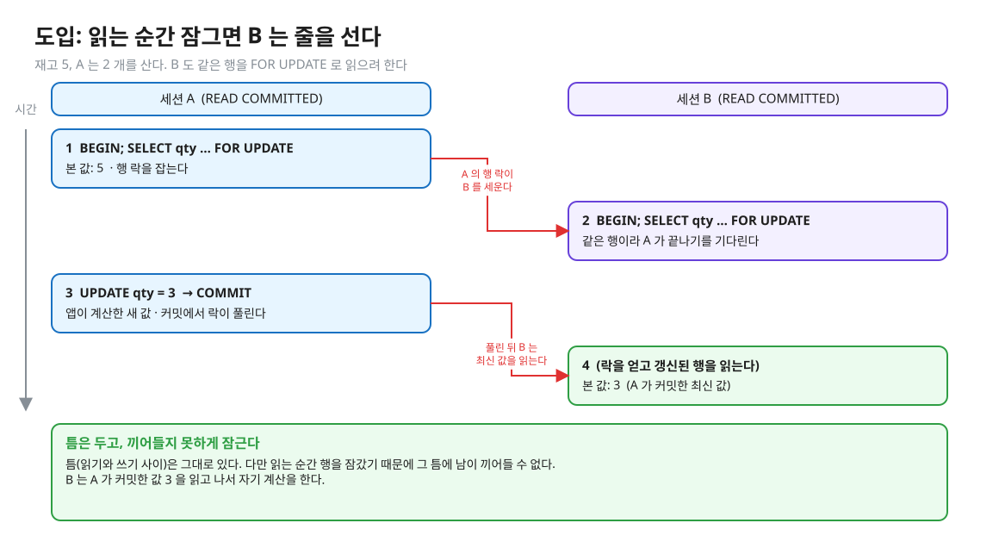
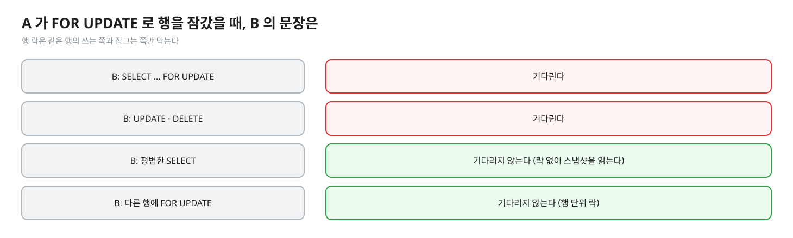
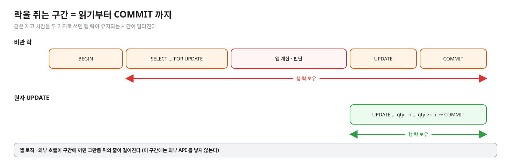
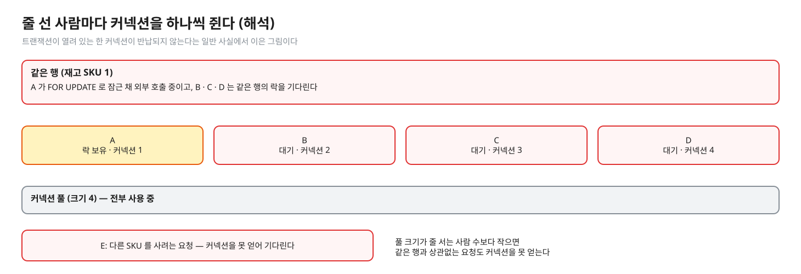
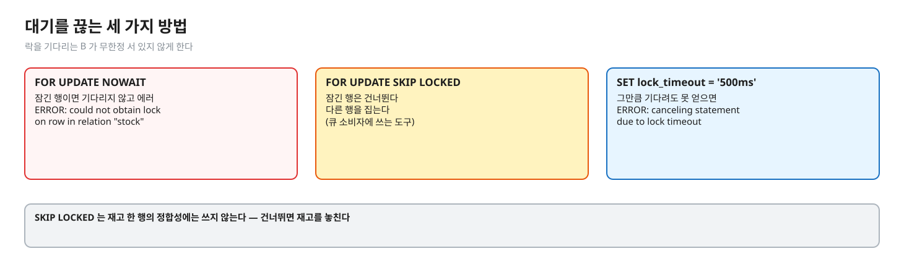
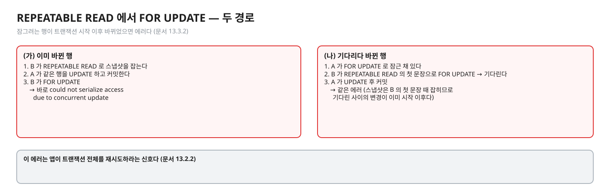
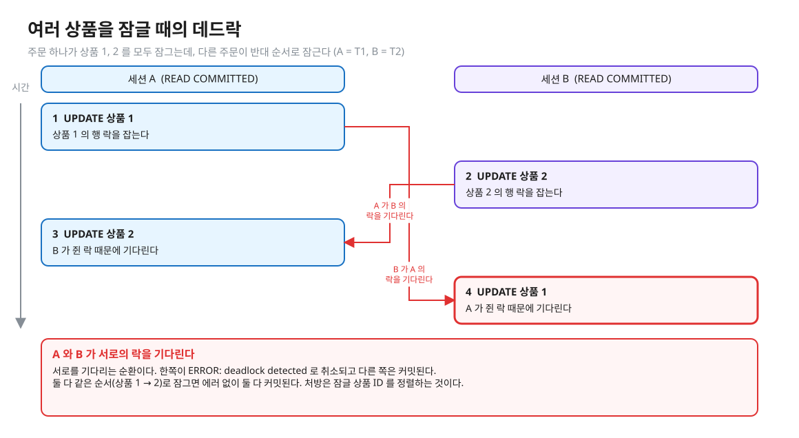
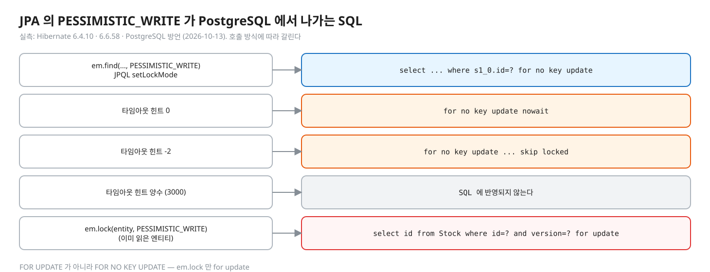

# 03. 비관 락 — `SELECT … FOR UPDATE` 로 읽는 순간 잠그기

> **이 글에서 알게 되는 것**
> 1. `SELECT … FOR UPDATE` 가 무엇을 잠그고 언제 푸는지, 그 사이 일반 SELECT 는 어떻게 되는지 안다.
> 2. 기다린 쪽이 최신 값을 읽는다는 점에서 02 의 원자 UPDATE 와 같은 원리 위에 있고, 차이는 **락 보유 구간**이라는 것을 안다.
> 3. 락을 쥔 시간의 비용(직렬화 · 커넥션 점유), 대기를 끊는 방법, 여러 상품을 잠글 때의 데드락과 정렬을 안다.
>
> **먼저 알면 좋은 것**: [01. 틈](01-lost-update-and-the-gap.md) · [02. 원자 조건부 UPDATE](02-atomic-conditional-update.md) 의 행 락 → 대기 → 재평가.
> **다음 글**: [04. 낙관 락](04-optimistic-lock.md)
> **구분**: 필수 — ② 원리 (① 에서 예측을 먼저 한 뒤 읽는다)

## 틈은 두고, 읽는 순간 잠근다

02 는 확인과 쓰기를 한 문장으로 붙여 틈을 없앴다. 그런데 읽은 값을 보고 **앱 코드가 복잡하게 판단**한 뒤 써야 한다면 한 문장 UPDATE 로 표현이 안 된다. 그럴 때는 틈을 그대로 두고, 읽는 순간 행 락을 잡아 남이 끼어들지 못하게 한다. 대가는 락을 쥔 시간만큼의 직렬화와 커넥션 점유다.

"`FOR UPDATE` 는 무엇을 잠그고 언제 푸나?", "그 사이 일반 SELECT 는?", "여러 상품을 주문하면 데드락은?" 이 한 줄로 이어지는 질문이다. 실무에서는 락을 쥔 채 외부 API 를 부르거나 트랜잭션이 길어져 대기자가 줄줄이 늘고 커넥션 풀이 마르는 장애의 전형적인 원인이 되기도 한다. 먼저 장면을 보자. 재고가 5 이고 A 가 2 개를 산다.


<sub>편집: [diagrams/blog03-intro.excalidraw](diagrams/blog03-intro.excalidraw)</sub>

## FOR UPDATE 는 무엇을 잠그나

```sql
BEGIN;
SELECT qty FROM stock WHERE sku = :sku FOR UPDATE;   -- 읽으면서 잠근다
-- 앱이 qty 를 보고 복잡한 계산 · 판단
UPDATE stock SET qty = :새값 WHERE sku = :sku;
COMMIT;                                              -- 여기서 락이 풀린다
```

[문서 13.3.2](https://www.postgresql.org/docs/16/explicit-locking.html)의 `FOR UPDATE`: 선택한 행을 "update 하려는 것처럼" 잠가서 현재 트랜잭션이 끝날 때까지 다른 트랜잭션이 그 행을 **잠그거나 수정하거나 삭제하지 못하게** 한다. 즉 같은 행에 `UPDATE` · `DELETE` · `SELECT FOR UPDATE`(및 다른 FOR 절)를 시도하는 쪽은 트랜잭션이 끝날 때까지 막힌다. 반대로 "행 락은 데이터 조회에 영향을 주지 않는다 — 같은 행의 쓰는 쪽과 잠그는 쪽만 막는다". 그래서 평범한 `SELECT` 는 이 락 때문에 기다리지 않는다 (같은 장면을 Q07 에서 예측한다 — 답은 접힌 칸).

<details><summary>그림 — A 가 잠근 행에 B 의 문장이 오면 (Q06 · Q07 과 같은 장면이라 접어 둔다)</summary>


<sub>편집: [diagrams/blog03-what-blocks.excalidraw](diagrams/blog03-what-blocks.excalidraw)</sub>
</details>

언제 쓰나: 읽은 값을 보고 **앱 코드가 복잡하게 판단**한 뒤 쓰는 경우 — 한 문장 UPDATE 로 표현이 안 되는 경우다. 단순한 증감이면 [02](02-atomic-conditional-update.md) 가 더 짧다.

## PostgreSQL 에서는

### 기다린 뒤에는 최신 값 — READ COMMITTED

B 가 `FOR UPDATE` 에서 A 를 기다리다 A 가 커밋하면, B 는 **갱신된 행을 잠그고 그 값을 읽는다**. 문서 13.2.1: `SELECT FOR UPDATE` 는 "갱신된 버전의 행이 잠기고 클라이언트에 반환된다". `SELECT` 에 `WHERE` 가 있으면 같은 재평가 규칙이 적용된다 — (실측: psql 2026-10-13) A 가 `FOR UPDATE` 로 잠근 뒤 `qty` 를 0 으로 바꾸고 커밋하는 동안 B 가 `SELECT … WHERE sku='A' AND qty >= 1 FOR UPDATE` 를 날리면 B 는 기다렸다가 **0 행**을 받았다. B 가 읽은 값은 A 가 커밋한 최신 값이었고 조건이 다시 평가됐다.

그래서 비관 락의 안전성은 02 와 같은 원리 위에 있다 — 줄을 세우고, 기다린 쪽이 최신 값을 읽는다. 차이는 **락 보유 구간**이다.

### 락 보유 시간 = 트랜잭션 길이

락은 `COMMIT`/`ROLLBACK` 에서 풀린다. 이 레슨의 `PessimisticLockStockService` 는 `setAutoCommit(false)` 로 트랜잭션을 열고 `FOR UPDATE` 로 읽고, 재고가 모자라면 `rollback()` 으로 락을 풀어 준 뒤 `false` 를 돌려준다. 이 `rollback()` 을 빼먹으면 락이 커넥션이 닫힐 때까지 남는다.


<sub>편집: [diagrams/blog03-lock-span.excalidraw](diagrams/blog03-lock-span.excalidraw)</sub>

아래 타임라인은 세 전략에서 늦게 온 구매자 B 가 거치는 단계를 나란히 놓은 것이다 (05 에서 다시 쓴다).


<sub>편집: [diagrams/three-timelines.excalidraw](diagrams/three-timelines.excalidraw)</sub>

락을 쥐는 동안 줄을 선 B, C, D 는 각자 **커넥션을 하나씩 쥐고** 기다린다 (해석 — 트랜잭션이 열려 있는 한 커넥션이 반납되지 않는다는 일반 사실에서). 풀 크기가 줄 서는 사람 수보다 작으면 같은 행과 상관없는 요청도 커넥션을 못 얻는다. 그래서 락을 쥔 구간에 외부 API · 느린 계산을 넣지 않는다.


<sub>편집: [diagrams/blog03-pool.excalidraw](diagrams/blog03-pool.excalidraw)</sub>

### 대기를 끊는 방법 (실측: psql 2026-10-13)

| 방법 | 동작 |
|---|---|
| `FOR UPDATE NOWAIT` | 잠긴 행이면 기다리지 않고 에러: `ERROR: could not obtain lock on row in relation "stock"` |
| `FOR UPDATE SKIP LOCKED` | 잠긴 행은 건너뛴다 — 다른 행을 집는다 |
| `SET lock_timeout = '500ms'` | 락을 그만큼 기다려도 못 얻으면 `ERROR: canceling statement due to lock timeout` |


<sub>편집: [diagrams/blog03-cut-wait.excalidraw](diagrams/blog03-cut-wait.excalidraw)</sub>

`NOWAIT` · `SKIP LOCKED` 는 [SELECT 레퍼런스](https://www.postgresql.org/docs/16/sql-select.html)가 설명한다. `SKIP LOCKED` 는 "일관되지 않은 뷰를 주므로 범용 작업에는 부적합하고, 큐 같은 테이블을 여러 소비자가 읽을 때 락 경합을 피하는 데 쓸 수 있다" 고 문서가 말한다 — 재고 한 행의 정합성에는 쓰지 않고(건너뛰면 재고를 놓친다), 재고를 여러 행으로 나눈 뒤 빈 행을 집을 때(05)나 작업 큐에 쓴다.

### REPEATABLE READ 에서는 (실측: psql 2026-10-13)

문서 13.3.2 의 `FOR UPDATE` 항목 끝: "REPEATABLE READ · SERIALIZABLE 에서는 잠그려는 행이 **트랜잭션 시작 이후 바뀌었으면 에러**" 다. 실측으로 두 경로를 봤다. (가) B 가 REPEATABLE READ 로 스냅샷을 잡은 뒤 A 가 같은 행을 UPDATE 하고 커밋한 다음 B 가 `FOR UPDATE` → 바로 `ERROR: could not serialize access due to concurrent update`. (나) A 가 `FOR UPDATE` 로 잠근 채 있을 때 B 가 REPEATABLE READ 의 **첫 문장**으로 `FOR UPDATE` → B 는 기다렸다가 A 가 UPDATE 후 커밋하자 같은 에러. 스냅샷은 B 의 첫 문장 시작 때 잡히므로 기다린 사이 일어난 변경이 이미 "트랜잭션 시작 이후" 다. 이 에러는 앱이 **트랜잭션 전체를 재시도**하라는 신호다 ([문서 13.2.2](https://www.postgresql.org/docs/16/transaction-iso.html)).

<details><summary>그림 — 두 경로 (04 의 Q05 와 같은 규칙이라 접어 둔다)</summary>


<sub>편집: [diagrams/blog03-rr-paths.excalidraw](diagrams/blog03-rr-paths.excalidraw)</sub>
</details>

### 여러 상품 — 데드락과 정렬

주문 한 건이 상품 A, B 를 모두 잠그는데 다른 주문이 B, A 순서로 잠그면 서로를 기다린다. (실측: psql 2026-10-13) T1 이 A→B, T2 가 B→A 로 UPDATE 하자 한쪽이 `ERROR: deadlock detected` (`DETAIL: Process 227 waits for ShareLock on transaction 763; blocked by process 226. …`) 로 취소됐고 다른 쪽은 커밋됐다. 둘 다 같은 순서(A→B)로 하면 에러 없이 둘 다 커밋됐다.


<sub>편집: [diagrams/blog03-deadlock.excalidraw](diagrams/blog03-deadlock.excalidraw)</sub>

- 문서의 처방: "데드락에 대한 최선의 방어는 **모든 애플리케이션이 여러 객체의 락을 일관된 순서로 얻도록** 확실히 하는 것" ([문서 13.3.4](https://www.postgresql.org/docs/16/explicit-locking.html)). 실무 규칙: 잠글 상품 ID 를 정렬해 한 개씩 같은 순서로 잠근다.
- 감지: `deadlock_timeout`(기본 1초, [문서 20.12](https://www.postgresql.org/docs/16/runtime-config-locks.html))만큼 락을 기다린 뒤 데드락 검사를 한다. 이 레슨 컨테이너는 관찰 편의로 `200ms` 로 줄여 두었다 (`observe/docker-compose.yml`).
- 데드락 감지와 락 모드 상세는 [01.02 docs](../../l02-row-locks-deadlock/docs/README.md).
- 한 문장 `SELECT … WHERE sku IN (…) ORDER BY sku FOR UPDATE` 로 순서를 강제할 수 있는지는 확인하지 못했다. 문서가 말하는 것은 READ COMMITTED 에서 `ORDER BY` 와 락 절을 같이 쓰면 락을 기다린 뒤 행이 정렬 밖으로 나올 수 있다는 주의뿐이다 (SELECT 레퍼런스 Caution). 락 획득 순서를 보장한다는 문장은 못 찾았다.

### 자주 하는 오해

1. **"`FOR UPDATE` 는 테이블을 잠근다."** 선택한 행만 잠근다. 서로 다른 행의 락은 서로를 막지 않는다 (같은 장면을 Q08 에서 예측한다 — 답은 접힌 칸).
2. **"비관 락이 걸려 있으면 SELECT 도 막힌다."** 막히지 않는다. 일반 SELECT 는 락 없이 스냅샷을 읽는다. 그래서 `SELECT` 만 보고 재고를 판단하는 코드는 `FOR UPDATE` 로 보호되지 않는다 — 읽는 쪽도 `FOR UPDATE` 를 써야 줄을 선다.
3. **"비관 락이면 재시도가 필요 없다."** READ COMMITTED 에서는 맞다. 하지만 REPEATABLE READ 이상에서는 `40001` 이 날 수 있고, 데드락(`40P01`)과 `lock_timeout` 취소도 재시도 대상이다.
4. **"락을 길게 잡아야 안전하다."** 안전은 순서(읽기 전 잠금)에서 오고, 길이는 비용이다. 필요한 곳까지만 짧게.

### 앱 · 프레임워크에서는

- JPA 의 비관 락 `PESSIMISTIC_WRITE`: Jakarta Persistence 3.1 스펙(3.4.4.2)은 "엔티티 인스턴스에 얻어 트랜잭션 간 직렬화를 강제할 수 있고, 즉시 얻어 트랜잭션이 끝날 때까지 유지된다" 고 정의한다. PostgreSQL 16 에서 나가는 SQL 은 (Hibernate 6.4/6.6 · PostgreSQL 방언 기준 — 7.x 는 다르다) `em.find(…, PESSIMISTIC_WRITE)` · JPQL `setLockMode` 모두 `select … where s1_0.id=? for no key update` 다 — `FOR UPDATE` 가 아니다 (실측: Hibernate 6.4.10 · 6.6.58, 2026-10-13; Spring Data `@Lock(PESSIMISTIC_WRITE)` 리포지토리 메서드도 6.6.53 에서 같은 `for no key update` — [05-spring-jpa-mapping.md](../../docs/05-spring-jpa-mapping.md)). 타임아웃 힌트 0 이면 `for no key update nowait`, -2 면 `… skip locked` 이고 양수(3000)는 SQL 에 반영되지 않는다. 이미 읽은 엔티티에 `em.lock(entity, PESSIMISTIC_WRITE)` 를 하면 별도 SELECT 가 `select id from Stock where id=? and version=? for update` 로 나간다 — 호출 방식에 따라 `FOR NO KEY UPDATE` 와 `FOR UPDATE` 로 갈린다 (`@Version` 이 없으면 `version=?` 조건이 빠지는지는 확인하지 않았다). 참고로 Hibernate 7.4.13 은 `for no key update of s1_0` 으로 나가고 양수 타임아웃을 `set local lock_timeout` 으로 보낸다. `FOR NO KEY UPDATE` 는 다른 `UPDATE` · `FOR UPDATE` · `FOR NO KEY UPDATE` · `FOR SHARE` 와는 충돌하고 `FOR KEY SHARE` 만 막지 않는다 ([문서 13.3.2](https://www.postgresql.org/docs/16/explicit-locking.html)).
- 위치: 락을 거는 순간이 트랜잭션 시작 직후여야 락 보유 구간이 짧다 (해석).


<sub>편집: [diagrams/blog03-hibernate.excalidraw](diagrams/blog03-hibernate.excalidraw)</sub>

## MySQL InnoDB 는 어떻게 다른가 (심화)

`SELECT … FOR UPDATE` 는 "최신 데이터를 읽고 읽은 각 행에 배타 락을 건다. 검색된 SQL UPDATE 가 거는 것과 같은 락" ([MySQL 8.0 · 17.7.2.4](https://dev.mysql.com/doc/refman/8.0/en/innodb-locking-reads.html)). 락은 커밋/롤백에서 풀린다. 일반 SELECT 는 일관된 읽기라 락을 무시한다. 상세는 [06](06-mysql-innodb.md).

## 한눈에 정리

| | 02 원자 UPDATE | 03 비관 락 |
|---|---|---|
| 틈 | 없다 (한 문장) | 있지만 잠가서 끼어들 수 없다 |
| 락 보유 | UPDATE 문장 ~ 커밋 | 읽기 ~ 커밋 (앱 로직 포함) |
| 기다린 쪽 | 최신 값으로 WHERE 재평가 | 갱신된 행을 잠그고 최신 값을 읽는다 |
| 대가 | 거의 없음 | 락 보유 시간만큼의 직렬화 · 커넥션 점유 |

- `FOR UPDATE` 는 선택한 **행**만 잠근다. 일반 SELECT 는 막히지 않는다.
- 안전은 "읽기 전 잠금" 이라는 순서에서 오고, 락의 길이는 비용이다. 락 구간에 외부 호출을 넣지 않는다.
- 대기는 `NOWAIT` · `lock_timeout` 으로 끊고, 여러 행은 일관된 순서로 잠근다. 데드락(`40P01`)과 REPEATABLE READ 의 `40001` 은 재시도 대상이다.

## 스스로 확인

1. 비관 락이 낙관 락보다 경합이 높을 때 유리하다고 하는데, 그럼 모든 곳에 비관 락을 쓰면 되나?
   <details><summary>답</summary>
   경합이 없을 때도 매번 트랜잭션을 열고 락을 잡고 풀어 왕복이 늘고(타임라인 그림: 3 왕복 vs 1), 락을 쥔 구간이 길면 줄이 길어진다. 관찰 테스트에서도 경합 높음(재고 충분) 구간의 비관 락이 원자 UPDATE 보다 느렸다(05). 그리고 읽고 복잡하게 판단해야 할 때만 이득이다 — 단순 증감이면 원자 UPDATE 가 같은 안전을 더 짧은 락으로 준다.
   </details>
2. 재고 행이 아직 없는 SKU 에 `SELECT … FOR UPDATE` 를 하면 무엇이 잠기나?
   <details><summary>답</summary>
   `FOR UPDATE` 는 "선택한 행" 을 잠그므로(문서 13.3.2) 0 행이면 잠기는 것이 없다 (해석 — 문서의 행 단위 정의에서 이은 결론, 직접 돌려 보지는 않았다). 그 사이 다른 트랜잭션이 같은 SKU 의 행을 INSERT 할 수 있다. 행이 없을 수 있는 대상의 동시성은 `INSERT … ON CONFLICT` 나 유니크 제약 같은 다른 도구가 필요하다 — 이 레슨 범위 밖.
   </details>
3. 락을 건 B 가 오래 기다리다 응답이 안 가는 사용자 경험을 어떻게 막나?
   <details><summary>답</summary>
   `lock_timeout` 이나 `NOWAIT` 으로 대기를 끊고 "잠시 후 다시" 를 돌려준다 (실측: psql — 위 표). 취소된 요청은 트랜잭션을 롤백하고 필요하면 처음부터 다시 한다 (01.01 docs 04 의 25P02 설명 — 에러 후 같은 트랜잭션의 다음 문장은 거절된다).
   </details>

## 이 레슨에서 직접 보기

| 어디서 | 무엇을 |
|---|---|
| Q06 | A 가 `FOR UPDATE` 로 잠근 채 커밋 전 — B 의 `FOR UPDATE` 는 기다리나 · A 가 0 으로 바꿔 커밋한 뒤 B 가 읽은 값 |
| Q07 | 같은 상황에서 B 의 **평범한** SELECT 는 기다리나 · 읽은 값 |
| 장면 4 ([observe/SCRIPT.md](../observe/SCRIPT.md)) | `pg_locks` 에서 `granted = f` 인 행 — 누구의 `transactionid` 를 기다리나 |
| 구현 ② | `PessimisticLockStockService#reserve` |

이 글의 그림은 일부러 문항과 다른 숫자(재고 5 · 2 개)로 그렸다. 예측 문항의 값을 직접 적어 보고 나서 확인한다.

<details><summary>실측 — 예측을 끝낸 뒤 펼친다 (Q06 · Q07)</summary>

| Q | 결과 |
|---|---|
| Q06 | B 의 `FOR UPDATE` 는 기다린다(`true`), 풀린 뒤 B 가 읽은 값 `0` |
| Q07 | 평범한 SELECT 는 기다리지 않는다(`false`), 읽은 값은 A 가 커밋 전이라 옛 값 `1` |

근거: [정답 patch](../../../solutions/01.04.patch) · `StockPredictTest` Q06 · Q07. (실측: Q06 · Q07)
</details>

## 출처

- [PostgreSQL 16 · 13.3 Explicit Locking](https://www.postgresql.org/docs/16/explicit-locking.html) — FOR UPDATE · 행 락은 조회에 영향 없음 · 일관된 순서 · 데드락
- [13.2 Transaction Isolation](https://www.postgresql.org/docs/16/transaction-iso.html) — 기다린 뒤 갱신된 행 반환 · RR 의 40001
- [SELECT](https://www.postgresql.org/docs/16/sql-select.html) — NOWAIT · SKIP LOCKED · ORDER BY 주의
- [20.12 Lock Management](https://www.postgresql.org/docs/16/runtime-config-locks.html) — `deadlock_timeout` 기본 1s
- Hibernate 6.4.10 · 6.6.58 · 7.4.13 을 PostgreSQL 16 에 붙여 `show_sql` 로 읽은 SQL (2026-10-13) — `PESSIMISTIC_WRITE` → `for no key update`
- [Jakarta Persistence 3.1](https://jakarta.ee/specifications/persistence/3.1/jakarta-persistence-spec-3.1.html) — 3.4.4.2 PESSIMISTIC_WRITE
- [MySQL 8.0 · 17.7.2.4 Locking Reads](https://dev.mysql.com/doc/refman/8.0/en/innodb-locking-reads.html)
