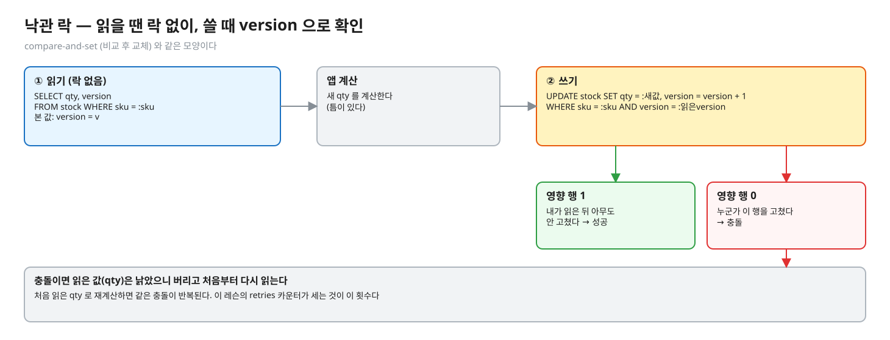
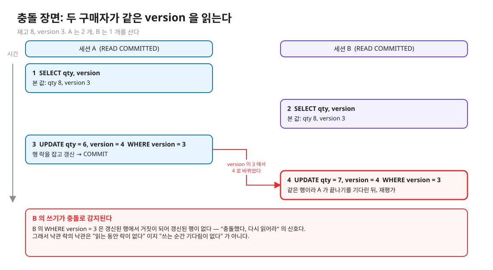
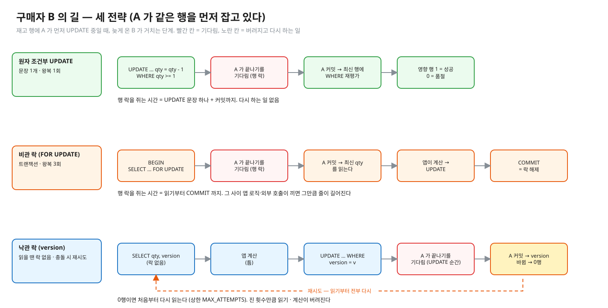
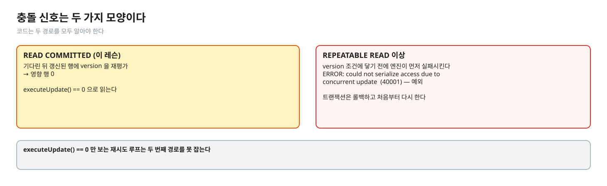
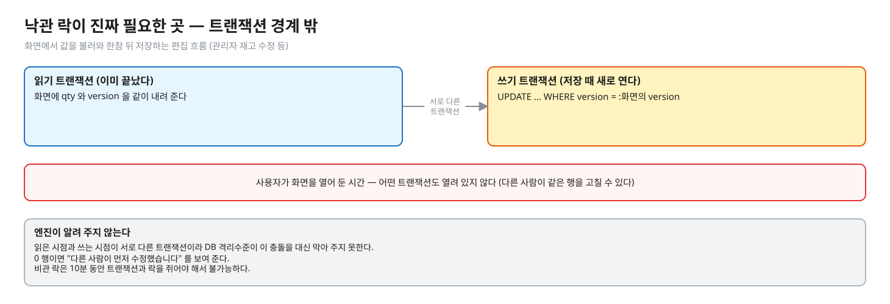
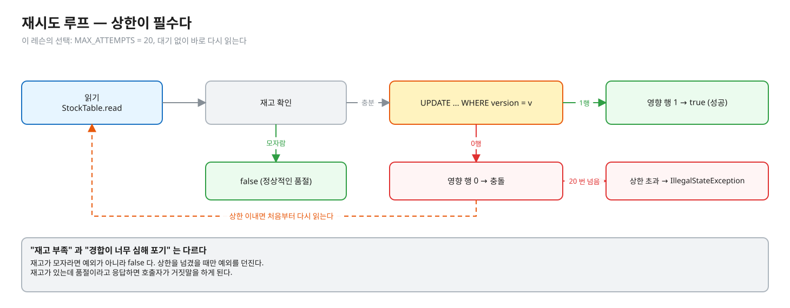
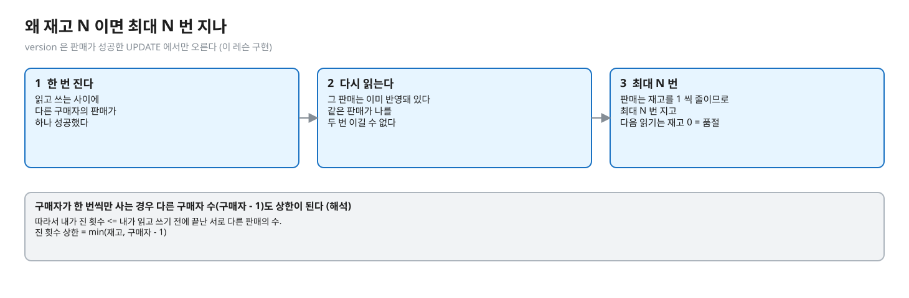
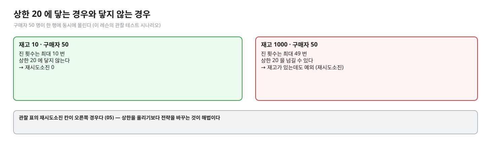
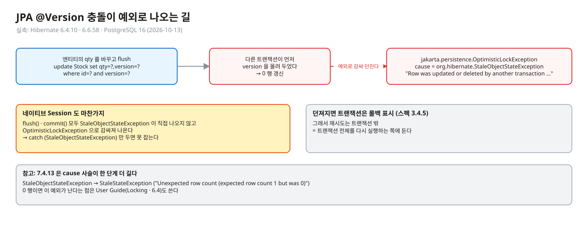

# 04. 낙관 락 — version 으로 충돌을 감지하고 다시 한다

> **이 글에서 알게 되는 것**
> 1. 낙관 락이 읽을 때 락을 안 잡고, 쓸 때 `WHERE version = 읽은 값` 으로 충돌을 감지하며, 영향 행 0 이면 처음부터 다시 읽는다는 것을 안다.
> 2. 낙관 락의 UPDATE 도 행 락을 기다린다는 것, 그리고 REPEATABLE READ 에서는 충돌 신호가 0 행에서 예외로 바뀐다는 것을 안다.
> 3. 재시도에 상한이 왜 필수이고, 재고 N 이면 최대 N 번만 지는 이유를 안다. JPA `@Version` 의 예외와 재시도 위치까지 안다.
>
> **먼저 알면 좋은 것**: [02. 원자 조건부 UPDATE](02-atomic-conditional-update.md) 의 재평가, [03. 비관 락](03-pessimistic-lock.md).
> **다음 글**: [05. 세 전략 비교와 선택](05-choosing-and-hot-row.md)
> **구분**: 필수 — ② 원리 (① 에서 예측을 먼저 한 뒤 읽는다)

## 일단 낙관하고, 쓸 때 확인한다

비관 락은 읽는 순간 잠갔다. 낙관 락은 반대로 "충돌은 드물 것" 이라 가정하고 읽을 때 락을 잡지 않는다. 대신 쓸 때 "내가 읽은 뒤 아무도 안 고쳤나" 를 확인하고, 고쳤으면 처음부터 다시 한다. 화면에서 값을 불러와 한참 뒤 저장하는 편집 흐름(관리자 재고 수정 등)의 표준 해법이다. 반대로 인기 상품 한 행에 몰리는 차감에 쓰면 재시도 폭풍이 난다.

"낙관 락은 락을 안 쓰나?", "경합이 심하면 왜 불리하나?", "재시도는 몇 번까지, 넘으면?", "JPA `@Version` 은?" 이 이 글에서 답할 질문이다.

## version 으로 충돌을 감지한다

```sql
SELECT qty, version FROM stock WHERE sku = :sku;            -- ① 읽기 (락 없음)
-- 앱 계산
UPDATE stock SET qty = :새값, version = version + 1
 WHERE sku = :sku AND version = :읽은version;               -- ② 쓰기 — 영향 행 1 = 성공, 0 = 충돌
```


<sub>편집: [diagrams/blog04-cas.excalidraw](diagrams/blog04-cas.excalidraw)</sub>

- 이름이 낙관인 이유: **읽는 동안** 락을 안 잡고 충돌이 없을 것이라 낙관한다. 충돌은 쓰는 순간 `version` 비교로 감지한다 — 컴퓨터 과학에서 compare-and-set(비교 후 교체)과 같은 모양이다.
- 영향 행 0 = 내가 읽은 뒤 누군가 이 행을 고쳤다. 읽은 값(qty)은 낡았으니 **버리고 처음부터 다시 읽는다** (이 레슨의 `retries` 카운터가 세는 것). 처음 읽은 qty 로 재계산하면 같은 충돌이 반복된다.
- 다시 읽었더니 재고가 모자라면 예외가 아니라 `false`(정상적인 품절)다. 상한을 넘겼을 때만 예외 — "재고 부족" 과 "경합이 너무 심해 포기" 를 구분해야 호출자가 거짓말을 안 한다. 재고가 있는데 품절이라고 응답하면 안 된다.

02 의 원자 UPDATE 와 무엇이 다른가. 02 는 검사가 문장 안에 있어 기다린 쪽이 알아서 최신 값으로 판단했다. 낙관 락은 앱이 계산한 값을 쓰되, 그 계산의 근거가 아직 유효한지를 version 으로 확인한다. 그래서 틈이 남아 있고 충돌을 **감지**한다.

### version 이 올라가는 때 (이 레슨 구현)

`version = version + 1` 은 **판매가 성공한 UPDATE** 에서만 오른다. 그래서 "내가 진 횟수" 는 "내가 읽고 쓰는 사이에 다른 구매자의 판매가 성공한 횟수" 와 같다. (해석 — 구현 코드에서 이은 추론. 다른 코드가 version 을 올리면 그 횟수도 센다.)

## PostgreSQL 에서는

### 낙관 락도 UPDATE 순간에는 행 락을 기다린다

낙관 락의 UPDATE 는 보통 UPDATE 이므로 행 락이 있다. 같은 행을 먼저 UPDATE 한 트랜잭션이 아직 끝나지 않았다면 `UPDATE … WHERE version = v` 도 02 · 03 과 같은 규칙으로 **행 락을 기다린다**. 그쪽이 커밋하면 READ COMMITTED 의 재평가([문서 13.2.1](https://www.postgresql.org/docs/16/transaction-iso.html), [01.01 docs 04](../../l01-isolation-mvcc/docs/04-write-conflicts.md))가 갱신된 행에 `version = v` 를 다시 평가한다 — 먼저 쓴 쪽이 version 을 올렸으면 조건은 거짓이고 그 행은 갱신되지 않아 영향 행이 0 이다. 이 0 이 "충돌했다, 다시 읽어라" 의 신호다. 그래서 낙관 락의 낙관은 "읽는 동안 락이 없다" 이지 "쓰는 순간 기다림이 없다" 가 아니다 (같은 장면을 Q04 에서 예측한다 — 답은 접힌 칸).

<details><summary>그림 — 충돌 장면 (Q04 와 같은 규칙이라 접어 둔다)</summary>


<sub>편집: [diagrams/blog04-conflict.excalidraw](diagrams/blog04-conflict.excalidraw)</sub>
</details>

비관 락과 비교하면, 락을 쥐는 시간이 읽기부터 커밋까지가 아니라 UPDATE 에서 커밋까지로 짧다. 대신 진 쪽은 읽기와 계산을 전부 버린다. 기존 그림의 맨 아래 줄이 이 길이다.


<sub>편집: [diagrams/three-timelines.excalidraw](diagrams/three-timelines.excalidraw)</sub>

### REPEATABLE READ 에서는 — 신호의 모양이 바뀐다

REPEATABLE READ 로 읽은 뒤 같은 행이 바뀌어 있으면 UPDATE 는 `version` 조건에 닿기 전에 엔진이 `40001 could not serialize access due to concurrent update` 로 실패시킨다 ([문서 13.2.2](https://www.postgresql.org/docs/16/transaction-iso.html), 01.01 Q07 과 같은 규칙 — 이 레슨 Q05 가 같은 장면이다. 답은 접힌 칸). 그러면 충돌 신호가 영향 행 0 에서 **예외**로 바뀌므로 `executeUpdate() == 0` 만 보는 재시도 루프는 이 경로를 못 잡는다. 또 에러가 난 트랜잭션은 롤백하고 처음부터 해야 한다.

<details><summary>그림 — 충돌 신호의 두 모양 (Q05 의 답이 보여서 접어 둔다)</summary>


<sub>편집: [diagrams/blog04-two-signals.excalidraw](diagrams/blog04-two-signals.excalidraw)</sub>
</details>

이 경우 version 은 중복 보호(엔진이 먼저 막아 준다)지만 낙관 락이 진짜 필요한 곳은 **트랜잭션 경계 밖**이다 — 화면에서 읽고 한참 뒤 저장하면 읽은 시점과 쓰는 시점이 서로 다른 트랜잭션이라 엔진이 알려 주지 않는다.


<sub>편집: [diagrams/blog04-edit-form.excalidraw](diagrams/blog04-edit-form.excalidraw)</sub>

### 재시도 설계

재시도 루프를 그림으로 보면 이렇다. 읽고, 충분하면 UPDATE 하고, 0 행이면 상한 안에서 처음부터 다시 읽는다.


<sub>편집: [diagrams/blog04-retry-loop.excalidraw](diagrams/blog04-retry-loop.excalidraw)</sub>

| 결정 | 이 레슨의 선택 | 일반 설계 (해석) |
|---|---|---|
| 상한 | `MAX_ATTEMPTS = 20` (레슨의 선택 — 이유는 아래 "왜 상한이 20 인가": 재고 10 · 구매자 50 의 테스트가 최대 10 번 지므로 닿지 않는 값. 01.01 은 5회 + 지터를 골랐다) | 끝없이 도는 것을 막는다. 상한이 없으면 경합이 계속되는 한 한 요청이 안 끝날 수 있다 |
| 상한 초과 | `IllegalStateException` (품절 `false` 와 구분) | 호출자에게 "다시 시도" 를 명확히 전달 (HTTP 409/503 + `Retry-After` 같은 번역은 설계 선택) |
| 대기 | 없음 — 바로 다시 읽는다 (레슨의 선택: 재시도 횟수를 센 관찰을 단순하게 두려는 것 (해석). 01.01 은 5~25ms 지터를 둔다) | 같은 순간에 진 사람들이 같은 순간에 다시 오면 또 부딪힌다. 지수적 대기(backoff)와 무작위 흔들림(jitter)을 더하는 것이 일반적이다. 이 레슨 코드에는 없다 |
| 다시 읽기 | 매 시도마다 `StockTable.read` | 필수 — 낡은 값으로 재계산하면 같은 충돌 |

### 왜 상한이 20 인가 — 재고 N 이면 최대 N 번 진다

구현 주석의 근거를 풀어 쓰면:

1. 내가 한 번 진다 = 읽고 쓰는 사이에 **다른 구매자의 판매가 하나 성공**했다 (version 은 판매 성공 때만 오른다).
2. 지고 나서 다시 읽으면 그 판매는 이미 반영돼 있다. 같은 판매가 나를 두 번 이길 수 없다.
3. 따라서 내가 진 횟수 <= (내가 읽고 쓰기 전에 끝난 서로 다른 판매의 수). 판매는 재고를 1 씩 줄이므로 최대 N 번 지고, 그다음 읽기는 재고 0 = 품절(`false`)이다. 구매자가 한 번씩만 사는 경우 다른 구매자 수(구매자 - 1)도 상한이 된다 (해석 — 위 1~2 에서 이은 계산).


<sub>편집: [diagrams/blog04-version-rule.excalidraw](diagrams/blog04-version-rule.excalidraw)</sub>

그래서 재고 10 · 구매자 50 의 구현 테스트는 최대 10 번 지고 상한 20 에 닿지 않는다. 반대로 재고가 충분한 채 50 명이 몰리면 최대 49 번 질 수 있어 20 을 넘길 수 있다 — 관찰 표의 `재시도소진` 칸이 그것이다 (05).


<sub>편집: [diagrams/blog04-bound.excalidraw](diagrams/blog04-bound.excalidraw)</sub>

### 자주 하는 오해

1. **"낙관 락은 락이 없다."** 읽기 구간에 락이 없을 뿐, UPDATE 는 행 락을 잡고 상대를 기다린다. 락의 *보유 시간*이 짧을 뿐이다.
2. **"충돌이 나면 에러가 난다."** 이 레슨(READ COMMITTED)에서는 에러가 아니라 영향 행 0 이다. 에러(`40001`)가 나는 것은 REPEATABLE READ 이상이다 — 충돌 신호가 두 가지 모양이라는 점을 코드가 알아야 한다.
3. **"재시도하면 언젠가 된다."** 경합이 계속되면 영원히 못 끝낼 수 있다. 상한이 있어야 하고, 넘기면 명확히 실패시켜야 한다.
4. **"낙관 락은 재고 차감에 가장 효율적이다."** 같은 행에 몰리면 진 쪽의 읽기 · 계산이 전부 버려진다. 재고 같은 핫 로우 차감의 기본값은 원자 UPDATE 다 (05).
5. **"재고가 모자라면 낙관 락도 예외를 던진다."** 모자라면 `false`. 예외는 "경합 포기" 만이다.

### 앱 · 프레임워크에서는

- JPA: [Jakarta Persistence 3.1](https://jakarta.ee/specifications/persistence/3.1/jakarta-persistence-spec-3.1.html) 3.4.2 — version 속성은 영속성 공급자가 엔티티를 DB 에 쓸 때 갱신하고, 애플리케이션이 version 값을 수정하면 안 된다. 3.4.5 — `OptimisticLockException` 은 flush 시점이나 커밋 시점에 던져질 수 있고("before completion" 단계), 던져지면 **트랜잭션은 롤백 표시**된다. 그래서 `@Version` 충돌의 재시도는 트랜잭션 밖(트랜잭션 전체 재실행)에 둔다.
- Hibernate 에는 `StaleObjectStateException` (`StaleStateException` 의 하위 클래스, 어떤 엔티티 인스턴스가 문제인지 정보를 가진다 — [Javadoc 6.4](https://docs.hibernate.org/orm/6.4/javadocs/org/hibernate/StaleObjectStateException.html))이 있다. `@Version` 엔티티의 qty 를 바꾸고 flush 하면 `update Stock set qty=?,version=? where id=? and version=?` 가 나간다 (실측: Hibernate 6.4.10 · 6.6.58, 2026-10-13). 다른 트랜잭션이 먼저 version 을 올려 두었으면 0 행이 갱신되고, Hibernate 네이티브 `Session` 의 `flush()` · `commit()` 과 JPA `EntityManager` 의 `flush()` · `commit()` 모두 `jakarta.persistence.OptimisticLockException` 이 던져지며 cause 는 `org.hibernate.StaleObjectStateException`(메시지 "Row was updated or deleted by another transaction … [probe.Stock#1]") 하나다. 네이티브 `Session` 에서도 `StaleObjectStateException` 이 직접 나오지 않고 `OptimisticLockException` 으로 감싸져 나온다 — `catch (StaleObjectStateException)` 만 두면 못 잡는다. 참고로 7.4.13 은 같은 UPDATE 에 cause 사슬이 `StaleObjectStateException` → `StaleStateException`("Unexpected row count (expected row count 1 but was 0)") 로 한 단계 길다. 0 행이면 이 예외가 난다는 점은 User Guide(Locking · 6.4)도 쓴다.


<sub>편집: [diagrams/blog04-jpa.excalidraw](diagrams/blog04-jpa.excalidraw)</sub>

## MySQL InnoDB 는 어떻게 다른가 (심화)

UPDATE 가 최신 커밋 행에 적용되므로 `WHERE version = ?` 가 0 행이 되는 모양은 같다 (해석 — 17.7.2.3 에서 이은 결론, 직접 돌리지 않음). REPEATABLE READ 에서 PostgreSQL 처럼 `40001` 로 먼저 막는다는 문서 근거는 찾지 못했다 → [06](06-mysql-innodb.md).

## 한눈에 정리

| | 낙관 락 |
|---|---|
| 읽을 때 | 락 없음 (`SELECT qty, version`) |
| 쓸 때 | `WHERE version = 읽은 값` + `version + 1`, UPDATE 순간에는 행 락을 기다린다 |
| 충돌 신호 | READ COMMITTED 는 영향 행 0, REPEATABLE READ 이상은 `40001` 예외 |
| 충돌하면 | 읽은 값을 버리고 처음부터 다시 읽는다. 상한 필수 (이 레슨 20), 초과는 예외, 품절은 `false` |
| 맞는 곳 | 읽기와 쓰기가 서로 다른 트랜잭션인 편집 흐름, 충돌이 드문 쓰기 |

- 낙관 락의 낙관은 "읽는 동안 락이 없다" 이지 "쓰는 순간 기다림이 없다" 가 아니다.
- 재고 N 이면 진 횟수는 최대 N 번이다. 재고가 충분한 채 몰리면 상한을 넘겨 재고가 있는데 못 사는 일이 생긴다.
- `@Version` 충돌의 재시도는 트랜잭션 바깥에서 전체를 다시 시작한다.

## 스스로 확인

1. 낙관 락 재시도 루프를 재고 100 · 구매자 1000 명이 몰리는 상황에서 `MAX_ATTEMPTS = 20` 으로 돌리면 어떻게 되나?
   <details><summary>답</summary>
   진 횟수는 최대 min(100, 구매자 수 - 1) 이라 20 을 넘길 수 있고, 일부 구매자는 재고가 남아 있는데도 "재시도 초과" 예외를 받는다. 관찰 테스트의 `재시도소진` 칸과 같은 현상이다 (실측: 관찰 테스트 — 구매자 50 · 재고 1000 에서 3~7 명). 해법은 상한을 올리는 것(경합이 더 길어진다)이 아니라 전략을 바꾸는 것(원자 UPDATE)이다.
   </details>
2. 낙관 락을 쓰는데 UPDATE 에 `qty >= ?` 조건까지 같이 걸면 어떻게 되나?
   <details><summary>답</summary>
   0 행의 원인이 둘(version 충돌 · 재고 부족)이 되어 구분이 안 된다. 어차피 0 이면 "다시 읽어서 판단" 하므로 동작은 하지만, 그렇게 하면 사실상 원자 UPDATE 가 된다 — version 이 필요 없어진다 (해석). 이 연습의 구현 주석도 "요점은 version" 이라고 한다.
   </details>
3. 사용자가 상품 정보를 편집 화면에서 열어 두고 10분 뒤 저장한다. 어떤 전략이 맞나?
   <details><summary>답</summary>
   낙관 락이다. 비관 락은 10분 동안 트랜잭션과 락을 쥐어야 해서(커넥션 점유 · 대기자 폭증) 불가능하다. version 을 화면에 같이 내려 두었다가 저장 때 `WHERE version = ?` 로 확인하고, 0 행이면 "다른 사람이 먼저 수정했습니다" 를 보여 준다. 읽은 시점과 쓰는 시점이 서로 다른 트랜잭션이라 DB 격리수준이 이 충돌을 대신 막아 주지 못한다 (REPEATABLE READ 의 40001 은 같은 트랜잭션 안에서만).
   </details>
4. 재시도 루프를 `@Transactional` 메서드 **안에** 두면 왜 문제가 되나?
   <details><summary>답</summary>
   JPA 에서 `OptimisticLockException` 이 던져지면 트랜잭션이 롤백 표시되므로(스펙 3.4.5) 같은 트랜잭션 안에서 다시 시도할 수 없다. 또 REPEATABLE READ 의 `40001` 후에는 트랜잭션이 중단 상태라 이후 문장이 거절된다. 재시도는 트랜잭션 경계 **바깥**에서 전체를 다시 시작해야 한다 ([01.01 docs 05](../../l01-isolation-mvcc/docs/05-serializable-ssi-retry.md)).
   </details>

## 이 레슨에서 직접 보기

| 어디서 | 무엇을 |
|---|---|
| Q04 | A 가 version 을 올려 UPDATE 후 커밋 전 — B 의 같은 UPDATE 는 기다리나 · A 커밋 뒤 영향 행 수 |
| Q05 | B 를 REPEATABLE READ 로 시작해 같은 장면 — B 의 UPDATE 결과 |
| 장면 3 ([observe/SCRIPT.md](../observe/SCRIPT.md)) | 손으로 0 행과 40001 을 본다 |
| 구현 ③ | `OptimisticLockStockService#reserve` — 결과 검사(50명) · 상한 초과 · 방법 검사(충돌 시 다시 읽는다) |

이 글의 그림은 일부러 문항과 다른 숫자(재고 8 · version 3)로 그렸다. 예측 문항의 값을 직접 적어 보고 나서 확인한다.

<details><summary>실측 — 예측을 끝낸 뒤 펼친다 (Q04 · Q05)</summary>

| Q | 결과 |
|---|---|
| Q04 | B 는 기다린다(`true`), A 커밋 뒤 영향 행 수 `0` |
| Q05 | 0 행이 아니라 `에러 40001` (SQLState) |

근거: [정답 patch](../../../solutions/01.04.patch) · `StockPredictTest` Q04 · Q05. (실측: Q04 · Q05)
</details>

## 출처

- [PostgreSQL 16 · 13.2 Transaction Isolation](https://www.postgresql.org/docs/16/transaction-iso.html) — RC 재평가 · RR 40001
- [Jakarta Persistence 3.1 스펙](https://jakarta.ee/specifications/persistence/3.1/jakarta-persistence-spec-3.1.html) — 3.4.2 Version Attributes · 3.4.5 OptimisticLockException
- Hibernate 6.4.10 · 6.6.58 · 7.4.13 을 PostgreSQL 16 에 붙여 `show_sql` 과 예외 `getClass()` · cause 사슬을 읽은 결과 (2026-10-13) — `@Version` UPDATE · `OptimisticLockException`
- [Hibernate 6.4 · StaleObjectStateException](https://docs.hibernate.org/orm/6.4/javadocs/org/hibernate/StaleObjectStateException.html)
