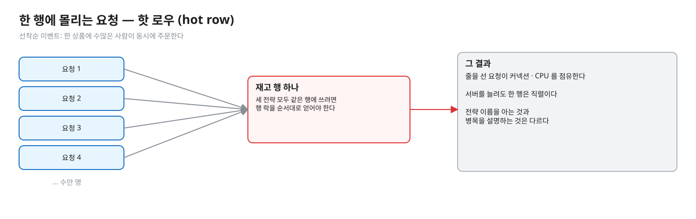
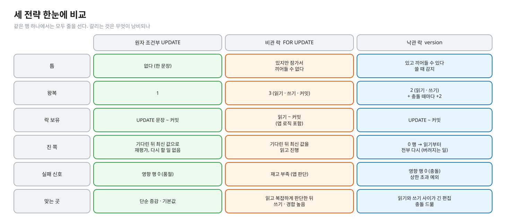
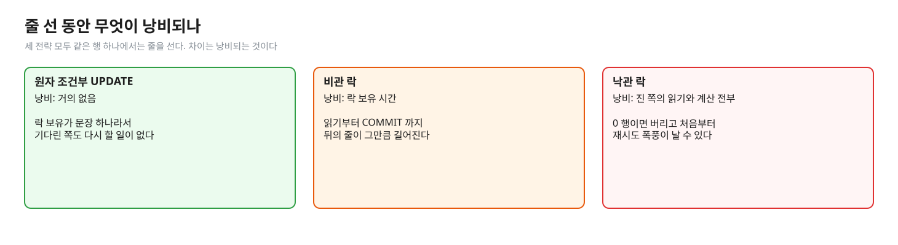
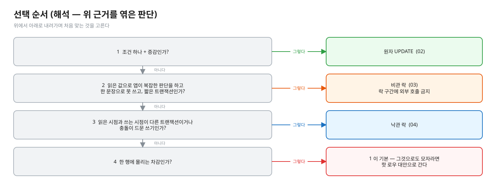
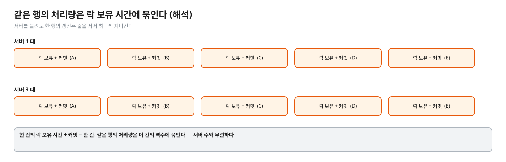
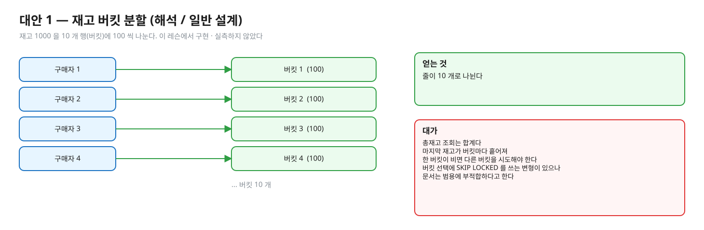
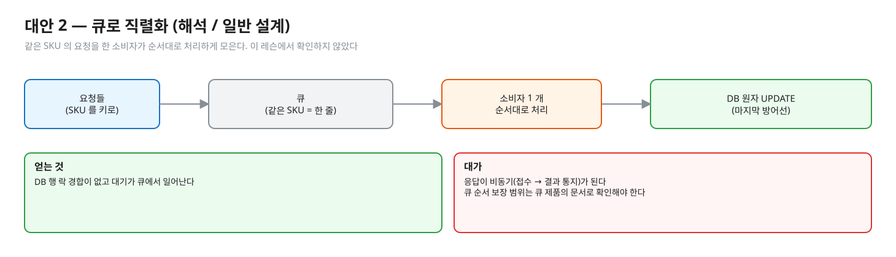
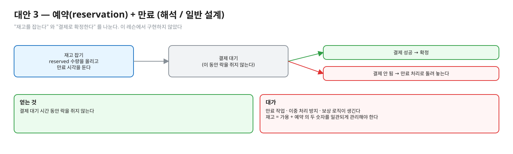
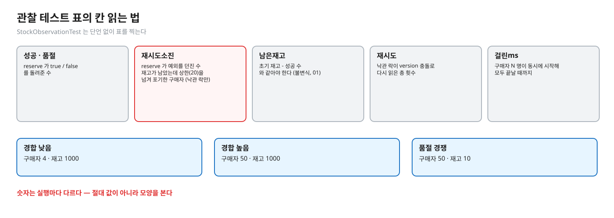

# 05. 세 전략 비교와 선택 — 핫 로우(hot row) 문제

> **이 글에서 알게 되는 것**
> 1. 세 전략이 같은 행 하나에서는 모두 줄을 서고, 차이는 줄 선 동안 **무엇이 낭비되나**(원자 UPDATE: 거의 없음 · 비관 락: 락 보유 시간 · 낙관 락: 진 쪽의 읽기와 계산 전부)라는 것을 안다.
> 2. 상황별로 어떤 전략을 고르는지 순서(해석)를 안다. 기본값은 원자 UPDATE 이다.
> 3. 한 행이 그래도 병목일 때 설계를 바꾸는 대안(재고 버킷 분할 · 큐 직렬화 · 예약 + 만료)과 그 대가를 안다.
>
> **먼저 알면 좋은 것**: [02. 원자 조건부 UPDATE](02-atomic-conditional-update.md) · [03. 비관 락](03-pessimistic-lock.md) · [04. 낙관 락](04-optimistic-lock.md).
> **다음 글**: [06. MySQL InnoDB 라면](06-mysql-innodb.md)
> **구분**: 심화 — 꼬리질문 대비 (레슨을 마친 뒤 · 면접 전)

## 전략 이름을 아는 것과 병목을 설명하는 것

"세 방법을 언제 각각 고르나?" 에는 표 하나로 답할 수 있다. 그런데 "선착순 이벤트에 한 상품에 수만 명이 몰리면?" 이라는 질문이 오면 이야기가 달라진다. 이쪽이 진짜 질문이다. 락 대기 급증 · DB CPU 상승 · 커넥션 풀 고갈이 한 행에서 시작되는 장애(07 의 시나리오)가 실무에서 실제로 나는 모양이기 때문이다.

편집: [diagrams/blog05-intro.excalidraw](diagrams/blog05-intro.excalidraw)

이 글은 앞의 세 글(02 ~ 04)을 한 표로 묶고, 그 표로도 안 풀리는 한 행의 병목으로 넘어간다.

## 한눈에 비교

| | 원자 조건부 UPDATE | 비관 락 `FOR UPDATE` | 낙관 락 `version` |
|---|---|---|---|
| 틈 | 없다 (한 문장) | 있지만 잠가서 끼어들 수 없다 | 있고 끼어들 수 있다, 쓸 때 감지 |
| 왕복 | 1 | 3 (읽기 · 쓰기 · 커밋) | 2 (읽기 · 쓰기) + 충돌 때마다 +2 |
| 락 보유 | UPDATE 문장 ~ 커밋 | 읽기 ~ 커밋 (앱 로직 포함) | UPDATE ~ 커밋 |
| 진 쪽 | 기다린 뒤 최신 값으로 재평가, 다시 할 일 없음 | 기다린 뒤 최신 값을 읽고 진행, 다시 할 일 없음 | 0 행 → 읽기부터 전부 다시 (버려지는 일) |
| 실패 신호 | 영향 행 0 (품절) | 재고 부족(앱 판단) | 영향 행 0 (충돌) · 상한 초과 예외 |
| 맞는 곳 | 단순 증감 · 기본값 | 읽고 복잡하게 판단한 뒤 쓰기 · 경합 높음 | 읽기와 쓰기 사이가 긴 편집 · 충돌 드묾 |

편집: [diagrams/blog05-compare.excalidraw](diagrams/blog05-compare.excalidraw)

같은 비교를 시간 축으로 보면 이렇다. 늦게 온 구매자 B 가 거치는 단계를 전략별로 나란히 놓았다.

편집: [diagrams/three-timelines.excalidraw](diagrams/three-timelines.excalidraw)

표의 가장 중요한 줄은 "진 쪽" 이다. 세 전략 모두 같은 행에서는 줄을 서지만, 줄 선 동안 무엇이 낭비되는지가 다르다.

편집: [diagrams/blog05-waste.excalidraw](diagrams/blog05-waste.excalidraw)

## 선택 순서 (해석 — 위 근거를 엮은 판단)

1. 조건 하나 + 증감이면 **원자 UPDATE**. 02.
2. 읽은 값으로 앱이 복잡한 판단을 하고, 한 문장으로 못 쓰고, 짧은 트랜잭션이면 **비관 락**. 락 구간에 외부 호출 금지.
3. 읽은 시점과 쓰는 시점이 서로 다른 트랜잭션(사람이 편집)이거나, 충돌이 드문 쓰기면 **낙관 락**.
4. 한 행에 몰리는 차감이라면 1 이 기본이고, 그것으로도 모자라면 아래 핫 로우 대안으로 간다.

편집: [diagrams/blog05-decision.excalidraw](diagrams/blog05-decision.excalidraw)

## PostgreSQL 에서는 — 한 행이 병목인 이유

세 전략 모두 같은 행에 쓰려면 행 락을 순서대로 얻어야 한다 ([문서 13.3.2](https://www.postgresql.org/docs/16/explicit-locking.html): 두 트랜잭션은 같은 행에 충돌하는 락을 가질 수 없다). 같은 행을 갱신하는 트랜잭션의 처리량은 "한 건의 락 보유 시간 + 커밋" 의 역수에 묶인다 (해석). 서버를 늘리거나 커넥션을 늘려도 이 직렬화는 안 풀리고, 대기자만 늘어 커넥션과 CPU 를 점유한다 (해석 — 대기 중인 트랜잭션이 커넥션을 쥔다는 일반 사실). 그래서 락 보유 시간을 줄이는 것(원자 UPDATE)이 1순위이고, 그다음은 **줄 자체를 나누는** 설계다.

편집: [diagrams/blog05-serial.excalidraw](diagrams/blog05-serial.excalidraw)

## 핫 로우의 대안 — 모두 (해석) / 일반 설계

이 레슨에서 구현하거나 실측하지 않았다. 실무에서는 "이런 선택지가 있고 대가는 이것" 으로 말한다. 세 가지가 모두 같은 생각에서 나온다 — 한 행에 줄을 서는 구조 자체를 바꾼다.

| 대안 | 아이디어 | 얻는 것 | 대가 |
|---|---|---|---|
| 재고 버킷 분할 | 재고 1000 을 10 개 행(버킷)에 100 씩 나눈다. 구매자는 버킷 하나를 골라 원자 UPDATE | 줄이 10 개로 나뉜다 | 총재고 조회는 합계, 마지막 재고가 버킷마다 흩어져 한 버킷이 비면 다른 버킷을 시도해야 한다. 버킷을 고르는 데 `FOR UPDATE SKIP LOCKED` 를 쓰는 변형이 있다 — 다만 문서는 `SKIP LOCKED` 를 "일관되지 않은 뷰라 범용 작업에는 부적합, 큐 같은 테이블의 경합 회피용" 이라고 한다 ([SELECT](https://www.postgresql.org/docs/16/sql-select.html)) |
| 큐로 직렬화 | 같은 SKU 의 요청을 한 소비자가 순서대로 처리하게 모은다 (예: 메시지 큐에서 SKU 를 키로) | DB 행 락 경합이 없고 대기가 큐에서 일어난다 | 응답이 비동기(접수 → 결과 통지)가 된다. 큐 순서 보장 범위는 큐 제품의 문서로 확인해야 한다 (이 레슨에서 확인하지 않았다). DB 쪽 원자 UPDATE 는 마지막 방어선으로 남긴다 |
| 예약(reservation) + 만료 | "재고를 잡는다" 와 "결제로 확정한다" 를 나눈다. 잡을 때는 `reserved` 수량을 올리고 만료 시각을 둔다. 결제가 안 되면 만료 처리로 돌려 놓는다 | 결제 대기 시간 동안 락을 쥐지 않는다 | 만료 작업 · 이중 처리 방지 · 보상 로직이 생긴다. 재고 = 가용 + 예약 의 두 숫자를 일관되게 관리해야 한다 |

### 1. 재고 버킷 분할

편집: [diagrams/blog05-buckets.excalidraw](diagrams/blog05-buckets.excalidraw)

### 2. 큐로 직렬화

편집: [diagrams/blog05-queue.excalidraw](diagrams/blog05-queue.excalidraw)

### 3. 예약 + 만료

편집: [diagrams/blog05-reservation.excalidraw](diagrams/blog05-reservation.excalidraw)

어느 쪽이든 마지막 방어선은 DB 의 원자 조건부 UPDATE 로 남기는 것이 안전하다는 점(앞단이 뚫려도 초과 판매는 안 난다)을 같이 말한다 (해석).

### 자주 하는 오해

1. **"비관 락은 항상 느리다 / 낙관 락은 항상 빠르다."** 경합에 달렸다. 낮음에서는 셋이 비슷하고(아래 표), 경합 높음에서 낙관 락이 재시도로 낭비한다.
2. **"서버를 늘리면 해결된다."** 한 행은 서버 수와 무관하게 직렬이다.
3. **"재시도를 늘리면 낙관 락이 해결된다."** 상한을 올리면 낭비가 길어질 뿐이다.
4. **"`재시도소진` 은 품절이다."** 반대다. 재고가 남았는데 포기한 것이고 사용자에게 "품절" 이라고 해서는 안 된다.

### 앱 · 프레임워크에서는

선택은 코드 양과 직결된다. 원자 UPDATE 는 쿼리 하나, 비관 락은 트랜잭션 경계 + 락 쿼리, 낙관 락은 version 컬럼 + 재시도 루프(트랜잭션 밖) 가 필요하다. 이 레슨이 구현으로 확인하는 것이 이 차이다. JPA `@Version` · 비관 락의 세부는 03 · 04.

## 한눈에 정리

| 상황 | 고르는 것 |
|---|---|
| 단순 증감 + 조건 하나 | 원자 조건부 UPDATE (기본값) |
| 읽은 값으로 앱이 복잡하게 판단 | 비관 락 (짧은 트랜잭션, 락 구간에 외부 호출 금지) |
| 읽기와 쓰기가 다른 트랜잭션 · 충돌 드묾 | 낙관 락 |
| 한 행이 그래도 병목 | 버킷 분할 · 큐 직렬화 · 예약 + 만료 (해석 / 일반 설계) |

- 세 전략 모두 같은 행에서는 줄을 선다. 낭비되는 것이 다르다.
- 낮은 경합에서는 셋이 비슷하고, 높은 경합에서 낙관 락이 재시도로 낭비한다. 서버를 늘려도 한 행은 직렬이다.
- 대안을 쓰더라도 DB 의 원자 조건부 UPDATE 는 마지막 방어선으로 남긴다 (해석).

## 스스로 확인

1. 재고 한 행에 초당 1만 건이 몰리는 선착순 이벤트다. 원자 UPDATE 로도 느리다. 어떻게 하겠나?
   

답

   먼저 병목을 확인한다(행 락 대기인지, 커넥션 풀 고갈인지, 트랜잭션이 길어서인지). 락 보유가 길면 트랜잭션에서 외부 호출 제거. 그래도 한 행이 직렬 병목이면 버킷 분할 · 큐 직렬화 · 예약(위 표, 모두 해석/일반 설계)을 말한다. 어느 쪽이든 마지막 방어선은 DB 의 원자 조건부 UPDATE 로 남기는 것이 안전하다는 점(앞단이 뚫려도 초과 판매는 안 난다)을 같이 말한다 (해석).
   

2. 경합 높음 표에서 낙관 락의 `성공` 이 50 이 아니었다. 이것을 어떻게 설명하겠나?
   

답

   재고는 1000 으로 충분했는데 일부 구매자가 재시도 상한(20)을 넘겨 예외를 받았다(`재시도소진`). 같은 행에 50 명이 동시에 몰리면 진 횟수가 최대 49 까지 가능하고(04), 상한이 그보다 작다. 정합성(초과 판매 · 갱신 손실)은 지켜졌지만 가용성이 깨졌다 — 재고가 있는데 못 산 것이다 (실측: 관찰 테스트).
   

3. 비관 락의 `FOR UPDATE` 를 원자 UPDATE 로 바꾸면 항상 더 빠른가?
   

답

   같은 행에 대해서는 락 보유 시간이 줄어 보통 유리하다(경합 높음에서 3 회 모두 원자 UPDATE 가 빨랐다 — 실측: 관찰 테스트). 하지만 읽은 값으로 앱이 복잡한 판단(여러 테이블 · 정책 계산)을 해야 하면 한 문장으로 못 쓴다. 속도보다 표현 가능성이 먼저다.
   

## 이 레슨에서 직접 보기 — 관찰 테스트 표 읽는 법

`./gradlew :01-concurrency-consistency:l04-stock-concurrency:test --tests '*Observation*'` (deep-dive 폴더에서)는 단언 없이 표를 찍는다.

| 칸 | 뜻 |
|---|---|
| 성공 · 품절 | `reserve` 가 `true` / `false` 를 돌려준 수 |
| 재시도소진 | `reserve` 가 **예외**를 던진 수. 재고가 남았는데도 재시도 상한(20)을 넘겨 포기한 구매자 (낙관 락만 가능) |
| 남은재고 | 초기 재고 - 성공 수 와 같아야 한다 (불변식, 01) |
| 재시도 | 낙관 락이 version 충돌로 다시 읽은 총 횟수 |
| 걸린ms | 구매자 N 명이 동시에 시작해 모두 끝날 때까지 |

세 시나리오: 경합 낮음(구매자 4 · 재고 1000), 경합 높음(구매자 50 · 재고 1000), 품절 경쟁(구매자 50 · 재고 10).

편집: [diagrams/blog05-columns.excalidraw](diagrams/blog05-columns.excalidraw)

**숫자는 실행마다 다르다.** 아래는 정답 구현 상태로 같은 머신에서 3번 돌린 값이다 (실측: 관찰 테스트 2026-10-13, Docker 의 PostgreSQL 16 컨테이너 · 걸린 ms 는 3회를 "/" 로 나열). 절대 값이 아니라 **모양**을 본다.

| 시나리오 | 전략 | 성공 | 재시도소진 | 재시도 | 걸린 ms |
|---|---|---:|---:|---:|---|
| 경합 낮음 (4 · 1000) | 원자 UPDATE | 4 | 0 | - | 34 / 23 / 297 |
| | 낙관 락 | 4 | 0 | 6 / 6 / 3 | 40 / 29 / 37 |
| | 비관 락 | 4 | 0 | - | 37 / 27 / 35 |
| 경합 높음 (50 · 1000) | 원자 UPDATE | 50 | 0 | - | 240 / 243 / 300 |
| | 낙관 락 | 47 / 43 / 45 | 3 / 7 / 5 | 455 / 482 / 475 | 613 / 993 / 740 |
| | 비관 락 | 50 | 0 | - | 752 / 396 / 431 |
| 품절 경쟁 (50 · 10) | 원자 UPDATE | 10 | 0 | - | 299 / 251 / 201 |
| | 낙관 락 | 10 | 0 | 123 / 96 / 140 | 337 / 525 / 283 |
| | 비관 락 | 10 | 0 | - | 194 / 480 / 218 |

해석 과제 (README ③ a~d) 의 답 후보 — 내 표를 해석한 뒤 펼친다

- (a) 경합이 낮음에서 높음으로 가면 낙관 락의 재시도는 3~6 회에서 약 450~480 회로 늘고, 시간은 원자 UPDATE 의 2~4 배가 됐다 (이 3 회의 값에서). 낮음에서도 재시도가 0 이 아닌 것은 구매자 4 명이 동시에 시작하기 때문이다 (해석).
- (b) `재시도소진` 3~7 은 재고가 충분한데도 상한 20 을 넘긴 구매자다. 진 횟수의 상한이 min(재고, 구매자 - 1) 이므로 재고 1000 · 구매자 50 이면 49 까지 질 수 있다 ([04](04-optimistic-lock.md)). 이때 `성공` 이 50 보다 줄고 `남은재고` 가 그만큼 높다 — 재고가 있는데 못 산 사람이 생긴 것이다.
- (c) 재고 10 이면 진 횟수가 최대 10 이라 상한 20 에 닿지 않아 소진이 0 이다. 4 장의 "재고 N 이면 최대 N 번" 근거 그대로다.
- (d) 원자 UPDATE 가 시간이 가장 안정적이고(경합 높음에서 240~300ms), 재시도 폭풍이 없고, 상한 설계가 필요 없고, 락 보유가 문장 하나라서다. 비관 락은 락 보유가 트랜잭션 전체라 경합 높음에서 뒤로 줄이 길어진다.

주의: 3 회, 한 머신, 한 풀의 값이다. 비관 락이 품절 경쟁에서 원자 UPDATE 보다 빠른 경우도 섞여 나왔다(194 대 299) — 순위를 일반화하지 말고 "경합 높음에서 낙관 락이 재시도로 낭비한다" 는 모양만 가져간다.

## 출처

- [PostgreSQL 16 · 13.3 Explicit Locking](https://www.postgresql.org/docs/16/explicit-locking.html) — 같은 행에 충돌하는 락 불가
- [SELECT](https://www.postgresql.org/docs/16/sql-select.html) — `SKIP LOCKED` 의 "일관되지 않은 뷰" 설명
- 이 레슨 `StockObservationTest` · `OptimisticLockStockService` 주석 — 관찰 표 · MAX_ATTEMPTS 근거
