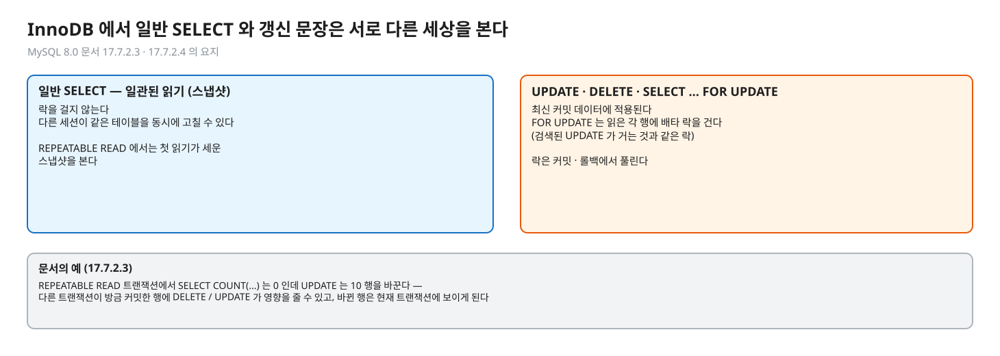
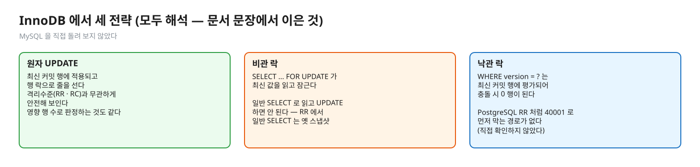
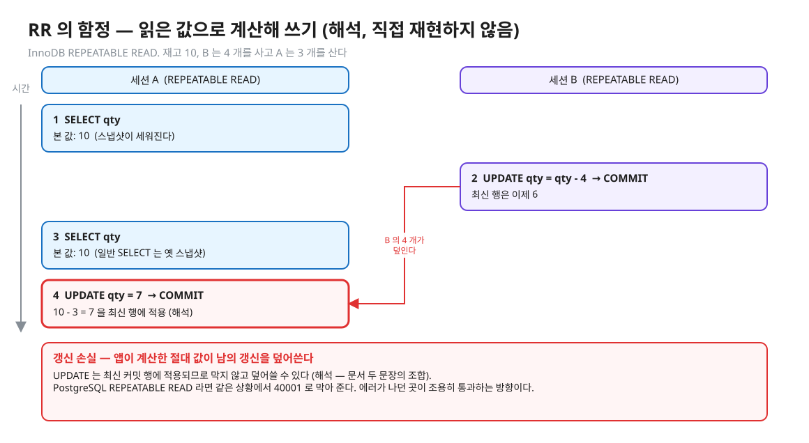
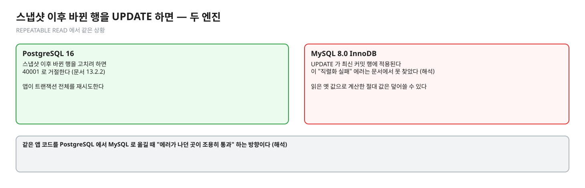
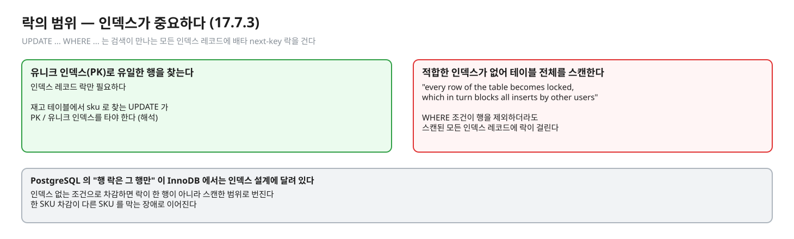
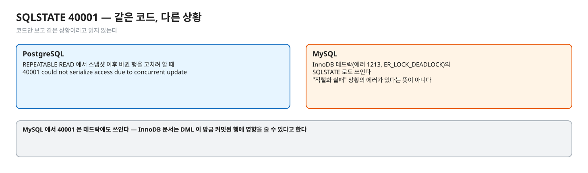

# 06. MySQL InnoDB 라면 — UPDATE 는 최신 값을 읽는다

> **이 글에서 알게 되는 것**
> 1. InnoDB 의 일반 `SELECT` 는 스냅샷(일관된 읽기)을 보지만, `UPDATE` · `DELETE` · `SELECT … FOR UPDATE` 는 **최신 커밋 데이터**를 읽고 락을 건다는 것을 안다.
> 2. 그래서 세 전략의 뼈대는 같고, PostgreSQL REPEATABLE READ 처럼 "스냅샷 이후 바뀐 행을 고치려 하면 `40001` 로 거절" 하는 동작은 InnoDB 문서에서 찾지 못했다는 점(해석)을 안다.
> 3. InnoDB 에서 락의 범위가 인덱스에 달려 있다는 것을 안다.
>
> **먼저 알면 좋은 것**: [02. 원자 조건부 UPDATE](02-atomic-conditional-update.md) · [03. 비관 락](03-pessimistic-lock.md) · [04. 낙관 락](04-optimistic-lock.md)
> **다음 글**: [07. 면접 사다리](07-interview-ladder.md)
> **구분**: 심화 — 꼬리질문 대비 (레슨을 마친 뒤 · 면접 전)

## 같은 코드를 MySQL 로 옮기면

이 시리즈는 PostgreSQL 16 을 기준으로 썼다. 그런데 같은 코드를 다른 엔진으로 옮길 때는 "무엇이 같고 무엇이 달라지는지" 를 알아야 한다. "InnoDB 기본 격리수준에서 재고 차감은 어떻게 되나?" 가 그때 나오는 질문이다. 이 글은 PostgreSQL 과 어디서 갈리는지만 짚는 짧은 보충이다.

이 글의 근거는 MySQL 8.0 공식 문서뿐이다. 이 레슨에서 **MySQL 을 직접 돌려 보지 않았다** — 문서 문장에서 이은 결론은 `(해석)` 으로 표시한다.

한 줄로 먼저 말하면 이렇다. InnoDB 의 일반 `SELECT` 는 스냅샷(일관된 읽기)을 보지만, `UPDATE` · `DELETE` · `SELECT … FOR UPDATE` 는 **최신 커밋 데이터**를 읽고 락을 건다. 그래서 세 전략의 뼈대는 같고, PostgreSQL REPEATABLE READ 처럼 "스냅샷 이후 바뀐 행을 고치려 하면 `40001` 로 거절" 하는 동작은 InnoDB 문서에서 찾지 못했다 (해석). 주의: SQLSTATE `40001` 자체는 InnoDB 데드락(에러 1213)에도 쓰인다 — 여기서 말하는 것은 이 "직렬화 실패" 상황의 에러가 없다는 뜻이다.

## 일반 SELECT 와 갱신 문장은 서로 다른 세상을 본다

[MySQL 8.0 · 17.7.2.3 Consistent Nonlocking Reads](https://dev.mysql.com/doc/refman/8.0/en/innodb-consistent-read.html):

- 일관된 읽기는 락을 걸지 않는다: "A consistent read does not set any locks on the tables it accesses, and therefore other sessions are free to modify those tables at the same time" — 요지.
- 스냅샷은 `SELECT` 에 적용되고 DML 에는 꼭 그렇지 않다. REPEATABLE READ 트랜잭션의 `DELETE`/`UPDATE` 가 다른 트랜잭션이 방금 커밋한 행에 영향을 줄 수 있고, 그렇게 바뀐 행은 현재 트랜잭션에 보이게 된다 (문서 예: `SELECT COUNT(...)` 는 0 인데 `UPDATE` 는 10 행을 바꾼다).

[17.7.2.4 Locking Reads](https://dev.mysql.com/doc/refman/8.0/en/innodb-locking-reads.html): `SELECT … FOR UPDATE` 는 "latest available data" 를 읽고 읽은 각 행에 배타 락을 건다 — "검색된 SQL UPDATE 가 거는 것과 같은 락". 락은 커밋/롤백에서 풀린다. 일관된 읽기는 락을 무시한다. `NOWAIT` · `SKIP LOCKED` 옵션이 있다(문서가 `FOR UPDATE` 에서 설명).

편집: [diagrams/blog06-two-worlds.excalidraw](diagrams/blog06-two-worlds.excalidraw)

PostgreSQL 은 어떤가. READ COMMITTED 에서는 문장마다 스냅샷을 새로 잡고, REPEATABLE READ 에서는 스냅샷이 고정된 채 바뀐 행을 고치려 하면 막는다. InnoDB 는 읽기와 쓰기가 다른 세상을 본다는 점이 출발점이다.

## 세 전략에 적용

편집: [diagrams/blog06-three-strategies.excalidraw](diagrams/blog06-three-strategies.excalidraw)

| 전략 | InnoDB 에서 (모두 해석 — 위 문서 문장에서 이은 것) |
|---|---|
| 원자 UPDATE | `UPDATE … SET qty = qty - n WHERE … AND qty >= n` 은 최신 커밋 행에 적용되고 행 락으로 줄을 선다. 격리수준(RR 이든 RC 든)과 무관하게 안전해 보인다. 영향 행 수로 판정하는 것도 같다 |
| 비관 락 | `SELECT … FOR UPDATE` 가 최신 값을 읽고 잠그므로 읽기-계산-쓰기가 안전하다. **일반 SELECT 로 읽고 UPDATE 하면 안 된다** — RR 에서 일반 SELECT 는 옛 스냅샷이다 |
| 낙관 락 | `UPDATE … WHERE version = ?` 는 최신 커밋 행에 대해 평가되므로 충돌 시 0 행이 된다. PostgreSQL RR 처럼 엔진이 `40001` 로 먼저 막아 주는 경로가 없다 → 재시도 루프는 "0 행" 만 보면 된다 (직접 확인하지 않았다) |

### 가장 큰 함정 — RR 에서 "읽은 값으로 계산해 쓰기"

PostgreSQL REPEATABLE READ 는 스냅샷 이후 바뀐 행을 UPDATE 하면 `40001` 로 막아 준다([문서 13.2.2](https://www.postgresql.org/docs/16/transaction-iso.html)). InnoDB RR 은 UPDATE 가 최신 값에 적용되므로(위 17.7.2.3) **막지 않고 덮어쓸 수 있다**. 일반 SELECT 로 읽은 옛 qty 에서 계산한 절대 값을 UPDATE 로 쓰면 갱신 손실이 난다 (해석 — 문서 두 문장의 조합이고 직접 재현하지 않았다). 같은 앱 코드를 PostgreSQL 에서 MySQL 로 옮길 때 "에러가 나던 곳이 조용히 통과" 하는 방향이다.

편집: [diagrams/blog06-trap.excalidraw](diagrams/blog06-trap.excalidraw)

편집: [diagrams/blog06-pg-vs-innodb.excalidraw](diagrams/blog06-pg-vs-innodb.excalidraw)

### 락의 범위 — 인덱스가 중요하다

[17.7.3 Locks Set by Different SQL Statements](https://dev.mysql.com/doc/refman/8.0/en/innodb-locks-set.html): `UPDATE … WHERE …` 는 검색이 만나는 **모든 인덱스 레코드**에 배타 next-key 락을 건다. 다만 유니크 인덱스로 유일한 행을 찾으면 인덱스 레코드 락만 필요하다. 적합한 인덱스가 없어 테이블 전체를 스캔하면 "every row of the table becomes locked, which in turn blocks all inserts by other users". 또한 `WHERE` 조건이 행을 제외하더라도 스캔된 모든 인덱스 레코드에 락이 걸린다고 한다.

재고 테이블에서는 `sku` 로 찾는 UPDATE 가 PK/유니크 인덱스를 타야 한다 (해석 — 문서 문장의 적용). 인덱스 없는 조건으로 차감하면 락이 한 행이 아니라 스캔한 범위로 번진다. PostgreSQL 편(02~03)의 "행 락은 그 행만" 이 InnoDB 에서는 **인덱스 설계에 달려 있다**.

편집: [diagrams/blog06-locks-index.excalidraw](diagrams/blog06-locks-index.excalidraw)

### 자주 하는 오해

1. **"MySQL 도 REPEATABLE READ 에서 스냅샷 이후 바뀐 행을 고치면 `40001` 이 난다."** 이 레슨이 확인한 PostgreSQL 의 동작이다. (MySQL 의 `40001` 은 데드락 에러 1213 의 SQLSTATE — [MySQL 에러 레퍼런스](https://dev.mysql.com/doc/mysql-errors/8.0/en/server-error-reference.html) — 이므로 SQLSTATE 만 보고 같은 상황이라고 읽지 않는다.) InnoDB 문서는 DML 이 방금 커밋된 행에 영향을 줄 수 있다고 한다.
2. **"일반 SELECT 로 확인하고 UPDATE 하면 안전하다."** 두 쪽이 서로 다른 세상을 본다 (일관된 읽기 vs 최신 읽기).
3. **"`FOR UPDATE` 는 PostgreSQL 과 똑같다."** 의미(읽고 잠금)는 같지만 InnoDB 는 범위 · 인덱스에 따라 간격까지 잠글 수 있다 (17.7.3).

편집: [diagrams/blog06-sqlstate.excalidraw](diagrams/blog06-sqlstate.excalidraw)

## 한눈에 정리

| | PostgreSQL 16 | MySQL 8.0 InnoDB |
|---|---|---|
| 일반 SELECT | 스냅샷 (RC 는 문장마다, RR 은 고정) | 일관된 읽기 (RR 은 첫 읽기가 세운 스냅샷), 락 없음 |
| UPDATE 가 보는 것 | RR 에서는 스냅샷 이후 바뀐 행이면 `40001` | 최신 커밋 행에 적용 |
| 갱신 손실 방지 도구 | 원자 UPDATE · `FOR UPDATE` · version | 같다 (해석) |
| 락 범위 | 그 행 | 인덱스 · 스캔 범위에 따라 (17.7.3) |

- InnoDB 의 세 전략 뼈대는 PostgreSQL 과 같다. 다른 점은 RR 에서 "막아 주는 에러" 가 없다는 것이다 (해석).
- 일반 SELECT 로 확인하고 UPDATE 하는 코드는 InnoDB RR 에서 조용히 갱신 손실이 난다 (해석).
- 재고 차감 UPDATE 는 PK/유니크 인덱스를 타게 한다 (해석 — 17.7.3 문장의 적용).

## 스스로 확인

1. 같은 `SELECT` 두 번에 값이 다르지 않은데 `UPDATE` 는 새 값을 본다. InnoDB 에서 이게 가능한 이유는?
   

답

   일관된 읽기의 스냅샷은 `SELECT` 에 적용되고 DML 에는 반드시 그렇지 않기 때문이다. UPDATE/DELETE 는 최신 커밋 행에 영향을 주고, 바뀐 행은 그 뒤 현재 트랜잭션에 보인다 (MySQL 8.0 17.7.2.3). PostgreSQL RR 이라면 같은 상황에서 `40001` 이다 — 두 엔진의 가장 큰 행동 차이.
   

2. InnoDB 에서 재고 차감을 일반 SELECT + UPDATE 로 짰다. 락 없이 쓰면 안 되는 이유와 고치는 법은?
   

답

   읽은 값(스냅샷)이 낡을 수 있고 UPDATE 는 최신 값에 적용되므로 앱이 계산한 절대 값이 남의 갱신을 덮어쓸 수 있다 (해석). 고치는 법은 PostgreSQL 과 같은 세 가지 — 원자 조건부 UPDATE, `SELECT … FOR UPDATE`(최신을 읽고 잠금), version 낙관 락.
   

3. 재고 차감 UPDATE 의 `WHERE` 에 인덱스가 없으면?
   

답

   InnoDB 는 스캔한 모든 레코드에 락을 건다. 테이블 전체 스캔이면 모든 행이 잠겨 다른 사용자의 INSERT 까지 막는다 (17.7.3). 한 SKU 차감이 다른 SKU 를 막는 장애로 이어진다.
   

## 출처

- [MySQL 8.0 · 17.7.2.3 Consistent Nonlocking Reads](https://dev.mysql.com/doc/refman/8.0/en/innodb-consistent-read.html)
- [MySQL 8.0 · 17.7.2.4 Locking Reads](https://dev.mysql.com/doc/refman/8.0/en/innodb-locking-reads.html)
- [MySQL 8.0 · 17.7.3 Locks Set by Different SQL Statements](https://dev.mysql.com/doc/refman/8.0/en/innodb-locks-set.html)
- [MySQL 8.0 에러 레퍼런스 · 1213 ER_LOCK_DEADLOCK](https://dev.mysql.com/doc/mysql-errors/8.0/en/server-error-reference.html) — SQLSTATE 40001
- [PostgreSQL 16 · 13.2.2 Repeatable Read](https://www.postgresql.org/docs/16/transaction-iso.html) — 비교 대상
