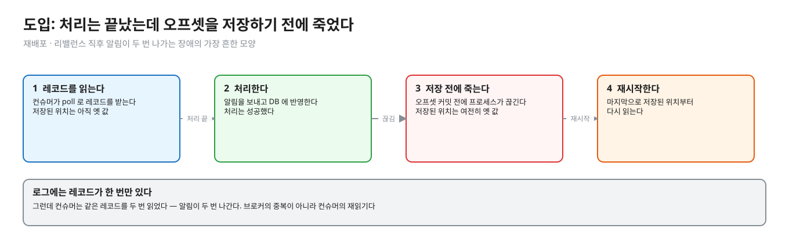
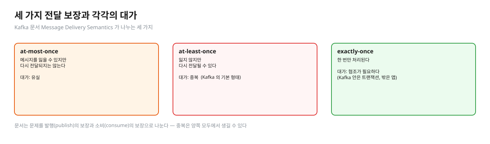
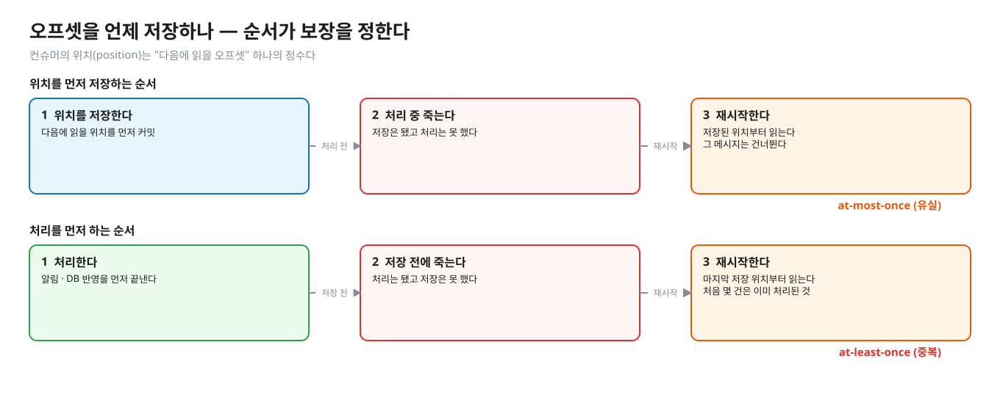
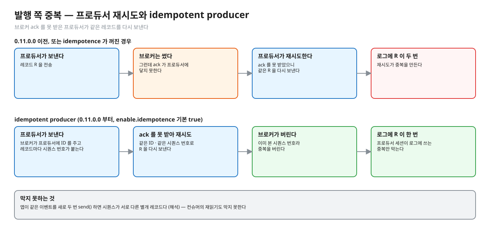
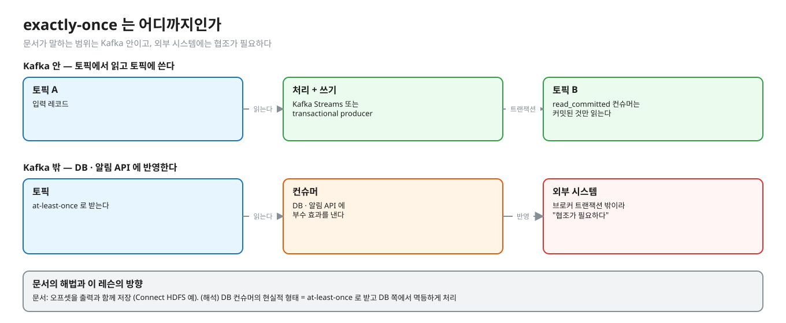
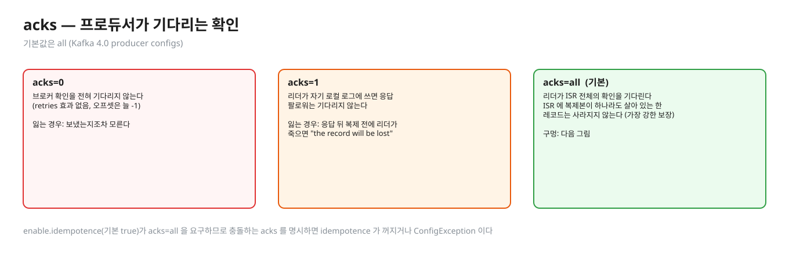
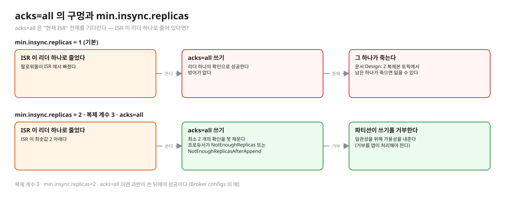
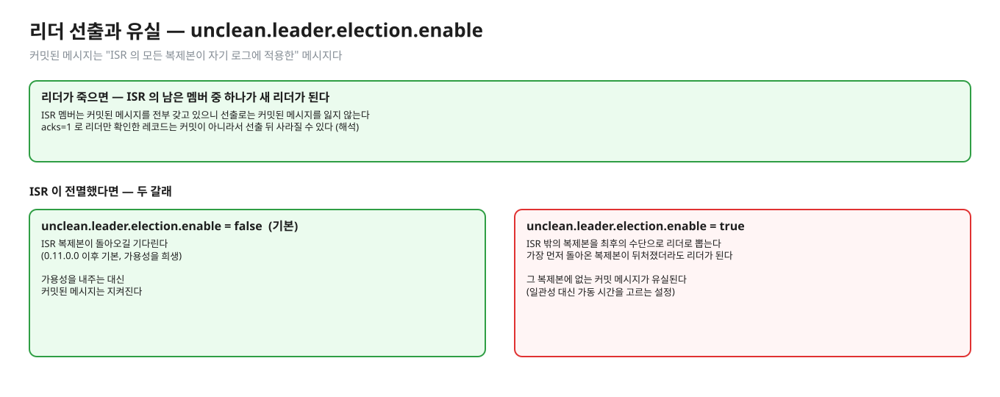
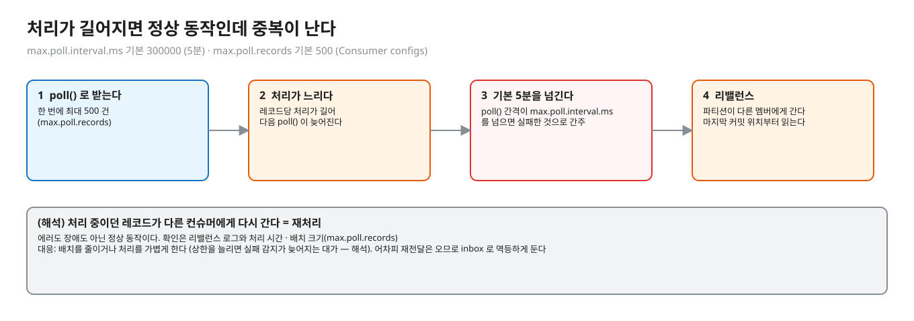

# 01. 전달 보장 — at-least-once 에서 중복은 어디서 생기나

> **이 글에서 알게 되는 것**
> 1. Kafka 가 기본적으로 at-least-once 라서, 같은 레코드를 두 번 받는 일이 설계에 들어 있다는 것을 안다.
> 2. 브로커 쪽 장치(idempotent producer · 트랜잭션)가 막는 중복의 범위가 Kafka 안까지이고, DB 반영의 중복은 앱이 걸러야 한다는 것을 안다.
> 3. 반대편인 레코드 유실이 어떤 설정 조합(`acks` · `min.insync.replicas` · `unclean.leader.election.enable`)에서 생기는지 구분할 수 있다.
>
> **다음 글**: [02. 순서가 뒤집히는 길](02-ordering-paths.md) → [03. 중복 거르기](03-inbox-dedupe.md)
> **구분**: 심화 — 꼬리질문 대비 (레슨을 마친 뒤 · 면접 전)

## 알림이 두 번 나간 이유

재배포를 마친 직후, 고객 몇 명에게 같은 알림이 두 번 나갔다. 포인트가 두 번 적립된 계정도 있다. 로그를 뒤져 보면 브로커에는 레코드가 한 번만 들어 있다. 컨슈머가 그 레코드를 두 번 읽은 것이다. 원인은 대개 "처리는 끝났는데 오프셋 커밋 전에 끊김" 이다.

편집: [diagrams/blog01-intro.excalidraw](diagrams/blog01-intro.excalidraw)

이 글은 그 장면을 풀어 쓴다. 중복이 어디서 생기는지, Kafka 가 막아 주는 것은 어디까지인지, 그리고 반대편인 "유실" 은 어떤 조건에서 생기는지를 차례로 본다. "Kafka 가 exactly-once 를 지원하니 괜찮다" 고 믿으면 이 장애를 설명하지 못한다. 그 범위가 어디까지인가가 핵심이기 때문이다.

## 세 가지 보장

[Kafka 문서 · Design · Message Delivery Semantics](https://kafka.apache.org/documentation/#semantics) (Kafka 4.0 문서 2026-10-13 조회)는 전달 보장을 세 가지로 나눈다.

편집: [diagrams/blog01-three.excalidraw](diagrams/blog01-three.excalidraw)

| 보장 | 뜻 | 대가 |
|---|---|---|
| at-most-once | 메시지를 잃을 수 있지만 다시 전달되지는 않는다 | 유실 |
| at-least-once | 잃지 않지만 다시 전달될 수 있다 | **중복** |
| exactly-once | 한 번만 처리된다 | 협조가 필요하다 (아래) |

문서는 문제를 둘로 나눈다. **발행(publish)** 의 보장과 **소비(consume)** 의 보장이다. 중복은 양쪽 모두에서 생길 수 있다. 먼저 소비 쪽부터 보자.

## 소비 쪽 — 오프셋을 언제 저장하나

컨슈머의 위치(position)는 "다음에 읽을 오프셋" 하나의 정수다 (문서 Consumer Position). 처리와 위치 저장 중 무엇을 먼저 하느냐가 보장을 정한다.

편집: [diagrams/blog01-commit-order.excalidraw](diagrams/blog01-commit-order.excalidraw)

| 순서 | 중간에 죽으면 | 결과 |
|---|---|---|
| 위치를 **먼저** 저장, 그 다음 처리 | 저장은 됐고 처리는 못 했다 → 재시작해도 그 메시지를 건너뛴다 | at-most-once (유실) |
| **처리 먼저**, 그 다음 위치 저장 | 처리는 됐고 저장은 못 했다 → 재시작하면 마지막 저장 위치부터 다시 읽는다 | at-least-once (**중복**) |

문서의 취지는 이렇다. 처리 후 저장 순서에서 처리 뒤 · 저장 전에 죽으면, 새 프로세스가 받는 첫 몇 건은 이미 처리된 것이다("the first few messages it receives will already have been processed"). 문서는 이 중복이 **갱신이 멱등일 때(키 단위로 덮어쓰기 같은)는 무해**하다고도 쓴다. 이 레슨의 Q01 이 "그럼 덮어쓰기면 괜찮나?" 를 재는 자리다.

## 발행 쪽 — 프로듀서 재시도

중복은 브로커에 쓰는 쪽에서도 생긴다. 브로커 ack 를 못 받은 프로듀서가 재시도하면 같은 레코드가 로그에 두 번 쓰일 수 있다. 문서에 따르면 0.11.0.0 이전에는 재시도가 중복을 만들어 at-least-once 였다.

편집: [diagrams/blog01-producer-retry.excalidraw](diagrams/blog01-producer-retry.excalidraw)

0.11.0.0 부터 **idempotent producer** 가 생겼다. 브로커가 프로듀서에 ID 를 주고, 레코드마다 붙는 시퀀스 번호로 중복을 버린다 (문서 Message Delivery Semantics). 같은 문서가 **트랜잭션**으로 여러 파티션에 원자적으로 쓰는 것도 소개한다.

- 설정: `enable.idempotence` 기본 `true` (Kafka 4.0 [producer configs](https://kafka.apache.org/documentation/#producerconfigs)). 켜려면 `acks=all` · `retries>0` · `max.in.flight.requests.per.connection<=5` 가 필요하고, 충돌하는 설정을 **명시적으로** 같이 주면 `ConfigException` 이다. `retries` 기본은 `2147483647` 이고 `delivery.timeout.ms`(기본 120000) 가 실질 상한이다.
- `transactional.id` 를 주면 idempotence 가 함께 켜진다. 트랜잭션 메시지를 컨슈머가 커밋된 것만 읽으려면 `isolation.level=read_committed` 를 줘야 한다. 기본은 `read_uncommitted` 다 (consumer configs).

여기서 짚을 점이 있다. idempotent producer 는 **프로듀서 세션이 로그에 쓰는 중복**만 막는다. 업무 로직이 같은 사건을 두 번 발행한 것은 모른다 (해석). 앱이 같은 이벤트를 새로 두 번 `send()` 하면 브로커에게는 서로 다른 레코드이기 때문이다. 그래서 이벤트에 업무 단위의 `messageId` 가 필요하다.

## exactly-once 는 어디까지인가

편집: [diagrams/blog01-eos-scope.excalidraw](diagrams/blog01-eos-scope.excalidraw)

문서가 말하는 범위는 이렇다.

- **Kafka 안**: Kafka Streams, 또는 transactional producer + `read_committed` 컨슈머. 토픽에서 읽고 토픽에 쓰는 처리를 exactly-once 로 할 수 있다.
- **외부 시스템(DB · 알림 API)**: "협조가 필요하다". 고전적 해법은 오프셋 저장과 출력 사이의 2단계 커밋인데 많은 시스템이 지원하지 않는다. 문서는 **오프셋을 출력과 함께 저장**하는 방식을 더 낫다고 한다. 예로 Kafka Connect HDFS 커넥터가 "데이터와 오프셋이 둘 다 갱신되거나 둘 다 안 되거나" 를 보장한다.

(해석) 그래서 DB 에 반영하는 컨슈머의 현실적 형태는 **at-least-once 로 받고, DB 쪽에서 멱등하게 처리**하는 것이다. 이 레슨의 inbox 와 version 이 그것이다 (문서 [03](03-inbox-dedupe.md) · [04](04-version-ordering.md)). 『데이터 중심 애플리케이션 설계』 11장의 관점과 같은 방향이다.

## 중복이 생기는 경로 정리

편집: [diagrams/dup-order-paths.excalidraw](diagrams/dup-order-paths.excalidraw)

| 경로 | 근거 | 막는 장치 |
|---|---|---|
| 프로듀서 재시도 | 문서 Design | idempotent producer (기본 켜짐) |
| 앱이 같은 이벤트를 **두 번 send** (재시도 로직 · 배치 재실행) | (해석) — 브로커 입장에선 서로 다른 레코드 | 이벤트 자체의 messageId 를 컨슈머가 거른다 |
| 처리 후 오프셋 커밋 전 컨슈머 크래시 | 문서 Consumer Position · Delivery Semantics | 컨슈머 쪽 멱등 처리 (inbox) |
| 리밸런스 · 파티션 이동 후 마지막 커밋 위치부터 재시작 | 문서: 리밸런스 시 마지막 커밋 오프셋을 다시 가져온다 (Transactions 절) · 나머지는 (해석) | 위와 같음 |
| 에러 핸들러의 재시도 · 수동 오프셋 되감기 | Spring 문서 ([문서 06](06-spring-kafka-mysql.md)) | 위와 같음 |

두 가지를 기억하자. 두 번째 줄이 중요하다. 업무 로직이 같은 사건을 두 번 발행하면 idempotent producer 는 막지 못한다. 그리고 컨슈머 쪽 재전달은 브로커의 중복이 아니다. 로그에는 한 번 있는 레코드를 **두 번 읽는** 것이라서, idempotent producer 가 막지 못한다.

## 반대편 — 브로커에서 레코드가 사라지는 조건

위 절들은 "중복" 이었다. 이제 반대편, 프로듀서가 보낸 레코드가 **브로커에서 사라지는** 조건을 본다. 기준은 Kafka 4.0 문서([Design · Replication](https://kafka.apache.org/40/design/design/#replication) · [Producer configs](https://kafka.apache.org/40/configuration/producer-configs/) · [Broker configs](https://kafka.apache.org/40/configuration/broker-configs/), 2026-10-13 조회)다.

### "커밋된 메시지" 의 정의

- 파티션은 리더 1개와 팔로워(복제본)들로 복제된다. 리더는 **ISR(in-sync replicas)** 을 관리한다. 복제본이 ISR 에 있으려면 컨트롤러 세션이 살아 있고 리더에 너무 뒤처지지 않아야 하며, 그 기준이 `replica.lag.time.max.ms`(기본 30000, 30초)다 (Design · Broker configs).
- 문서의 정의: 메시지는 "그 파티션의 ISR 의 모든 복제본이 자기 로그에 적용했을 때" **커밋**된 것이다. 컨슈머에게는 커밋된 메시지만 주어진다. 문서 보장은 이렇다. "ISR 에 동기화된 복제본이 **하나라도 늘 살아 있는 한** 커밋된 메시지는 사라지지 않는다." 복제본이 f+1 개면 커밋된 메시지를 잃지 않고 f 번의 장애를 견딘다 (Design).
- 프로듀서는 커밋을 기다릴지 말지 고른다 (Design). 그것이 `acks` 다.

### `acks` — 프로듀서가 기다리는 확인

편집: [diagrams/blog01-acks.excalidraw](diagrams/blog01-acks.excalidraw)

| 값 | 의미 (Producer configs) | 잃는 경우 |
|---|---|---|
| `0` | 브로커 확인을 전혀 기다리지 않는다 (`retries` 효과 없음, 오프셋은 늘 -1) | 보냈는지조차 모른다 |
| `1` | 리더가 자기 로컬 로그에 쓰면 응답, 팔로워는 기다리지 않는다 | 리더가 응답한 뒤 팔로워가 복제하기 전에 죽으면 "the record will be lost" |
| `all` | 리더가 ISR 전체의 확인을 기다린다. "ISR 의 복제본이 하나라도 살아 있는 한 레코드는 사라지지 않는다" — 문서가 "가장 강한 보장" 이라 부른다 | 아래 |

**기본값은 `all`** 이다 (Kafka 4.0 producer configs). `enable.idempotence` 기본 `true` 가 `acks=all` 을 요구하기 때문에, 충돌하는 `acks` 를 명시하면 idempotence 가 꺼지거나 `ConfigException` 이다 (위 발행 쪽 절). 이전 버전의 기본값은 이 문서에서 확인하지 못했다.

### `acks=all` 의 구멍과 `min.insync.replicas`

`acks=all` 이면 안전한가. 아직 아니다. `acks=all` 은 "**현재 ISR** 전체" 를 기다린다. ISR 이 리더 1개로 줄어 있으면 리더 하나의 확인으로 성공한다. Design 문서가 이 경우를 쓴다. 2 복제본 토픽에서 하나를 잃어도 `acks=all` 쓰기는 성공하지만, 남은 하나가 죽으면 잃을 수 있다.

편집: [diagrams/blog01-min-isr.excalidraw](diagrams/blog01-min-isr.excalidraw)

`min.insync.replicas`(기본 **1**, Broker configs)가 이 구멍을 막는다. `acks=all`(또는 -1)일 때 쓰기가 성공하려면 최소 이만큼의 복제본이 확인해야 하고, 못 채우면 프로듀서가 `NotEnoughReplicas` 또는 `NotEnoughReplicasAfterAppend` 예외를 받는다. Design 문서는 ISR 이 최솟값 아래면 그 파티션이 쓰기에 응하지 않는다고 쓴다. **일관성을 위해 가용성을 내주는** 것이다. 기본값 1 이면 방어가 없다.

Broker configs 의 예는 이렇다. 복제 계수 3 · `min.insync.replicas=2` · `acks=all` 이면 과반이 쓴 뒤에야 성공이다. (해석) 이 조합이 "리더 혼자 확인한 쓰기가 성공으로 보이는" 경우를 없앤다. 그렇다면 이 조합으로 모든 것이 막힐까?

| 조합 | 막는 것 | 못 막는 것 |
|---|---|---|
| `acks=all` + `min.insync.replicas=2` + 복제 계수 3 | 리더 단독 확인으로 성공 처리 (ISR 이 2 미만이면 쓰기 거부) · 리더 1대 장애 | ISR 의 복제본이 **모두** 죽는 경우 — 문서: 이때는 보장이 성립하지 않는다 |
| 같은 조합 | — | 쓰기 실패(`NotEnoughReplicas`) 를 앱이 삼키는 경우 = 앱이 만든 유실. 재시도 · 실패 처리는 앱 책임이다 (해석) |
| 같은 조합 | — | 디스크 flush: 문서는 "fsync 를 매 쓰기마다 요구하지 않고" 복제로 일관성을 지킨다고 쓴다. 모든 복제본이 동시에 flush 전 상태로 죽는 경우의 영향은 이 문서에서 확인하지 못했다 |

### 리더 선출과 유실

편집: [diagrams/blog01-leader-election.excalidraw](diagrams/blog01-leader-election.excalidraw)

- 리더가 죽으면 컨트롤러가 **ISR 의 남은 멤버 중 하나**를 새 리더로 뽑는다 (Design). ISR 은 변할 때마다 클러스터 메타데이터에 영속된다. ISR 멤버는 커밋된 메시지를 전부 갖고 있으니 선출로는 커밋된 메시지를 잃지 않는다. `acks=1` 로 리더만 확인한 레코드는 커밋이 아니라서 선출 뒤 사라질 수 있다 (해석 — 문서가 이 경로를 한 문장으로 쓰지는 않았고, `acks=1` 정의와 "커밋" 정의에서 따라온다).
- **`unclean.leader.election.enable`** (기본 **false**, Broker configs)은 ISR 밖의 복제본을 "최후의 수단" 으로 리더로 뽑을지 정한다. ISR 이 전멸하면 두 길이다 (Design). ISR 복제본이 돌아오길 **기다리거나**(0.11.0.0 이후 기본, 가용성을 희생), 가장 먼저 돌아온 복제본이 뒤처졌더라도 리더가 된다. 후자는 그 복제본에 없는 커밋 메시지가 **유실**된다. `true` 는 일관성 대신 가동 시간을 고르는 설정이다.

### 소비 쪽 — 처리가 길면 리밸런스로 재처리

유실의 반대편으로 돌아와, 소비 쪽에서 정상 동작인데 중복이 늘어나는 경우를 하나 더 보자.

편집: [diagrams/blog01-poll-interval.excalidraw](diagrams/blog01-poll-interval.excalidraw)

`max.poll.interval.ms`(기본 300000, 5분)는 `poll()` 호출 사이의 최대 간격이다. 이 안에 `poll()` 이 안 돌면 컨슈머를 **실패한 것으로 간주**하고 그룹이 리밸런스해 파티션을 다른 멤버에게 준다 (Consumer configs). 한 번에 가져오는 `max.poll.records` 기본은 500 이다. (해석) 레코드당 처리가 느려 500건을 5분 안에 못 끝내면, 처리 중이던 레코드가 마지막 커밋 위치부터 다른 컨슈머에게 다시 간다. 이것이 **재처리**다. 정상 동작인데 중복이 난다. 커밋 시점 · 재전달 경로는 위 "중복이 생기는 경로 정리", 대응(inbox)은 [문서 03](03-inbox-dedupe.md)에서 본다.

(해석) 정리하면 "유실 없음" 은 세 곳의 조건이다. 프로듀서 `acks=all` · 브로커 `min.insync.replicas ≥ 2`(복제 계수 3) · `unclean.leader.election.enable=false` 이고, 거기에 앱이 쓰기 실패를 처리해야 한다. 그리고 소비 쪽 "중복 없음" 은 따로 멱등 처리로 만든다. DB 커밋과 발행 사이의 구멍은 별개 문제다 → [01 트랙 문서 06 (outbox)](../../docs/06-outbox-dual-write.md).

## 앱 · 프레임워크에서는

오프셋 커밋 시점은 컨슈머 설정과 프레임워크가 정한다. `enable.auto.commit` 기본 `true` · `auto.commit.interval.ms` 기본 5000 이다 (Kafka 4.0 consumer configs). 자동 커밋은 "백그라운드에서 주기적으로" 커밋하므로, 처리 완료와 커밋의 순서를 앱이 통제하지 못한다 (해석). Spring Kafka 는 이 값을 기본 `false` 로 두고 컨테이너가 커밋한다 — [문서 06](06-spring-kafka-mysql.md).

## 자주 하는 오해

1. **"Kafka 가 exactly-once 를 지원하니 중복 처리는 필요 없다."** 문서가 말하는 exactly-once 는 Kafka 안(Streams · 트랜잭션 + read_committed)이다. 외부 시스템은 협조가 필요하다.
2. **"idempotent producer 를 켜면 컨슈머 중복도 없다."** 프로듀서가 로그에 쓰는 중복을 막는다. 처리 후 커밋 전에 죽은 컨슈머의 재읽기는 그대로 있다.
3. **"at-least-once 는 장애 때만 중복이 난다."** 정상 배포(재시작 · 리밸런스)에서도 난다. 오프셋 저장이 처리 직후 즉시가 아니기 때문이다 (해석 — 저장 주기는 설정에 달렸다).
4. **"같은 값으로 덮어쓰는 이벤트면 중복이 무해하다."** 상태 값만 보면 맞다 (문서도 멱등 갱신은 무해하다고 쓴다). 하지만 알림 · 적립 같은 **부수 효과**와 반영 횟수, 그리고 순서([문서 02](02-ordering-paths.md) · [04](04-version-ordering.md))는 따로 지켜야 한다.
5. **"at-most-once 는 중복이 없으니 안전하다."** 유실한다. 결제 · 배송 이벤트에서는 유실이 더 나쁜 경우가 많다 (해석).

## 한눈에 정리

| 질문 | 답 | 근거 |
|---|---|---|
| 중복은 어디서 생기나 | 프로듀서 재시도 · 앱의 이중 발행 · 처리 후 커밋 전 크래시 · 리밸런스 · 에러 핸들러 재시도 | 문서 Design · (해석) · Spring 문서 |
| 브로커 장치가 막는 것 | 프로듀서 세션이 로그에 쓰는 중복 (idempotent producer) · Kafka 안의 exactly-once | 문서 Design |
| 못 막는 것 | 컨슈머의 재읽기 · 앱의 이중 발행 · 외부 시스템 반영의 중복 | 문서 · (해석) |
| 유실이 생기는 조건 | `acks` 0 · 1 · `min.insync.replicas` 1 의 구멍 · ISR 전멸 + unclean 선출 | Kafka 4.0 문서 |

- Kafka 는 기본이 at-least-once 라서 같은 레코드를 두 번 받는 일이 설계에 들어 있다.
- 브로커 쪽 장치(idempotent producer · 트랜잭션)는 Kafka 안의 중복만 막는다. DB 반영의 중복은 앱이 거른다.
- "유실 없음" 은 프로듀서 · 브로커 · 리더 선출 세 곳의 조건이고, "중복 없음" 은 따로 멱등 처리로 만든다.
- 처리가 길어져도 리밸런스로 재처리가 생기니, 재전달은 늘 온다고 가정한다.

## 스스로 확인

1. 처리 후 커밋 순서(at-least-once)인데 중복이 "한 건" 이 아니라 "수백 건" 날 수 있다. 왜?
   

답

   오프셋은 레코드마다가 아니라 poll 한 묶음(배치) 단위 또는 주기 단위로 저장되는 경우가 많다 (Spring Kafka 기본 `AckMode.BATCH` = poll 이 돌려준 레코드를 모두 처리한 뒤 커밋 · 문서 06). 배치 중간에 죽으면 마지막 커밋 이후 레코드 전부가 다시 온다. 배치 크기만큼 중복이다. 그래서 inbox 는 건 단위로 판정해야 하고 (문서 03), 재배포 시 대량 재처리가 장애 시나리오로 나온다 (문서 07).
   

2. at-most-once 를 만들려면 어떻게 하나? 언제 쓰나?
   

답

   문서: 프로듀서 재시도를 끄고, 컨슈머가 배치를 처리하기 **전에** 오프셋을 커밋한다. 유실이 괜찮고 중복이 더 해로운 경우(예: 센서 값 샘플링 · 지나간 알림)에 쓴다 (사용처는 해석). 결제 · 배송 상태처럼 유실이 곤란하면 at-least-once + 멱등 처리다.
   

3. "exactly-once 는 불가능하다" 와 "Kafka 가 exactly-once 를 지원한다" 는 어떻게 양립하나?
   

답

   범위의 차이다. Kafka 문서는 Kafka 안(토픽 읽기 → 토픽 쓰기)의 exactly-once 를 트랜잭션과 `read_committed` 로 제공한다고 한다. 컨슈머가 DB · 외부 API 에 부수 효과를 내는 순간 그 시스템이 브로커 트랜잭션 밖이므로 "협조가 필요하다". 현실적 구현은 at-least-once 전달 + 멱등한 처리 = **효과가 한 번** 인 것처럼 보이게 하는 것이다 (해석).
   

4. idempotent producer 의 중복 제거 키는 무엇이고, 앱이 같은 이벤트를 두 번 `send()` 하면 막히나?
   

답

   문서: 브로커가 프로듀서에 ID 를 주고 레코드마다 시퀀스 번호를 붙여 중복을 버린다. 앱이 같은 이벤트를 **새로 두 번** send 하면 시퀀스가 서로 다른 별개 레코드이므로 막히지 않는다 (해석 — 문서가 이 경우를 따로 쓰지는 않는다). 그래서 컨슈머가 업무 messageId 를 본다.
   

5. `acks=all` 로 보냈는데도 레코드가 사라질 수 있나? 어떤 설정이 필요한가?
   

답

   `acks=all` 은 "현재 ISR 전체" 의 확인이라 ISR 이 리더 하나로 줄어 있으면 그 하나로 성공한다. `min.insync.replicas`(기본 1) 를 2 로 올리면(복제 계수 3 기준) ISR 이 2 미만일 때 쓰기가 `NotEnoughReplicas` 로 거부된다. 그래도 ISR 의 모든 복제본이 죽으면 보장이 성립하지 않고, `unclean.leader.election.enable=true` 면 뒤처진 복제본이 리더가 되어 커밋 메시지를 잃을 수 있다(기본 false). 거부된 쓰기를 앱이 처리하지 않아 잃는 것은 앱 책임이다 (Kafka 4.0 문서, 마지막 문장은 해석).
   

6. `min.insync.replicas` 를 복제 계수와 같게(예: 3 / 3) 두면?
   

답

   쓰기마다 모든 복제본의 확인이 필요해서 복제본 1대만 빠져도 ISR 이 최솟값 아래로 내려가 그 파티션이 쓰기를 거부한다. 문서의 가용성 · 일관성 트레이드오프의 극단이다(Design: ISR 이 최솟값 아래면 쓰기 불가). 복제 계수 3 에 2 가 보통의 절충으로 제시되는 예다(Broker configs 의 예) — "보통" 이라는 일반화는 해석.
   

7. 컨슈머 처리 시간이 갑자기 길어진 뒤 중복 처리가 늘었다. 무엇을 의심하나?
   

답

   `poll()` 간격이 `max.poll.interval.ms`(기본 5분)를 넘겨 컨슈머가 실패로 간주되고 리밸런스가 일어나, 마지막 커밋 위치부터 다른 컨슈머가 다시 읽는다(Consumer configs). 확인은 리밸런스 로그와 처리 시간 · 배치 크기(`max.poll.records` 기본 500). 대응은 배치를 줄이거나 처리를 가볍게 하고(상한 늘리기는 실패 감지가 늦어지는 대가 — 해석), 어차피 재전달은 오므로 inbox 로 멱등하게 둔다.
   

## 이 레슨에서 직접 보기

| 어디서 | 무엇을 |
|---|---|
| Q01 | 같은 이벤트가 두 번 오면 반영 횟수는 (부수 효과의 대역 `change_count`) |
| Kafka 는 없다 | 이 레슨은 "이벤트가 DB 에 도착한 순간" 만 진짜 PostgreSQL 위에서 판정한다 — 브로커와 inbox 를 잇는 이야기는 02.03 |

실측 — 예측을 끝낸 뒤 펼친다 (Q01)

Q01 = 2. 같은 이벤트(SHIPPED v1)를 version 확인 없이 두 번 UPDATE 하면 `change_count` 가 2 가 된다. 상태 값은 같아도 "반영한 횟수" 는 두 번이다 (실측: Q01). 근거: [정답 patch](../../../solutions/01.05.patch) 의 예측 답.

## 출처

- [Kafka 문서 · Design · Message Delivery Semantics / Consumer Position](https://kafka.apache.org/documentation/#semantics) — 세 보장 · 처리/저장 순서 · idempotent producer(0.11.0.0) · 외부 시스템 협조 · Connect HDFS 예 (Kafka 4.0 문서)
- [Kafka 문서 · Producer Configs](https://kafka.apache.org/documentation/#producerconfigs) — `enable.idempotence` · `retries` · `delivery.timeout.ms` · `transactional.id`
- [Kafka 문서 · Consumer Configs](https://kafka.apache.org/documentation/#consumerconfigs) — `enable.auto.commit` · `auto.commit.interval.ms` · `isolation.level`
- [Kafka 문서 · Design · Replication](https://kafka.apache.org/40/design/design/#replication) / [Broker Configs](https://kafka.apache.org/40/configuration/broker-configs/) — 커밋 정의 · ISR · `min.insync.replicas` · `unclean.leader.election.enable` · `replica.lag.time.max.ms` (Kafka 4.0)
- [Kafka 4.0 · Producer Configs `acks`](https://kafka.apache.org/40/configuration/producer-configs/) · [Consumer Configs](https://kafka.apache.org/40/configuration/consumer-configs/) — `acks` 기본 `all` · `max.poll.interval.ms` · `max.poll.records`
