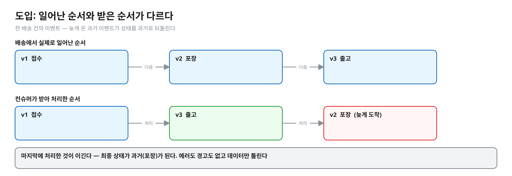
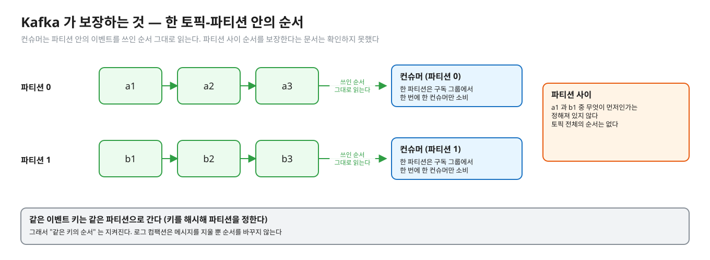
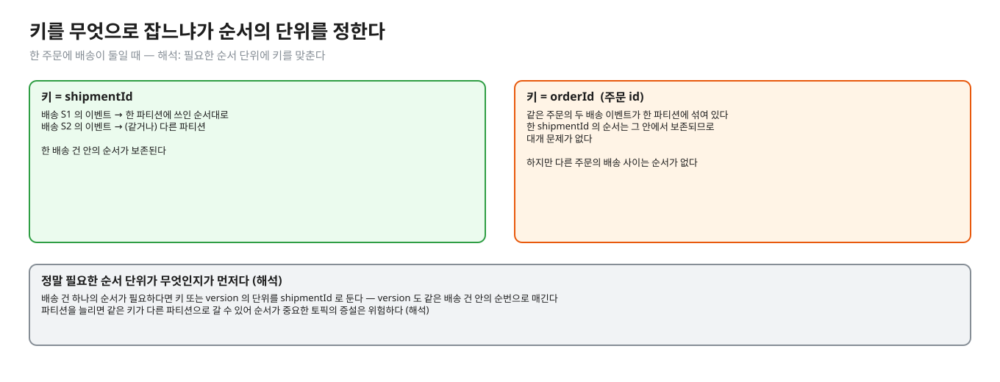
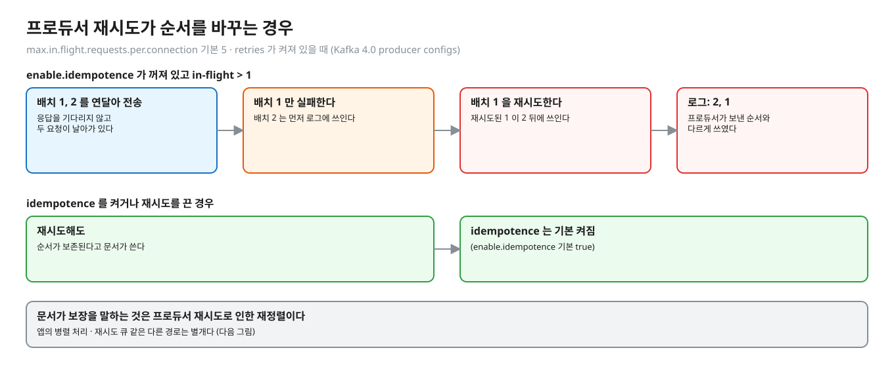
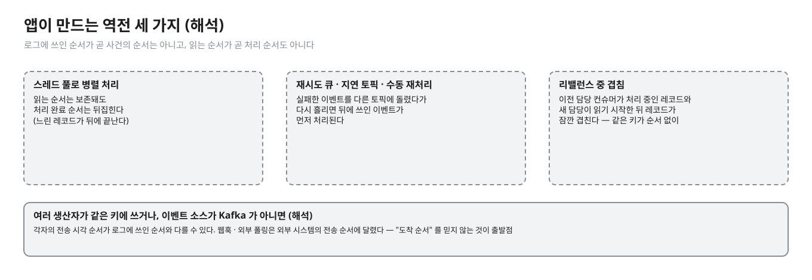
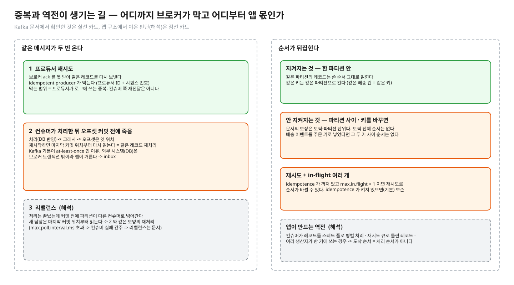

# 02. 순서가 뒤집히는 길 — Kafka 가 보장하는 것과 안 하는 것

> **이 글에서 알게 되는 것**
> 1. Kafka 의 순서 보장이 "한 토픽-파티션 안" 이 전부라는 것을 안다.
> 2. 키를 잘못 잡거나 재시도 · 병렬 처리 · 여러 생산자가 끼면, 컨슈머가 받는 순서와 사건이 일어난 순서가 달라지는 길을 일곱 가지 구분할 수 있다.
> 3. 그 방어가 데이터에 붙인 version 의 몫이라는 것을 안다.
>
> **먼저 알면 좋은 것**: [01. 전달 보장](01-delivery-semantics.md) — 중복이 어디서 생기는지.
> **다음 글**: [03. 중복 거르기](03-inbox-dedupe.md) → [04. 순서 지키기](04-version-ordering.md)
> **구분**: 필수 — ② 원리 (① 에서 예측을 먼저 한 뒤 읽는다)

## 완료된 배송이 이전 단계로 돌아갔다

고객에게 "배송이 완료됐다" 는 알림이 나갔는데, 잠시 뒤 앱을 열어 보니 배송 상태가 "포장" 이다. 로그에는 에러가 하나도 없다. 데이터만 틀렸다. 원인은 늦게 도착한 이전 단계 이벤트가 상태를 과거로 되돌린 것이다.

편집: [diagrams/blog02-intro.excalidraw](diagrams/blog02-intro.excalidraw)

"Kafka 는 순서를 보장한다" 고 알고 있는데 왜 이런 일이 생길까. 정답의 절반은 "파티션 안에서만" 이고, 나머지 절반은 "그래서 우리 시스템에서 순서가 깨지는 길이 어디인가" 이다. 이 글은 그 길을 찾는다.

## Kafka 가 보장하는 것

편집: [diagrams/blog02-partition.excalidraw](diagrams/blog02-partition.excalidraw)

- [Kafka 소개 문서](https://kafka.apache.org/documentation/#intro_concepts_and_terms): 같은 이벤트 키(예: 고객 ID · 차량 ID)의 이벤트는 같은 파티션에 쓰이고, 토픽-파티션의 컨슈머는 이벤트를 **쓰인 순서 그대로** 읽는다 (Kafka 4.0 문서). 보장은 토픽-파티션 단위이고 토픽 전체가 아니다.
- [Design](https://kafka.apache.org/documentation/#design): 토픽은 "전체 순서가 있는(totally ordered) 파티션" 의 집합이고, 구독 그룹에서 한 파티션은 **한 번에 한 컨슈머**만 소비한다. 키를 해시해 파티션을 정하면 같은 키의 레코드는 같은 파티션으로 간다. 로그 컴팩션은 메시지를 지울 뿐 순서를 바꾸지 않는다.
- 문서가 파티션 **사이** 순서를 보장한다고 쓴 곳은 확인하지 못했다. 그러니 보장이 없다고 읽어야 한다.

정리하면 보장은 "한 파티션 안에서 쓰인 순서" 이고, 같은 키가 같은 파티션으로 가게 키를 잡았을 때 "같은 키의 순서" 가 된다. 이제 이 보장이 어떻게 무너지는지 하나씩 보자.

## 순서가 뒤집히는 길

한눈에 보면 일곱 가지다.

| 경로 | 근거 | 설명 |
|---|---|---|
| 서로 다른 파티션 · 키 | 문서(보장 범위가 파티션 단위) | 배송 이벤트는 "배송 id" 로 키를 잡아야 한 배송의 순서가 보존된다. 주문 id 로 잡으면 배송 건 사이는 순서가 없다 (해석) |
| 프로듀서 재시도 | Kafka 4.0 producer configs | `max.in.flight.requests.per.connection`(기본 5) > 1 이고 retries 가 켜져 있고 **idempotence 가 꺼져 있으면** 실패한 전송의 재시도로 순서가 바뀔 수 있다. idempotence 를 켜거나 재시도를 끄면 순서가 보존된다고 문서가 쓴다. idempotence 는 기본 켜짐 |
| 여러 생산자가 같은 키에 쓴다 | (해석) | 각자의 전송 시각 순서가 로그에 쓰인 순서와 다를 수 있다. 로그에 쓰인 순서가 곧 "사건의 순서" 가 아니다 |
| 컨슈머가 스레드 풀로 병렬 처리 | (해석) | 읽는 순서는 보존돼도 처리 완료 순서는 뒤집힌다 |
| 재시도 큐 · 지연 토픽 · 수동 재처리 | (해석) | 실패한 이벤트를 다른 토픽에 돌렸다가 다시 흘리면 뒤에 쓰인 이벤트가 먼저 처리된다 |
| 리밸런스 중 겹침 | (해석) | 이전 담당 컨슈머가 처리 중인 레코드와 새 담당이 읽기 시작한 뒤 레코드가 잠깐 겹칠 수 있다 — 같은 키의 처리가 순서 없이 겹친다 |
| 이벤트 소스가 Kafka 가 아니다 (웹훅 · 외부 폴링 · 다른 시스템) | (해석) | 외부 시스템의 전송 순서는 그 시스템에 달렸다. "도착 순서" 를 믿지 않는 것이 출발점 |

### 1. 키를 잘못 잡았다

가장 흔한 길은 키다. 배송 이벤트의 순서가 필요한데 키를 주문 id 로 잡았다고 하자. 한 주문에 배송이 둘이면 두 배송의 이벤트가 같은 파티션에 섞여 쓰인다.

편집: [diagrams/blog02-key.excalidraw](diagrams/blog02-key.excalidraw)

같은 orderId 는 같은 파티션이라 그 안의 순서는 쓰인 순서다. 한 shipmentId 의 순서는 그 안에서 보존되므로 대개 문제가 없다. 하지만 **다른 주문의 배송**과의 순서는 없다 (해석). 정말 필요한 순서 단위가 무엇인지(배송 건 하나)에 맞춰 키 또는 version 의 단위를 `shipmentId` 로 두는 것이 안전하다. version 도 그 단위(같은 배송 건 안의 순번)로 매긴다.

파티션 수를 늘리는 경우도 비슷하다. 문서는 키 해시로 파티션을 정한다고 쓴다. 파티션 수가 바뀌면 같은 키가 다른 파티션으로 갈 수 있고(해시 → 파티션 매핑이 바뀌므로 — 이 매핑 공식은 문서에서 확인하지 않았다 · 해석), 옛 파티션의 남은 레코드와 새 파티션의 레코드가 같은 키에 대해 서로 순서 없이 읽힌다. 순서가 중요한 토픽은 파티션 증설이 위험하다 (해석).

### 2. 프로듀서 재시도

키를 제대로 잡아도 프로듀서가 순서를 바꿀 수 있다. 앞 글에서 본 재시도 때문이다.

편집: [diagrams/blog02-retry.excalidraw](diagrams/blog02-retry.excalidraw)

`max.in.flight.requests.per.connection`(기본 5) > 1 이고 retries 가 켜져 있고 idempotence 가 꺼져 있으면, 실패한 전송의 재시도로 순서가 바뀔 수 있다 (Kafka 4.0 producer configs). idempotence 를 켜거나 재시도를 끄면 순서가 보존된다고 문서가 쓴다. idempotence 는 기본으로 켜져 있다. 다만 문서가 보장을 말하는 것은 프로듀서 재시도로 인한 재정렬뿐이다. 다음의 앱 쪽 경로는 별개다.

### 3. 앱이 만드는 역전

편집: [diagrams/blog02-app-made.excalidraw](diagrams/blog02-app-made.excalidraw)

프로듀서를 아무리 잘 맞춰도 컨슈머 앱이 순서를 다시 깰 수 있다. 스레드 풀로 병렬 처리하면 읽는 순서는 보존돼도 처리 완료 순서가 뒤집힌다. 실패한 이벤트를 재시도 큐나 지연 토픽에 돌렸다가 다시 흘리면 뒤에 쓰인 이벤트가 먼저 처리된다. 리밸런스 중에는 이전 담당 컨슈머가 처리 중인 레코드와 새 담당이 읽기 시작한 레코드가 겹칠 수 있다. 여러 생산자가 같은 키에 쓰거나 이벤트 소스가 Kafka 가 아닌 경우도 있다. 모두 (해석)이다.

(해석) 요약하면 **도착 순서 ≠ 사건 순서**다. 파티션 순서는 "로그에 쓰인 순서" 를 지켜 줄 뿐이다. 그 순서가 사건 순서와 같은지는 쓰는 쪽 구조에 달렸다.

편집: [diagrams/dup-order-paths.excalidraw](diagrams/dup-order-paths.excalidraw)

## 앱 · 프레임워크에서는

Spring Kafka 의 기본 리스너는 컨테이너 스레드가 poll 한 레코드를 순서대로 처리한다. 동시성은 `concurrency` 로 파티션 단위를 늘린다 — (해석), 이 문서에서 확인하지 않았다. 에러 핸들러는 실패한 레코드를 seek 로 되돌려 재전달한다 ([문서 06](06-spring-kafka-mysql.md)). 그 재전달이 같은 키의 뒤쪽 레코드 앞에 오느냐 뒤에 오느냐는 설정에 따라 다르다. 재시도 토픽 · DLT 로 돌리면 뒤로 간다 (해석).

## 자주 하는 오해

1. **"Kafka 는 순서를 보장한다."** 한 토픽-파티션 안만이다. 같은 키가 같은 파티션으로 가게 키를 잡았을 때에 한해 "같은 키의 순서" 가 된다.
2. **"파티션이 하나면 순서 걱정이 없다."** 읽는 순서는 보존되지만 처리 · 재시도 · 생산 쪽 경로에서 뒤집힐 수 있다 (위 표). 파티션 하나는 처리량의 상한이기도 하다.
3. **"idempotent producer 를 켰으니 순서도 완벽하다."** 문서가 보장을 말하는 것은 프로듀서 재시도로 인한 재정렬이다. 다른 경로(앱 병렬 처리, 재시도 큐)는 별개다.
4. **"타임스탬프로 정렬하면 된다."** 서버마다 시계가 다르고 같은 시각이 존재한다. 순서 키로 시각을 쓰는 것은 위험하다 (해석). 소스가 순번을 붙이는 편이 낫다 ([문서 04](04-version-ordering.md)).
5. **"순서 역전은 드물다."** 정상 운영에서 재시도 큐 · 병렬 소비가 있으면 매일 난다 (해석). 드물다고 가정한 코드는 드물게 데이터를 틀리게 만든다.

## 한눈에 정리

| 구분 | 내용 |
|---|---|
| 지켜지는 것 | 한 토픽-파티션 안의 쓰인 순서 · 같은 키는 같은 파티션 |
| 보장이 없는 것 | 파티션 사이 순서 (문서에서 보장을 확인하지 못함) · 토픽 전체 순서 |
| 깨지는 길 | 키 선택 · 프로듀서 재시도(idempotence 꺼짐) · 여러 생산자 · 병렬 처리 · 재시도 큐 · 리밸런스 겹침 · Kafka 가 아닌 소스 |
| 방어 | 데이터에 붙인 version ([04](04-version-ordering.md)) |

- Kafka 의 순서 보장은 "한 토픽-파티션 안" 이 전부다.
- 키를 잘못 잡거나, 재시도 · 병렬 처리 · 여러 생산자가 끼면 컨슈머가 받는 순서와 사건이 일어난 순서는 달라진다.
- 도착 순서를 믿지 않는 것이 출발점이고, 그 방어는 데이터에 붙인 version 이 한다.

## 스스로 확인

1. 키를 `orderId` 로 잡았는데 배송 이벤트가 `shipmentId` 단위로 순서가 필요하다. 한 주문에 배송이 둘이면?
   

답

   같은 orderId 는 같은 파티션이라 두 배송 이벤트가 한 로그에 섞여 있고 그 안의 순서는 쓰인 순서다. 한 shipmentId 의 순서는 그 안에서 보존되므로 대개 문제가 없다 — 하지만 **다른 주문의 배송**과의 순서는 없다 (해석). 정말 필요한 순서 단위가 무엇인지(배송 건 하나)에 맞춰 키 또는 version 의 단위를 `shipmentId` 로 두는 것이 안전하다. version 도 그 단위(같은 배송 건 안의 순번)로 매긴다.
   

2. 파티션을 늘리면 순서에 무슨 일이 생기나?
   

답

   문서는 키 해시로 파티션을 정한다고 쓴다. 파티션 수가 바뀌면 같은 키가 다른 파티션으로 갈 수 있고 (해시 → 파티션 매핑이 바뀌므로 — 이 매핑 공식은 문서에서 확인하지 않았다 · 해석), 옛 파티션의 남은 레코드와 새 파티션의 레코드가 같은 키에 대해 서로 순서 없이 읽힌다. 순서가 중요한 토픽은 파티션 증설이 위험하다 (해석).
   

3. 컨슈머를 스레드 풀로 병렬화하면서 순서를 지키려면?
   

답

   키(또는 파티션) 단위로 같은 스레드에 할당해 같은 키의 처리는 직렬화한다 (해석). 그게 어렵다면 처리 쪽에서 version 으로 역전을 거른다 (문서 04) — 순서를 지키는 것과 역전을 무해하게 하는 것은 별개 전략이다.
   

4. 순서가 뒤집혀 오는 이벤트를 version 없이 처리해야 한다면(소스를 못 바꾼다)?
   

답

   문서 04 에서 다룬다 — 전이표로 허용되지 않는 후퇴를 거르거나, 이벤트를 신호로만 쓰고 소스에 최신 상태를 다시 조회한다 (해석). 어느 것이든 "도착 순서를 신뢰" 하는 설계는 아니다.
   

## 이 레슨에서 직접 보기

| 어디서 | 무엇을 |
|---|---|
| Q02 | version 비교 없이 덮어쓰면 늦은 과거 이벤트가 상태를 되돌리나 |
| 장면 2 (observe/SCRIPT.md) | 같은 장면을 psql 로 |
| 구현 테스트 | 순서를 섞은 version 1..10 순차 · 동시에 반영 → 최종 version 10 이어야 한다 ([EventApplierImplementTest](../src/test/java/deepdive/c01/l05/EventApplierImplementTest.java)) |

이 글의 그림은 일부러 문항과 다른 상태(접수 · 포장 · 출고)로 그렸다. 예측 문항의 값을 직접 적어 보고 나서 확인한다.

실측 — 예측을 끝낸 뒤 펼친다 (Q02)

Q02 = IN_TRANSIT. v3(DELIVERED) 다음에 v2(IN_TRANSIT) 를 그냥 덮어쓰면 마지막 쓴 것이 이긴다 — 최종 상태는 과거다 (실측: Q02). 에러도 경고도 없다.

## 출처

- [Kafka 문서 · Introduction · 키와 파티션 · 순서](https://kafka.apache.org/documentation/#intro_concepts_and_terms) — 같은 키는 같은 파티션, 파티션 안 읽기 순서 보장 (Kafka 4.0)
- [Kafka 문서 · Design](https://kafka.apache.org/documentation/#design) — 파티션은 전체 순서 · 그룹당 한 컨슈머 · 키 해시 · 컴팩션은 순서를 바꾸지 않는다
- [Kafka 문서 · Producer Configs](https://kafka.apache.org/documentation/#producerconfigs) — `max.in.flight.requests.per.connection` · `enable.idempotence`
