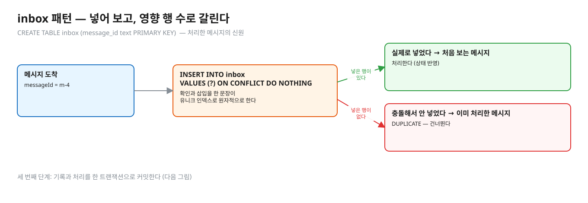
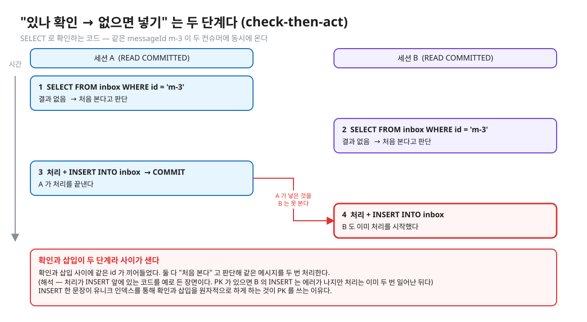
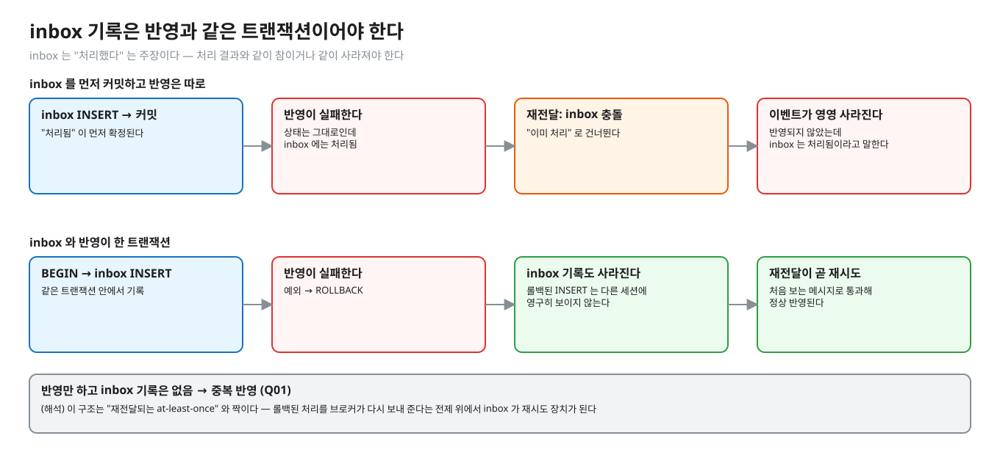
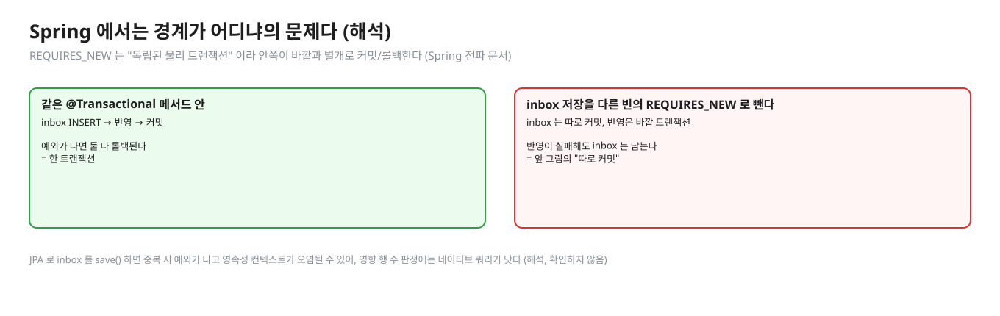
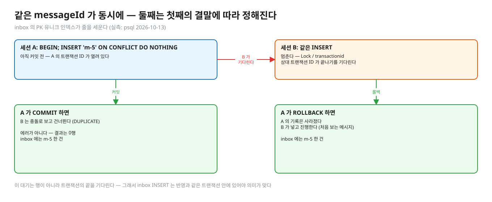
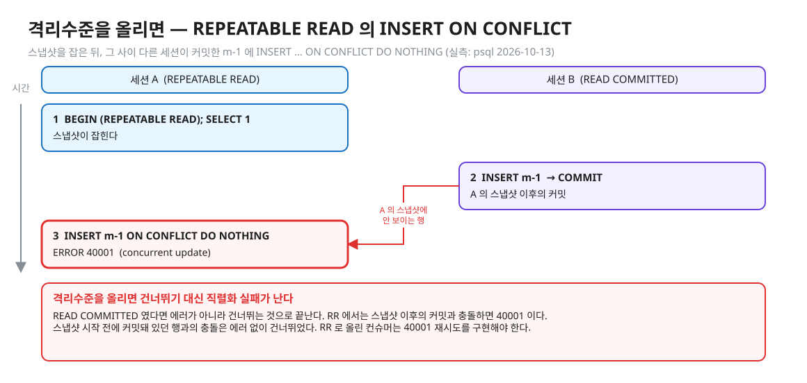

# 03. 중복 거르기 — inbox 테이블 · ON CONFLICT DO NOTHING · 한 트랜잭션

> **이 글에서 알게 되는 것**
> 1. "처리한 messageId" 를 PRIMARY KEY 테이블(inbox)에 넣어 보고 **영향 행 수**로 처음 본 메시지인지 판정하는 방법을 안다.
> 2. 그 기록이 상태 반영과 **같은 트랜잭션**이어야 하는 이유를 안다 — 따로 커밋하면 실패한 이벤트가 "처리됨" 으로 남아 영영 사라진다.
> 3. 같은 messageId 가 동시에 올 때 PostgreSQL 이 어떻게 줄을 세우는지, 격리수준을 올리면 무엇이 달라지는지 안다.
>
> **먼저 알면 좋은 것**: [01. 전달 보장](01-delivery-semantics.md) — at-least-once 에서 중복이 어디서 생기는지.
> **다음 글**: [04. 순서 지키기](04-version-ordering.md)
> **구분**: 필수 — ② 원리 (① 에서 예측을 먼저 한 뒤 읽는다)

## 같은 이벤트가 두 번 오면

재처리가 한 번 돌고 나면 알림과 적립이 두 번 나가 있다. 이미 받은 이벤트가 다시 왔을 뿐인데 코드는 그것을 알아채지 못했다. 반대의 사고도 있다. inbox 를 만들어 두었는데 이벤트가 오히려 사라진다. 기록만 커밋되고 처리는 실패한 경우다. 이 글은 두 사고를 모두 막는 방법을 다룬다. "같은 이벤트가 두 번 와도 한 번만 처리되게 하려면?" 의 표준 답이 inbox(멱등 소비자)이고, 거기에 붙는 꼬리 질문이 "그 기록과 처리를 한 트랜잭션에 묶지 않으면?" · "동시에 같은 id 가 오면?" 이다.

## inbox 패턴

```sql
CREATE TABLE inbox (message_id text PRIMARY KEY);      -- 처리한 메시지의 신원
INSERT INTO inbox (message_id) VALUES (?) ON CONFLICT DO NOTHING;
```


<sub>편집: [diagrams/blog03-inbox-flow.excalidraw](diagrams/blog03-inbox-flow.excalidraw)</sub>

1. 메시지를 처리하기 전에 inbox 에 `messageId` 를 넣어 본다.
2. **영향 행 수**로 갈린다. 실제로 넣었으면 처음 보는 메시지(처리한다), 충돌해서 안 넣었으면 이미 처리한 메시지(DUPLICATE · 건너뛴다)다.
3. 기록과 처리를 **한 트랜잭션**으로 커밋한다.

판정에 SELECT 를 쓰지 않는 이유가 있다. "있나 확인 → 없으면 넣기" 는 두 단계라 사이에 같은 id 가 끼어든다 (check-then-act).


<sub>편집: [diagrams/blog03-check-then-act.excalidraw](diagrams/blog03-check-then-act.excalidraw)</sub>

(위 장면은 이해를 위한 예시다.) INSERT 한 문장이 유니크 인덱스를 통해 "확인과 삽입" 을 원자적으로 하게 한다. 이것이 PK 를 쓰는 이유다. 유니크 제약 자체의 동작(`23505` 등)은 [01.03 멱등성 docs](../../l03-idempotency/docs/README.md) 에 있다.

## 영향 행 수가 신호다

[PostgreSQL 16 · INSERT](https://www.postgresql.org/docs/16/sql-insert.html) 가 말하는 것은 다음과 같다.

- `ON CONFLICT DO NOTHING` 은 "충돌 시 행을 넣지 않는 것을 대안 동작으로 삼는다". `DO NOTHING` 은 `conflict_target` 를 생략할 수 있고, 생략하면 사용 가능한 모든 제약 · 유니크 인덱스와의 충돌을 다룬다.
- 명령 태그는 `INSERT oid count` 이고 `count` 는 "삽입되거나 갱신된 행 수" 다. `oid` 는 항상 0 이다.
- 그래서 JDBC 의 `executeUpdate()` 반환값이 곧 "새로 넣었나" 다. `ON CONFLICT` 가 **없으면** 같은 id 는 에러이고, 있으면 에러 없이 건너뛴다. 앱 코드가 예외 대신 반환값으로 분기한다 (구체 값은 아래 접힌 칸).

<details><summary>실측 — 예측을 끝낸 뒤 펼친다 (Q04 · psql 2026-10-13)</summary>

Q04 = 첫 번째 1, 두 번째 0 (실측: Q04). psql 에서:

```
INSERT INTO inbox VALUES ('m-1') ON CONFLICT DO NOTHING;   → INSERT 0 1
INSERT INTO inbox VALUES ('m-1') ON CONFLICT DO NOTHING;   → INSERT 0 0   (에러 아님)
INSERT INTO inbox VALUES ('m-1');                          → ERROR: 23505 duplicate key value violates unique constraint "inbox_pkey"
```
</details>

## 반영과 같은 트랜잭션이어야 하는 이유

inbox 는 "처리했다" 는 **주장**이다. 이 주장은 처리 결과와 같이 참이거나 같이 사라져야 한다.


<sub>편집: [diagrams/blog03-tx-compare.excalidraw](diagrams/blog03-tx-compare.excalidraw)</sub>

| 구조 | 처리가 중간에 실패하면 | 재전달 때 |
|---|---|---|
| inbox 를 **먼저 커밋**, 반영은 따로 | inbox 에는 "처리됨", 상태는 그대로 | inbox 가 충돌 → "이미 처리" 로 건너뛴다 → **이벤트가 영영 반영되지 않는다** |
| inbox 와 반영이 **한 트랜잭션** | 롤백으로 inbox 기록도 사라진다 | 재전달이 처음 보는 메시지로 통과해 정상 반영된다 — **재전달이 곧 재시도** |
| 반영만 하고 inbox 기록은 없음 | 반영은 됐으나 기록이 없다 | 중복 반영 (Q01) |

(해석) 이 구조는 "재전달되는 at-least-once" 와 짝이다. 롤백된 처리를 브로커가 다시 보내 준다는 전제 위에서 inbox 가 재시도 장치가 된다 (오프셋을 처리 후 커밋하는 구성 · [문서 01](01-delivery-semantics.md)).

<details><summary>실측 — 예측을 끝낸 뒤 펼친다 (Q05 · Q06)</summary>

실패는 `CHECK (status <> 'DELIVERED')` 제약으로 흉내 낸다 (반영 쪽 장애). 이벤트 = m-9 → DELIVERED.

- **따로 커밋 (Q05)**: inbox INSERT autocommit 후 반영 UPDATE 가 제약 위반으로 실패 → 장애 해소 → 같은 메시지 재전달의 inbox INSERT 는 **0행** → 앱이 건너뛴다 → 최종 status = **READY** (실측: Q05). 이 이벤트는 반영되지 않았는데 inbox 는 처리됨이라고 말한다.
- **한 트랜잭션 (Q06)**: BEGIN → inbox INSERT → UPDATE 실패 → ROLLBACK → 장애 해소 → 재전달의 inbox INSERT 는 **1행** → 반영 → 최종 status = **DELIVERED** (실측: Q06).

실패한 트랜잭션은 중단 상태라 `ROLLBACK` 전까지 다음 명령이 `25P02` 로 거부된다 (실측: psql 2026-10-13 `BEGIN; SELECT 1/0; INSERT …` → `22012` 뒤 `25P02 current transaction is aborted, commands ignored until end of transaction block`) — 그래서 앱은 예외를 받으면 롤백한 뒤 던진다. 근거: [정답 patch](../../../solutions/01.05.patch).
</details>

### Spring 에서는 경계가 어디냐의 문제다

Spring 에서는 inbox INSERT 와 반영이 **같은 `@Transactional`** 메서드 안이어야 한다. inbox 저장을 다른 빈의 `REQUIRES_NEW` 로 빼면 위 "따로 커밋" 이 된다 (해석 — [Spring 트랜잭션 전파](https://docs.spring.io/spring-framework/reference/data-access/transaction/declarative/tx-propagation.html): REQUIRES_NEW 는 "독립된 물리 트랜잭션" 이라 안쪽이 바깥과 별개로 커밋/롤백한다).


<sub>편집: [diagrams/blog03-requires-new.excalidraw](diagrams/blog03-requires-new.excalidraw)</sub>

## 동시에 같은 messageId 가 오면

같은 id 를 두 컨슈머(리밸런스 중 겹침 · 중복 발행)가 동시에 처리하면, inbox 의 PK 유니크 인덱스가 줄을 세운다.

- 먼저 INSERT 한 트랜잭션이 **아직 커밋 전**일 때 두 번째 INSERT 가 어떻게 되는지, 첫째가 커밋/롤백하면 각각 어떻게 끝나는지가 Q09 다. 결과는 아래 접힌 칸이다. 유니크 제약의 대기 · 충돌 동작은 [01.03](../../l03-idempotency/docs/README.md) 에 있다.
- 이 대기는 행이 아니라 **트랜잭션의 끝**을 기다린다. 그래서 inbox INSERT 가 반영과 같은 트랜잭션 안에 있어야 의미가 맞다.
- PostgreSQL 문서(13.2 Read Committed)는 이렇게 쓴다. "`INSERT … ON CONFLICT DO NOTHING` 은 [그 INSERT 의 스냅샷에 보이지 않는] 다른 트랜잭션의 결과 때문에 어떤 행의 삽입이 진행되지 않을 수 있다 — 이는 Read Committed 에서만 그렇다". 즉 기본 격리수준(READ COMMITTED)에서 "내 스냅샷에는 없는데 방금 다른 쪽이 커밋한 행" 을 DO NOTHING 이 충돌로 본다.

<details><summary>실측 — 예측을 끝낸 뒤 펼친다 (Q09 · psql 2026-10-13)</summary>

Q09 = (기다린다 true, A 롤백 뒤 B 의 영향 행 1) (실측: Q09). 첫째가 커밋하면 둘째는 건너뛰고(DUPLICATE), 롤백하면 둘째가 넣고 진행한다. psql 두 세션 (A: `BEGIN; INSERT … 'm-1' ON CONFLICT DO NOTHING;` 후 3초 대기, B: 같은 문장):

| A 의 끝 | B 의 INSERT 가 멈춰 있는 동안 `pg_stat_activity` | B 의 결과 |
|---|---|---|
| COMMIT | `Lock` / `transactionid` | `INSERT 0 0` → inbox 에 m-1 한 건 |
| ROLLBACK | `Lock` / `transactionid` | `INSERT 0 1` → inbox 에 m-1 한 건 |

`transactionid` 대기 = 상대 **트랜잭션 ID 가 끝나기를** 기다린다는 뜻이다 (행이 아니라 트랜잭션).


<sub>편집: [diagrams/blog03-concurrent.excalidraw](diagrams/blog03-concurrent.excalidraw)</sub>
</details>

### 격리수준을 올리면

**주의 — 격리수준을 올리면** (실측: psql 2026-10-13): REPEATABLE READ 로 `SELECT 1` 로 스냅샷을 잡은 뒤, 그 사이 다른 세션이 커밋한 `m-1` 에 `INSERT … ON CONFLICT DO NOTHING` 을 하면 0행이 아니라 `ERROR: 40001 could not serialize access due to concurrent update` 가 났다. 스냅샷 시작 **전에** 커밋돼 있던 행과의 충돌은 `INSERT 0 0` 이었다.


<sub>편집: [diagrams/blog03-rr-40001.excalidraw](diagrams/blog03-rr-40001.excalidraw)</sub>

격리수준을 RR 로 올린 컨슈머는 `40001` 재시도를 구현해야 한다 (01.01 의 [40001 · 재시도](../../l01-isolation-mvcc/docs/05-serializable-ssi-retry.md)).

## PostgreSQL 에서는 (요약)

- inbox 의 PK = 유니크 B-tree 인덱스. 같은 키의 두 번째 삽입은 첫 트랜잭션이 끝나야 결론이 난다 (대기 이벤트 `transactionid`).
- `ON CONFLICT DO NOTHING`: 충돌한 행은 건너뛰고, count 는 "삽입되거나 갱신된 행 수" 라서 건너뛴 행은 세지 않는다 (INSERT 페이지의 명령 태그 정의).
- 같은 messageId 의 기록은 **트랜잭션이 롤백되면 사라진다**. 롤백된 INSERT 는 다른 세션에 영구히 보이지 않는다 (MVCC · 01.01).

## 자주 하는 오해

1. **"inbox 에 SELECT 로 있나 확인하고 없으면 INSERT 하면 된다."** 확인과 삽입 사이에 같은 id 가 끼어든다. INSERT … ON CONFLICT 한 문장이 원자적이다.
2. **"ON CONFLICT DO NOTHING 이면 에러가 나지 않으니 안전하다."** 에러가 안 나는 것이 **신호를 버리는 것**이 되기 쉽다. 반환 행 수를 안 보고 무조건 이어 처리하면 중복을 통과시킨다 (구현에서 `== 0` 이면 DUPLICATE).
3. **"inbox 를 먼저 커밋해 두면 안전하게 선점한다."** 선점은 맞지만 처리가 실패하면 이벤트가 사라진다 (위 표 첫 줄). 선점과 반영은 한 트랜잭션.
4. **"STALE(늦은 과거)이면 inbox 를 남기지 않아도 된다."** 남긴다. 같은 메시지가 또 오면 DUPLICATE 로 끝나야 한다 (이 레슨 구현 지침). 안 남겨도 version 조건이 상태를 지키지만, 매번 상태 테이블을 건드린다 (해석).
5. **"동시에 같은 id 가 오면 둘 다 통과한다."** PK 가 줄을 세운다. 둘째는 첫째의 결말에 따라 결정된다 (위 Q09).

## 앱 · 프레임워크에서는

- JDBC: `executeUpdate()` 반환값이 INSERT 의 count 다 (PostgreSQL 명령 태그의 count 와 같은 값이라고 읽는 것은 해석 — 드라이버 코드를 확인하지 않았다). 이 레슨 구현이 그 방식이다.
- Spring: 위 "Spring 에서는 경계가 어디냐의 문제다" 를 참고한다.
- JPA 로 inbox 를 `save()` 하면 중복 시 예외(`DataIntegrityViolationException` 류)가 나고 영속성 컨텍스트가 오염될 수 있다. 영향 행 수 판정이 필요하면 네이티브 쿼리가 낫다 (해석, 확인하지 않음).

## MySQL InnoDB 는 어떻게 다른가 (심화)

다른 점은 [문서 06](06-spring-kafka-mysql.md)에 모았다. `INSERT IGNORE`, `ON DUPLICATE KEY UPDATE`, 그리고 중복 키 충돌 시 **공유 락** 때문에 동시 INSERT 에서 데드락이 날 수 있다 ([MySQL 8.0 · 17.7.3 Locks Set by Different SQL Statements](https://dev.mysql.com/doc/refman/8.0/en/innodb-locks-set.html)).

## 한눈에 정리

| 상황 | PostgreSQL 16 에서 |
|---|---|
| 중복 판정 | `INSERT … ON CONFLICT DO NOTHING` 의 영향 행 수 (SELECT 확인은 check-then-act) |
| 기록과 반영 | 같은 트랜잭션 — 따로 커밋하면 실패한 이벤트가 사라진다 |
| 같은 id 동시 | PK 유니크 인덱스가 줄을 세운다 (`transactionid` 대기) |
| 격리수준을 RR 로 | 스냅샷 이후의 커밋과 충돌하면 `40001` |

- inbox 는 "처리했다" 는 주장이라서, 처리 결과와 같은 트랜잭션에서 같이 참이거나 같이 사라져야 한다.
- 판정은 SELECT 가 아니라 INSERT 한 문장의 영향 행 수로 한다.
- 재전달이 곧 재시도가 되려면 롤백된 처리를 브로커가 다시 보내 주는 at-least-once 가 전제다.

## 스스로 확인

1. 처리 도중 예외가 나면 inbox 기록은 어디까지 되돌아가야 하나? 외부 API 호출(알림 발송)이 그 처리 안에 있으면?
   <details><summary>답</summary>
   inbox 와 DB 반영은 같은 트랜잭션이라 함께 롤백된다. 하지만 외부 API 호출은 DB 롤백으로 되돌릴 수 없다 — 호출 후 커밋이 실패하면 재전달 때 호출이 또 나간다. 그래서 호출 자체를 커밋 뒤로 미루거나 outbox 에 "보낼 것" 으로 기록해 한 트랜잭션에 묶고(02.03 예고), 상대에게 멱등 키를 준다 (해석).
   </details>
2. 같은 messageId 두 건이 동시에 와서 첫째가 커밋하는 순간, 둘째 INSERT 는 어떻게 결론 나나? 에러인가?
   <details><summary>답</summary>
   READ COMMITTED 에서 에러가 아니라 0행이다 (실측: psql 2026-10-13 `INSERT 0 0`). 둘째는 첫째가 끝나길 `transactionid` 로 기다리다가, 첫째가 커밋하면 충돌로 보고 건너뛴다. 첫째가 롤백하면 둘째가 넣고 진행한다 (Q09). RR 로 올리면 스냅샷 이후의 커밋과 충돌할 때 `40001` 이 난다 (실측: psql).
   </details>
3. messageId 를 무엇으로 만드나? Kafka 의 (토픽, 파티션, 오프셋) 을 쓰면?
   <details><summary>답</summary>
   (해석) 오프셋 기반 키는 "같은 레코드를 두 번 읽음" 은 거르지만, 프로듀서가 같은 사건을 두 번 발행해 서로 다른 오프셋에 쓰인 경우는 못 거른다. 업무 단위 id(이벤트를 만드는 쪽이 부여, 재발행해도 같은 값)가 더 단단하다. 업무 id 가 없으면 오프셋을 쓰되 이 한계를 안다.
   </details>
4. inbox 가 없고 version 만 있으면 무엇이 샌다?
   <details><summary>답</summary>
   상태는 version 이 지킨다(문서 04). 부수 효과는 조건에 따라 갈린다 — `<` 비교이고 부수 효과를 APPLIED 일 때만 일으키면 같은 메시지 재전달도 STALE 이라 막힌다. `<=` 이거나 부수 효과가 version 판정과 무관(외부 호출 · 반영 결과를 보지 않는 카운터)하면 샌다 (표: 문서 05 "version 만으로 부수 효과를 제한할 수 있나"). NOTES 의 설명 요지: messageId = 재전달 거르기, version = 역전 거르기.
   </details>

## 이 레슨에서 직접 보기

| 어디서 | 무엇을 |
|---|---|
| Q04 | inbox 두 번 INSERT 의 영향 행 수 |
| Q05 · Q06 · 장면 3 | 따로 커밋 vs 한 트랜잭션 — 재전달 결과 |
| Q09 · 장면 4 | 같은 messageId 동시에 — 대기 · 첫째가 롤백하면 |
| 구현 테스트 | 같은 messageId 5개 동시 → 반영 1번 · "예외 후 재전달" 가드 ([EventApplierImplementTest](../src/test/java/deepdive/c01/l05/EventApplierImplementTest.java)) |

이 글의 그림은 일부러 문항과 다른 messageId · 상태로 그렸고, Q09 의 결과를 담은 그림은 위 접힌 칸 안에 두었다.

## 출처

- [PostgreSQL 16 · INSERT](https://www.postgresql.org/docs/16/sql-insert.html) — ON CONFLICT DO NOTHING · 명령 태그 count · conflict_target 생략 규칙
- [PostgreSQL 16 · 13.2 Transaction Isolation · Read Committed](https://www.postgresql.org/docs/16/transaction-iso.html) — `ON CONFLICT DO NOTHING` 이 다른 트랜잭션의 결과로 삽입을 건너뛸 수 있다 (Read Committed 한정)
- [Spring · 트랜잭션 전파](https://docs.spring.io/spring-framework/reference/data-access/transaction/declarative/tx-propagation.html) — REQUIRES_NEW 는 독립된 물리 트랜잭션
- [MySQL 8.0 · InnoDB Locks Set by Different SQL Statements](https://dev.mysql.com/doc/refman/8.0/en/innodb-locks-set.html)
- 실측: psql 2026-10-13 (PostgreSQL 16.14, 컨테이너 `deepdive-01.05-pg`)
