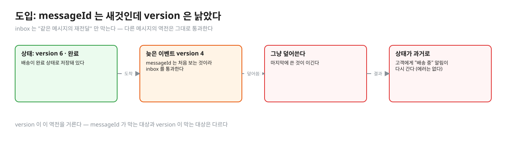
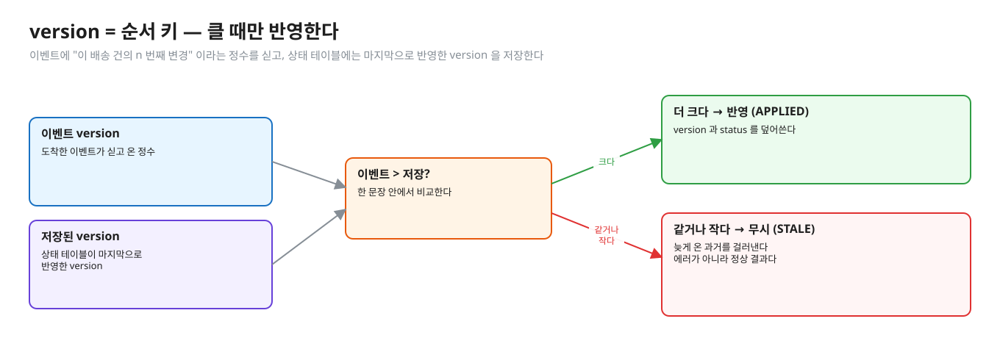
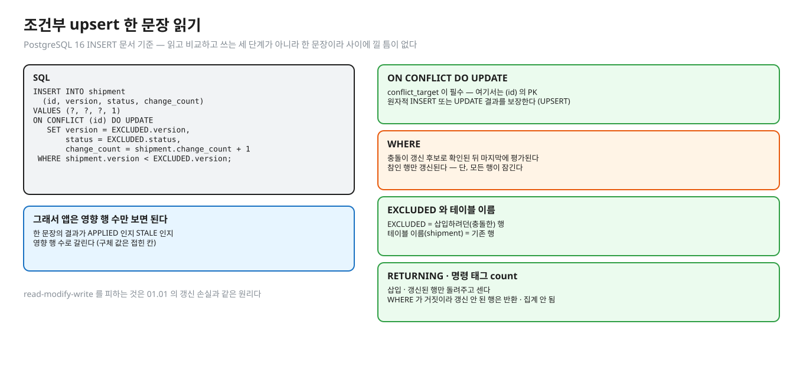
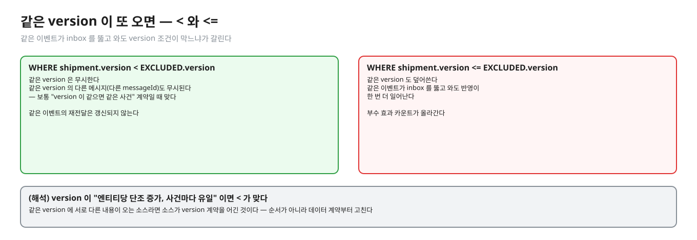
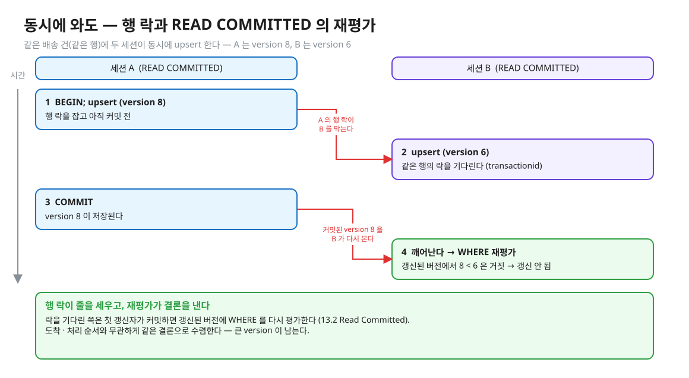
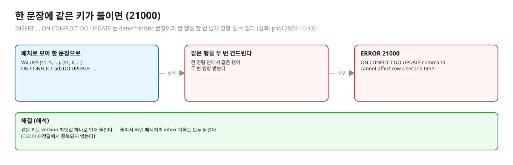
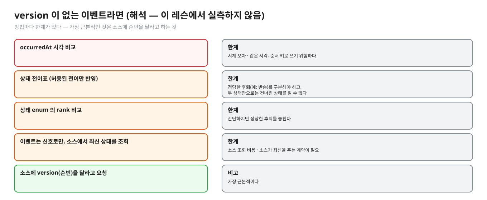

# 04. 순서 지키기 — version · 조건부 upsert · stale 무시

> **이 글에서 알게 되는 것**
> 1. 엔티티마다 단조 증가하는 version 을 이벤트에 싣고, 저장된 version 보다 **클 때만** 덮어쓰는 규칙으로 늦게 온 과거를 거르는 방법을 안다.
> 2. 그 규칙이 읽고 비교하고 쓰는 세 단계가 아니라 조건부 upsert **한 문장**이어야 하는 이유와, PostgreSQL 이 그 문장을 어떻게 평가하는지 안다.
> 3. 같은 version 이 또 올 때(`<` 와 `<=`)와 동시에 올 때 결과가 어떻게 갈리는지 안다.
>
> **먼저 알면 좋은 것**: [02. 순서가 뒤집히는 길](02-ordering-paths.md) · [03. 중복 거르기](03-inbox-dedupe.md)
> **다음 글**: [05. 설계 정리](05-design-patterns.md)
> **구분**: 필수 — ② 원리 (① 에서 예측을 먼저 한 뒤 읽는다)

## messageId 는 새것인데 version 은 낡았다

완료된 배송이 이전 단계로 되돌아가, 고객에게 "배송 중" 알림이 다시 가는 장애가 있다. 이 이벤트의 messageId 는 처음 보는 것이라 앞 글의 inbox 를 그냥 통과한다. 같은 메시지의 재전달이 아니라 **다른 메시지**의 역전이기 때문이다. "순서가 뒤집혀 온 이벤트는 어떻게 처리하나요?" 의 답이 version 비교이고, 꼬리 질문은 "동시에 두 개가 오면?" · "같은 version 이 또 오면?" · "version 을 못 받으면?" 으로 이어진다.


<sub>편집: [diagrams/blog04-intro.excalidraw](diagrams/blog04-intro.excalidraw)</sub>

## version = 순서 키

이벤트에 "이 배송 건의 n 번째 변경" 이라는 정수를 싣는다. 상태 테이블에는 마지막으로 반영한 version 을 저장한다. 규칙은 하나다. **이벤트 version > 저장된 version 일 때만 반영한다.** 같거나 작으면 무시(STALE)한다.


<sub>편집: [diagrams/blog04-rule.excalidraw](diagrams/blog04-rule.excalidraw)</sub>

version 은 inbox 의 messageId 와 **막는 대상이 다르다**. messageId 는 같은 메시지의 재전달을, version 은 **다른 메시지**의 역전을 막는다. messageId 만 있으면 역전이 새고, version 만 있으면 `<=` 이거나 부수 효과가 version 판정과 무관할 때 중복이 샌다 (조건별 표: [문서 05](05-design-patterns.md)).

## 조건부 upsert 한 문장

```sql
INSERT INTO shipment (id, version, status, change_count) VALUES (?, ?, ?, 1)
ON CONFLICT (id) DO UPDATE
   SET version = EXCLUDED.version, status = EXCLUDED.status,
       change_count = shipment.change_count + 1
 WHERE shipment.version < EXCLUDED.version;
```


<sub>편집: [diagrams/blog04-upsert.excalidraw](diagrams/blog04-upsert.excalidraw)</sub>

[PostgreSQL 16 · INSERT](https://www.postgresql.org/docs/16/sql-insert.html) 로 읽는 법은 이렇다.

- `ON CONFLICT DO UPDATE` 는 **conflict_target 이 필수**다 (여기서는 `(id)` 의 PK). `DO NOTHING` 과 다르다.
- `DO UPDATE` 는 "원자적 INSERT 또는 UPDATE 결과를 보장" 한다. 독립된 에러가 없는 한, 높은 동시성에서도 둘 중 하나로 끝난다 (UPSERT).
- `WHERE` 의 조건식은 "충돌이 갱신 후보로 확인된 **뒤 마지막에** 평가" 되고, 조건이 참인 행만 갱신된다. 단, **모든 행이 잠긴다**.
- `RETURNING` 은 "성공적으로 삽입 · 갱신된 행만" 돌려준다. 문서 예: "`DO UPDATE … WHERE` 조건이 거짓이라 갱신되지 않은 행은 반환되지 않는다".
- 명령 태그 count = 삽입 또는 갱신된 행 수라서, 조건에 걸려 갱신되지 않은 행은 세지 않는다. 새 키는 INSERT 로 들어가므로 센다.
- `EXCLUDED` = 삽입하려던(충돌한) 행, 테이블 이름 = 기존 행.

그래서 앱은 영향 행 수만 보면 APPLIED / STALE 를 가른다 (값은 접힌 칸). 읽고 비교하고 쓰는 세 단계가 아니라 **한 문장**이라 사이에 낄 틈이 없다. read-modify-write 를 피하는 것은 01.01 의 갱신 손실과 같은 원리다.

## 같은 version 은 어떻게 하나 — `<` 와 `<=`


<sub>편집: [diagrams/blog04-lt-le.excalidraw](diagrams/blog04-lt-le.excalidraw)</sub>

- `<` : 같은 version 은 무시한다. **같은 version 의 다른 메시지**(다른 messageId, 같은 shipment 의 같은 순번)도 무시된다. 보통 "version 이 같으면 같은 사건" 이라는 계약일 때 맞다.
- `<=` : 같은 version 도 덮어쓴다. 같은 이벤트가 inbox 를 뚫고 와도 반영이 한 번 더 일어난다. 부수 효과 카운트가 올라간다.
- (해석) version 이 "엔티티당 단조 증가, 사건마다 유일" 이면 `<` 가 맞다. 같은 version 에 서로 다른 내용이 오는 소스라면 소스가 version 계약을 어긴 것이므로, 순서가 아니라 데이터 계약부터 고친다.

<details><summary>실측 — 예측을 끝낸 뒤 펼친다 (Q03 · psql 2026-10-13)</summary>

Q03 = 과거(v2) 0, 같은 버전(v3) 0 (실측: Q03). psql (v3 반영 뒤 version 3 · change_count 1 → 다시 시도):

| 문장 | 결과 |
|---|---|
| upsert (v3) `WHERE shipment.version < EXCLUDED.version` — 최초 | `INSERT 0 1` |
| 같은 문장, v2 | `INSERT 0 0` |
| 같은 문장, v3 를 **`<=`** 로 | `INSERT 0 1` — `change_count` 가 2 로 오른다 |
| v3 (다른 status `RETURNED`) 를 `<` 로 | `INSERT 0 0` — 상태는 DELIVERED 그대로 |
| v4 `RETURNING id, version` | 1행 `s1 | 4` + `INSERT 0 1` |
| v1 `RETURNING id, version` | 0행 + `INSERT 0 0` |
| 새 키 `s9` v1 | `INSERT 0 1` |
</details>

## 동시에 와도

같은 배송 건(같은 행)에 두 세션이 동시에 upsert 하면 행 락이 줄을 세운다. READ COMMITTED 에서 락을 기다린 쪽은 [13.2 Read Committed](https://www.postgresql.org/docs/16/transaction-iso.html) 규칙대로 움직인다. 첫 갱신자가 커밋하면 **갱신된 버전**에 WHERE 를 **다시 평가**한다 (WHERE 절을 다시 평가해 갱신된 버전이 아직 검색 조건에 맞는지 본다). 같은 문서는 `INSERT … ON CONFLICT DO UPDATE` 도 "비슷하게" 동작해, 각 행이 삽입 또는 갱신 중 하나로 끝난다고 쓴다.

- 결과: 도착 · 처리 순서와 무관하게 같은 결론으로 수렴한다. 최종 version 과 영향 행 수는 접힌 칸 (Q07 · Q08).
- 락 이름 대기는 `transactionid` 다. 상대 트랜잭션이 끝나기를 기다린다 ([문서 03](03-inbox-dedupe.md)과 같은 대기).

<details><summary>실측 — 예측을 끝낸 뒤 펼친다 (Q07 · Q08 · psql 2026-10-13)</summary>

- Q07 (A 가 v3 반영 중 커밋 전, B 가 v2): B 는 **기다린다 true**, A 커밋 뒤 B 의 영향 행 **0**, 최종 version **3** (실측: Q07).
- Q08 (A 가 v2 반영 중, B 가 v3): B 는 **기다린다 true**, A 커밋 뒤 B 영향 행 **1**, 최종 version **3** (실측: Q08).

psql 로 같은 일을 upsert 문장으로 (A 가 BEGIN 한 뒤 3초 대기, B 가 바로 이어서):

| | B 가 멈춘 동안 | B 의 결과 | 최종 |
|---|---|---|---|
| A: v3 (대기), B: v2 | `Lock` / `transactionid` | `INSERT 0 0` | version 3 · `change_count` 1 |
| A: v2 (대기), B: v3 | — (관찰하지 않음 · Q08 이 대기를 잰다) | `INSERT 0 1` | version 3 · `change_count` 2 |

다른 숫자(version 8 과 6)로 그린 같은 장면이다. 행 락이 줄을 세우고 재평가가 결론을 낸다.


<sub>편집: [diagrams/blog04-concurrent.excalidraw](diagrams/blog04-concurrent.excalidraw)</sub>
</details>

## 한 문장에 같은 키가 둘이면

`INSERT … VALUES (s1,5,…),(s1,6,…) ON CONFLICT (id) DO UPDATE …` 처럼 **한 명령 안에서 같은 행을 두 번** 건드리려 하면 `ERROR: 21000 ON CONFLICT DO UPDATE command cannot affect row a second time` 가 난다 (실측: psql 2026-10-13).


<sub>편집: [diagrams/blog04-batch.excalidraw](diagrams/blog04-batch.excalidraw)</sub>

문서: "DO UPDATE 가 있는 INSERT 는 deterministic 문장이라 한 행을 한 번 넘게 영향 줄 수 없다 — 제안된 행들이 중재 인덱스 제약 속성에서 서로 중복되면 안 된다". 배치로 이벤트를 모아 한 문장으로 넣으려면 같은 키는 **version 최댓값 하나**로 먼저 줄인다 (해석).

## PostgreSQL 에서는 (요약)

- upsert 의 WHERE 는 충돌한 기존 행 위에서 평가되고, 거짓이면 행은 잠기되 갱신되지 않는다 → 영향 행 0.
- 동시성은 행 락 + READ COMMITTED 재평가가 처리한다 → 순서 · 타이밍과 무관하게 큰 version 이 남는다.
- inbox([문서 03](03-inbox-dedupe.md))와 version(이 글)은 **같은 트랜잭션**의 두 문장이다.

## version 이 없는 이벤트라면 (해석 — 이 레슨에서 실측하지 않음)

소스를 바꿀 수 없어 version 을 못 받는 경우에는 방법이 여럿이지만 모두 한계가 있다.


<sub>편집: [diagrams/blog04-no-version.excalidraw](diagrams/blog04-no-version.excalidraw)</sub>

| 방법 | 한계 |
|---|---|
| 이벤트의 `occurredAt` 시각 비교 | 시계 오차 · 같은 시각. 순서 키로 쓰기 위험하다 |
| 상태 전이표 (허용된 전이만 반영) | 정당한 후퇴(예: 반송)를 구분해야 하고, 두 상태만으로는 건너뛴 상태를 알 수 없다 |
| 상태 enum 의 rank 비교 | 간단하지만 정당한 후퇴를 놓친다 |
| 이벤트는 "바뀌었다" 신호로만 쓰고 소스에서 **최신 상태를 조회**해 덮어쓴다 | 소스 조회 비용 · 소스가 최신을 주는 계약이 필요 |
| 소스에 version(순번)을 달라고 요청 | 가장 근본적이다 |

## 자주 하는 오해

1. **"version 이 있으면 messageId 는 필요 없다."** 상태는 지킨다. 부수 효과는 `<` 이고 APPLIED 일 때만 일으키면 같은 메시지 재전달도 막히지만, `<=` 이거나 부수 효과가 version 판정과 무관하면 샌다 (조건별 표: [문서 05](05-design-patterns.md)).
2. **"stale 이면 에러로 처리한다."** 정상이다. 늦은 과거를 걸러낸 결과다. 이 레슨의 구현도 STALE 을 정상 결과로 돌려준다 (`Outcome.STALE`). 에러로 던지면 재시도 폭풍이 난다.
3. **"version 은 한 건이라도 비면 안 된다 (연속이어야)."** `<` 규칙은 큰 값이 오면 중간이 비었어도 덮는다. 이벤트가 **상태 전체(스냅샷)** 를 싣는 한 안전하지만, **변경분(delta)** 이벤트라면 건너뛴 변경이 유실된다 (해석 — 이벤트가 상태인지 델타인지 먼저 정한다).
4. **"`WHERE version < v` 가 있으니 inbox 는 필요 없다."** 상태는 맞다. `<=` 설계 · version 판정과 무관한 부수 효과에서는 중복이 샌다 (실측: psql 2026-10-13 — `<=` 로 같은 이벤트 두 번 → change_count 가 두 번 오른다). 조건별 표는 [문서 05](05-design-patterns.md).
5. **"조건이 거짓이면 행은 건드리지 않는다."** 행 락은 잡힌다. 문서가 "모든 행이 잠긴다" 고 쓴다. 갱신하지 않아도 잠금 대기는 생긴다.

## 앱 · 프레임워크에서는

- JDBC `executeUpdate()` 반환값으로 APPLIED/STALE 를 가른다. 이 레슨 구현이 그렇다 (`== 1 ? APPLIED : STALE`).
- JPA 에서 엔티티를 읽고 `if (event.version > entity.version) …` 로 비교하면 read-modify-write 라서 동시에 오면 둘 다 통과한다. 낙관적 락(`@Version`)은 **다른 목적의 컬럼**이다(동시 수정 충돌 감지). 이벤트 version 과 섞지 않는다 (해석, Hibernate 문서로 확인하지 않음). 이벤트 순서 판정은 DB 문장 한 번으로 한다.

## MySQL InnoDB 는 어떻게 다른가 (심화)

`INSERT … ON DUPLICATE KEY UPDATE` 에는 `WHERE` 가 없다 (문법에 assignment 목록만 있다). 조건부 갱신은 값을 `IF()` 같은 표현식으로 고르는 식이 된다 (해석). 자세한 규칙 · 영향 행 수는 [문서 06](06-spring-kafka-mysql.md)에 있다.

## 한눈에 정리

| 질문 | 답 |
|---|---|
| 순서를 지키는 키 | 엔티티당 단조 증가하는 version |
| 반영 규칙 | 이벤트 version > 저장된 version 일 때만 (`<`) |
| 같은 version | `<` 는 무시, `<=` 는 덮어써서 부수 효과 카운트가 오른다 |
| 동시에 올 때 | 행 락이 줄을 세우고, READ COMMITTED 에서 갱신된 버전에 WHERE 를 다시 평가한다 |
| 배치 upsert | 같은 키는 version 최댓값 하나로 줄이지 않으면 `21000` |

- version 은 messageId 와 막는 대상이 다르다. messageId 는 재전달을, version 은 다른 메시지의 역전을 막는다.
- 조건부 upsert 는 읽고 비교하고 쓰는 세 단계가 아니라 한 문장이라 사이에 낄 틈이 없다.
- STALE 은 에러가 아니라 정상 결과이고, 영향 행 수로 APPLIED 와 가른다.
- 조건이 거짓이어도 행은 잠긴다.

## 스스로 확인

1. A 가 v3 를 반영하는 중(커밋 전)에 B 가 v2 를 보냈다. B 는 어떻게 되고, 왜 최종이 3 인가?
   <details><summary>답</summary>
   B 의 upsert 는 같은 행의 행 락을 기다린다. A 가 커밋하면 B 는 갱신된 버전(version 3)에 WHERE 를 다시 평가하고 `3 < 2` 가 거짓이라 0행이다 — 13.2 Read Committed 의 재평가 규칙과 INSERT 문서의 "조건은 마지막에 평가" (실측: Q07 · psql). 만약 B 가 앱에서 version 을 읽고 비교한 뒤 쓰는 구조였다면 A 의 커밋 전에 읽은 값으로 통과해 덮었을 것이다.
   </details>
2. 같은 version 의 서로 다른 메시지가 오면 `<` 는 어떻게 되나? 무엇이 문제가 될 수 있나?
   <details><summary>답</summary>
   무시된다 (실측: Q03 · psql). 두 번째 메시지의 내용이 버려지므로, 같은 version 에 서로 다른 변경이 올 수 있는 소스라면 유실이다. 그럴 수 없다는 계약(version 은 사건마다 유일)을 확인해야 한다 — 확인할 수 없으면 `<=` 로 가면 중복이 샌다. 순서 키의 계약부터 정하는 문제다 (해석).
   </details>
3. 이벤트가 상태 전체가 아니라 필드 일부 변경(delta)이다. `<` 규칙은 안전한가?
   <details><summary>답</summary>
   아니다. version 5 가 먼저 와서 반영되면 4 는 STALE 로 버려지는데 4 의 변경이 5 에 포함되어 있지 않다면 유실이다 (해석). delta 라면 version 이 **연속**임을 확인해 빈 곳을 보류 · 대기시키거나, 소스에 상태 스냅샷을 요구한다.
   </details>
4. 배치로 100건을 한 문장 upsert 로 넣었더니 `21000` 이 났다. 왜?
   <details><summary>답</summary>
   한 명령 안에서 같은 키가 두 번 이상 있어 같은 행을 두 번 갱신하려 했기 때문이다 (실측: psql · 문서 INSERT "deterministic"). 같은 키는 version 최댓값 하나로 줄이고, 그렇게 줄인 것의 inbox 기록은 모두 남긴다 (해석 — 줄여서 버린 메시지도 "처리했다" 로 기록해야 재전달에서 중복되지 않는다).
   </details>

## 이 레슨에서 직접 보기

| 어디서 | 무엇을 |
|---|---|
| Q02 | version 비교가 없으면 늦은 과거가 상태를 되돌리나 |
| Q03 · 장면 2 | 조건부 UPDATE 의 과거 · 같은 버전 영향 행 수 |
| Q07 · Q08 | 동시에 v3 와 v2, v2 와 v3 — 기다림 · 영향 행 · 최종 version |
| 구현 테스트 | stale 재전달 · 같은 version 의 다른 메시지 · version 1..10 섞어 순차/동시 ([EventApplierImplementTest](../src/test/java/deepdive/c01/l05/EventApplierImplementTest.java)) |

## 출처

- [PostgreSQL 16 · INSERT](https://www.postgresql.org/docs/16/sql-insert.html) — conflict_target 필수 · 원자적 UPSERT · WHERE 마지막 평가 · 모든 행 잠김 · RETURNING · count · deterministic 문장
- [PostgreSQL 16 · 13.2 Transaction Isolation · Read Committed](https://www.postgresql.org/docs/16/transaction-iso.html) — 기다린 뒤 갱신된 버전에 WHERE 재평가 · INSERT … ON CONFLICT DO UPDATE 의 동작
- 실측: Q02 · Q03 · Q07 · Q08 · psql 2026-10-13 (PostgreSQL 16.14)
