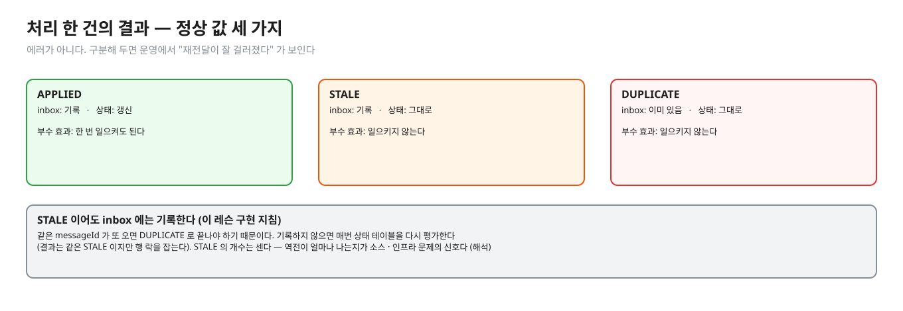
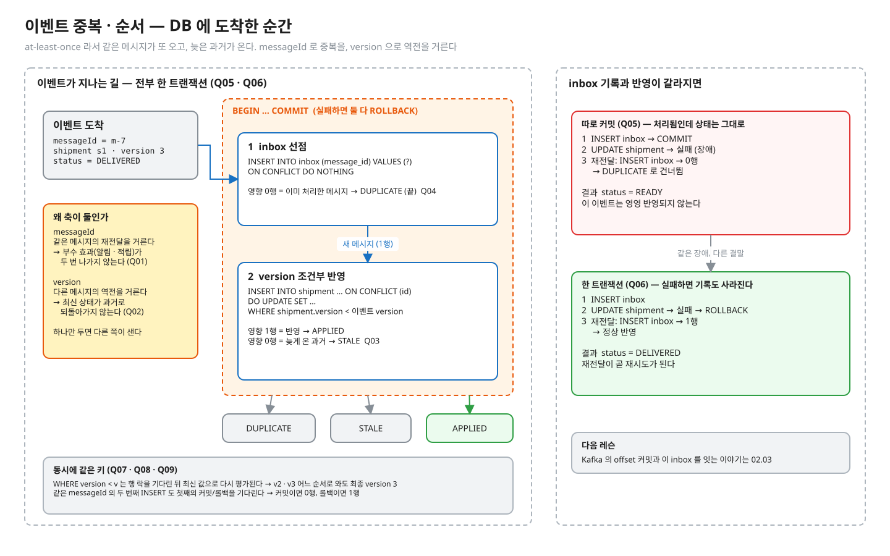
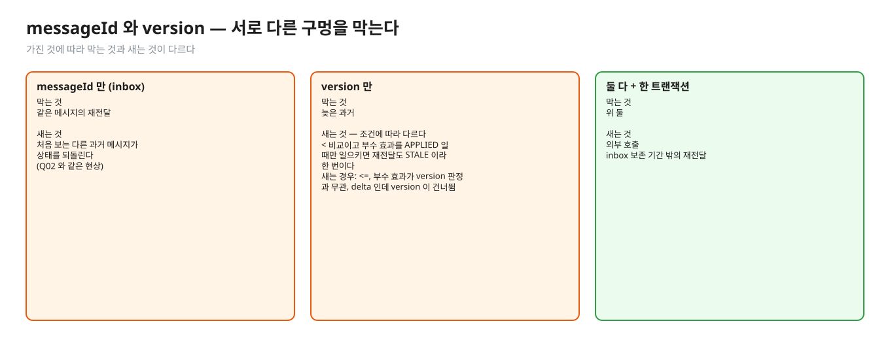
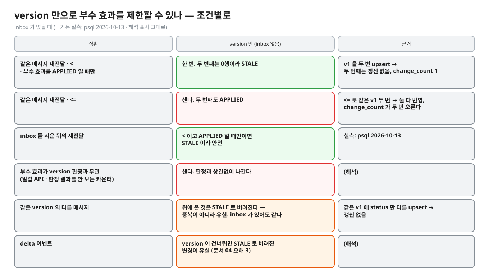
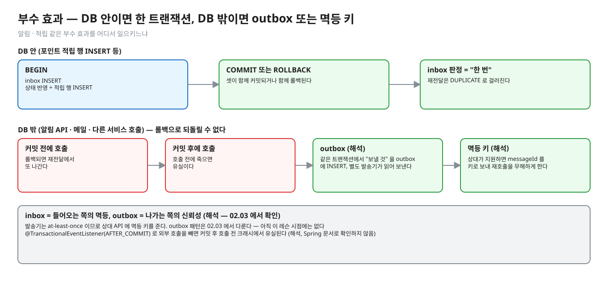
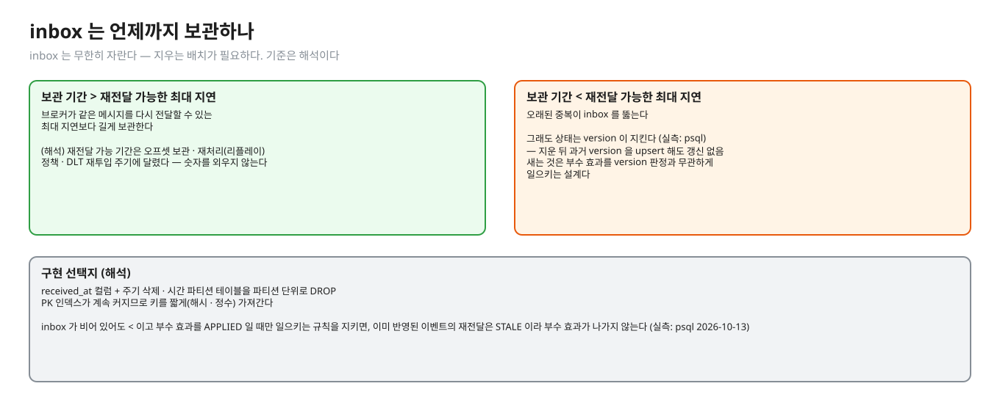

# 05. 설계 정리 — idempotent consumer · 부수 효과 · inbox 보존 · outbox

> **이 글에서 알게 되는 것**
> 1. 멱등 소비자 = "inbox 로 재전달을 거르고, version 으로 역전을 거르고, 둘 다 반영과 한 트랜잭션" 이라는 전체 흐름을 안다.
> 2. version 만으로 부수 효과를 제한할 수 있는지를 **조건별로** 구분할 수 있다.
> 3. 그 위에 얹히는 것 — 부수 효과를 어디서 일으키느냐 · inbox 를 언제 지우느냐 · 그 앞단의 outbox — 를 안다.
>
> **먼저 알면 좋은 것**: [03. 중복 거르기](03-inbox-dedupe.md) · [04. 순서 지키기](04-version-ordering.md)
> **다음 글**: [06. 앱 · 프레임워크 · MySQL](06-spring-kafka-mysql.md)
> **구분**: 심화 — 꼬리질문 대비 (레슨을 마친 뒤 · 면접 전)

## inbox 가 멀쩡한데 알림이 두 번 나갔다

멱등한 컨슈머를 설계하라는 요구의 뼈대가 이 글이다. 실무에서는 두 가지 사고로 나타난다. inbox 가 멀쩡한데 알림이 두 번 나가는 사고(외부 호출이 트랜잭션 밖)가 하나이고, inbox 테이블이 수억 건으로 커져 INSERT 가 느려지는 운영 이슈가 다른 하나다. 꼬리 질문도 대개 여기서 나온다. "알림은 어떻게 한 번만 보내나요?" · "inbox 는 영원히 커지는데요?" · "outbox 와 뭐가 다른가요?".

## 처리 한 건의 전체 흐름

앞의 두 글에서 만든 부품을 한 트랜잭션에 모으면 이 흐름이 된다.

```
BEGIN
  1. INSERT INTO inbox … ON CONFLICT DO NOTHING      -- 영향 행 수로 DUPLICATE 판정   (문서 03)
  2. INSERT INTO shipment … ON CONFLICT (id) DO UPDATE … WHERE shipment.version < EXCLUDED.version
                                                      -- 영향 행 수로 APPLIED / STALE (문서 04)
COMMIT            -- 어디서든 SQLException 이면 ROLLBACK 후 예외 → 재전달이 재시도
```

이 레슨의 `EventApplier.apply` 가 이 구조다 ([src](../src/main/java/deepdive/c01/l05/EventApplier.java)). 결과는 세 가지 정상 값이다. `APPLIED` · `DUPLICATE` · `STALE` 은 에러가 아니고, 구분해 두면 운영에서 "재전달이 잘 걸러졌다" 가 보인다.


<sub>편집: [diagrams/blog05-outcomes.excalidraw](diagrams/blog05-outcomes.excalidraw)</sub>

| 결과 | inbox | 상태 | 부수 효과 |
|---|---|---|---|
| APPLIED | 기록 | 갱신 | **한 번** 일으켜도 된다 |
| STALE | 기록 | 그대로 | 일으키지 않는다 |
| DUPLICATE | 이미 있음 | 그대로 | 일으키지 않는다 |

흐름 전체를 한 장으로 그린 그림이 있다. 이 그림에는 03 · 04 의 예측 문항(Q04 ~ Q09)에 해당하는 결과 값이 들어 있어서 접어 두었다. 예측을 끝낸 뒤 펼친다.

<details><summary>이벤트 중복 · 순서 — 전체 그림 (예측을 끝낸 뒤 펼친다)</summary>


<sub>편집: [../diagrams/event-dedupe.excalidraw](../diagrams/event-dedupe.excalidraw)</sub>
</details>

## messageId 와 version — 서로 다른 구멍을 막는다


<sub>편집: [diagrams/blog05-holes.excalidraw](diagrams/blog05-holes.excalidraw)</sub>

| 가진 것 | 막는 것 | 새는 것 |
|---|---|---|
| messageId 만 (inbox) | 같은 메시지의 재전달 | 처음 보는 **다른** 과거 메시지가 상태를 되돌린다 (Q02 와 같은 현상) |
| version 만 | 늦은 과거 | 조건에 따라 다르다 (아래 "version 만으로 부수 효과를 제한할 수 있나"). `<` 비교이고 부수 효과를 APPLIED 일 때만 일으키면 같은 메시지의 재전달은 STALE 이라 한 번이다. 새는 경우: `<=`, 부수 효과가 version 판정과 무관(외부 호출 · 반영 결과를 보지 않는 카운터), 이벤트가 delta 인데 version 이 건너뜀 |
| 둘 다 + 한 트랜잭션 | 위 둘 | 외부 호출 · inbox 보존 기간 밖의 재전달 (아래) |

### version 만으로 부수 효과를 제한할 수 있나 — 조건별로

"version 이 있으면 inbox 는 필요 없다" 는 주장이 맞는지가 이 글의 가장 흔한 쟁점이다. 답은 조건에 따라 갈린다.


<sub>편집: [diagrams/blog05-version-only.excalidraw](diagrams/blog05-version-only.excalidraw)</sub>

| 상황 | version 만 (inbox 없음) | 근거 |
|---|---|---|
| 같은 메시지 재전달 · `<` · 부수 효과를 APPLIED 일 때만 | **한 번**. 두 번째는 0행이라 STALE | (실측: psql 2026-10-13 — v1 을 두 번 upsert → `INSERT 0 1` 뒤 `INSERT 0 0`, change_count 1) |
| 같은 메시지 재전달 · `<=` | **샌다**. 두 번째도 APPLIED | (실측: psql 2026-10-13 — `<=` 로 같은 v1 두 번 → 둘 다 `INSERT 0 1`, change_count 가 두 번 오른다) |
| inbox 를 지운 뒤의 재전달 | `<` 이고 APPLIED 일 때만이면 STALE 이라 안전 (위 보존 기간) | (실측: psql 2026-10-13) |
| 부수 효과가 version 판정과 무관 (알림 API · 판정 결과를 보지 않는 카운터) | **샌다**. 판정과 상관없이 나간다 | (해석) |
| 같은 version 의 **다른** 메시지 | 뒤에 온 것은 STALE 로 버려진다 — 중복이 아니라 유실이다. inbox 가 있어도 같은 결과 | (실측: psql 2026-10-13 — 같은 v1 에 status 만 다른 upsert → 0행) |
| delta 이벤트 | version 이 건너뛰면 STALE 로 버려진 변경이 유실 (문서 04 오해 3) | (해석) |

즉 "version 만으로는 부수 효과를 못 막는다" 는 `<=` 이거나 부수 효과를 version 판정과 묶지 않았을 때의 말이다. 판정에 묶었다면 version 만으로도 같은 메시지 재전달은 막힌다. inbox 가 더해 주는 것은 (1) 판정 결과와 무관하게 "메시지 단위로 한 번" 이 필요한 처리의 근거, (2) DUPLICATE 와 STALE 의 구분(운영 가시성)이다 (해석).

## 부수 효과 — 알림 · 적립


<sub>편집: [diagrams/blog05-side-effect.excalidraw](diagrams/blog05-side-effect.excalidraw)</sub>

- 이 레슨의 `change_count` 는 알림 발송 같은 부수 효과의 대역이다. 같은 이벤트가 두 번 반영되면 그 횟수가 오른다 (Q01).
- 부수 효과가 **DB 안**(포인트 적립 행 INSERT 등)이면 상태 반영과 같은 트랜잭션에 넣는다. inbox 판정이 곧 "한 번" 을 보장한다.
- 부수 효과가 **DB 밖**(알림 API · 메일 · 다른 서비스 호출)이면 트랜잭션 롤백으로 되돌릴 수 없다. 커밋 전에 호출하면 롤백 시 재전달에서 또 나가고, 커밋 후에 호출하면 호출 전에 죽을 때 유실이다. 현실적 해법 두 가지 (해석):
  1. **outbox**: "보낼 것" 을 같은 트랜잭션에서 outbox 테이블에 INSERT 하고, 별도 발송기가 읽어 보낸다. 발송기는 at-least-once 이므로 상대 API 에 멱등 키를 준다. (outbox 패턴은 **02.03** 에서 다룬다 — 아직 이 레슨 시점에는 없다.)
  2. 상대가 멱등 키를 지원하면 messageId 를 그대로 키로 보내 재호출을 무해하게 한다.
- 즉 inbox = **들어오는** 쪽의 멱등, outbox = **나가는** 쪽의 신뢰성이다 (해석 — 02.03 에서 확인).

## inbox 보존 기간


<sub>편집: [diagrams/blog05-retention.excalidraw](diagrams/blog05-retention.excalidraw)</sub>

- inbox 는 무한히 자란다. 지우는 배치가 필요하다 (이 레슨 README 의 실무 메모).
- 기준 (해석): 브로커가 같은 메시지를 **다시 전달할 수 있는 최대 지연**보다 길게 보관한다. 그보다 짧으면 오래된 중복이 inbox 를 뚫는다. 재전달 가능 기간은 오프셋 보관 · 재처리(리플레이) 정책 · DLT 재투입 주기에 달렸으므로 시스템마다 다르다. 숫자를 외우지 않는다.
- 지워도 **상태는 version 이 지킨다**: inbox 에서 기록을 지운 뒤 같은 이벤트(과거 version)가 다시 와도 조건부 upsert 가 0행이라 상태가 되돌아가지 않는다 (실측: psql 2026-10-13 — version 3 상태에서 inbox 를 비우고 v2 를 upsert → `INSERT 0 0` · version 3 유지). `<` 비교이고 부수 효과를 **APPLIED 일 때만** 일으키는 규칙을 지키면, inbox 가 비어 있어도 이미 반영된 이벤트의 재전달은 STALE 이라 부수 효과가 나가지 않는다 (실측: psql 2026-10-13 — 같은 v1 을 두 번 upsert 하면 두 번째는 `INSERT 0 0`). 새는 것은 부수 효과를 version 판정과 무관하게 일으키는 설계다.
- 구현 선택지 (해석): `received_at` 컬럼 + 주기 삭제 · 시간 파티션 테이블을 파티션 단위로 DROP. PK 인덱스가 계속 커지므로 키를 짧게(해시 · 정수) 가져간다.

## PostgreSQL 에서는 (요약)

- inbox PK 의 유니크 인덱스가 중복 판정과 동시성 대기를 맡는다 ([문서 03](03-inbox-dedupe.md)).
- 조건부 upsert 의 행 락 + READ COMMITTED 재평가가 역전 판정과 동시성을 맡는다 ([문서 04](04-version-ordering.md)).
- 둘이 한 트랜잭션이라 롤백은 inbox 기록과 상태 갱신을 함께 되돌린다.

## 자주 하는 오해

1. **"멱등하게 만들었으니(`WHERE version <`) inbox 는 필요 없다."** 상태는 맞다. 부수 효과는 APPLIED 일 때만 일으킨다는 규칙을 지키면 같은 메시지 재전달도 막히지만, 그 규칙 밖의 부수 효과는 샌다 (위 "version 만으로 부수 효과를 제한할 수 있나" 표).
2. **"inbox 가 있으니 알림도 한 번이다."** 알림이 트랜잭션 밖이면 아니다. outbox 나 상대 API 의 멱등 키가 필요하다.
3. **"STALE 은 버리는 메시지라 로그도 필요 없다."** 개수는 센다. 역전이 얼마나 나는지가 소스 · 인프라 문제의 신호다 (해석).
4. **"inbox 는 오래 보관할수록 좋다."** 크기 · 인덱스 비용이 든다. 재전달 가능 기간 + 여유면 충분하다 (해석).
5. **"inbox 와 상태 테이블은 서로 다른 DB 에 둬도 된다."** 한 트랜잭션에 못 묶으면 [문서 03](03-inbox-dedupe.md)의 "따로 커밋" 이다. 같은 DB 여야 한다.

## 앱 · 프레임워크에서는

- 메시지 처리 메서드 하나에 `@Transactional` 을 걸고 그 안에서 inbox → 반영 순서로 호출한다. 리스너 메서드(`@KafkaListener`)와 트랜잭션 서비스 메서드를 나눌 때 **트랜잭션 경계가 서비스 메서드**에 있어야 하고, 예외가 리스너까지 전파돼야 컨테이너 재전달이 동작한다 (해석 — [문서 06](06-spring-kafka-mysql.md)의 에러 핸들러와 같이 본다).
- 외부 호출을 `@TransactionalEventListener(phase = AFTER_COMMIT)` 로 빼는 방식은 커밋 후 호출 전 크래시에서 유실된다. 이 때문에 outbox 가 나온다 (해석, 이 문서에서 Spring 문서로 확인하지 않음).

## 한눈에 정리

| 질문 | 답 |
|---|---|
| 멱등 소비자의 뼈대 | inbox(재전달) + version(역전) + 둘 다 반영과 한 트랜잭션 |
| 처리 결과 | APPLIED · STALE · DUPLICATE — 모두 정상 값 |
| version 만으로 부수 효과를 막나 | 조건에 따라 갈린다 — `<` 이고 APPLIED 일 때만이면 한 번, `<=` 이거나 판정과 무관하면 샌다 |
| DB 밖 부수 효과 | outbox 또는 상대 API 의 멱등 키 (해석) |
| inbox 보존 | 재전달 가능한 최대 지연보다 길게 (해석) |

- 멱등 소비자는 "inbox 로 재전달을 거르고, version 으로 역전을 거르고, 둘 다 반영과 한 트랜잭션" 이다.
- inbox 가 더해 주는 것은 메시지 단위로 한 번이 필요한 처리의 근거와 DUPLICATE · STALE 의 구분이다 (해석).
- inbox = 들어오는 쪽의 멱등, outbox = 나가는 쪽의 신뢰성이다 (해석).
- inbox 를 지워도 상태는 version 이 지키지만, 부수 효과를 판정과 무관하게 일으키는 설계는 샌다.

## 스스로 확인

1. 결제 완료 이벤트를 받아 포인트 적립 행을 INSERT 한다. inbox 와 version 중 무엇이 "한 번 적립" 을 보장하나?
   <details><summary>답</summary>
   inbox(messageId)와 **같은 트랜잭션**이다. 적립 행 INSERT 가 inbox 기록과 함께 커밋되거나 함께 롤백되므로 재전달에서 DUPLICATE 로 걸러진다. version 은 상태 되돌림을 막는 용도이고 적립 중복은 messageId 가 막는다. 추가로 적립 테이블에 `(messageId)` 유니크를 걸어 두면 inbox 가 뚫려도 DB 가 마지막으로 막는다 (해석 — 이중 방어).
   </details>
2. inbox 를 7일 보관으로 정했다. 재처리(리플레이)로 30일 전 이벤트가 다시 흘러오면?
   <details><summary>답</summary>
   inbox 에 기록이 없으므로 처음 보는 메시지로 통과한다. 상태는 version 이 지켜 준다 (실측: psql — 지운 뒤 과거 version 은 0행). 부수 효과가 "APPLIED 일 때만" 나가도록 짜 놨다면 STALE 이라 나가지 않는다 (해석). 그렇지 않은 부수 효과(version 과 무관한 카운터 · 외부 호출)는 새므로, 리플레이는 보관 기간을 전제로 설계하거나 리플레이용 별도 처리 경로를 둔다.
   </details>
3. inbox 와 outbox 의 차이는?
   <details><summary>답</summary>
   inbox 는 **수신** 쪽에서 "이미 처리한 메시지" 를 기록해 중복을 거른다. outbox 는 **발신** 쪽에서 "보낼 메시지" 를 상태 변경과 같은 트랜잭션에 기록해 두고 별도로 발행해, DB 와 브로커 사이의 이중 쓰기 유실을 막는다 (해석 — 02.03 에서 다룬다). 둘 다 "DB 트랜잭션에 기록을 묶는다" 는 같은 뼈대다.
   </details>
4. 같은 messageId 로 두 번 왔는데 첫 번째가 STALE 이었다. 두 번째 결과는?
   <details><summary>답</summary>
   DUPLICATE — STALE 이어도 inbox 에는 기록되기 때문이다 (이 레슨 구현 지침). 기록하지 않으면 매번 상태 테이블을 다시 평가한다 (결과는 같은 STALE 이지만 행 락을 잡는다 — 문서 04).
   </details>

## 이 레슨에서 직접 보기

| 어디서 | 무엇을 |
|---|---|
| 구현 테스트 7개 | 결과 검사 5(같은 messageId 5개 동시 · 순서 섞은 version 순차 · version 동시 · stale 재전달 · 같은 version 의 다른 메시지) + 가드 2(정상 순서 · 반영 중 예외 후 재전달) — [EventApplierImplementTest](../src/test/java/deepdive/c01/l05/EventApplierImplementTest.java) |
| 가드 "예외 후 재전달" | inbox 를 **따로 커밋**하면 이 테스트가 빨개진다 — Q05 와 같은 현상 |

## 출처

- 이 레슨의 구현 지침 · 테스트 ([EventApplier](../src/main/java/deepdive/c01/l05/EventApplier.java) · [README](../README.md))
- [PostgreSQL 16 · INSERT](https://www.postgresql.org/docs/16/sql-insert.html) — ON CONFLICT 동작 (문서 03 · 04 에 상세)
- [Kafka 문서 · Design · Message Delivery Semantics](https://kafka.apache.org/documentation/#semantics) — 외부 시스템 협조 필요 (문서 01)
- 실측: psql 2026-10-13 — inbox 를 비운 뒤 과거 version upsert → 0행
