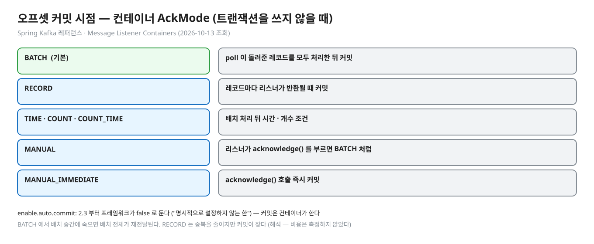
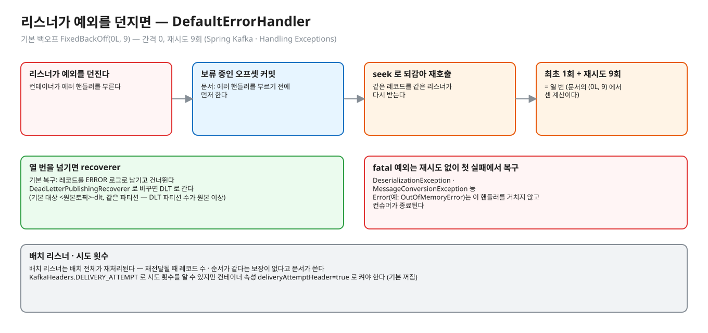
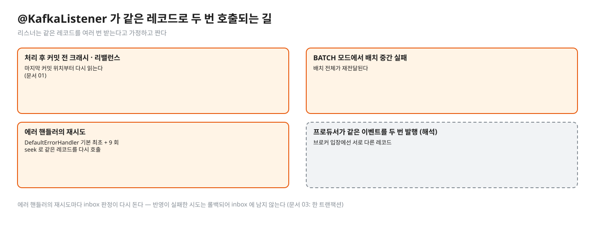
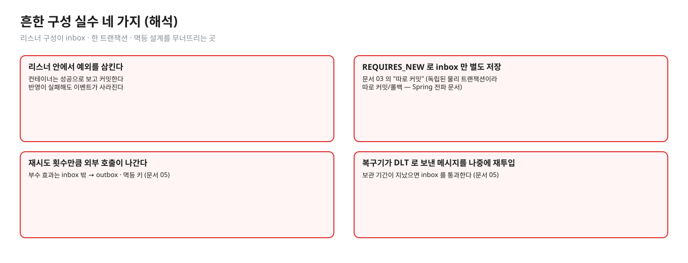
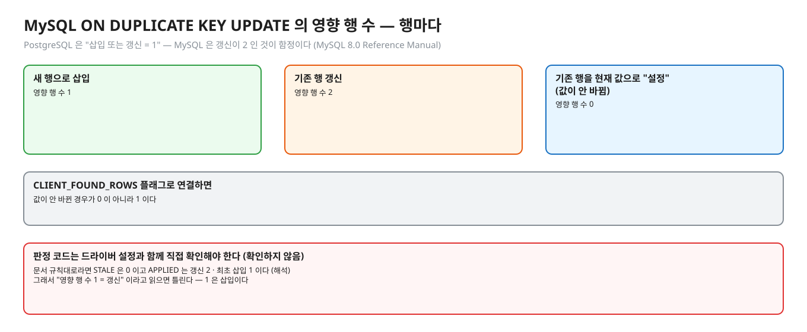
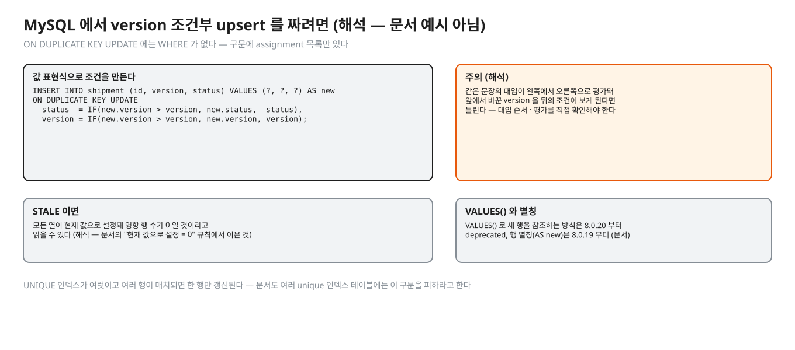
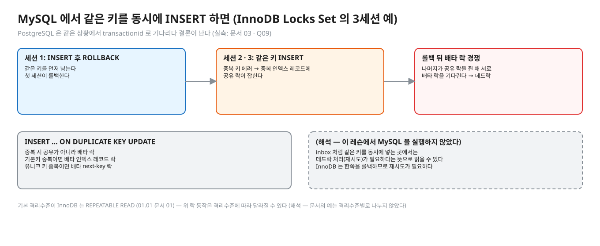

# 06. 앱 · 프레임워크 · MySQL — 커밋 시점과 같은 패턴의 다른 문법

> **이 글에서 알게 되는 것**
> 1. Spring Kafka 가 오프셋 커밋 시점(`AckMode`)과 실패 시 재전달(에러 핸들러의 재시도 · seek)로 중복의 양을 어떻게 정하는지 안다.
> 2. `DefaultErrorHandler` 의 기본 동작(`FixedBackOff(0L, 9)` · 로그 후 건너뜀)과 `@KafkaListener` 가 같은 레코드로 여러 번 호출되는 길을 안다.
> 3. MySQL 이 같은 inbox · version 패턴을 `INSERT IGNORE` · `ON DUPLICATE KEY UPDATE` 로 쓰되, 영향 행 수 규칙과 락이 PostgreSQL 과 다르다는 것을 안다.
>
> **먼저 알면 좋은 것**: [01. 전달 보장](01-delivery-semantics.md) · [03. 중복 거르기](03-inbox-dedupe.md) · [05. 설계 정리](05-design-patterns.md)
> **다음 글**: [07. 면접 사다리](07-interview-ladder.md)
> **구분**: 심화 — 꼬리질문 대비 (레슨을 마친 뒤 · 면접 전)

## 에러 핸들러가 열 번을 불렀다

에러 핸들러의 재시도가 같은 레코드를 열 번 부르고, 그 결과 부수 효과가 열 번 나가는 사고가 있다. 반대로 MySQL 로 옮겨 가서 `ON DUPLICATE KEY UPDATE` 의 영향 행 수를 PostgreSQL 처럼 읽다가 판정이 틀리는 버그도 있다. 둘 다 앞 글들의 패턴이 틀려서가 아니라, 프레임워크와 엔진이 그 패턴 아래에서 실제로 하는 일을 모르고 가정했기 때문이다. 이 글은 그 두 곳, "Spring Kafka" 와 "MySQL" 을 확인된 것만 골라 본다.

## Spring for Apache Kafka — 확인한 것만

(Spring Kafka 레퍼런스 현행판 2026-10-13 조회: [Message Listener Containers](https://docs.spring.io/spring-kafka/reference/kafka/receiving-messages/message-listener-container.html) · [Handling Exceptions](https://docs.spring.io/spring-kafka/reference/kafka/annotation-error-handling.html))

### 오프셋 커밋 시점


<sub>편집: [diagrams/blog06-ackmode.excalidraw](diagrams/blog06-ackmode.excalidraw)</sub>

- 트랜잭션을 쓰지 않을 때 컨테이너의 `AckMode`: **`BATCH` 가 기본** — poll 이 돌려준 레코드를 모두 처리한 뒤 커밋. `RECORD` = 레코드마다 리스너가 반환될 때 커밋. `TIME` · `COUNT` · `COUNT_TIME` = 배치 처리 뒤 시간 · 개수 조건. `MANUAL` = 리스너가 `acknowledge()` 를 부르면 BATCH 처럼, `MANUAL_IMMEDIATE` = 호출 즉시 커밋.
- `enable.auto.commit`: 2.3 부터 프레임워크가 **`false`** 로 둔다 ("명시적으로 설정하지 않는 한"). 즉 커밋은 컨테이너가 한다.
- 의미: `BATCH` 에서 배치 중간에 죽으면 그 배치 전체가 재전달된다 (처리 후 커밋 순서 — [문서 01](01-delivery-semantics.md)). `RECORD` 는 중복을 줄이지만 커밋이 잦다 (해석 — 비용은 측정하지 않았다).

### 실패와 재전달


<sub>편집: [diagrams/blog06-error-handler.excalidraw](diagrams/blog06-error-handler.excalidraw)</sub>

- 리스너가 예외를 던지면 컨테이너 설정에 따라 처리된다. **`DefaultErrorHandler`** 의 기본 백오프는 `FixedBackOff(0L, 9)` — 간격 0, 재시도 9회 → 최초 1회 + 9회 = **열 번**을 넘기면 복구(recoverer) 동작이고, 기본 복구는 **레코드를 ERROR 로그로 남기고 건너뛴다**. "열 번" 은 문서의 `(0L, 9)` 에서 센 계산이다 (문서가 "10회" 라고 쓰지는 않는다).
- 문서: "컨테이너는 에러 핸들러를 부르기 **전에** 보류 중인 오프셋 커밋을 먼저 한다."
- 재전달 메커니즘은 seek 다. `nack()` 의 경우 "실패한 레코드와 처리 안 된 레코드가 다음 poll 에서 다시 전달되도록 해당 파티션을 seek" 한다 (문서). 에러 핸들러의 재시도도 같은 방식으로 같은 레코드를 다시 호출한다. 같은 리스너가 **같은 레코드를 여러 번** 받는다 (재시도 횟수 만큼은 문서 · 구체 코드는 확인하지 않음).
- 역직렬화 · 변환 예외(`DeserializationException` · `MessageConversionException` 등)는 **재시도 없이** 첫 실패에서 복구로 간다 (fatal 목록). `Error`(예: `OutOfMemoryError`)는 이 핸들러를 거치지 않고 컨슈머가 종료된다.
- 문서는 데드레터 발행기(`DeadLetterPublishingRecoverer`)를 제공하고 기본 대상은 `<원본토픽>-dlt`, 같은 파티션이라 DLT 의 파티션 수가 원본 이상이어야 한다고 쓴다.
- 배치 리스너는 "배치 전체가 재처리" 된다 (트랜잭션 · AfterRollbackProcessor 절). 그리고 배치가 재전달될 때 레코드 수 · 순서가 같다는 보장이 없다고 문서가 쓴다 (Handling Exceptions 의 배치 리스너 절). `KafkaHeaders.DELIVERY_ATTEMPT` 로 시도 횟수를 알 수 있다고 쓰지만 컨테이너 속성 `deliveryAttemptHeader=true` 로 켜야 한다 (기본 꺼짐).

그래서 리스너는 **같은 레코드를 여러 번 받는다고 가정**하고 짠다. 에러 핸들러의 재시도마다 inbox 판정이 다시 돈다. 반영이 실패한 시도는 롤백되어 inbox 에 남지 않는다 ([문서 03](03-inbox-dedupe.md): 한 트랜잭션).


<sub>편집: [diagrams/blog06-listener-twice.excalidraw](diagrams/blog06-listener-twice.excalidraw)</sub>

### 흔한 구성 실수 (해석)


<sub>편집: [diagrams/blog06-mistakes.excalidraw](diagrams/blog06-mistakes.excalidraw)</sub>

| 실수 | 결과 |
|---|---|
| 리스너 안에서 예외를 삼킨다 | 컨테이너는 성공으로 보고 커밋 → 반영이 실패해도 이벤트가 사라진다 |
| `REQUIRES_NEW` 로 inbox 만 별도 저장 | [문서 03](03-inbox-dedupe.md)의 "따로 커밋" ([Spring 전파 문서](https://docs.spring.io/spring-framework/reference/data-access/transaction/declarative/tx-propagation.html): 독립된 물리 트랜잭션이라 따로 커밋/롤백) |
| 재시도 횟수만큼 외부 호출이 나간다 | 부수 효과는 inbox 밖 → outbox · 멱등 키 ([문서 05](05-design-patterns.md)) |
| 복구기가 DLT 로 보낸 메시지를 나중에 재투입 | 보관 기간이 지났으면 inbox 를 통과한다 ([문서 05](05-design-patterns.md)) |

## MySQL InnoDB 는 어떻게 다른가 — 같은 패턴의 다른 문법

(MySQL 8.0 Reference Manual)

### INSERT IGNORE — inbox 판정

[INSERT](https://dev.mysql.com/doc/refman/8.0/en/insert.html): `IGNORE` 를 쓰면 실행 중 **무시 가능한 에러가 경고로 바뀐다**. UNIQUE · PRIMARY KEY 중복 행은 "버려지고 에러가 나지 않는다". 다행 INSERT 는 `Records / Duplicates / Warnings` 를 돌려준다 (`Duplicates` = 중복이라 안 들어간 행).

- 주의: 이 수식어는 **중복만이 아니라 다른 에러도** 경고로 낮춘다. 문서에 따르면 데이터 변환 에러는 `IGNORE` 에서 값을 가장 가까운 값으로 조정해 넣고 경고만 낸다. inbox(`message_id` 하나)에서는 영향이 작지만, 반영 쪽 INSERT 에 `IGNORE` 를 붙이면 잘못된 값이 조용히 들어갈 수 있다 (문서의 변환 예 + 해석). 대안으로 `ON DUPLICATE KEY UPDATE message_id = message_id` 같은 no-op 갱신이 쓰이기도 한다 (해석).
- 영향 행 수: 중복으로 버려진 행이 affected rows 에 안 세어진다는 것이 inbox 판정의 근거인데, 위 페이지는 `Duplicates` 정보 문자열을 설명할 뿐 affected-rows 값을 명시하지는 않는다. 앱 드라이버가 돌려주는 값을 **직접 확인**해야 한다 (확인하지 않음).

### INSERT … ON DUPLICATE KEY UPDATE — version 조건부 upsert

[INSERT ... ON DUPLICATE KEY UPDATE](https://dev.mysql.com/doc/refman/8.0/en/insert-on-duplicate.html):


<sub>편집: [diagrams/blog06-mysql-rows.excalidraw](diagrams/blog06-mysql-rows.excalidraw)</sub>

- 영향 행 수는 **행마다**: 새 행으로 삽입 = **1**, 기존 행 갱신 = **2**, 기존 행이 현재 값으로 "설정" 됐다(값이 안 바뀜) = **0**. `CLIENT_FOUND_ROWS` 플래그로 연결하면 값이 안 바뀐 경우가 0 이 아니라 **1** 이다. → PostgreSQL 의 "삽입 또는 갱신 = 1" 과 다르다. 갱신이 **2** 인 것이 함정이다.
- `WHERE` 절은 없다 (구문에 assignment 목록만). 조건부 갱신은 값 표현식으로 만든다 — 예 (해석, 문서 예시 아님):

```sql
INSERT INTO shipment (id, version, status) VALUES (?, ?, ?) AS new
ON DUPLICATE KEY UPDATE
  status  = IF(new.version > version, new.status,  status),
  version = IF(new.version > version, new.version, version);
```

  주의 (해석): 같은 문장의 대입이 **왼쪽에서 오른쪽으로** 평가돼 앞에서 바꾼 `version` 을 뒤의 조건이 보게 된다면 틀린다 — 대입 순서 · 평가를 직접 확인해야 한다. STALE 이면 모든 열이 현재 값으로 설정돼 위 규칙에 따라 영향 행 수가 **0** 일 것이라고 읽을 수 있다 (해석 — 문서의 "현재 값으로 설정 = 0" 규칙에서 이은 것, 직접 확인하지 않음).


<sub>편집: [diagrams/blog06-mysql-cond.excalidraw](diagrams/blog06-mysql-cond.excalidraw)</sub>

- `VALUES()` 로 새 행을 참조하는 방식은 **8.0.20 부터 deprecated** 이고 행 별칭(`AS new`)은 **8.0.19 부터** 쓸 수 있다 (문서).
- UNIQUE 인덱스가 여럿이고 여러 행이 매치되면 **한 행만** 갱신된다. 문서도 여러 unique 인덱스 테이블에는 이 구문을 피하라고 한다.

### 동시 INSERT 와 락

[InnoDB Locks Set by Different SQL Statements](https://dev.mysql.com/doc/refman/8.0/en/innodb-locks-set.html):


<sub>편집: [diagrams/blog06-mysql-lock.excalidraw](diagrams/blog06-mysql-lock.excalidraw)</sub>

- 중복 키 에러가 나면 중복 인덱스 레코드에 **공유 락**이 잡힌다. 같은 행을 INSERT 하려는 세션이 여럿이면 — 첫 세션이 롤백할 때 — 나머지가 공유 락을 쥔 채 서로 배타 락을 기다려 **데드락**이 날 수 있다 (문서의 3세션 예: 세션 1 이 INSERT 후 ROLLBACK, 세션 2 · 3 이 같은 키 INSERT).
- `INSERT … ON DUPLICATE KEY UPDATE` 는 중복 시 공유가 아니라 **배타 락**: 기본키 중복이면 배타 인덱스 레코드 락, 유니크 키 중복이면 배타 next-key 락.
- PostgreSQL 은 같은 상황에서 두 번째 INSERT 가 `transactionid` 로 기다리다 결론이 난다 (실측: [문서 03](03-inbox-dedupe.md) · Q09). 같은 키를 동시에 넣는 inbox 에서 MySQL 은 데드락 처리(재시도)가 필요하다는 뜻으로 읽을 수 있다 (해석 — 이 레슨에서 MySQL 을 실행하지 않았다).
- 기본 격리수준이 InnoDB 는 REPEATABLE READ (01.01 문서 01). 위 락 동작은 격리수준에 따라 달라질 수 있으니 격리수준을 확인한다 (해석 — 이 페이지의 예는 격리수준별로 나누지 않았다).

## 자주 하는 오해

1. **"Spring Kafka 는 enable.auto.commit 기본이 true 다."** Kafka 클라이언트의 기본은 true 이지만 Spring Kafka 2.3 부터는 컨테이너가 false 로 두고 직접 커밋한다 (문서).
2. **"에러 핸들러가 재시도하면 중복이 아니다."** 같은 레코드를 같은 리스너가 다시 받는 것이므로 멱등해야 한다.
3. **"MySQL ON DUPLICATE KEY UPDATE 의 영향 행 수 1 = 갱신."** 1 은 삽입, **2** 가 갱신이다.
4. **"INSERT IGNORE 는 중복만 무시한다."** 변환 에러 등 다른 에러도 경고로 낮춘다.
5. **"트랜잭션 + AfterRollbackProcessor 면 외부 DB 까지 exactly-once 다."** 문서의 트랜잭션은 Kafka 오프셋 · 출력과의 원자성이다. DB 는 별개 자원이다 ([문서 01](01-delivery-semantics.md)).

## 한눈에 정리

| | Spring Kafka | MySQL 8.0 (InnoDB) |
|---|---|---|
| 커밋 · 판정 | `AckMode` 기본 `BATCH`, `enable.auto.commit` 은 2.3 부터 false | `INSERT IGNORE` 는 중복을 경고로, 영향 행 수는 드라이버로 확인 |
| 재전달 | `DefaultErrorHandler` 기본 `FixedBackOff(0L, 9)` = 최초 + 9 회, 그 뒤 로그 후 건너뜀 | ODKU 의 영향 행 수: 삽입 1 · 갱신 2 · 변화 없음 0 |
| 조심할 것 | 같은 레코드를 여러 번 받는다고 가정 | `WHERE` 없음 · 동시 INSERT 의 공유 락 데드락 |

- Spring Kafka 는 오프셋 커밋 시점(`AckMode`)과 실패 시 재전달(에러 핸들러의 재시도 · seek)로 중복의 양을 정한다.
- 리스너는 같은 레코드를 여러 번 받는다고 가정하고 짠다 — 재시도마다 inbox 판정이 다시 돈다.
- MySQL 은 같은 inbox · version 패턴을 쓰되 영향 행 수 규칙과 락이 다르다.
- 같은 패턴을 다른 엔진에 옮길 때는 영향 행 수 규칙부터 확인한다.

## 스스로 확인

1. `@KafkaListener` 메서드가 같은 메시지로 두 번 호출되는 경우를 말해 보세요.
   <details><summary>답</summary>
   (a) 처리 후 커밋 전 크래시 · 리밸런스 — 마지막 커밋 위치부터 다시 읽는다 (문서 01). (b) `BATCH` 모드에서 배치 중간 실패 — 배치 전체 재전달. (c) 에러 핸들러의 재시도(`DefaultErrorHandler` 기본 최초 + 9회) — seek 로 같은 레코드를 다시 호출. (d) 프로듀서가 같은 이벤트를 두 번 발행 (해석).
   </details>
2. 리스너가 예외를 던졌는데 다음 poll 에서도 계속 같은 메시지가 온다. 언제까지?
   <details><summary>답</summary>
   기본 `DefaultErrorHandler` 는 최초 1회 + 재시도 9회 후 복구기를 호출하고, 기본 복구기는 로그만 남기고 그 레코드를 건너뛴다 (Spring Kafka 문서). 그 전까지 같은 레코드가 열 번 호출된다. 복구기를 DLT 발행으로 바꿨다면 DLT 로 간다. 역직렬화 예외 등 fatal 은 재시도 없이 첫 실패에서 복구로 간다.
   </details>
3. MySQL 에서 version 조건부 upsert 를 어떻게 짜고, 영향 행 수로 APPLIED/STALE 를 가를 수 있나?
   <details><summary>답</summary>
   `ON DUPLICATE KEY UPDATE` 에서 `IF(new.version > version, …)` 식으로 조건부 대입을 한다 (해석 — `WHERE` 가 없다). 영향 행 수는 삽입 1 · 갱신 2 · 변화 없음 0 이라 PostgreSQL 처럼 "0/1" 이 아니다. 문서 규칙대로라면 STALE 은 0 이고 APPLIED 는 갱신 2 · 최초 삽입 1 이다 (해석). `CLIENT_FOUND_ROWS` 연결에서는 0 이 1 로 바뀐다 (문서). 그래서 판정 코드는 반드시 드라이버 설정과 함께 확인한다 (확인하지 않음).
   </details>
4. MySQL 에서 같은 messageId 를 여러 컨슈머가 동시에 INSERT 하면?
   <details><summary>답</summary>
   중복 키 에러는 공유 락을 잡고, 첫 INSERT 가 롤백하면 대기하던 세션들이 데드락이 날 수 있다는 것이 문서의 예다 (InnoDB Locks Set). `ON DUPLICATE KEY UPDATE` 는 배타 락이다. 데드락은 InnoDB 가 한쪽을 롤백하므로 재시도가 필요하다 (해석 — 실행하지 않음). PostgreSQL 에서는 기다린 뒤 결론이 난다 (실측).
   </details>

## 이 레슨에서 직접 보기

| 어디서 | 무엇을 |
|---|---|
| 구현 `EventApplier` | JDBC 로 한 트랜잭션: `setAutoCommit(false)` → inbox → upsert → commit · 예외 시 rollback 후 `IllegalStateException` (Spring 이 없다 — 경계가 코드에 그대로 보인다) |
| 가드 "예외 후 재전달" | 에러 핸들러의 재시도에 해당 — 한 트랜잭션이면 재시도가 정상 반영된다 |

## 출처

- [Spring for Apache Kafka · Message Listener Containers](https://docs.spring.io/spring-kafka/reference/kafka/receiving-messages/message-listener-container.html) — AckMode · enable.auto.commit(2.3) · nack 의 seek
- [Spring for Apache Kafka · Handling Exceptions](https://docs.spring.io/spring-kafka/reference/kafka/annotation-error-handling.html) — DefaultErrorHandler `FixedBackOff(0L, 9)` · 로그 후 건너뜀 · 오프셋 선커밋 · fatal 예외 · DLT
- [Spring Framework · 트랜잭션 전파](https://docs.spring.io/spring-framework/reference/data-access/transaction/declarative/tx-propagation.html) — REQUIRES_NEW
- [MySQL 8.0 · INSERT](https://dev.mysql.com/doc/refman/8.0/en/insert.html) — IGNORE
- [MySQL 8.0 · INSERT ... ON DUPLICATE KEY UPDATE](https://dev.mysql.com/doc/refman/8.0/en/insert-on-duplicate.html) — 영향 행 수 1/2/0 · CLIENT_FOUND_ROWS · VALUES() deprecated · 별칭
- [MySQL 8.0 · InnoDB Locks Set by Different SQL Statements](https://dev.mysql.com/doc/refman/8.0/en/innodb-locks-set.html) — 중복 키 공유 락 · 데드락 예 · ODKU 배타 락
