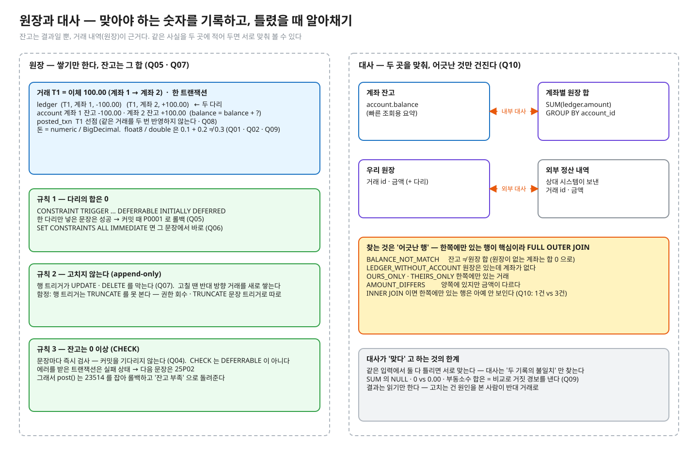

# 01.06 원장과 대사

> **완료 기준**: 예측 10문항을 먼저 적고 돌려 전부 초록 · 구현 테스트 초록 · NOTES 를 채우고 꼬리질문 5개를 해설 보기 전에 답한다 · "돈처럼 맞아야 하는 숫자를 원장으로 기록하면 무엇이 좋아지고, 틀어졌을 때 대사로 어떻게 알아채며, 같은 거래가 두 번 와도 어떻게 한 번만 반영하나"를 그림 없이 3분 안에 설명한다.

공고 연결 — "유실 없는 데이터 정합성". 잔고 · 수량 · 포인트 · 재고처럼 **맞아야 하는 숫자**는 한 번 틀리면 조용히 어긋난 채 쌓인다. 그래서 "안 틀리게" 만큼 "틀렸을 때 알아채기"가 설계에 들어간다.
이 레슨은 01.03(멱등) · 01.04(동시 차감) 위에 얹는다 — 같은 거래 한 번만, 잔고는 원자적으로, 그리고 그 둘이 어긋나지 않았는지를 **대사**로 확인한다. 특정 업종 이야기가 아니라 일반 주제다.

---

## ① 질문 · 첫 예측 — 20분

1. 잔고를 숫자 하나로만 들고 있으면 무엇을 잃나? 원장(거래 내역을 쌓고 잔고는 그 합)과는 어떤 관계로 두나?
2. 금액을 실수(float / double)로 저장하면 무슨 일이 생기나? `numeric` 이면 안전한가 — 소수 셋째 자리 값이나 자릿수를 넘는 값은?
3. "이체 두 다리(차변 · 대변)의 합은 0" 같은 규칙은 언제 검사해야 하나? 문장마다 vs 커밋 때 — 한 다리만 넣은 문장은 성공해도 되나?
4. 원장과 잔고가 어긋난 걸 어떻게 알아채나? 한쪽에만 있는 행(원장 없는 계좌 · 계좌 없는 원장)은 어떻게 찾나?
5. 같은 거래가 두 번 기록되면(재시도 · 중복 메시지)? 어디서 막고, 막혔을 때 호출한 쪽은 무엇을 받아야 하나?

> **이어서 첫 예측**: 질문에 종이로 답해 NOTES §0 에 옮긴 뒤, `LedgerPredictTest.java` 의 예측 칸 `"?"` 를 **감으로** 채워 `./gradlew 01.06-predict` 를 돌린다. 틀려도 된다 — 틀린 문항이 ② 를 읽는 이유가 된다. PROGRESS 의 "예측 적중"은 이 첫 예측으로 센다.

## ② 원리 — 75분



<sub>편집: [diagrams/ledger-reconciliation.excalidraw](diagrams/ledger-reconciliation.excalidraw) · 다시 그리기(만든 사람용 · 레슨 폴더에서): `python3 -I diagrams/draw.py`</sub>

1차 자료 (블로그 요약 말고 이것부터):

공식 문서에서 아래 "찾을 것" 문장을 직접 찾아 표시하고, 한 줄로 번역해 NOTES 나 여백에 적어 둔다. ① 에서 틀린 문항이 **왜** 틀렸는지 찾으며 읽는다.

| 자료 | 읽으면서 찾을 것 |
|---|---|
| [개념 정리 docs/](docs/README.md) | **필수 01 · 03 · 05** 를 읽으며 ① 에서 틀린 문항이 왜 틀렸는지 찾는다 (나머지 글은 심화 — 레슨을 마친 뒤 · 면접 전). 공식 문서 행은 docs 가 링크하는 곳에서 같이 연다 · 예측 답은 접힌 칸에만 |
| [PostgreSQL 16 · 8.1 Numeric Types](https://www.postgresql.org/docs/16/datatype-numeric.html) | "Inexact means …" · 금액에는 `numeric` 을 쓰라는 문장 · 선언한 scale 보다 길면 반올림(ties 는 0 에서 먼 쪽)하고 정수부가 넘치면 에러 (Q01 · Q02 · Q03) |
| [CREATE TABLE · DEFERRABLE](https://www.postgresql.org/docs/16/sql-createtable.html) | 지연 가능한 제약 종류와 "NOT NULL and CHECK constraints are not deferrable" (Q04) |
| [SET CONSTRAINTS](https://www.postgresql.org/docs/16/sql-set-constraints.html) | "retroactively" — DEFERRED → IMMEDIATE 가 이미 쌓인 검사를 그 자리에서 하는 것 · constraint trigger 도 같은 설정을 따른다 (Q05 · Q06) |
| [CREATE TRIGGER](https://www.postgresql.org/docs/16/sql-createtrigger.html) | constraint trigger 의 조건(AFTER · FOR EACH ROW · DEFERRABLE) · TRUNCATE 는 문장 트리거만 (Q07) |
| [TRUNCATE](https://www.postgresql.org/docs/16/sql-truncate.html) | "TRUNCATE will not fire any ON DELETE triggers" (Q07) |
| [Appendix A. Error Codes](https://www.postgresql.org/docs/16/errcodes-appendix.html) | 22003 · 23505 · 23514 · 25P02 · P0001 이 무엇인가 (Q03 · Q04 · Q05 · Q08) |
| [INSERT · ON CONFLICT](https://www.postgresql.org/docs/16/sql-insert.html) | DO NOTHING 이 충돌한 행을 건너뛴다 · 영향 행 수 (Q08 · 01.03 과 연결) |

## ③ 재현 — 30분 · 세 가지 손 작업

파일 경로는 이 레슨 폴더(`01-concurrency-consistency/l06-ledger-reconciliation/`) 기준이다. 명령은 두 곳에서 친다.

```bash
# deep-dive 폴더에서 — ./gradlew 는 전부 여기서
./gradlew 01.06-predict
./gradlew 01.06-implement
```

```bash
# deep-dive 폴더에서 레슨 폴더로 들어간 뒤 — observe 스크립트는 여기서
cd 01-concurrency-consistency/l06-ledger-reconciliation
observe/up.sh
```

IntelliJ 로 한다면: deep-dive 폴더를 Gradle 프로젝트로 열고(코드를 바꾼 뒤 Gradle 창에서 Reload), 테스트 메서드 옆 ▶ 로 한 문항씩 돌려도 된다. 자세히는 [GUIDE.md](../../GUIDE.md).

| 작업 | 실행 | 무엇을 |
|---|---|---|
| **예측** (되짚기) | `./gradlew 01.06-predict` | ① 에서 틀린 문항을 ② 를 읽은 뒤 다시 본다 — `src/test/java/deepdive/c01/l06/LedgerPredictTest.java` 의 Q01~Q10(10문항 · 예측 칸 23곳) 중 틀린 칸을 NOTES §1 에 "내 예측 · 실제 · 왜" 로 적고 실제 값으로 고쳐 전부 초록으로. 출력의 A/B 타임라인은 예측을 적은 문항만 보인다 |
| **구현** (코드) | `./gradlew 01.06-implement` | 구현 대상 두 곳 — `src/main/java/deepdive/c01/l06/LedgerService.java` 의 `post`(같은 거래 한 번만 · 두 다리 + 두 잔고를 한 트랜잭션에서) · `Reconciler.java` 의 `findMismatches`(내부 · 외부 대사). 검사는 `LedgerImplementTest` · `ReconcilerImplementTest` |
| **관찰** (진짜 엔진) | `observe/up.sh` → [observe/SCRIPT.md](observe/SCRIPT.md) | psql 로 float vs numeric · 지연 제약이 커밋 때 터지는 모습 · 대사 쿼리가 어긋남을 찾는 모습 |

테스트는 진짜 PostgreSQL 16 컨테이너(Testcontainers)에서 돈다. Docker 가 떠 있어야 한다. 첫 실행은 이미지 준비로 느릴 수 있다.

한 문항만 (deep-dive 폴더에서): `./gradlew :01-concurrency-consistency:l06-ledger-reconciliation:predict --tests '*Q05*'` (IDE 에서 메서드 하나 실행해도 된다)

구현 테스트는 11개다. `LedgerService#post` 는 **결과 검사** 셋 — 같은 거래 두 번 · 같은 거래 동시에 · 동시 이체 24건 뒤 모든 계좌 잔고 = 원장 합 · 전체 합 보존 — 과 **방법 검사** 하나(금액을 `double` 로 다루면 17 자리 금액에서 센트가 깨진다), 가드 둘(이체 한 건 반영 · 잔고 부족 거절)이다.
`Reconciler#findMismatches` 는 결과 검사 넷(잔고 ≠ 원장 합 · 원장 없는 계좌/계좌 없는 원장 · 외부 대사 세 종류 · 다섯 개가 섞인 경우)과 가드 하나(깨끗하면 빈 결과)다.
빈칸 상태에서 빨강 8 · 초록 3 이다 (가드 셋은 처음부터 초록).
동시 이체에는 서로 반대 방향 이체가 섞여 있다 — 두 계좌의 갱신 순서가 엇갈리면 데드락(40P01)이 난다 (01.02). 실패 메시지가 그렇게 알려 준다.

## ④ 내 말로 — 20분

1. [NOTES.md](NOTES.md) — §2~4(그림 · 3분 설명 · 꼬리질문 5개: 답을 먼저 쓰고 해설과 비교) · §6 내 실무와 연결(권장)
2. `/kata:discuss 원장과 대사, 지연 제약, 멱등` — 면접관 역할의 꼬리질문
3. 버텼으면 [../../PROGRESS.md](../../PROGRESS.md) 에 테스트 ✅ · 내 말로 ✅

---

💡 **실무**: 대사는 "안 틀리게" 를 대신하지 않는다 — **틀렸을 때 사람이 알아채게** 하는 마지막 안전망이다. 대사가 못 찾는 어긋남도 있다(같은 입력으로 두 기록이 함께 틀린 경우).
그래서 DB 제약(CHECK · 지연 제약 · append-only)과 원자적 갱신으로 먼저 막고, 대사는 막지 못한 것과 외부와의 차이를 잡는다. 어긋남을 찾았을 때 원장을 고치지 않고 **반대 거래를 쌓는** 이유도 같은 맥락이다.

정답 patch: [../../solutions/01.06.patch](../../solutions/01.06.patch) — 구현 정답과 **예측 답**이 들어 있다. 예측 · 구현을 끝낸 뒤 연다 (deep-dive 폴더에서 `less solutions/01.06.patch`). 내 코드와 비교한다.
