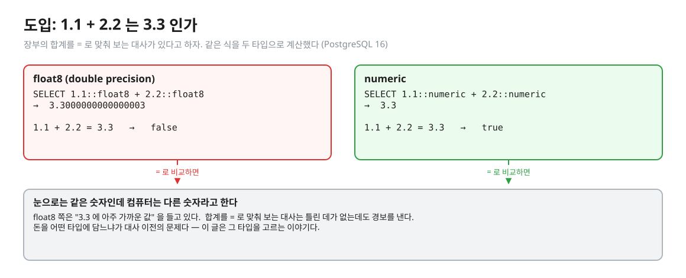
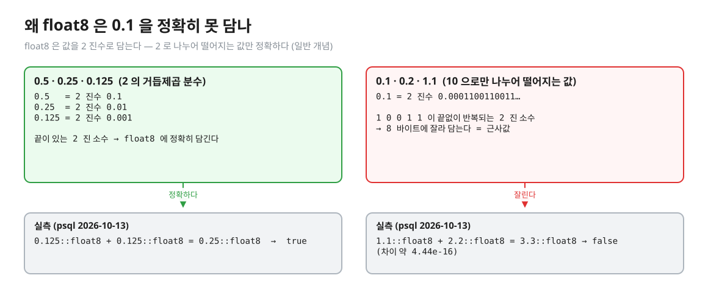
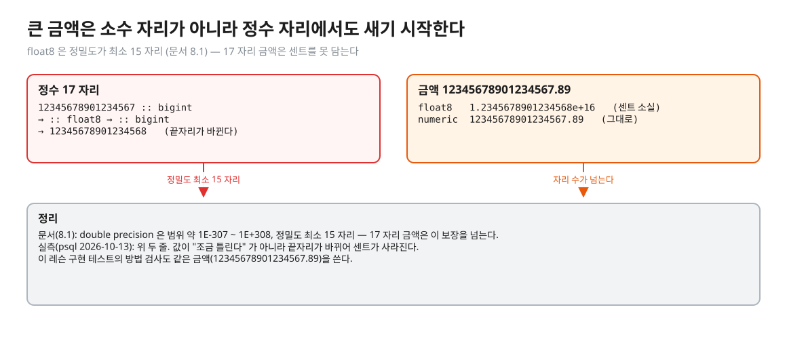
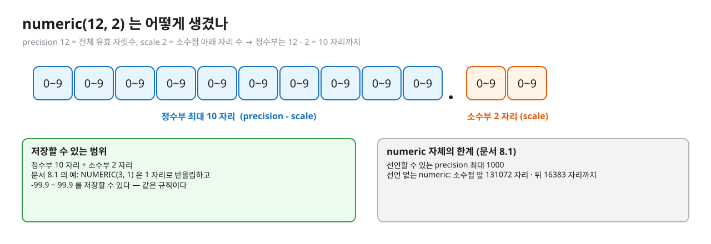
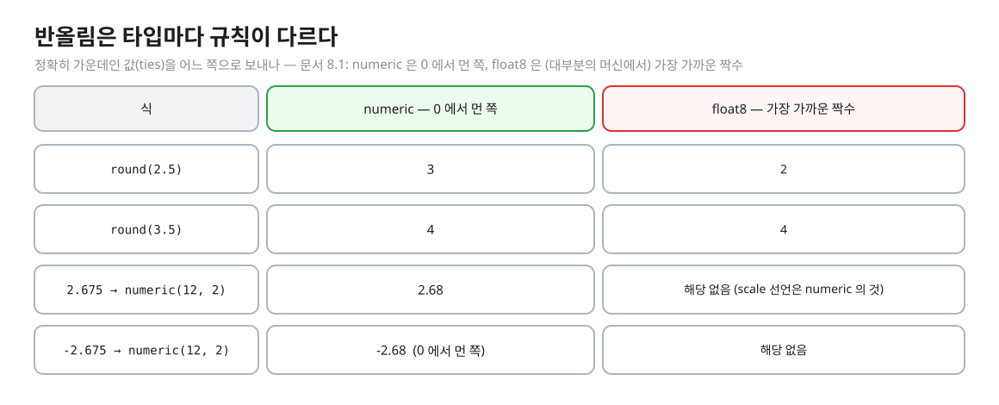
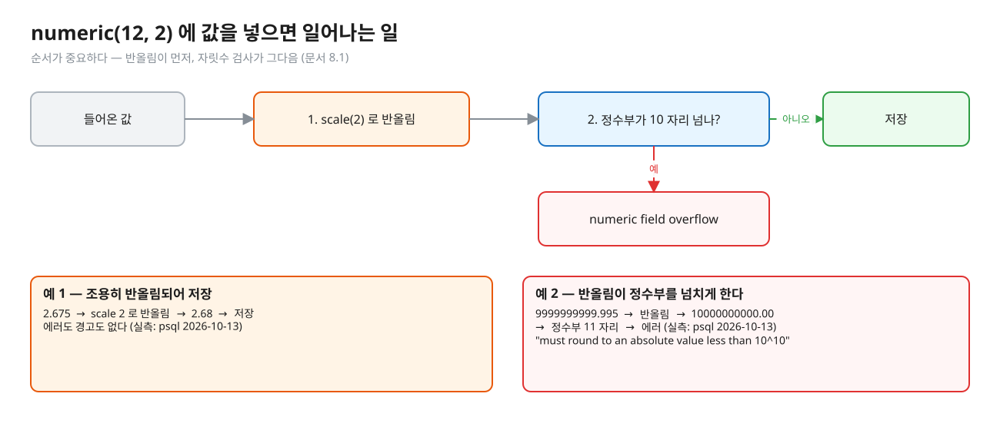
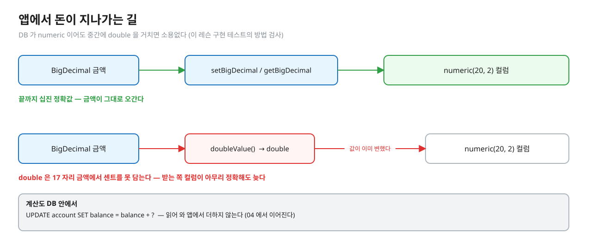

# 01. 숫자를 어떻게 저장하나

> **이 글에서 알게 되는 것**
> 1. 금액을 `float8` 에 담으면 왜 `=` 비교가 어긋나고, 큰 금액에서는 왜 센트가 사라지는지 안다.
> 2. `numeric(p, s)` 가 값을 반올림하는 규칙과, 자릿수를 넘으면 에러가 나는 순서를 안다.
> 3. 앱에서 `BigDecimal` 이 `double` 을 거치지 않아야 하는 이유를 안다.
>
> **먼저 알면 좋은 것**: 없음 — 이 연재의 첫 글이다.
> **다음 글**: [02. 잔고와 원장](02-balance-and-ledger.md)
> **구분**: 필수 — ② 원리 (① 에서 예측을 먼저 한 뒤 읽는다). Q01 · Q02 · Q03 · Q09 를 되짚는다.

## 1.1 + 2.2 는 3.3 인가

장부의 합계를 `=` 로 맞춰 보는 대사 쿼리가 있다고 하자. 거래 두 건의 금액이 1.1 과 2.2 이고 합계 칸에 3.3 이 적혀 있다. 같은 식을 두 가지 타입으로 계산해 보았다. (실측: psql 2026-10-13, PostgreSQL 16.14)

편집: [diagrams/blog01-intro.excalidraw](diagrams/blog01-intro.excalidraw)

`float8` 쪽은 눈으로 봐서는 같은 숫자인데 `=` 가 거짓이다. 틀린 곳이 없는데 대사가 경보를 내는 셈이다. 이 글은 "돈을 어떤 타입에 담아야 하나" 를 정하는 글이고, 다음 글들이 쌓는 원장과 대사는 모두 이 위에 올라간다.

## float8 은 근사값을 들고 있다

PostgreSQL 문서는 `real` 과 `double precision`(`float8`)을 "부정확한(inexact) 가변 정밀도 타입" 으로 분류한다. 일부 값은 내부 형식으로 정확히 바꿀 수 없어 근사값으로 저장되고, 그래서 저장했다 꺼낸 값이 조금 다를 수 있다. 같음 비교가 기대대로 안 될 수 있다는 경고도 문서에 있다. 돈처럼 정확한 저장과 계산이 필요하면 `numeric` 을 쓰라는 것이 문서의 권고다. ([문서 8.1](https://www.postgresql.org/docs/16/datatype-numeric.html))

이유는 값을 담는 방식에 있다. `float8` 은 IEEE 754 이진 부동소수점이다 (문서 8.1). 이진수로는 2 로 나누어 떨어지는 값(0.5 · 0.25 · 0.125)만 끝이 있는 소수가 되고, 0.1 처럼 10 으로만 나누어 떨어지는 값은 `0.0001100110011…` 로 끝없이 반복된다. 8 바이트에 담으려면 어디선가 잘라야 하므로 근사값이 된다. (일반 개념)

편집: [diagrams/blog01-binary.excalidraw](diagrams/blog01-binary.excalidraw)

그림의 두 번째 칸이 앞 장면의 정체다. 1.1 과 2.2 는 모두 잘린 값이라 더한 결과가 3.3 의 근사값과 약 4.44e-16 만큼 다르다. 반대로 0.125 + 0.125 는 정확히 0.25 와 같다 (실측: psql 2026-10-13). "float 는 늘 틀린다" 가 아니라 "10 진 소수는 대체로 근사다" 가 정확한 말이다.

두 가지를 덧붙인다. 첫째, 화면에 찍힌 값과 저장된 값은 다를 수 있다. `extra_float_digits` 를 0 으로 내리면 `1.1 + 2.2` 가 `3.3` 으로 보이지만 `= 3.3` 은 여전히 거짓이다 (실측: psql 2026-10-13). 둘째, "차이가 1e-9 보다 작으면 같다" 같은 허용 오차 비교로 거짓 경보를 줄일 수는 있다. 그러나 오차는 더할수록 쌓이고, 돈 계산에서 "얼마까지 틀려도 되나" 를 정하는 일 자체가 부담이다. (해석)

### 큰 금액은 정수 자리에서도 샌다

소수 자리만 문제가 아니다. 문서는 `double precision` 의 정밀도를 "최소 15 자리" 라고 쓴다 (문서 8.1). 17 자리 금액은 그 범위를 넘는다. 실측으로 `12345678901234567` 을 `float8` 로 바꿨다가 `bigint` 로 되돌리면 `12345678901234568` 이 된다. 금액 `12345678901234567.89` 는 `float8` 에서 `1.2345678901234568e+16` 이 되어 센트가 사라지고, `numeric` 에서는 그대로다 (실측: psql 2026-10-13).

편집: [diagrams/blog01-float-digits.excalidraw](diagrams/blog01-float-digits.excalidraw)

이 금액은 이 레슨 구현 테스트의 방법 검사에서도 쓴다. `LedgerService#post` 가 금액을 `double` 로 바꾸면 보내는 계좌의 잔고가 달라져 테스트가 빨개진다 (실측: `LedgerImplementTest` 방법 검사).

## numeric 은 십진 정확값이다

`numeric(precision, scale)` 에서 precision 은 전체 유효 자릿수이고, scale 은 소수점 아래 자릿수다. 문서의 예: `NUMERIC(3, 1)` 은 값을 소수 첫째 자리로 반올림하고 -99.9 ~ 99.9 를 저장할 수 있다 (문서 8.1). 그러니 `numeric(12, 2)` 의 정수부는 12 - 2 = 10 자리까지다.

편집: [diagrams/blog01-numeric-layout.excalidraw](diagrams/blog01-numeric-layout.excalidraw)

문서가 적은 한계는 이렇다 (PostgreSQL 16). 선언할 수 있는 precision 은 최대 1000 이고, 정밀도를 선언하지 않은 `numeric` 은 소수점 앞 131072 자리, 뒤 16383 자리까지 담는다 (문서 8.1, 표 8.2). 이 레슨의 스키마는 `account.balance` · `ledger.amount` 를 `numeric(20, 2)` 로 둔다 (`ledger-schema.sql`). 이후 예제는 간단히 `numeric(12, 2)` 상자 하나(`money_box`)로 규칙을 본다.

`numeric` 은 값을 십진수 그대로 계산하므로 1.1 + 2.2 = 3.3 이 참이다 (실측: psql 2026-10-13). 또 scale 이 달라도 같은 값은 같다 — `100.0 = 100.00` 이 참이고(실측), 선언한 scale 이 2 인 열에서는 `1.5` 가 `1.50` 으로 저장된다 (실측). 이 레슨의 `Mismatch` 가 금액을 소수 둘째 자리로 맞춰 비교하는 것도 "0 과 0.00 이 다른 값으로 보이지 않게" 하려는 것이다.

## 선언한 scale 보다 길면 반올림한다

`numeric` 열에 선언한 scale 보다 긴 값이 들어오면 시스템이 **조용히 반올림**한다. 에러도 경고도 없다. 문서의 문장은 이렇다. "값의 scale 이 열에 선언된 scale 보다 크면 시스템이 지정한 소수 자릿수로 반올림한다." ([문서 8.1](https://www.postgresql.org/docs/16/datatype-numeric.html))

반올림에서 정확히 가운데인 값(ties)을 어느 쪽으로 보내느냐가 타입마다 다르다. 문서: `numeric` 은 0 에서 먼 쪽으로 보내고, `real` · `double precision` 은 (대부분의 머신에서) 가장 가까운 짝수로 보낸다 (문서 8.1). 실측으로 `round(2.5::numeric)` 은 3, `round(2.5::float8)` 은 2 이고, 3.5 는 둘 다 4 다. `numeric(12, 2)` 에 `2.675` 와 `-2.675` 를 넣으면 각각 `2.68` 과 `-2.68` 이 저장된다 — 0 에서 먼 쪽이다 (실측: psql 2026-10-13).

편집: [diagrams/blog01-rounding.excalidraw](diagrams/blog01-rounding.excalidraw)

여기서 흔한 실수가 나온다. `numeric` 이니 "정확하다" 고 믿고 소수 셋째 자리 값을 그냥 넣는 것이다. 정확한 것은 **저장과 계산**이고, 선언한 scale 보다 긴 값은 그 자리에서 정보가 사라진다. 어디서 몇 자리로 반올림할지(예: 수수료를 계산한 뒤 한 번만)는 도메인이 정할 일이다. (해석)

## 자릿수를 넘으면 에러다 — 반올림이 먼저

문서의 문장 순서가 곧 엔진의 순서다. 먼저 scale 로 반올림하고, **그 뒤** 소수점 왼쪽 자릿수가 precision - scale 을 넘으면 에러를 낸다 (문서 8.1). 그래서 반올림 때문에 자릿수가 하나 늘어나 에러가 나는 경우가 있다.

편집: [diagrams/blog01-store-flow.excalidraw](diagrams/blog01-store-flow.excalidraw)

실측: `numeric(12, 2)` 에 `9999999999.995` 를 넣으면 `ERROR: numeric field overflow` 와 `DETAIL: A field with precision 12, scale 2 must round to an absolute value less than 10^10.` 가 나온다 (psql 2026-10-13). 정수부는 10 자리까지 담으므로 반올림해 `10000000000.00` 이 되는 순간 넘친 것이다. 에러 코드(SQLSTATE)는 Q03 의 접은 칸에서 확인한다.

조용히 반올림하는 쪽과 에러로 거부하는 쪽 중 앱에는 후자가 훨씬 눈에 잘 띈다. 앞의 반올림은 돈이 모자라도 아무도 모르게 지나갈 수 있어서, 입력 단계에서 자릿수를 검증해 두는 편이 안전하다. (해석) 이 레슨의 `Transfer` 는 금액이 소수 둘째 자리를 넘으면 생성 단계에서 거절한다 (`src/main/java/deepdive/c01/l06/Transfer.java`).

## 앱에서도 double 을 거치지 않는다

DB 컬럼을 `numeric` 으로 만들어도 앱이 `double` 로 받아 계산한 뒤 쓰면 늦다. 이 레슨의 정답은 금액을 `BigDecimal` 로 두고 `PreparedStatement#setBigDecimal` · `ResultSet#getBigDecimal` 로만 주고받으며, 잔고 계산도 `UPDATE account SET balance = balance + ?` 로 DB 안에서 한다 (`solutions/01.06.patch`).

편집: [diagrams/blog01-app-path.excalidraw](diagrams/blog01-app-path.excalidraw)

대안으로 "최소 단위 정수(예: 센트)를 `bigint` 에 담는" 설계도 있다. 반올림을 앱이 전부 책임지는 대신 타입 변환 실수가 줄어든다. 어느 쪽이 낫다는 말은 하지 않는다 — 이 레슨은 `numeric` 으로 간다. (일반 개념 · 해석)

## 합계를 낼 때: sum 의 타입과 NULL

대사는 합계를 낸다. `sum` 의 반환 타입은 입력을 따른다 — `sum(numeric)` 은 `numeric`, `sum(double precision)` 은 `double precision` 이다. 그리고 `sum` 은 행이 하나도 없으면 0 이 아니라 NULL 을 돌려준다. 문서 9.21 도 "`count` 를 제외한 집계 함수는 선택된 행이 없으면 null 을 반환한다 … `coalesce` 로 0 으로 바꿀 수 있다" 고 쓴다. ([문서 9.21](https://www.postgresql.org/docs/16/functions-aggregate.html)) 실측으로 행이 없는 `sum` 은 빈 값(NULL)이었다 (psql 2026-10-13). 이 NULL 은 05 의 대사에서 다시 만난다.

### 정리: 타입마다 무엇이 다른가

| | float8 (double precision) | numeric(12, 2) |
|---|---|---|
| 저장 | 이진 근사값 | 십진 정확값 |
| 정밀도 | 최소 15 자리 (문서 8.1) | 선언한 precision (최대 1000) |
| `1.1 + 2.2 = 3.3` | 거짓 (실측) | 참 (실측) |
| scale 보다 긴 값 | (해당 없음) | 조용히 반올림, ties 는 0 에서 먼 쪽 |
| 자릿수 초과 | 큰 수까지 담되 끝자리가 바뀐다 | 에러 (반올림 뒤에 검사) |
| 앱 타입 | `double` | `BigDecimal` |

## 자주 하는 오해

1. **"numeric 이면 소수 셋째 자리를 넣어도 안전하다."** 선언한 scale 로 조용히 반올림된다. 에러도 경고도 없다.
2. **"float 는 가끔만 틀리니 화면에 안 보이면 괜찮다."** 화면 표시는 설정(`extra_float_digits`)으로 바뀌어도 값은 그대로다. `=` 와 `GROUP BY` 같은 비교는 저장된 값을 본다.
3. **"DB 만 numeric 이면 끝."** 앱이 `double` 을 거치면 DB 에 닿기 전에 값이 변한다.
4. **"numeric 은 에러를 내지 않으니 자릿수는 신경 안 써도 된다."** 정수부가 넘치면 에러다. 반올림이 먼저라서 경계 값에서 의외의 에러가 난다.

## 한눈에 정리

- 금액은 `numeric` · 앱은 `BigDecimal`. 끝까지 `double` 을 거치지 않는다.
- `float8` 은 근사값이라 `=` 비교와 합계 비교가 어긋난다. 17 자리 금액은 센트가 사라진다.
- `numeric(p, s)` 는 scale 보다 긴 값을 조용히 반올림(ties 는 0 에서 먼 쪽)하고, 그 뒤 정수부가 p - s 자리를 넘으면 에러를 낸다.
- `sum` 은 행이 없으면 NULL 이다 — 합이 0 인 것과 합할 행이 없는 것은 다르다.

## 스스로 확인

1. `numeric(12, 2)` 열에 소수 셋째 자리 값을 넣으면 어떻게 되고, 자릿수를 넘기면 어떻게 되나? 둘 중 무엇이 더 위험한가?
   

답

   scale 보다 길면 조용히 반올림하고(ties 는 0 에서 먼 쪽), 반올림한 값의 정수부가 precision - scale 자리를 넘으면 에러다 (문서 8.1). 조용히 반올림하는 쪽이 눈에 안 띄어 더 위험하다 — 앞의 정보 손실은 아무도 모르게 지나간다 (해석).
   

2. `float8` 이 문제가 되는 것은 소수만인가?
   

답

   아니다. 정밀도가 최소 15 자리라 17 자리 금액은 정수 자리에서도 끝자리가 바뀐다 (실측: `12345678901234567` → `12345678901234568`). 이 레슨 구현 테스트의 방법 검사가 같은 금액을 쓴다.
   

3. 반올림이 먼저인가, 자릿수 검사가 먼저인가? 그 순서가 보이는 경계 값은?
   

답

   반올림이 먼저다 (문서 8.1). `numeric(12, 2)` 에 `9999999999.995` 를 넣으면 반올림해 `10000000000.00` 이 되어 정수부가 11 자리가 되므로 에러다 (실측). 입력은 10 자리인데 에러가 난다.
   

4. `sum` 이 NULL 일 때 대사에서 어떻게 해야 하나?
   

답

   `COALESCE(sum, 0)` 로 0 으로 바꿔 비교한다 (문서 9.21). 안 그러면 잔고 0 인 빈 계좌가 NULL 과 비교되어 `<>` 가 참이 되지 않는다 (05 에서 자세히).
   

## 이 레슨에서 직접 보기

| 어디서 | 무엇을 |
|---|---|
| Q01 | `float8` 과 `numeric` 의 `0.1 + 0.2 = 0.3` |
| Q02 | `numeric(12, 2)` 에 소수 셋째 자리 값 (양수 · 음수) |
| Q03 | `numeric(12, 2)` 의 자릿수 경계 |
| Q09 | `0.1` 을 열 번 더한 합이 1 과 같은가 (`float8` vs `numeric`) |
| 장면 1 (observe/SCRIPT.md) | psql 로 위를 직접 |
| `LedgerImplementTest` 방법 검사 | 금액을 `double` 로 다루면 17 자리 금액에서 센트가 깨진다 |

이 글의 예는 일부러 문항과 다른 숫자(1.1 + 2.2 · 2.675 · 9999999999.995)로 썼다. 문항의 값을 먼저 직접 적어 보고 확인한다.

실측 — 예측을 끝낸 뒤 펼친다 (Q01 · Q02 · Q03 · Q09)

정답 상태 기준 ([정답 patch](../../../solutions/01.06.patch)):

| Q | 상황 | 결과 |
|---|---|---|
| Q01 | `0.1 + 0.2 = 0.3` | float8: false · numeric: true |
| Q02 | `numeric(12, 2)` 에 `1.005` · `-1.005` | 저장된 값 `1.01` · `-1.01` (ties 는 0 에서 먼 쪽) |
| Q03 | `9999999999.99` (정수부 10 자리) · `10000000000` (11 자리) | 성공 · 에러 `22003` (`numeric_value_out_of_range`) |
| Q09 | `0.1` 을 열 번 더한 합 `= 1` | float8: false · numeric: true |

(에러 이름은 [부록 A](https://www.postgresql.org/docs/16/errcodes-appendix.html) 확인 — 22003 = `numeric_value_out_of_range`)

## 출처

- [PostgreSQL 16 · 8.1 Numeric Types](https://www.postgresql.org/docs/16/datatype-numeric.html) — inexact · 금액에는 numeric · 반올림(ties) · precision 초과 에러 · 최대 자릿수 · double 정밀도
- [PostgreSQL 16 · 9.21 Aggregate Functions](https://www.postgresql.org/docs/16/functions-aggregate.html) — sum 의 반환 타입 · 행이 없으면 null · coalesce
- [PostgreSQL 16 · Appendix A. Error Codes](https://www.postgresql.org/docs/16/errcodes-appendix.html) — 22003 `numeric_value_out_of_range`
- 이 레슨: `src/main/resources/ledger-schema.sql` · `LedgerImplementTest` 방법 검사 · `solutions/01.06.patch`
- 실측: psql 2026-10-13 (PostgreSQL 16.14 · observe/up.sh 컨테이너)
