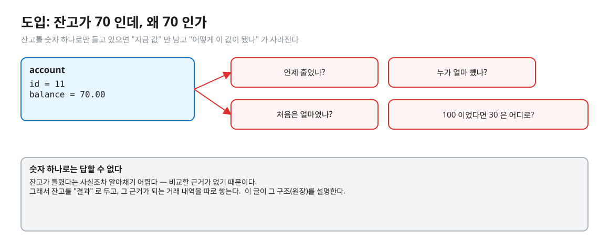
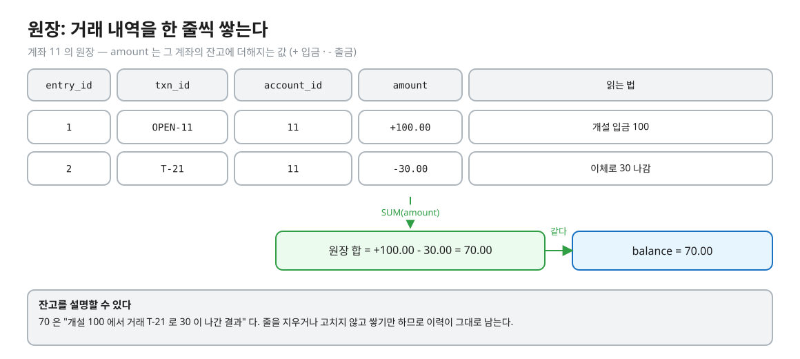
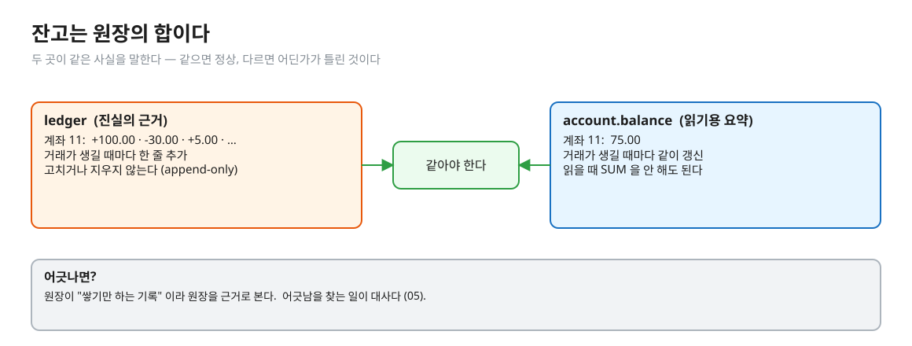
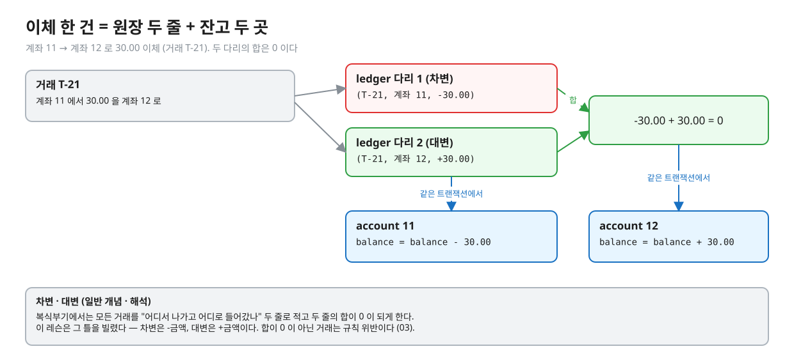
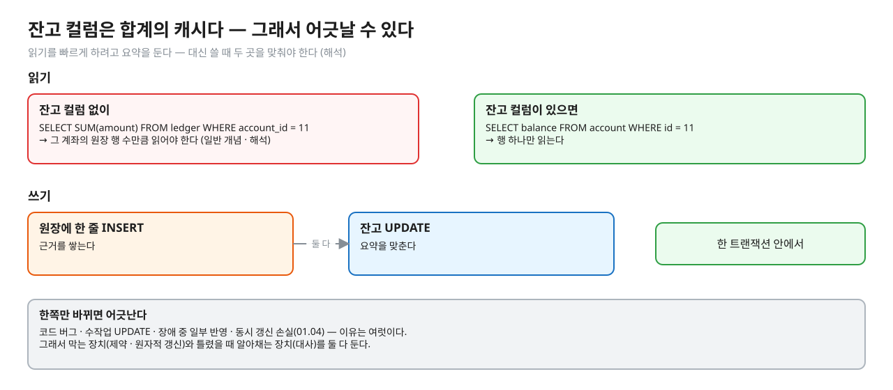
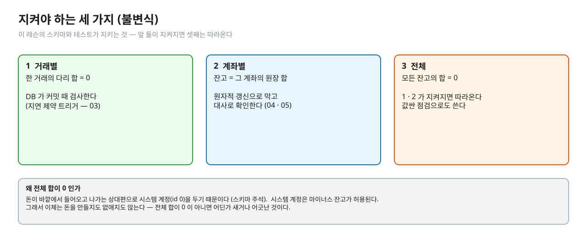
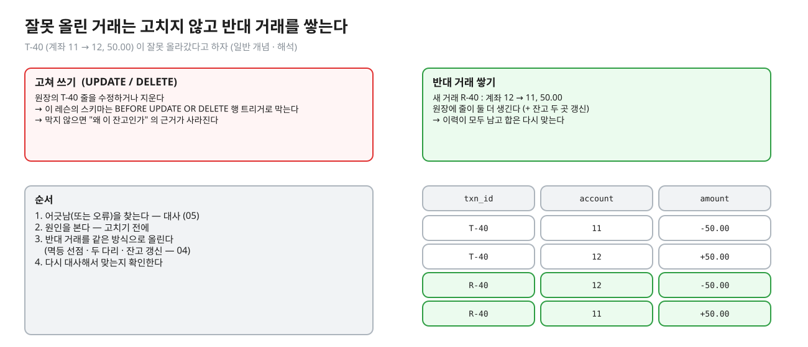
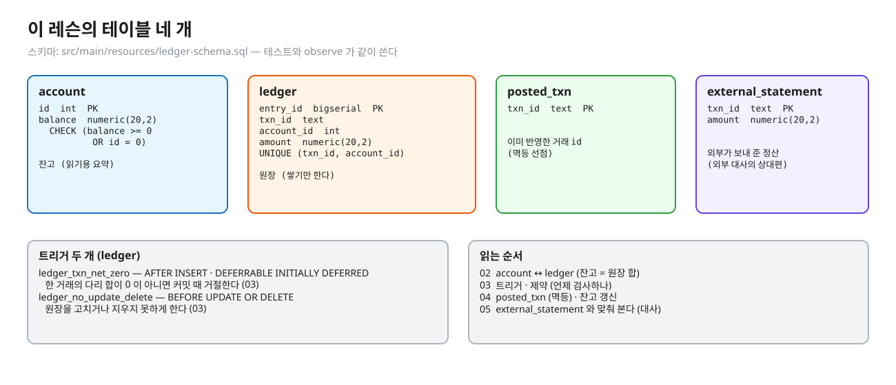

# 02. 잔고와 원장

> **이 글에서 알게 되는 것**
> 1. 잔고를 숫자 하나로만 들고 있으면 무엇을 잃는지, 원장(ledger)이 그것을 어떻게 되찾는지 안다.
> 2. 이체 한 건이 원장 두 줄 + 잔고 두 곳의 변경이 되는 구조와, 그 구조가 지키려는 세 가지 규칙(불변식)을 안다.
> 3. 잔고 컬럼이 "원장 합의 캐시" 라서 어긋날 수 있다는 것, 그래서 고치지 않고 반대 거래를 쌓는 이유를 안다.
>
> **먼저 알면 좋은 것**: [01. 숫자를 어떻게 저장하나](01-numbers-float-numeric.md) — 금액은 `numeric` 이다.
> **다음 글**: [03. 규칙은 언제 검사하나](03-when-rules-are-checked.md)
> **구분**: 심화 — 꼬리질문 대비 (레슨을 마친 뒤 · 면접 전). 용어와 구조의 배경이라 ① 에서 막혔을 때 훑어 읽어도 좋다.

## 잔고가 70 인데, 왜 70 인가

계좌 11 의 잔고가 70.00 이다. 어제 보니 100.00 이었다고 한다. 누가 30.00 을 가져갔나? 그 거래는 한 번이었나, 두 번이었나? `account` 테이블에는 `balance = 70.00` 한 줄뿐이라 답이 없다.


<sub>편집: [diagrams/blog02-intro.excalidraw](diagrams/blog02-intro.excalidraw)</sub>

숫자 하나로 잔고를 들고 있으면 "지금 값" 만 남는다. 더 나쁜 것은 그 값이 틀렸는지 알아챌 수조차 없다는 점이다. 맞춰 볼 근거가 없기 때문이다. 이 글은 그 근거를 따로 쌓는 구조를 다룬다.

## 원장은 거래 내역을 쌓기만 한다

원장(ledger)은 거래가 생길 때마다 **한 줄씩 추가**하는 표다. 이 레슨의 `ledger` 는 `(txn_id, account_id, amount)` 를 담고, `amount` 는 그 계좌의 잔고에 더해지는 값이다. 입금은 +, 출금은 -다 (`ledger-schema.sql` 의 주석).


<sub>편집: [diagrams/blog02-ledger-rows.excalidraw](diagrams/blog02-ledger-rows.excalidraw)</sub>

이제 70 을 설명할 수 있다. "개설 100 에서 거래 T-21 로 30 이 나간 결과" 다. 줄을 고치거나 지우지 않고 쌓기만 하므로(append-only) 이력이 그대로 남는다. 이 "쌓기만 한다" 는 약속은 DB 가 강제한다. 원장에 `BEFORE UPDATE OR DELETE` 행 트리거가 걸려 있어서 고치거나 지우려 하면 에러를 낸다 (`ledger-schema.sql`). 어디까지 막아 주는지는 [03](03-when-rules-are-checked.md) 에서 본다.

## 잔고는 원장의 합이다

계좌 11 의 잔고는 계좌 11 의 원장 줄의 합이다. 같은 사실이 두 곳에 적혀 있는 셈이다.


<sub>편집: [diagrams/blog02-balance-sum.excalidraw](diagrams/blog02-balance-sum.excalidraw)</sub>

SQL 로는 이렇게 맞춰 본다. (실측: psql 2026-10-13)

```sql
SELECT a.id, a.balance, COALESCE(l.s, 0) AS ledger_sum
FROM account a
LEFT JOIN (SELECT account_id, sum(amount) s FROM ledger GROUP BY account_id) l ON l.account_id = a.id;
```

원장 줄이 하나도 없는 계좌는 `sum` 이 NULL 이라(문서 9.21, [01](01-numbers-float-numeric.md)) `COALESCE(…, 0)` 로 0 으로 읽는다. 원장 줄이 없는데 잔고가 0 인 계좌는 정상이다. 이 쿼리를 "어긋난 것만 남기도록" 다듬은 것이 [05](05-reconciliation.md) 의 대사다.

두 곳 중 무엇이 진실일까? 원장이 쌓기만 하는 기록이라서 원장이다. 잔고 컬럼은 그것을 빨리 읽으려고 둔 요약이다. (해석 — 이 레슨의 설계 선택)

## 이체 한 건은 두 줄이다

돈은 갑자기 생기거나 사라지지 않는다. 이체는 "한 곳에서 나가고 한 곳으로 들어온다" 이므로 원장에 **두 줄**로 적는다. 나가는 쪽 -금액(차변), 들어오는 쪽 +금액(대변)이고, 두 줄의 합은 0 이다.


<sub>편집: [diagrams/blog02-two-legs.excalidraw](diagrams/blog02-two-legs.excalidraw)</sub>

이 틀은 복식부기에서 빌렸다. 복식부기는 모든 거래를 두 줄로 적고 합이 맞게 하는 회계 방식이다. (일반 개념 · 해석) 이 레슨의 용어로는 거래 한 건의 두 줄을 "다리(leg)" 라고 부른다.

`ledger` 에는 `UNIQUE (txn_id, account_id)` 가 있어서 같은 거래가 같은 계좌에 두 줄을 넣지 못한다. 입금 · 출금처럼 바깥과 오가는 돈은 시스템 계정(id 0)을 상대편으로 둔다. 시스템 계정은 마이너스 잔고가 허용된다 — 스키마의 `CHECK (balance >= 0 OR id = 0)` 가 그 예외다 (`ledger-schema.sql`).

## 잔고 컬럼은 합계의 캐시다

원장만 있어도 잔고는 계산할 수 있다. 그런데 왜 잔고 컬럼을 따로 둘까? 읽는 쪽에서 보면 `SUM` 은 그 계좌의 원장 줄을 모두 읽어야 하고, 컬럼은 한 줄이면 된다. (일반 개념 · 해석) 그래서 요약을 같이 들고 있고, 쓸 때 두 곳을 같이 바꾼다.


<sub>편집: [diagrams/blog02-cache.excalidraw](diagrams/blog02-cache.excalidraw)</sub>

같은 사실이 두 곳에 있으면 어긋날 수 있다. 코드 버그, 수작업 UPDATE, 장애 중 일부만 반영, 동시 갱신 손실([01.04](../../l04-stock-concurrency/docs/01-lost-update-and-the-gap.md)) 같은 이유다. 그래서 두 가지 장치를 함께 둔다. 어긋나지 않게 **막는** 장치(제약 · 원자적 갱신 — 03 · 04)와, 그래도 어긋났을 때 **알아채는** 장치(대사 — 05)다.

## 지켜야 하는 세 가지

이 레슨의 스키마와 테스트가 지키려는 규칙은 셋이다.


<sub>편집: [diagrams/blog02-invariants.excalidraw](diagrams/blog02-invariants.excalidraw)</sub>

1. **거래별**: 한 거래의 다리 합은 0 이다. DB 가 커밋 때 검사한다 ([03](03-when-rules-are-checked.md)).
2. **계좌별**: 잔고 = 그 계좌의 원장 합이다. 원자적 갱신으로 지키고 대사로 확인한다 ([04](04-posting-to-the-ledger.md) · [05](05-reconciliation.md)).
3. **전체**: 모든 잔고의 합은 0 이다. 1 · 2 가 지켜지면 따라온다. 모든 다리가 쌍으로 합 0 이면 원장 전체 합이 0 이고, 모든 잔고가 원장 합과 같으면 잔고 전체 합도 0 이기 때문이다. 이 레슨의 동시 이체 구현 테스트가 이 값을 검사한다 (`LedgerImplementTest`).

셋째는 값싼 점검으로도 쓴다. 실측으로 일부러 어긋나게 만든 장부에서 원장 전체 합은 0.00 인데 잔고 전체 합은 9.00 이었다 (psql 2026-10-13). 합이 0 이 아니라는 사실만으로 "어딘가 어긋났다" 는 것을 알 수 있다. 어디인지는 계좌별 대사가 알려 준다.

## 틀렸으면 고치지 않고 반대 거래를 쌓는다

잘못 올라간 거래를 어떻게 바로잡을까? 원장의 그 줄을 UPDATE 로 고치면 "왜 이 잔고인가" 의 근거가 사라진다. 그래서 새 거래로 **반대 방향**을 올린다. 거래 T-40 이 잘못되었으면 같은 금액을 반대로 옮기는 R-40 을 쌓는다. 원장은 줄이 늘어난 모양으로 남고, 합은 다시 맞는다. (일반 개념 · 해석 — 이 레슨의 스키마가 UPDATE · DELETE 를 막는 이유도 같다)


<sub>편집: [diagrams/blog02-reversal.excalidraw](diagrams/blog02-reversal.excalidraw)</sub>

반대 거래도 정식 거래라서 멱등 선점 · 두 다리 · 잔고 갱신을 똑같이 거친다. 원인을 모른 채 반대 거래부터 올리면 문제를 덮을 뿐이다. 순서는 항상 "찾고 → 원인을 보고 → 정정" 이다.

## PostgreSQL 에서는

이 레슨의 테이블은 네 개다. (정의: `src/main/resources/ledger-schema.sql`)


<sub>편집: [diagrams/blog02-schema.excalidraw](diagrams/blog02-schema.excalidraw)</sub>

- `account(id, balance numeric(20,2))` — 잔고. `CHECK (balance >= 0 OR id = 0)` 로 잔고 부족을 막는다. CHECK 는 새 행이나 바뀐 행이 만족해야 하는 조건이고 FALSE 면 에러다 ([CREATE TABLE](https://www.postgresql.org/docs/16/sql-createtable.html)). 시점은 03 에서 본다.
- `ledger(entry_id, txn_id, account_id, amount)` — 원장. 트리거 둘: 합 0 검사(커밋 때), UPDATE · DELETE 금지.
- `posted_txn(txn_id)` — 이미 반영한 거래 id. 멱등 선점용이다 (04).
- `external_statement(txn_id, amount)` — 외부가 보내 준 정산 내역. 외부 대사의 상대편이다 (05).

### 자주 하는 오해

1. **"원장이 있으면 잔고 컬럼은 필요 없다."** 계산은 가능하지만 읽을 때마다 합해야 한다. 요약을 두는 것은 선택이고, 두면 두 곳을 맞춰야 하는 비용이 생긴다. (해석)
2. **"잔고 컬럼이 진짜고 원장은 부가 로그다."** 반대다. 이 레슨은 원장을 근거로 두고 잔고는 그 합으로 본다. 둘이 어긋나면 원장을 믿는다.
3. **"원장 합이 0 이니 잔고 합도 0 이다."** 둘이 같을 때만 그렇다. 실측에서 원장 합은 0.00 이고 잔고 합은 9.00 이었다 — 어긋남의 신호다.
4. **"원장을 고쳐서 바로잡는다."** 고치지 않는다. 반대 거래를 쌓는다.

## 한눈에 정리

| | account (잔고) | ledger (원장) |
|---|---|---|
| 역할 | 읽기용 요약 | 근거 (거래 내역) |
| 바뀌는 방식 | `balance = balance + ?` 로 갱신 | 줄 추가만 (UPDATE · DELETE 금지) |
| 이체 한 건 | 두 계좌의 잔고가 바뀜 | 두 줄 (-금액 · +금액) 추가 |
| 믿는 순서 | 어긋나면 원장을 확인 | 근거 |

- 잔고만 두면 이력을 잃고, 틀렸는지도 알아채기 어렵다.
- 잔고 = 원장의 합. 그래서 두 곳을 같은 트랜잭션에서 바꾸고, 대사로 맞춰 본다.
- 불변식 셋: 거래별 다리 합 0 · 계좌별 잔고 = 원장 합 · 전체 잔고 합 0.
- 틀렸으면 고치지 않고 반대 거래를 쌓는다.

## 스스로 확인

1. 원장과 잔고 컬럼 중 어느 쪽이 "진실" 인가? 그 이유는?
   <details><summary>답</summary>
   원장이다. 쌓기만 하는 기록이라 "왜 이 잔고인가" 를 설명한다. 잔고 컬럼은 합을 빨리 읽으려는 요약(캐시)이고, 어긋나면 원장을 근거로 본다 (이 레슨의 설계 · 해석).
   </details>
2. 모든 잔고의 합이 0 이 아니라는 사실은 무엇을 알려 주나? 알려 주지 못하는 것은?
   <details><summary>답</summary>
   어딘가 어긋났다는 것은 알려 준다 (이체는 돈을 만들지도 없애지도 않으므로). 어느 계좌인지, 어떤 종류의 어긋남인지는 알려 주지 못한다 — 그것이 계좌별 대사의 일이다. 또 어긋남이 서로 상쇄되면 합은 0 일 수 있다 (해석: 합계 점검은 필요조건이지 충분조건이 아니다).
   </details>
3. 원장 줄을 UPDATE 로 고치지 않고 반대 거래를 쌓으면 무엇이 좋은가?
   <details><summary>답</summary>
   이력이 남는다 — 무엇이 언제 어떻게 바로잡혔는지 원장만 보면 안다. 그리고 반대 거래도 정식 거래라 같은 규칙(합 0 · 멱등)을 지난다 (일반 개념 · 해석).
   </details>
4. 시스템 계정(id 0)을 두는 이유는?
   <details><summary>답</summary>
   바깥에서 돈이 들어오고 나가는 상대편이 필요해서다. 입금도 "한 곳에서 나가고 한 곳으로 들어온다" 는 두 줄 틀에 맞추면 모든 거래의 합이 0 이 되고, 시스템 계정은 마이너스 잔고가 허용된다 (`ledger-schema.sql` 주석과 CHECK).
   </details>

## 이 레슨에서 직접 보기

| 어디서 | 무엇을 |
|---|---|
| 장면 3 (observe/SCRIPT.md) | 일부러 어긋나게 만든 seed 에서 계좌별 잔고와 원장 합을 나란히 |
| Q07 | 원장 append-only — UPDATE 와 TRUNCATE (03 에서 자세히) |
| Q10 | 대사 쿼리가 찾는 어긋남 건수 (05 에서 자세히) |
| `LedgerImplementTest` | 동시 이체 뒤 모든 계좌 잔고 = 원장 합 · 전체 합 보존 |

## 출처

- [PostgreSQL 16 · CREATE TABLE](https://www.postgresql.org/docs/16/sql-createtable.html) — CHECK 의미 · 새 행 / 바뀐 행이 만족해야 한다
- [PostgreSQL 16 · 9.21 Aggregate Functions](https://www.postgresql.org/docs/16/functions-aggregate.html) — sum 은 행이 없으면 null
- 이 레슨: `src/main/resources/ledger-schema.sql` (테이블 · 트리거 · CHECK · 주석) · `LedgerImplementTest` · `observe/SCRIPT.md` 장면 3
- 복식부기 · 반대 거래: 회계 일반 개념 — 공식 출처를 붙이지 않았고 (일반 개념 · 해석) 으로 표시했다
- 실측: psql 2026-10-13 (PostgreSQL 16.14)
