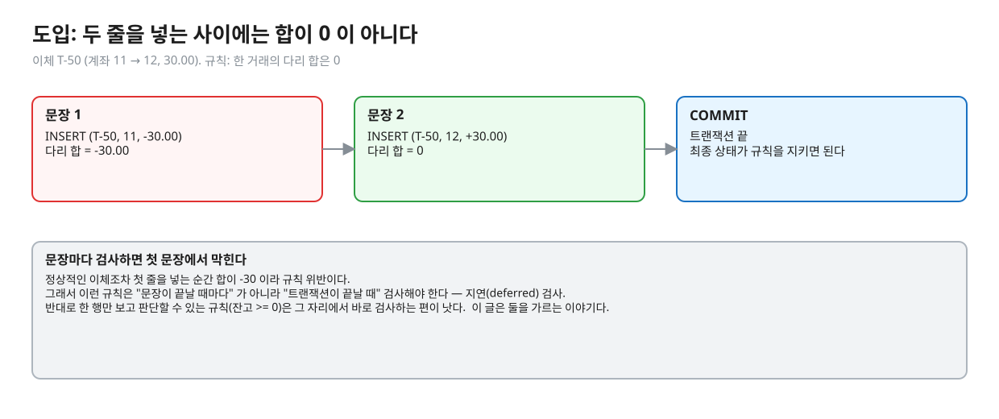
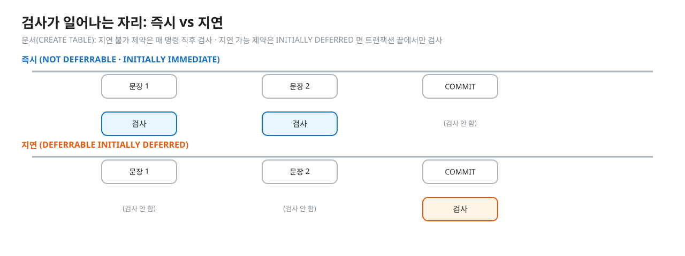
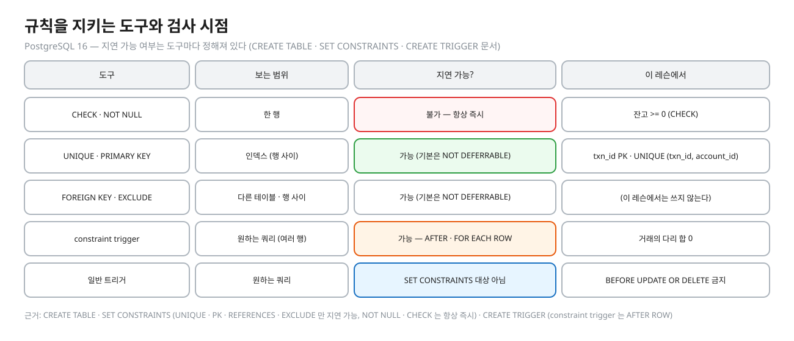
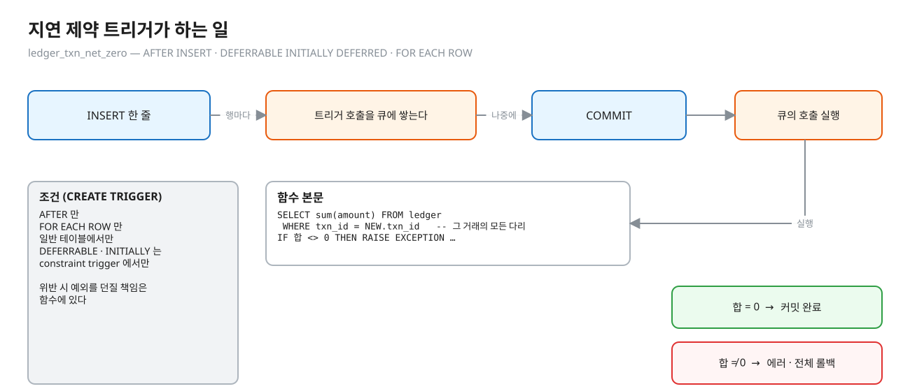
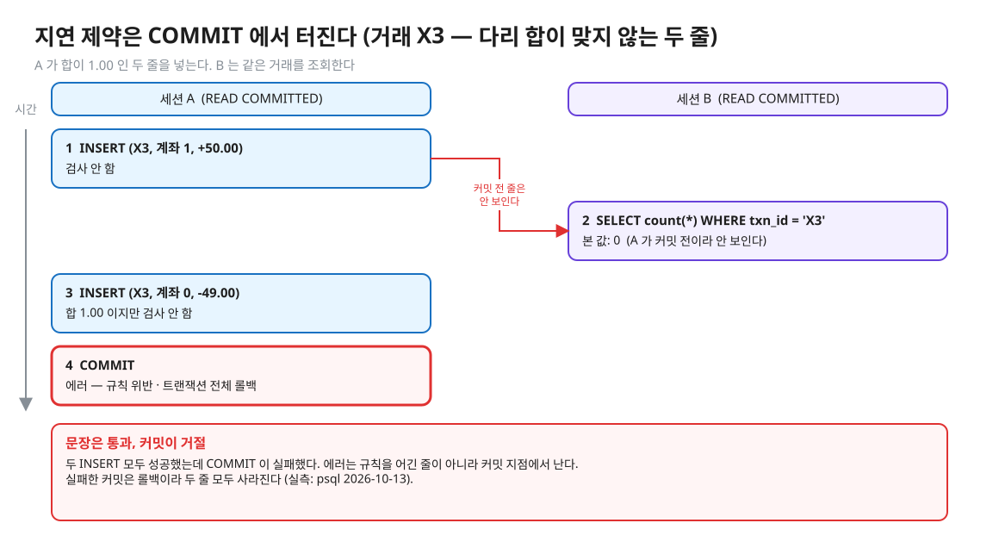
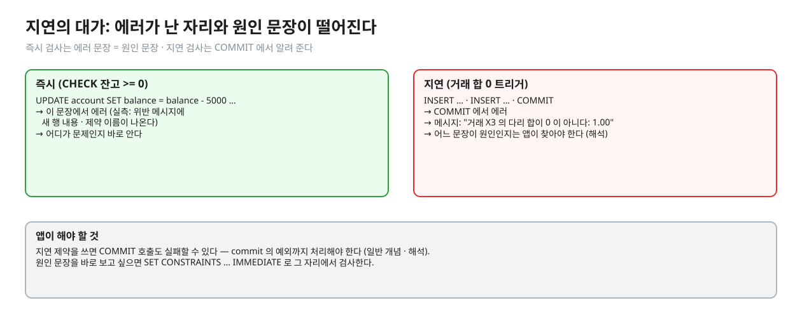
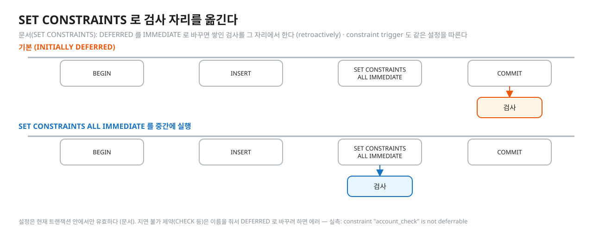
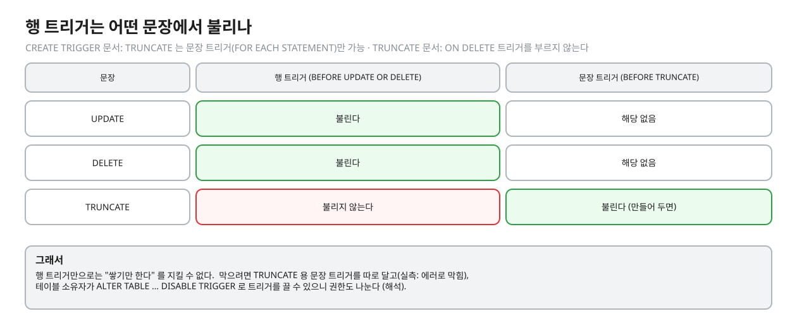
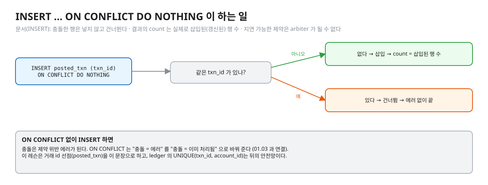
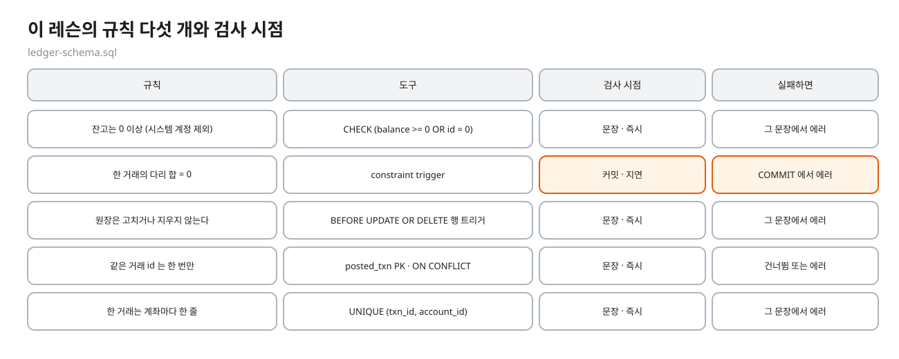

# 03. 규칙은 언제 검사하나

> **이 글에서 알게 되는 것**
> 1. 규칙을 지키는 도구(CHECK · UNIQUE · 트리거)가 각각 한 행만 보는지 여러 행을 보는지, 지연할 수 있는지 안다.
> 2. "거래의 다리 합은 0" 같은 여러 행에 걸친 규칙을 왜 커밋 때 검사해야 하는지, 지연 제약 트리거가 어떻게 동작하는지 안다.
> 3. `SET CONSTRAINTS` 로 검사 시점을 앞당기는 법, 지연의 대가, append-only 트리거의 빈틈(TRUNCATE), `ON CONFLICT` 가 하는 일을 안다.
>
> **먼저 알면 좋은 것**: [02. 잔고와 원장](02-balance-and-ledger.md) — 이체 한 건은 원장 두 줄이다.
> **다음 글**: [04. 원장에 기록하기](04-posting-to-the-ledger.md)
> **구분**: 필수 — ② 원리 (① 에서 예측을 먼저 한 뒤 읽는다). Q04 · Q05 · Q06 · Q07 · Q08 을 되짚는다.

## 두 줄을 넣는 사이에는 합이 0 이 아니다

이체 T-50 (계좌 11 → 12, 30.00)을 원장에 넣는다. 규칙은 "한 거래의 다리 합은 0" 이다. 두 줄을 한 문장으로 넣지 않고 두 문장으로 넣으면, 첫 문장이 끝난 시점의 합은 -30.00 이다.


<sub>편집: [diagrams/blog03-intro.excalidraw](diagrams/blog03-intro.excalidraw)</sub>

문장이 끝날 때마다 규칙을 검사하면 이 정상적인 이체가 첫 문장에서 막힌다. 반대로 "잔고는 0 이상" 같은 규칙은 한 행만 보면 판단되니 그 자리에서 검사하는 편이 낫다. 이 글은 규칙에 따라 **검사 시점**이 갈리는 이유와 도구를 다룬다.

## 즉시 검사와 지연 검사

PostgreSQL 문서(CREATE TABLE)는 이렇게 설명한다. 지연할 수 없는(NOT DEFERRABLE) 제약은 **매 명령 직후** 검사한다. 지연 가능한(DEFERRABLE) 제약은 검사를 트랜잭션 끝까지 미룰 수 있고, `INITIALLY DEFERRED` 이면 기본이 "트랜잭션 끝에서만" 이다. `INITIALLY IMMEDIATE` 는 문장 끝마다다. 기본값은 NOT DEFERRABLE 이다. ([CREATE TABLE](https://www.postgresql.org/docs/16/sql-createtable.html))


<sub>편집: [diagrams/blog03-when.excalidraw](diagrams/blog03-when.excalidraw)</sub>

지연이라고 검사를 건너뛰는 것이 아니다. 커밋 직전에 검사하고, 위반이면 트랜잭션 전체가 실패한다. 중간 상태는 같은 트랜잭션 안에서만 보이고, 다른 세션은 커밋 전의 줄을 보지 못한다 (더티 리드가 없다 — [01.01 문서 01](../../l01-isolation-mvcc/docs/01-anomalies-and-isolation-levels.md)).

## 도구마다 지연 가능 여부가 정해져 있다

문서(CREATE TABLE · SET CONSTRAINTS)에 따르면 지연을 받아들이는 제약은 `UNIQUE` · `PRIMARY KEY` · `EXCLUDE` · `REFERENCES`(외래 키)뿐이다. `NOT NULL` 과 `CHECK` 는 지연할 수 없고, 행이 삽입되거나 바뀔 때 **항상 즉시** 검사된다 (문장 끝도 아니다). ([CREATE TABLE](https://www.postgresql.org/docs/16/sql-createtable.html), [SET CONSTRAINTS](https://www.postgresql.org/docs/16/sql-set-constraints.html))


<sub>편집: [diagrams/blog03-tools.excalidraw](diagrams/blog03-tools.excalidraw)</sub>

이 표에서 "여러 행에 걸친 규칙" 을 지연할 수 있는 도구가 하나 보인다. 외래 키와 UNIQUE 는 정해진 모양의 규칙만 검사한다. "한 거래의 다리 합이 0" 같은 임의의 규칙은 **constraint trigger** 로 만든다.

### CHECK — 한 행만 보는 즉시 검사

`account` 의 `CHECK (balance >= 0 OR id = 0)` 는 새 행이나 바뀐 행이 만족해야 하는 조건이다. 식이 TRUE 또는 UNKNOWN(NULL)이면 통과하고 FALSE 면 에러다 ([CREATE TABLE](https://www.postgresql.org/docs/16/sql-createtable.html)). 그 행만 보고 판단하므로 "다른 행과의 합" 은 못 본다. 위반하면 그 문장이 에러를 낸다. 에러를 받은 트랜잭션이 이어서 어떻게 되는지는 [01.03 문서 05](../../l03-idempotency/docs/05-failed-transaction.md) 가 다룬다. 위반 메시지에는 제약 이름과 문제가 된 행이 나온다 (실측: `new row for relation "account" violates check constraint "account_check"` · `Failing row contains (1, -4900.00)`, psql 2026-10-13). 이 에러의 SQLSTATE 와 에러 뒤 다음 문장의 결과는 Q04 의 접은 칸에 있다.

## 합 0 규칙: 지연 제약 트리거

constraint trigger 는 일반 트리거와 같지만, 실행 시점을 `SET CONSTRAINTS` 로 조정할 수 있다. 문서(CREATE TRIGGER)의 조건은 이렇다. 일반 테이블의 `AFTER ROW` 트리거여야 하고(`FOR EACH ROW`), 지연 옵션(`DEFERRABLE` · `INITIALLY …`)은 constraint trigger 에서만 쓸 수 있다. 문장 끝에 실행하거나, 트랜잭션 끝까지 미루면 "지연(deferred)" 이다. 규칙 위반을 알리는 일은 트리거 함수가 예외를 던져서 한다. ([CREATE TRIGGER](https://www.postgresql.org/docs/16/sql-createtrigger.html))

이 레슨의 스키마가 그렇게 만들었다. (`ledger-schema.sql`)

```sql
CREATE CONSTRAINT TRIGGER ledger_txn_net_zero
    AFTER INSERT ON ledger
    DEFERRABLE INITIALLY DEFERRED
    FOR EACH ROW EXECUTE FUNCTION ledger_txn_must_net_zero();
```

함수 본문은 같은 거래(`txn_id`)의 다리를 모두 합해 0 이 아니면 `RAISE EXCEPTION` 을 한다.


<sub>편집: [diagrams/blog03-constraint-trigger.excalidraw](diagrams/blog03-constraint-trigger.excalidraw)</sub>

`AFTER` 행 트리거는 문장 끝에 실행되고, constraint trigger 로 정의하면 트랜잭션 끝까지 미룰 수 있다 ([문서 39.1](https://www.postgresql.org/docs/16/trigger-definition.html)). `AFTER` 행 트리거의 반환값은 무시되므로 NULL 을 돌려줘도 된다 ([문서 39.1](https://www.postgresql.org/docs/16/trigger-definition.html) · [문서 43.10](https://www.postgresql.org/docs/16/plpgsql-trigger.html)). 이 레슨의 함수가 `RETURN NULL` 인 이유다. 에러를 알리는 쪽은 `RAISE EXCEPTION` 이고, 조건 이름이나 SQLSTATE 를 주지 않았을 때의 기본값은 [문서 43.9](https://www.postgresql.org/docs/16/plpgsql-errors-and-messages.html) 에 적혀 있다. 실제로 어떤 값이 나오는지는 Q05 · Q06 에서 직접 적어 본다.

두 줄을 넣는 두 문장에 INSERT 가 두 번 일어나므로 트리거 호출도 행마다 두 번 큐에 쌓인다 (`FOR EACH ROW`). 커밋 때 큐의 호출이 실행되고, 이때 함수의 `SELECT sum(amount)` 는 같은 트랜잭션이 넣은 두 줄을 모두 본다. 그래서 정상 이체는 통과하고 합이 맞지 않으면 걸린다.

<details><summary>실측 — 합이 맞지 않는 두 줄 (거래 X3: +50.00 과 -49.00) 을 넣고 COMMIT 한 장면 (Q05 를 푼 뒤 펼친다)</summary>


<sub>편집: [diagrams/blog03-fail-timeline.excalidraw](diagrams/blog03-fail-timeline.excalidraw)</sub>

실측(psql 2026-10-13): 두 INSERT 는 `INSERT 0 1` 로 성공하고, COMMIT 에서 `ERROR:  P0001: 거래 X3 의 다리 합이 0 이 아니다: 1.00` 가 났다. 이 거래의 줄 수는 이후 0 이었다 — 실패한 커밋은 롤백이다. (Q05 의 한 줄만 넣는 경우도 같은 모양이다.)
</details>

### 지연의 대가


<sub>편집: [diagrams/blog03-deferral-cost.excalidraw](diagrams/blog03-deferral-cost.excalidraw)</sub>

지연 제약은 규칙을 어긴 줄을 넣은 문장이 아니라 **커밋에서** 에러를 낸다. 그러면 앱은 `commit()` 호출의 예외까지 처리해야 하고, 어느 문장이 원인인지 찾기도 어렵다. (일반 개념 · 해석) 이 레슨의 `LedgerService#post` 도 합이 맞는 두 줄만 넣으므로 정상 경로에서는 걸리지 않고, 걸리면 버그 신호다.

## SET CONSTRAINTS — 검사 시점 앞당기기

`SET CONSTRAINTS` 는 현재 트랜잭션 안에서 지연 가능한 제약의 검사 시점을 바꾼다. 문서의 핵심 문장: `DEFERRED` 를 `IMMEDIATE` 로 바꾸면 새 모드는 **소급(retroactively)** 적용되어, 트랜잭션 끝에서 검사했을 쌓인 수정사항을 `SET CONSTRAINTS` 를 실행하는 그 자리에서 검사한다. 위반이 있으면 `SET CONSTRAINTS` 가 실패하고 모드는 바뀌지 않는다. "그래서 `SET CONSTRAINTS` 로 트랜잭션 안의 특정 지점에서 검사를 강제할 수 있다." constraint trigger 도 같은 설정을 따른다. ([SET CONSTRAINTS](https://www.postgresql.org/docs/16/sql-set-constraints.html))


<sub>편집: [diagrams/blog03-set-constraints.excalidraw](diagrams/blog03-set-constraints.excalidraw)</sub>

범위는 `ALL`(지연 가능한 제약 전부) 또는 이름 목록이다. 이름을 준 제약은 모두 지연 가능해야 한다. 실측: `SET CONSTRAINTS account_check DEFERRED` 는 `ERROR: constraint "account_check" is not deferrable` 로 거절됐다 (psql 2026-10-13). 이 설정은 현재 트랜잭션에만 유효하고, 트랜잭션 밖에서 실행하면 경고만 나고 효과가 없다 (문서).

반대로 `IMMEDIATE` 로 먼저 바꾼 뒤 INSERT 하면 constraint trigger 는 INSERT 문장 끝에 실행된다 (`AFTER` 행 트리거는 문장 끝에 실행 — 문서 39.1). 그러면 두 줄을 **한 문장**으로 넣어야 한다. 실측: `SET CONSTRAINTS ALL IMMEDIATE` 뒤에 `VALUES (…, +5.00), (…, -5.00)` 두 줄을 한 문장으로 넣고 COMMIT 하면 통과했다 (psql 2026-10-13, 두 줄이 그대로 남았다). 한 줄만 넣는 문장이 어떻게 되는지는 Q06 에서 직접 적어 본다. 이 레슨의 seed 가 두 다리를 한 문장으로 넣는 이유다 (`observe/seed.sql`).

## append-only — 고치지 못하게 막는다

원장은 쌓기만 한다. 이 레슨은 두 가지로 약속을 강제한다. 하나는 `BEFORE UPDATE OR DELETE` 행 트리거에서 `RAISE EXCEPTION` 하는 것이다 (`ledger_no_update_delete`). 실측으로 UPDATE 와 DELETE 모두 `원장은 고치거나 지울 수 없다 (UPDATE 시도)` · `(DELETE 시도)` 에러가 났다 (psql 2026-10-13).

`BEFORE` 행 트리거가 NULL 을 돌려주면 그 행의 작업을 건너뛰는 것이 PL/pgSQL 의 규칙이다 ([문서 43.10](https://www.postgresql.org/docs/16/plpgsql-trigger.html)). 이 레슨은 NULL 이 아니라 예외로 막는다. 조용히 건너뛰면 호출한 쪽이 성공한 줄 알기 때문이다. (해석)

그런데 이 행 트리거가 부르지 않는 문장이 하나 있다. 문서(TRUNCATE): "`TRUNCATE` will not fire any `ON DELETE` triggers that might exist for the tables." 대신 `ON TRUNCATE` 트리거는 부른다. 그리고 문서(CREATE TRIGGER): TRUNCATE 에는 **문장 트리거(`FOR EACH STATEMENT`)만** 만들 수 있다. ([TRUNCATE](https://www.postgresql.org/docs/16/sql-truncate.html), [CREATE TRIGGER](https://www.postgresql.org/docs/16/sql-createtrigger.html)) 그래서 행 트리거만으로는 append-only 가 완성되지 않는다. TRUNCATE 가 트랜잭션 안에서 롤백 가능하다는 점도 문서에 있다 (`TRUNCATE` is transaction-safe).

막으려면 `BEFORE TRUNCATE … FOR EACH STATEMENT` 트리거를 따로 단다. 실측으로 `RAISE EXCEPTION` 하는 문장 트리거를 달면 TRUNCATE 가 에러로 막혔다 (psql 2026-10-13, 직접 만든 트리거 — 이 레슨 스키마에는 없다).

그래도 빈틈은 남는다. 테이블 소유자는 `ALTER TABLE … DISABLE TRIGGER` 로 트리거를 끌 수 있다 — 끈 트리거는 시스템에 남아 있지만 실행되지 않는다 ([ALTER TABLE](https://www.postgresql.org/docs/16/sql-altertable.html)). 실측으로 `ledger_no_update_delete` 를 끄자 UPDATE 가 통과했다 (psql 2026-10-13). 트리거는 실수를 막지, 권한 있는 사람의 의도를 막지는 못한다. 그래서 일반 앱 계정에는 원장 수정 권한을 주지 않는 식의 권한 분리가 같이 필요하다. (해석)

<details><summary>실측 — 예측을 끝낸 뒤 펼친다 (Q07 · 행 트리거는 어떤 문장에서 불리나)</summary>


<sub>편집: [diagrams/blog03-append-only.excalidraw](diagrams/blog03-append-only.excalidraw)</sub>

이 그림의 표가 Q07 의 답이다 (아래 "이 레슨에서 직접 보기" 의 표에 값이 있다).
</details>

## 같은 거래는 한 번만 — UNIQUE 와 ON CONFLICT

`PRIMARY KEY` · `UNIQUE` 는 지연 가능하지만 기본은 `NOT DEFERRABLE` 이라 문장마다 검사한다. 중복 거래를 막는 것도 이 즉시 검사다. `posted_txn.txn_id` 가 PK 이고, `ledger` 에는 `UNIQUE (txn_id, account_id)` 가 있다.

`INSERT … ON CONFLICT DO NOTHING` 은 충돌 대신 에러 없이 그 행을 건너뛴다. 문서: "`ON CONFLICT DO NOTHING` simply avoids inserting a row as its alternative action." 결과의 `count` 는 삽입(또는 갱신)된 행 수이고, 건너뛴 행은 세지 않는다. `conflict_target` 은 `DO NOTHING` 에서 생략할 수 있고, 그러면 사용할 수 있는 모든 제약 · 유니크 인덱스에 대한 충돌을 처리한다. 지연 가능한 제약은 arbiter 로 쓸 수 없다 — 문서가 "only `NOT DEFERRABLE` constraints and unique indexes are supported as arbiters" 라고 적었다. ([INSERT](https://www.postgresql.org/docs/16/sql-insert.html), [CREATE TABLE](https://www.postgresql.org/docs/16/sql-createtable.html))


<sub>편집: [diagrams/blog03-unique-flow.excalidraw](diagrams/blog03-unique-flow.excalidraw)</sub>

동시에 같은 id 가 오면 어떻게 될까. 실측으로 A 가 `posted_txn` 에 새 id 를 넣고 아직 끝내지 않은 사이 B 가 같은 id 로 `ON CONFLICT DO NOTHING` 을 실행하면 B 는 **기다렸다**(약 1.3 ~ 1.4 초). A 가 롤백하면 B 는 삽입에 성공했고, A 가 커밋하면 B 는 건너뛰었다 (psql 2026-10-13). 이 "첫 번째 결과를 기다린다" 가 멱등 선점이 동시에도 안전한 이유이고, 거절되어 롤백한 거래의 선점이 남지 않아야 하는 이유이기도 하다 ([04](04-posting-to-the-ledger.md) · [01.03 문서 04](../../l03-idempotency/docs/04-on-conflict.md)).

<details><summary>실측 — 예측을 끝낸 뒤 펼친다 (Q08 의 두 장면)</summary>

| 장면 | 실측 (psql 2026-10-13) |
|---|---|
| A 가 새 id Z1 삽입 후 롤백하기 전, B 의 `INSERT … ON CONFLICT DO NOTHING` | 약 1.4 초 기다린 뒤 `INSERT 0 1` (A 가 롤백했으므로 삽입됨) |
| A 가 Z2 삽입 후 커밋, B 의 같은 문장 | 약 1.3 초 기다린 뒤 `INSERT 0 0` (건너뜀) |
</details>

## 정리: 이 레슨의 규칙 다섯 개


<sub>편집: [diagrams/blog03-summary.excalidraw](diagrams/blog03-summary.excalidraw)</sub>

| 규칙 | 도구 | 검사 시점 | 지연 가능? |
|---|---|---|---|
| 잔고 >= 0 | CHECK | 문장 (즉시) | 불가 |
| 거래 다리 합 = 0 | constraint trigger | 커밋 (지연) | 가능 |
| 원장 수정 금지 | BEFORE 행 트리거 | 문장 | (일반 트리거라 `SET CONSTRAINTS` 대상 아님) |
| 같은 거래 한 번만 | PK · ON CONFLICT | 문장 | 기본 불가 |
| 거래당 계좌별 한 줄 | UNIQUE | 문장 | 기본 불가 |

## 자주 하는 오해

1. **"CHECK 도 DEFERRABLE 로 만들 수 있다."** 문서가 CHECK · NOT NULL 은 지연할 수 없다고 한다. 여러 행에 걸친 규칙은 constraint trigger 로 만든다.
2. **"지연 제약이면 검사를 안 한다."** 커밋 직전에 한다. 위반이면 트랜잭션이 통째로 실패한다.
3. **"BEFORE UPDATE OR DELETE 트리거면 원장을 못 고친다."** TRUNCATE 는 행 트리거를 부르지 않는다. 소유자는 트리거를 끌 수도 있다.
4. **"ON CONFLICT DO NOTHING 의 결과는 항상 같다."** 충돌 여부는 먼저 온 쪽의 커밋 여부에 달렸다. 동시에 오면 기다린 뒤 판단한다.

## 한눈에 정리

- 한 행만 보는 규칙은 CHECK(즉시). 여러 행에 걸친 규칙은 constraint trigger(지연 가능).
- 지연 제약의 에러는 COMMIT 에서 난다. `SET CONSTRAINTS … IMMEDIATE` 로 그 자리에서 검사할 수 있고, 소급 적용된다.
- append-only 는 행 트리거만으로는 TRUNCATE 가 빠진다. 문장 트리거와 권한 분리가 같이 필요하다.
- 같은 거래는 `INSERT … ON CONFLICT DO NOTHING` 으로 한 번만 — 동시에 오면 첫 번째 결과를 기다린다.

## 스스로 확인

1. 거래의 다리 합 0 을 CHECK 로 못 만드는 이유는?
   <details><summary>답</summary>
   CHECK 는 새 행이나 바뀐 행 하나가 만족해야 하는 조건이고, 문서상 지연할 수 없어 행이 삽입될 때 즉시 검사된다 (CREATE TABLE · SET CONSTRAINTS). 이체는 두 줄을 넣는 동안 합이 0 이 아닌 순간이 있으므로 즉시 검사로는 정상 이체도 막힌다.
   </details>
2. `SET CONSTRAINTS ALL IMMEDIATE` 를 INSERT 전에 실행하면 두 줄을 넣는 방식이 달라지나?
   <details><summary>답</summary>
   달라진다. constraint trigger 가 문장 끝에 실행되므로 두 줄을 한 INSERT 문장으로 넣어야 한다 (실측: 한 문장 두 줄은 통과). 두 문장으로 나누면 첫 문장에서 걸린다.
   </details>
3. 원장 UPDATE 를 막는 행 트리거가 있는데 데이터를 지울 수 있는 길은?
   <details><summary>답</summary>
   TRUNCATE (행 트리거를 부르지 않음 — 문서), 트리거를 끄는 `ALTER TABLE … DISABLE TRIGGER`(소유자 · 실측), 테이블 DROP 등이다. 문장 트리거 · 권한 분리가 필요하다.
   </details>
4. 지연 제약 에러를 만났을 때 앱에서 가장 먼저 하는 일은?
   <details><summary>답</summary>
   실패한 COMMIT 은 롤백이므로(실측) 같은 트랜잭션을 이어가지 말고 처음부터 판단한다. 원인은 합이 맞지 않는 줄이므로 버그인지(코드) 일시적 문제인지 가려야 한다. 같은 입력으로 재시도하면 같은 에러가 난다 (해석).
   </details>

## 이 레슨에서 직접 보기

| 어디서 | 무엇을 |
|---|---|
| Q04 | `CHECK (balance >= 0)` 위반 문장 · 에러 뒤 같은 트랜잭션의 다음 문장 |
| Q05 | 지연 제약 트리거 — 한 다리만 넣고 커밋 |
| Q06 | `SET CONSTRAINTS ALL IMMEDIATE` 로 검사 시점 앞당기기 |
| Q07 | 원장 append-only — UPDATE 와 TRUNCATE |
| Q08 | 같은 거래를 두 번 기록하면 (`ON CONFLICT` · UNIQUE) |
| 장면 2 (observe/SCRIPT.md) | psql 로 위를 직접 — COMMIT 이 터지는 메시지 원문 |

<details><summary>실측 — 예측을 끝낸 뒤 펼친다 (Q04 ~ Q08)</summary>

정답 상태 기준 ([정답 patch](../../../solutions/01.06.patch)):

| Q | 상황 | 결과 |
|---|---|---|
| Q04 | 잔고 100 에서 150 을 빼는 UPDATE · 에러 뒤 같은 트랜잭션의 SELECT | 에러 `23514` (`check_violation`) · 에러 `25P02` (`in_failed_sql_transaction`) |
| Q05 | 한 줄만 INSERT · COMMIT · 이후 줄 수 | 성공 · 에러 `P0001` (`raise_exception`) · 0 |
| Q06 | A: 한 줄 INSERT 뒤 SET CONSTRAINTS ALL IMMEDIATE · B: SET 먼저 하고 한 줄 INSERT | 에러 `P0001` · 에러 `P0001` |
| Q07 | UPDATE · TRUNCATE · 이후 행 수 (처음 2) | 에러 `P0001` · 성공 · 0 |
| Q08 | `ON CONFLICT DO NOTHING` 영향 행 수 · 그냥 INSERT · 선점 없이 원장 두 다리 | 0 · 에러 `23505` (`unique_violation`) · 에러 `23505` |
</details>

## 출처

- [PostgreSQL 16 · CREATE TABLE](https://www.postgresql.org/docs/16/sql-createtable.html) — DEFERRABLE · INITIALLY · CHECK · NOT NULL 지연 불가 · 지연 제약은 ON CONFLICT arbiter 불가
- [PostgreSQL 16 · SET CONSTRAINTS](https://www.postgresql.org/docs/16/sql-set-constraints.html) — retroactively · constraint trigger · 적용 범위
- [PostgreSQL 16 · CREATE TRIGGER](https://www.postgresql.org/docs/16/sql-createtrigger.html) — constraint trigger 조건 · TRUNCATE 는 문장 트리거만
- [PostgreSQL 16 · 39.1 Overview of Trigger Behavior](https://www.postgresql.org/docs/16/trigger-definition.html) — AFTER 행 트리거 시점 · 반환값
- [PostgreSQL 16 · 43.10 Trigger Functions](https://www.postgresql.org/docs/16/plpgsql-trigger.html) — BEFORE 행 트리거 NULL · AFTER 반환값 무시
- [PostgreSQL 16 · 43.9 Errors and Messages](https://www.postgresql.org/docs/16/plpgsql-errors-and-messages.html) — RAISE EXCEPTION 기본 SQLSTATE
- [PostgreSQL 16 · TRUNCATE](https://www.postgresql.org/docs/16/sql-truncate.html) — ON DELETE 트리거 안 부름 · 트랜잭션 안전
- [PostgreSQL 16 · ALTER TABLE](https://www.postgresql.org/docs/16/sql-altertable.html) — DISABLE TRIGGER
- [PostgreSQL 16 · INSERT](https://www.postgresql.org/docs/16/sql-insert.html) — ON CONFLICT DO NOTHING · count · arbiter
- [PostgreSQL 16 · Appendix A. Error Codes](https://www.postgresql.org/docs/16/errcodes-appendix.html) — 23505 · 23514 · 25P02 · P0001 · 22003
- 이 레슨: `ledger-schema.sql` · `observe/seed.sql` · `observe/SCRIPT.md` 장면 2
- 실측: psql 2026-10-13 (PostgreSQL 16.14)
