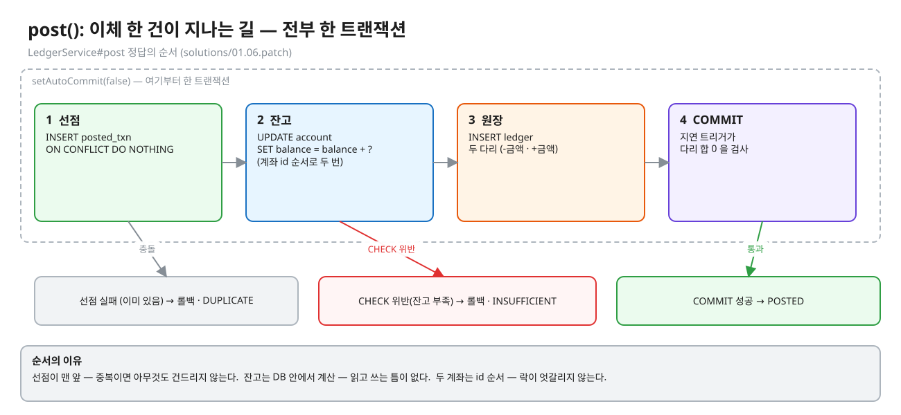
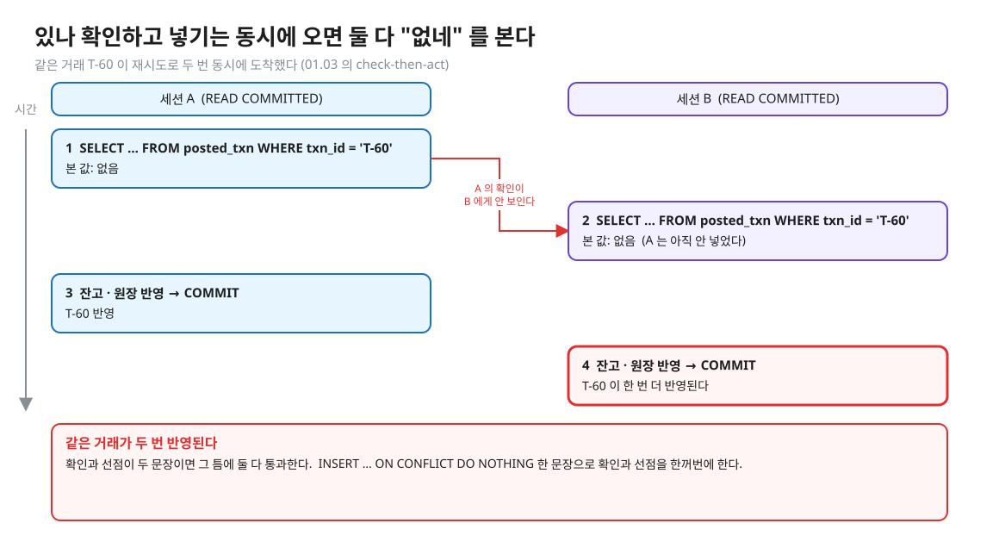
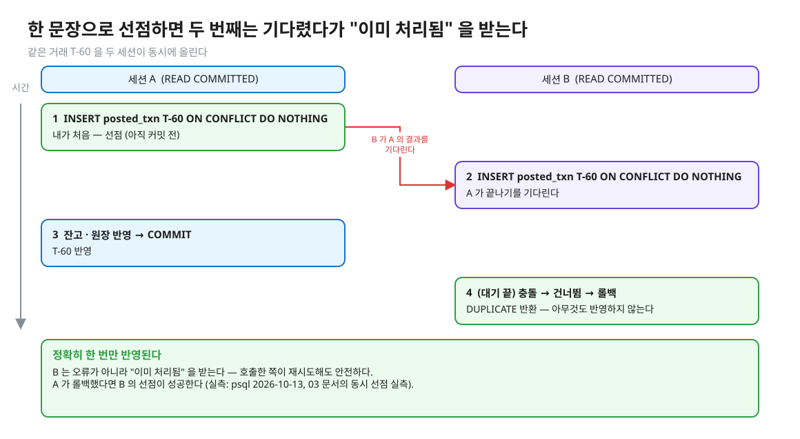
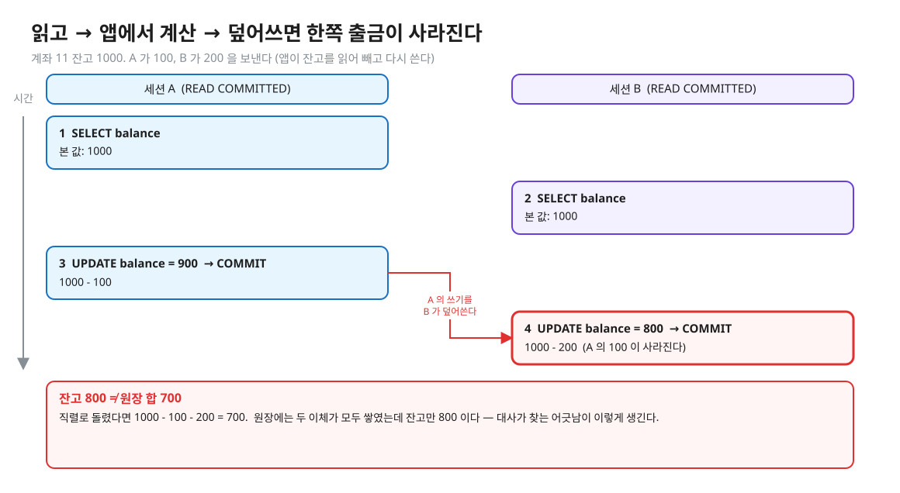
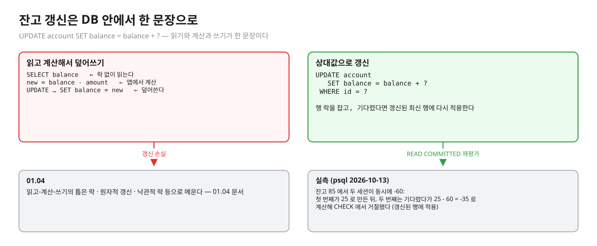
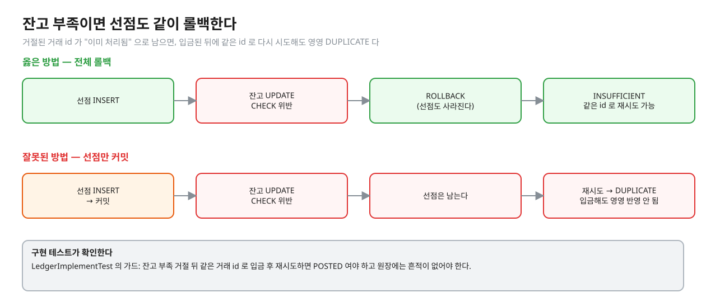
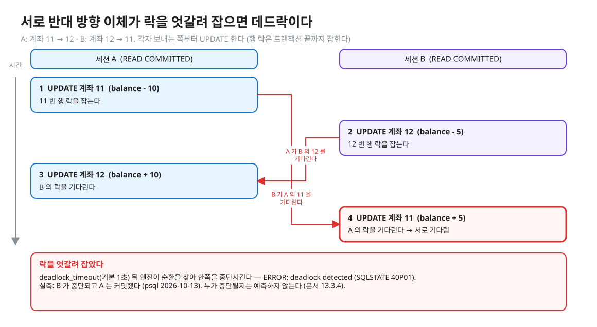
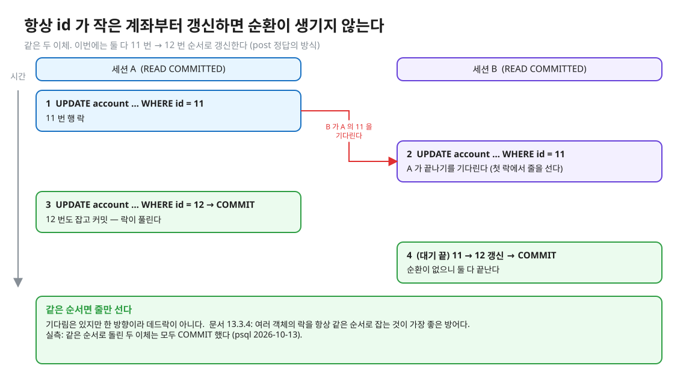
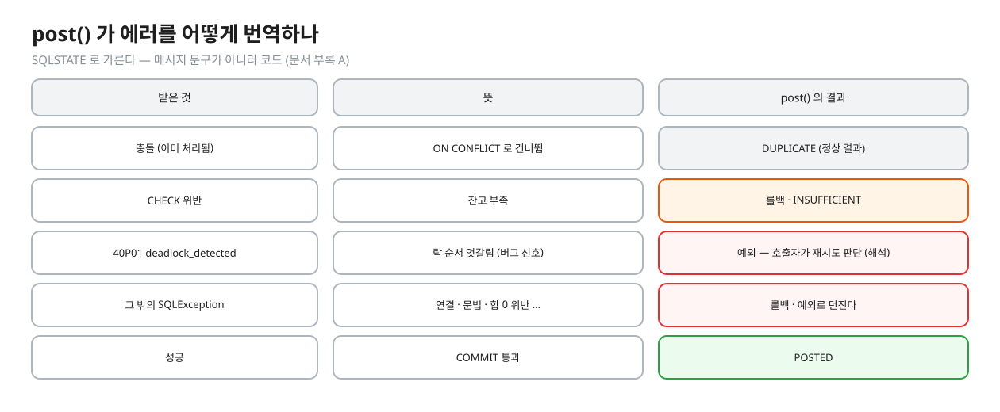

# 04. 원장에 기록하기

> **이 글에서 알게 되는 것**
> 1. 이체 한 건을 원장에 올리는 `post()` 가 어떤 순서로 무엇을 하는지, 그 순서의 이유를 안다.
> 2. 같은 거래의 중복 · 동시 이체의 잔고 손실 · 엇갈린 락(데드락)을 각각 무엇으로 막는지 안다.
> 3. 에러(잔고 부족 · 중복 · 데드락)를 앱이 어떻게 구분해 돌려주는지 안다.
>
> **먼저 알면 좋은 것**: [02. 잔고와 원장](02-balance-and-ledger.md) · [03. 규칙은 언제 검사하나](03-when-rules-are-checked.md)
> **다음 글**: [05. 대사](05-reconciliation.md)
> **구분**: 심화 — 꼬리질문 대비 (레슨을 마친 뒤 · 면접 전). `LedgerService#post` 구현에서 막혔을 때 먼저 펼치는 글이기도 하다.

## 이체 한 건이 지나는 길

02 에서 이체 한 건은 "원장 두 줄 + 두 잔고의 변경" 이라고 했다. 이것을 코드로 옮기면 네 단계다. 거래 id 를 선점하고, 두 잔고를 갱신하고, 원장 두 줄을 넣고, 커밋한다. 전부 한 트랜잭션이다.


<sub>편집: [diagrams/blog04-flow.excalidraw](diagrams/blog04-flow.excalidraw)</sub>

이 순서에는 이유가 셋 있다. 이 글은 그 셋 — 선점을 맨 앞에, 잔고는 DB 안에서, 계좌는 id 순서로 — 을 차례로 본다. (정답 코드: `solutions/01.06.patch`)

## 선점: 같은 거래는 한 번만

재시도나 중복 메시지로 같은 거래 T-60 이 두 번 도착한다고 하자. "이미 처리했나?" 를 `SELECT` 로 확인하고 없으면 처리하는 방식은 동시에 오면 깨진다. 두 세션이 모두 "없다" 를 보고 둘 다 반영한다. 01.03 이 다룬 check-then-act 문제다 ([01.03 문서 02](../../l03-idempotency/docs/02-check-then-act.md)).


<sub>편집: [diagrams/blog04-check-then-act.excalidraw](diagrams/blog04-check-then-act.excalidraw)</sub>

그래서 확인과 선점을 **한 문장**으로 한다. `INSERT INTO posted_txn (txn_id) VALUES (?) ON CONFLICT DO NOTHING` 을 실행해, 삽입된 행 수로 내가 처음인지 이미 처리된 거래인지 가른다 (행 수가 각각 몇인지는 03 의 `INSERT` 문서 · Q08 접은 칸 · 구현 `claim`). 동시에 오면 두 번째 문장은 첫 번째가 끝나기를 기다렸다가 결과를 받는다 (실측: 03 의 동시 선점 실측).


<sub>편집: [diagrams/blog04-claim.excalidraw](diagrams/blog04-claim.excalidraw)</sub>

호출한 쪽에는 **오류가 아니라 "이미 처리됨"** 을 돌려준다(`DUPLICATE`). 그래야 호출한 쪽이 재시도해도 안전하다. 이 레슨의 `PostResult` Javadoc 이 "두 번째 시도는 오류가 아니라 정상" 이라고 쓴 이유다. `ledger` 의 `UNIQUE (txn_id, account_id)` 는 선점을 빠뜨린 코드가 두 번째 줄을 넣을 때 막아 주는 뒤의 안전망이다 (03).

## 잔고 갱신: DB 안에서 한 문장으로

계좌 11 의 잔고가 1000 이고, 두 이체(100 과 200)가 동시에 온다. 앱이 잔고를 읽어 빼고 다시 쓰면 한쪽이 사라진다.


<sub>편집: [diagrams/blog04-lost-update.excalidraw](diagrams/blog04-lost-update.excalidraw)</sub>

원장에는 두 이체가 모두 쌓였는데 잔고만 800 이다. 05 의 대사가 찾는 어긋남이 이렇게 생긴다. 해법은 계산을 DB 안으로 넣는 것이다. `UPDATE account SET balance = balance + ? WHERE id = ?` 는 읽기 · 계산 · 쓰기가 한 문장이다. 같은 행을 두고 동시에 오면 엔진이 행 락으로 줄을 세우고, 기다린 쪽은 먼저 끝난 쪽이 만든 **최신 행**에 다시 적용한다. 문서(13.2.1): 첫 번째 갱신이 커밋하면 두 번째 갱신자는 갱신된 행에 연산을 적용하려 하고, `WHERE` 조건을 다시 평가한다. ([문서 13.2.1](https://www.postgresql.org/docs/16/transaction-iso.html)) 이 레슨은 01.04 와 같은 원리다 ([01.04 문서 02](../../l04-stock-concurrency/docs/02-atomic-conditional-update.md)).


<sub>편집: [diagrams/blog04-atomic.excalidraw](diagrams/blog04-atomic.excalidraw)</sub>

실측: 잔고 85 인 계좌에서 두 세션이 동시에 `balance = balance - 60` 을 하면, 첫 번째가 25 로 만든 뒤 두 번째는 기다렸다가 그 25 에서 60 을 빼 -35 가 되려다 CHECK 에서 거절됐다 (psql 2026-10-13). 둘 다 85 를 읽고 25 를 쓰는 일은 일어나지 않았다.

금액은 `BigDecimal` 이고 `setBigDecimal` 로 넘긴다. `double` 로 바꿔 계산하면 큰 금액에서 센트가 깨진다 ([01](01-numbers-float-numeric.md)).

### 잔고 부족: CHECK 가 막고, 앱이 번역한다

보내는 계좌의 잔고가 모자라면 `balance - 금액` 이 음수가 되어 `CHECK (balance >= 0 OR id = 0)` 를 어긴다. 앱이 먼저 읽어 비교하고 보내면 방금 본 갱신 손실 틈이 다시 열리므로, 이 레슨은 DB 가 거절하게 한다 (해석). 위반은 CHECK 위반을 가리키는 SQLSTATE 로 오고(코드 값은 Q04 의 접은 칸 · [부록 A](https://www.postgresql.org/docs/16/errcodes-appendix.html)), `post()` 는 이것을 `INSUFFICIENT` 로 번역한다.

여기에 놓치기 쉬운 곳이 있다. 선점은 이미 `INSERT` 했다. 잔고 부족으로 거절한다면 선점도 **같이 롤백**해야 한다. 선점이 커밋된 채 남으면 입금된 뒤 같은 거래 id 로 다시 시도해도 영영 `DUPLICATE` 가 나온다.


<sub>편집: [diagrams/blog04-insufficient.excalidraw](diagrams/blog04-insufficient.excalidraw)</sub>

구현은 하나의 트랜잭션 안에서 이 모두를 하므로 `rollback()` 하나로 선점과 부분 갱신이 함께 사라진다. 이 레슨의 가드 테스트(`잔고가 모자라면 거절하고 아무 흔적도 남기지 않는다`)가 같은 거래 id 의 재시도가 `POSTED` 가 되는지 확인한다 (`LedgerImplementTest`).

## 락 순서: 계좌는 id 순서로

`UPDATE` 는 해당 행에 행 락을 잡고, 행 락은 트랜잭션이 끝날 때까지 유지된다 ([문서 13.3.2](https://www.postgresql.org/docs/16/explicit-locking.html): "released at transaction end"). 이체는 두 계좌를 갱신하므로 두 행 락을 잡는다. 서로 반대 방향 이체(11 → 12 와 12 → 11)가 각자 보내는 쪽부터 갱신하면 락을 엇갈려 잡는다.


<sub>편집: [diagrams/blog04-deadlock.excalidraw](diagrams/blog04-deadlock.excalidraw)</sub>

문서(13.3.4)는 행 락만으로도 데드락이 생긴다고 하고, 엔진이 순환을 찾아 **한쪽 트랜잭션을 중단**시키며 어느 쪽인지는 예측하면 안 된다고 한다. 감지는 `deadlock_timeout`(기본 `1s`) 동안 기다린 뒤에 시작된다 ([문서 20.12](https://www.postgresql.org/docs/16/runtime-config-locks.html)). 실측으로 두 세션을 위 순서로 돌리니 약 1 초 뒤 한쪽이 `ERROR: deadlock detected` 로 중단됐고 다른 쪽은 커밋했다 (psql 2026-10-13). SQLSTATE 는 `40P01`(`deadlock_detected`)이다 ([부록 A](https://www.postgresql.org/docs/16/errcodes-appendix.html)).

방어는 문서가 말한 대로다. "여러 객체의 락을 항상 같은 순서로 잡는 것이 최선의 방어" 이다. 이 레슨은 두 계좌를 **id 가 작은 쪽부터** 갱신한다.


<sub>편집: [diagrams/blog04-lock-order.excalidraw](diagrams/blog04-lock-order.excalidraw)</sub>

같은 순서로 돌린 두 이체는 모두 커밋했다 (실측: psql 2026-10-13). 기다림은 있지만 한 방향이라 데드락이 아니다. 데드락의 원리는 [01.02 문서 05](../../l02-row-locks-deadlock/docs/05-deadlock.md) 에서 더 본다. 이 레슨의 구현 테스트에는 반대 방향 이체가 섞여 있고, 순서를 어기면 `40P01` 이 난다는 힌트가 실패 메시지에 들어 있다.

잔고를 왜 `balance = balance + ?` 로 하면서 먼저 선점을 두느냐는 순서 질문이 남는다. 선점이 맨 앞인 이유는 중복이면 **아무 락도 잡지 않고** 끝내기 위해서다. (해석)

## 원장 두 줄, 그리고 합 0 검사

잔고 갱신 뒤에 원장 두 줄을 넣는다(`(txn_id, from, -금액)` · `(txn_id, to, +금액)`). 두 INSERT 이든 한 INSERT 이든 상관없다. 03 에서 본 지연 제약 트리거가 커밋 때 두 줄의 합이 0 인지 검사하기 때문이다. 정상 경로에서는 합이 항상 0 이므로 통과하고, 걸린다면 코드 버그다. 이 레슨의 구현에서 합 0 위반은 `INSUFFICIENT` 로 번역되지 않고 예외로 던져진다 (CHECK 위반 코드가 아니므로).

## 에러를 어떻게 구분해 돌려주나

`post()` 는 SQLSTATE 로 갈라서 결과를 돌려준다. 메시지 문구가 아니라 코드를 검사하는 것이 안전하다 (문구는 언어 · 버전에 흔들린다 — [01.01 문서 01](../../l01-isolation-mvcc/docs/01-anomalies-and-isolation-levels.md)).


<sub>편집: [diagrams/blog04-error-map.excalidraw](diagrams/blog04-error-map.excalidraw)</sub>

정답 구현의 `catch (SQLException e)` 는 CHECK 위반 코드면 롤백 후 `INSUFFICIENT`, 그 밖에는 롤백하고 다시 던진다. 데드락(`40P01`)은 그 밖에 속해 호출자에게 예외로 올라간다. 호출자가 재시도할지는 정책이다. 거래 id 선점이 있으므로 같은 거래를 다시 올려도 두 번 반영되지 않는다 (해석).

### 앱 · 프레임워크에서는

- 정답 `post()` 는 `Connection#setAutoCommit(false)` 로 트랜잭션을 열고, 성공하면 `commit()`, 실패하면 `rollback()` 한다. 금액은 `setBigDecimal` · 잔고는 `UPDATE … SET balance = balance + ?` 다 (`solutions/01.06.patch`).
- 지연 제약을 쓰면 `commit()` 호출이 던질 수 있다 (03). 이 레슨의 `catch` 는 `commit()` 도 같은 `try` 안에 있다.
- Spring `@Transactional` 에서의 재시도 위치는 이 트랙의 [05 문서](../../docs/05-spring-jpa-mapping.md) 가 실측했다 (spring-probe): 재시도는 트랜잭션 경계 **바깥 빈**의 루프에 두어야 매 시도가 새 트랜잭션이고, `@Transactional` 메서드 안에서 같은 루프를 돌리면 같은 트랜잭션이라 두 번째 시도의 첫 쿼리가 `25P02` 로 끝내 실패한다. 같은 클래스의 `this.` 호출은 트랜잭션이 열리지 않는다. 데드락(`40P01`)은 JdbcTemplate 경로에서 `PessimisticLockingFailureException`, JPA 경로에서 `CannotAcquireLockException` 으로 온다 (실측: spring-probe). 이 레슨의 `post()` 는 순수 JDBC 이고, 지연 제약 위반(`commit()` 에서 나는 에러)이 Spring 에서 어떤 예외가 되는지는 이 레슨도 그 문서도 확인하지 않았다. 01.01 의 [05 문서](../../l01-isolation-mvcc/docs/05-serializable-ssi-retry.md) 가 재시도 설계를 다룬다.

### 기다림을 눈으로 보기

락 때문에 기다리는 세션은 `pg_stat_activity` 의 `wait_event_type = 'Lock'` 으로 보인다 ([문서 28.2](https://www.postgresql.org/docs/16/monitoring-stats.html)). 실측으로 다른 세션이 잡은 행을 `UPDATE` 하려 하는 세션은 `state = active` · `wait_event_type = Lock` · `wait_event = transactionid` 였다 (psql 2026-10-13). "트랜잭션 끝을 기다린다" 는 뜻이다.

```sql
SELECT pid, state, wait_event_type, wait_event, left(query, 60) AS query
FROM pg_stat_activity
WHERE wait_event_type = 'Lock' OR state = 'idle in transaction';
```

`idle in transaction` 은 트랜잭션을 연 채 쿼리를 안 보내는 상태로(문서 28.2), 이런 세션이 잡은 락이 다른 이체를 막는다.

## 자주 하는 오해

1. **"중복은 SELECT 로 먼저 확인하면 된다."** 동시에 오면 둘 다 "없다" 를 본다. 확인과 선점은 한 문장이어야 한다.
2. **"잔고는 읽어서 계산해야 부족한지 알 수 있다."** DB 의 CHECK 가 같은 일을 하고 틈이 없다. 앱의 사전 확인은 UX 용일 뿐 안전장치가 아니다. (해석)
3. **"두 계좌를 갱신하는 순서는 상관없다."** 반대 방향 이체가 있으면 데드락이 난다. id 순서로 고정한다.
4. **"실패하면 그냥 return 하면 된다."** 롤백하지 않으면 선점이 남거나 부분 갱신이 남는다.
5. **"DUPLICATE 도 에러로 던져야 한다."** 이미 처리됨은 정상 결과다. 에러로 던지면 호출자가 재시도 때마다 실패한 것으로 안다.

## 한눈에 정리

| 문제 | 막는 것 | 이 레슨의 장치 |
|---|---|---|
| 같은 거래 두 번 | 확인 + 선점을 한 문장으로 | `INSERT … ON CONFLICT DO NOTHING` |
| 동시 이체의 잔고 손실 | DB 안에서 상대값 갱신 | `balance = balance + ?` |
| 잔고 부족 | CHECK + 번역 | CHECK 위반 → `INSUFFICIENT` (선점도 롤백) |
| 락 엇갈림 | 갱신 순서 고정 | 계좌 id 순서 |
| 두 줄이 안 맞음 | 지연 제약 트리거 | 커밋 때 합 0 검사 |

- `post()` 의 순서: 선점 → 잔고(id 순) → 원장 두 줄 → 커밋. 전부 한 트랜잭션이고 실패하면 전체 롤백.
- 중복은 오류가 아니라 정상 결과(`DUPLICATE`)로 돌려준다.
- 데드락은 엔진이 한쪽을 중단시킨다(`40P01`). 막는 최선은 락 순서 고정이다.

## 스스로 확인

1. 잔고 부족으로 거절할 때 `rollback()` 을 안 하면 무슨 일이 생기나?
   <details><summary>답</summary>
   선점이 커밋된 채 남아(또는 트랜잭션이 열려 락을 쥔 채) 입금 뒤 같은 거래 id 로 다시 시도해도 `DUPLICATE` 가 나온다. 이 레슨의 가드 테스트가 이 경우를 잡는다.
   </details>
2. 반대 방향 이체 두 개가 동시에 오는데 락 순서를 고정했는데도 기다림이 생긴다. 문제인가?
   <details><summary>답</summary>
   아니다. 같은 순서라 한 방향 대기이고, 먼저 잡은 쪽이 끝나면 풀린다 (실측: 같은 순서로 돌린 두 이체 모두 커밋). 순환이 있어야 데드락이다 (문서 13.3.4).
   </details>
3. 데드락이 나면 누가 중단되나? 앱은 어떻게 하나?
   <details><summary>답</summary>
   엔진이 순환을 감지(`deadlock_timeout` 기본 1초 뒤)해 한쪽을 중단시키며, 어느 쪽인지는 예측하면 안 된다 (문서 13.3.4). 앱은 SQLSTATE `40P01` 을 보고 롤백한 뒤 재시도할지 정책으로 정한다. 거래 id 선점이 있어서 같은 거래의 재시도는 두 번 반영되지 않는다 (해석).
   </details>
4. 잔고를 SELECT 로 읽어 부족 여부를 먼저 확인하면 안 되는 이유는?
   <details><summary>답</summary>
   읽는 시점과 쓰는 시점 사이에 다른 트랜잭션이 잔고를 바꿀 수 있어서 확인이 무효가 된다. DB 의 CHECK 는 갱신된 최신 행에 대해 검사하므로 틈이 없다 (실측: 잔고 85 에서 동시 -60 두 번 중 두 번째만 거절).
   </details>

## 이 레슨에서 직접 보기

| 어디서 | 무엇을 |
|---|---|
| Q08 | 같은 거래를 두 번 기록하면 (`ON CONFLICT` · UNIQUE) |
| Q04 | `CHECK (balance >= 0)` 위반 — 잔고 부족의 정체 |
| 구현 `LedgerService#post` | 선점 · 잔고 · 두 다리 · 커밋 (빈 칸) |
| `LedgerImplementTest` | 같은 거래 두 번 · 같은 거래 동시에 · 동시 이체 24건 뒤 잔고 = 원장 합 · 잔고 부족 거절 · 방법 검사 |

빈칸 상태(읽고 → `double` 계산 → 덮어쓰기)에서는 구현 테스트가 빨강 8 · 초록 3 이다 (레슨 README). 실패 메시지가 고칠 곳을 알려 준다.

## 출처

- [PostgreSQL 16 · INSERT](https://www.postgresql.org/docs/16/sql-insert.html) — ON CONFLICT DO NOTHING · count
- [PostgreSQL 16 · 13.2 Transaction Isolation (13.2.1 Read Committed)](https://www.postgresql.org/docs/16/transaction-iso.html) — 대기 후 갱신된 행에 재적용 · WHERE 재평가
- [PostgreSQL 16 · 13.3 Explicit Locking](https://www.postgresql.org/docs/16/explicit-locking.html) — 행 락 해제 시점(13.3.2) · 데드락 · 락 순서(13.3.4)
- [PostgreSQL 16 · 20.12 Lock Management](https://www.postgresql.org/docs/16/runtime-config-locks.html) — deadlock_timeout 기본 1s
- [PostgreSQL 16 · 28.2 The Cumulative Statistics System](https://www.postgresql.org/docs/16/monitoring-stats.html) — pg_stat_activity wait_event_type · idle in transaction
- [PostgreSQL 16 · Appendix A. Error Codes](https://www.postgresql.org/docs/16/errcodes-appendix.html) — check_violation · 40P01
- 이 레슨: `solutions/01.06.patch`(`LedgerService#post`) · `LedgerImplementTest` · `PostResult`
- 실측: psql 2026-10-13 (PostgreSQL 16.14) — 데드락 · 같은 순서 · 동시 -60 · 락 대기
