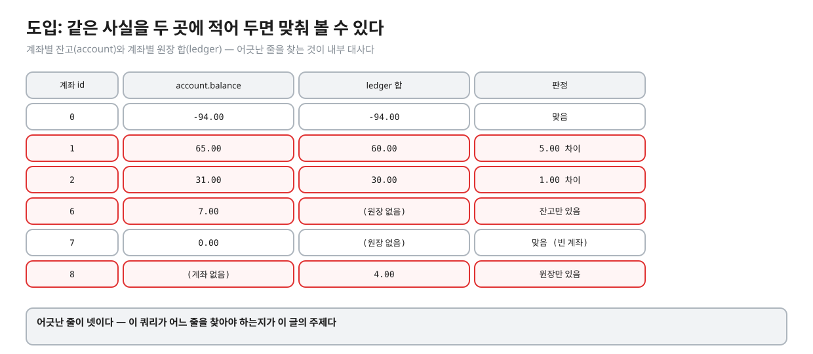
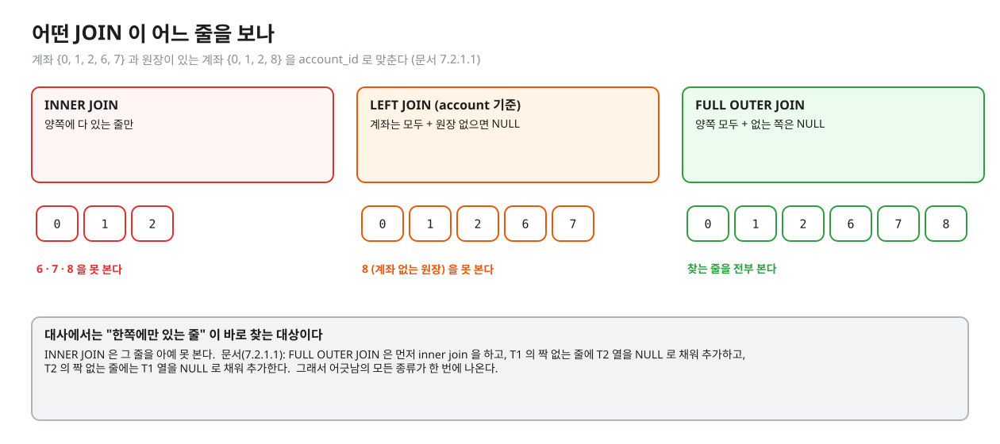
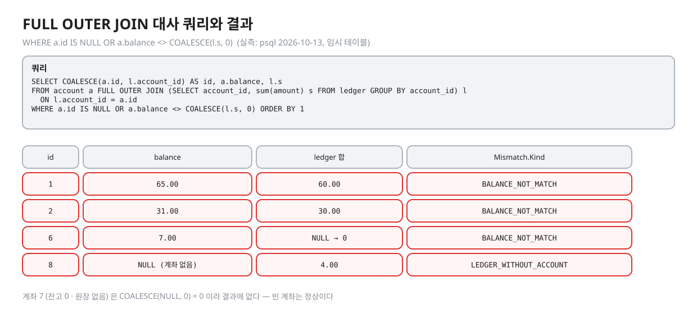
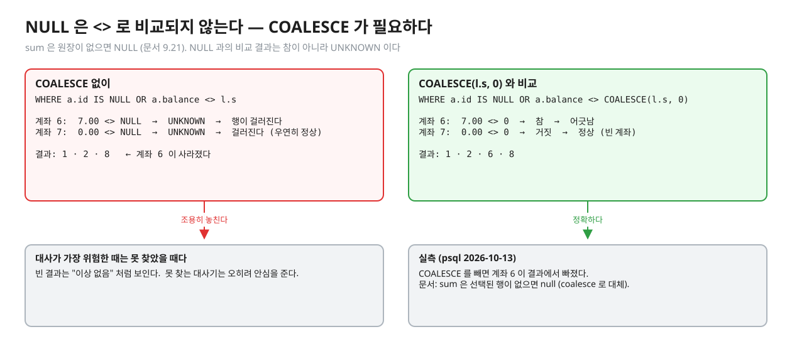
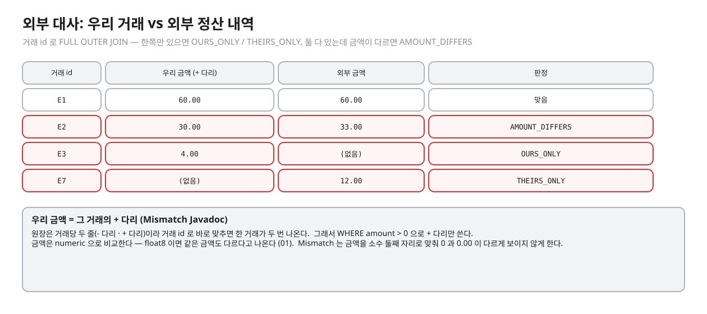
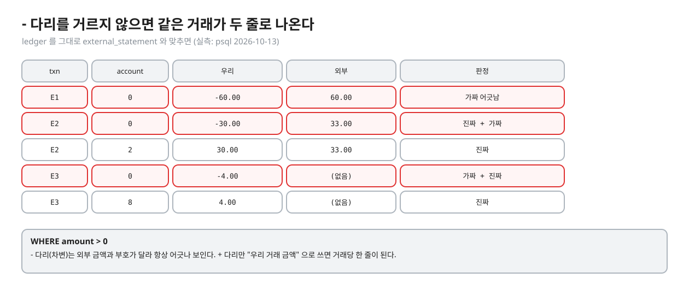
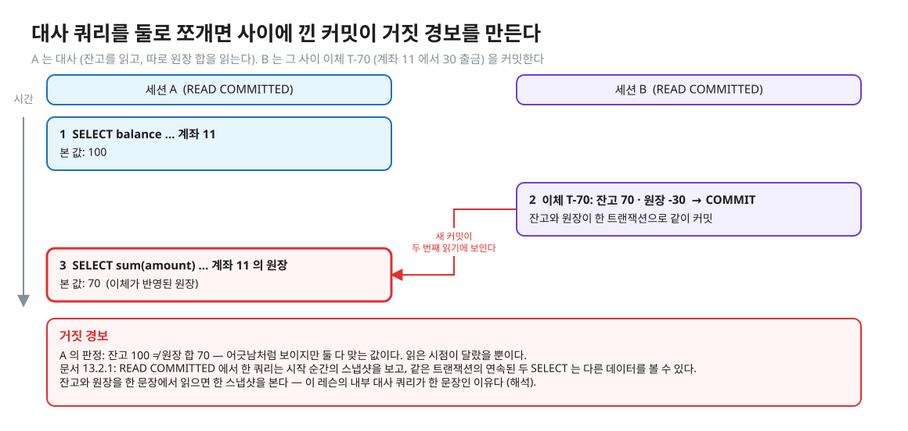
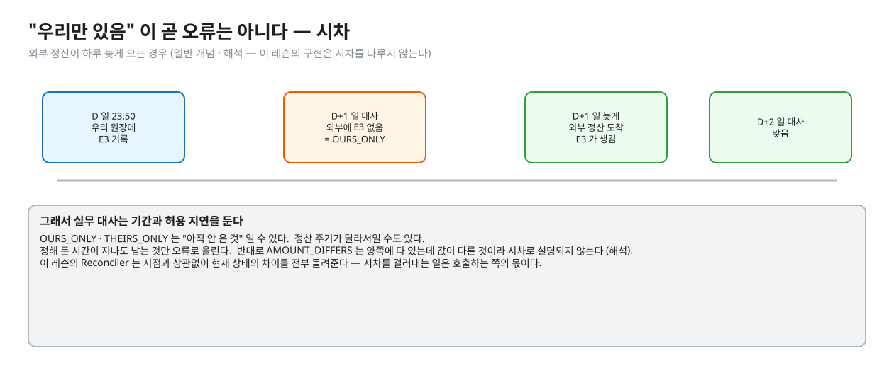
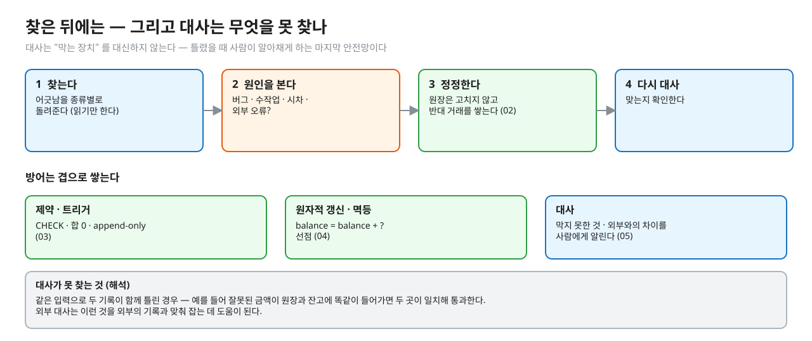

# 05. 대사

> **이 글에서 알게 되는 것**
> 1. 대사(reconciliation)가 무엇이고, 내부 대사와 외부 대사가 각각 무엇을 맞춰 보는지 안다.
> 2. 왜 `INNER JOIN` 이 아니라 `FULL OUTER JOIN` 을 쓰는지, `COALESCE` 가 왜 필요한지, 어긋남이 어떤 종류로 나뉘는지 안다.
> 3. 시차 · 한 쿼리로 읽기 · 찾은 뒤의 처리 · 대사가 못 찾는 것까지 안다.
>
> **먼저 알면 좋은 것**: [02. 잔고와 원장](02-balance-and-ledger.md) · [01. 숫자를 어떻게 저장하나](01-numbers-float-numeric.md)
> **다음 글**: [06. 면접 사다리](06-interview-ladder.md)
> **구분**: 필수 — ② 원리 (① 에서 예측을 먼저 한 뒤 읽는다). Q10 과 `Reconciler#findMismatches` 구현을 되짚는다.

## 같은 사실을 두 곳에 적어 두면 맞춰 볼 수 있다

02 에서 계좌 잔고(`account.balance`)와 계좌별 원장 합(`ledger`)은 같아야 한다고 했다. 같아야 하는 두 값을 나란히 놓고 다른 줄을 찾는 일이 **대사(reconciliation)** 다. 막는 장치가 있어도 코드 버그 · 수작업 UPDATE · 장애 중 일부 반영 같은 일로 어긋날 수 있으니, 어긋났을 때 알아채는 마지막 안전망이 필요하다.

계좌 {0, 1, 2, 6, 7} 과 원장이 있는 계좌 {0, 1, 2, 8} 을 나란히 놓은 장면이다.


<sub>편집: [diagrams/blog05-intro.excalidraw](diagrams/blog05-intro.excalidraw)</sub>

어긋난 줄은 넷이다. 값이 다른 줄(1 · 2), 계좌는 있는데 원장이 없고 잔고가 0 이 아닌 줄(6), 원장은 있는데 계좌가 없는 줄(8). 계좌 7 은 원장이 없지만 잔고가 0 이라 정상이다. 이 넷을 정확히 찾고 7 을 건드리지 않는 쿼리가 이 글의 주제다.

대사에는 두 종류가 있다. **내부 대사**는 같은 시스템 안의 두 기록(잔고 · 원장)을 맞춘다. **외부 대사**는 우리 원장과 바깥(상대 시스템)이 보내 준 정산 내역을 거래 id 로 맞춘다. (일반 개념 · 해석 — 이 레슨의 `Reconciler` 가 둘 다 한다)

## FULL OUTER JOIN — 한쪽에만 있는 줄을 보려고

대사가 찾는 것은 양쪽에 다 있는 줄이 아니라 **한쪽에만 있는 줄**이다. 어떤 JOIN 이 어느 줄을 보는지 PostgreSQL 문서(7.2.1.1)로 확인하자. `INNER JOIN` 은 T1 의 각 줄마다 조건을 만족하는 T2 의 줄만 낸다. `LEFT OUTER JOIN` 은 inner join 한 뒤 T1 에서 짝이 없는 줄에 T2 열을 NULL 로 채워 더한다. `FULL OUTER JOIN` 은 거기에 더해 T2 에서 짝이 없는 줄에 T1 열을 NULL 로 채워 더한다. ([문서 7.2.1.1](https://www.postgresql.org/docs/16/queries-table-expressions.html))


<sub>편집: [diagrams/blog05-joins.excalidraw](diagrams/blog05-joins.excalidraw)</sub>

`INNER JOIN` 은 6 · 7 · 8 을 아예 못 본다. `LEFT JOIN` 은 계좌 없는 원장(8)을 못 본다. 어긋남이 어느 쪽에 숨어 있을지 모르니 양쪽을 다 봐야 하고, 그래서 `FULL OUTER JOIN` 이다.

### 내부 대사 쿼리

이 레슨의 정답과 같은 모양이다. 계좌별 원장 합을 만들고(`GROUP BY`), 계좌와 `FULL OUTER JOIN` 한 뒤, 어긋난 줄만 남긴다. (실측: psql 2026-10-13, 위 장면 데이터를 임시 테이블에 넣어서)

```sql
SELECT COALESCE(a.id, l.account_id) AS id, a.balance, l.s
FROM account a
FULL OUTER JOIN (SELECT account_id, sum(amount) AS s FROM ledger GROUP BY account_id) l
  ON l.account_id = a.id
WHERE a.id IS NULL OR a.balance <> COALESCE(l.s, 0)
ORDER BY 1;
```


<sub>편집: [diagrams/blog05-result.excalidraw](diagrams/blog05-result.excalidraw)</sub>

결과 네 줄(1 · 2 · 6 · 8)이다. `INNER JOIN` 으로 `balance <> s` 를 걸었다면 같은 데이터에서 1 · 2 두 줄만 나왔다 (실측). 이 레슨의 `Mismatch.Kind` 로는 이렇게 나뉜다.

| 종류 | 뜻 | key · left · right |
|---|---|---|
| `BALANCE_NOT_MATCH` | 계좌 잔고 ≠ 그 계좌의 원장 합 (원장이 없으면 합을 0 으로 본다) | 계좌 id · 잔고 · 원장 합 |
| `LEDGER_WITHOUT_ACCOUNT` | 원장에는 있는데 계좌 행이 없다 (합이 0 이어도 어긋남이다) | 계좌 id · null · 원장 합 |

계좌 행이 없으면 `a.id IS NULL` 로 먼저 잡는다. 원장 합이 0 이어도 계좌가 없다는 사실 자체가 어긋남이기 때문이다 (`Mismatch.java` Javadoc).

### NULL 과 COALESCE

`sum` 은 선택된 행이 없으면 0 이 아니라 NULL 이다 (문서 9.21 — [01](01-numbers-float-numeric.md)). 원장이 없는 계좌의 `l.s` 는 NULL 이고, NULL 과의 `<>` 비교는 참이 아니라 UNKNOWN 이라 `WHERE` 가 그 줄을 걸러낸다. 그러면 계좌 6 이 조용히 사라진다.


<sub>편집: [diagrams/blog05-null-trap.excalidraw](diagrams/blog05-null-trap.excalidraw)</sub>

실측: `COALESCE` 를 빼면 계좌 6 이 결과에서 빠졌다 (psql 2026-10-13). 대사가 가장 위험한 때는 **못 찾았을 때**다. 빈 결과가 "이상 없음" 으로 읽히기 때문이다. 이 레슨의 `ReconcilerImplementTest` 가 가드(깨끗하면 빈 결과) 와 결과 검사(종류별로 정확히)를 둘 다 두는 이유도 같다.

또 하나. `FULL OUTER JOIN` 의 조건을 `ON` 에 넣느냐 `WHERE` 에 넣느냐는 결과가 다르다. 문서(7.2.2): 바깥 조인의 `ON` 은 `WHERE` 와 같지 않다 — `ON` 은 짝 없는 줄을 **추가하는** 일까지 하고, `WHERE` 는 조인 뒤 결과에서 줄을 **지운다**. ([문서 7.2.2](https://www.postgresql.org/docs/16/queries-table-expressions.html)) 실측으로 `LEFT JOIN … ON l.account_id = a.id AND a.balance <> l.s` 처럼 어긋남 조건을 `ON` 에 두면 모든 계좌가 그대로 나왔다 (psql 2026-10-13). 어긋난 줄만 남기려면 `WHERE` 다.

## 외부 대사

외부 정산 내역(`external_statement`)이 거래 id 와 금액을 보내 준다. 우리 원장과 거래 id 로 맞춘다. 같은 `FULL OUTER JOIN` 이다.


<sub>편집: [diagrams/blog05-external.excalidraw](diagrams/blog05-external.excalidraw)</sub>

```sql
SELECT COALESCE(o.txn_id, e.txn_id) AS txn_id, o.amount AS ours, e.amount AS theirs
FROM (SELECT txn_id, amount FROM ledger WHERE amount > 0) o
FULL OUTER JOIN external_statement e ON e.txn_id = o.txn_id
WHERE o.txn_id IS NULL OR e.txn_id IS NULL OR o.amount <> e.amount
ORDER BY 1;
```

| 종류 | 뜻 | left (우리) · right (외부) |
|---|---|---|
| `OURS_ONLY` | 우리 원장에만 있는 거래 | 금액 · null |
| `THEIRS_ONLY` | 외부 내역에만 있는 거래 | null · 금액 |
| `AMOUNT_DIFFERS` | 양쪽에 있지만 금액이 다르다 | 우리 금액 · 외부 금액 |

`WHERE amount > 0` 이 중요하다. 원장은 거래당 두 줄(- 다리 · + 다리)이라, 그대로 외부와 맞추면 한 거래가 두 줄로 나오고 - 다리는 부호가 달라 항상 어긋나 보인다.


<sub>편집: [diagrams/blog05-legs-filter.excalidraw](diagrams/blog05-legs-filter.excalidraw)</sub>

"우리 거래 금액" 은 그 거래의 + 다리 금액으로 정의한다 (`Mismatch` Javadoc). 금액은 `numeric` 으로 비교한다. `float8` 이면 같은 금액도 다르다고 나와 거짓 경보가 된다 ([01](01-numbers-float-numeric.md)). `Mismatch` 는 소수 둘째 자리로 맞춰 `0` 과 `0.00` 이 다르게 보이지 않게 한다.

## 읽는 시점: 한 문장으로 읽는다

대사는 두 값을 읽는다. 읽는 시점이 서로 다르면 어긋나지 않았는데도 어긋나 보일 수 있다. A 가 잔고를 읽은 뒤 B 가 이체를 커밋하고, A 가 원장 합을 따로 읽는 장면이다.


<sub>편집: [diagrams/blog05-snapshot.excalidraw](diagrams/blog05-snapshot.excalidraw)</sub>

문서(13.2.1): READ COMMITTED 에서 `SELECT` 는 쿼리가 시작되는 순간의 스냅샷을 보고, 같은 트랜잭션 안의 연속된 두 `SELECT` 는 그 사이 다른 트랜잭션이 커밋하면 다른 데이터를 볼 수 있다. ([문서 13.2.1](https://www.postgresql.org/docs/16/transaction-iso.html)) 이 레슨의 내부 대사 쿼리는 잔고와 원장 합을 **한 문장**에서 읽으므로 한 스냅샷을 본다. 이체는 잔고 갱신과 원장 INSERT 를 한 트랜잭션으로 커밋하므로(04) 한 스냅샷에는 둘이 함께 보이거나 함께 안 보인다. (해석 — 이 두 사실에서 이은 판단) 구현은 내부 대사와 외부 대사를 따로 실행한다. 둘은 서로 다른 데이터를 비교하므로 사이에 커밋이 끼어도 서로의 결과가 틀리지는 않는다 (해석).

## 시차: "우리만 있음" 이 곧 오류는 아니다

외부 정산이 하루 늦게 오는 경우를 생각해 보자. 우리가 D 일 23:50 에 기록한 거래 E3 는 D+1 일 대사 때 외부에 없다. `OURS_ONLY` 다. 그런데 외부가 늦게 보내 준다면 곧 맞는다.


<sub>편집: [diagrams/blog05-timing.excalidraw](diagrams/blog05-timing.excalidraw)</sub>

그래서 실무 대사는 기간과 허용 지연을 둔다. 정한 시간이 지나도 남는 것만 오류로 올린다. `AMOUNT_DIFFERS` 는 양쪽에 다 있는데 값이 다른 것이라 시차로는 설명되지 않는다. (일반 개념 · 해석) 이 레슨의 `Reconciler` 는 시차를 다루지 않고 현재 상태의 차이를 전부 돌려준다.

## 찾은 뒤에는

대사의 결과는 "고칠 목록" 이 아니라 "조사할 목록" 이다. `findMismatches()` 는 읽기만 한다. 찾은 뒤의 순서는 이렇다.


<sub>편집: [diagrams/blog05-after-find.excalidraw](diagrams/blog05-after-find.excalidraw)</sub>

원인을 보기 전에 숫자부터 맞추면 문제를 덮는다. 정정은 원장을 고치지 않고 반대 거래를 쌓는다 ([02](02-balance-and-ledger.md)). 이 레슨의 스키마는 원장 UPDATE · DELETE 를 막아 둔다 (03).

대사가 못 찾는 어긋남도 있다. 같은 입력으로 두 기록이 함께 틀린 경우다. 잘못된 금액이 원장과 잔고에 똑같이 들어가면 두 곳이 일치해 통과한다. 외부 대사는 이런 경우를 외부의 기록과 맞춰 잡는 데 도움이 된다. (해석 — 레슨 README 의 실무 메모) 그래서 대사는 막는 장치를 대신하지 않는다. DB 제약(03)과 원자적 갱신(04)으로 먼저 막고, 대사는 막지 못한 것과 외부와의 차이를 잡는다.

## 자주 하는 오해

1. **"대사는 INNER JOIN 으로 충분하다."** 한쪽에만 있는 줄이 찾는 대상이다. INNER JOIN 은 그 줄을 못 본다.
2. **"빈 결과면 이상 없다."** `COALESCE` 를 빼먹은 쿼리도 빈 결과를 낸다. 못 찾는 대사기가 가장 위험하다. 어긋남을 일부러 넣은 데이터로 대사기 자체를 검증한다.
3. **"어긋남을 찾았으니 원장을 UPDATE 로 고친다."** 원인을 먼저 본다. 정정은 반대 거래다.
4. **"외부에 없으면 틀린 거래다."** 시차일 수 있다.
5. **"대사만 있으면 제약은 필요 없다."** 대사는 틀린 뒤에 알아채고, 제약은 틀리기 전에 막는다. 둘이 다르다.

## 한눈에 정리

| | 내부 대사 | 외부 대사 |
|---|---|---|
| 맞추는 것 | 계좌 잔고 vs 계좌별 원장 합 | 우리 거래의 + 다리 vs 외부 정산 내역 |
| 키 | 계좌 id | 거래 id |
| JOIN | FULL OUTER JOIN + `COALESCE(합, 0)` | FULL OUTER JOIN |
| 종류 | `BALANCE_NOT_MATCH` · `LEDGER_WITHOUT_ACCOUNT` | `OURS_ONLY` · `THEIRS_ONLY` · `AMOUNT_DIFFERS` |

- 대사는 같은 사실을 두 곳에 적어 두고 어긋난 줄을 찾는 일이다. 한쪽에만 있는 줄이 찾는 대상이라 FULL OUTER JOIN 이다.
- NULL 은 `<>` 로 비교되지 않는다 — 합이 NULL 일 수 있으면 `COALESCE` 로 0 을 준다.
- 두 값은 한 문장으로 읽는다 — 문장마다 스냅샷이 다르다.
- 찾은 뒤에는 원인부터. 정정은 반대 거래. 시차는 허용 지연으로 거른다.

## 스스로 확인

1. 내부 대사에서 `COALESCE` 를 빼면 어떤 줄이 사라지고, 왜 문제인가?
   <details><summary>답</summary>
   원장이 없는 계좌 중 잔고가 0 이 아닌 줄(예: 잔고 7.00 에 원장 없음)이 사라진다. 합이 NULL 이라 `7.00 <> NULL` 이 UNKNOWN 이 되어 WHERE 가 거르기 때문이다 (실측). 못 찾은 어긋남이 "이상 없음" 으로 읽힌다.
   </details>
2. `LEFT JOIN` 으로 계좌 기준만 보면 무엇을 놓치나?
   <details><summary>답</summary>
   원장에는 있는데 계좌 행이 없는 줄(`LEDGER_WITHOUT_ACCOUNT`)을 못 본다. 문서(7.2.1.1)상 LEFT JOIN 은 왼쪽(T1)의 짝 없는 줄만 추가하기 때문이다.
   </details>
3. 외부 대사에서 `amount > 0` 을 걸지 않으면 어떻게 되나?
   <details><summary>답</summary>
   한 거래가 - 다리와 + 다리 두 줄로 나와, - 다리는 부호가 달라 항상 어긋난 것처럼 보인다 (실측: 가짜 어긋남이 거래마다 하나씩 더 나왔다).
   </details>
4. `OURS_ONLY` 가 나왔다. 곧바로 오류로 처리해도 되나?
   <details><summary>답</summary>
   안 된다. 외부가 아직 보내지 않았거나 정산 주기가 달라서일 수 있다. 허용 지연 · 기간을 두고 시간이 지나도 남는 것만 오류로 올린다 (일반 개념 · 해석).
   </details>
5. 모든 잔고의 합이 0 이 아니다. 계좌별 대사 없이도 알 수 있는 것은?
   <details><summary>답</summary>
   어딘가 어긋났다는 것(이체는 돈을 만들지도 없애지도 않는다). 어느 계좌인지는 계좌별 대사가 알려 준다 (02, 실측: 원장 합 0.00 · 잔고 합 9.00 인 장부).
   </details>

## 이 레슨에서 직접 보기

| 어디서 | 무엇을 |
|---|---|
| Q10 | 대사 쿼리가 찾는 어긋남 건수 (INNER JOIN vs FULL OUTER JOIN) |
| 장면 3 (observe/SCRIPT.md) | psql 로 대사 쿼리 직접 — 외부 대사 세 줄의 종류, COALESCE 를 빼면 |
| 구현 `Reconciler#findMismatches` | 내부 · 외부 대사 (빈 칸) |
| `ReconcilerImplementTest` | 결과 검사 넷(잔고 ≠ 원장 합 · 원장 없는 계좌 / 계좌 없는 원장 · 외부 대사 세 종류 · 섞인 경우) + 가드(깨끗하면 빈 결과) |

이 글의 장면은 일부러 문항과 다른 데이터(계좌 {0, 1, 2, 6, 7} · 원장 {0, 1, 2, 8})다. 문항의 값은 직접 적어 본 뒤에 확인한다.

<details><summary>실측 — 예측을 끝낸 뒤 펼친다 (Q10)</summary>

정답 상태 기준 ([정답 patch](../../../solutions/01.06.patch)): 계좌 0(-145) · 1(100) · 2(50) · 3(10) · 5(0) · 계좌 4 는 없음, 원장 D1 · D2 · D4.

| Q | 상황 | 결과 |
|---|---|---|
| Q10 | INNER JOIN 으로 "잔고 <> 원장 합" 인 계좌 수 · FULL OUTER JOIN + COALESCE 로 센 수 | 1 · 3 (FULL 쪽은 계좌 2 · 계좌 3 · 계좌 4 의 원장) |
</details>

## 출처

- [PostgreSQL 16 · 7.2 Table Expressions](https://www.postgresql.org/docs/16/queries-table-expressions.html) — INNER · LEFT · FULL OUTER JOIN 정의(7.2.1.1) · ON 과 WHERE 의 차이(7.2.2)
- [PostgreSQL 16 · 9.21 Aggregate Functions](https://www.postgresql.org/docs/16/functions-aggregate.html) — sum 은 행이 없으면 null · coalesce
- [PostgreSQL 16 · 13.2 Transaction Isolation](https://www.postgresql.org/docs/16/transaction-iso.html) — READ COMMITTED 의 쿼리 시작 시점 스냅샷
- 이 레슨: `solutions/01.06.patch` (`Reconciler`) · `Mismatch.java` · `ReconcilerImplementTest` · `observe/SCRIPT.md` 장면 3
- 대사의 종류 · 시차 · 반대 거래: 회계 · 운영 일반 개념 — 공식 출처를 붙이지 않았고 (일반 개념 · 해석) 으로 표시했다
- 실측: psql 2026-10-13 (PostgreSQL 16.14) — 임시 테이블로 내부 · 외부 대사 · COALESCE 제거 · ON vs WHERE
