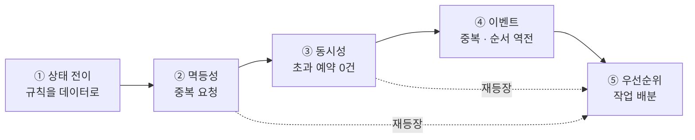

# order-flow-playground

> **완료 기준(1줄)**: 다섯 스테이지를 전부 초록으로 만들고, 그중 무작위 1개를 **사전 준비 없이 60분 안에** 완주한다.

주문 흐름(상태 → 재고 → 배송 → 작업 배분)을 소재로,
**외부 시스템과 내부 상태를 어긋나지 않게 유지하는 문제**를 60분 타임박스로 반복 연습하는 실험장.

새 기술은 하나도 안 배운다. **이미 아는 것을 제한 시간 안에 꺼내 쓰는 연습**이다.

---

## 이 저장소의 규칙

**구현은 전부 비어 있다.** 채워져 있는 것과 아닌 것:

| | 상태 |
|---|---|
| 도메인 타입 (enum, record), 예외 클래스 | ✅ 채워져 있음 (보일러플레이트) |
| 동시성 테스트 하네스 `ConcurrencyHarness` | ✅ 채워져 있음 |
| **로직 메서드 전부** | ❌ `throw new UnsupportedOperationException("TODO")` |
| stage1 테스트 | ✅ 완비 — 명세 겸 **테스트 작성 견본** |
| stage2~5 테스트 | ❌ `@Disabled` 스텁 + 시나리오 힌트만. **직접 쓴다** |
| docs/ 확장 질문 | ✅ 질문과 답 모두 (답은 접혀 있음 — 먼저 답해보고 펼친다) |

첫 실행이 빨간 게 정상이다.

---

## 사전 준비

- JDK 21 (`java -version` 으로 확인)
- 그 외 없음 — Spring도 DB도 도커도 쓰지 않는다. **인프라 설정에 60분을 태우지 않기 위한 의도적 선택**이다

---

## 실행

```bash
./gradlew s1        # stage1 만
./gradlew test      # 전체
```

저장소 루트에서 그대로 친다. `app/` 안에서 쳐도 동일하다 —
루트의 `gradlew` 는 `app/gradlew` 로 넘기는 위임 스크립트고, 실제 Gradle 빌드는 `app/` 에만 있다.

> 전역 `gradle` 이 아니라 **항상 `./gradlew`** 를 쓴다. 이 빌드는 wrapper 의 Gradle 8.5 기준이다.

첫 실행 결과 (정상):
```
72 tests completed, 41 failed, 31 skipped
```
- `failed 41` = 미구현 TODO
- `skipped 31` = 직접 쓸 테스트 (`@Disabled` 제거하고 채운다)

스크립트:
```bash
./scripts/01-drill.sh 3      # stage3 을 60분 타이머와 함께 시작
./scripts/02-progress.sh     # 스테이지별 구현률 확인
```

---

## 다섯 스테이지

| # | 주제 | 핵심 질문 | 노트 |
|---|---|---|---|
| 1 | 상태 전이 | 규칙을 `if` 가 아니라 어디에 둘 것인가 | [01](docs/01-state-transition.md) |
| 2 | 멱등성 | 같은 요청이 두 번 오면 | [02](docs/02-idempotency.md) |
| 3 | 동시성 | 재고 10개에 50명이 동시에 달려들면 | [03](docs/03-concurrency-and-stock.md) |
| 4 | 이벤트 순서 | 완료 후에 과거 이벤트가 도착하면 | [04](docs/04-event-ordering.md) |
| 5 | 우선순위 | 무엇부터 처리할 것인가 | [05](docs/05-priority-dispatch.md) |



순서는 난이도가 아니라 **의존 관계**다. 02의 멱등성은 04·05에서 다시 나온다.

---

## 진행 방법

1. **`docs/10-timeboxed-drill.md` 를 먼저 읽는다** — 60분을 어떻게 쓰는지가 코드보다 중요하다
2. 스테이지 하나를 골라 타이머를 켜고 구현한다
3. 초록이 되면 해당 노트의 **확장 질문**에 답한다 (여기가 본체다)
4. `TESTING.md` 에 3줄 기록 — 막힌 곳 / 배운 것 / 다음 개선
5. 같은 곳에서 두 번 막히면, 그게 진짜 약점이다

> **하지 말 것**: 다섯 개를 하루에 몰아치기. 한 회차 60분 + 노트 20분이면 충분하다.
> 강도보다 반복 횟수가 중요하다.

---

## 이 연습이 실제로 겨냥하는 것

코드가 아니라 **진행 방식**이다.

```
요구사항 재진술 → 애매한 조건 질문 → 단순한 정상 경로 → 테스트
→ 중복 · 동시성 · 예외 보완 → 복잡도와 실서비스 확장 설명
```

마지막 단계가 빠지면 알고리즘 풀이로 끝난다. 매 회차 마지막 10분에 반드시 이 문장을 소리 내어 말한다:

> "현재 구현은 단일 프로세스 메모리 기반의 단순화 버전입니다.
> 실서비스라면 상태와 이력을 DB에 두고 unique 제약으로 중복을 막고,
> 실패 건을 나중에 찾아 재처리할 수 있게 원본과 사유를 남기겠습니다."

---

## 정리

로컬 코드뿐이라 비용 0. 빌드 산출물만 지우면 된다.

```bash
./gradlew clean
```

---

## 문서

- [docs/](docs/README.md) — 학습 지도 (여기서 시작)
- [TESTING.md](TESTING.md) — 드릴 매트릭스 + 회차 기록
