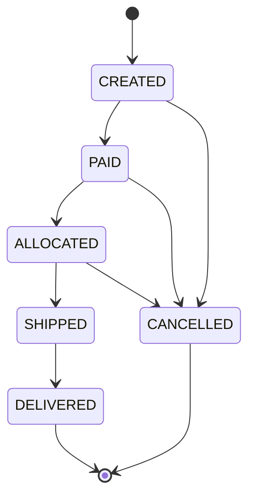

# 01 — 상태 전이를 데이터로 표현하기

> 상태 전이 규칙이 `if` 로 흩어지면, 상태가 하나 늘 때 어디를 고쳐야 하는지 아무도 모른다.

**대상 코드**: `stage1/OrderStateMachine.java` · `stage1/OrderStatus.java`
**완료 기준**: `./gradlew s1` 초록

---

## 1. 문제

주문은 시간에 따라 상태가 바뀐다. 그런데 상태를 바꾸는 코드는 서비스 여기저기에 흩어진다.

```java
// 결제 서비스
if (order.getStatus() == CREATED) { order.setStatus(PAID); }

// 창고 서비스
if (order.getStatus() == PAID) { order.setStatus(ALLOCATED); }

// 취소 API
if (order.getStatus() != SHIPPED) { order.setStatus(CANCELLED); }   // ← DELIVERED 는?
```

세 번째 줄이 버그다. `DELIVERED` 인 주문도 취소된다. 그리고 이런 버그는 **상태를 하나 추가할 때마다 새로 생긴다.**



이 그림이 코드 안에 **그림 그대로** 들어 있어야 한다.

---

## 2. 핵심 아이디어 — 규칙을 데이터로

```java
private static final Map<OrderStatus, Set<OrderStatus>> ALLOWED = new EnumMap<>(...);
```

`if` 체인 대신 표를 만든다. 얻는 것:

| | if 체인 | 전이표(데이터) |
|---|---|---|
| 상태 추가 | 호출부 전부 검토 | 표에 한 줄 |
| 전이 규칙 전체 보기 | 불가능 (흩어져 있음) | 한 화면 |
| 누락 검출 | 런타임에 발견 | 표를 순회하는 테스트로 검출 |
| 설정으로 외부화 | 불가능 | 표만 갈아끼우면 됨 |

> ⚠️ **함정**: `EnumMap` 대신 `HashMap` 을 써도 동작한다. 하지만 enum 키에는 `EnumMap` 이 정석이다 — 내부가 배열이라 해시 계산이 없고, 순회 순서가 선언 순서로 고정된다. **"돌아가니까 됐다" 와 "왜 이걸 골랐는지 말할 수 있다" 의 차이가 이런 지점에서 난다.**

---

## 3. 결정해야 하는 것 — 자기 상태로의 전이

`PAID → PAID` 는 허용인가?

| 선택 | 의미 | 결과 |
|---|---|---|
| 허용(true) | "이미 그 상태면 성공으로 친다" | 상태 머신이 멱등성까지 떠안는다 |
| **거부(false)** ← 이 플레이그라운드의 선택 | "전이가 아니다" | 중복 요청 처리는 별도 계층(stage2)이 담당 |

정답이 하나는 아니다. **중요한 건 결정을 내리고 그 이유를 말하는 것**이다.

> 💡 이렇게 말한다: "같은 상태로의 전이는 false 로 두겠습니다. '이미 PAID 인데 PAID 요청이 또 왔다'는 상태 전이의 문제가 아니라 중복 요청의 문제라서, 멱등 처리 계층에서 다루는 게 책임 분리에 맞다고 봅니다."

---

## 4. 확장 질문

코드가 초록이 된 다음이 진짜다. 먼저 답해보고 펼쳐라.

### Q1. 이 상태를 DB에 저장한다면, 동시에 두 요청이 상태를 바꾸려 하면?

<details><summary>답</summary>

메모리에서 `canTransition` 이 true 여도, 그 사이 다른 트랜잭션이 상태를 바꿨을 수 있다 (check-then-act).

**해법 1 — 조건부 UPDATE (권장)**
```sql
UPDATE orders SET status = 'PAID'
WHERE order_id = ? AND status = 'CREATED';
```
영향 행 수가 0이면 "누군가 먼저 바꿨다"는 뜻. 락 없이 원자적이고, DB 왕복 1회로 끝난다.

**해법 2 — 낙관적 락**: `version` 컬럼. JPA `@Version`. 충돌 시 `OptimisticLockException` → 재시도.

**해법 3 — 비관적 락**: `SELECT ... FOR UPDATE`. 확실하지만 락 유지 시간만큼 처리량이 깎인다.

상태 전이처럼 **충돌이 드물고 재시도가 싼** 경우는 1번이나 2번이 맞다.
</details>

### Q2. 상태 변경 이력은 어떻게 남기나?

<details><summary>답</summary>

`orders.status` 하나만 두면 "언제 누가 왜 바꿨는지"가 사라진다. **현재 상태와 이력은 별도 테이블**로 나눈다.

```
orders             : order_id, status(현재), updated_at
order_status_history : id, order_id, from_status, to_status, reason, actor, occurred_at
```

- 현재 상태 조회는 빠르게 (조인 없이)
- 이력은 append-only — UPDATE/DELETE 없음. 이게 감사(audit)의 전제
- 장애 조사에서 실제로 쓰이는 건 대부분 이력 쪽이다

같은 트랜잭션에서 둘을 함께 쓴다. 이력만 남고 상태가 안 바뀌거나 그 반대면 조사 자체가 불가능해진다.
</details>

### Q3. 상태가 20개로 늘어나면?

<details><summary>답</summary>

전이표는 20개까지는 버틴다. 그 이상이면 신호를 의심한다:

- **상태 하나에 여러 관심사가 섞여 있진 않은가** — 결제 상태 / 배송 상태 / 정산 상태를 한 enum 에 밀어넣으면 조합 폭발이 난다. 축을 나누면 `5 × 4` 가 `20` 이 아니라 `5 + 4` 가 된다
- 그래도 크면 전이표를 설정 파일로 외부화하거나 상태 머신 라이브러리(Spring StateMachine 등)를 검토

다만 라이브러리는 **디버깅 난이도와 학습 비용**을 같이 데려온다. 전이표 하나로 되는 걸 프레임워크로 바꾸는 건 대개 손해다.
</details>

### Q4. `CANCELLED` 후 환불이 필요하면 `REFUNDED` 를 추가해야 하나?

<details><summary>답</summary>

여기서 갈린다 — **주문 상태와 결제 상태는 다른 축이다.**

`CANCELLED` 는 주문의 종료 상태이고, 환불은 결제 쪽 흐름이다. 주문 enum 에 `REFUNDED` 를 넣으면
"취소됐지만 환불 전" 을 표현할 수 없어 결국 `CANCELLED_PENDING_REFUND` 같은 상태가 딸려 나온다. 조합 폭발의 시작.

축을 나눈다: `order.status = CANCELLED` + `payment.status = REFUND_PENDING → REFUNDED`.

> ✗→✓ **오해**: "상태가 늘면 enum 에 추가한다" → **정정**: 먼저 "이게 같은 축의 상태인가"를 묻는다. 다른 축이면 다른 필드다.
</details>

---

## 5. 자가 점검

- [ ] 전이표가 데이터로 표현돼 있다 (if 체인 아님)
- [ ] 종료 상태 판정이 한 곳에만 있다
- [ ] enum 값을 추가하면 깨지는 안전망 테스트가 있다
- [ ] self-transition 정책을 정하고 이유를 말할 수 있다
- [ ] 예외 메시지에 from/to 가 들어간다
- [ ] Q1(동시 전이)을 SQL 로 답할 수 있다

---

**다음** → [02 — 멱등성](02-idempotency.md)
