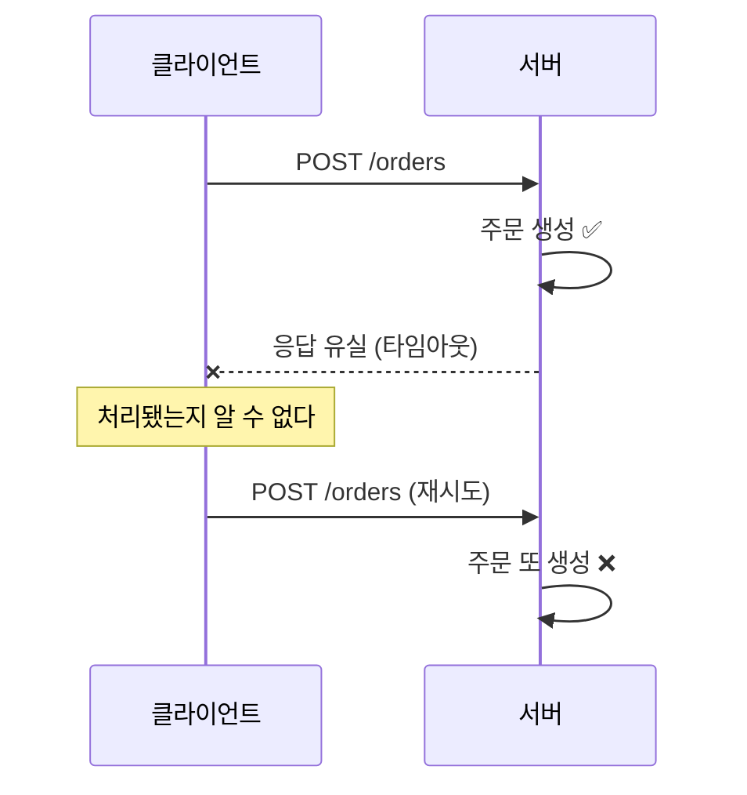

# 02 — 멱등성: 같은 요청이 두 번 와도 한 번만

> 네트워크에서 "응답을 못 받았다" 와 "처리가 안 됐다" 는 **구분할 수 없다.**
> 이 한 문장이 멱등성이 필요한 이유 전부다.

**대상 코드**: `stage2/IdempotentOrderService.java`
**완료 기준**: `./gradlew s2` 초록 + 동시 50요청에 생성 1회

---

## 1. 문제



클라이언트는 잘못한 게 없다. 재시도는 **올바른 동작**이다. 막아야 하는 쪽은 서버다.

같은 모양의 사고들:
- 사용자 더블클릭
- 로드밸런서/프록시의 자동 재시도
- 메시지 브로커의 at-least-once 재전달
- 배치 job 재실행

전부 "같은 의도의 요청이 두 번 도착" 이다.

---

## 2. 저장해야 하는 세 가지

```
key          클라이언트가 준 멱등키
fingerprint  요청 내용의 지문
result       처리 결과 (orderId)
```

**fingerprint 를 빠뜨리는 구현이 가장 흔하다.** 없으면 이런 일이 난다:

```
POST /orders  key=k1  {sku: A, qty: 1}   → ORDER-1 생성
POST /orders  key=k1  {sku: B, qty: 99}  → ORDER-1 반환 ← 사용자는 B를 주문했다고 믿는다
```

키 재사용은 클라이언트 버그다. 조용히 넘기지 말고 **409 Conflict** 로 알려줘야 고쳐진다.

> ⚠️ **함정**: fingerprint 를 "요청 객체 전체의 equals" 로 잡으면, 의미 없는 차이(라인 순서, 공백, 타임스탬프 필드)까지 충돌로 잡힌다. **무엇을 같다고 볼지는 비즈니스 결정**이다. Q2 참조.

---

## 3. 동시성 — 이 스테이지의 본 게임

키 검사와 저장 사이가 원자적이지 않으면 두 요청이 동시에 통과한다.

```java
// ❌ check-then-act
if (!store.containsKey(key)) {   // 두 스레드가 동시에 여기 통과
    store.put(key, create());     // 둘 다 생성
}
```

```java
// ✅ 키 단위 원자 연산
store.computeIfAbsent(key, k -> create());
```

`ConcurrentHashMap#computeIfAbsent` 는 **같은 키에 대해 매핑 함수를 한 번만** 실행한다. 다른 키끼리는 막지 않는다(버킷 단위 락).

> ⚠️ **함정**: `computeIfAbsent` 의 매핑 함수 안에서 **같은 맵을 다시 건드리면 데드락 또는 `ConcurrentModificationException`** 이다. 매핑 함수는 짧고 순수하게. I/O(DB 호출, HTTP)를 그 안에서 하는 것도 위험하다 — 버킷 락을 붙잡은 채 네트워크를 기다리게 된다.

### 그런데 이건 단일 JVM 얘기다

서버가 2대면 `ConcurrentHashMap` 2개가 각자 논다. **분산 환경에서는 무의미하다.**

| 방법 | 원리 | 특징 |
|---|---|---|
| **DB unique 제약** | `UNIQUE(idempotency_key)` + INSERT 시도 | 가장 견고. 두 번째 INSERT 가 제약 위반 → 잡아서 기존 결과 조회. **DB가 이미 하는 일을 재발명하지 않는 게 핵심** |
| Redis `SETNX` | 원자적 set-if-absent | 빠르지만 Redis 유실 시 중복 발생. 결제급이면 DB 권장 |
| 분산 락 | Redisson 등 | 락 획득/해제 실패 경로가 추가된다. 위 두 개로 되면 안 쓰는 게 낫다 |

> 💡 **실무**: 응답 캐시를 통째로 저장할지, orderId 만 저장할지도 결정 사항이다. 응답이 크면 저장 비용이 크고, 작으면 재구성 비용이 든다. 대개 **식별자만 저장하고 조회로 재구성**이 균형점.

---

## 4. 확장 질문

### Q1. 멱등 레코드는 언제까지 보관하나?

<details><summary>답</summary>

영원히 두면 테이블이 무한히 큰다. TTL 을 정해야 하는데, 기준은 **"클라이언트가 재시도를 포기하는 시점"** 이다.

- HTTP API: 24시간이면 충분한 경우가 많다 (Stripe 는 24시간)
- 배치/메시지 재처리: 재처리 윈도우보다 길게. 7일 등
- TTL 이 너무 짧으면 → 늦은 재시도가 중복 생성으로 이어진다
- 너무 길면 → 저장소 비용 + 인덱스 비대

삭제는 배치로. **저부하 시간대에, 청크 단위로.** `DELETE FROM ... WHERE created_at < ?` 한 방은 대량이면 락과 복제 지연을 부른다.

> 📖 근거: [Stripe — Idempotent requests](https://docs.stripe.com/api/idempotent_requests)
</details>

### Q2. 무엇을 "같은 요청" 으로 볼 것인가?

<details><summary>답</summary>

정답 없음. **정하고 문서화하는 것**이 답이다.

| 후보 | 판단 |
|---|---|
| 요청 바디 전체 해시 | 가장 엄격. 공백·필드 순서 차이도 충돌 → JSON 이면 정규화 필요 |
| 비즈니스 키만 (customerId + 라인 집합 + 금액) | 실무에서 가장 흔함. 의미 있는 필드만 고른다 |
| 라인 순서 무시 | 집합으로 비교. `[A,B]` 와 `[B,A]` 를 같게 볼 것인가 — 대개 같게 보는 게 맞다 |

주의: 요청에 `requestedAt` 같은 **매번 달라지는 필드**가 있으면 전체 해시는 항상 충돌한다. 이런 필드를 지문에서 빼는 것이 실무 작업의 대부분.
</details>

### Q3. 처리 중(in-flight)에 같은 키로 또 오면?

<details><summary>답</summary>

세 가지 상태가 필요하다: `IN_PROGRESS` / `COMPLETED` / `FAILED`.

- `IN_PROGRESS` 인데 또 오면 → **409 또는 425(Too Early)** 로 "처리 중이니 잠시 후 재시도" 를 알린다. 기다리게 만들면 커넥션을 잡아먹는다
- 처리 중이던 서버가 죽으면 `IN_PROGRESS` 가 영원히 남는다 → **타임아웃(lease)** 이 필요하다. "N분 이상 IN_PROGRESS 면 실패로 간주하고 재시도 허용"

이 lease 설계가 빠지면 장애 한 번에 특정 키가 영구히 잠긴다. 실제로 잘 나는 사고다.
</details>

### Q4. 실패한 요청도 멱등 레코드로 남겨야 하나?

<details><summary>답</summary>

**실패의 종류에 따라 갈린다.**

| 실패 유형 | 저장? | 이유 |
|---|---|---|
| 검증 실패 (400) | 저장 | 몇 번을 재시도해도 같은 결과. 재시도를 낭비시키지 않는다 |
| 재고 부족 등 비즈니스 실패 | 상황에 따라 | 나중에 재고가 들어오면 성공할 수 있다 → 대개 저장 안 함 |
| 외부 시스템 타임아웃 (5xx) | **저장 안 함** | 재시도로 성공할 수 있어야 한다 |

핵심 원칙: **"재시도로 결과가 달라질 수 있는가?"** 달라질 수 있으면 키를 붙잡지 않는다.
</details>

### Q5. 멱등키를 서버가 만들면 안 되나?

<details><summary>답</summary>

안 된다. 서버가 만들면 **재시도 때 다른 키가 생긴다** — 멱등성의 전제가 무너진다.
키는 반드시 클라이언트가 생성하고, **재시도할 때 같은 값을 유지**해야 한다.

이건 API 문서에 명시해야 하는 계약이다. "재시도 시 동일한 `Idempotency-Key` 헤더를 사용하세요."
클라이언트가 매번 새 UUID 를 만들면 서버가 아무리 잘 짜도 소용없다.
</details>

---

## 5. 자가 점검

- [ ] fingerprint 를 저장해 "같은 키 다른 요청" 을 잡는다
- [ ] 생성 로직이 **정확히 1회** 실행됨을 카운터로 검증했다
- [ ] 동시 50요청 테스트를 200회 반복해도 통과한다
- [ ] 단일 JVM 해법(`computeIfAbsent`)과 분산 해법(DB unique)의 차이를 말할 수 있다
- [ ] TTL 과 in-flight 처리를 설명할 수 있다
- [ ] 실패를 캐싱할지 여부를 실패 유형별로 나눠 말할 수 있다

---

**이전** ← [01 — 상태 전이](01-state-transition.md) · **다음** → [03 — 동시성과 재고](03-concurrency-and-stock.md)
