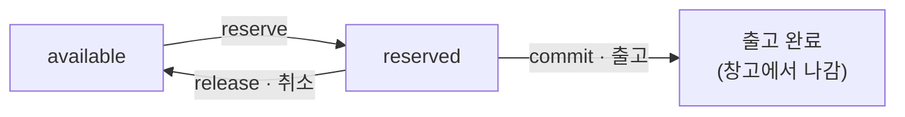

# 03 — 동시성: 초과 예약 0건 만들기

> 재고 1개에 주문 2건이 동시에 들어오는 상황은 예외가 아니다. **트래픽이 있다면 매일 일어난다.**

**대상 코드**: `stage3/InventoryService.java`
**완료 기준**: `./gradlew s3` 초록 + 재고 10개에 50스레드 → 정확히 10건 성공

---

## 1. 문제 — check-then-act

```
스레드 A: available(1) >= 1 ?  → true
스레드 B: available(1) >= 1 ?  → true      ← A가 아직 차감하기 전
스레드 A: available = 0
스레드 B: available = -1                    ← 초과 판매
```

"확인" 과 "변경" 사이에 틈이 있으면 반드시 뚫린다. 이 틈은 코드 두 줄 사이의 나노초지만, 초당 수백 요청이면 매일 걸린다.

> ⚠️ **직접 보고 넘어가라.** 락 없는 구현으로 동시성 테스트를 먼저 돌려라. `successCount = 13` 같은 숫자를 눈으로 봐야 이 문제가 자기 것이 된다. 이론으로만 알면 면접에서도 이론으로만 말하게 된다.

---

## 2. 왜 available / reserved 를 나누는가

재고를 숫자 하나로 두면 반드시 둘 중 하나가 된다:

| 방식 | 문제 |
|---|---|
| 주문 시 바로 차감 | 취소·결제실패 때 복구를 빠뜨리면 **팔 수 있는 재고가 증발**한다 |
| 출고 시에만 차감 | 주문~출고 사이에 **초과 판매**가 난다 |

그래서 둘로 나눈다.

```
available   지금 새 주문이 잡을 수 있는 수량
reserved    잡혀 있지만 아직 안 나간 수량
onHand      = available + reserved   (물리적으로 창고에 있는 수량)
```



**`onHand = available + reserved` 는 어떤 연산 뒤에도 깨지면 안 되는 불변식**이다. 테스트마다 이걸 확인하는 습관이 재고 버그의 90%를 잡는다.

> 💡 이 구조는 재고에만 있는 게 아니다. 좌석 예약, 쿠폰 발급, 크레딧 차감 전부 같은 모양이다 — **"확정 전에 잡아두는 자원"** 은 전부 이 패턴을 쓴다.

---

## 3. 락을 좁혀가는 3단계

**1→2→3 을 실제로 밟아라.** 3부터 짜면 왜 필요한지 설명할 수 없다.

### 1단계 — 락 없음 (깨지는 걸 본다)
```java
if (stock.available >= qty) { stock.available -= qty; ... }
```
동시성 테스트 실패. **이 실패를 관찰하는 게 목적이다.**

### 2단계 — 전역 락 (통과한다, 그리고 느리다)
```java
public synchronized boolean reserve(...) { ... }
```
정확하다. 하지만 SKU 10만 개가 락 하나를 두고 줄을 선다. 서로 상관없는 상품끼리 서로를 기다린다.

### 3단계 — 키 단위 락
```java
stocks.compute(sku, (k, cur) -> { ... });   // ConcurrentHashMap
```
같은 SKU 끼리만 직렬화된다. 다른 SKU 는 병렬로 흐른다.

> ⚠️ **함정**: `compute` 의 함수 안에서 **다른 SKU 를 건드리면 데드락 위험**이다. 여러 SKU 를 한 번에 예약해야 하면(주문 1건에 상품 3개) 이 방식으로는 안 된다 — 그때는 **SKU 를 정렬해서 순서대로 락을 잡는다.** 락 획득 순서를 전역으로 통일하는 것이 데드락 예방의 정석.

---

## 4. 그래서 실제 DB에서는?

메모리 락은 서버 1대에서만 유효하다. 실서비스는 DB가 진실의 원천이다.

### 방법 1 — 조건부 UPDATE (가장 권장)
```sql
UPDATE stock
   SET available = available - :qty,
       reserved  = reserved  + :qty
 WHERE sku = :sku
   AND available >= :qty;
```
영향 행 수가 `1` 이면 성공, `0` 이면 재고 부족.

- 락을 명시적으로 잡지 않는다 (UPDATE 가 행 락을 알아서 잡고 즉시 놓는다)
- **check 와 act 가 한 문장** → 틈이 없다
- DB 왕복 1회

> ✗→✓ **오해**: "동시성 = 락" → **정정**: 조건을 UPDATE 문 안으로 밀어넣으면 락을 직접 다루지 않고도 원자성이 나온다. **원자적 연산 하나가 락 두 줄보다 낫다.**

### 방법 2 — 비관적 락
```sql
SELECT * FROM stock WHERE sku = ? FOR UPDATE;
```
읽고 계산하고 쓰는 로직이 복잡할 때. 락 유지 시간 = 트랜잭션 길이라, **그 안에서 외부 API 를 호출하면 최악**이다.

### 방법 3 — 낙관적 락
```sql
UPDATE stock SET available = ?, version = version + 1
 WHERE sku = ? AND version = ?;
```
충돌이 드물 때 유리. 인기 상품처럼 **경합이 심한 행에서는 재시도만 반복**하다 오히려 느려진다.

| 상황 | 선택 |
|---|---|
| 단순 증감 | **조건부 UPDATE** |
| 복잡한 계산 후 쓰기, 경합 높음 | 비관적 락 |
| 경합 낮음, 재시도 저렴 | 낙관적 락 |
| 초당 수천 건 몰리는 핫 상품 | 재고를 N개로 쪼개기(분산 카운터) 또는 큐로 직렬화 |

---

## 5. 확장 질문

### Q1. 주문 1건에 상품 3개면, 하나만 재고가 없으면?

<details><summary>답</summary>

**전부 성공하거나 전부 실패해야 한다** (all-or-nothing). 부분 예약을 남기면 그 재고는 누구도 쓸 수 없는 좀비가 된다.

한 트랜잭션에서 세 SKU 를 UPDATE 하고, 하나라도 영향 행 0이면 롤백.

여기서 데드락이 나온다: 주문 A는 `SKU-1 → SKU-2` 순, 주문 B는 `SKU-2 → SKU-1` 순으로 잡으면 서로를 기다린다.
**해법: SKU 를 항상 같은 기준(사전순 등)으로 정렬해서 잡는다.** 락 순서 전역 통일.
</details>

### Q2. 예약만 하고 결제를 안 하면 재고가 영원히 묶이지 않나?

<details><summary>답</summary>

묶인다. 그래서 **예약에 만료 시각**을 둔다.

```
reservation: sku, order_id, quantity, expires_at
```

배치가 주기적으로 만료된 예약을 찾아 `release` 한다. 설계 포인트 세 개:

1. **만료 배치와 정상 결제가 동시에 일어나면?** — 결제 처리 시 예약 상태를 조건부로 확인해야 한다. `WHERE status = 'RESERVED' AND expires_at > now()`
2. **만료 시간은?** — 결제 페이지 이탈률을 보고 정한다. 짧으면 정상 사용자가 실패하고, 길면 재고 회전이 죽는다
3. **배치가 안 돌면?** — 조회 시점에 만료를 판정하는 lazy expiration 을 함께 두면 배치 지연에 강해진다
</details>

### Q3. SKU 단위 락이 왜 전역 락보다 나은지, 테스트로 증명할 수 있나?

<details><summary>답</summary>

**단위 테스트로는 사실상 증명 못 한다.** 둘 다 정확성 테스트는 통과한다. 차이는 처리량이고, 그건 부하 테스트의 영역이다.

그래서 이 질문의 진짜 의도는 "측정 없이 성능을 주장하지 않는가" 다. 이렇게 답한다:

> "정확성은 둘 다 같습니다. 차이는 처리량인데 단위 테스트로는 안 보입니다. 실제로 확인하려면 SKU 를 N개로 늘리고 동시 요청을 넣어 초당 처리 건수를 비교해야 하고, 그건 부하 테스트에서 할 일입니다. 다만 전역 락은 무관한 SKU 끼리 직렬화된다는 구조적 사실이 명확하니, 기본값은 키 단위로 두겠습니다."

> 💡 **측정하지 않은 성능 개선을 단정하지 않는 것** 자체가 신호다.
</details>

### Q4. 재고가 음수가 되는 버그를 나중에 발견하면?

<details><summary>답</summary>

세 겹으로 막는다.

1. **DB 제약**: `CHECK (available >= 0 AND reserved >= 0)` — 마지막 방어선. 애플리케이션 버그가 있어도 데이터는 지킨다
2. **불변식 검증 배치**: 주기적으로 `onHand` 와 실제 창고 실사 수량을 대사(reconciliation). 어긋나면 알람
3. **이력 테이블**: 모든 재고 변동을 append-only 로 기록. 음수가 발견되면 **어느 연산부터 어긋났는지 역추적**할 수 있다

3번이 없으면 "왜 음수가 됐는지" 를 영원히 모른다. 현재 값만 저장하는 설계의 대가가 여기서 나온다.
</details>

---

## 6. 자가 점검

- [ ] 락 없는 구현이 깨지는 걸 **직접 봤다**
- [ ] 1→2→3 단계를 실제로 밟았다
- [ ] 모든 테스트에서 `onHand` 불변식을 확인한다
- [ ] 재고 부족을 예외가 아닌 반환값으로 처리한 이유를 말할 수 있다
- [ ] 조건부 UPDATE 를 SQL 로 쓸 수 있다
- [ ] 다중 SKU 예약의 데드락과 해법(락 순서 통일)을 안다
- [ ] 예약 만료 설계를 설명할 수 있다

---

**이전** ← [02 — 멱등성](02-idempotency.md) · **다음** → [04 — 이벤트 순서와 중복](04-event-ordering.md)
